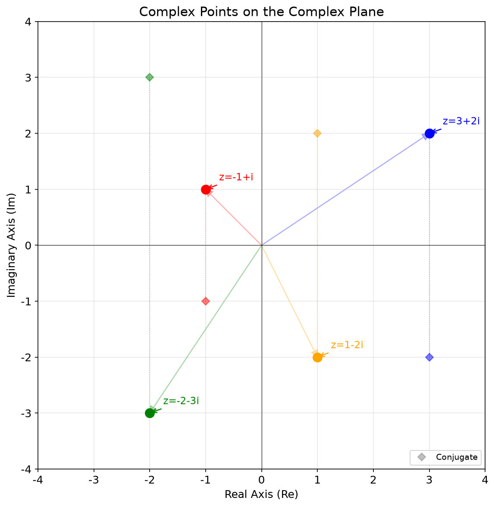
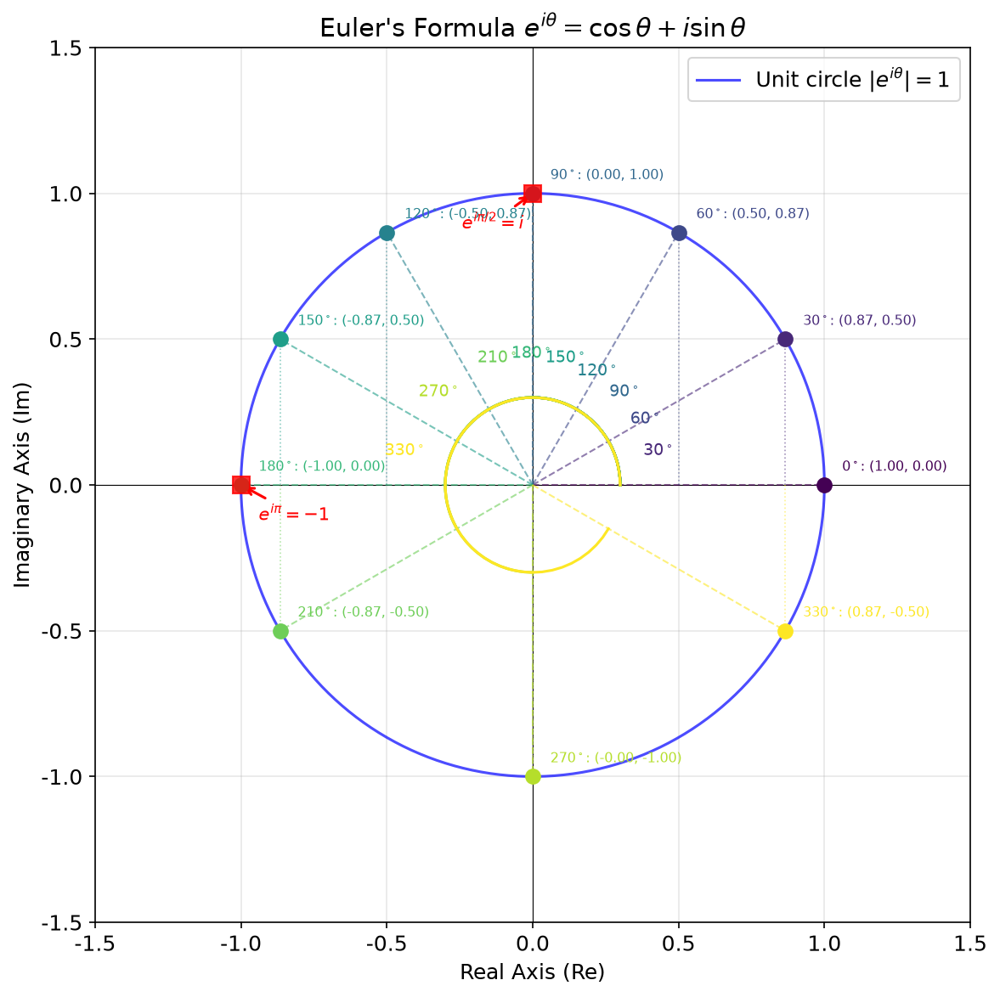
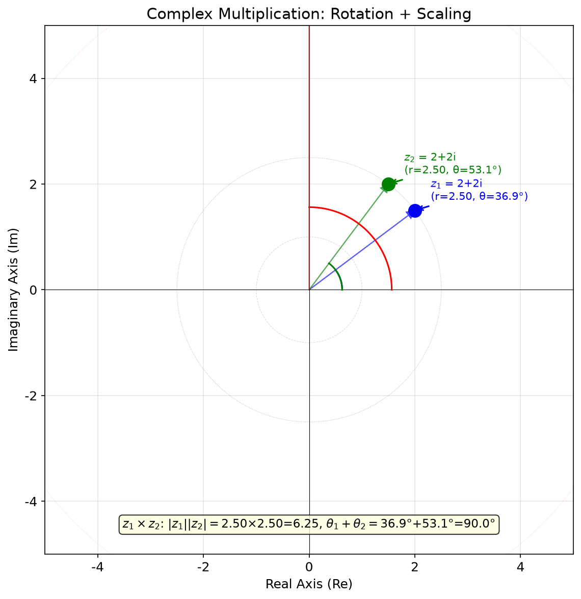
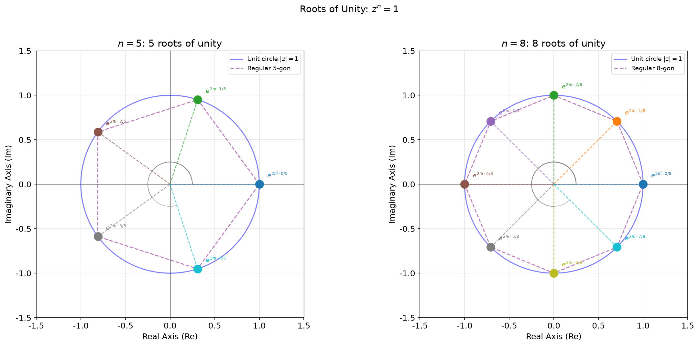
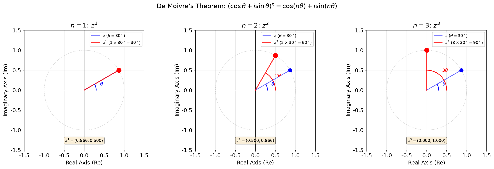
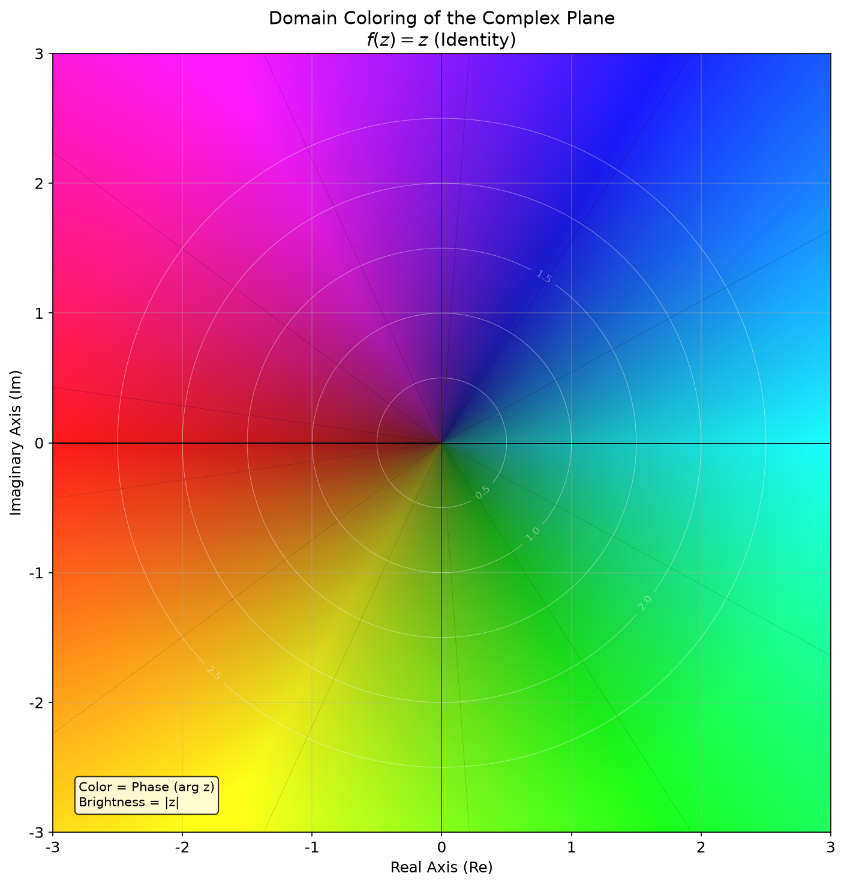
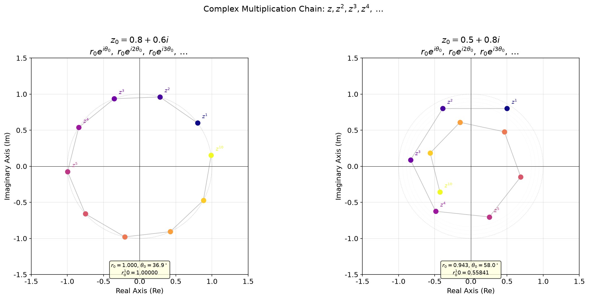
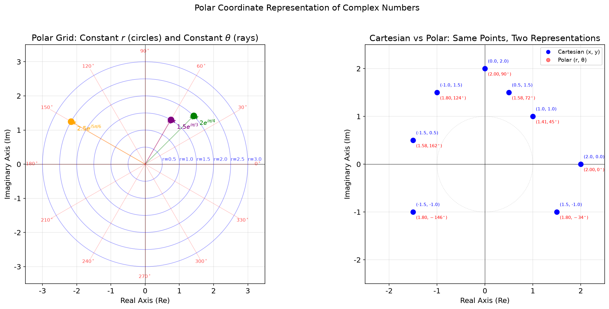

# 第1章 复数与复平面 - Python可视化

## 概述

本章提供8个可视化，帮助建立对复数、其几何表示及关键定理的直觉。每个可视化设计为按顺序学习——后面的概念建立在前面的基础上。所有代码均在 `visualization.py` 中。

---

## 可视化1：复平面上的复数点

### 目的与原理
一个复数 $z = x + yi$ 被表示为复平面上的一个点 $(x, y)$。水平轴（Re）表示实部，垂直轴（Im）表示虚部。本可视化绘制了几个复数及其共轭，建立了基本的几何直觉。

### 核心代码
```python
def viz1_complex_points():
    """Visualization 1: Complex points on the complex plane (enhanced)"""
    fig, ax = plt.subplots(figsize=(8, 8))
    setup_axes(ax, 'Complex Points on the Complex Plane', 'Real Axis (Re)', 'Imaginary Axis (Im)')

    # Define complex points with their conjugates
    points = [
        (3+2j, 'z=3+2i', 'blue'),
        (-1+1j, 'z=-1+i', 'red'),
        (-2-3j, 'z=-2-3i', 'green'),
        (1-2j, 'z=1-2i', 'orange'),
    ]

    for z, label, color in points:
        ax.plot(z.real, z.imag, 'o', color=color, markersize=10, zorder=5)
        ax.annotate(label, (z.real, z.imag),
                     textcoords="offset points",
                     xytext=(15, 10), fontsize=11, color=color,
                     arrowprops=dict(arrowstyle='->', color=color, lw=1.2))
        # Draw vector from origin
        ax.arrow(0, 0, z.real, z.imag, head_width=0.12, head_length=0.12,
                 fc=color, ec=color, alpha=0.3, length_includes_head=True)
        # Draw conjugate
        conj = z.conjugate()
        ax.plot(conj.real, conj.imag, 'D', color=color, markersize=6, alpha=0.5, zorder=4)
        ax.plot([z.real, conj.real], [z.imag, conj.imag], ':', color=color, lw=0.8, alpha=0.4)

    # Add legend for conjugate
    ax.plot([], [], 'D', color='gray', markersize=6, alpha=0.5, label='Conjugate')
    ax.legend(loc='lower right', fontsize=9)

    ax.set_xlim(-4, 4)
    ax.set_ylim(-4, 4)
```

### 图片


### 详细图像分析

#### 1. 整体概览
该图展示了四个分布在复平面四个象限的复数点。每个点用大彩色圆圈标记，标有其复数表示，并通过半透明箭头连接到原点。此外，每个点的共轭用菱形形状显示，并通过垂直虚线连接。

#### 2. 逐个元素分析

- **四个象限**：观察复平面被实轴（水平黑线）和虚轴（垂直黑线）划分为四个象限。每个象限恰有一个点：
  - **第一象限（右上）**：蓝色点 $z = 3 + 2i$，实部和虚部均为正。
  - **第二象限（左上）**：红色点 $z = -1 + i$，实部为负，虚部为正。
  - **第三象限（左下）**：绿色点 $z = -2 - 3i$，实部和虚部均为负。
  - **第四象限（右下）**：橙色点 $z = 1 - 2i$，实部为正，虚部为负。

- **从原点出发的向量**：每个点都有一条从 $(0,0)$ 指向该点的淡箭头。这强调了一个复数可以看作二维平面上的一个向量。该箭头的长度为模 $|z| = \sqrt{x^2 + y^2}$。

- **共轭菱形**：对于每个点，一个较小的菱形标记其共轭 $\bar{z} = x - yi$。注意规律：
  - $3+2i$ 的共轭为 $3-2i$（关于实轴对称）
  - $-1+i$ 的共轭为 $-1-i$
  - $-2-3i$ 的共轭为 $-2+3i$
  - $1-2i$ 的共轭为 $1+2i$

- **虚线连接线**：垂直虚线将每个点与其共轭连接起来。这直观地展示了共轭是关于实轴的反射。

#### 3. 关键观察点

- **观察1**：四个点分布在所有四个象限中。这表明复数可以具有实部和虚部的任意正负组合。

- **观察2**：比较一个点与其共轭的位置。例如，观察蓝色点 $(3, 2)$ 与其菱形共轭 $(3, -2)$。它们是关于水平（实）轴的镜像。这就是复共轭的几何意义。

- **观察3**：从原点到每个点的箭头长度和方向各不相同。长度（模）表示复数的"大小"，而方向（辐角）表示其"相位"。

#### 4. 数学原理对应
每个复数 $z = x + yi$ 唯一对应复平面上的一个点 $(x, y)$。这就是**阿甘图**表示。共轭 $\bar{z} = x - yi$ 是关于实轴的反射。

$$z = x + yi \quad \longleftrightarrow \quad (x, y)$$

#### 5. 结论与延伸
本可视化建立了复数的基本"几何词汇"。在后续的可视化中，我们将看到加法（向量加法）、乘法（旋转+缩放）和幂运算等操作如何在该平面中具有清晰的几何解释。尝试在脑海中绘制 $z = 4 - 3i$——它在哪个象限？它的共轭呢？

---

## 可视化2：欧拉公式 $e^{i\theta} = \cos\theta + i\sin\theta$

### 目的与原理
欧拉公式是复分析的基石。它将指数函数与三角函数联系起来，表明单位圆上的点对应于 $e^{i\theta}$。本可视化标记了单位圆上的10个角度，展示了它们的坐标及 $\theta$、$\cos\theta$ 和 $\sin\theta$ 之间的关系。

### 核心代码
```python
def viz2_euler_formula():
    """Visualization 2: Euler's formula e^{iθ} = cosθ + i sinθ (enhanced)"""
    fig, ax = plt.subplots(figsize=(8, 8))
    setup_axes(ax, r"Euler's Formula $e^{i\theta} = \cos\theta + i\sin\theta$",
               'Real Axis (Re)', 'Imaginary Axis (Im)')

    # Draw unit circle
    theta = np.linspace(0, 2*np.pi, 400)
    ax.plot(np.cos(theta), np.sin(theta), 'b-', lw=1.5, alpha=0.7, label='Unit circle $|e^{i\\theta}|=1$')

    # Mark angles
    angles_deg = [0, 30, 60, 90, 120, 150, 180, 210, 270, 330]
    colors = plt.cm.viridis(np.linspace(0, 1, len(angles_deg)))

    for i, deg in enumerate(angles_deg):
        rad = np.deg2rad(deg)
        x = np.cos(rad)
        y = np.sin(rad)
        ax.plot(x, y, 'o', color=colors[i], markersize=8, zorder=5)
        ax.plot([0, x], [0, y], '--', color=colors[i], lw=1, alpha=0.6)
        # Vertical dashed line to real axis
        ax.plot([x, x], [0, y], ':', color=colors[i], lw=0.8, alpha=0.5)

        label = rf'${deg}^\circ$: ({x:.2f}, {y:.2f})'
        ax.annotate(label, (x, y),
                     textcoords="offset points",
                     xytext=(10, 8), fontsize=7.5, color=colors[i])

        # Draw angle arc
        if deg > 0:
            arc_theta = np.linspace(0, rad, 50)
            arc_r = 0.3
            ax.plot(arc_r * np.cos(arc_theta), arc_r * np.sin(arc_theta),
                    color=colors[i], lw=1.5)
            mid_angle = rad / 2
            ax.text(0.45 * np.cos(mid_angle), 0.45 * np.sin(mid_angle),
                    rf'${deg}^\circ$', fontsize=9, color=colors[i],
                    ha='center', va='center')

    # Highlight special points
    ax.plot(0, 1, 's', color='red', markersize=10, zorder=6, alpha=0.8)
    ax.annotate(r'$e^{i\pi/2}=i$', (0, 1), textcoords="offset points",
                xytext=(-40, -20), fontsize=10, color='red',
                arrowprops=dict(arrowstyle='->', color='red', lw=1.5))
    ax.plot(-1, 0, 's', color='red', markersize=10, zorder=6, alpha=0.8)
    ax.annotate(r'$e^{i\pi}=-1$', (-1, 0), textcoords="offset points",
                xytext=(10, -20), fontsize=10, color='red',
                arrowprops=dict(arrowstyle='->', color='red', lw=1.5))
```

### 图片


### 详细图像分析

#### 1. 整体概览
该图显示了单位圆（蓝色实线），上面标记了10个不同角度的点，每个点具有来自viridis颜色映射的独特颜色。从每个点出发，一条虚线连接回原点，一条垂直虚线延伸到实轴。红色方块突出显示了两个最重要的点：$e^{i\pi/2} = i$ 和 $e^{i\pi} = -1$。

#### 2. 逐个元素分析

- **单位圆**：蓝色圆半径为1，中心在原点。该圆上的每个点满足 $|z| = 1$，即对任意 $\theta$ 有 $|e^{i\theta}| = 1$。

- **10个彩色点**：从最右边的点（$0^\circ$，黄色）开始逆时针移动，颜色依次过渡到绿色、蓝色、紫色，最后在 $270^\circ$ 处为红色。每个点的标签显示其角度和坐标。

- **虚线径向线**：每个点通过一条同色虚线连接到原点。这条线表示向量 $e^{i\theta}$。其长度始终为1（因为它到达单位圆）。

- **垂直虚线**：从每个点出发，一条垂直虚线延伸到实轴。它与实轴的交点恰好是 $\cos\theta$（x坐标）。虚线的高度是 $\sin\theta$（y坐标）。

- **角度弧**：原点附近的小彩色弧显示了每个点的角度 $\theta$。角度标签放置在每条弧的中点。

- **红色方块**：两个特殊点被突出显示：
  - $(0, 1)$ 标记为 $e^{i\pi/2} = i$：这是 $90^\circ$ 处的点，纯虚数。
  - $(-1, 0)$ 标记为 $e^{i\pi} = -1$：这是 $180^\circ$ 处的点，纯实数且为负。这给出了著名的恒等式 $e^{i\pi} + 1 = 0$。

#### 3. 关键观察点

- **观察1**：观察 $0^\circ$ 处的点（黄色，最右边）。其坐标为 $(1, 0)$，所以 $e^{i\cdot0} = 1$。这很有道理，因为 $\cos 0 = 1$ 且 $\sin 0 = 0$。

- **观察2**：再看 $90^\circ$ 处的点（绿色，最上边）。其坐标为 $(0, 1)$，所以 $e^{i\pi/2} = i$。这里的垂直虚线与虚轴重合。

- **观察3**：比较 $30^\circ$ 和 $330^\circ$ 处的点。它们有相同的 x 坐标（$\cos 30^\circ = \cos 330^\circ \approx 0.87$）但相反的 y 坐标（$\sin 30^\circ = 0.5$，$\sin 330^\circ = -0.5$）。这表明 $\cos$ 是偶函数，$\sin$ 是奇函数。

- **观察4**：$180^\circ$ 处的点（紫色，最左边）在 $(-1, 0)$。垂直虚线高度为零，确认了 $\sin 180^\circ = 0$。

#### 4. 数学原理对应
欧拉公式指出：
$$e^{i\theta} = \cos\theta + i\sin\theta$$

这意味着：
- 实部 $\text{Re}(e^{i\theta}) = \cos\theta$ 是单位圆上的 x 坐标
- 虚部 $\text{Im}(e^{i\theta}) = \sin\theta$ 是单位圆上的 y 坐标
- 模 $|e^{i\theta}| = \sqrt{\cos^2\theta + \sin^2\theta} = 1$

#### 5. 结论与延伸
欧拉公式优美地统一了三角学和复指数。单位圆上的每个点都可以写为 $e^{i\theta}$（对于某个 $\theta$）。这是理解复数乘法（变为简单的角度加法）和复数极坐标表示的基础。试问：$e^{i\pi/4}$ 是什么？它的坐标是多少？

---

## 可视化3：复数乘法 = 旋转 + 缩放

### 目的与原理
当两个复数相乘时，它们的模相乘，辐角相加。这是关于复数最重要的几何见解。本可视化展示了 $z_1$、$z_2$ 及其乘积 $z_1 \times z_2$，并标注了所有相关量。

### 核心代码
```python
def viz3_complex_multiplication():
    """Visualization 3: Complex multiplication = rotation + scaling (enhanced)"""
    fig, ax = plt.subplots(figsize=(8, 8))
    setup_axes(ax, 'Complex Multiplication: Rotation + Scaling', 'Real Axis (Re)', 'Imaginary Axis (Im)')

    # Define two complex numbers
    z1 = 2 + 1.5j      # modulus ≈ 2.5, angle ≈ 36.87°
    z2 = 1.5 + 2j      # modulus ≈ 2.5, angle ≈ 53.13°
    z3 = z1 * z2       # product: moduli multiply, angles add

    # Compute modulus and angle
    r1, theta1 = abs(z1), np.angle(z1)
    r2, theta2 = abs(z2), np.angle(z2)
    r3, theta3 = abs(z3), np.angle(z3)

    # Draw unit circle reference
    theta_ref = np.linspace(0, 2*np.pi, 400)
    ax.plot(np.cos(theta_ref), np.sin(theta_ref), 'gray', lw=0.5, alpha=0.3, linestyle='--')

    # Draw circles at radii r1, r2, r3
    for r, c, ls in [(r1, 'blue', ':'), (r2, 'green', ':'), (r3, 'red', ':')]:
        ax.plot(r * np.cos(theta_ref), r * np.sin(theta_ref), color=c, lw=0.5, alpha=0.2, linestyle=ls)

    # Draw three points
    points_data = [
        (z1, f'$z_1$ = {z1.real:.0f}+{z1.imag:.0f}i\n(r={r1:.2f}, θ={np.rad2deg(theta1):.1f}°)', 'blue'),
        (z2, f'$z_2$ = {z2.real:.0f}+{z2.imag:.0f}i\n(r={r2:.2f}, θ={np.rad2deg(theta2):.1f}°)', 'green'),
        (z3, f'$z_1 \\times z_2$ = {z3.real:.1f}+{z3.imag:.1f}i\n(r={r3:.2f}, θ={np.rad2deg(theta3):.1f}°)', 'red'),
    ]

    for z, label, color in points_data:
        ax.plot(z.real, z.imag, 'o', color=color, markersize=12, zorder=5)
        ax.annotate(label, (z.real, z.imag),
                     textcoords="offset points",
                     xytext=(15, 10), fontsize=10, color=color,
                     arrowprops=dict(arrowstyle='->', color=color, lw=1.5))

    # Draw vectors from origin to each point
    for z, _, color in points_data:
        ax.arrow(0, 0, z.real, z.imag, head_width=0.15, head_length=0.15,
                 fc=color, ec=color, alpha=0.6, length_includes_head=True)

    # Add annotation explaining the geometric meaning
    ax.text(0, -4.5, 
            r'$z_1 \times z_2$: $|z_1||z_2| = $' + f'{r1:.2f}×{r2:.2f}={r3:.2f}' +
            r', $\theta_1+\theta_2 = $' + f'{np.rad2deg(theta1):.1f}°+{np.rad2deg(theta2):.1f}°={np.rad2deg(theta3):.1f}°',
            ha='center', fontsize=11,
            bbox=dict(boxstyle='round', facecolor='lightyellow', alpha=0.8))
```

### 图片


### 详细图像分析

#### 1. 整体概览
该图展示了三个复数：$z_1$（蓝色）、$z_2$（绿色）及其乘积 $z_3 = z_1 \times z_2$（红色）。每个都绘制为一个大圆圈，并带有从原点出发的箭头。半径为 $r_1$、$r_2$ 和 $r_3$ 的虚线圆隐约可见。灰色虚线单位圆作为参考。底部的摘要框确认了数值关系。

#### 2. 逐个元素分析

- **三个向量**：
  - 蓝色箭头指向第一象限的 $z_1 = 2 + 1.5i$。其标签显示 $r \approx 2.50$ 和 $\theta \approx 36.87^\circ$。
  - 绿色箭头指向第一象限的 $z_2 = 1.5 + 2i$。其标签显示 $r \approx 2.50$ 和 $\theta \approx 53.13^\circ$。
  - 红色箭头指向 $z_3 = z_1 \times z_2$，大约在 $(0.75, 6.20)$，非常接近正虚轴。其标签显示 $r \approx 6.25$ 和 $\theta \approx 90^\circ$。

- **虚线模圆**：半径为 $r_1$、$r_2$ 和 $r_3$ 的淡虚线圆帮助可视化模的大小。红色圆远大于蓝色和绿色的圆。

- **角度弧**：原点处的小弧显示每个向量的角度。蓝色弧标记 $\theta_1 \approx 36.87^\circ$，绿色弧标记 $\theta_2 \approx 53.13^\circ$，红色弧标记 $\theta_3 \approx 90^\circ$。

- **摘要框**：底部的注释确认了：$|z_1||z_2| = 2.50 \times 2.50 = 6.25 = |z_3|$，且 $\theta_1 + \theta_2 = 36.87^\circ + 53.13^\circ = 90^\circ = \theta_3$。

#### 3. 关键观察点

- **观察1**：观察模。$z_1$ 和 $z_2$ 的模都约为 $2.5$。它们的乘积 $z_3$ 的模约为 $6.25$。注意 $2.5 \times 2.5 = 6.25$。这就是复数乘法的"缩放"部分。

- **观察2**：再看角度。$\theta_1 \approx 36.87^\circ$ 且 $\theta_2 \approx 53.13^\circ$。它们的和为 $90^\circ$，恰好是 $\theta_3$。乘积最终落在正虚轴上！这就是"旋转"部分。

- **观察3**：比较位置。$z_1$ 在 $(2, 1.5)$，$z_2$ 在 $(1.5, 2)$。乘积 $z_3$ 大约在 $(0.75, 6.20)$。乘积不是"两者之间的某个位置"——它是一个由复数乘法规则决定的全新点。

#### 4. 数学原理对应
在极坐标形式下：
$$z_1 = r_1 e^{i\theta_1}, \quad z_2 = r_2 e^{i\theta_2}$$
$$z_1 \times z_2 = (r_1 r_2) e^{i(\theta_1 + \theta_2)}$$

关键见解是：**复数乘法同时进行缩放和旋转**。

#### 5. 结论与延伸
复数乘法与实数乘法有根本不同。实数乘法只进行缩放（如 $2 \times 3 = 6$），而复数乘法同时进行缩放和旋转。这种双重性质使复数在物理学、工程学和信号处理中描述旋转时极为强大。尝试：如果 $z_1 = i$（旋转 $90^\circ$）且 $z_2 = 2 + 3i$，会发生什么？几何效果是什么？

---

## 可视化4：单位根

### 目的与原理
方程 $z^n = 1$ 恰好有 $n$ 个解，称为 $n$ 次单位根。它们均匀分布在单位圆上，角度为 $2\pi k / n$，其中 $k = 0, 1, ..., n-1$。本可视化并排展示了 $n=5$ 和 $n=8$ 两种情况，揭示了其优美的对称性。

### 核心代码
```python
def viz4_unit_roots():
    """Visualization 4: Roots of unity (z^n = 1, n=5, n=8) (enhanced)"""
    fig, axes = plt.subplots(1, 2, figsize=(16, 7))
    fig.suptitle(r'Roots of Unity: $z^n = 1$', fontsize=14, y=1.02)

    for idx, n in enumerate([5, 8]):
        ax = axes[idx]
        setup_axes(ax, rf'$n={n}$: ${n}$ roots of unity', 'Real Axis (Re)', 'Imaginary Axis (Im)')

        # Compute n-th roots of unity
        roots = [np.exp(2j * np.pi * k / n) for k in range(n)]

        # Draw unit circle
        theta = np.linspace(0, 2*np.pi, 400)
        ax.plot(np.cos(theta), np.sin(theta), 'b-', lw=1.5, alpha=0.5, label='Unit circle $|z|=1$')

        # Draw roots
        colors = plt.cm.tab10(np.linspace(0, 1, n))
        for k, (z, color) in enumerate(zip(roots, colors)):
            ax.plot(z.real, z.imag, 'o', color=color, markersize=12, zorder=5)
            # Line from origin
            ax.plot([0, z.real], [0, z.imag], '--', color=color, lw=1.2, alpha=0.7)
            # Label
            label = rf'$e^{{2\pi i \cdot {k}/{n}}}$'
            ax.annotate(label, (z.real, z.imag),
                         textcoords="offset points",
                         xytext=(12, 10), fontsize=9, color=color)

        # Draw regular polygon connecting roots
        root_pts = [(z.real, z.imag) for z in roots]
        root_pts.append(root_pts[0])
        xs, ys = zip(*root_pts)
        ax.plot(xs, ys, 'purple', lw=1.5, alpha=0.5, linestyle='--',
                label=f'Regular {n}-gon')
```

### 图片


### 详细图像分析

#### 1. 整体概览
两个子图分别展示了5次和8次单位根。每个子图包含一个蓝色单位圆、标记每个根的彩色点、从原点到每个根的虚线，以及连接连续根的紫色虚线多边形。

#### 2. 逐个元素分析

- **左子图（$n=5$）**：
  - 5个根均匀分布在单位圆上，位于 $0^\circ, 72^\circ, 144^\circ, 216^\circ, 288^\circ$。
  - 连接它们的紫色虚线形成一个正五边形。
  - 每个根都标有其指数形式 $e^{2\pi i k/5}$。

- **右子图（$n=8$）**：
  - 8个根位于 $0^\circ, 45^\circ, 90^\circ, 135^\circ, 180^\circ, 225^\circ, 270^\circ, 315^\circ$。
  - 连接线形成一个正八边形。
  - 标签显示 $e^{2\pi i k/8}$。

- **灰色角度弧**：原点处的小弧显示了连续根之间的等角度间距。

#### 3. 关键观察点

- **观察1**：在两个子图中，根都完美均匀地分布在圆上。对于 $n=5$，相邻根之间的角度为 $360^\circ/5 = 72^\circ$。对于 $n=8$，为 $360^\circ/8 = 45^\circ$。

- **观察2**：总有一个根在 $z = 1$（正实轴上的点 $(1, 0)$），对应于 $k=0$。这很有道理，因为 $1^n = 1$ 对任意 $n$ 成立。

- **观察3**：比较两个子图。$n=5$ 的情况在 $z = -1$ 处没有根（因为 $(-1)^5 = -1 \neq 1$），而 $n=8$ 的情况在 $z = -1$ 处确实有根（因为 $(-1)^8 = 1$）。这是因为奇数次单位根不包含 $-1$，但偶数次单位根包含。

- **观察4**：所形成的多边形（五边形和八边形）都是正多边形，且关于实轴对称。这种对称性反映了如果 $z$ 是一个根，那么它的共轭 $\bar{z}$ 也是一个根。

#### 4. 数学原理对应
$n$ 次单位根由下式给出：
$$z_k = e^{2\pi i k/n} = \cos\left(\frac{2\pi k}{n}\right) + i\sin\left(\frac{2\pi k}{n}\right), \quad k = 0, 1, \ldots, n-1$$

它们满足 $z_k^n = 1$，并在乘法下构成一个循环群。

#### 5. 结论与延伸
单位根展示了代数（解方程）与几何（正多边形）之间的深层联系。它们在傅里叶分析、信号处理和数论中至关重要。尝试：$n=3$ 的根看起来是什么样？$n=12$ 呢？连接多边形是什么形状？

---

## 可视化5：棣莫弗定理

### 目的与原理
棣莫弗定理指出 $(\cos\theta + i\sin\theta)^n = \cos(n\theta) + i\sin(n\theta)$。本可视化取 $\theta = 30^\circ$，在单位圆上展示 $z$、$z^2$ 和 $z^3$，证明角度随 $n$ 倍增。

### 核心代码
```python
def viz5_demoivre_theorem():
    """Visualization 5: De Moivre's theorem (cosθ + i sinθ)^n = cos(nθ) + i sin(nθ) (enhanced)"""
    fig, axes = plt.subplots(1, 3, figsize=(16, 5))
    fig.suptitle(r"De Moivre's Theorem: $(\cos\theta + i\sin\theta)^n = \cos(n\theta) + i\sin(n\theta)$",
                 fontsize=14, y=1.02)

    theta = np.deg2rad(30)  # θ = 30°
    z = np.cos(theta) + 1j * np.sin(theta)  # Point on unit circle

    for idx, n in enumerate([1, 2, 3]):
        ax = axes[idx]
        setup_axes(ax, rf'$n={n}$: $z^{{{n}}}$', 'Real Axis (Re)', 'Imaginary Axis (Im)')

        # Draw unit circle
        t = np.linspace(0, 2*np.pi, 400)
        ax.plot(np.cos(t), np.sin(t), 'gray', lw=0.8, alpha=0.3, linestyle='--')

        # Compute z^n
        zn = z ** n
        theta_n = np.angle(zn)

        # Draw original point z
        ax.plot(z.real, z.imag, 'o', color='blue', markersize=8, zorder=5)
        ax.plot([0, z.real], [0, z.imag], 'b-', lw=1.5, alpha=0.6, label=rf'$z$ ($\theta=30^\circ$)')

        # Draw z^n
        ax.plot(zn.real, zn.imag, 'o', color='red', markersize=10, zorder=5)
        ax.plot([0, zn.real], [0, zn.imag], 'r-', lw=2, alpha=0.8,
                label=rf'$z^{{{n}}}$ (${n}\times30^\circ={n*30}^\circ$)')

        # Draw angle arc - original angle
        arc1 = np.linspace(0, theta, 50)
        r1 = 0.3
        ax.plot(r1 * np.cos(arc1), r1 * np.sin(arc1), 'b', lw=1.5)
        ax.text(0.45 * np.cos(theta/2), 0.45 * np.sin(theta/2),
                r'$\theta$', fontsize=10, color='blue', ha='center')

        # Draw angle arc - n times angle
        if n > 1:
            arc2 = np.linspace(0, theta_n, 50)
            r2 = 0.5
            ax.plot(r2 * np.cos(arc2), r2 * np.sin(arc2), 'r', lw=1.5)
            ax.text(0.65 * np.cos(theta_n/2), 0.65 * np.sin(theta_n/2),
                    rf'${n}\theta$', fontsize=10, color='red', ha='center')
```

### 图片


### 详细图像分析

#### 1. 整体概览
三个子图分别展示了 $z = e^{i\cdot 30^\circ}$ 的 $n=1$、$n=2$ 和 $n=3$ 次幂。每个子图包含一个单位圆（灰色虚线）、一个蓝色点/向量表示 $z$，以及一个红色点/向量表示 $z^n$。蓝色和红色弧分别标记角度 $\theta$ 和 $n\theta$。

#### 2. 逐个元素分析

- **子图 $n=1$**：
  - $30^\circ$ 处的蓝色点和红色点完全重合。这是平凡的：$z^1 = z$。
  - 蓝色弧标记 $\theta = 30^\circ$。
  - 标签确认 $z^1 = (0.866, 0.500)$。

- **子图 $n=2$**：
  - 蓝色点保持在 $30^\circ$（参考）。
  - 红色点在 $60^\circ$——恰好是角度的两倍。
  - 红色弧标记 $2\theta = 60^\circ$，明显大于蓝色的 $\theta$ 弧。
  - 标签确认 $z^2 = (0.500, 0.866)$。

- **子图 $n=3$**：
  - 蓝色点在 $30^\circ$。
  - 红色点在 $90^\circ$——恰好是角度的三倍。
  - 红色弧标记 $3\theta = 90^\circ$。
  - 标签确认 $z^3 = (0.000, 1.000)$，即 $i$。

#### 3. 关键观察点

- **观察1**：观察红色点随 $n$ 增加而移动。从 $n=1$ 到 $n=2$ 到 $n=3$，红色点每次逆时针旋转 $30^\circ$。$z^n$ 的角度始终是 $n \times 30^\circ$。

- **观察2**：在所有情况下，$z^n$ 的模保持为1（因为 $|z| = 1$，$|z^n| = 1^n = 1$）。所有点都留在单位圆上。

- **观察3**：在 $n=3$ 时，$z^3 = i$。这意味着 $(e^{i\pi/6})^3 = e^{i\pi/2} = i$。这是棣莫弗定理如何工作的具体例子：$(\cos 30^\circ + i\sin 30^\circ)^3 = \cos 90^\circ + i\sin 90^\circ = i$。

#### 4. 数学原理对应
棣莫弗定理：
$$(\cos\theta + i\sin\theta)^n = \cos(n\theta) + i\sin(n\theta)$$

用指数记号表示：$(e^{i\theta})^n = e^{i n\theta}$。

#### 5. 结论与延伸
棣莫弗定理表明，将复数求幂对应于将其辐角相乘。这是复数乘法加法性质的直接结果。尝试：$(\cos 30^\circ + i\sin 30^\circ)^6$ 是什么？红色点会在哪里？你能用这个定理推导出 $\cos 2\theta$ 和 $\sin 2\theta$ 的三角恒等式吗？

---

## 可视化6：复平面区域着色

### 目的与原理
区域着色是一种可视化复函数的强大技术。由于一个复数有两个分量（实部和虚部），我们使用颜色来编码两者：**色调**（颜色）表示 $z$ 的**相位/辐角**，**亮度**表示**模** $|z|$。本可视化使用区域着色展示了恒等函数 $f(z) = z$。

### 核心代码
```python
def viz6_domain_coloring():
    """Visualization 6: Domain coloring of complex plane (NEW)"""
    fig, ax = plt.subplots(figsize=(10, 10))
    setup_axes(ax, 'Domain Coloring of the Complex Plane\n$f(z)=z$ (Identity)',
               'Real Axis (Re)', 'Imaginary Axis (Im)')

    # Create a fine grid
    x = np.linspace(-3, 3, 600)
    y = np.linspace(-3, 3, 600)
    X, Y = np.meshgrid(x, y)
    Z = X + 1j * Y

    # Compute phase (argument) and modulus
    phase = np.angle(Z)  # range [-π, π]
    modulus = np.abs(Z)

    # HLS color mapping:
    # Hue = phase (maps to color wheel)
    # Lightness = normalized modulus (brightness)
    norm_mod = np.clip(modulus / 3.0, 0, 1)
    # Use log scale for better contrast
    norm_mod = np.log(1 + modulus) / np.log(1 + 3.0)

    # Convert phase [0, 2π) to hue [0, 1]
    hue = (phase + np.pi) / (2 * np.pi)

    # Create RGB image: bright colors for large modulus, dark for small
    saturation = np.ones_like(hue)
    brightness = 0.3 + 0.7 * norm_mod

    # Convert HSV to RGB
    import matplotlib.colors as mcolors
    hsv = np.stack([hue, saturation, brightness], axis=-1)
    rgb = mcolors.hsv_to_rgb(hsv)

    ax.imshow(rgb, extent=[-3, 3, -3, 3], origin='lower', alpha=0.9)

    # Add contour lines for modulus
    contour_levels = [0.5, 1.0, 1.5, 2.0, 2.5]
    cs = ax.contour(X, Y, modulus, levels=contour_levels, colors='white',
                    linewidths=0.5, alpha=0.4)
    ax.clabel(cs, inline=True, fontsize=8, fmt='%.1f', colors='white')

    # Add phase contour lines
    phase_contours = ax.contour(X, Y, phase, levels=12, colors='black',
                                 linewidths=0.3, alpha=0.3)
```

### 图片


### 详细图像分析

#### 1. 整体概览
这是一幅色彩丰富的复平面图像，两个轴的范围均为 $-3$ 到 $3$。每个点根据其复数值着色。颜色轮的排列方式一目了然：当你围绕原点移动时，颜色会循环变化。

#### 2. 逐个元素分析

- **颜色轮组织**：注意颜色如何围绕原点形成彩虹：
  - 沿正实轴（右侧，$\arg z = 0$）为红色/橙色
  - 右上象限为黄色/绿色
  - 沿正虚轴（上方，$\arg z = \pi/2$）为青色/蓝色
  - 左上象限为蓝色/紫色
  - 沿负实轴（左侧，$\arg z = \pi$）为紫色/品红
  - 左下和右下象限为品红/红色

- **亮度变化**：图像在中心（原点）附近较暗，向边缘逐渐变亮。这表示模：$|z|$ 在原点附近小，在远处大。

- **白色等高线**：这些是恒定模 $|z| = 0.5, 1.0, 1.5, 2.0, 2.5$ 的线。它们形成以原点为中心的同心圆，确认了 $|z|$ 仅取决于到原点的距离。

- **黑色等高线**：这些是恒定相位（辐角）的线。它们像轮辐一样从原点向外辐射。

#### 3. 关键观察点

- **观察1**：观察原点。它非常暗（几乎黑色）。这是因为 $|0| = 0$，亮度最小。原点是一个"分支点"，所有颜色在此交汇。

- **观察2**：围绕原点走一圈。注意颜色恰好完整地循环一次。这是因为当你绕一圈时，$\arg z$ 从 $-\pi$ 增加到 $\pi$，覆盖了所有可能的色调。

- **观察3**：观察正实轴（右侧，从0到3）。颜色始终为红色/橙色，亮度从暗到亮向右增加。这表明在正实轴上，$z$ 是正实数，$\arg z = 0$，$|z|$ 递增。

- **观察4**：比较白色等高线圆。它们是完美的圆形，确认了 $|z|$ 仅取决于到原点的距离，与角度无关。

#### 4. 数学原理对应
区域着色将复数 $z = re^{i\theta}$ 映射为一种颜色：
- 色调 $\propto \theta$（辐角决定颜色）
- 亮度 $\propto r$（模决定亮度）

这使得我们可以在单幅图像中可视化整个复平面，同时编码幅值和相位信息。

#### 5. 结论与延伸
区域着色是理解复函数的宝贵工具。在第2章中，我们将使用区域着色来可视化 $f(z) = z^2$、$z^3$ 和 $1/z$，颜色将揭示这些函数如何扭曲复平面。尝试：$f(z) = z^2$ 的区域着色看起来会是什么样？颜色会如何变化？

---

## 可视化7：复数乘法链

### 目的与原理
当你反复将一个复数与其自身相乘时会发生什么？这会产生一个序列 $z, z^2, z^3, z^4, \ldots$，其行为关键取决于 $z$ 的模。本可视化展示了两种情况：$z_0 = 0.8 + 0.6i$（模 $= 1$）和 $z_0 = 0.5 + 0.8i$（模 $< 1$）。

### 核心代码
```python
def viz7_multiplication_chain():
    """Visualization 7: Complex multiplication chain - z, z², z³, z⁴... (NEW)"""
    fig, axes = plt.subplots(1, 2, figsize=(16, 7))
    fig.suptitle(r'Complex Multiplication Chain: $z, z^2, z^3, z^4, \dots$',
                 fontsize=14, y=1.02)

    # Two different starting points
    z_starts = [0.8 + 0.6j, 0.5 + 0.8j]
    titles = [r'$z_0 = 0.8 + 0.6i$', r'$z_0 = 0.5 + 0.8i$']

    for idx, (z0, title) in enumerate(zip(z_starts, titles)):
        ax = axes[idx]
        setup_axes(ax, title + '\n' + r'$r_0 e^{i\theta_0},\; r_0 e^{i2\theta_0},\; r_0 e^{i3\theta_0}, \dots$',
                   'Real Axis (Re)', 'Imaginary Axis (Im)')

        # Draw unit circle reference
        theta = np.linspace(0, 2*np.pi, 400)
        ax.plot(np.cos(theta), np.sin(theta), 'gray', lw=0.5, alpha=0.3, linestyle='--')

        # Compute chain: z^1, z^2, z^3, ..., z^10
        n_max = 10
        r0 = abs(z0)
        theta0 = np.angle(z0)

        chain_points = []
        r_powers = []
        for n in range(1, n_max + 1):
            zn = z0 ** n
            chain_points.append(zn)
            r_powers.append(r0 ** n)

        # Color gradient from blue to red
        colors = plt.cm.plasma(np.linspace(0, 1, n_max))

        # Draw spiral trajectory
        traj_re = [z.real for z in chain_points]
        traj_im = [z.imag for z in chain_points]
        ax.plot(traj_re, traj_im, 'gray', lw=1, alpha=0.5, linestyle='-', marker='')

        # Draw each point
        for n, (zn, color) in enumerate(zip(chain_points, colors)):
            n_val = n + 1
            ax.plot(zn.real, zn.imag, 'o', color=color, markersize=8, zorder=5)
            if n_val <= 5 or n_val == n_max:
                ax.annotate(rf'$z^{{{n_val}}}$', (zn.real, zn.imag),
                            textcoords="offset points",
                            xytext=(8, 8), fontsize=9, color=color)
```

### 图片


### 详细图像分析

#### 1. 整体概览
两个子图展示了两个不同起始复数的前10次幂。灰色虚线单位圆提供参考。点从深蓝色（低次幂）经过紫色到黄色（高次幂）着色。灰色线连接轨迹。

#### 2. 逐个元素分析

- **左子图**（$z_0 = 0.8 + 0.6i$）：
  - 信息框显示 $r_0 = 1.000$，$\theta_0 \approx 36.87^\circ$。
  - 由于 $r_0 = 1$，所有点都停留在单位圆上。点围绕圆旋转：$z^1$ 在 $36.87^\circ$，$z^2$ 在 $73.74^\circ$，$z^3$ 在 $110.61^\circ$，等等。
  - 10步之后，$r_0^{10} = 1.00000$，所以 $z^{10}$ 仍在单位圆上。

- **右子图**（$z_0 = 0.5 + 0.8i$）：
  - 信息框显示 $r_0 \approx 0.943$，$\theta_0 \approx 57.99^\circ$。
  - 由于 $r_0 < 1$，点向原点螺旋靠近。$z^1$ 在圆外（实际上 $r_0 \approx 0.943$ 略小于1）。
  - 10步之后，$r_0^{10} \approx 0.556$，所以 $z^{10}$ 明显更靠近原点。

- **螺旋轨迹**：连接连续点的灰色线揭示了一个螺旋图案。在左子图中，螺旋保持在单位圆上。在右子图中，螺旋向内弯曲。

#### 3. 关键观察点

- **观察1**：比较两个子图。左图的 $r_0 = 1$（恰好落在单位圆上），所以所有幂次都保持在单位圆上，仅旋转。右图的 $r_0 < 1$，所以点向内螺旋。

- **观察2**：在左子图中，$z^{10} \approx z^0$（因为 $10 \times 36.87^\circ = 368.7^\circ \approx 360^\circ + 8.7^\circ$），所以乘法链几乎完成了一整圈旋转。

- **观察3**：从蓝色到红色的颜色渐变有助于追踪点的顺序。深蓝色是 $z^1$，浅蓝/青色是 $z^2$，绿色是 $z^3$，黄色是 $z^5$，红色是 $z^{10}$。

- **观察4**：如果 $r_0 > 1$ 会发生什么？点会向外螺旋，每次幂次都离原点更远。这是理解曼德博集合的关键！

#### 4. 数学原理对应
对于 $z_0 = re^{i\theta}$，$n$ 次幂为：
$$z_0^n = r^n e^{i n\theta}$$

行为分为三种情况：
- $r < 1$：$r^n \to 0$ 当 $n \to \infty$（向内螺旋）
- $r = 1$：$r^n = 1$ 始终成立（保持单位圆上，仅旋转）
- $r > 1$：$r^n \to \infty$ 当 $n \to \infty$（向外螺旋）

#### 5. 结论与延伸
乘法链揭示了复动力学的基本二分法：单位圆内的点被"吸引"到原点，单位圆上的点"轨道运行"，单位圆外的点"逃逸"到无穷远。这是曼德博集合和朱利亚集合的基础。尝试：如果 $z_0 = 0.9 + 0.4i$ 呢？计算 $r_0$ 并预测乘法链是向内还是向外螺旋。

---

## 可视化8：极坐标网格表示

### 目的与原理
复数可以用两种等价的方式表示：笛卡尔坐标 $(x, y)$ 和极坐标 $(r, \theta)$。极坐标形式 $z = r e^{i\theta}$ 对于乘法和幂运算通常更自然。本可视化展示了极坐标网格并比较了两种表示方式。

### 核心代码
```python
def viz8_polar_grid():
    """Visualization 8: Polar coordinate grid representation of complex numbers (NEW)"""
    fig, axes = plt.subplots(1, 2, figsize=(16, 7))
    fig.suptitle(r'Polar Coordinate Representation of Complex Numbers',
                 fontsize=14, y=1.02)

    # ---- Left: Polar grid in complex plane ----
    ax1 = axes[0]
    setup_axes(ax1, 'Polar Grid: Constant $r$ (circles) and Constant $\\theta$ (rays)',
               'Real Axis (Re)', 'Imaginary Axis (Im)')

    # Draw circles of constant radius
    radii = [0.5, 1.0, 1.5, 2.0, 2.5, 3.0]
    theta = np.linspace(0, 2*np.pi, 400)
    for r in radii:
        ax1.plot(r * np.cos(theta), r * np.sin(theta), 'b-', lw=0.8, alpha=0.4)
        ax1.text(r, 0.1, f'r={r}', fontsize=8, color='blue', alpha=0.7)

    # Draw rays of constant angle
    angles_deg = [0, 30, 60, 90, 120, 150, 180, 210, 240, 270, 300, 330]
    for deg in angles_deg:
        rad = np.deg2rad(deg)
        ray_len = 3.2
        ax1.plot([0, ray_len * np.cos(rad)], [0, ray_len * np.sin(rad)],
                 'r-', lw=0.6, alpha=0.3)
        ax1.text(3.3 * np.cos(rad), 3.3 * np.sin(rad),
                 rf'${deg}^\circ$', fontsize=8, color='red', alpha=0.7,
                 ha='center', va='center')

    # Mark some example complex numbers
    examples = [
        (2*np.exp(1j*np.pi/4), r'$2e^{i\pi/4}$', 'green'),
        (1.5*np.exp(1j*np.pi/3), r'$1.5e^{i\pi/3}$', 'purple'),
        (2.5*np.exp(1j*5*np.pi/6), r'$2.5e^{i5\pi/6}$', 'orange'),
    ]
    for z, label, color in examples:
        ax1.plot(z.real, z.imag, 'o', color=color, markersize=10, zorder=5)
        ax1.annotate(label, (z.real, z.imag),
                     textcoords="offset points",
                     xytext=(10, -15), fontsize=10, color=color,
                     arrowprops=dict(arrowstyle='->', color=color, lw=1.2))
        # Draw vector
        ax1.arrow(0, 0, z.real, z.imag, head_width=0.1, head_length=0.1,
                  fc=color, ec=color, alpha=0.4, length_includes_head=True)

    # ---- Right: Cartesian vs Polar comparison ----
    ax2 = axes[1]
    setup_axes(ax2, 'Cartesian vs Polar: Same Points, Two Representations',
               'Real Axis (Re)', 'Imaginary Axis (Im)')

    # Create a grid of points in both representations
    test_points_cart = [
        (1, 1), (-1, 1.5), (-1.5, -1), (1.5, -1),
        (0.5, 1.5), (-1.5, 0.5), (0, 2), (2, 0)
    ]

    for (x, y) in test_points_cart:
        z = x + 1j*y
        r = abs(z)
        theta_deg = np.rad2deg(np.angle(z))

        ax2.plot(x, y, 'o', color='blue', markersize=8, zorder=5)
        # Cartesian label
        ax2.annotate(f'({x:.1f}, {y:.1f})', (x, y),
                     textcoords="offset points",
                     xytext=(5, 10), fontsize=7, color='blue')
        # Polar label (offset in opposite direction)
        ax2.annotate(rf'$({r:.2f}, {theta_deg:.0f}^\circ)$', (x, y),
                     textcoords="offset points",
                     xytext=(5, -12), fontsize=7, color='red')
```

### 图片


### 详细图像分析

#### 1. 整体概览
两个子图：左侧显示极坐标网格（蓝色等半径圆和红色等角度射线），并突出显示了三个示例点。右侧显示一组点，每个点同时标注了笛卡尔坐标 $(x, y)$ 和极坐标 $(r, \theta^\circ)$。

#### 2. 逐个元素分析

- **左子图 - 极坐标网格**：
  - **蓝色圆**：六个同心圆，半径分别为 $r = 0.5, 1.0, 1.5, 2.0, 2.5, 3.0$。每个都标有其半径。这些是恒定 $|z|$ 的线。
  - **红色射线**：12条从原点发出的射线，间隔 $30^\circ$（$0^\circ$ 到 $330^\circ$）。每条都标有其角度。这些是恒定 $\arg z$ 的线。
  - **三个突出显示的点**：
    - 绿色：$2e^{i\pi/4}$ 在 $(1.41, 1.41)$ — 半径2，角度 $45^\circ$
    - 紫色：$1.5e^{i\pi/3}$ 在 $(0.75, 1.30)$ — 半径1.5，角度 $60^\circ$
    - 橙色：$2.5e^{i5\pi/6}$ 在 $(-2.17, 1.25)$ — 半径2.5，角度 $150^\circ$

- **右子图 - 笛卡尔 vs 极坐标**：
  - 绘制了8个点，每个点有两个标签：上方蓝色标签显示 $(x, y)$，下方红色标签显示 $(r, \theta^\circ)$。
  - 灰色虚线单位圆提供参考。

#### 3. 关键观察点

- **观察1**：在左子图中，注意极坐标网格如何形成"蜘蛛网"图案。平面中的任何点都可以通过其所在的圆（半径）和射线（角度）唯一确定。

- **观察2**：观察三个突出显示的点。绿色点 $(1.41, 1.41)$ 的极坐标形式为 $2e^{i\pi/4}$。半径2意味着它在第二个蓝色圆上；角度 $45^\circ$ 将其置于 $30^\circ$ 和 $60^\circ$ 射线之间。

- **观察3**：在右子图中，比较同一点的两种表示。例如，笛卡尔坐标 $(1, 1)$ 在极坐标中为 $(1.41, 45^\circ)$。笛卡尔形式告诉你水平和垂直距离，而极坐标形式告诉你到原点的直线距离和方向。

- **观察4**：注意 $(0, 2)$ 的极坐标形式为 $(2.00, 90^\circ)$。这是一个纯虚数。而 $(2, 0)$ 的极坐标形式为 $(2.00, 0^\circ)$，是一个纯实数。极坐标形式能立即清楚地表明一个数是否为实数（$\theta = 0^\circ$ 或 $180^\circ$）或虚数（$\theta = 90^\circ$ 或 $270^\circ$）。

#### 4. 数学原理对应
笛卡尔形式与极坐标形式之间的转换：
$$z = x + yi = r(\cos\theta + i\sin\theta) = re^{i\theta}$$
其中：
$$r = \sqrt{x^2 + y^2}, \quad \theta = \arctan(y/x)$$
$$x = r\cos\theta, \quad y = r\sin\theta$$

#### 5. 结论与延伸
极坐标表示对于理解复数乘法、幂和根至关重要。它将乘法（$r_1 e^{i\theta_1} \times r_2 e^{i\theta_2} = r_1 r_2 e^{i(\theta_1+\theta_2)}$）从复杂的代数运算转化为简单的缩放和旋转。尝试：将 $z = -2 + 2i$ 转换为极坐标形式。它的半径是多少？它的角度是多少？它在哪个象限？