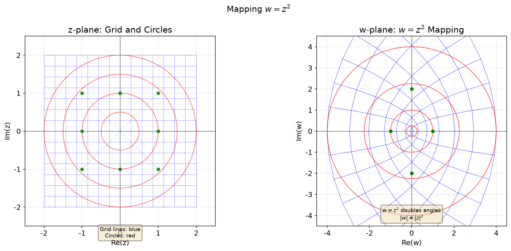
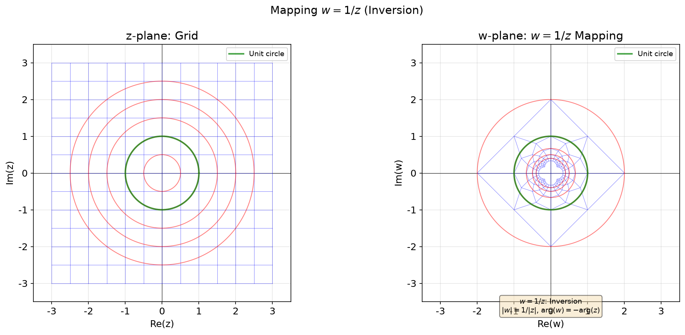
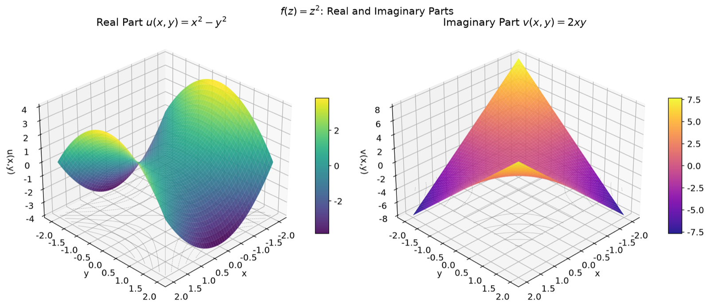
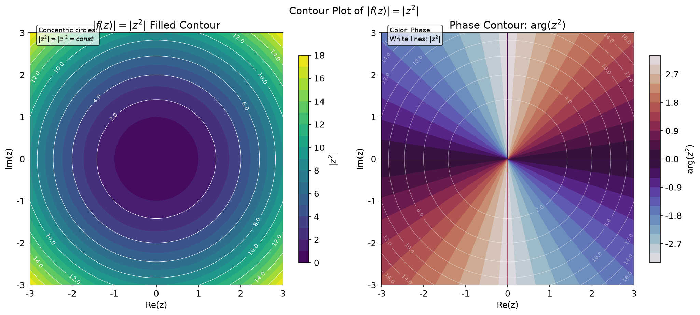
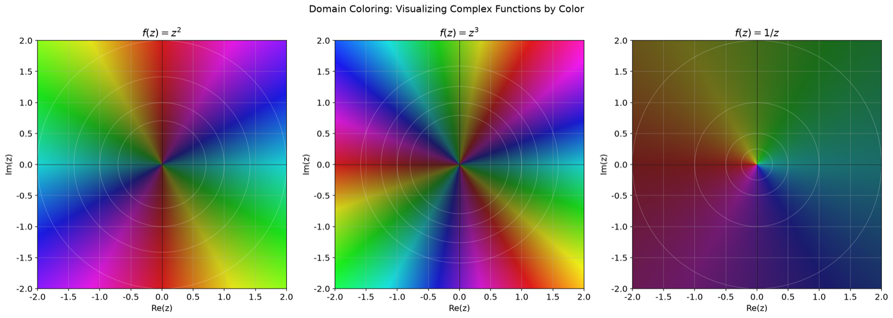
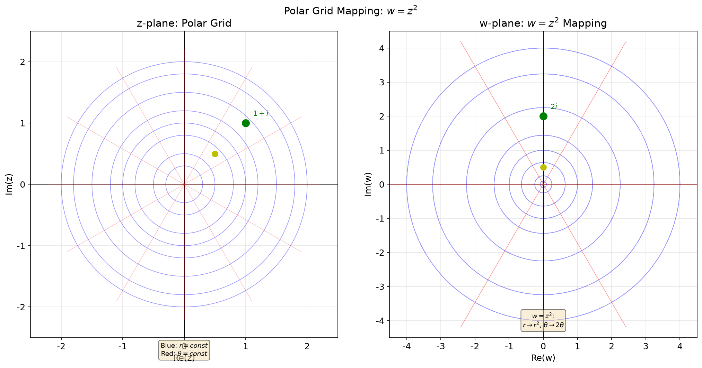
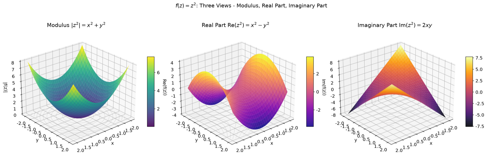

# 第2章 复变函数的基本概念 - Python可视化

## 概述

本章提供7个可视化，探索复函数如何将点从 $z$ 平面映射到 $w$ 平面。我们重点关注函数 $f(z) = z^2$、$f(z) = 1/z$ 和 $f(z) = z^3$，通过网格映射、3D曲面、等高线图和区域着色来研究它们的行为。所有代码均在 `visualization.py` 中。

---

## 可视化1：映射 $w = z^2$

### 目的与原理
复函数 $w = f(z) = z^2$ 将 $z$ 平面中的每个点 $z = x + iy$ 映射到 $w$ 平面中的点 $w = u + iv$。本可视化展示了笛卡尔网格和同心圆在该映射下如何变换。

### 核心代码
```python
def viz1_mapping_z2():
    """Visualization 1: w = z² mapping (enhanced with color)"""
    fig, axes = plt.subplots(1, 2, figsize=(14, 6))
    fig.suptitle(r'Mapping $w = z^2$', fontsize=14)

    ax_z = axes[0]
    ax_w = axes[1]
    setup_axes(ax_z, r'z-plane: Grid and Circles', 'Re(z)', 'Im(z)')
    setup_axes(ax_w, r'w-plane: $w = z^2$ Mapping', 'Re(w)', 'Im(w)')

    # ---- Create grid in z-plane ----
    x = np.linspace(-2, 2, 15)
    y = np.linspace(-2, 2, 15)
    X, Y = np.meshgrid(x, y)
    Z = X + 1j * Y

    # Draw z-plane grid with color gradient
    for i in range(len(x)):
        ax_z.plot(X[:, i], Y[:, i], 'b-', lw=0.5, alpha=0.5)
    for i in range(len(y)):
        ax_z.plot(X[i, :], Y[i, :], 'b-', lw=0.5, alpha=0.5)

    # Draw z-plane circles
    for r in [0.5, 1.0, 1.5, 2.0]:
        theta = np.linspace(0, 2*np.pi, 100)
        ax_z.plot(r * np.cos(theta), r * np.sin(theta), 'r-', lw=1, alpha=0.6)

    # ---- Compute w = z² and plot ----
    W = Z ** 2

    # Draw w-plane grid (mapped lines)
    for i in range(len(x)):
        ax_w.plot(W[:, i].real, W[:, i].imag, 'b-', lw=0.5, alpha=0.5)
    for i in range(len(y)):
        ax_w.plot(W[i, :].real, W[i, :].imag, 'b-', lw=0.5, alpha=0.5)

    # Draw w-plane circles (mapped circles)
    for r in [0.5, 1.0, 1.5, 2.0]:
        theta = np.linspace(0, 2*np.pi, 200)
        circle = r * np.exp(1j * theta)
        w_circle = circle ** 2
        ax_w.plot(w_circle.real, w_circle.imag, 'r-', lw=1, alpha=0.6)

    # Draw w-plane special points
    test_points = [1, 1j, -1, -1j, 1+1j, 1-1j, -1+1j, -1-1j]
    for zp in test_points:
        wp = zp ** 2
        ax_z.plot(zp.real, zp.imag, 'go', markersize=5, alpha=0.8)
        ax_w.plot(wp.real, wp.imag, 'go', markersize=5, alpha=0.8)
        ax_z.plot([0, zp.real], [0, zp.imag], 'g-', lw=0.5, alpha=0.3)
        ax_w.plot([0, wp.real], [0, wp.imag], 'g-', lw=0.5, alpha=0.3)
```

### 图片


### 详细图像分析

#### 1. 整体概览
两个并排的图：左侧显示 $z$ 平面，带有蓝色笛卡尔网格和红色同心圆；右侧显示 $w$ 平面，带有映射后的网格线和圆。绿色点标记了特殊的测试点及其像。

#### 2. 逐个元素分析

- **左图（$z$ 平面）**：
  - **蓝色网格线**：垂直线 $x = \text{const}$ 和水平线 $y = \text{const}$ 形成规则的方形网格。
  - **红色圆**：以原点为中心的同心圆，半径 $r = 0.5, 1.0, 1.5, 2.0$。
  - **绿色点**：八个特殊点：$1, i, -1, -i, 1+i, 1-i, -1+i, -1-i$。它们通过淡绿色线连接到原点。

- **右图（$w$ 平面）**：
  - **映射后的蓝色线**：规则网格已被变换为一组曲线。$z$ 平面中的垂直线 $x = \text{const}$ 在 $w$ 平面中变为向左或向右开口的**抛物线**。水平线 $y = \text{const}$ 变为向上或向下开口的**抛物线**。
  - **映射后的红色圆**：$z$ 平面中半径为 $r$ 的同心圆变为 $w$ 平面中半径为 $r^2$ 的同心圆。例如，半径为1的圆映射到单位圆（半径 $1^2 = 1$），而半径为2的圆映射到半径为4的圆。
  - **映射后的绿色点**：每个绿色点都已被变换。例如，$z = 1+i$ 映射到 $w = (1+i)^2 = 2i$，位于正虚轴上。

#### 3. 关键观察点

- **观察1**：比较网格间距。在 $z$ 平面中，网格线均匀分布。在 $w$ 平面中，映射后的线是弯曲的，间距也不均匀。==在 $w$ 平面中靠近原点处，线较稀疏；远离原点处，线较密集。==

- **观察2**：观察红色圆。$z$ 平面中半径为 $0.5$ 的圆映射到 $w$ 平面中半径为 $0.25$ 的圆（更小）。半径为 $1.0$ 的圆映射到自身（半径1）。半径为 $1.5$ 的圆映射到半径 $2.25$（更大）。这表明 $|w| = |z|^2$：单位圆内的点更靠近原点，单位圆外的点则更远。

- **观察3**：关注绿色点 $z = 1$（实轴）。它映射到 $w = 1$（不变）。但 $z = i$（在虚轴上）映射到 $w = -1$（在负实轴上）。这是因为 $i^2 = -1$。角度加倍：$\arg(i) = 90^\circ$，$\arg(i^2) = 180^\circ$。

- **观察4**：注意 $z = 1$ 和 $z = -1$ 都映射到 $w = 1$。而 $z = i$ 和 $z = -i$ 都映射到 $w = -1$。这是因为 $z^2$ 是一个**二对一**映射（除 $z = 0$ 外）：两个不同的 $z$ 值映射到同一个 $w$ 值。

#### 4. 数学原理对应
映射 $w = z^2$ 的极坐标形式：
$$z = re^{i\theta} \quad \Longrightarrow \quad w = r^2 e^{i2\theta}$$

这意味着：
- 模：$|w| = |z|^2$（缩放是平方的）
- 辐角：$\arg(w) = 2\arg(z)$（角度加倍）

#### 5. 结论与延伸
映射 $w = z^2$ 是最简单的非线性复函数之一，但它揭示了丰富的性质：角度加倍、半径平方，并以二对一的方式映射 $z$ 平面。这是一个共形映射（保角），处处成立，除 $z = 0$ 处 $f'(z) = 0$。尝试：$w = z^3$ 下的网格会是什么样？角度会如何变化？

---

## 可视化2：映射 $w = 1/z$（反演）

### 目的与原理
函数 $w = 1/z$ 称为**反演**。它将单位圆内部映射到外部，反之亦然。本可视化展示了网格和圆在反演下如何变换。

### 核心代码
```python
def viz2_mapping_1_over_z():
    """Visualization 2: w = 1/z mapping (inversion) (enhanced)"""
    fig, axes = plt.subplots(1, 2, figsize=(14, 6))
    fig.suptitle(r'Mapping $w = 1/z$ (Inversion)', fontsize=14)

    ax_z = axes[0]
    ax_w = axes[1]
    setup_axes(ax_z, r'z-plane: Grid', 'Re(z)', 'Im(z)')
    setup_axes(ax_w, r'w-plane: $w = 1/z$ Mapping', 'Re(w)', 'Im(w)')

    # Create grid (avoid origin)
    x = np.linspace(-3, 3, 13)
    y = np.linspace(-3, 3, 13)
    X, Y = np.meshgrid(x, y)

    # Remove points near origin
    mask = (np.abs(X) > 0.3) | (np.abs(Y) > 0.3)
    X = X * mask
    Y = Y * mask
    Z = X + 1j * Y
    Z[Z == 0] = np.nan

    # Draw z-plane grid
    for i in range(len(x)):
        ax_z.plot(X[:, i], Y[:, i], 'b-', lw=0.5, alpha=0.5)
    for i in range(len(y)):
        ax_z.plot(X[i, :], Y[i, :], 'b-', lw=0.5, alpha=0.5)

    # Draw circles in z-plane
    for r in [0.5, 1.0, 1.5, 2.0, 2.5]:
        theta = np.linspace(0, 2*np.pi, 200)
        ax_z.plot(r * np.cos(theta), r * np.sin(theta), 'r-', lw=1, alpha=0.5)

    # Mark the unit circle specially
    theta = np.linspace(0, 2*np.pi, 200)
    ax_z.plot(np.cos(theta), np.sin(theta), 'g-', lw=2, alpha=0.7, label='Unit circle')
    ax_z.legend(loc='upper right', fontsize=9)

    # ---- Compute w = 1/z ----
    W = 1.0 / Z

    # Draw w-plane grid
    for i in range(len(x)):
        valid = ~np.isnan(W[:, i].real)
        if np.any(valid):
            ax_w.plot(W[valid, i].real, W[valid, i].imag, 'b-', lw=0.5, alpha=0.5)
    for i in range(len(y)):
        valid = ~np.isnan(W[i, :].real)
        if np.any(valid):
            ax_w.plot(W[i, valid].real, W[i, valid].imag, 'b-', lw=0.5, alpha=0.5)

    # Draw w-plane circles (mapped images)
    for r in [0.5, 1.0, 1.5, 2.0, 2.5]:
        theta = np.linspace(0, 2*np.pi, 200)
        circle = r * np.exp(1j * theta)
        w_circle = 1.0 / circle
        ax_w.plot(w_circle.real, w_circle.imag, 'r-', lw=1, alpha=0.5)
```

### 图片


### 详细图像分析

#### 1. 整体概览
两个并排的图：$z$ 平面（左）带有网格和圆，$w$ 平面（右）带有映射结果。单位圆在两个平面中均以绿色突出显示。

#### 2. 逐个元素分析

- **左图（$z$ 平面）**：
  - 蓝色网格线从 $-3$ 延伸到 $3$。
  - 红色圆的半径为 $0.5, 1.0, 1.5, 2.0, 2.5$。
  - 单位圆（$r=1$）以绿色突出显示。

- **右图（$w$ 平面）**：
  - 网格线发生了戏剧性的变换：直线变为曲线（圆或圆弧）。
  - $z$ 平面中的红色圆已被映射到其他圆。注意半径为 $0.5$ 的圆映射到半径为 $2$ 的圆（单位圆外），半径为 $2$ 的圆映射到半径为 $0.5$ 的圆（单位圆内）。
  - 单位圆（$r=1$）映射到自身——它是反演下唯一保持不变的圆。

#### 3. 关键观察点

- **观察1**：最显著的效果是，靠近原点的点（小 $|z|$）映射到远离原点的点（大 $|w|$），反之亦然。例如，$z = 0.1$ 映射到 $w = 10$，$z = 10$ 映射到 $w = 0.1$。

- **观察2**：观察绿色单位圆。它在反演下完美保持不变（映射到自身）。验证：如果 $|z| = 1$，则 $|w| = 1/|z| = 1$，所以 $|w| = 1$ 也成立。

- **观察3**：注意 $w$ 平面的网格线也是"圆"或"圆弧"。这是因为反演将圆和线映射到圆和线。具体来说，不通过原点的圆映射到另一个圆，而通过原点的圆映射到一条直线。

- **观察4**：辐角的符号翻转：$\arg(w) = -\arg(z)$。所以上半平面中的点映射到下半平面中的点，反之亦然。观察 $z$ 平面上半部分的网格线——它们映射到 $w$ 平面下半部分的曲线。

#### 4. 数学原理对应
反演的极坐标形式：
$$z = re^{i\theta} \quad \Longrightarrow \quad w = \frac{1}{r} e^{-i\theta}$$

这意味着：
- 模：$|w| = 1/|z|$（模的倒数）
- 辐角：$\arg(w) = -\arg(z)$（角度的取反）

#### 5. 结论与延伸
反演是复分析中的一个基本变换。它将单位圆的"内部"映射到"外部"，反之亦然。结合平移和缩放，反演生成整个莫比乌斯变换族。尝试：垂直线 $x = 2$ 在 $w = 1/z$ 下会变成什么？它会变成什么曲线？

---

## 可视化3：实部和虚部的3D曲面

### 目的与原理
对于 $f(z) = z^2$，实部和虚部分别为：
$$u(x,y) = \text{Re}(z^2) = x^2 - y^2$$
$$v(x,y) = \text{Im}(z^2) = 2xy$$

这些是两个变量的实值函数。本可视化展示了它们的3D曲面，底部带有等高线投影。

### 核心代码
```python
def viz3_real_imag_3d():
    """Visualization 3: 3D surfaces of real and imaginary parts of f(z) = z² (enhanced)"""
    fig = plt.figure(figsize=(14, 6))
    fig.suptitle(r'$f(z) = z^2$: Real and Imaginary Parts', fontsize=14)

    # Define grid
    x = np.linspace(-2, 2, 50)
    y = np.linspace(-2, 2, 50)
    X, Y = np.meshgrid(x, y)
    Z = X + 1j * Y
    F = Z ** 2

    # Real part: u(x,y) = x² - y²
    U = X**2 - Y**2
    # Imaginary part: v(x,y) = 2xy
    V = 2 * X * Y

    # ---- Left: Real part surface ----
    ax1 = fig.add_subplot(1, 2, 1, projection='3d')
    surf1 = ax1.plot_surface(X, Y, U, cmap='viridis', alpha=0.9,
                             linewidth=0, antialiased=True)
    ax1.set_xlabel('x')
    ax1.set_ylabel('y')
    ax1.set_zlabel('u(x,y)')
    ax1.set_title(r'Real Part $u(x,y) = x^2 - y^2$')
    ax1.view_init(30, 45)
    fig.colorbar(surf1, ax=ax1, shrink=0.5, aspect=10)

    # Add contour projection on the bottom
    offset = -4
    ax1.contour(X, Y, U, levels=10, colors='k', alpha=0.3, offset=offset,
                linewidths=0.5)

    # ---- Right: Imaginary part surface ----
    ax2 = fig.add_subplot(1, 2, 2, projection='3d')
    surf2 = ax2.plot_surface(X, Y, V, cmap='plasma', alpha=0.9,
                             linewidth=0, antialiased=True)
    ax2.set_xlabel('x')
    ax2.set_ylabel('y')
    ax2.set_zlabel('v(x,y)')
    ax2.set_title(r'Imaginary Part $v(x,y) = 2xy$')
    ax2.view_init(30, 45)
    fig.colorbar(surf2, ax=ax2, shrink=0.5, aspect=10)

    # Add contour projection
    ax2.contour(X, Y, V, levels=10, colors='k', alpha=0.3, offset=offset,
                linewidths=0.5)
```

### 图片


### 详细图像分析

#### 1. 整体概览
两个3D曲面图：左侧显示实部 $u(x,y) = x^2 - y^2$（一个鞍面），右侧显示虚部 $v(x,y) = 2xy$（一个扭曲曲面）。两者均从 $30^\circ$ 仰角和 $45^\circ$ 方位角观察。

#### 2. 逐个元素分析

- **左图（实部 $u = x^2 - y^2$）**：
  - 这是一个**鞍面**（双曲抛物面）。
  - 沿 $x$ 轴（$y=0$）：$u = x^2$，向上弯曲（开口向上的抛物线）。
  - 沿 $y$ 轴（$x=0$）：$u = -y^2$，向下弯曲（开口向下的抛物线）。
  - 颜色映射（viridis）显示函数值：紫色/蓝色表示负值，绿色表示零，黄色表示正值。
  - 底部的等高线投影显示双曲线（恒定 $u$ 的线）。

- **右图（虚部 $v = 2xy$）**：
  - 这是一个**扭曲曲面**。
  - 沿直线 $y = x$：$v = 2x^2$，向上抛物线。
  - 沿直线 $y = -x$：$v = -2x^2$，向下抛物线。
  - 颜色映射（plasma）显示函数值。
  - 底部的等高线投影显示矩形双曲线。

#### 3. 关键观察点

- **观察1**：比较两个曲面。实部关于两个轴对称（$u(x,y) = u(-x,y) = u(x,-y)$）。虚部在两个变量中都是奇函数（$v(-x,y) = -v(x,y)$ 且 $v(x,-y) = -v(x,y)$）。

- **观察2**：观察实部在原点的鞍点。沿 $x$ 轴移动，曲面上升；沿 $y$ 轴移动，曲面下降。这是鞍点的定义特征：在一个方向上是最小值，在另一个方向上是最大值。

- **观察3**：对于虚部，注意 $v(x,y) = 0$ 当 $x=0$ 或 $y=0$ 时（坐标轴）。该曲面沿两个坐标轴为零，并在四个象限中交替符号。

- **观察4**：两个曲面都满足拉普拉斯方程 $\nabla^2 u = 0$ 和 $\nabla^2 v = 0$，意味着它们是调和函数。二阶导数之和在每一点为零。

#### 4. 数学原理对应
对于 $f(z) = z^2 = (x^2 - y^2) + i(2xy)$：
- 实部：$u(x,y) = x^2 - y^2$，一个双曲抛物面
- 虚部：$v(x,y) = 2xy$，旋转 $45^\circ$ 的双曲抛物面

$u$ 和 $v$ 都满足**柯西-黎曼方程**：
$$\frac{\partial u}{\partial x} = 2x = \frac{\partial v}{\partial y}, \quad \frac{\partial u}{\partial y} = -2y = -\frac{\partial v}{\partial x}$$

#### 5. 结论与延伸
3D曲面揭示了 $f(z) = z^2$ 分解为两个鞍形曲面。实部和虚部是调和共轭：它们满足柯西-黎曼方程和拉普拉斯方程。尝试：$f(z) = z^3$ 的3D曲面会是什么样？实部还会是鞍面吗？

---

## 可视化4：$|f(z)| = |z^2|$ 的等高线图

### 目的与原理
模 $|f(z)| = |z^2| = |z|^2 = x^2 + y^2$ 是一个实值函数，衡量 $f(z)$ 的"大小"。本可视化同时展示了模的等高线和相位（辐角）的等高线。

### 核心代码
```python
def viz4_contour_modulus():
    """Visualization 4: Contour plot of |f(z)| = |z²| (enhanced)"""
    fig, axes = plt.subplots(1, 2, figsize=(14, 6))
    fig.suptitle(r'Contour Plot of $|f(z)| = |z^2|$', fontsize=14)

    # Define grid
    x = np.linspace(-3, 3, 200)
    y = np.linspace(-3, 3, 200)
    X, Y = np.meshgrid(x, y)
    Z = X + 1j * Y
    F = Z ** 2
    modulus = np.abs(F)
    phase = np.angle(F)

    # ---- Left: Filled contour plot ----
    ax1 = axes[0]
    contour1 = ax1.contourf(X, Y, modulus, levels=20, cmap='viridis')
    ax1.set_xlabel('Re(z)')
    ax1.set_ylabel('Im(z)')
    ax1.set_title(r'$|f(z)| = |z^2|$ Filled Contour')
    ax1.set_aspect('equal')
    fig.colorbar(contour1, ax=ax1, shrink=0.8, label=r'$|z^2|$')

    # Overlay contour lines
    contour_lines = ax1.contour(X, Y, modulus, levels=10, colors='white', linewidths=0.5)
    ax1.clabel(contour_lines, inline=True, fontsize=8, fmt='%.1f')

    # ---- Right: Contour with phase information ----
    ax2 = axes[1]
    contour2 = ax2.contourf(X, Y, phase, levels=20, cmap='twilight')
    ax2.set_xlabel('Re(z)')
    ax2.set_ylabel('Im(z)')
    ax2.set_title(r'Phase Contour: $\arg(z^2)$')
    ax2.set_aspect('equal')
    fig.colorbar(contour2, ax=ax2, shrink=0.8, label=r'$\arg(z^2)$')

    # Overlay modulus contour lines
    mod_contour = ax2.contour(X, Y, modulus, levels=8, colors='white', linewidths=0.6, alpha=0.5)
    ax2.clabel(mod_contour, inline=True, fontsize=7, fmt='%.1f')
```

### 图片


### 详细图像分析

#### 1. 整体概览
两个图：左侧显示 $|z^2|$ 的填充等高线，带有白色等高线；右侧使用twilight颜色映射显示相位 $\arg(z^2)$，并叠加了白色模等高线。

#### 2. 逐个元素分析

- **左图（模等高线）**：
  - viridis颜色映射显示 $|z^2|$ 从暗紫色（原点附近的小值）到亮黄色（远离原点的大值）。
  - 白色等高线标有数值：$1, 2, 3, 4, 5, 6, 7, 8, 9$。
  - 等高线是**完美的同心圆**，以原点为中心。这确认了 $|z^2| = x^2 + y^2$ 仅取决于到原点的距离。

- **右图（相位等高线）**：
  - twilight颜色映射循环显示代表相位角 $\arg(z^2)$ 的颜色。
  - 白色等高线显示模值（与左图相同）叠加在相位信息上。
  - 相位在围绕原点移动时平滑变化。

#### 3. 关键观察点

- **观察1**：在左图中，等高线圆按值（1, 2, 3, ...）均匀分布，但它们的半径遵循 $\sqrt{\text{值}}$。所以值为4的等高线半径为2，值为9的等高线半径为3，等等。连续等高线之间的间距向外逐渐减小。

- **观察2**：在右图中，相位从 $-\pi$ 到 $\pi$ 围绕原点变化。注意颜色围绕原点循环两次（因为 $\arg(z^2) = 2\arg(z)$，在 $z$ 中绕一圈对应相位绕两整圈）。

- **观察3**：比较两个图。模告诉你 $f(z)$ "有多大"，而相位告诉你 $f(z)$ "指向哪个方向"。两者共同在每个点上完全刻画了 $f(z)$。

- **观察4**：原点是一个特殊点，$|z^2| = 0$（最小值）且相位未定义。这是函数的一个**零点**。

#### 4. 数学原理对应
$f(z) = z^2$ 的模和相位：
$$|z^2| = |z|^2 = x^2 + y^2$$
$$\arg(z^2) = 2\arg(z) = 2\arctan(y/x)$$

模衡量"大小"，相位衡量"旋转"。

#### 5. 结论与延伸
等高线图提供了函数行为的二维视图，补充了3D曲面。模的同心圆和相位的循环性质是幂函数的特征。尝试：$|z^3|$ 的等高线图会是什么样？相位会如何变化？

---

## 可视化5：多个函数的区域着色

### 目的与原理
区域着色使用颜色来可视化复函数，通过将相位（辐角）编码为色调，模编码为亮度。本可视化比较了三个函数：$f(z) = z^2$、$f(z) = z^3$ 和 $f(z) = 1/z$，展示了每个函数如何扭曲复平面。

### 核心代码
```python
def viz5_domain_coloring_functions():
    """Visualization 5: Domain coloring for multiple functions w = z², z³, 1/z (NEW)"""
    fig, axes = plt.subplots(1, 3, figsize=(18, 6))
    fig.suptitle(r'Domain Coloring: Visualizing Complex Functions by Color',
                 fontsize=14, y=1.02)

    # Define grid
    x = np.linspace(-2, 2, 500)
    y = np.linspace(-2, 2, 500)
    X, Y = np.meshgrid(x, y)
    Z = X + 1j * Y

    import matplotlib.colors as mcolors

    functions = [
        (Z ** 2, r'$f(z) = z^2$', 'viridis'),
        (Z ** 3, r'$f(z) = z^3$', 'plasma'),
        (1.0 / (Z + 1e-10), r'$f(z) = 1/z$', 'inferno'),
    ]

    for idx, (W, title, cmap_name) in enumerate(functions):
        ax = axes[idx]
        setup_axes(ax, title, 'Re(z)', 'Im(z)')

        phase = np.angle(W)
        modulus = np.abs(W)

        # Normalize modulus logarithmically
        norm_mod = np.log(1 + modulus) / np.log(1 + np.max(modulus[~np.isinf(modulus)]))

        # Hue = phase, Brightness = modulus
        hue = (phase + np.pi) / (2 * np.pi)
        saturation = np.ones_like(hue)
        brightness = 0.3 + 0.7 * norm_mod

        hsv = np.stack([hue, saturation, brightness], axis=-1)
        rgb = mcolors.hsv_to_rgb(hsv)

        ax.imshow(rgb, extent=[-2, 2, -2, 2], origin='lower', alpha=0.9)

        # Add modulus contour lines
        mod_clip = np.clip(modulus, 0.1, 10)
        levels = [0.5, 1.0, 2.0, 4.0]
        cs = ax.contour(X, Y, mod_clip, levels=levels, colors='white',
                        linewidths=0.5, alpha=0.4)
```

### 图片


### 详细图像分析

#### 1. 整体概览
三幅并排的区域着色图像，每幅展示一个不同的复函数，区域为 $[-2, 2] \times [-2, 2]$。白色等高线标记了恒定模值。

#### 2. 逐个元素分析

- **左：$f(z) = z^2$**：
  - 颜色轮围绕原点循环**两次**（相比于第1章中恒等函数 $f(z)=z$ 的一次）。这是因为 $\arg(z^2) = 2\arg(z)$。
  - 白色等高线是以原点为中心的圆，表示 $|z^2| = 0.5, 1.0, 2.0, 4.0$。
  - 原点是一个暗点（函数的零点）。

- **中：$f(z) = z^3$**：
  - 颜色轮围绕原点循环**三次**。这是因为 $\arg(z^3) = 3\arg(z)$。
  - 颜色过渡比 $z^2$ 更急剧，反映了更快的相位变化。
  - 白色等高线圆在原点附近更密集。

- **右：$f(z) = 1/z$**：
  - 颜色模式完全不同！原点附近的颜色很亮（因为 $|1/z|$ 在 $z=0$ 附近很大），而远离原点的颜色很暗（因为 $|1/z|$ 很小）。
  - 颜色轮以与 $f(z)=z$ 相比**相反的方向**循环，因为 $\arg(1/z) = -\arg(z)$。
  - 原点是一个亮点（函数的极点）。

#### 3. 关键观察点

- **观察1**：比较围绕原点的颜色循环次数。对于 $f(z)=z^2$，围绕原点走一圈得到两个完整的颜色循环。对于 $f(z)=z^3$，得到三个循环。这是函数"次数"的可视化表示。

- **观察2**：观察亮度模式。对于 $z^2$ 和 $z^3$，原点很暗（函数的零点）。对于 $1/z$，原点很亮（函数的极点）。亮度立即告诉你函数在何处有零点和极点。

- **观察3**：对于 $1/z$，注意白色等高线仍然是以原点为中心的圆，但其值为 $0.5, 1.0, 2.0, 4.0$，表示 $|1/z| = \text{const}$。最小的圆（最靠近原点）具有最大的值（4.0），确认了 $|1/z|$ 在原点附近很大。

#### 4. 数学原理对应
区域着色揭示了复函数的全局行为：
- **零点**：$f(z) = 0$ 处的暗点（亮度 = 0）
- **极点**：$f(z) \to \infty$ 处的亮点（亮度 = 1）
- **次数**：围绕一个点的颜色循环次数等于零点/极点的阶数

#### 5. 结论与延伸
区域着色提供了复函数的全局视图，一眼就能看出零点、极点和缠绕数。它是复分析中最强大的可视化技术之一。尝试：$f(z) = 1/(z^2+1)$ 的区域着色会是什么样？它的极点在哪里？

---

## 可视化6：极坐标网格在 $w = z^2$ 下的映射

### 目的与原理
可视化1展示了笛卡尔网格的映射，而本可视化使用**极坐标网格**（恒定半径的圆和恒定角度的射线）来展示 $w = z^2$ 如何变换极坐标。极坐标网格对于理解 $z^2$ 更自然，因为该映射在极坐标形式下表达简单。

### 核心代码
```python
def viz6_polar_grid_mapping():
    """Visualization 6: Polar grid mapping under w = z² (NEW)"""
    fig, axes = plt.subplots(1, 2, figsize=(14, 7))
    fig.suptitle(r'Polar Grid Mapping: $w = z^2$', fontsize=14)

    ax_z = axes[0]
    ax_w = axes[1]
    setup_axes(ax_z, r'z-plane: Polar Grid', 'Re(z)', 'Im(z)')
    setup_axes(ax_w, r'w-plane: $w = z^2$ Mapping', 'Re(w)', 'Im(w)')

    # ---- Create polar grid in z-plane ----
    # Circles of constant radius
    radii = [0.3, 0.5, 0.8, 1.0, 1.2, 1.5, 1.8, 2.0]
    theta_fine = np.linspace(0, 2*np.pi, 400)

    for r in radii:
        ax_z.plot(r * np.cos(theta_fine), r * np.sin(theta_fine),
                  'b-', lw=0.8, alpha=0.4)

    # Rays of constant angle
    angles_deg = np.arange(0, 360, 30)
    for deg in angles_deg:
        rad = np.deg2rad(deg)
        ray_len = 2.2
        ax_z.plot([0, ray_len * np.cos(rad)], [0, ray_len * np.sin(rad)],
                  'r-', lw=0.6, alpha=0.3)

    # ---- Compute w = z² mapping ----
    # Map circles: circles of radius r become circles of radius r²
    for r in radii:
        circle = r * np.exp(1j * theta_fine)
        w_circle = circle ** 2
        ax_w.plot(w_circle.real, w_circle.imag, 'b-', lw=0.8, alpha=0.4)

    # Map rays: ray at angle θ becomes ray at angle 2θ
    for deg in angles_deg:
        rad = np.deg2rad(deg)
        ray_len = 2.2
        ray_points = np.linspace(0.05, ray_len, 100)
        z_ray = ray_points * np.exp(1j * rad)
        w_ray = z_ray ** 2
        ax_w.plot(w_ray.real, w_ray.imag, 'r-', lw=0.6, alpha=0.3)

    # Mark a specific example: z = 1+i maps to w = 2i
    z_example = 1 + 1j
    w_example = z_example ** 2
    ax_z.plot(z_example.real, z_example.imag, 'go', markersize=10, zorder=5)
    ax_w.plot(w_example.real, w_example.imag, 'go', markersize=10, zorder=5)
    ax_z.annotate(r'$1+i$', (z_example.real, z_example.imag),
                  textcoords="offset points", xytext=(10, 10), fontsize=10, color='green')
    ax_w.annotate(r'$2i$', (w_example.real, w_example.imag),
                  textcoords="offset points", xytext=(10, 10), fontsize=10, color='green')
```

### 图片


### 详细图像分析

#### 1. 整体概览
两个图：左侧显示 $z$ 平面中的极坐标网格（各种半径的蓝色圆，$30^\circ$ 间隔的红色射线），右侧显示 $w = z^2$ 映射后的 $w$ 平面。绿色和黄色点标记了示例映射。

#### 2. 逐个元素分析

- **左图（$z$ 平面极坐标网格）**：
  - **蓝色圆**：半径 $r = 0.3, 0.5, 0.8, 1.0, 1.2, 1.5, 1.8, 2.0$。
  - **红色射线**：12条射线，$30^\circ$ 间隔（$0^\circ, 30^\circ, 60^\circ, \ldots, 330^\circ$）。
  - 绿色点：$z = 1 + i$（半径 $\sqrt{2}$，角度 $45^\circ$）。
  - 黄色点：$z = 0.5 + 0.5i$（半径 $\approx 0.707$，角度 $45^\circ$）。

- **右图（$w$ 平面映射后的网格）**：
  - **映射后的蓝色圆**：$z$ 平面中半径为 $r$ 的每个圆变为 $w$ 平面中半径为 $r^2$ 的圆。
    - $r = 0.3 \to r^2 = 0.09$（原点附近非常小的圆）
    - $r = 0.5 \to r^2 = 0.25$
    - $r = 1.0 \to r^2 = 1.0$（单位圆保持不变）
    - $r = 1.5 \to r^2 = 2.25$
    - $r = 2.0 \to r^2 = 4.0$（大圆）
  - **映射后的红色射线**：角度为 $\theta$ 的每条射线变为角度为 $2\theta$ 的射线。
    - $0^\circ \to 0^\circ$（正实轴）
    - $30^\circ \to 60^\circ$
    - $60^\circ \to 120^\circ$
    - $90^\circ \to 180^\circ$（负实轴）
    - $180^\circ \to 360^\circ = 0^\circ$（正实轴——重叠！）
  - 绿色点：$z = 1+i \to w = (1+i)^2 = 2i$（在正虚轴上）。
  - 黄色点：$z = 0.5+0.5i \to w = 0.5i$（也在虚轴上，但更靠近原点）。

#### 3. 关键观察点

- **观察1**：最引人注目的特征是 $z$ 平面中的 $30^\circ$ 和 $210^\circ$ 射线都映射到 $w$ 平面中的 $60^\circ$ 射线。这是 $z^2$ 的**二对一**性质的可视化体现。

- **观察2**：注意 $90^\circ$ 射线（正虚轴）映射到 $180^\circ$ 射线（负实轴）。所以整个正虚轴映射到负实轴。

- **观察3**：$z$ 平面中单位圆内（$r < 1$）的圆在 $w$ 平面中变得更小。单位圆外（$r > 1$）的圆变得更大。单位圆（$r=1$）保持不变。

- **观察4**：两个示例点 $1+i$ 和 $0.5+0.5i$ 都位于 $45^\circ$ 射线上。映射后，它们都位于 $90^\circ$ 射线（正虚轴）上。距离原点较远的点（$1+i$）映射到距离原点较远的点（$2i$），而较近的点（$0.5+0.5i$）映射到较近的点（$0.5i$）。

#### 4. 数学原理对应
在 $w = z^2$ 下，极坐标网格变换为：
$$r e^{i\theta} \quad \longrightarrow \quad r^2 e^{i2\theta}$$

$z$ 平面中角度为 $\theta$ 的一个扇形映射到 $w$ 平面中角度为 $2\theta$ 的扇形。$z$ 平面被"包裹"到 $w$ 平面上，上半平面（$0 \leq \theta < \pi$）覆盖整个 $w$ 平面，下半平面（$\pi \leq \theta < 2\pi$）再次覆盖它。

#### 5. 结论与延伸
极坐标网格可视化使得 $z^2$ 的几何性质一目了然：它是角度的"加倍"和半径的"平方"。二对一的性质在视觉上很明显：$z$ 平面中 $\theta$ 和 $\theta + \pi$ 处的射线都映射到 $w$ 平面中 $2\theta$ 处的同一条射线。尝试：$w = z^3$ 的极坐标网格映射会是什么样？$z$ 平面会围绕 $w$ 平面包裹多少次？

---

## 可视化7：增强3D曲面——模、实部、虚部

### 目的与原理
本可视化将 $f(z) = z^2$ 的三个不同视图集中在一个图中：模 $|f(z)|$、实部 $\text{Re}(f(z))$ 和虚部 $\text{Im}(f(z))$。并排查看所有三个视图提供了函数的完整图像。

### 核心代码
```python
def viz7_enhanced_3d_surfaces():
    """Visualization 7: Enhanced 3D - |f(z)|, Re(f(z)), Im(f(z)) side by side (NEW)"""
    fig = plt.figure(figsize=(18, 6))
    fig.suptitle(r'$f(z) = z^2$: Three Views - Modulus, Real Part, Imaginary Part',
                 fontsize=14, y=1.02)

    # Define grid
    x = np.linspace(-2, 2, 60)
    y = np.linspace(-2, 2, 60)
    X, Y = np.meshgrid(x, y)
    Z = X + 1j * Y
    F = Z ** 2

    modulus = np.abs(F)
    real_part = X**2 - Y**2
    imag_part = 2 * X * Y

    # ---- Left: Modulus surface ----
    ax1 = fig.add_subplot(1, 3, 1, projection='3d')
    surf1 = ax1.plot_surface(X, Y, modulus, cmap='viridis', alpha=0.9,
                             linewidth=0, antialiased=True)
    ax1.set_xlabel('x')
    ax1.set_ylabel('y')
    ax1.set_zlabel('|f(z)|')
    ax1.set_title(r'Modulus $|z^2| = x^2 + y^2$')
    ax1.view_init(25, 50)
    fig.colorbar(surf1, ax=ax1, shrink=0.5, aspect=10)

    # ---- Middle: Real part surface ----
    ax2 = fig.add_subplot(1, 3, 2, projection='3d')
    surf2 = ax2.plot_surface(X, Y, real_part, cmap='plasma', alpha=0.9,
                             linewidth=0, antialiased=True)
    ax2.set_xlabel('x')
    ax2.set_ylabel('y')
    ax2.set_zlabel('Re(f(z))')
    ax2.set_title(r'Real Part $\mathrm{Re}(z^2) = x^2 - y^2$')
    ax2.view_init(25, 50)
    fig.colorbar(surf2, ax=ax2, shrink=0.5, aspect=10)

    # ---- Right: Imaginary part surface ----
    ax3 = fig.add_subplot(1, 3, 3, projection='3d')
    surf3 = ax3.plot_surface(X, Y, imag_part, cmap='inferno', alpha=0.9,
                             linewidth=0, antialiased=True)
    ax3.set_xlabel('x')
    ax3.set_ylabel('y')
    ax3.set_zlabel('Im(f(z))')
    ax3.set_title(r'Imaginary Part $\mathrm{Im}(z^2) = 2xy$')
    ax3.view_init(25, 50)
    fig.colorbar(surf3, ax=ax3, shrink=0.5, aspect=10)
```

### 图片


### 详细图像分析

#### 1. 整体概览
从左到右三个3D曲面图：模 $|z^2|$（一个抛物面）、实部 $x^2 - y^2$（一个鞍面）和虚部 $2xy$（一个扭曲鞍面）。每个使用不同的颜色映射（viridis、plasma、inferno），底部有等高线投影。

#### 2. 逐个元素分析

- **左：模 $|z^2| = x^2 + y^2$**：
  - 这是一个**旋转抛物面**——碗状形状。
  - 曲面关于 $z$ 轴旋转对称。
  - 最小值在原点（$|z^2| = 0$）。
  - 底部的等高线投影是同心圆。
  - viridis 颜色映射从暗紫色（低）到亮黄色（高）。

- **中：实部 $\text{Re}(z^2) = x^2 - y^2$**：
  - 这是一个**鞍面**（双曲抛物面）。
  - 沿 $x$ 轴向上弯曲，沿 $y$ 轴向下弯曲。
  - 等高线投影是双曲线。
  - plasma 颜色映射从深蓝色（负）经过黄色（零）到红色（正）。

- **右：虚部 $\text{Im}(z^2) = 2xy$**：
  - 这也是一个鞍面，但相对于实部旋转了 $45^\circ$。
  - 沿两个坐标轴为零，在四个象限中交替符号。
  - 等高线投影是矩形双曲线。
  - inferno 颜色映射从黑色（负）经过橙色（零）到黄色/白色（正）。

#### 3. 关键观察点

- **观察1**：比较三个曲面。模始终非负，在原点有一个最小值。实部和虚部可正可负，在原点有鞍点。

- **观察2**：注意实部和虚部曲面在某种意义上是正交的。它们的梯度垂直：$\nabla u \cdot \nabla v = (2x, -2y) \cdot (2y, 2x) = 4xy - 4xy = 0$。

- **观察3**：模曲面与实部和虚部的关系为：$|f(z)|^2 = u^2 + v^2 = (x^2 - y^2)^2 + (2xy)^2 = (x^2 + y^2)^2 = |z|^4$。所以模是另外两个曲面平方和的平方根。

- **观察4**：等高线投影揭示了每个曲面的不同"坐标系"：
  - 模：同心圆（极坐标）
  - 实部：双曲线 $x^2 - y^2 = \text{const}$
  - 虚部：双曲线 $2xy = \text{const}$

#### 4. 数学原理对应
$f(z) = z^2$ 的三个视图之间的关系为：
$$f(z) = u + iv, \quad |f(z)| = \sqrt{u^2 + v^2}$$

柯西-黎曼方程连接 $u$ 和 $v$：
$$\frac{\partial u}{\partial x} = \frac{\partial v}{\partial y}, \quad \frac{\partial u}{\partial y} = -\frac{\partial v}{\partial x}$$

$u$ 和 $v$ 都满足拉普拉斯方程：
$$\nabla^2 u = 0, \quad \nabla^2 v = 0$$

#### 5. 结论与延伸
同时看到所有三个视图提供了对 $f(z) = z^2$ 的完整理解。模告诉你"多大"，实部告诉你"水平分量"，虚部告诉你"垂直分量"。它们共同完全刻画了该函数。尝试：$f(z) = 1/z$ 的这三个曲面会是什么样？模还会是光滑的碗状吗？


