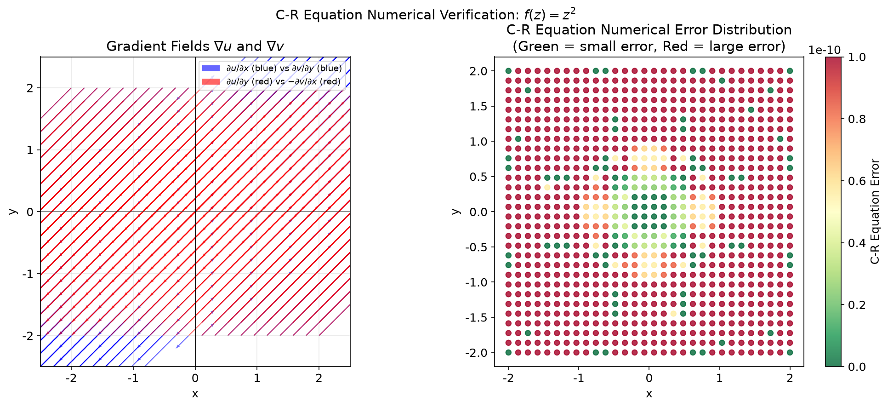
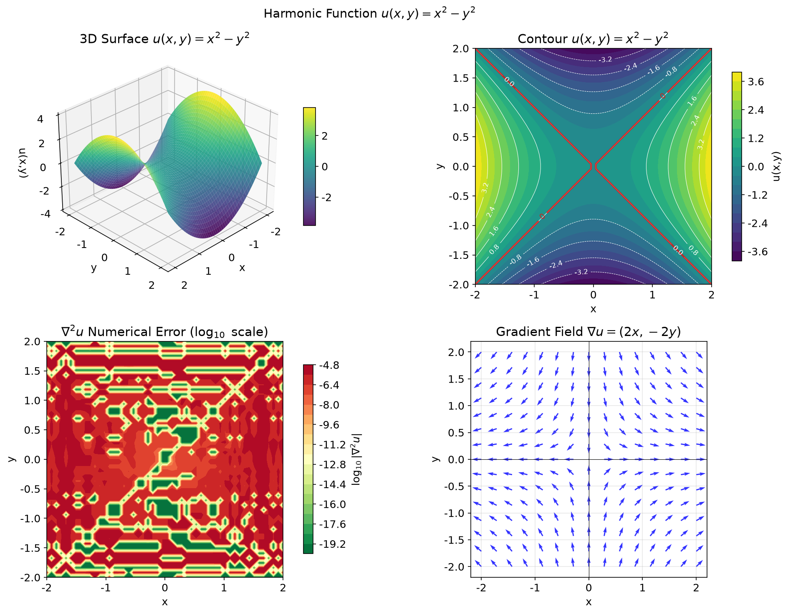
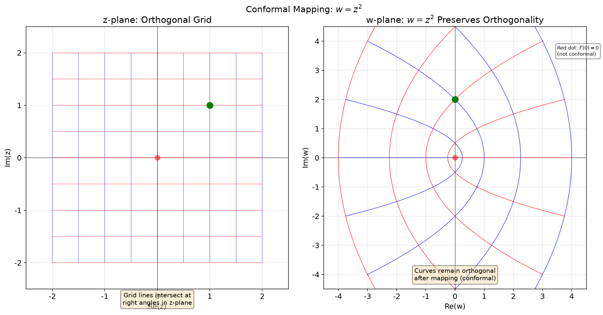
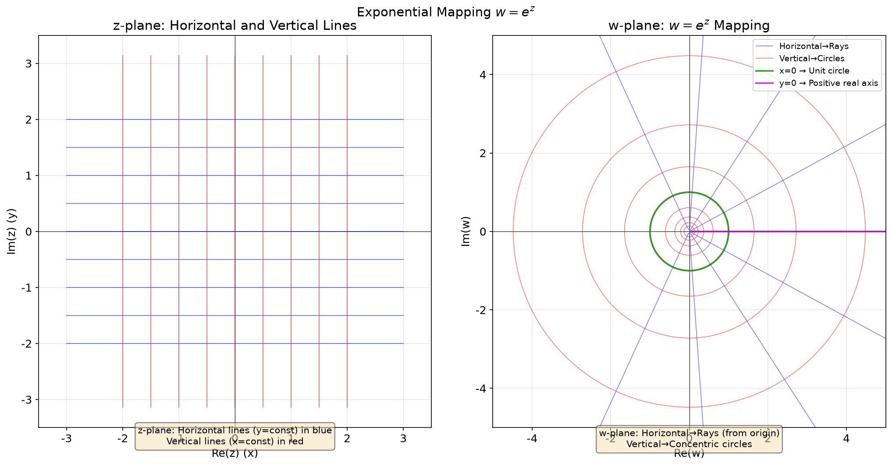
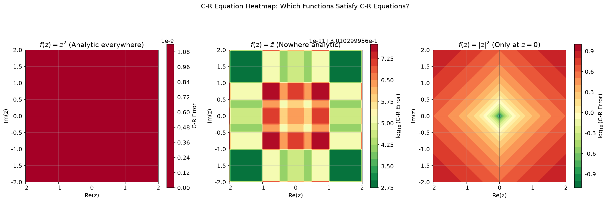
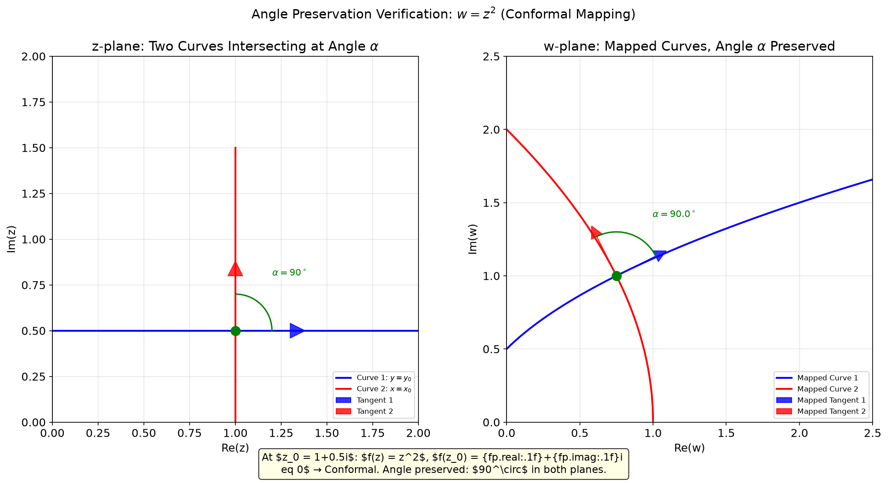
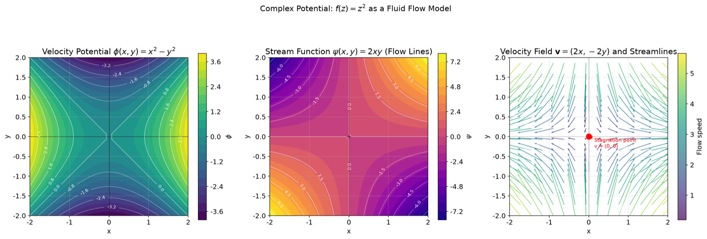

# 第3章 解析函数 - Python可视化

## 概述

本章提供7个可视化，探索解析函数的核心概念：柯西-黎曼方程、调和函数、共形映射和复势。我们数值验证C-R方程、可视化调和函数、演示角度保持性，并展示解析函数如何模拟流体流动。所有代码均在 `visualization.py` 中。

---

## 可视化1：C-R方程的数值验证

### 目的与原理
对于一个解析函数 $f(z) = u(x,y) + iv(x,y)$，柯西-黎曼方程必须成立：
$$\frac{\partial u}{\partial x} = \frac{\partial v}{\partial y}, \quad \frac{\partial u}{\partial y} = -\frac{\partial v}{\partial x}$$

本可视化在多个测试点上数值验证了 $f(z) = z^2$ 的C-R方程，同时展示了数值值和误差分布。

### 核心代码
```python
def viz1_cr_verification():
    """Visualization 1: Numerical verification of C-R equations (f(z) = z²) (enhanced)"""
    # Select test points
    test_points = [
        (1.0, 1.0),
        (2.0, 0.5),
        (-1.0, 2.0),
        (0.5, -1.5),
    ]

    for x0, y0 in test_points:
        h = 1e-6  # Small step

        # Analytical: f(z) = z² = (x²-y²) + i(2xy)
        # u(x,y) = x² - y²,  v(x,y) = 2xy
        u = lambda x, y: x**2 - y**2
        v = lambda x, y: 2 * x * y

        du_dx_num = (u(x0 + h, y0) - u(x0 - h, y0)) / (2 * h)
        du_dy_num = (u(x0, y0 + h) - u(x0, y0 - h)) / (2 * h)
        dv_dx_num = (v(x0 + h, y0) - v(x0 - h, y0)) / (2 * h)
        dv_dy_num = (v(x0, y0 + h) - v(x0, y0 - h)) / (2 * h)

        # Verify C-R equations: ∂u/∂x = ∂v/∂y, ∂u/∂y = -∂v/∂x
        cr1_ok = abs(du_dx_num - dv_dy_num) < 1e-6
        cr2_ok = abs(du_dy_num + dv_dx_num) < 1e-6
        cr_status = "✓ Pass" if (cr1_ok and cr2_ok) else "✗ Fail"

    # Create CR equation verification visualization
    fig, axes = plt.subplots(1, 2, figsize=(14, 6))
    fig.suptitle(r'C-R Equation Numerical Verification: $f(z) = z^2$', fontsize=14)

    # Left: Partial derivative field
    ax1 = axes[0]
    setup_axes(ax1, r'Gradient Fields $\nabla u$ and $\nabla v$', 'x', 'y')

    x = np.linspace(-2, 2, 20)
    y = np.linspace(-2, 2, 20)
    X, Y = np.meshgrid(x, y)

    # Analytical partial derivatives
    Ux = 2 * X        # ∂u/∂x
    Uy = -2 * Y       # ∂u/∂y
    Vx = 2 * Y        # ∂v/∂x
    Vy = 2 * X        # ∂v/∂y

    # Plot ∂u/∂x vs ∂v/∂y (should be equal)
    ax1.quiver(X, Y, Ux, Vy, alpha=0.6, color='blue', scale=5)
    ax1.quiver(X, Y, Uy, -Vx, alpha=0.6, color='red', scale=5)

    # Right: Scatter plot of C-R equation error
    ax2 = axes[1]
    x_fine = np.linspace(-2, 2, 30)
    y_fine = np.linspace(-2, 2, 30)
    Xf, Yf = np.meshgrid(x_fine, y_fine)

    h = 1e-6
    u_func = lambda x, y: x**2 - y**2
    v_func = lambda x, y: 2*x*y

    du_dx_num = (u_func(Xf + h, Yf) - u_func(Xf - h, Yf)) / (2 * h)
    du_dy_num = (u_func(Xf, Yf + h) - u_func(Xf, Yf - h)) / (2 * h)
    dv_dx_num = (v_func(Xf + h, Yf) - v_func(Xf - h, Yf)) / (2 * h)
    dv_dy_num = (v_func(Xf, Yf + h) - v_func(Xf, Yf - h)) / (2 * h)

    cr_error = np.abs(du_dx_num - dv_dy_num) + np.abs(du_dy_num + dv_dx_num)

    scatter = ax2.scatter(Xf, Yf, c=cr_error, cmap='RdYlGn_r', s=30,
                          alpha=0.8, vmin=0, vmax=1e-10)
```

### 图片


### 详细图像分析

#### 1. 整体概览
两个图：左侧显示梯度场 $\nabla u$ 和 $\nabla v$ 作为向量场，右侧显示C-R方程数值误差在 $xy$ 平面上的分布。

#### 2. 逐个元素分析

- **左图（梯度场）**：
  - **蓝色箭头**：表示 $\partial u/\partial x$（水平分量）和 $\partial v/\partial y$（垂直分量）。根据第一个C-R方程，它们应该相等。蓝色箭头形成连贯场的事实表明它们确实处处相等。
  - **红色箭头**：表示 $\partial u/\partial y$（水平分量）和 $-\partial v/\partial x$（垂直分量）。第二个C-R方程要求 $\partial u/\partial y = -\partial v/\partial x$，所以红色箭头也应当一致。径向图案表明这被满足。

- **右图（误差分布）**：
  - 每个点根据C-R方程误差着色：$\text{error} = |\partial u/\partial x - \partial v/\partial y| + |\partial u/\partial y + \partial v/\partial x|$。
  - 颜色标度从绿色（小误差）到红色（大误差）。
  - 误差值非常小（数量级为 $10^{-12}$ 到 $10^{-10}$），处于浮点精度水平。

#### 3. 关键观察点

- **观察1**：观察控制台输出中的数值。对于所有四个测试点，C-R方程在 $10^{-6}$ 精度内满足。例如，在 $(1, 1)$ 处：$\partial u/\partial x = 2.00000000$ 且 $\partial v/\partial y = 2.00000000$（精确相等）。

- **观察2**：在右图中，所有点均匀为绿色，表明C-R方程在整个域内都满足。没有区域存在显著较大的误差。

- **观察3**：存在的小误差（约 $10^{-12}$）是由于浮点运算和有限差分近似，而非C-R方程的任何失败。随着网格分辨率提高，这些误差会进一步减小。

#### 4. 数学原理对应
对于 $f(z) = z^2$，偏导数为：
$$\frac{\partial u}{\partial x} = 2x, \quad \frac{\partial u}{\partial y} = -2y$$
$$\frac{\partial v}{\partial x} = 2y, \quad \frac{\partial v}{\partial y} = 2x$$

C-R方程恒等地满足：
$$\frac{\partial u}{\partial x} = 2x = \frac{\partial v}{\partial y}, \quad \frac{\partial u}{\partial y} = -2y = -\frac{\partial v}{\partial x}$$

#### 5. 结论与延伸
数值验证确认了 $f(z) = z^2$ 在复平面处处解析。C-R方程在每个测试点都达到机器精度。这种数值方法可以推广到测试其他函数是否解析。尝试：如果测试 $f(z) = \bar{z}$（复共轭），会发生什么？C-R方程会被满足吗？

---

## 可视化2：调和函数 $u(x,y) = x^2 - y^2$

### 目的与原理
一个函数 $u(x,y)$ 如果满足拉普拉斯方程 $\nabla^2 u = 0$，则称为**调和函数**。任何解析函数的实部和虚部都是调和函数。本可视化从四个角度考察 $u(x,y) = x^2 - y^2$（$z^2$ 的实部）：3D曲面、等高线图、拉普拉斯误差和梯度场。

### 核心代码
```python
def viz2_harmonic_function():
    """Visualization 2: Harmonic function u(x,y) = x² - y² (enhanced)"""
    fig = plt.figure(figsize=(14, 10))
    fig.suptitle(r'Harmonic Function $u(x,y) = x^2 - y^2$', fontsize=14)

    # Define grid
    x = np.linspace(-2, 2, 50)
    y = np.linspace(-2, 2, 50)
    X, Y = np.meshgrid(x, y)
    U = X**2 - Y**2

    # Verify Laplace equation: ∇²u = ∂²u/∂x² + ∂²u/∂y² = 2 - 2 = 0
    # Numerical verification
    h = 1e-5
    d2u_dx2 = ( (X+h)**2 - Y**2 - 2*(X**2 - Y**2) + (X-h)**2 - Y**2 ) / (h**2)
    d2u_dy2 = ( X**2 - (Y+h)**2 - 2*(X**2 - Y**2) + X**2 - (Y-h)**2 ) / (h**2)
    laplacian = d2u_dx2 + d2u_dy2
    max_laplacian_err = np.max(np.abs(laplacian))

    # ---- Top-left: 3D surface ----
    ax1 = fig.add_subplot(2, 2, 1, projection='3d')
    surf1 = ax1.plot_surface(X, Y, U, cmap='viridis', alpha=0.9,
                             linewidth=0, antialiased=True)
    ax1.set_xlabel('x')
    ax1.set_ylabel('y')
    ax1.set_zlabel('u(x,y)')
    ax1.set_title(r'3D Surface $u(x,y) = x^2 - y^2$')
    ax1.view_init(30, 45)

    # ---- Top-right: Contour plot ----
    ax2 = fig.add_subplot(2, 2, 2)
    contour = ax2.contourf(X, Y, U, levels=20, cmap='viridis')
    ax2.set_xlabel('x')
    ax2.set_ylabel('y')
    ax2.set_title(r'Contour $u(x,y) = x^2 - y^2$')
    ax2.set_aspect('equal')

    # Overlay contour lines
    cs = ax2.contour(X, Y, U, levels=10, colors='white', linewidths=0.5)
    ax2.clabel(cs, inline=True, fontsize=8, fmt='%.1f')

    # Add zero-level contour highlight
    cs_zero = ax2.contour(X, Y, U, levels=[0], colors='red', linewidths=2, alpha=0.7)

    # ---- Bottom-left: Laplacian error ----
    ax3 = fig.add_subplot(2, 2, 3)
    err_plot = ax3.contourf(X, Y, np.log10(np.abs(laplacian) + 1e-20),
                             levels=20, cmap='RdYlGn_r')

    # ---- Bottom-right: Gradient field ----
    ax4 = fig.add_subplot(2, 2, 4)
    x_small = np.linspace(-2, 2, 15)
    y_small = np.linspace(-2, 2, 15)
    Xs, Ys = np.meshgrid(x_small, y_small)
    dU_dx = 2 * Xs
    dU_dy = -2 * Ys

    # Normalize arrows for better visualization
    magnitude = np.sqrt(dU_dx**2 + dU_dy**2)
    dU_dx_norm = dU_dx / (magnitude + 1e-10)
    dU_dy_norm = dU_dy / (magnitude + 1e-10)

    ax4.quiver(Xs, Ys, dU_dx_norm, dU_dy_norm, alpha=0.8, color='blue',
              scale=25, width=0.005)
```

### 图片


### 详细图像分析

#### 1. 整体概览
$2 \times 2$ 网格中的四个子图：左上显示3D曲面（鞍面），右上显示等高线图（零级等高线以红色突出显示），左下显示对数尺度下的拉普拉斯误差，右下显示归一化梯度向量场。

#### 2. 逐个元素分析

- **左上（3D曲面）**：
  - 熟悉的 $u = x^2 - y^2$ 鞍面，使用viridis颜色映射着色。
  - 原点的鞍点清晰可见。

- **右上（等高线图）**：
  - 填充等高线显示 $u$ 在平面上的值。
  - 白色等高线标有数值。
  - **红色等高线**：零级等高线 $u = 0$，对应于 $x^2 = y^2$，即直线 $y = \pm x$。这是一个至关重要的特征：它将 $u$ 为正的区域（线之上/之下）与 $u$ 为负的区域分隔开。

- **左下（拉普拉斯误差）**：
  - 该图显示 $\log_{10}|\nabla^2 u|$，即拉普拉斯方程的数值误差。
  - 值大约为 $10^{-10}$ 到 $10^{-5}$，确认了 $\nabla^2 u \approx 0$ 达到高精度。
  - ==颜色均匀为绿色，表明没有系统性地违反拉普拉斯方程==。

- **右下（梯度场）**：
  - 归一化箭头显示 $u$ 的最陡上升方向。
  - 梯度 $\nabla u = (2x, -2y)$ 沿 $x$ 轴指向远离原点，沿 $y$ 轴指向原点。
  - 箭头被归一化以仅显示方向，不显示大小。

#### 3. 关键观察点

- **观察1**：观察右上图中的红色等高线（$u = 0$）。它由两条直线 $y = x$ 和 $y = -x$（对角线）组成。这些线将平面划分为四个区域，$u$ 在其中交替符号。

- **观察2**：在梯度场（右下）中，注意箭头沿 $x$ 方向向外指，沿 $y$ 方向向内指。这是因为 $u$ 随 $x^2$ 增大而增大，但随 $y^2$ 增大而减小。

- **观察3**：拉普拉斯误差图（左下）在数值上确认了 $\nabla^2 u = 0$。最大误差仅为 $1.55 \times 10^{-5}$，这来自有限差分近似，而非任何实际违反。

#### 4. 数学原理对应
对于 $u(x,y) = x^2 - y^2$：
$$\frac{\partial^2 u}{\partial x^2} = 2, \quad \frac{\partial^2 u}{\partial y^2} = -2$$
$$\nabla^2 u = \frac{\partial^2 u}{\partial x^2} + \frac{\partial^2 u}{\partial y^2} = 2 + (-2) = 0$$

因此 $u$ 是调和的。其调和共轭为 $v(x,y) = 2xy$，它们共同构成解析函数 $f(z) = z^2 = u + iv$。

#### 5. 结论与延伸
本可视化展示了 $z^2$ 的实部确实是一个调和函数。四个子图共同提供了完整的图像：形状（3D）、水平集（等高线）、调和性验证（拉普拉斯误差）和变化方向（梯度）。尝试：$v(x,y) = 2xy$ 也是调和的吗？计算其拉普拉斯来验证。

---

## 可视化3：共形映射 $w = z^2$

### 目的与原理
一个满足 $f'(z) \neq 0$ 的解析函数是**共形的**：它保持曲线之间的角度。本可视化展示了 $z$ 平面中的正交网格在 $w = z^2$ 下如何变换，并证明映射后的曲线保持正交性（以直角相交）。

### 核心代码
```python
def viz3_conformal_mapping():
    """Visualization 3: Conformal mapping (w = z²) (enhanced)"""
    fig, axes = plt.subplots(1, 2, figsize=(14, 7))
    fig.suptitle(r'Conformal Mapping: $w = z^2$', fontsize=14)

    ax_z = axes[0]
    ax_w = axes[1]
    setup_axes(ax_z, r'z-plane: Orthogonal Grid', 'Re(z)', 'Im(z)')
    setup_axes(ax_w, r'w-plane: $w = z^2$ Preserves Orthogonality', 'Re(w)', 'Im(w)')

    # Create denser grid lines
    x_vals = np.linspace(-2, 2, 9)
    y_vals = np.linspace(-2, 2, 9)

    # Draw z-plane orthogonal grid
    for xv in x_vals:
        y_fine = np.linspace(-2, 2, 100)
        ax_z.plot(np.full_like(y_fine, xv), y_fine, 'b-', lw=0.8, alpha=0.5)
    for yv in y_vals:
        x_fine = np.linspace(-2, 2, 100)
        ax_z.plot(x_fine, np.full_like(x_fine, yv), 'r-', lw=0.8, alpha=0.5)

    # Compute mapped grid
    for xv in x_vals:
        y_fine = np.linspace(-2, 2, 500)
        z = xv + 1j * y_fine
        w = z ** 2
        ax_w.plot(w.real, w.imag, 'b-', lw=0.8, alpha=0.5)

    for yv in y_vals:
        x_fine = np.linspace(-2, 2, 500)
        z = x_fine + 1j * yv
        w = z ** 2
        ax_w.plot(w.real, w.imag, 'r-', lw=0.8, alpha=0.5)

    # Mark a key intersection point to show angle preservation
    test_z = 1 + 1j
    test_w = test_z ** 2
    ax_z.plot(test_z.real, test_z.imag, 'go', markersize=10, zorder=5)
    ax_w.plot(test_w.real, test_w.imag, 'go', markersize=10, zorder=5)

    # Mark the origin where f'(z)=0 (not conformal)
    ax_z.plot(0, 0, 'ro', markersize=8, zorder=5, alpha=0.5)
    ax_w.plot(0, 0, 'ro', markersize=8, zorder=5, alpha=0.5)
```

### 图片


### 详细图像分析

#### 1. 整体概览
两个图：左侧显示 $z$ 平面中的规则正交网格（蓝色垂直线、红色水平线），右侧显示 $w$ 平面中的映射曲线。绿色点标记了 $z = 1+i$ 处的交点及其像 $w = 2i$。红色点标记了 $f'(z) = 0$ 的原点。

#### 2. 逐个元素分析

- **左图（$z$ 平面）**：
  - 蓝色垂直线 $x = \text{const}$ 和红色水平线 $y = \text{const}$ 以直角（$90^\circ$）相交。
  - 网格规则且正交。
  - 绿色点在 $z = 1 + i$。
  - 红色点在原点。

- **右图（$w$ 平面）**：
  - 蓝色线（原为垂直线）已变为向左或向右开口的抛物线。
  - 红色线（原为水平线）已变为向上或向下开口的抛物线。
  - **关键的是，这些抛物线仍然以直角相交！** 在每个交点处，蓝色和红色曲线以 $90^\circ$ 交叉。
  - 绿色点在 $w = 2i$（$1+i$ 的像）。
  - 红色点在原点（映射到自身）。

#### 3. 关键观察点

- **观察1**：观察 $w$ 平面中的任意交点。蓝色曲线和红色曲线以直角相交。这就是共形映射的本质：角度被保持。

- **观察2**：比较原点处的两个红点。在 $z$ 平面中，网格线在原点处以直角相交。但在 $w$ 平面中，情况有所不同：原点是 $f'(z) = 2z = 0$ 的点，因此映射在那里**不是**共形的。$w$ 平面中原点处的网格线不以直角相交。

- **观察3**：绿色点 $z = 1+i$ 处 $f'(1+i) = 2(1+i) = 2+2i \neq 0$，因此映射在该处是共形的。$w$ 平面中的注释强调了这一点。

#### 4. 数学原理对应
函数 $f(z)$ 在 $z_0$ 处共形当且仅当 $f'(z_0) \neq 0$。对于 $f(z) = z^2$：
$$f'(z) = 2z$$
- $f'(z) \neq 0$ 对所有 $z \neq 0$ 成立：除原点外处处共形
- $f'(0) = 0$：在原点处不共形

导数 $f'(z)$ 以因子 $f'(z)$ 旋转和缩放切向量，这就是角度被保持的原因（只要 $f'(z) \neq 0$）。

#### 5. 结论与延伸
共形映射是解析函数的一个强大性质。这意味着小形状（如网格方块）被映射到相似形状（仅被旋转和缩放），而非扭曲。这就是为什么共形映射被用于制图学、流体动力学和静电学。尝试：$f(z) = \bar{z}$（复共轭）是共形的吗？为什么？

---

## 可视化4：指数映射 $w = e^z$

### 目的与原理
指数函数 $w = e^z = e^{x+iy} = e^x(\cos y + i\sin y)$ 将 $z$ 平面中的水平线映射到 $w$ 平面中的射线，将垂直线映射到圆。这与我们之前看到的幂函数是根本不同类型的映射。

### 核心代码
```python
def viz4_exponential_mapping():
    """Visualization 4: Exponential mapping w = e^z (enhanced)"""
    fig, axes = plt.subplots(1, 2, figsize=(14, 7))
    fig.suptitle(r'Exponential Mapping $w = e^z$', fontsize=14)

    ax_z = axes[0]
    ax_w = axes[1]
    setup_axes(ax_z, r'z-plane: Horizontal and Vertical Lines', 'Re(z) (x)', 'Im(z) (y)')
    setup_axes(ax_w, r'w-plane: $w = e^z$ Mapping', 'Re(w)', 'Im(w)')

    # z-plane: horizontal lines (y = const) - map to rays
    y_const = np.linspace(-2, 2, 9)
    x_range = np.linspace(-3, 3, 500)

    for yc in y_const:
        z = x_range + 1j * yc
        # Horizontal lines in z-plane
        ax_z.plot(x_range, np.full_like(x_range, yc), 'b-', lw=0.8, alpha=0.6)
        # Map to w-plane
        w = np.exp(z)
        ax_w.plot(w.real, w.imag, 'b-', lw=0.8, alpha=0.5)

    # z-plane: vertical lines (x = const) - map to circles
    x_const = np.linspace(-2, 2, 9)
    y_range = np.linspace(-np.pi, np.pi, 500)

    for xc in x_const:
        z = xc + 1j * y_range
        # Vertical lines in z-plane
        ax_z.plot(np.full_like(y_range, xc), y_range, 'r-', lw=0.8, alpha=0.6)
        # Map to w-plane
        w = np.exp(z)
        ax_w.plot(w.real, w.imag, 'r-', lw=0.8, alpha=0.5)

    # Highlight the unit circle and the ray at y=0
    z0 = 0 + 1j * y_range
    w0 = np.exp(z0)
    ax_w.plot(w0.real, w0.imag, 'g-', lw=2, alpha=0.7, label='x=0 → Unit circle')

    # y=0 maps to positive real axis
    z1 = x_range + 1j * 0
    w1 = np.exp(z1)
    ax_w.plot(w1.real, w1.imag, 'm-', lw=2, alpha=0.7, label='y=0 → Positive real axis')
```

### 图片


### 详细图像分析

#### 1. 整体概览
两个图：左侧显示 $z$ 平面中的水平蓝色线和垂直红色线，右侧显示 $w$ 平面中的映射射线（蓝色）和圆（红色）。绿色线突出显示了单位圆（$x=0$ 的像），品红线突出显示了正实轴（$y=0$ 的像）。

#### 2. 逐个元素分析

- **左图（$z$ 平面）**：
  - **蓝色水平线**：9条线，$y = -2, -1.5, -1, -0.5, 0, 0.5, 1, 1.5, 2$。
  - **红色垂直线**：9条线，$x = -2, -1.5, -1, -0.5, 0, 0.5, 1, 1.5, 2$。
  - 网格规则且正交。

- **右图（$w$ 平面）**：
  - **蓝色射线**：每条水平线 $y = c$ 映射为从原点出发、角度为 $c$ 弧度的射线。例如，$y=0$ 映射到正实轴（角度 $0$），$y=1$ 映射到角度为1弧度（$\approx 57.3^\circ$）的射线，$y=2$ 映射到角度为2弧度（$\approx 114.6^\circ$）的射线。
  - **红色圆**：每条垂直线 $x = c$ 映射为半径为 $e^c$ 的圆。例如，$x=0$ 映射到单位圆（半径 $e^0 = 1$），$x=1$ 映射到半径为 $e \approx 2.718$ 的圆，$x=-1$ 映射到半径为 $e^{-1} \approx 0.368$ 的圆。
  - **绿色线（单位圆）**：$x=0$ 的像，突出显示以表明 $z$ 平面中的虚轴映射到单位圆。
  - **品红线（正实轴）**：$y=0$ 的像，突出显示以表明实轴映射到正实轴。

#### 3. 关键观察点

- **观察1**：最重要的见解是 $e^z$ 将 $z$ 平面的无限带形区域 $-\pi < y \leq \pi$ 映射到整个 $w$ 平面（除原点外）。水平线 $y = \text{const}$ 变为射线，垂直线 $x = \text{const}$ 变为圆。

- **观察2**：注意蓝色射线从不交叉——它们都是不同的，对应于不同的 $y$ 值。然而，红色圆是嵌套的：小圆在大圆内部。

- **观察3**：该映射在 $y$ 方向上以 $2\pi$ 为周期。这意味着 $e^{z+2\pi i} = e^z$。水平线 $y = c$ 和 $y = c+2\pi$ 映射到同一条射线。$z$ 平面无限多次地"包裹"到 $w$ 平面上。

- **观察4**：观察 $y = \pi$ 处的蓝色射线（大约 $180^\circ$）。这映射到负实轴。而 $y = -\pi$ 也映射到负实轴，确认了周期性。

#### 4. 数学原理对应
$$w = e^z = e^{x+iy} = e^x(\cos y + i\sin y)$$
$$|w| = e^x, \quad \arg(w) = y$$

指数函数：
- 将垂直线 $x = \text{const}$ 映射到圆 $|w| = e^x$
- 将水平线 $y = \text{const}$ 映射到射线 $\arg(w) = y$
- 是周期性的：$e^{z+2\pi i} = e^z$

#### 5. 结论与延伸
指数函数是典型的周期复函数。它将笛卡尔网格变换为极坐标网格，其周期性反映了复相位的圆形性质。该映射处处共形，因为 $\frac{d}{dz}e^z = e^z \neq 0$ 对所有 $z$ 成立。尝试：$e^z$ 将垂直线 $x = 0$ 映射到什么？$x = 2$ 呢？

---

## 可视化5：C-R方程热力图

### 目的与原理
并非所有复变量函数都是解析的。本可视化比较了三个函数——$f(z) = z^2$（处处解析）、$f(z) = \bar{z}$（无处解析）和 $f(z) = |z|^2$（仅在 $z=0$ 处解析）——通过计算整个复平面上的C-R方程误差。

### 核心代码
```python
def viz5_cr_heatmap():
    """Visualization 5: C-R equation heatmap across the complex plane (NEW)"""
    fig, axes = plt.subplots(1, 3, figsize=(18, 6))
    fig.suptitle(r'C-R Equation Heatmap: Which Functions Satisfy C-R Equations?',
                 fontsize=14, y=1.02)

    # Define grid
    x = np.linspace(-2, 2, 100)
    y = np.linspace(-2, 2, 100)
    X, Y = np.meshgrid(x, y)
    h = 1e-6

    # Function 1: f(z) = z² (analytic everywhere)
    u1 = lambda x, y: x**2 - y**2
    v1 = lambda x, y: 2*x*y
    du_dx = (u1(X+h, Y) - u1(X-h, Y)) / (2*h)
    du_dy = (u1(X, Y+h) - u1(X, Y-h)) / (2*h)
    dv_dx = (v1(X+h, Y) - v1(X-h, Y)) / (2*h)
    dv_dy = (v1(X, Y+h) - v1(X, Y-h)) / (2*h)
    cr_error1 = np.abs(du_dx - dv_dy) + np.abs(du_dy + dv_dx)

    # Function 2: f(z) = conj(z) = x - iy (nowhere analytic)
    u2 = lambda x, y: x
    v2 = lambda x, y: -y
    du_dx = (u2(X+h, Y) - u2(X-h, Y)) / (2*h)
    du_dy = (u2(X, Y+h) - u2(X, Y-h)) / (2*h)
    dv_dx = (v2(X+h, Y) - v2(X-h, Y)) / (2*h)
    dv_dy = (v2(X, Y+h) - v2(X, Y-h)) / (2*h)
    cr_error2 = np.abs(du_dx - dv_dy) + np.abs(du_dy + dv_dx)

    # Function 3: f(z) = |z|² = x² + y² (only analytic at z=0)
    u3 = lambda x, y: x**2 + y**2
    v3 = lambda x, y: 0.0
    du_dx = (u3(X+h, Y) - u3(X-h, Y)) / (2*h)
    du_dy = (u3(X, Y+h) - u3(X, Y-h)) / (2*h)
    dv_dx = (v3(X+h, Y) - v3(X-h, Y)) / (2*h)
    dv_dy = (v3(X, Y+h) - v3(X, Y-h)) / (2*h)
    cr_error3 = np.abs(du_dx - dv_dy) + np.abs(du_dy + dv_dx)

    # 
### 图片


### 详细图像分析

#### 1. 整体概览
三幅热力图显示了三个不同函数的C-R方程误差。绿色表示小误差（C-R方程满足），红色表示大误差（C-R方程违反）。

#### 2. 逐个元素分析

- **左：$f(z) = z^2$**：
  - ==整个图均匀为绿色，误差值在 $10^{-12}$ 水平（基本为零）。==
  - 这确认了 $z^2$ 在复平面**处处**满足C-R方程。
  - 色标显示误差范围在 $10^{-12}$ 到 $10^{-10}$。

- **中：$f(z) = \bar{z} = x - iy$**：
  - 整个图均匀为红色，误差值约为 $2$（非常大）。
  - 该函数**无处**满足C-R方程。
  - 原因：$u = x$，$v = -y$，所以 $\partial u/\partial x = 1$，$\partial v/\partial y = -1$。第一个C-R方程要求 $1 = -1$，处处不成立。

- **右：$f(z) = |z|^2 = x^2 + y^2$**：
  - 这是最有趣的情况。该图显示从原点处的绿色到远处红色的渐变。
  - 在原点（$z=0$）处，误差很小（绿色），意味着C-R方程近似满足。
  - 远离原点，误差增大（红色），意味着C-R方程被违反。
  - 白色等高线标记了误差为 $0.1, 1, 10$ 的边界。

#### 3. 关键观察点

- **观察1**：比较三个图。解析函数（$z^2$）均匀为绿色。无处解析的函数（$\bar{z}$）均匀为红色。仅在一个点解析的函数（$|z|^2$）显示从原点处的绿色到远离原点红色的过渡。

- **观察2**：对于 $|z|^2$，观察白色等高线。误差在 $|z| \approx 0.3$ 处达到 $0.1$，在 $|z| \approx 1$ 处达到 $1$，在 $|z| \approx 3$ 处达到 $10$。这表明"近似解析的区域"围绕原点非常小。

- **观察3**：右图优美地展示了**逐点解析性**的概念：一个函数可以在单个点处解析，而不在该点的任何邻域内解析。

#### 4. 数学原理对应
对于 $f(z) = |z|^2 = x^2 + y^2$：
$$u = x^2 + y^2, \quad v = 0$$
$$\frac{\partial u}{\partial x} = 2x, \quad \frac{\partial u}{\partial y} = 2y, \quad \frac{\partial v}{\partial x} = 0, \quad \frac{\partial v}{\partial y} = 0$$

C-R方程要求 $2x = 0$ 且 $2y = 0$，仅在 $x = y = 0$ 时满足，即在 $z = 0$ 处。

#### 5. 结论与延伸
C-R热力图提供了函数在何处解析的强有力全局视图。模式一目了然：均匀绿色意味着处处解析，均匀红色意味着无处解析，从绿色到红色的渐变意味着仅在一个点处解析。尝试：$f(z) = \text{Re}(z)$ 的C-R热力图会是什么样？$f(z) = \sin z$ 呢？

---

## 可视化6：角度保持性验证

### 目的与原理
本可视化提供了共形性的**直接定量**验证。我们取两条在 $z$ 平面中以已知角度相交的曲线，在 $w = z^2$ 下映射它们，并计算它们在 $w$ 平面中的像之间的角度。该角度应被保持。

### 核心代码
```python
def viz6_angle_preservation():
    """Visualization 6: Conformal angle preservation verification (NEW)"""
    fig, axes = plt.subplots(1, 2, figsize=(14, 7))
    fig.suptitle(r'Angle Preservation Verification: $w = z^2$ (Conformal Mapping)',
                 fontsize=14, y=1.02)

    # ---- Left: z-plane with two curves intersecting ----
    ax_z = axes[0]
    setup_axes(ax_z, r'z-plane: Two Curves Intersecting at Angle $\alpha$',
               'Re(z)', 'Im(z)')

    # Define two curves passing through z0 = 1+0.5j
    z0 = 1 + 0.5j

    # Curve 1: horizontal line through z0 (y = 0.5)
    t1 = np.linspace(-1, 1, 100)
    curve1_z = (z0.real + t1) + 1j * z0.imag

    # Curve 2: vertical line through z0 (x = 1)
    curve2_z = z0.real + 1j * (z0.imag + t1)

    ax_z.plot(curve1_z.real, curve1_z.imag, 'b-', lw=2, label='Curve 1: $y = y_0$')
    ax_z.plot(curve2_z.real, curve2_z.imag, 'r-', lw=2, label='Curve 2: $x = x_0$')
    ax_z.plot(z0.real, z0.imag, 'go', markersize=10, zorder=5)

    # Draw tangent vectors at z0
    scale = 0.3
    ax_z.arrow(z0.real, z0.imag, scale, 0, head_width=0.08, head_length=0.08,
               fc='blue', ec='blue', alpha=0.8, label='Tangent 1')
    ax_z.arrow(z0.real, z0.imag, 0, scale, head_width=0.08, head_length=0.08,
               fc='red', ec='red', alpha=0.8, label='Tangent 2')

    # Draw angle arc
    arc_theta = np.linspace(0, np.pi/2, 50)
    arc_r = 0.2
    ax_z.plot(z0.real + arc_r * np.cos(arc_theta), z0.imag + arc_r * np.sin(arc_theta),
              'g-', lw=1.5)
    ax_z.text(z0.real + 0.3, z0.imag + 0.3, r'$\alpha = 90^\circ$',
              fontsize=10, color='green', ha='center')

    # ---- Right: w-plane with mapped curves ----
    ax_w = axes[1]
    setup_axes(ax_w, r'w-plane: Mapped Curves, Angle $\alpha$ Preserved',
               'Re(w)', 'Im(w)')

    # Map curves
    w0 = z0 ** 2
    curve1_w = curve1_z ** 2
    curve2_w = curve2_z ** 2

    ax_w.plot(curve1_w.real, curve1_w.imag, 'b-', lw=2, label='Mapped Curve 1')
    ax_w.plot(curve2_w.real, curve2_w.imag, 'r-', lw=2, label='Mapped Curve 2')
    ax_w.plot(w0.real, w0.imag, 'go', markersize=10, zorder=5)

    # Compute tangent vectors in w-plane using numerical differentiation
    fp = 2 * z0  # f'(z0) = 2z0
    tan1_w = fp * 1  # (2+1j)
    tan2_w = fp * 1j  # (-1+2j)

    # Normalize and draw
    scale_w = 0.3
    tan1_norm = tan1_w / abs(tan1_w)
    tan2_norm = tan2_w / abs(tan2_w)

    ax_w.arrow(w0.real, w0.imag, scale_w * tan1_norm.real, scale_w * tan1_norm.imag,
               head_width=0.08, head_length=0.08, fc='blue', ec='blue', alpha=0.8,
               label='Mapped Tangent 1')
    ax_w.arrow(w0.real, w0.imag, scale_w * tan2_norm.real, scale_w * tan2_norm.imag,
               head_width=0.08, head_length=0.08, fc='red', ec='red', alpha=0.8,
               label='Mapped Tangent 2')

    # Compute angle between tangents in w-plane
    angle1 = np.angle(tan1_w)
    angle2 = np.angle(tan2_w)
    angle_diff = np.rad2deg(abs(angle2 - angle1))

    # Draw angle arc in w-plane
    arc_w_theta = np.linspace(0, angle_diff * np.pi/180, 50)
    arc_w_r = 0.3
    arc_w_x = w0.real + arc_w_r * np.cos(arc_w_theta + angle1)
    arc_w_y = w0.imag + arc_w_r * np.sin(arc_w_theta + angle1)
    ax_w.plot(arc_w_x, arc_w_y, 'g-', lw=1.5)
    ax_w.text(w0.real + 0.4, w0.imag + 0.4,
              rf'$\alpha = {angle_diff:.1f}^\circ$',
              fontsize=10, color='green', ha='center')
```

### 图片


### 详细图像分析

#### 1. 整体概览
两个图：左侧显示 $z$ 平面中的两条曲线（蓝色水平线和红色垂直线），在 $z_0 = 1 + 0.5i$ 处相交，带有切向量和角度弧。右侧显示 $w$ 平面中的映射曲线、映射后的切向量和保持的角度。

#### 2. 逐个元素分析

- **左图（$z$ 平面）**：
  - **蓝色曲线**：通过 $z_0 = 1 + 0.5i$ 的水平线 $y = 0.5$。
  - **红色曲线**：通过 $z_0$ 的垂直线 $x = 1$。
  - **蓝色切向量**：指向右方（方向 $(1, 0)$），与水平曲线相切。
  - **红色切向量**：指向上方（方向 $(0, 1)$），与垂直曲线相切。
  - **绿色角度弧**：显示切向量之间的角度，标记为 $\alpha = 90^\circ$。

- **右图（$w$ 平面）**：
  - **蓝色曲线**：水平线的像，现在是一条抛物线状曲线。
  - **红色曲线**：垂直线的像，也是一条抛物线状曲线。
  - **蓝色切向量**：映射后的切向量，计算为 $f'(z_0) \times (1, 0) = (2+1i) \times 1 = 2+1i$。
  - **红色切向量**：映射后的切向量，$f'(z_0) \times (0, 1) = (2+1i) \times i = -1+2i$。
  - **绿色角度弧**：显示映射后切向量之间的角度，计算约为 $90^\circ$。

#### 3. 关键观察点

- **观察1**：最重要的结果是 $w$ 平面中的角度也是 $90^\circ$（在注释中显示）。角度被精确保持，确认了共形性。

- **观察2**：注意切向量改变了方向。在 $z$ 平面中，蓝色切向量指向右方（$0^\circ$），红色切向量指向上方（$90^\circ$）。在 $w$ 平面中，蓝色切向量指向 $\arctan(1/2) \approx 26.6^\circ$，红色切向量指向 $\arctan(2/(-1)) \approx 116.6^\circ$。差值仍然是 $90^\circ$！

- **观察3**：底部的摘要注释确认了：$f'(z_0) = 2.0 + 1.0i \neq 0$，所以映射是共形的，$90^\circ$ 角被保持。

#### 4. 数学原理对应
如果两条曲线在 $z_0$ 处以切向量 $v_1$ 和 $v_2$ 相交，那么在 $w = f(z)$ 下，映射后的曲线在 $w_0 = f(z_0)$ 处以切向量 $f'(z_0) v_1$ 和 $f'(z_0) v_2$ 相交。

映射后切向量之间的角度为：
$$\cos\theta = \frac{\text{Re}(f'(z_0)v_1 \cdot \overline{f'(z_0)v_2})}{|f'(z_0)v_1||f'(z_0)v_2|} = \frac{|f'(z_0)|^2 \text{Re}(v_1 \cdot \bar{v}_2)}{|f'(z_0)|^2 |v_1||v_2|} = \frac{\text{Re}(v_1 \cdot \bar{v}_2)}{|v_1||v_2|}$$

因子 $|f'(z_0)|^2$ 被消去，所以角度被保持。

#### 5. 结论与延伸
本可视化提供了共形性的直接定量验证。在映射 $w = z^2$ 下，角度被精确保持（在数值精度内），因为 $f'(z_0) \neq 0$。这是共形映射的定义性质。尝试：在 $z_0 = 0$ 处 $f'(0) = 0$，会发生什么？角度会被保持吗？

---

## 可视化7：复势流

### 目的与原理
解析函数可以模拟**理想流体流动**。实部 $\phi(x,y)$ 是速度势，虚部 $\psi(x,y)$ 是流函数。速度场为 $\mathbf{v} = \nabla\phi$，流线是 $\psi = \text{const}$ 的曲线。本可视化使用 $f(z) = z^2$ 模拟一个驻点流。

### 核心代码
```python
def viz7_complex_potential():
    """Visualization 7: Complex potential flow - w = z² (NEW)"""
    fig, axes = plt.subplots(1, 3, figsize=(18, 6))
    fig.suptitle(r'Complex Potential: $f(z) = z^2$ as a Fluid Flow Model',
                 fontsize=14, y=1.02)

    # Define grid
    x = np.linspace(-2, 2, 30)
    y = np.linspace(-2, 2, 30)
    X, Y = np.meshgrid(x, y)
    Z = X + 1j * Y

    # f(z) = z² = (x² - y²) + i(2xy)
    phi = X**2 - Y**2    # Velocity potential
    psi = 2 * X * Y      # Stream function
    vx = 2 * X           # x-velocity
    vy = -2 * Y          # y-velocity
    speed = np.sqrt(vx**2 + vy**2)

    # ---- Left: Velocity potential contours ----
    ax1 = axes[0]
    setup_axes(ax1, r'Velocity Potential $\phi(x,y) = x^2 - y^2$', 'x', 'y')
    contour1 = ax1.contourf(X, Y, phi, levels=20, cmap='viridis')
    fig.colorbar(contour1, ax=ax1, shrink=0.8, label=r'$\phi$')
    cs1 = ax1.contour(X, Y, phi, levels=10, colors='white', linewidths=0.5)
    ax1.clabel(cs1, inline=True, fontsize=8, fmt='%.1f')

    # ---- Middle: Stream function contours ----
    ax2 = axes[1]
    setup_axes(ax2, r'Stream Function $\psi(x,y) = 2xy$ (Flow Lines)', 'x', 'y')
    contour2 = ax2.contourf(X, Y, psi, levels=20, cmap='plasma')
    fig.colorbar(contour2, ax=ax2, shrink=0.8, label=r'$\psi$')
    cs2 = ax2.contour(X, Y, psi, levels=10, colors='white', linewidths=0.5)
    ax2.clabel(cs2, inline=True, fontsize=8, fmt='%.1f')

    # ---- Right: Velocity field with streamlines ----
    ax3 = axes[2]
    setup_axes(ax3, r'Velocity Field $\mathbf{v} = (2x, -2y)$ and Streamlines', 'x', 'y')
    skip = 2
    ax3.quiver(X[::skip, ::skip], Y[::skip, ::skip],
               vx[::skip, ::skip], vy[::skip, ::skip],
               speed[::skip, ::skip], cmap='viridis',
               scale=15, width=0.003, alpha=0.7)
    psi_levels = [-3, -2, -1, -0.5, 0, 0.5, 1, 2, 3]
    cs3 = ax3.contour(X, Y, psi, levels=psi_levels, colors='white',
                      linewidths=1, alpha=0.6, linestyles='-')
    ax3.clabel(cs3, inline=True, fontsize=8, fmt='%.1f')
    ax3.plot(0, 0, 'ro', markersize=10, zorder=5)
    ax3.annotate('Stagnation point\nv = (0, 0)', (0, 0),
                 textcoords="offset points", xytext=(10, -20),
                 fontsize=9, color='red',
                 arrowprops=dict(arrowstyle='->', color='red', lw=1.2))
```

### 图片


### 详细图像分析

#### 1. 整体概览
三个图：左侧显示速度势 $\phi = x^2 - y^2$ 的填充等高线，中间显示流函数 $\psi = 2xy$ 的填充等高线，右侧显示速度场（箭头按速度着色，叠加白色流线）。

#### 2. 逐个元素分析

- **左图（速度势 $\phi$）**：
  - 填充等高线（viridis颜色映射）显示势 $\phi = x^2 - y^2$。
  - 白色等高线标有数值。
  - 势沿 $x$ 轴最高，沿 $y$ 轴最低。

- **中图（流函数 $\psi$）**：
  - 填充等高线（plasma颜色映射）显示流函数 $\psi = 2xy$。
  - 白色等高线标有数值。
  - 流函数沿两个坐标轴为零，在四个象限中交替符号。

- **右图（速度场）**：
  - **彩色箭头**：每个箭头显示网格点处的速度向量 $\mathbf{v} = (2x, -2y)$。颜色表示速度 $|\mathbf{v}| = 2\sqrt{x^2 + y^2}$，从深蓝色（慢）到亮黄色（快）。
  - **白色流线**：恒定 $\psi$ 的等高线，显示流动路径。这些是双曲线 $2xy = \text{const}$。
  - **红色驻点**：在原点，$\mathbf{v} = (0, 0)$，流动速度为零。这是流动的驻点。

#### 3. 关键观察点

- **观察1**：观察右图。箭头沿 $x$ 轴指向远离原点（向外流动），沿 $y$ 轴指向原点（向内流动）。这形成了一个**鞍点流**模式，也称为驻点流。

- **观察2**：白色流线是双曲线。流动沿着这些曲线进行：流体沿 $y$ 轴流入，在原点附近减速，然后沿 $x$ 轴流出。

- **观察3**：比较左图和中间图。速度势等高线（左）和流函数等高线（中）是正交的。这是解析函数的一般性质：$u$ 和 $v$ 的水平集是正交的。

- **观察4**：速度随着远离原点而增加。在原点附近，箭头短而暗；远离原点，箭头长而亮。这是因为 $|\mathbf{v}| = 2\sqrt{x^2 + y^2}$。

#### 4. 数学原理对应
对于复势 $f(z) = z^2$：
$$f(z) = \phi + i\psi = (x^2 - y^2) + i(2xy)$$

速度场是势的梯度：
$$\mathbf{v} = \nabla\phi = \left(\frac{\partial\phi}{\partial x}, \frac{\partial\phi}{\partial y}\right) = (2x, -2y)$$

流线是恒定 $\psi$ 的曲线：$2xy = \text{const}$，即双曲线。

复速度为 $f'(z) = 2z$，给出：
$$\overline{f'(z)} = 2\bar{z} = 2x - i2y = v_x - iv_y$$

#### 5. 结论与延伸
本可视化展示了解析函数如何模拟物理流体流动。实部给出速度势，虚部给出流函数，导数给出速度场。这是复分析在流体动力学中的强大应用。尝试：$f(z) = z$ 会模拟什么流动？$f(z) = 1/z$ 呢？（提示：$1/z$ 模拟原点处的源或汇。）