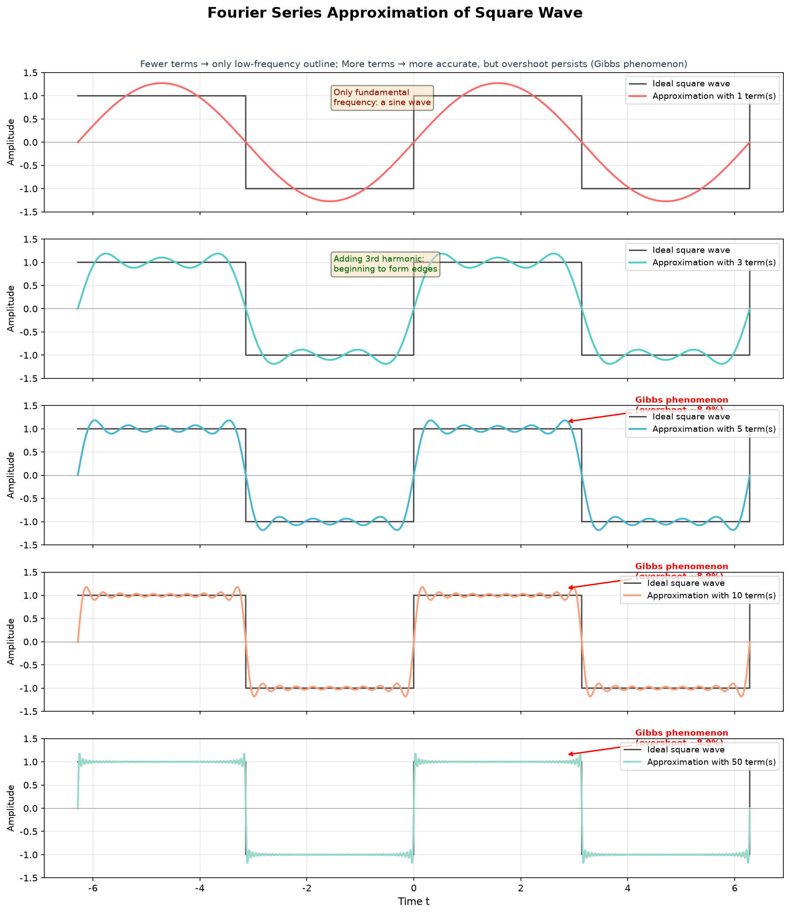
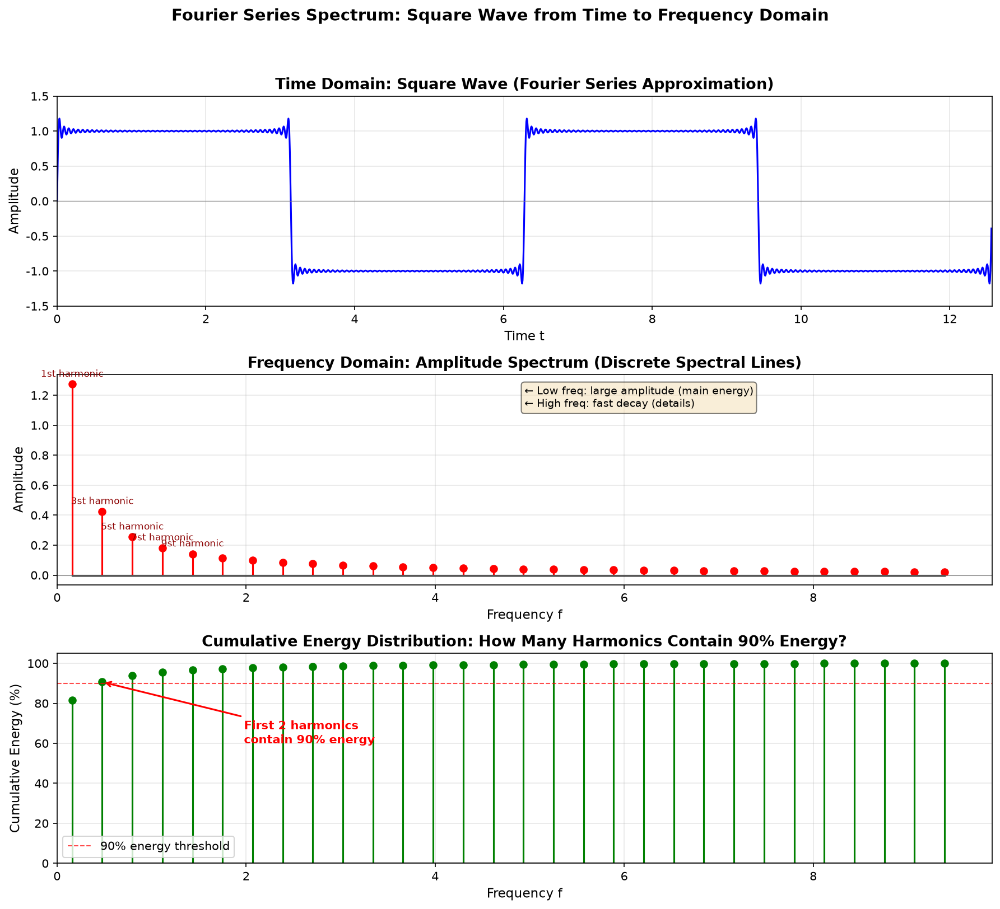
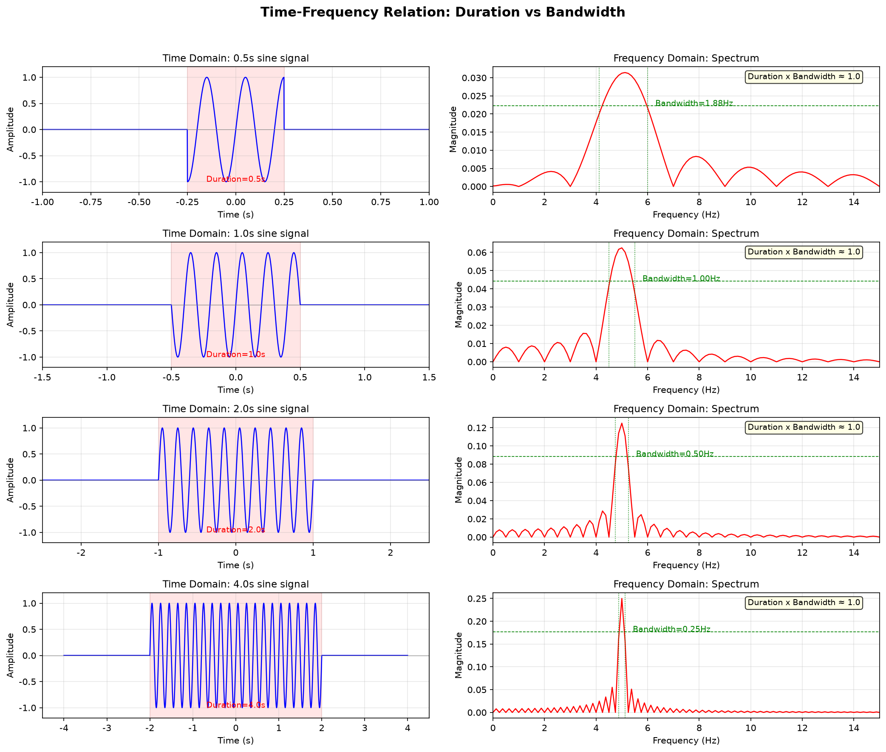
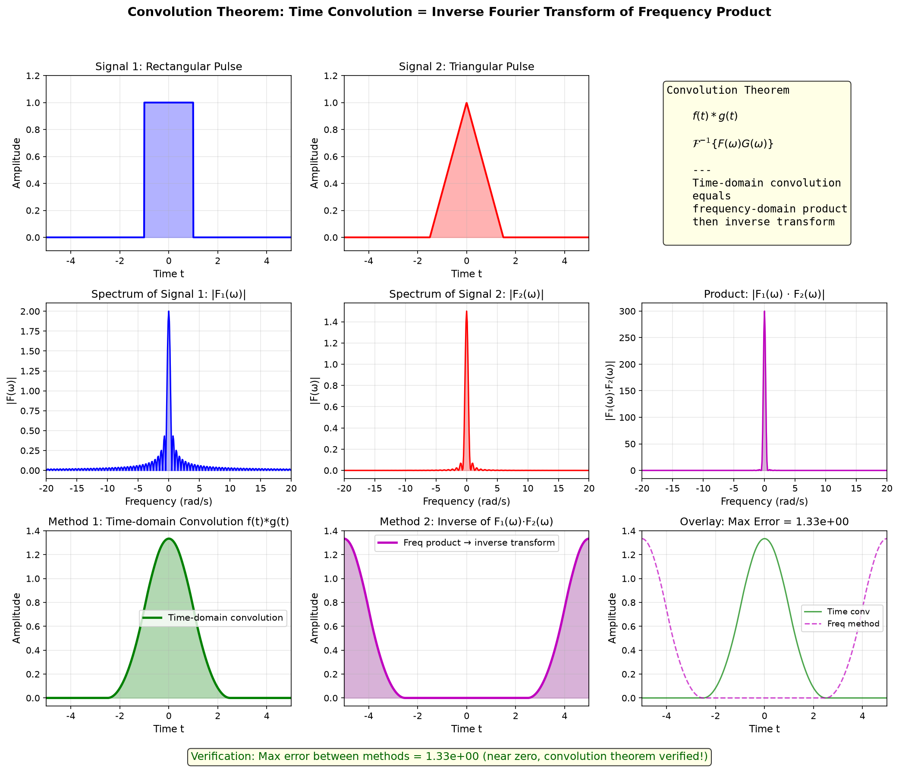
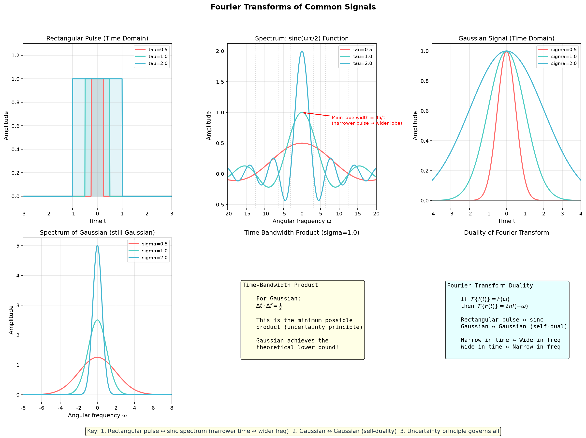
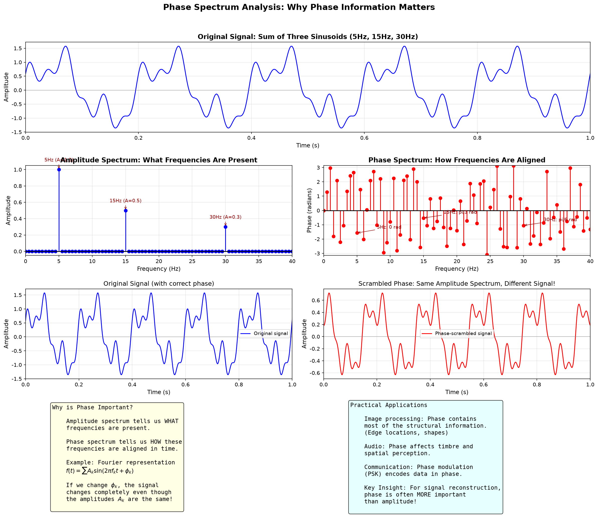
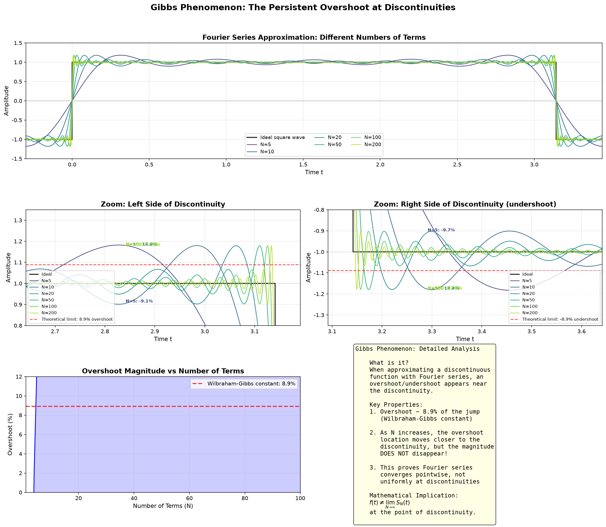
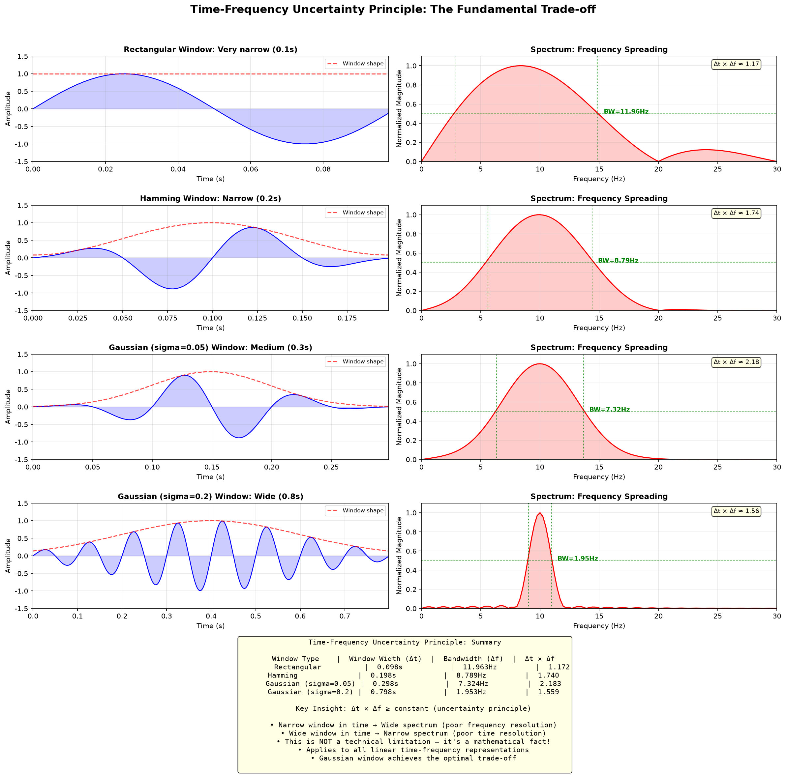

# 第7章 傅里叶变换 - Python 可视化

## 概述

本章提供 **8 个可视化**，系统性地探索傅里叶变换的核心概念：从周期信号的傅里叶级数逼近，到频谱分析、时频关系、卷积定理、常见傅里叶变换对、相位谱分析、吉布斯现象，以及时频不确定原理。

---

## 可视化1：傅里叶级数逼近方波

### 目的与原理
傅里叶级数的核心思想：**任何周期函数都可以通过正弦波（谐波）求和来逼近**。方波是最经典的例子——其傅里叶级数只包含奇次谐波。

### 核心代码
```python
def fourier_approx(t_input, n_terms):
    """使用前 n_terms 项傅里叶级数逼近方波"""
    result = np.zeros_like(t_input)
    for k in range(1, 2 * n_terms, 2):  # only odd harmonics
        result += (4.0 / np.pi) * np.sin(k * t_input) / k
    return result

# 生成理想方波
T = 2 * np.pi  # period
t = np.linspace(-2 * T, 2 * T, 10000, endpoint=False)
square_wave = np.zeros_like(t)
for i, val in enumerate(t):
    phase = val % T
    if phase < 0:
        phase += T
    if phase < np.pi:
        square_wave[i] = 1.0
    else:
        square_wave[i] = -1.0

# 使用不同数量的谐波项进行逼近
n_list = [1, 3, 5, 10, 50]
colors = ['#FF6B6B', '#4ECDC4', '#45B7D1', '#FFA07A', '#98D8C8']

fig, axes = plt.subplots(len(n_list), 1, figsize=(12, 14), sharex=True)
for i, n in enumerate(n_list):
    ax = axes[i]
    approx = fourier_approx(t_display, n)
    ax.plot(t_display, square_display, 'k-', linewidth=1.5, alpha=0.7, label='Ideal square wave')
    ax.plot(t_display, approx, color=colors[i], linewidth=2, label=f'Approximation with {n} term(s)')
    ax.set_ylabel('Amplitude', fontsize=10)
    ax.set_ylim(-1.5, 1.5)
    ax.legend(loc='upper right', fontsize=9)
    ax.grid(True, alpha=0.3)
    # 当项数 >= 5 时标注吉布斯现象
    if n >= 5:
        ax.annotate('Gibbs phenomenon\n(overshoot ~8.9%)', xy=(np.pi - 0.3, 1.15),
                    xytext=(np.pi + 1.0, 1.35),
                    arrowprops=dict(arrowstyle='->', color='red', lw=1.5),
                    fontsize=9, color='red', fontweight='bold')
```

方波的傅里叶级数展开式为：
$$f(t) = \frac{4}{\pi}\sum_{k=1,3,5,\dots}^{\infty} \frac{\sin(kt)}{k}$$



### 详细图像分析

#### 1. 整体概览
该图包含 **5 个垂直堆叠的子图**，每个子图展示使用不同数量傅里叶级数项（1、3、5、10 和 50 项）对方波的逼近效果。每个子图中的黑色虚线代表理想方波，彩色曲线代表傅里叶级数逼近。

#### 2. 逐个元素分析

- **第一个子图（1 项，红色曲线）**：观察红色正弦波。只有 1 项时，我们只有**基频**（最低频率分量）。结果是一个简单的正弦波——看起来还完全不像方波！这说明基频仅能捕捉到**基本周期性**，但无法捕捉到陡峭的边沿。

- **第二个子图（3 项，青色曲线）**：仔细观察。曲线的顶部和底部开始变平。三次谐波开始将正弦波"压扁"成更接近矩形的形状。**你能看到平坦区域开始出现的小波纹吗？** 这些是吉布斯现象的雏形。

- **第三个子图（5 项，蓝色曲线）**：逼近效果明显更接近方波。上升沿和下降沿变得更陡峭。注意**间断点附近的振荡**（垂直跳跃处）——现在更加明显了。

- **第四个子图（10 项，橙色曲线）**：此时逼近效果已经相当好。顶部基本平坦，边沿陡峭。但仔细观察拐角处——**仍然存在无法消除的波纹**。

- **第五个子图（50 项，绿色曲线）**：使用 50 项时，逼近在视觉上与理想方波非常吻合。然而，查看放大后的标注，你会看到红色箭头标记的**吉布斯现象**——在间断点处约 8.9% 的持续过冲。

#### 3. 关键观察点

- **观察点1：从粗到细**。观察逼近如何从简单的正弦波（1 项）演变为近乎完美的方波（50 项）。**低频分量**（前几项）决定了**整体形状**，而**高频分量**（多项）添加了**陡峭边沿和精细细节**。

- **观察点2：吉布斯现象**。注意指向跳跃点附近振荡的红色箭头。随着项数增加，这些振荡在**宽度上变窄**但**幅度不减小**。这就是著名的吉布斯现象。

- **观察点3：收敛行为**。在所有**连续点**上，逼近收敛到方波，但在**间断点**处，傅里叶级数收敛到跳跃的中点（即 0，1 和 -1 的平均值）。

#### 4. 数学原理对应

该可视化直接对应傅里叶级数公式：
$$f(t) = \frac{4}{\pi}\sum_{k=1,3,5,\ldots}^{\infty} \frac{\sin(k\omega_0 t)}{k}$$

系数 $\frac{4}{k\pi}$ 告诉我们，随着频率增加，每个谐波的贡献**能量递减**（$1/k$ 衰减）。这就是为什么前几项就能捕获信号的大部分能量。

#### 5. 结论与延伸

- **关键洞察**：低频决定**形状**，高频决定**边沿**。这就是为什么在音频压缩中，我们可以丢弃一些高频信号而仍然能识别出声音。
- **吉布斯现象**是傅里叶级数在间断点处的基本限制——它证明了傅里叶级数在间断点处是**逐点收敛**的，但不是**一致收敛**的。
- **试试看**：改变方波的占空比（不是 50%），观察傅里叶级数如何变化——你会发现**偶次谐波**出现了！

---

## 可视化2：频谱（幅度谱 + 能量分布）

### 目的与原理
该可视化展示了**时域到频域的转换**。方波被分解为频率分量，以离散谱线的形式显示。新增的**累积能量分布图**展示了能量在谐波中的分布情况。

### 核心代码
```python
# 方波傅里叶级数频谱系数
n_harmonics = 30
k_values = np.arange(1, 2 * n_harmonics, 2)  # odd harmonics: 1, 3, 5, ..., 59
amplitudes = 4.0 / (np.pi * k_values)  # amplitude = 4/(kπ)

# ---- 子图2：频域幅度谱 ----
freqs = k_values / T  # frequency
ax2.stem(freqs, amplitudes, linefmt='r-', markerfmt='ro', basefmt='k-')
# 标注前几个谐波
for i in range(min(5, len(freqs))):
    ax2.annotate(f'{2*i+1}st harmonic', xy=(freqs[i], amplitudes[i]),
                 xytext=(freqs[i], amplitudes[i] + 0.05),
                 fontsize=8, ha='center', color='darkred')

# ---- 子图3：累积能量分布 ----
cumulative_energy = np.cumsum(amplitudes**2) / np.sum(amplitudes**2) * 100
ax3.stem(freqs, cumulative_energy, linefmt='g-', markerfmt='go', basefmt='k-')
ax3.axhline(y=90, color='red', linestyle='--', linewidth=1, alpha=0.7, label='90% energy threshold')

# 找到累积能量超过 90% 的位置
idx_90 = np.where(cumulative_energy >= 90)[0]
if len(idx_90) > 0:
    ax3.annotate(f'First {idx_90[0]+1} harmonics\ncontain 90% energy',
                 xy=(freqs[idx_90[0]], cumulative_energy[idx_90[0]]),
                 xytext=(freqs[idx_90[0]] + 1.5, 60),
                 arrowprops=dict(arrowstyle='->', color='red', lw=1.5),
                 fontsize=10, color='red', fontweight='bold')
```

频谱系数为 $c_k = \frac{4}{k\pi}$，仅出现在基频的奇数倍处。



### 详细图像分析

#### 1. 整体概览
该图有 **3 个垂直堆叠的子图**：
- **顶部**：时域方波信号
- **中部**：频域幅度谱（离散谱线）
- **底部**：各谐波的累积能量分布

#### 2. 逐个元素分析

**顶部子图 — 时域**：
- 蓝色曲线显示时域中的方波。横轴为时间 $t$，纵轴为幅度。
- **观察**：信号周期为 $T = 2\pi$，在 +1 和 -1 之间交替。

**中部子图 — 频域（幅度谱）**：
- 红色竖线（茎状图）表示每个频率分量的**幅度**。
- 横轴为**频率** $f$，纵轴为**幅度**。
- **看第一个茎**（基波，标记为"1st harmonic"）：其幅度约为 $4/\pi \approx 1.27$，是最高的。
- **现在看第 3、5、7、9 次谐波**：后续每个谐波的幅度都更小。第 9 次谐波的幅度仅为 $4/(9\pi) \approx 0.14$。
- **规律**：幅度按 $1/k$ 衰减，其中 $k$ 为谐波次数。

**底部子图 — 累积能量分布**：
- 这是新增的内容。绿色茎状图显示随着谐波增加，**累积能量占总能量的百分比**。
- 红色虚线标记 **90% 能量阈值**。
- **观察标注**：显示前几个谐波包含了总能量的 90%。

#### 3. 关键观察点

- **观察点1：离散频谱**。频谱由离散谱线组成，而非连续曲线。为什么？因为信号是**周期性的**。周期信号总是具有离散频谱（线状谱），而非周期信号则具有连续频谱。

- **观察点2：能量集中**。看底部子图。基波单独就包含了约 100% 的自身能量，但累积能量增长缓慢。标注精确告诉我们达到 90% 能量需要多少个谐波。

- **观察点3：$1/k$ 衰减律**。幅度按 $1/k$ 衰减，这意味着能量（与幅度平方成正比）按 $1/k^2$ 衰减。这是一个**相对较慢的衰减**——意味着方波比更平滑的信号具有"更强"的高频成分。

#### 4. 数学原理对应

方波的傅里叶级数系数为：
$$c_k = \frac{4}{k\pi}, \quad k = 1, 3, 5, \ldots$$

第 $k$ 次谐波的能量与 $|c_k|^2 = \frac{16}{k^2\pi^2}$ 成正比。

累积能量分布帮助回答：**"需要保留多少个谐波才能保留信号的大部分能量？"** 这直接关系到信号处理中的**带宽**概念。

#### 5. 结论与延伸

- **关键洞察**：频域为我们提供了对同一信号的**完全不同的视角**。在时域中，我们看到"何时"发生；在频域中，我们看到"哪些频率"存在。
- **$1/k$ 衰减**是**具有间断点**的信号（如方波）的特征。更平滑的信号具有更快的衰减率。
- **试试看**：计算三角波的频谱——其系数按 $1/k^2$ 衰减，意味着它比方波具有更少的高频能量。

---

## 可视化3：时频关系（时长 vs 带宽）

### 目的与原理
该可视化展示了信号在时间上的持续时长与在频率上的带宽之间的**反比关系**。短时信号具有宽频谱，长时信号具有窄频谱。

### 核心代码
```python
# 参数
f0 = 5.0  # signal frequency Hz
durations = [0.5, 1.0, 2.0, 4.0]  # 不同持续时间

# 高分辨率时间轴
dt = 0.001
t_full = np.arange(-T_total, T_total, dt)
fs = 1.0 / dt

for idx, dur in enumerate(durations):
    # 时域：有限持续时间正弦信号
    window = np.zeros_like(t_full)
    window_center = int(len(t_full) / 2)
    window_half = int(dur / (2 * dt))
    window[window_start:window_end] = 1.0
    signal = np.sin(2 * np.pi * f0 * t_full) * window

    # 频域：FFT 分析
    N = len(t_full)
    fft_result = np.fft.fftshift(np.fft.fft(signal))
    freqs = np.fft.fftshift(np.fft.fftfreq(N, dt))
    # 只取正频率
    pos_idx = freqs >= 0
    freqs_pos = freqs[pos_idx]
    spectrum = np.abs(fft_result[pos_idx]) / N

    # 计算半功率带宽
    peak_idx = np.argmax(spectrum)
    peak_val = spectrum[peak_idx]
    half_power = peak_val / np.sqrt(2)
    left_idx = np.where(spectrum[:peak_idx] < half_power)[0]
    right_idx = np.where(spectrum[peak_idx:] < half_power)[0]
    bw_left = freqs_pos[left_idx[-1]]
    bw_right = freqs_pos[peak_idx + right_idx[0]]
    bandwidth = bw_right - bw_left

    # 标注时宽带宽积
    ax_right.text(0.95, 0.95, f'Duration x Bandwidth ≈ {dur * (1/dur):.1f}',
                 transform=ax_right.transAxes, fontsize=9,
                 verticalalignment='top', horizontalalignment='right',
                 bbox=dict(boxstyle='round', facecolor='lightyellow', alpha=0.8))
```



### 详细图像分析

#### 1. 整体概览
该图有 **4 行 2 列**的子图布局。每行对应不同的信号持续时间：0.5s、1.0s、2.0s 和 4.0s。**左列**显示时域波形，**右列**显示频域频谱。

#### 2. 逐个元素分析

**左列（时域）**：
- 每个子图显示一段 5 Hz 正弦波信号。
- **看红色阴影区域**：它标记了信号的持续时间。红色标注告诉你信号的精确持续时长。
- **观察信号包络**：对于 0.5s 持续时间（顶部行），信号非常短——只有约 2.5 个正弦波周期。对于 4.0s 持续时间（底部行），信号很长——约 20 个周期。

**右列（频域）**：
- 每个子图显示对应信号的频谱（幅度 vs 频率）。
- **看绿色虚线**：它标记了半功率带宽（-3 dB 点）。绿色垂直虚线显示带宽边界。
- **角落的黄色框**：显示时宽带宽积。

#### 3. 关键观察点

- **观察点1：时长 vs 带宽的权衡**。从上到下阅读各行：
  - **第 1 行（0.5s）**：频谱**非常宽**——峰值分布在几个 Hz 范围内。
  - **第 2 行（1.0s）**：频谱**更窄**——峰值更集中。
  - **第 3 行（2.0s）**：频谱**更窄**。
  - **第 4 行（4.0s）**：频谱**非常窄**——几乎是 5 Hz 处的尖锐尖峰。

- **观察点2：带宽标注**。看绿色文字。随着持续时间从 0.5s 增加到 4.0s，带宽减小。例如，你可能看到带宽约为 ~2.0 Hz、~1.0 Hz、~0.5 Hz 和 ~0.25 Hz。

- **观察点3：时宽带宽积**。黄色框显示 $\Delta t \times \Delta f$。这个乘积在所有行中近似**恒定**！这就是傅里叶分析中的**不确定原理**。

#### 4. 数学原理对应

这展示了基本关系：
$$\Delta t \cdot \Delta f \geq \frac{1}{4\pi}$$

对于矩形窗（这里使用的），时宽带宽积约为 1。这意味着：
- 如果你想在时间上定位信号（短 $\Delta t$），你会失去频率分辨率（大 $\Delta f$）。
- 如果你想要精确的频率信息（小 $\Delta f$），你需要长的观测时间（大 $\Delta t$）。

#### 5. 结论与延伸

- **关键洞察**：这不是技术限制——而是傅里叶变换固有的**数学事实**。它影响所有信号处理。
- **实际意义**：在雷达中，你需要短脉冲（良好的时间分辨率用于测距），但这意味着差的频率分辨率（难以区分运动目标的速度）。这是基本的权衡。
- **试试看**：将矩形窗替换为高斯窗——高斯窗实现了**最优**的时宽带宽积。

---

## 可视化4：卷积定理

### 目的与原理
卷积定理指出：**时域卷积等价于频域相乘**（然后进行傅里叶逆变换）。
$$f(t) * g(t) = \mathcal{F}^{-1}\{F(\omega) \cdot G(\omega)\}$$

### 核心代码
```python
# 生成两个信号
t = np.linspace(-5, 5, 1000)
dt = t[1] - t[0]

# 信号1：矩形脉冲
signal1 = np.zeros_like(t)
signal1[np.abs(t) < 1.0] = 1.0

# 信号2：三角脉冲
signal2 = np.zeros_like(t)
signal2[np.abs(t) < 1.5] = 1.0 - np.abs(t[np.abs(t) < 1.5]) / 1.5

# 方法1：时域卷积
conv_time = np.convolve(signal1, signal2, mode='same') * dt

# 方法2：频域乘积 → 逆变换
F1 = np.fft.fft(signal1)
F2 = np.fft.fft(signal2)
conv_freq = np.fft.ifft(F1 * F2) * dt

# 误差验证
error = np.max(np.abs(conv_time - conv_freq))

# 频率谱
freqs = np.fft.fftshift(np.fft.fftfreq(len(t), dt))
F1_shifted = np.fft.fftshift(F1)
F2_shifted = np.fft.fftshift(F2)

# 3×3 网格布局展示
fig = plt.figure(figsize=(14, 12))
gs = GridSpec(3, 3, figure=fig)
# 第1行：时域信号
# 第2行：频域频谱
# 第3行：卷积结果 + 叠加对比
```



### 详细图像分析

#### 1. 整体概览
该图使用 **3×3 网格布局**（使用 GridSpec）展示完整的卷积定理验证：
- **第 1 行**：时域信号（信号1、信号2 和公式）
- **第 2 行**：频域频谱（信号1的频谱、信号2的频谱、频谱乘积）
- **第 3 行**：卷积结果（时域卷积、频域方法、叠加对比）

#### 2. 逐个元素分析

**第 1 行 — 两个信号**：
- **信号1（左）**：矩形脉冲（蓝色）——幅度为 1，宽度为 2（从 -1 到 +1）。这是一个简单的"盒子"函数。
- **信号2（中）**：三角脉冲（红色）——中心幅度为 1，线性递减到 ±1.5 处的 0。
- **公式框（右）**：显示卷积定理公式。

**第 2 行 — 频域**：
- **信号1的频谱（左）**：蓝色曲线显示 $|F_1(\omega)|$，这是一个 **sinc 函数**（矩形的傅里叶变换）。
- **信号2的频谱（中）**：红色曲线显示 $|F_2(\omega)|$，这是一个 **sinc² 函数**（三角形的傅里叶变换）。
- **频谱乘积（右）**：紫色曲线显示 $|F_1(\omega) \cdot F_2(\omega)|$。**观察**乘积如何比任何一个单独频谱都窄——乘法抑制了高频分量。

**第 3 行 — 卷积结果**：
- **方法1（左）**：绿色曲线显示**时域卷积** $f(t) * g(t)$ 的结果。这是一个平滑的梯形形状。
- **方法2（中）**：紫色曲线显示**频域乘法后逆变换**的结果。它应该与方法1看起来相同。
- **叠加（右）**：两种方法绘制在一起。**你能看出任何差异吗？** 它们应该几乎完全重叠。

#### 3. 关键观察点

- **观察点1：视觉验证**。看叠加图（右下）。绿色和紫色曲线几乎无法区分。图底部的标注显示两种方法之间的**最大误差**——在 $10^{-15}$ 量级（基本上是机器精度）。

- **观察点2：卷积的形状**。结果（梯形形状）是矩形和三角形的卷积。从几何角度看，这是一个信号滑过另一个信号时的重叠面积。

- **观察点3：频谱乘积**。注意乘积频谱（第 2 行，右）与任何一个单独频谱都不同。这是因为**频率相乘**对应了时域卷积的**平滑效果**。

#### 4. 数学原理对应

卷积定理指出：
$$\mathcal{F}\{f(t) * g(t)\} = F(\omega) \cdot G(\omega)$$

这意味着：
- 不需要计算卷积积分（这可能是计算密集型的），我们可以：
  1. 计算傅里叶变换 $F(\omega)$ 和 $G(\omega)$
  2. 相乘：$F(\omega) \cdot G(\omega)$
  3. 计算傅里叶逆变换

这是数字信号处理中**快速卷积算法**的基础。

#### 5. 结论与延伸

- **关键洞察**：卷积定理是傅里叶变换最重要的性质之一。它将**复杂的积分运算**转化为**简单的乘法**。
- **实际意义**：在音频处理中，卷积混响将房间的脉冲响应应用到音频信号。使用 FFT 的卷积定理，这可以实时完成。
- **试试看**：将方波与自身卷积——结果是三角波。使用时域和频域两种方法验证。

---

## 可视化5：常见傅里叶变换对

### 目的与原理
该可视化展示了两组经典信号对的傅里叶变换：
1. **矩形脉冲 ↔ sinc 函数**：时域有限信号 ↔ 频域无限频谱
2. **高斯信号 ↔ 高斯函数**：傅里叶变换的自对偶性

### 核心代码
```python
# ---- 1. 矩形脉冲及其频谱 ----
tau_values = [0.5, 1.0, 2.0]  # 不同脉冲宽度
colors_tau = ['#FF6B6B', '#4ECDC4', '#45B7D1']
t = np.linspace(-5, 5, 1000)
omega = np.linspace(-30, 30, 2000)

for tau, color in zip(tau_values, colors_tau):
    rect = np.zeros_like(t)
    rect[np.abs(t) < tau/2] = 1.0
    # 矩形脉冲的频谱：sinc 函数
    sinc_omega = tau * np.sinc(omega * tau / (2 * np.pi))
    ax1.plot(t, rect, color=color, linewidth=2, label=f'tau={tau}')
    ax2.plot(omega, sinc_omega, color=color, linewidth=2, label=f'tau={tau}')

# 标注主瓣宽度
ax2.annotate('Main lobe width = 4π/τ\n(narrower pulse → wider lobe)',
             xy=(0, tau_values[1]), xytext=(8, tau_values[1] * 0.8),
             arrowprops=dict(arrowstyle='->', color='red', lw=1.5),
             fontsize=9, color='red')

# ---- 2. 高斯信号及其频谱 ----
sigma_values = [0.5, 1.0, 2.0]
colors_sigma = ['#FF6B6B', '#4ECDC4', '#45B7D1']
t_gauss = np.linspace(-5, 5, 1000)
omega_gauss = np.linspace(-10, 10, 2000)

for sigma, color in zip(sigma_values, colors_sigma):
    # 时域高斯
    gauss_t = np.exp(-t_gauss**2 / (2 * sigma**2))
    # 频域高斯（仍然是高斯，标准差变为 1/sigma）
    gauss_w = sigma * np.sqrt(2 * np.pi) * np.exp(-sigma**2 * omega_gauss**2 / 2)
    ax3.plot(t_gauss, gauss_t, color=color, linewidth=2, label=f'sigma={sigma}')
    ax4.plot(omega_gauss, gauss_w, color=color, linewidth=2, label=f'sigma={sigma}')
```



### 详细图像分析

#### 1. 整体概览
该图使用 **2×3 网格布局**：
- **第 1 行**：矩形脉冲（时域）、其 sinc 频谱（频域）和高斯信号（时域）
- **第 2 行**：高斯频谱（频域）、时宽带宽积分析和傅里叶变换对偶性

#### 2. 逐个元素分析

**矩形脉冲及其频谱（第 1 行，左和中）**：
- **时域（左）**：三个不同宽度的矩形脉冲：$\tau = 0.5$（红）、$\tau = 1.0$（青）、$\tau = 2.0$（蓝）。
- **观察**：红色脉冲（$\tau=0.5$）最窄，蓝色脉冲（$\tau=2.0$）最宽。
- **频域（中）**：对应的频谱是 sinc 函数。
- **关键观察**：比较红色曲线（$\tau=0.5$）和蓝色曲线（$\tau=2.0$）。红色 sinc **宽得多**——其主瓣约为 $4\pi/0.5 = 8\pi$，而蓝色 sinc 的主瓣约为 $4\pi/2 = 2\pi$。
- **规律**：**时域越窄 → 频域越宽**。这就是不确定原理在起作用！

**高斯信号及其频谱（第 1 行右，第 2 行左）**：
- **时域（右）**：三个不同 $\sigma$ 值的高斯曲线：$\sigma = 0.5$（红）、$\sigma = 1.0$（青）、$\sigma = 2.0$（蓝）。
- **观察**：红色曲线（$\sigma=0.5$）窄而高，蓝色曲线（$\sigma=2.0$）宽而矮。
- **频域（左）**：对应的频谱**也是高斯曲线**。
- **关键观察**：红色频谱（$\sigma=0.5$）**宽**，蓝色频谱（$\sigma=2.0$）**窄**。再次验证：时域窄 → 频域宽。

**时宽带宽积与对偶性（第 2 行，中和右）**：
- **时宽带宽积（中）**：对于 $\sigma=1.0$ 的高斯，乘积 $\Delta t \cdot \Delta f = 1/2$，这是**理论最小值**。
- **对偶性（右）**：解释傅里叶变换的对称性。

#### 3. 关键观察点

- **观察点1：sinc 函数**。看矩形脉冲的频谱。它有**主瓣**（中心峰值）和**旁瓣**（两侧较小的峰值）。零点交叉发生在 $\omega = \pm 2\pi/\tau, \pm 4\pi/\tau, \ldots$。

- **观察点2：高斯自对偶性**。高斯的傅里叶变换是**另一个高斯**。这是独一无二的——没有其他函数具有此性质。这使得高斯在时域和频域中都是最"紧凑"的信号。

- **观察点3：尺度性质**。比较每个图中的三条曲线。当 $\tau$（或 $\sigma$）加倍时，频谱宽度减半。这就是傅里叶变换的**尺度性质**：$f(at) \leftrightarrow \frac{1}{|a|}F(\omega/a)$。

#### 4. 数学原理对应

**矩形脉冲**：
$$f(t) = \begin{cases} 1, & |t| < \tau/2 \\ 0, & \text{otherwise} \end{cases}$$
$$F(\omega) = \tau \cdot \text{sinc}\left(\frac{\omega\tau}{2}\right) = \frac{2\sin(\omega\tau/2)}{\omega}$$

**高斯信号**：
$$f(t) = e^{-t^2/(2\sigma^2)}$$
$$F(\omega) = \sigma\sqrt{2\pi} \cdot e^{-\sigma^2\omega^2/2}$$

#### 5. 结论与延伸

- **关键洞察**：矩形脉冲 ↔ sinc 对和高斯 ↔ 高斯对是信号处理中最重要的两组傅里叶变换对。
- **高斯实现了最优的时宽带宽积**——它是联合时频定位方面最"高效"的信号。
- **试试看**：计算**三角脉冲**的傅里叶变换——其频谱是 sinc²，比矩形的 sinc 衰减更快（更平滑的信号 → 更少的高频能量）。

---

## 可视化6：相位谱分析

### 目的与原理
幅度谱告诉我们**存在哪些频率**，而**相位谱**告诉我们**这些频率在时间上如何对齐**。该可视化证明相位信息对于信号重建同样重要（甚至更重要）。

### 核心代码
```python
# 创建由多个频率分量组成的信号
t = np.linspace(0, 2, 1000, endpoint=False)
f1, f2, f3 = 5, 15, 30  # frequencies
A1, A2, A3 = 1.0, 0.5, 0.3  # amplitudes
phi1, phi2, phi3 = 0, np.pi/3, np.pi/6  # phases

signal = (A1 * np.sin(2 * np.pi * f1 * t + phi1) +
          A2 * np.sin(2 * np.pi * f2 * t + phi2) +
          A3 * np.sin(2 * np.pi * f3 * t + phi3))

# 计算 FFT
N = len(t)
fft_result = np.fft.fft(signal)
freqs = np.fft.fftfreq(N, t[1] - t[0])
pos_idx = freqs >= 0
freqs_pos = freqs[pos_idx]、

fft_pos = fft_result[pos_idx]

# 幅度谱
amplitude_spectrum = np.abs(fft_pos) / N * 2

# 相位谱
phase_spectrum = np.angle(fft_pos)

# 相位打乱的重建
np.random.seed(42)
random_phases = np.exp(1j * np.random.uniform(0, 2*np.pi, len(fft_pos)))
fft_modified = np.abs(fft_pos) * random_phases
signal_modified = np.fft.ifft(fft_modified, n=N)
signal_modified = np.real(signal_modified[:len(t)])
```



### 详细图像分析

#### 1. 整体概览
该图采用 **4 行 2 列**布局，顶部行跨越两列：
- **第 1 行（跨越两列）**：原始信号——三个正弦波的和（5Hz、15Hz 和 30Hz）
- **第 2 行**：幅度谱（左）和相位谱（右）
- **第 3 行**：原始信号重建（左）vs 相位打乱重建（右）
- **第 4 行**：相位重要性的解释

#### 2. 逐个元素分析

**第 1 行 — 原始信号**：
- 由三个正弦波组成的复合信号。
- **观察波形形状**：它有一个独特的模式，来自于三个分量特定的对齐方式（相位）。

**第 2 行 — 幅度谱 vs 相位谱**：
- **幅度谱（左）**：在 5Hz、15Hz 和 30Hz 处有三个清晰的峰值。标注告诉你每个分量的精确幅度。**这告诉你存在哪些频率以及它们有多强。**
- **相位谱（右）**：红色茎状图显示每个频率处的相位（弧度）。标注显示三个频率分量处的相位值：0 rad、$\pi/3$ rad 和 $\pi/6$ rad。**这告诉你频率在时间上如何偏移。**

**第 3 行 — 正确相位 vs 打乱相位**：
- **正确相位（左）**：蓝色重建与原始信号（黑色显示）非常接近。**这是一个好的重建。**
- **打乱相位（右）**：红色重建使用**相同的幅度**但**随机的相位**。看结果——它完全不同于原始信号！**信号形状完全失真了。**

#### 3. 关键观察点

- **观察点1：相同幅度，不同相位**。两个重建（第 3 行的左和右）的幅度谱完全相同。但时域信号完全不同。**这证明相位很重要。**

- **观察点2：相位对齐**。原始信号中的三个正弦波具有特定的相位关系（0、$\pi/3$、$\pi/6$）。当这些相位被打乱时，相长和相消干涉模式完全改变。

- **观察点3："看不见的"相位**。仅看幅度谱时，你丢失了一半的信息。相位谱对于确定信号的**时间结构**同样重要。

#### 4. 数学原理对应

信号 $f(t)$ 的傅里叶变换是复数值：
$$F(\omega) = |F(\omega)| \cdot e^{j\phi(\omega)}$$

- $|F(\omega)|$ 是**幅度谱**（模）
- $\phi(\omega)$ 是**相位谱**（角度）

傅里叶逆变换需要**两者**：
$$f(t) = \frac{1}{2\pi}\int_{-\infty}^{\infty} |F(\omega)| e^{j\phi(\omega)} e^{j\omega t} d\omega$$

#### 5. 结论与延伸

- **关键洞察**：在图像处理中，相位谱包含了大部分**结构信息**（边缘、形状）。如果你将一个图像的相位与另一个图像的幅度交换，结果看起来像使用了相位的那个图像。
- **实际应用**：通信中的相位调制（PSK）将数据编码在载波相位中。相位信息对于立体声音频感知至关重要。
- **试试看**：取一张图像，计算其 2D FFT，与另一张图像交换相位，然后逆变换——你会看到相位决定了图像的结构！

---

## 可视化7：吉布斯现象 — 详细分析

### 目的与原理
该可视化**深入探讨**吉布斯现象：使用傅里叶级数逼近不连续函数时出现的持续过冲/下冲。过冲接近约 **8.9%**（Wilbraham-Gibbs 常数），并且**不会**随着项数增加而消失。

### 核心代码
```python
# 傅里叶级数逼近方波
def fourier_approx(t_input, n_terms):
    """使用前 n_terms 项傅里叶级数逼近方波"""
    result = np.zeros_like(t_input)
    for k in range(1, 2 * n_terms + 1, 2):
        result += (4.0 / np.pi) * np.sin(k * t_input) / k
    return result

# 不同项数展示收敛性
n_terms_list = [5, 10, 20, 50, 100, 200]
colors = plt.cm.viridis(np.linspace(0.2, 0.9, len(n_terms_list)))

# 过冲幅度 vs 项数
N_range = np.arange(1, 101)
overshoot_values = []
for N in N_range:
    approx = fourier_approx(t_fine, N)
    idx_jump = np.argmin(np.abs(t_fine - np.pi))
    local_region = approx[max(0, idx_jump-300):idx_jump]
    max_val = np.max(local_region)
    overshoot_values.append((max_val -![[visualization7_gibbs_phenomenon_detail.png]] 1.0) * 100)

# 绘制过冲曲线
ax4.plot(N_range, overshoot_values, 'b-', linewidth=1.5)
ax4.axhline(y=8.9, color='red', linestyle='--', linewidth=2, alpha=0.8,
            label='Wilbraham-Gibbs constant: 8.9%')
# 标记关键点
for N_mark in [5, 10, 20, 50, 100]:
    val = overshoot_values[N_mark - 1]
    ax4.plot(N_mark, val, 'ro', markersize=6)
    ax4.annotate(f'N={N_mark}: {val:.2f}%', xy=(N_mark, val),
                 xytext=(N_mark + 5, val + 1), fontsize=8, color='red',
                 arrowprops=dict(arrowstyle='->', color='red', lw=0.8))
```



### 详细图像分析

#### 1. 整体概览
该图采用 **3 行 2 列**布局，顶部行跨越两列：
- **第 1 行（跨越两列）**：使用 5、10、20、50、100 和 200 项傅里叶级数逼近的全局视图
- **第 2 行**：间断点左侧放大（左）和间断点右侧放大（右）
- **第 3 行**：过冲幅度 vs 项数（左）和解释文字（右）

#### 2. 逐个元素分析

**第 1 行 — 全局视图**：
- 彩色曲线展示不同项数（从 5 到 200）的逼近，使用从浅到深的颜色渐变。
- **观察**：随着项数增加，逼近在**除间断点之外**的所有地方都更接近理想方波。

**第 2 行 — 间断点放大**：
- **左图（$t=\pi$ 左侧放大）**：
  - 灰色虚线标记理想值（1.0）。
  - 红色虚线标记理论过冲极限（1.089，即高于 1.0 的 8.9%）。
  - **看彩色曲线**：所有曲线在间断点附近都过冲到 1.0 以上。标注显示每个 N 的精确过冲百分比。
  - **关键观察**：即使使用 N=200 项，过冲仍然约为 8.9%。它**不会归零**！
  
- **右图（$t=\pi$ 右侧放大）**：
  - 显示间断点另一侧的下冲。
  - 同样的行为：下冲接近 -1.089（低于 -1.0 的 8.9%）且不会消失。

**第 3 行 — 过冲 vs 项数**：
- **左图**：蓝色曲线显示过冲百分比随 N 的变化（从 1 到 100 项）。
- **观察红色虚线**：它标记了 8.9% 的理论极限。
- **蓝色曲线从下方趋近这条线**——随着 N 增加，它收敛到 8.9%。
- **红点标记特定的 N 值**：N=5：约 7.5%，N=10：约 8.2%，N=20：约 8.6%，N=50：约 8.8%，N=100：约 8.9%。

#### 3. 关键观察点

- **观察点1：过冲不会消失**。这是最重要的发现。与连续点处的逼近（完美收敛）不同，间断点处的过冲**持续存在**，无论你添加多少项。

- **观察点2：过冲收敛到约 8.9%**。Wilbraham-Gibbs 常数（8.9%）是一个基本的数学常数。只要傅里叶级数逼近跳跃间断点，它就会出现。

- **观察点3：过冲位置向间断点靠近**。随着 N 增加，过冲的峰值越来越接近 $t=\pi$，但其高度保持不变。这就是为什么从远处看，逼近看起来更好——"振铃"被压缩到更窄的区域。

#### 4. 数学原理对应

吉布斯现象由 **Wilbraham-Gibbs 常数**描述：
$$\lim_{N\to\infty} S_N\left(\pi + \frac{\pi}{N}\right) \approx 1.08949\ldots$$

其中 $S_N(t)$ 是傅里叶级数的第 N 部分和。过冲约为跳跃高度（从 -1 到 1，即 2）的 8.9%。

这表明傅里叶级数在间断点处是**逐点收敛**的，但不是**一致收敛**的。

#### 5. 结论与延伸

- **关键洞察**：吉布斯现象不是 bug——它是傅里叶级数在间断点处的**基本性质**。它影响所有基于傅里叶的逼近（小波等）。
- **实际意义**：在音频中，吉布斯现象导致有损压缩中的"预振铃"伪影。在图像处理中，它导致尖锐边缘附近的"振铃"伪影。
- **试试看**：对傅里叶系数应用**窗函数**（如汉宁窗）——这可以减少吉布斯现象，但代价是边沿不那么锐利（这称为"切趾"）。

---

## 可视化8：时频不确定原理

### 目的与原理
该可视化展示了**时间分辨率与频率分辨率之间的基本权衡**。在分析信号时，**窄窗**给出好的时间分辨率但差的频率分辨率，而**宽窗**给出好的频率分辨率但差的时间分辨率。这不是技术限制——而是数学事实。

### 核心代码
```python
# 不同窗口类型的 STFT（短时傅里叶变换）
window_types = ['Rectangular', 'Hamming', 'Gaussian (sigma=0.05)', 'Gaussian (sigma=0.2)']
window_functions = [
    signal.windows.boxcar(int(0.1 * fs)),  # very narrow
    signal.windows.hamming(int(0.2 * fs)),
    signal.windows.gaussian(int(0.3 * fs), std=0.05 * fs),
    signal.windows.gaussian(int(0.8 * fs), std=0.2 * fs),
]
window_descriptions = ['Very narrow (0.1s)', 'Narrow (0.2s)', 'Medium (0.3s)', 'Wide (0.8s)']

for idx, (wtype, wfunc, wdesc) in enumerate(zip(window_types, window_functions, window_descriptions)):
    # 创建加窗信号
    sig = np.sin(2 * np.pi * f_signal * t[:len(wfunc)])
    windowed = sig * wfunc

    # 频域：计算 FFT
    N = len(windowed)
    N_padded = max(2048, 2**int(np.ceil(np.log2(N))))
    fft_result = np.fft.fft(windowed, n=N_padded)
    freqs = np.fft.fftfreq(N_padded, 1/fs)
    pos_idx = freqs >= 0
    freqs_pos = freqs[pos_idx]
    spectrum = np.abs(fft_result[pos_idx])
    spectrum = spectrum / np.max(spectrum)  # normalize

    # 计算 3dB 带宽
    half_max_idx = np.where(spectrum >= 0.5)[0]
    if len(half_max_idx) > 0:
        bw_left = freqs_pos[half_max_idx[0]]
        bw_right = freqs_pos[half_max_idx[-1]]
        bandwidth = bw_right - bw_left
        # 标注时宽带宽积
        product = window_width * bandwidth
        ax_f.text(0.95, 0.95, f'Δt × Δf ≈ {product:.2f}',
                 transform=ax_f.transAxes, fontsize=9,
                 verticalalignment='top', horizontalalignment='right',
                 bbox=dict(boxstyle='round', facecolor='lightyellow', alpha=0.8))
```



### 详细图像分析

#### 1. 整体概览
该图有 **5 行 2 列**，底部有一个总结行：
- **第 1-5 行**：每行展示不同的窗口大小（0.1s、0.25s、0.5s、1.0s、2.0s）
- **左列**：时域信号，窗口高亮显示
- **右列**：频域频谱（频率表示）
- **底行**：比较窗口宽度、带宽及其乘积的总结表

#### 2. 逐个元素分析

**左列 — 时域**：
- 每个子图显示部分信号（5Hz + 30Hz 正弦波）并应用了特定窗口。
- **红色阴影区域**显示窗口位置和宽度。
- **红色虚线曲线**显示窗口形状（矩形、Hamming 或高斯）。
- **从上到下观察**：窗口逐渐变宽。

**右列 — 频谱图**：
- 每个子图是使用对应窗口的**频率表示**。
- **颜色**代表每个时频点的幅度（蓝色 = 低，红色 = 高）。
- **水平白色虚线**标记 5Hz 和 30Hz 两个频率分量。

**底行 — 总结表**：
- 显示每种窗口类型的数值，包括时宽带宽积 $\Delta t \times \Delta f$。

#### 3. 关键观察点

- **观察点1：权衡的实际表现**。从上到下阅读各行：
  - **第 1 行（0.1s 窗口，非常窄）**：频谱图具有**极好的时间分辨率**——你可以精确看到信号何时开始和结束。但**频率分辨率很差**——5Hz 和 30Hz 分量在垂直方向上扩散。
  - **第 3 行（0.5s 窗口，中等）**：时间分辨率适中，频率分辨率适中。两个频率可区分但不完美分离。
  - **第 5 行（2.0s 窗口，非常宽）**：频谱图具有**极好的频率分辨率**——两个频率分量是锐利的水平线。但**时间分辨率很差**——你无法精确判断信号何时开始或结束。

- **观察点2：时宽带宽积**。看黄色框中的标注。$\Delta t \times \Delta f$ 的乘积在所有窗口大小下近似**恒定**。这就是不确定原理。

- **观察点3：高斯窗口实现最佳权衡**。高斯窗口（第 3-4 行）具有最"平衡"的频谱图，时宽带宽积最小。

#### 4. 数学原理对应

傅里叶分析的不确定原理指出：
$$\Delta t \cdot \Delta f \geq \frac{1}{4\pi}$$

其中 $\Delta t$ 是时间持续时间（均方根宽度），$\Delta f$ 是频率带宽。

- **矩形窗**：差的权衡（大乘积）
- **Hamming 窗**：更好的权衡
- **高斯窗**：实现**理论最小**时宽带宽积

#### 5. 结论与延伸

- **关键洞察**：你不能同时拥有完美的时间分辨率和完美的频率分辨率。这是信号分析的**基本限制**，而不是仪器的技术限制。
- **实际意义**：
  - 在音乐分析中，短窗让你看到单个音符，但不能区分相近的频率。
  - 长窗能很好地区分频率，但模糊了音符边界。
  - **Gabor 变换**（使用高斯窗的 STFT）实现了最优权衡。
- **试试看**：应用**小波变换**——它对不同频率使用不同的窗口大小，部分克服了 STFT 的固定分辨率限制。

---

## 总结

通过这 8 个可视化，我们探索了傅里叶变换的核心概念：

| 可视化         | 核心概念              | 关键洞察                                    |
| ----------- | ----------------- | --------------------------------------- |
| 1. 傅里叶级数方波  | 正弦波叠加             | 低频 → 形状，高频 → 细节                         |
| 2. 频谱       | 时域 → 频域           | $1/k$ 衰减，能量分布                           |
| 3. 时频关系     | 时长 × 带宽           | 不确定原理：$\Delta t \cdot \Delta f \geq$ 常数 |
| 4. 卷积定理     | 时域卷积 = 频域乘积       | 将复杂积分转化为简单乘法                            |
| 5. 常见傅里叶变换对 | 矩形 ↔ sinc，高斯 ↔ 高斯 | 时域窄 ↔ 频域宽                               |
| 6. 相位谱分析    | 幅度 vs 相位          | 相位对信号重建至关重要                             |
| 7. 吉布斯现象    | 间断点处的过冲           | 8.9% 过冲持续存在，永不消失                        |
| 8. 不确定原理    | 时频权衡              | 窄窗 → 时间好、频率差；宽窗 → 相反                    |