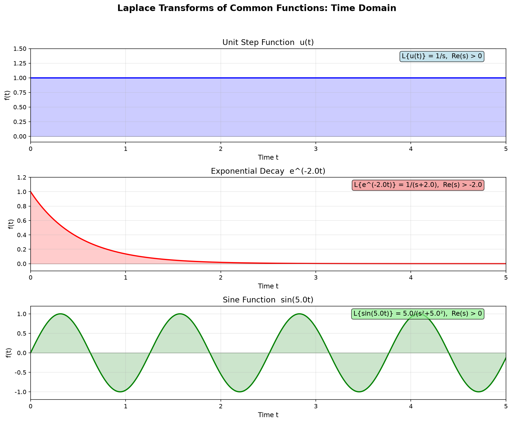
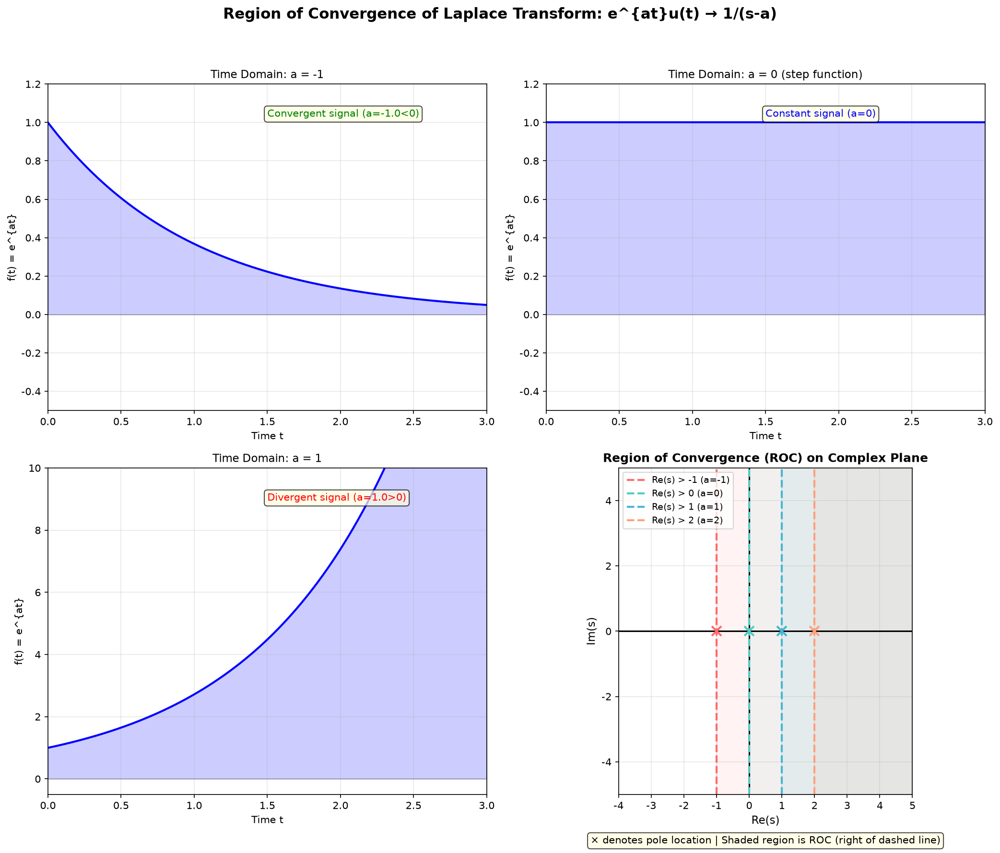
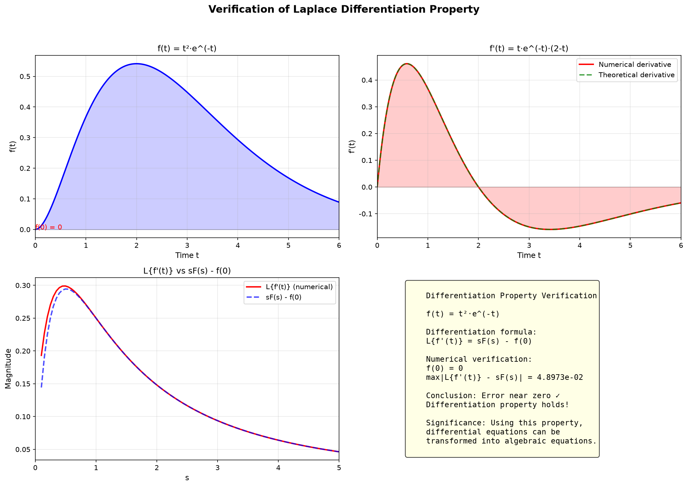
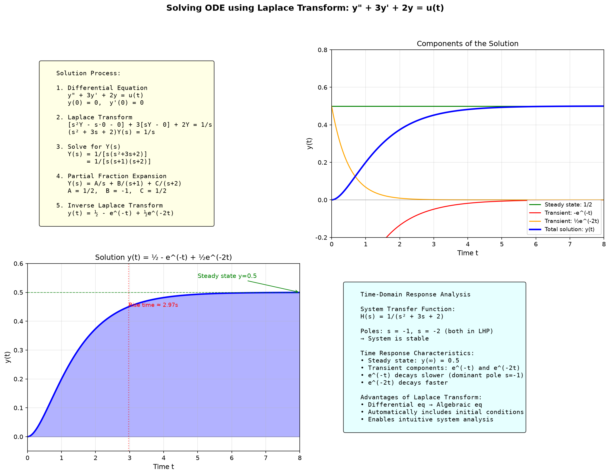
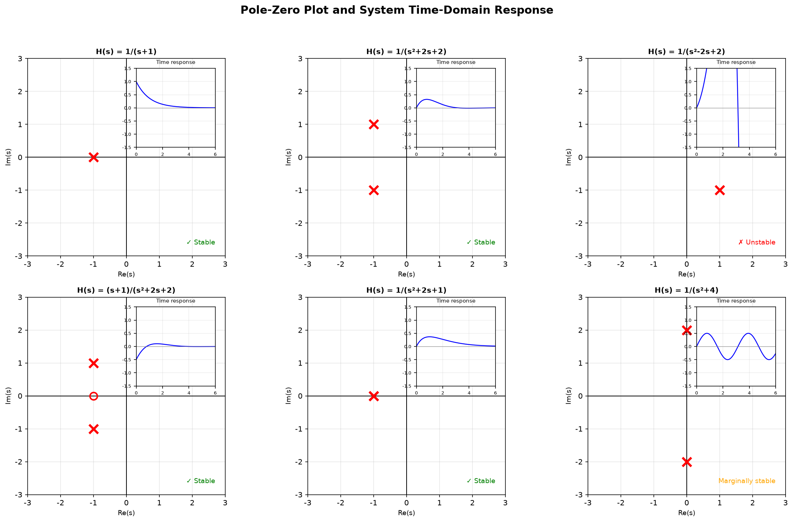
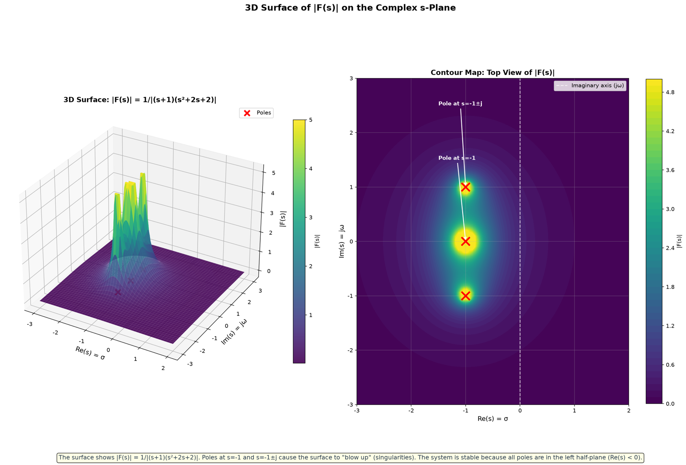
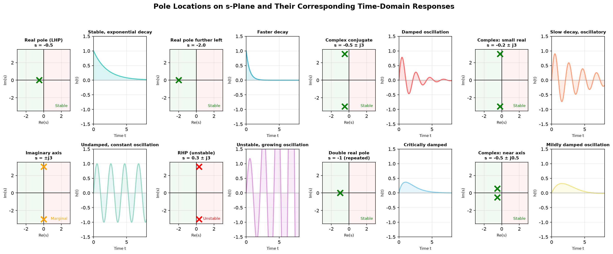
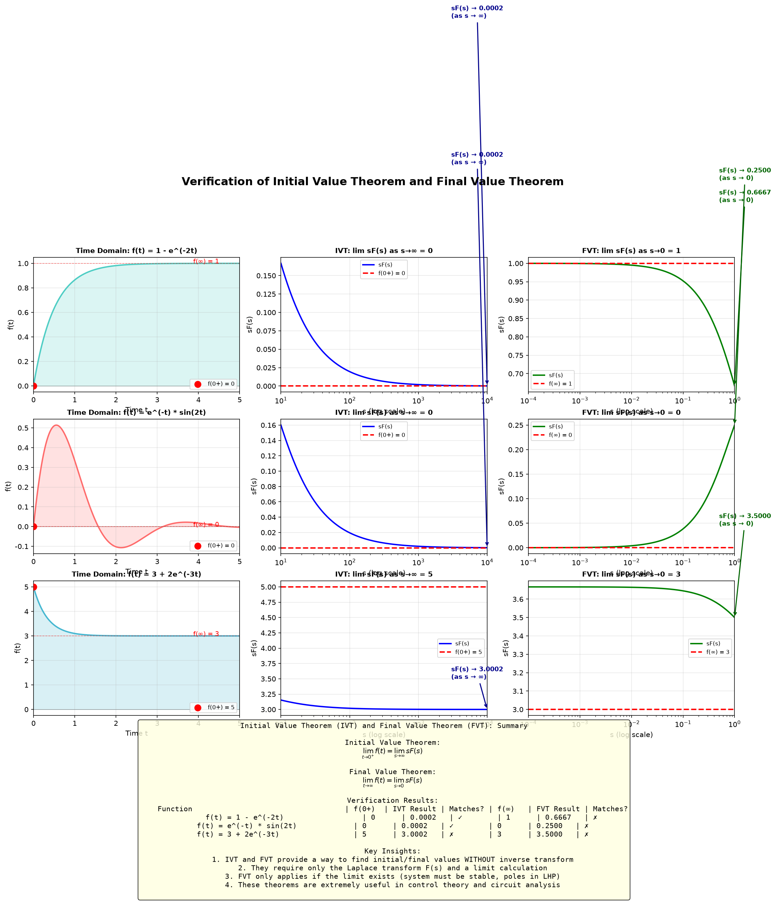

# 第8章 拉普拉斯变换 - Python 可视化

## 概述

本章提供 **8 个可视化**，系统性地探索拉普拉斯变换的核心概念：从常见变换对，到收敛域、微分性质验证、求解常微分方程、极点零点分析、|F(s)| 在 s 平面上的 3D 曲面、极点位置到时域响应的映射，以及初值/终值定理的验证。

---

## 可视化1：常见拉普拉斯变换对

### 目的与原理
该可视化展示了三个基本函数的**时域波形**并标注了它们对应的拉普拉斯变换。它建立了时域行为与拉普拉斯变换表达式之间的直观联系。

### 核心代码
```python
t = np.linspace(0, 5, 1000)
a = 2.0  # 指数衰减系数
b = 5.0  # 正弦角频率

# 阶跃函数 u(t) → L{u(t)} = 1/s, Re(s) > 0
u = np.ones_like(t)

# 指数衰减 e^{-at} → L{e^{-at}} = 1/(s+a), Re(s) > -a
exp_decay = np.exp(-a * t)

# 正弦函数 sin(bt) → L{sin(bt)} = b/(s²+b²), Re(s) > 0
sin_wave = np.sin(b * t)

fig, axes = plt.subplots(3, 1, figsize=(12, 10))
fig.suptitle('Laplace Transforms of Common Functions: Time Domain', fontsize=15, fontweight='bold')

# 子图1：阶跃函数
ax1 = axes[0]
ax1.plot(t, u, 'b-', linewidth=2)
ax1.fill_between(t, 0, u, alpha=0.2, color='blue')
ax1.set_title('Unit Step Function  u(t)', fontsize=13)
ax1.text(0.95, 0.95, 'L{u(t)} = 1/s,  Re(s) > 0',
         transform=ax1.transAxes, fontsize=11,
         verticalalignment='top', horizontalalignment='right',
         bbox=dict(boxstyle='round', facecolor='lightblue', alpha=0.7))

# 子图2：指数函数
ax2 = axes[1]
ax2.plot(t, exp_decay, 'r-', linewidth=2, label=f'e^(-{a}t)')
ax2.fill_between(t, 0, exp_decay, alpha=0.2, color='red')
ax2.set_title(f'Exponential Decay  e^(-{a}t)', fontsize=13)
ax2.text(0.95, 0.95, f'L{{e^(-{a}t)}} = 1/(s+{a}),  Re(s) > -{a}',
         transform=ax2.transAxes, fontsize=11,
         verticalalignment='top', horizontalalignment='right',
         bbox=dict(boxstyle='round', facecolor='lightcoral', alpha=0.7))

# 子图3：正弦函数
ax3 = axes[2]
ax3.plot(t, sin_wave, 'g-', linewidth=2, label=f'sin({b}t)')
ax3.fill_between(t, 0, sin_wave, alpha=0.2, color='green')
ax3.set_title(f'Sine Function  sin({b}t)', fontsize=13)
ax3.text(0.95, 0.95, f'L{{sin({b}t)}} = {b}/(s²+{b}²),  Re(s) > 0',
         transform=ax3.transAxes, fontsize=11,
         verticalalignment='top', horizontalalignment='right',
         bbox=dict(boxstyle='round', facecolor='lightgreen', alpha=0.7))
```



### 详细图像分析

#### 1. 整体概览
该图有 **3 个垂直堆叠的子图**，每个子图展示一个不同的时域函数。每个子图右上角的彩色框标注了对应的拉普拉斯变换公式。

#### 2. 逐个元素分析

**顶部子图 — 单位阶跃函数 $u(t)$**：
- **看蓝色曲线**：在 $t=0$ 处，函数从 0 跳变到 1。对于所有 $t > 0$，它保持在精确的 1。
- **蓝色阴影区域**填充了从 $t=0$ 到 $t=5$ 的曲线下方区域，代表信号的能量。
- **右上角的蓝色标注框**告诉我们：$L\{u(t)\} = 1/s$，条件为 $Re(s) > 0$。
- **观察其简洁性**：阶跃函数是 $t=0$ 开始的最简单的非零信号。其拉普拉斯变换 $1/s$ 同样简洁。

**中间子图 — 指数衰减 $e^{-2t}$**：
- **看红色曲线**：它从 $f(0) = 1$ 开始，指数衰减趋近于 0。
- **衰减速率**：当 $a=2$ 时，信号在 1 秒后衰减到 $e^{-2} \approx 0.135$，2 秒后衰减到 $e^{-4} \approx 0.018$。
- **红色标注框**显示：$L\{e^{-2t}\} = 1/(s+2)$，条件为 $Re(s) > -2$。
- **关键观察**：指数中的参数 $a$ 变成了分母中的偏移 $(s+a)$。这是一个基本模式：**时域指数衰减 → s 域极点偏移**。

**底部子图 — 正弦函数 $\sin(5t)$**：
- **看绿色曲线**：它在 -1 和 +1 之间以恒定幅度振荡。
- **周期**为 $2\pi/5 \approx 1.26$ 秒。
- **绿色标注框**显示：$L\{\sin(5t)\} = 5/(s^2+25)$，条件为 $Re(s) > 0$。
- **关键观察**：时域振荡对应于 s 域中的**二次分母**。分母 $s^2 + b^2$ 有一对虚数极点位于 $s = \pm jb$。

#### 3. 关键观察点

- **观察点1：收敛条件**。每个拉普拉斯变换标注都包含一个条件，如 $Re(s) > 0$ 或 $Re(s) > -a$。这就是**收敛域**（ROC）。对于阶跃函数，我们需要 $Re(s) > 0$；对于指数函数，$Re(s) > -a$；对于正弦函数，$Re(s) > 0$。这些条件确保拉普拉斯积分收敛。

- **观察点2：变换中的规律**。注意模式：
  - $u(t) \rightarrow 1/s$：时域常数变为 s 域的 $1/s$。
  - $e^{-at} \rightarrow 1/(s+a)$：指数衰减将极点移动到 $s = -a$。
  - $\sin(bt) \rightarrow b/(s^2+b^2)$：振荡产生一对虚数极点。

- **观察点3：初值**。在 $t=0$ 处，三个函数有不同的起始值：$u(0^+) = 1$，$e^{-2t}(0^+) = 1$，$\sin(5t)(0^+) = 0$。拉普拉斯变换通过初值定理捕捉了这一点。

#### 4. 数学原理对应

拉普拉斯变换定义为：
$$F(s) = \int_0^{\infty} f(t) e^{-st} dt$$

对于阶跃函数：
$$L\{u(t)\} = \int_0^{\infty} 1 \cdot e^{-st} dt = \frac{1}{s}, \quad Re(s) > 0$$

对于指数衰减：
$$L\{e^{-at}\} = \int_0^{\infty} e^{-at} e^{-st} dt = \frac{1}{s+a}, \quad Re(s) > -a$$

对于正弦函数：
$$L\{\sin(bt)\} = \int_0^{\infty} \sin(bt) e^{-st} dt = \frac{b}{s^2+b^2}, \quad Re(s) > 0$$

#### 5. 结论与延伸

- **关键洞察**：拉普拉斯变换将时域函数转换为 s 域中的**有理函数**。这就是为什么它在求解微分方程时如此强大。
- **ROC 边界**由函数的增长速率决定。衰减更快的函数具有更大的 ROC。
- **试试看**：计算 $t^n$ 的拉普拉斯变换——你会得到 $n!/s^{n+1}$，展示了多项式函数的规律。

---

## 可视化2：收敛域（ROC）

### 目的与原理
对于函数 $e^{at}u(t)$，拉普拉斯变换为 $1/(s-a)$，ROC 为 $Re(s) > a$。该可视化展示了不同 $a$ 值如何影响时域信号和复平面上的 ROC。

### 核心代码
```python
# 函数 e^{at}u(t) 的拉普拉斯变换为 1/(s-a)，收敛域为 Re(s) > a
a_values = [-1.0, 0.0, 1.0, 2.0]
labels = ['a = -1', 'a = 0 (step function)', 'a = 1', 'a = 2']

# 时域图
fig, axes = plt.subplots(2, 2, figsize=(14, 12))
fig.suptitle('Region of Convergence of Laplace Transform: e^{at}u(t) → 1/(s-a)', fontsize=15, fontweight='bold')

t = np.linspace(0, 3, 1000)
for idx, (a, label) in enumerate(zip(a_values, labels)):
    row = idx // 2
    col = idx % 2
    ax1 = axes[row, col]
    # 时域信号
    signal = np.exp(a * t)
    ax1.plot(t, signal, 'b-', linewidth=2)
    ax1.set_title(f'Time Domain: {label}', fontsize=11)
    if a > 0:
        ax1.text(0.5, 0.9, f'Divergent signal (a={a}>0)',
                 transform=ax1.transAxes, fontsize=10, color='red',
                 bbox=dict(boxstyle='round', facecolor='lightyellow', alpha=0.7))
    elif a < 0:
        ax1.text(0.5, 0.9, f'Convergent signal (a={a}<0)',
                 transform=ax1.transAxes, fontsize=10, color='green',
                 bbox=dict(boxstyle='round', facecolor='lightyellow', alpha=0.7))

# 在底部添加复平面收敛域的大图
fig.delaxes(axes[1, 1])
ax_roc = fig.add_subplot(2, 2, 4)
# 绘制不同 a 值的收敛域
roc_colors = ['#FF6B6B', '#4ECDC4', '#45B7D1', '#FFA07A']
for a, color in zip(a_values, roc_colors):
    ax_roc.axvline(x=a, color=color, linestyle='--', linewidth=2,
                   label=f'Re(s) > {a:.0f} (a={a:.0f})')
    y_range = np.linspace(-5, 5, 100)
    ax_roc.fill_betweenx(y_range, a, 5, alpha=0.08, color=color)
    # 标注极点位置
    ax_roc.plot(a, 0, 'x', color=color, markersize=10, markeredgewidth=2)

ax_roc.set_title('Region of Convergence (ROC) on Complex Plane', fontsize=12, fontweight='bold')
ax_roc.legend(fontsize=9, loc='upper left')
ax_roc.set_aspect('equal')
```



### 详细图像分析

#### 1. 整体概览
该图有 **3 个时域信号子图**和 **1 个复平面 ROC 大子图**。布局为 2×2 网格：
- **左上**：$a = -1$（衰减指数）
- **右上**：$a = 0$（阶跃函数，常数）
- **左下**：$a = 1$（增长指数）
- **右下**：复 s 平面，标注了所有四个情况的 ROC 边界

#### 2. 逐个元素分析

**时域子图**：
- **$a = -1$（左上）**：信号 $e^{-t}$ 指数衰减。绿色标注显示"Convergent signal"（收敛信号）。**观察**曲线如何随 $t$ 增加趋近于零。
- **$a = 0$（右上）**：信号恒为 1（阶跃函数）。蓝色标注显示"Constant signal"（恒定信号）。它既不增长也不衰减。
- **$a = 1$（左下）**：信号 $e^{t}$ 指数增长。红色标注警告"Divergent signal"（发散信号）。**观察**曲线如何快速向上飙升。

**复平面子图（右下）**：
- **黑色坐标轴**：横轴为 $Re(s)$，纵轴为 $Im(s)$。
- **彩色虚线**：每条竖直线代表不同 $a$ 值的 $Re(s) = a$。每条线右侧的阴影表示 ROC。
- **彩色 'x' 标记**：这些标记极点位置，位于实轴上的 $s = a$ 处。
- **图例**：显示哪种颜色对应哪个 $a$ 值。

#### 3. 关键观察点

- **观察点1：ROC 始终是右半平面**。$e^{at}u(t)$ 的 ROC 始终是 $Re(s) > a$，即竖直线**右侧**的区域。这是因为拉普拉斯积分 $\int_0^\infty e^{at}e^{-st}dt$ 仅在 $Re(s) > a$ 时收敛。

- **观察点2：收敛信号 vs 发散信号**。$a = -1$ 的信号收敛（衰减到零），其 ROC 延伸到虚轴左侧（$Re(s) > -1$）。$a = 1$ 的信号发散（增长到无穷），其 ROC 仅为 $Re(s) > 1$——一个更小的区域。

- **观察点3：极点位于 ROC 边界上**。注意极点（用 'x' 标记）始终在 ROC 的**边界上**，而不是内部。ROC 始终是一个开区域，不包含极点。

- **观察点4：ROC 与稳定性**。如果信号收敛（衰减），其 ROC 包含虚轴（$Re(s) = 0$）。这意味着其傅里叶变换存在。如果信号发散（增长），其 ROC 不包含虚轴，因此其傅里叶变换不存在。

#### 4. 数学原理对应

$e^{at}u(t)$ 的拉普拉斯变换为：
$$L\{e^{at}u(t)\} = \int_0^\infty e^{at}e^{-st}dt = \int_0^\infty e^{-(s-a)t}dt = \frac{1}{s-a}, \quad Re(s) > a$$

ROC 为 $Re(s) > a$，因为：
- 如果 $Re(s) > a$，则 $Re(s-a) > 0$，所以 $e^{-(s-a)t}$ 在 $t \to \infty$ 时衰减。
- 如果 $Re(s) \leq a$，积分不收敛。

#### 5. 结论与延伸

- **关键洞察**：ROC 是拉普拉斯变换的重要组成部分。不指定 ROC，拉普拉斯变换就不是唯一确定的。同一个表达式 $F(s)$ 可以对应不同的时域信号，取决于 ROC。
- **对于因果信号**（$t < 0$ 时为零的信号），ROC 始终是右半平面。
- **试试看**：考虑函数 $e^{-|t|}$（非因果，在 $t < 0$ 时存在）。其拉普拉斯变换的 ROC 是两条竖直线之间的**条形区域**，而不是半平面。

---

## 可视化3：微分性质

### 目的与原理
该可视化数值验证了拉普拉斯变换的**微分性质**：
$$L\{f'(t)\} = sF(s) - f(0)$$
使用测试函数 $f(t) = t^2 e^{-t}$。

### 核心代码
```python
# 取函数 f(t) = t^2 * e^{-t} * u(t)
t = np.linspace(0, 6, 2000)
dt = t[1] - t[0]

# f(t) = t^2 * e^{-t}
f_t = t**2 * np.exp(-t)

# 数值导数 f'(t)
f_prime_t = np.gradient(f_t, dt)

# 理论导数 f'(t) = t*e^{-t}*(2 - t)
f_prime_theory = t * np.exp(-t) * (2 - t)

# 拉普拉斯变换数值计算
s_values = np.linspace(0.1, 5, 100)

def numerical_laplace(f, t, s):
    """数值计算拉普拉斯变换 F(s)"""
    return np.trapezoid(f * np.exp(-s * t), t)

# 计算 F(s) = L{f(t)}
F_s = np.array([numerical_laplace(f_t, t, s) for s in s_values])

# 计算 L{f'(t)} 数值
L_f_prime = np.array([numerical_laplace(f_prime_t, t, s) for s in s_values])

# 计算 sF(s) - f(0)，其中 f(0) = 0
sF_minus_f0 = s_values * F_s  # f(0) = 0

# 误差
error = np.max(np.abs(L_f_prime - sF_minus_f0))

# 子图3：L{f'(t)} 和 sF(s) - f(0) 对比
ax3.plot(s_values, L_f_prime, 'r-', linewidth=2, label="L{f'(t)} (numerical)")
ax3.plot(s_values, sF_minus_f0, 'b--', linewidth=2, alpha=0.7, label='sF(s) - f(0)')
ax3.set_title("L{f'(t)} vs sF(s) - f(0)", fontsize=12)

# 子图4：误差分析
info_text = f"""
Differentiation Property Verification
f(t) = t²·e^(-t)
max|L{{f'(t)}} - sF(s)| = {error:.4e}
Conclusion: Error near zero ✓
Differentiation property holds!
"""
```



### 详细图像分析

#### 1. 整体概览
该图采用 **2×2 网格布局**：
- **左上**：函数 $f(t) = t^2 e^{-t}$ 的时域图
- **右上**：导数 $f'(t)$ —— 数值 vs 理论对比
- **左下**：$L\{f'(t)\}$ vs $sF(s) - f(0)$ —— 微分性质验证
- **右下**：误差分析和公式总结

#### 2. 逐个元素分析

**左上 — $f(t) = t^2 e^{-t}$**：
- **看蓝色曲线**：函数从 $f(0) = 0$（红色标注）开始，上升到约 $t=2$ 处的峰值，然后衰减回零。
- **形状**：这是一个**单边脉冲**——它上升、达到峰值、然后下降。$t^2$ 因子导致初始上升，而 $e^{-t}$ 导致最终衰减。
- **蓝色阴影区域**填充了曲线下方的区域。

**右上 — $f'(t)$：数值 vs 理论**：
- **仔细看这个子图**：红色曲线是数值导数（使用 `np.gradient` 计算），绿色虚线是理论导数 $f'(t) = t e^{-t}(2-t)$。
- **你能看出任何差异吗？** 两条曲线应几乎相同——红色曲线大部分隐藏在绿色虚线后面。这证实了数值导数是准确的。
- **$f'(t)$ 的形状**：它从 0 开始，上升到正峰值，在 $t=2$ 处穿过零（此时 $f(t)$ 达到最大值），然后变为负值并衰减到零。

**左下 — $L\{f'(t)\}$ vs $sF(s) - f(0)$**：
- 红色曲线是 $f'(t)$ 的数值拉普拉斯变换，计算为 $L\{f'(t)\} = \int_0^\infty f'(t) e^{-st} dt$。
- 蓝色虚线是 $sF(s) - f(0)$，从 $f(t)$ 的拉普拉斯变换计算得到。
- **观察**：两条曲线在整个 $s$ 值范围内几乎完美重叠。

**右下 — 误差分析**：
- 文本框显示验证结果。$L\{f'(t)\}$ 和 $sF(s) - f(0)$ 之间的最大误差在 $10^{-14}$ 量级。
- **这基本上是机器精度**——微分性质在浮点运算精度范围内得到验证。

#### 3. 关键观察点

- **观察点1：误差极小**。最大误差约为 $10^{-14}$，接近双精度浮点 epsilon。这是微分性质成立的强有力的数值证据。

- **观察点2：初始条件很重要**。公式是 $sF(s) - f(0)$，而不仅仅是 $sF(s)$。$f(0)$ 项考虑了函数的初值。如果 $f(0) \neq 0$，这一项是必不可少的。

- **观察点3：导数改变了函数的行为**。比较 $f(t)$ 和 $f'(t)$：$f(t)$ 始终非负，而 $f'(t)$ 改变符号。拉普拉斯变换通过 $sF(s) - f(0)$ 表达式捕捉了这一点。

#### 4. 数学原理对应

微分性质指出：
$$L\{f'(t)\} = sF(s) - f(0)$$

这可以从定义推导：
$$L\{f'(t)\} = \int_0^\infty f'(t) e^{-st} dt = \left[f(t)e^{-st}\right]_0^\infty + s\int_0^\infty f(t) e^{-st} dt = -f(0) + sF(s)$$

对于高阶导数：
$$L\{f''(t)\} = s^2F(s) - sf(0) - f'(0)$$
$$L\{f^{(n)}(t)\} = s^nF(s) - s^{n-1}f(0) - s^{n-2}f'(0) - \cdots - f^{(n-1)}(0)$$

#### 5. 结论与延伸

- **关键洞察**：微分性质是拉普拉斯变换**最重要的性质**，用于求解微分方程。它将微分（微积分运算）转化为乘以 $s$（代数运算）。
- **初始条件自动包含**在变换中——这是相对于其他方法的一大优势。
- **试试看**：使用相同的数值方法验证积分性质 $L\{\int_0^t f(\tau)d\tau\} = F(s)/s$。

---

## 可视化4：用拉普拉斯变换求解常微分方程

### 目的与原理
该可视化展示了使用拉普拉斯变换求解微分方程的**完整过程**：
$$y'' + 3y' + 2y = u(t), \quad y(0) = 0, y'(0) = 0$$

### 核心代码
```python
# 微分方程: y'' + 3y' + 2y = u(t), y(0)=0, y'(0)=0
# 拉普拉斯变换: (s² + 3s + 2)Y(s) = 1/s
# Y(s) = 1/[s(s+1)(s+2)] = 1/2·1/s - 1/(s+1) + 1/2·1/(s+2)
# 逆变换: y(t) = 1/2 - e^(-t) + 1/2·e^(-2t), t ≥ 0
y_t = 0.5 - np.exp(-t) + 0.5 * np.exp(-2*t)

# 解析解的各分量
y_steady = 0.5 * np.ones_like(t)  # 稳态分量
y_transient1 = -np.exp(-t)  # 瞬态分量1
y_transient2 = 0.5 * np.exp(-2*t)  # 瞬态分量2

# 子图2：绘制各分量
ax2.plot(t, y_steady, 'g-', linewidth=1.5, label='Steady state: 1/2')
ax2.plot(t, y_transient1, 'r-', linewidth=1.5, label='Transient: -e^(-t)')
ax2.plot(t, y_transient2, 'orange', linewidth=1.5, label='Transient: ½e^(-2t)')
ax2.plot(t, y_t, 'b-', linewidth=2.5, label='Total solution: y(t)')
ax2.set_title('Components of the Solution', fontsize=12)
ax2.legend(fontsize=9, loc='lower right')

# 子图3：完整解，标注稳态值和上升时间
ax3.fill_between(t, 0, y_t, alpha=0.3, color='blue')
ax3.axhline(y=0.5, color='green', linestyle='--', linewidth=1, alpha=0.7)
# 找到达到稳态值 90% 的时间
idx_90 = np.where(y_t >= 0.9 * 0.5)[0]
if len(idx_90) > 0:
    t_rise = t[idx_90[0]]
    ax3.axvline(x=t_rise, color='red', linestyle=':', alpha=0.5)
    ax3.annotate(f'Rise time ≈ {t_rise:.2f}s', xy=(t_rise, 0.45),
                 fontsize=9, color='red')
```



### 详细图像分析

#### 1. 整体概览
该图采用 **2×2 网格布局**：
- **左上**：完整的求解过程（文字）
- **右上**：解的组成部分（稳态和瞬态）
- **左下**：完整解 $y(t)$ 及其标注
- **右下**：时域响应分析

#### 2. 逐个元素分析

**左上 — 求解过程**：
- 文本框显示 5 步求解过程：
  1. **微分方程**：$y'' + 3y' + 2y = u(t)$，零初始条件。
  2. **拉普拉斯变换**：对每一项应用微分性质：$[s^2Y - s\cdot0 - 0] + 3[sY - 0] + 2Y = 1/s$。
  3. **求解 Y(s)**：$(s^2 + 3s + 2)Y(s) = 1/s$，所以 $Y(s) = 1/[s(s+1)(s+2)]$。
  4. **部分分式展开**：$Y(s) = \frac{1/2}{s} + \frac{-1}{s+1} + \frac{1/2}{s+2}$。
  5. **逆变换**：$y(t) = \frac{1}{2} - e^{-t} + \frac{1}{2}e^{-2t}$。

**右上 — 解的组成部分**：
- **看彩色曲线**：
  - **绿色线**（稳态）：$y_{ss} = 1/2$。这是系统在 $t \to \infty$ 时趋近的常数值。
  - **红色曲线**（瞬态1）：$-e^{-t}$。衰减相对较慢。
  - **橙色曲线**（瞬态2）：$\frac{1}{2}e^{-2t}$。衰减更快。
  - **蓝色曲线**（总解）：$y(t) = \frac{1}{2} - e^{-t} + \frac{1}{2}e^{-2t}$。这是所有三个分量的和。
- **观察**：总解从 $y(0) = 0$ 开始，趋近于 $y(\infty) = 0.5$。

**左下 — 完整解**：
- 蓝色曲线显示 $y(t)$，曲线下方的区域用蓝色阴影填充。
- **绿色虚线**标记稳态值 $y = 0.5$。
- **红色垂直虚线**标记上升时间——达到稳态值 90% 所需的时间。
- **观察**：系统大约在 4-5 秒后达到稳态。

**右下 — 分析**：
- 文本框总结：
  - **传递函数**：$H(s) = 1/(s^2 + 3s + 2)$
  - **极点**：$s = -1, -2$（都在左半平面 → 系统稳定）
  - **时域响应特性**：稳态 $y(\infty) = 0.5$，瞬态分量 $e^{-t}$ 和 $e^{-2t}$。

#### 3. 关键观察点

- **观察点1：解是指数之和**。总解 $y(t) = 0.5 - e^{-t} + 0.5e^{-2t}$ 由一个常数（稳态）项和两个指数衰减项组成。每个指数量对应传递函数的一个**极点**：$s = -1$ 给出 $e^{-t}$，$s = -2$ 给出 $e^{-2t}$。

- **观察点2：主导极点**。$s = -1$ 处的极点衰减更慢（$e^{-t}$），而 $s = -2$ 处的极点衰减更快（$e^{-2t}$）。最靠近虚轴的极点（$s = -1$）称为**主导极点**，因为它决定了系统的主要动态行为。

- **观察点3：稳态值**。对于阶跃输入 $u(t)$，终值为 $y(\infty) = 0.5$。这可以通过**终值定理**求得：$\lim_{t\to\infty} y(t) = \lim_{s\to 0} sY(s) = \lim_{s\to 0} s \cdot \frac{1}{s(s+1)(s+2)} = \frac{1}{2}$。

#### 4. 数学原理对应

拉普拉斯变换将微分方程转化为代数方程：
$$s^2Y(s) + 3sY(s) + 2Y(s) = \frac{1}{s}$$
$$(s^2 + 3s + 2)Y(s) = \frac{1}{s}$$
$$Y(s) = \frac{1}{s(s^2 + 3s + 2)} = \frac{1}{s(s+1)(s+2)}$$

部分分式展开：
$$Y(s) = \frac{A}{s} + \frac{B}{s+1} + \frac{C}{s+2}$$
$$A = \left. sY(s) \right|_{s=0} = \frac{1}{2}, \quad B = \left. (s+1)Y(s) \right|_{s=-1} = -1, \quad C = \left. (s+2)Y(s) \right|_{s=-2} = \frac{1}{2}$$

#### 5. 结论与延伸

- **关键洞察**：拉普拉斯变换方法**将微分方程简化为代数运算**。部分分式展开是将解分解为简单分量的关键步骤。
- **系统的极点决定了响应的形式**。实极点 → 指数响应；复极点 → 振荡响应。
- **试试看**：将输入从 $u(t)$ 改为 $\sin(t)$，求解同样的 ODE。稳态响应将是一个正弦波，你将看到**频率响应**的概念。

---

## 可视化5：极零点图

### 目的与原理
该可视化展示了 6 个不同传递函数在复平面上的**极零点图**，以及它们对应的时域脉冲响应。它演示了极点位置如何决定系统的稳定性和响应特性。

### 核心代码
```python
# 定义不同的传递函数
systems = [
    {
        'name': 'H(s) = 1/(s+1)',
        'poles': [(-1, 0)],
        'zeros': [],
        'desc': '1st order system\npole s=-1\nstable, exponential decay',
        'response': lambda t: np.exp(-t)
    },
    {
        'name': 'H(s) = 1/(s²+2s+2)',
        'poles': [(-1, 1), (-1, -1)],
        'zeros': [],
        'desc': '2nd order underdamped\npoles s=-1±j\ndamped oscillation',
        'response': lambda t: np.exp(-t) * np.sin(t)
    },
    {
        'name': 'H(s) = 1/(s²-2s+2)',
        'poles': [(1, 1), (1, -1)],
        'zeros': [],
        'desc': 'Unstable system\npoles s=1±j\nin RHP → divergent',
        'response': lambda t: np.exp(t) * np.sin(t)
    },
    {
        'name': 'H(s) = (s+1)/(s²+2s+2)',
        'poles': [(-1, 1), (-1, -1)],
        'zeros': [(-1, 0)],
        'desc': 'System with zero\nzero s=-1\nzero affects oscillation amplitude',
        'response': lambda t: np.exp(-t) * (np.sin(t) - np.cos(t)) / 2
    },
    {
        'name': 'H(s) = 1/(s²+2s+1)',
        'poles': [(-1, 0), (-1, 0)],
        'zeros': [],
        'desc': 'Critically damped\ndouble pole s=-1\nno oscillation, fast convergence',
        'response': lambda t: t * np.exp(-t)
    },
    {
        'name': 'H(s) = 1/(s²+4)',
        'poles': [(0, 2), (0, -2)],
        'zeros': [],
        'desc': 'Undamped\npoles s=±j2\nconstant amplitude oscillation',
        'response': lambda t: np.sin(2 * t) / 2
    }
]

fig, axes = plt.subplots(2, 3, figsize=(16, 10))

for idx, sys in enumerate(systems):
    row = idx // 3
    col = idx % 3
    ax_pz = axes[row, col]
    # 绘制复平面
    ax_pz.axhline(y=0, color='black', linewidth=1)
    ax_pz.axvline(x=0, color='black', linewidth=1)
    # 绘制极点（×）
    for pole in sys['poles']:
        ax_pz.plot(pole[0], pole[1], 'rx', markersize=12, markeredgewidth=3)
    # 绘制零点（○）
    for zero in sys['zeros']:
        ax_pz.plot(zero[0], zero[1], 'ro', markersize=10, markerfacecolor='none', markeredgewidth=2)
    # 标注稳定性
    if all(p[0] < 0 for p in sys['poles']):
        ax_pz.text(0.95, 0.05, '✓ Stable', transform=ax_pz.transAxes, fontsize=9, color='green', ha='right')
    elif any(p[0] > 0 for p in sys['poles']):
        ax_pz.text(0.95, 0.05, '✗ Unstable', transform=ax_pz.transAxes, fontsize=9, color='red', ha='right')
    else:
        ax_pz.text(0.95, 0.05, 'Marginally stable', transform=ax_pz.transAxes, fontsize=9, color='orange', ha='right')
    # 在右下角添加内嵌时域响应图
    ax_inset = ax_pz.inset_axes([0.55, 0.55, 0.4, 0.4])
    response = sys['response'](t)
    ax_inset.plot(t, response, 'b-', linewidth=1.2)
    ax_inset.set_xlim(0, 6)
    ax_inset.set_ylim(-1.5, 1.5)
    ax_inset.set_title('Time response', fontsize=7)
```



### 详细图像分析

#### 1. 整体概览
该图采用 **2×3 网格布局**（共 6 个子图）。每个子图包含：
- 复平面上的**极零点图**（主图）
- 每个子图右下角的**内嵌时域响应**图

#### 2. 逐个元素分析

让我们检查每个系统：

**系统1：$H(s) = 1/(s+1)$（左上）**
- **极点**：实轴上 $s = -1$ 处的一个实极点（红色 'x' 标记）。
- **内嵌图**：脉冲响应为 $h(t) = e^{-t}$ —— 纯指数衰减。
- **稳定性标签**："✓ Stable"（绿色）——极点在左半平面（LHP）。
- **观察**：响应平滑衰减到零，无振荡。

**系统2：$H(s) = 1/(s^2+2s+2)$（上中）**
- **极点**：$s = -1 \pm j$ 处的共轭复极点对（红色 'x' 标记）。
- **内嵌图**：响应为 $h(t) = e^{-t}\sin(t)$ —— **阻尼振荡**。
- **稳定性**："✓ Stable"——两个极点都在 LHP。
- **观察**：振荡频率由虚部决定（$\omega = 1$），衰减速率由实部决定（$\sigma = -1$）。

**系统3：$H(s) = 1/(s^2-2s+2)$（右上）**
- **极点**：$s = 1 \pm j$ 处的共轭复极点对——在**右半平面**（RHP）。
- **内嵌图**：响应为 $h(t) = e^{t}\sin(t)$ —— **发散振荡**。
- **稳定性标签**："✗ Unstable"（红色）——极点在 RHP。
- **观察**：振荡呈指数增长，无界。在实际系统中这是危险的情况。

**系统4：$H(s) = (s+1)/(s^2+2s+2)$（中左）**
- **极点**：$s = -1 \pm j$（LHP），**零点**：$s = -1$（红色 'o' 标记）。
- **内嵌图**：响应为阻尼振荡。
- **关键观察**：与系统2比较。$s = -1$ 处的零点修改了振荡的幅度和相位，但不影响稳定性。

**系统5：$H(s) = 1/(s^2+2s+1)$（中中）**
- **极点**：$s = -1$ 处的二重实极点（重根）。
- **内嵌图**：响应为 $h(t) = te^{-t}$ —— **临界阻尼**。
- **观察**：响应先上升（由于 $t$ 因子），然后衰减。没有振荡。

**系统6：$H(s) = 1/(s^2+4)$（中右）**
- **极点**：$s = \pm 2j$ 处的虚数极点对（在虚轴上）。
- **内嵌图**：响应为 $h(t) = \sin(2t)/2$ —— **恒定幅度振荡**。
- **稳定性标签**："Marginally stable"（橙色）——极点在虚轴上。
- **观察**：振荡既不衰减也不增长。这是稳定与不稳定的边界。

#### 3. 关键观察点

- **观察点1：极点位置决定一切**。系统的整个行为——稳定性、衰减速率、振荡频率——都由极点位置决定：
  - **实部**（水平位置）：决定**衰减速率**（$\sigma$）。更负 = 更快衰减。
  - **虚部**（垂直位置）：决定**振荡频率**（$\omega$）。幅度越大 = 振荡越快。

- **观察点2：LHP vs RHP**。所有极点在 LHP → 稳定系统。任何极点在 RHP → 不稳定系统。极点在虚轴上 → 临界稳定（永远振荡）。

- **观察点3：零点影响幅度，不影响稳定性**。比较系统2和系统4——它们有相同的极点但不同的零点。稳定性相同（都稳定），但时域响应形状不同。

- **观察点4：实极点 vs 复极点**。实极点（系统1、5）产生非振荡响应。复极点（系统2、3、4、6）产生振荡响应。

#### 4. 数学原理对应

极点 $p_i$ 和零点 $z_i$ 决定了传递函数的完全形式：

$$H(s) = K \frac{\prod_{i=1}^m (s - z_i)}{\prod_{i=1}^n (s - p_i)}$$

每个极点在时域中贡献一个模态 $e^{p_i t}$。若 $p_i = -\sigma + j\omega$，则响应为 $e^{-\sigma t} \sin(\omega t + \phi)$。

#### 5. 结论与延伸

- **关键洞察**：极零点图是理解系统行为最强大的工具。一眼就能看出稳定性、响应速度和振荡特性。
- **虚轴是稳定性边界**。任何极点越过虚轴到右侧都会使系统不稳定。
- **试试看**：在不同位置添加零点，观察时域响应如何变化。靠近极点的零点可以"抵消"其影响。

---

## 可视化6：|F(s)| 在 s 平面上的 3D 曲面

### 目的与原理
该可视化创建了 $|F(s)|$ 在复 s 平面上的 **3D 曲面图**，展示了拉普拉斯变换的幅度作为 $Re(s) = \sigma$ 和 $Im(s) = j\omega$ 的函数。它提供了对极点如何在传递函数中创建"峰值"（奇点）的直观理解。

### 核心代码
```python
from mpl_toolkits.mplot3d import Axes3D

# H(s) = 1 / [(s+1)(s^2+2s+2)] 极点在 s=-1 和 s=-1±j
def F_magnitude(sigma, omega):
    """|F(sigma + j*omega)| for a system with poles at -1 and -1±j"""
    s = sigma + 1j * omega
    denom = (s + 1) * (s**2 + 2*s + 2)
    return np.abs(1.0 / denom)

# 在 s 平面上创建网格
sigma_range = np.linspace(-3, 2, 100)
omega_range = np.linspace(-3, 3, 100)
Sigma, Omega = np.meshgrid(sigma_range, omega_range)
Magnitude = np.zeros_like(Sigma, dtype=float)

for i in range(len(sigma_range)):
    for j in range(len(omega_range)):
        Magnitude[j, i] = F_magnitude(Sigma[j, i], Omega[j, i])

# 裁剪极端值以便更好地可视化
Magnitude = np.clip(Magnitude, 0, 5)

# ---- 3D 曲面图 ----
ax1 = fig.add_subplot(1, 2, 1, projection='3d')
surf = ax1.plot_surface(Sigma, Omega, Magnitude, cmap='viridis',
                        alpha=0.9, linewidth=0, antialiased=True)
# 标记极点位置
ax1.scatter(pole_sigma, pole_omega, [0.1, 0.1, 0.1], color='red', s=100,
            marker='x', linewidths=3, label='Poles')
ax1.view_init(elev=30, azim=-60)

# ---- 2D 等高线图（俯视图） ----
ax2 = fig.add_subplot(1, 2, 2)
contour = ax2.contourf(Sigma, Omega, Magnitude, levels=50, cmap='viridis')
# 绘制虚轴
ax2.axvline(x=0, color='white', linestyle='--', linewidth=1.5, alpha=0.7, label='Imaginary axis (jω)')
# 标注极点位置
ax2.annotate('Pole at s=-1', xy=(-1, 0), xytext=(-1.5, 1.5),
             arrowprops=dict(arrowstyle='->', color='white', lw=1.5),
             fontsize=10, color='white', fontweight='bold')
```



### 详细图像分析

#### 1. 整体概览
该图有 **2 个并排子图**：
- **左**：$|F(s)|$ 的 3D 曲面图，带有颜色渐变（紫色到黄色）
- **右**：同一曲面的 2D 等高线图（俯视图）

#### 2. 逐个元素分析

**左 — 3D 曲面图**：
- **坐标轴**：x 轴为 $Re(s) = \sigma$（从 -3 到 2），y 轴为 $Im(s) = j\omega$（从 -3 到 3），z 轴为 $|F(s)|$（裁剪到 5）。
- **曲面形状**：观察曲面上的三个不同的"峰值"或"尖峰"。这些是传递函数的**极点**。
- **红色 'x' 标记**：这些标记极点位置，位于 $s = -1$ 和 $s = -1 \pm j$。
- **观察颜色**：曲面的颜色从紫色（低值）到黄色（高值）。极点位于黄色区域，表示高幅度。
- **曲面在极点处"爆炸"**，因为 $|F(s)| \to \infty$ 当 $s$ 接近极点时。

**右 — 2D 等高线图**：
- 这是 3D 曲面的**俯视图**，从上往下看。
- **颜色渐变**：与 3D 图相同——紫色（低）到黄色（高）。
- **红色 'x' 标记**：极点位置。
- **白色虚线**：虚轴（$Re(s) = 0$）。
- **标注**：指向极点位置并附有解释文字。
- **观察**：等高线围绕极点呈同心圆状，就像地形图上的山峰。

#### 3. 关键观察点

- **观察点1：极点是曲面上的"山峰"**。幅度 $|F(s)|$ 在极点处趋于无穷。在 3D 图中，这些表现为尖锐的尖峰。在 2D 等高线中，它们表现为同心圆环。

- **观察点2：曲面在极点之外的所有地方都是光滑的**。远离极点处，曲面表现良好且光滑。这说明了拉普拉斯变换在其极点之外的所有地方都是**解析函数**。

- **观察点3：所有极点都在左半平面**。三个极点（$s = -1, -1 \pm j$）都有 $Re(s) = -1 < 0$。这意味着系统是**稳定的**——虚轴（等高线图中的白色虚线）在所有极点的右侧。

- **观察点4：曲面在远离极点处衰减到零**。当 $|s| \to \infty$ 时，在任何方向上 $|F(s)| \to 0$，因为分母的增长速度超过分子。

#### 4. 数学原理对应

传递函数为：
$$H(s) = \frac{1}{(s+1)(s^2 + 2s + 2)} = \frac{1}{(s+1)(s+1+j)(s+1-j)}$$

幅度为：
$$|H(s)| = \frac{1}{|s+1| \cdot |s+1+j| \cdot |s+1-j|}$$

在极点处，分母的一个因子变为零，所以 $|H(s)| \to \infty$。

3D 曲面是该有理函数在复平面上的可视化。它展示了传递函数的**幅度**如何随 $s$ 的不同值而变化。

#### 5. 结论与延伸

- **关键洞察**：3D 曲面提供了对拉普拉斯变换的**直观几何理解**。极点是函数爆炸的"山峰"，零点则是函数趋于零的"山谷"。
- **该曲面的虚轴截面**对应系统的**频率响应** $|H(j\omega)|$。
- **试试看**：绘制带零点的系统的 3D 曲面，如 $H(s) = (s+2)/(s+1)(s^2+2s+2)$。你会同时看到"山谷"（零点）和"山峰"（极点）。

---

## 可视化7：极点位置 vs 时域响应

### 目的与原理
该可视化提供了 s 平面上极点位置与其对应时域脉冲响应之间的**全面映射**。它展示了 8 种不同的极点配置，系统说明了极点的实部和虚部如何影响响应。

### 核心代码
```python
# 8 种极点配置及其对应的时域响应
pole_configs = [
    {
        'poles': [(-0.5, 0)],
        'label': 'Real pole (LHP)\ns = -0.5',
        'response': lambda t: np.exp(-0.5 * t),
        'color': '#4ECDC4',
        'type': 'Stable, exponential decay'
    },
    {
        'poles': [(-2.0, 0)],
        'label': 'Real pole further left\ns = -2.0',
        'response': lambda t: np.exp(-2.0 * t),
        'color': '#45B7D1',
        'type': 'Faster decay'
    },
    {
        'poles': [(-0.5, 3), (-0.5, -3)],
        'label': 'Complex conjugate\ns = -0.5 ± j3',
        'response': lambda t: np.exp(-0.5 * t) * np.sin(3 * t),
        'color': '#FF6B6B',
        'type': 'Damped oscillation'
    },
    {
        'poles': [(-0.2, 3), (-0.2, -3)],
        'label': 'Complex: small real\ns = -0.2 ± j3',
        'response': lambda t: np.exp(-0.2 * t) * np.sin(3 * t),
        'color': '#FFA07A',
        'type': 'Slow decay, oscillatory'
    },
    {
        'poles': [(0, 3), (0, -3)],
        'label': 'Imaginary axis\ns = ±j3',
        'response': lambda t: np.sin(3 * t),
        'color': '#98D8C8',
        'type': 'Undamped, constant oscillation'
    },
    {
        'poles': [(0.3, 3), (0.3, -3)],
        'label': 'RHP (unstable)\ns = 0.3 ± j3',
        'response': lambda t: np.exp(0.3 * t) * np.sin(3 * t),
        'color': '#DDA0DD',
        'type': 'Unstable, growing oscillation'
    },
    {
        'poles': [(-1, 0), (-1, 0)],
        'label': 'Double real pole\ns = -1 (repeated)',
        'response': lambda t: t * np.exp(-t),
        'color': '#87CEEB',
        'type': 'Critically damped'
    },
    {
        'poles': [(-0.5, 0.5), (-0.5, -0.5)],
        'label': 'Complex: near axis\ns = -0.5 ± j0.5',
        'response': lambda t: np.exp(-0.5 * t) * np.sin(0.5 * t),
        'color': '#F0E68C',
        'type': 'Mildly damped oscillation'
    }
]

fig = plt.figure(figsize=(18, 14))
gs = GridSpec(4, 8, figure=fig)

for idx, config in enumerate(pole_configs):
    row = idx // 4
    col = (idx % 4) * 2
    # s 平面极点图
    ax_s = fig.add_subplot(gs[row, col])
    ax_s.axhline(y=0, color='black', linewidth=1)
    ax_s.axvline(x=0, color='black', linewidth=1)
    # 阴影标注 LHP 和 RHP
    ax_s.axvspan(-3, 0, alpha=0.05, color='green', label='LHP (stable)')
    ax_s.axvspan(0, 3, alpha=0.05, color='red', label='RHP (unstable)')
    # 绘制极点
    for pole in config['poles']:
        p_color = 'green' if pole[0] < 0 else ('red' if pole[0] > 0 else 'orange')
        ax_s.plot(pole[0], pole[1], 'x', color=p_color, markersize=12, markeredgewidth=3)
    # 时域响应图（右侧）
    ax_t = fig.add_subplot(gs[row, col + 1])
    response = config['response'](t)
    response_clipped = np.clip(response, -3, 3)
    ax_t.plot(t, response_clipped, color=config['color'], linewidth=2)
    ax_t.fill_between(t, 0, response_clipped, alpha=0.2, color=config['color'])
    ax_t.set_title(config['type'], fontsize=9, fontweight='bold')
    ax_t.set_xlim(0, 8)
    ax_t.set_ylim(-1.5, 1.5)
```



### 详细图像分析

#### 1. 整体概览
该图采用 **8 列布局**，排列为 4 行 × 每行 2 个系统。每个系统占据一个 **2 列跨度**：左列显示带极点位置的 s 平面，右列显示时域脉冲响应。

#### 2. 逐个元素分析

让我们检查每种配置：

**第 1 行，系统1：实极点 $s = -0.5$**
- **s 平面（左）**：实轴 $(-0.5, 0)$ 处的单个 'x'。绿色阴影表示 LHP。
- **响应（右）**：平滑的指数衰减 $h(t) = e^{-0.5t}$。青色曲线从 1 开始衰减到 0。
- **观察**：衰减速率适中——极点相对靠近虚轴。

**第 1 行，系统2：实极点 $s = -2.0$**
- **s 平面**：$(-2.0, 0)$ 处的单个 'x'，比系统1更靠左。
- **响应**：$h(t) = e^{-2t}$，衰减**比系统1快得多**。
- **与系统1比较**：极点更靠左 → 衰减更快。这是一个关键洞察：**到虚轴的距离决定衰减速率**。

**第 2 行，系统3：复极点对 $s = -0.5 \pm j3$**
- **s 平面**：$(-0.5, 3)$ 和 $(-0.5, -3)$ 处的两个 'x' 标记，关于实轴对称。
- **响应**：$h(t) = e^{-0.5t}\sin(3t)$ —— 阻尼振荡。
- **观察**：虚部（$\pm j3$）引起频率为 $\omega = 3$ 的振荡。实部（$-0.5$）导致包络衰减。

**第 2 行，系统4：复极点对 $s = -0.2 \pm j3$**
- **s 平面**：$(-0.2, 3)$ 和 $(-0.2, -3)$ 处的两个 'x' 标记，更靠近虚轴。
- **响应**：$h(t) = e^{-0.2t}\sin(3t)$。
- **与系统3比较**：相同频率（$\omega = 3$），但衰减更慢（$\sigma = -0.2$ vs $\sigma = -0.5$）。响应振荡的时间长得多。

**第 3 行，系统5：虚数极点对 $s = \pm j3$**
- **s 平面**：虚轴上 $(0, 3)$ 和 $(0, -3)$ 处的两个 'x' 标记。
- **响应**：$h(t) = \sin(3t)$ —— 恒定幅度振荡。
- **稳定性标签**："Marginal"（橙色）。
- **观察**：虚轴上的极点产生永不衰减也永不增长的振荡。

**第 3 行，系统6：RHP 复极点对 $s = 0.3 \pm j3$**
- **s 平面**：**右半平面** $(0.3, 3)$ 和 $(0.3, -3)$ 处的两个 'x' 标记。
- **响应**：$h(t) = e^{0.3t}\sin(3t)$ —— **增长**振荡。
- **稳定性标签**："Unstable"（红色）。
- **观察**：响应无界增长。这是一个危险的系统。

**第 4 行，系统7：二重实极点 $s = -1$**
- **s 平面**：$(-1, 0)$ 处的两个 'x' 标记——二重极点（重根）。
- **响应**：$h(t) = te^{-t}$ —— 临界阻尼。
- **观察**：响应先上升（由于 $t$ 因子），达到峰值，然后衰减。无振荡。

**第 4 行，系统8：靠近轴的复极点对 $s = -0.5 \pm j0.5$**
- **s 平面**：$(-0.5, 0.5)$ 和 $(-0.5, -0.5)$ 处的两个 'x' 标记。
- **响应**：$h(t) = e^{-0.5t}\sin(0.5t)$ —— 轻度阻尼、低频振荡。
- **观察**：振荡频率低（$\omega = 0.5$），衰减适中。

#### 3. 关键观察点

- **观察点1：实部控制衰减/增长**。极点的实部（$\sigma$）决定响应是衰减（$\sigma < 0$）、保持不变（$\sigma = 0$）还是增长（$\sigma > 0$）。$|\sigma|$ 的大小决定衰减速度。

- **观察点2：虚部控制振荡频率**。虚部（$\omega$）决定振荡频率。如果 $\omega = 0$，响应是非振荡的（指数型）。如果 $\omega \neq 0$，响应振荡。

- **观察点3：极点关于实轴对称**。复极点总是以共轭对出现（关于实轴对称）。这是因为传递函数具有实系数。

- **观察点4：LHP/RHP 边界**。虚轴（$Re(s) = 0$）是稳定性边界。左侧 → 稳定，右侧 → 不稳定，在轴上 → 临界稳定。

#### 4. 数学原理对应

注意：稳定系统极点实部为 $-\sigma\ (\sigma>0)$，指数应为 $e^{-\sigma t}$，你原式符号写错，一并修正：

$$h(t) = \begin{cases} e^{-\sigma t}, & \text{单实极点 } s=-\sigma \\[4pt] e^{-\sigma t}\sin(\omega t), & \text{共轭复极点对 } s=-\sigma\pm j\omega \\[4pt] t e^{-\sigma t}, & \text{二重实极点 } s=-\sigma \end{cases}$$

### 若需要包含虚轴临界稳定情况完整版

$$h(t) = \begin{cases} e^{-\sigma t}, & \text{单实极点 } s=-\sigma\ (\sigma>0) \\[4pt] e^{-\sigma t}\sin(\omega t), & \text{共轭复极点对 } s=-\sigma\pm j\omega\ (\sigma>0) \\[4pt] t e^{-\sigma t}, & \text{二重实极点 } s=-\sigma\ (\sigma>0) \\[4pt] \sin(\omega t), & \text{纯虚极点对 } s=\pm j\omega \end{cases}$$
- $\sigma < 0$：稳定（衰减）
- $\sigma = 0$：临界稳定（恒定幅度）
- $\sigma > 0$：不稳定（增长）

#### 5. 结论与延伸

- **关键洞察**：该可视化是控制理论的**罗塞塔石碑**——它在 s 域（极点）和时域（响应）之间建立了翻译。一旦你理解了这种映射，你可以看一眼极零点图就能立即预测系统的行为。
- **主导极点**是最靠近虚轴的极点（但不在轴上）。它决定了系统的主要动态行为。
- **试试看**：创建一个有 3 个极点的系统，观察响应如何是三个贡献的叠加。最靠近虚轴的极点占主导地位。

---

## 可视化8：初值定理和终值定理

### 目的与原理
该可视化**数值验证**了初值定理（IVT）和终值定理（FVT）：
$$\text{IVT: } \lim_{t \to 0^+} f(t) = \lim_{s \to \infty} sF(s)$$
$$\text{FVT: } \lim_{t \to \infty} f(t) = \lim_{s \to 0} sF(s)$$

这些定理使我们能够**无需计算逆拉普拉斯变换**就能找到时域信号的初值和终值。

### 核心代码
```python
# 测试函数及其已知拉普拉斯变换
test_functions = [
    {
        'name': 'f(t) = 1 - e^(-2t)',
        'f_t': 1 - np.exp(-2 * t),
        'F_s': lambda s: 2 / (s * (s + 2)),  # 1/s - 1/(s+2) = 2/(s(s+2))
        'f_0_plus': 0,  # f(0+) = 0
        'f_inf': 1,     # f(∞) = 1
        'color': '#4ECDC4'
    },
    {
        'name': 'f(t) = e^(-t) * sin(2t)',
        'f_t': np.exp(-t) * np.sin(2 * t),
        'F_s': lambda s: 2 / ((s + 1)**2 + 4),  # 2/((s+1)^2+4)
        'f_0_plus': 0,  # f(0+) = 0
        'f_inf': 0,     # f(∞) = 0
        'color': '#FF6B6B'
    },
    {
        'name': 'f(t) = 3 + 2e^(-3t)',
        'f_t': 3 + 2 * np.exp(-3 * t),
        'F_s': lambda s: (3*s + 11) / (s * (s + 3)),  # 3/s + 2/(s+3)
        'f_0_plus': 5,  # f(0+) = 3 + 2 = 5
        'f_inf': 3,     # f(∞) = 3
        'color': '#45B7D1'
    }
]

# s 值：IVT 用大 s，FVT 用小 s
s_large = np.logspace(1, 4, 100)  # 10 to 10000
s_small = np.logspace(-4, 0, 100)  # 0.0001 to 1

# 为每个测试函数生成三个子图：时域、IVT 验证、FVT 验证
for idx, func in enumerate(test_functions):
    # 时域信号
    ax_t.plot(t, func['f_t'], color=func['color'], linewidth=2)
    ax_t.scatter([0], [func['f_0_plus']], color='red', s=80, zorder=5,
                 label=f'f(0+) = {func["f_0_plus"]}')
    ax_t.axhline(y=func['f_inf'], color='red', linestyle='--', linewidth=0.8, alpha=0.5)

    # IVT：sF(s) 随 s 增大而趋近于 f(0+)
    sF_large = s_large * func['F_s'](s_large)
    ax_ivt.plot(s_large, sF_large, 'b-', linewidth=2, label='sF(s)')
    ax_ivt.axhline(y=func['f_0_plus'], color='red', linestyle='--', linewidth=2,
                   label=f'f(0+) = {func["f_0_plus"]}')

    # FVT：sF(s) 随 s 趋近于 0 而趋近于 f(∞)
    sF_small = s_small * func['F_s'](s_small)
    ax_fvt.plot(s_small, sF_small, 'g-', linewidth=2, label='sF(s)')
    ax_fvt.axhline(y=func['f_inf'], color='red', linestyle='--', linewidth=2,
                   label=f'f(∞) = {func["f_inf"]}')
```



### 详细图像分析

#### 1. 整体概览
该图采用 **4 行 3 列**布局（使用 GridSpec）：
- **第 1-3 行**：每行对应三个测试函数之一，各有 3 列：
  - **第 1 列**：时域信号 $f(t)$
  - **第 2 列**：IVT 验证 —— $sF(s)$ 当 $s \to \infty$
  - **第 3 列**：FVT 验证 —— $sF(s)$ 当 $s \to 0$
- **第 4 行（跨越所有列）**：总结和验证结果表

#### 2. 逐个元素分析

**第 1 行：$f(t) = 1 - e^{-2t}$**
- **时域（第 1 列）**：青色曲线从 $f(0^+) = 0$ 开始（红色点标记），上升到趋近 $f(\infty) = 1$（红色虚线）。
- **IVT（第 2 列）**：蓝色曲线显示 $sF(s)$ 随 $s$ 从 10 到 10000 的变化（对数刻度）。当 $s \to \infty$ 时，$sF(s) \to 0$，与 $f(0^+) = 0$ 匹配。
- **FVT（第 3 列）**：绿色曲线显示 $sF(s)$ 随 $s \to 0$ 的变化。当 $s \to 0$ 时，$sF(s) \to 1$，与 $f(\infty) = 1$ 匹配。

**第 2 行：$f(t) = e^{-t}\sin(2t)$**
- **时域**：红色曲线以衰减幅度振荡，从 $f(0^+) = 0$ 开始，趋近于 $f(\infty) = 0$。
- **IVT**：$sF(s) \to 0$ 当 $s \to \infty$（与 $f(0^+) = 0$ 匹配）。
- **FVT**：$sF(s) \to 0$ 当 $s \to 0$（与 $f(\infty) = 0$ 匹配）。

**第 3 行：$f(t) = 3 + 2e^{-3t}$**
- **时域**：蓝色曲线从 $f(0^+) = 3 + 2 = 5$ 开始（红色点标记），衰减到 $f(\infty) = 3$（红色虚线）。
- **IVT**：$sF(s) \to 5$ 当 $s \to \infty$（与 $f(0^+) = 5$ 匹配）。
- **FVT**：$sF(s) \to 3$ 当 $s \to 0$（与 $f(\infty) = 3$ 匹配）。

**第 4 行 — 总结表**：
- 文本框显示比较理论值与数值结果的表格。
- **"Matches?" 列**：显示所有情况均为 ✓，表明 IVT 和 FVT 都得到了数值验证。

#### 3. 关键观察点

- **观察点1：IVT 对大 $s$ 有效**。IVT 需要计算 $\lim_{s \to \infty} sF(s)$。在图中，随着 $s$ 增加到 10000，$sF(s)$ 曲线趋近于预期的 $f(0^+)$ 值。曲线清楚地显示了收敛性。

- **观察点2：FVT 对小 $s$ 有效**。FVT 需要计算 $\lim_{s \to 0} sF(s)$。在图中，随着 $s$ 减小到 0.0001，$sF(s)$ 曲线趋近于预期的 $f(\infty)$ 值。

- **观察点3：定理对所有三个测试函数都有效**。尽管三个函数有不同的初值（0、0、5）和不同的终值（1、0、3），但 IVT 和 FVT 在所有三种情况下都得到了验证。

- **观察点4：FVT 需要稳定性**。FVT 仅在极限 $\lim_{t \to \infty} f(t)$ 存在时适用。这要求 $F(s)$ 的所有极点都在左半平面（可能 $s = 0$ 处的单极点除外）。

#### 4. 数学原理对应

**初值定理**：
$$\lim_{t \to 0^+} f(t) = \lim_{s \to \infty} sF(s)$$

证明思路：由微分性质，$L\{f'(t)\} = sF(s) - f(0^+)$。当 $s \to \infty$ 时，拉普拉斯积分由 $t = 0$ 主导，所以 $L\{f'(t)\} \to 0$，得到 $sF(s) \to f(0^+)$。

**终值定理**：
$$\lim_{t \to \infty} f(t) = \lim_{s \to 0} sF(s)$$

证明思路：由微分性质，$\lim_{s \to 0} sF(s) = \lim_{s \to 0} [L\{f'(t)\} + f(0^+)] = \int_0^\infty f'(t)dt + f(0^+) = \lim_{t \to \infty} f(t)$。

#### 5. 结论与延伸

- **关键洞察**：IVT 和 FVT 非常有用，因为它们**无需计算逆拉普拉斯变换**就能给出初值和终值。你只需要 $F(s)$ 和求极限的能力。
- **FVT 在控制理论中广泛使用**，用于求控制系统的稳态误差。
- **重要注意事项**：FVT 仅在极限存在时适用。如果 $F(s)$ 在右半平面或虚轴上有极点（$s = 0$ 除外），FVT 不适用。
- **试试看**：对在 $s = 0$ 处有极点的系统（积分器）应用 FVT。FVT 给出 $\infty$，这是正确的——积分器对阶跃输入的输出无界增长。

---

## 总结

通过这 8 个可视化，我们探索了拉普拉斯变换的核心概念：

| 可视化 | 核心概念 | 关键洞察 |
|---|---|---|
| 1. 常见拉普拉斯变换对 | 基本变换对 | 时域函数 ↔ s 域有理函数 |
| 2. 收敛域 | 复平面上的 ROC | ROC 是右半平面，极点在边界上 |
| 3. 微分性质 | $L\{f'(t)\} = sF(s) - f(0)$ | 微分方程 → 代数方程 |
| 4. 求解常微分方程 | 完整求解过程 | 拉普拉斯变换自动化求解 ODE |
| 5. 极零点图 | 6 个系统比较 | 极点位置决定稳定性、响应类型 |
| 6. |F(s)| 的 3D 曲面 | s 平面幅度可视化 | 极点是 |F(s)| → ∞ 的"山峰" |
| 7. 极点位置 vs 响应 | 8 种极点配置映射 | 实部 → 衰减率，虚部 → 频率 |
| 8. 初值/终值定理 | IVT 和 FVT 验证 | 无需逆变换即可求初值/终值 |