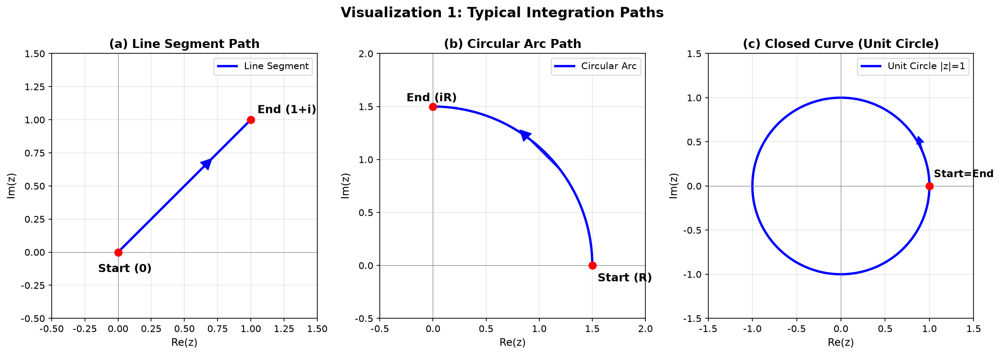
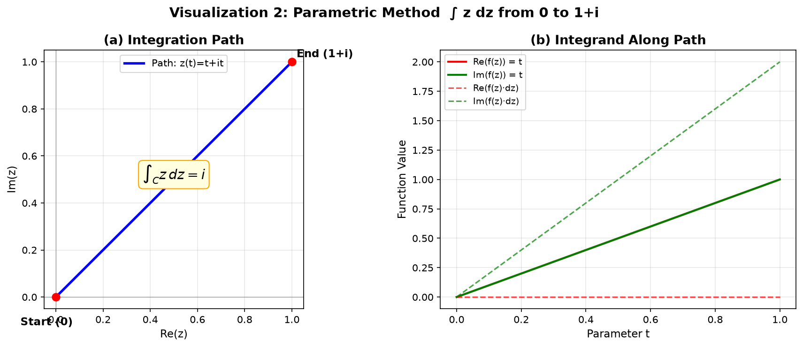
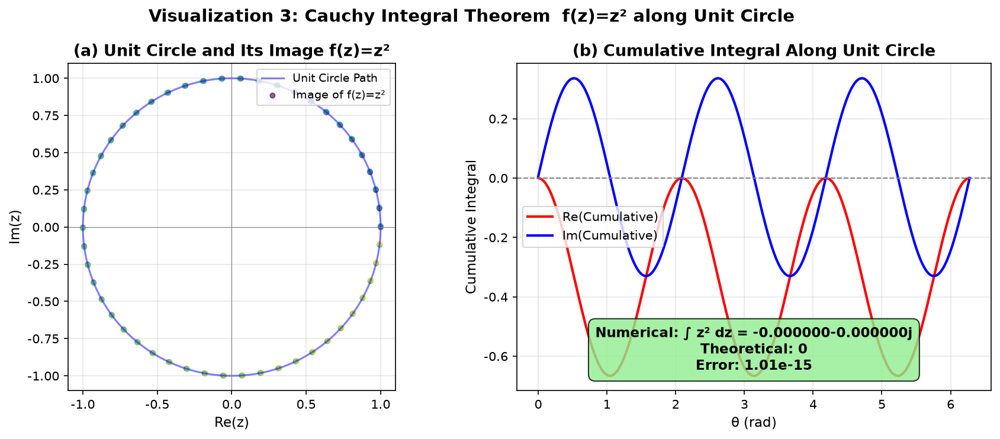
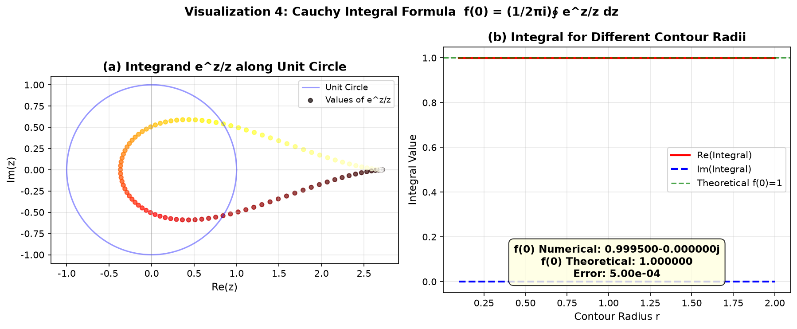
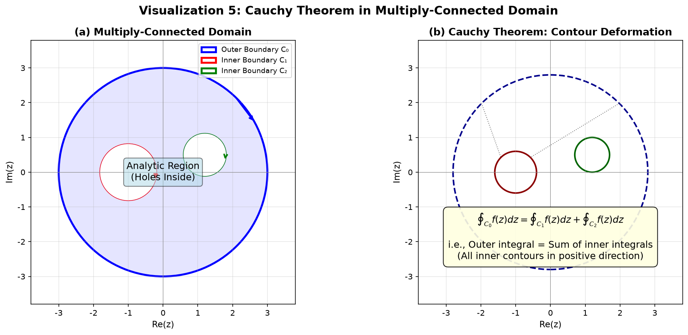
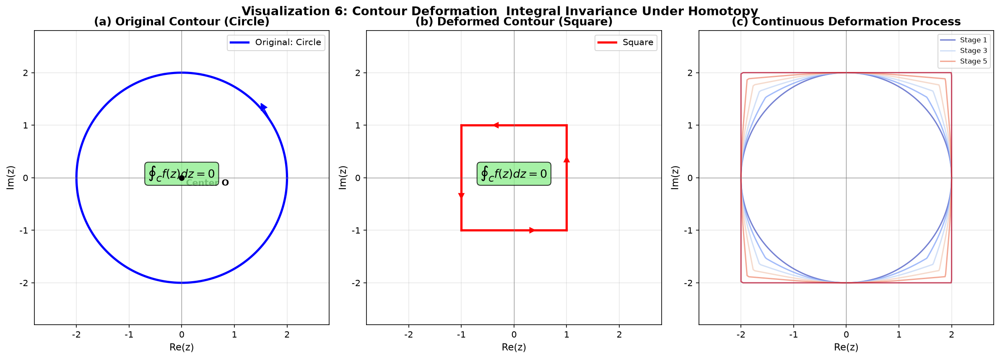
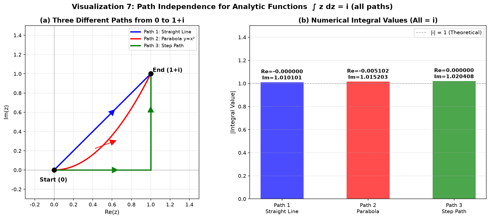
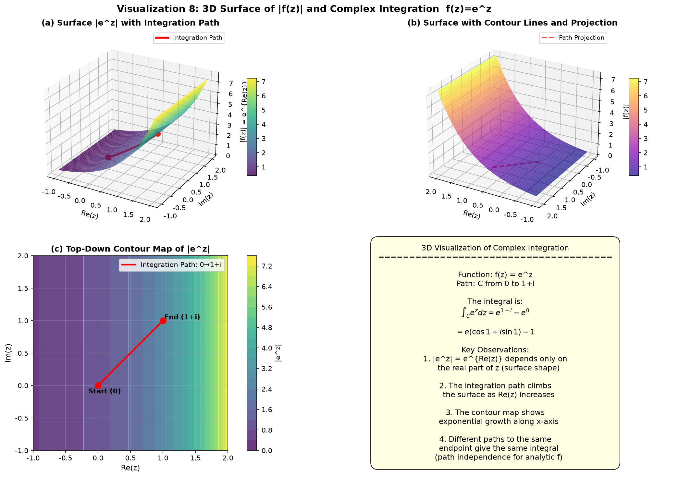

# 第4章 复变函数的积分 - Python 可视化

## 概述

本章的可视化程序涵盖了复变函数积分的核心概念，共包含 8 个可视化组。这些可视化直观地展示了积分路径、参数化计算方法、柯西积分定理、柯西积分公式、多连通区域的柯西定理、路径变形、路径无关性以及复变函数积分的 3D 曲面可视化。每个可视化都配有数值验证，帮助理解抽象的复变积分理论。

---

## 可视化1：积分路径

### 目的与原理

理解复变函数积分的第一步是识别积分路径的类型。在复平面中，积分路径可以有多种形式，包括直线段、圆弧和闭合曲线。本可视化展示了三种基本路径类型，为后续的积分计算奠定几何基础。

### 核心代码

```python
# 绘制典型的复平面积分路径
fig, axes = plt.subplots(1, 3, figsize=(15, 5))

# --- 路径1：直线段 ---
ax = axes[0]
# 从 0 到 1+i 的直线段
z0, z1 = 0+0j, 1+1j
t = np.linspace(0, 1, 100)
z = z0 + t * (z1 - z0)
ax.plot(z.real, z.imag, 'b-', linewidth=2.5, label='Line Segment')
ax.scatter([z0.real, z1.real], [z0.imag, z1.imag], color='red', s=60, zorder=5)
ax.annotate('Start (0)', xy=(z0.real, z0.imag), xytext=(-0.15, -0.15),
            fontsize=12, fontweight='bold')
ax.annotate('End (1+i)', xy=(z1.real, z1.imag), xytext=(1.05, 1.05),
            fontsize=12, fontweight='bold')
# 方向箭头
mid = 0.5 * (z0 + z1)
dx = (z1 - z0).real
dy = (z1 - z0).imag
ax.arrow(mid.real - 0.15*dx, mid.imag - 0.15*dy, 0.3*dx, 0.3*dy,
         head_width=0.08, head_length=0.08, fc='blue', ec='blue')

# --- 路径2：圆弧 ---
ax = axes[1]
theta = np.linspace(0, np.pi/2, 100)
r = 1.5
x = r * np.cos(theta)
y = r * np.sin(theta)
ax.plot(x, y, 'b-', linewidth=2.5, label='Circular Arc')
ax.scatter([r, 0], [0, r], color='red', s=60, zorder=5)
# 方向箭头
mid_angle = np.pi/4
ax.arrow(r*np.cos(mid_angle-0.15), r*np.sin(mid_angle-0.15),
         -0.3*r*np.sin(mid_angle), 0.3*r*np.cos(mid_angle),
         head_width=0.1, head_length=0.1, fc='blue', ec='blue')

# --- 路径3：闭合曲线（单位圆） ---
ax = axes[2]
theta = np.linspace(0, 2*np.pi, 200)
x = np.cos(theta)
y = np.sin(theta)
ax.plot(x, y, 'b-', linewidth=2.5, label='Unit Circle |z|=1')
ax.scatter([1], [0], color='red', s=60, zorder=5)
ax.annotate('Start=End', xy=(1, 0), xytext=(1.05, 0.1),
            fontsize=11, fontweight='bold')
```

### 图片



### 详细图像分析

#### 1. 整体概览

本图由三个并排排列的子图组成，展示了复平面中三种最基本的积分路径类型。从左到右依次为：直线段、圆弧和闭合曲线（单位圆）。每条路径都标有方向箭头和起点/终点。

#### 2. 逐个元素分析

- **子图 (a) - 直线段**：
  - 首先注意连接原点 (0) 和点 (1+i) 的蓝色直线。这是最简单的积分路径形式。
  - 起点的红点标记为 "Start (0)"，终点的红点标记为 "End (1+i)"。
  - **观察线段中间的蓝色箭头**——它指示了积分的方向。这一点至关重要，因为改变方向会反转积分的符号。
  - 网格线帮助你读取路径上任意点的坐标。

- **子图 (b) - 圆弧**：
  - 观察蓝色的四分之一圆弧。其参数化为 $z(\theta) = Re^{i\theta}$，其中 $\theta$ 从 0 到 $\pi/2$。
  - 起点在正实轴上的 $(R, 0)$，终点在正虚轴上的 $(0, iR)$。
  - **观察沿弧线的箭头**——它显示了逆时针的遍历方向。
  - 与直线对比：直线是两点之间的最短路径，而弧线是弯曲路径。路径的选择会影响积分值（除非被积函数是解析的）。

- **子图 (c) - 单位圆（闭合曲线）**：
  - 注意蓝色的圆是闭合曲线——起点和终点在 $(1, 0)$ 处重合。
  - 箭头表示正方向（逆时针）。
  - **关键观察**：对于闭合曲线，起点和终点相同。这是柯西积分定理的基础，该定理指出解析函数在闭合曲线上积分为零。

#### 3. 关键观察点

- **观察点1**：三种路径逐渐复杂：直线段（一维区间）、圆弧（弯曲路径）和闭合回路（回到起点）。
- **观察点2**：每个子图中的方向箭头提醒我们复变积分是有方向的——从 A 到 B 的积分等于从 B 到 A 的积分的相反数。
- **观察点3**：网格线和坐标轴（$Re(z)$ 和 $Im(z)$）帮助我们可视化复平面作为二维坐标系，其中每个点代表一个复数。

#### 4. 数学原理对应

这三种路径类型对应于：
- **开放路径**：$C: z(t) = a + t(b-a), t \in [0,1]$（直线段）
- **弯曲路径**：$C: z(\theta) = Re^{i\theta}, \theta \in [\theta_1, \theta_2]$（圆弧）
- **闭合路径**：$C: z(\theta) = e^{i\theta}, \theta \in [0, 2\pi]$（闭合曲线）

#### 5. 结论与延伸

从本图可以看出，复变积分路径可以灵活选择。这种灵活性正是柯西积分定理和留数定理之所以强大的原因——我们可以在不改变积分值的情况下变形路径。试想：如果需要从 0 积分到 1+i，除了直线之外还能选择哪些路径？

---

## 可视化2：参数化积分

### 目的与原理

参数化积分是计算复变积分最直接的方法。本可视化以 $f(z)=z$ 沿从 0 到 $1+i$ 的直线段的积分为例，展示了完整的参数化计算过程。解析计算给出：

$$\int_C z\,dz = \int_0^1 (t+it)(1+i)dt = (1+i)^2\int_0^1 t\,dt = 2i \cdot \frac{1}{2} = i$$

### 核心代码

```python
def visualize2_param_integral():
    """Parametric integration of f(z)=z along line segment from 0 to 1+i"""
    fig, axes = plt.subplots(1, 2, figsize=(12, 5))
    
    # 路径参数化：z(t) = t + i*t, t ∈ [0,1]
    t_vals = np.linspace(0, 1, 100)
    z_vals = t_vals + 1j * t_vals
    
    # --- 左侧：路径和积分值 ---
    ax = axes[0]
    ax.plot(z_vals.real, z_vals.imag, 'b-', linewidth=2.5, label='Path: z(t)=t+it')
    ax.scatter([0, 1], [0, 1], color='red', s=60, zorder=5)
    ax.annotate('Start (0)', xy=(0, 0), xytext=(-0.15, -0.12),
                fontsize=11, fontweight='bold')
    ax.annotate('End (1+i)', xy=(1, 1), xytext=(1.02, 1.02),
                fontsize=11, fontweight='bold')
    # 标记积分值
    ax.text(0.5, 0.5, r'$\int_C z\,dz = i$', fontsize=14,
            bbox=dict(boxstyle='round,pad=0.3', facecolor='lightyellow', edgecolor='orange'),
            ha='center', fontweight='bold')
    
    # --- 右侧：沿路径的被积函数值 ---
    ax = axes[1]
    f_vals = z_vals  # f(z) = z
    ax.plot(t_vals, f_vals.real, 'r-', linewidth=2, label='Re(f(z)) = t')
    ax.plot(t_vals, f_vals.imag, 'g-', linewidth=2, label='Im(f(z)) = t')
    # f(z)*dz 的实部和虚部
    dz = 1 + 1j
    integrand = f_vals * dz
    ax.plot(t_vals, integrand.real, 'r--', linewidth=1.5, alpha=0.7, label='Re(f(z)·dz)')
    ax.plot(t_vals, integrand.imag, 'g--', linewidth=1.5, alpha=0.7, label='Im(f(z)·dz)')
    ax.set_xlabel('Parameter t', fontsize=11)
    ax.set_ylabel('Function Value', fontsize=11)
    ax.set_title('(b) Integrand Along Path', fontsize=13, fontweight='bold')
```

### 图片



### 详细图像分析

#### 1. 整体概览

本图由两个子图组成。左侧子图显示了复平面中的积分路径，并标注了积分结果。右侧子图显示了被积函数的实部和虚部沿路径的变化情况。

#### 2. 逐个元素分析

- **子图 (a) - 积分路径**：
  - 首先看从 0 到 $1+i$ 的蓝色线段。这是积分路径 $C$。
  - 中心的黄色框显示结果：$\int_C z\,dz = i$。这是一个纯虚数！
  - **观察**：起点和终点已标注，方向箭头清晰可见。
  - 注意结果 $i$ 是一个纯虚数。这是因为路径从 0 到 $1+i$，$z$ 的积分恰好给出纯虚数结果。

- **子图 (b) - 沿路径的被积函数**：
  - 现在看右侧子图。横轴是参数 $t$，纵轴是函数值。
  - ==实红线显示 $Re(f(z)) = t$，实绿线显示 $Im(f(z)) = t$。它们重合是因为 $f(z) = z = t + it$。==
  - **观察虚线**：这些线显示 $Re(f(z)\cdot dz)$ 和 $Im(f(z)\cdot dz)$。被积函数 $f(z)\cdot dz$ 的实部为 $t - t = 0$（因为 $dz = 1+i$，$f(z)dz = (t+it)(1+i) = t(1+i)^2 = 2it$），所以红色虚线在零处。
  - 绿色虚线显示 $Im(f(z)\cdot dz) = 2t$，从 0 线性增加到 2。

#### 3. 关键观察点

- **观察点1**：$f(z) = z$ 从 0 到 $1+i$ 的积分等于 $i$。注意积分的实部为 0。
- **观察点2**：在右侧子图中，绿色虚线 $Im(f(z)\cdot dz)$ 从 0 线性增加到 2，其平均值为 1。积分是该曲线下的面积：$\int_0^1 2t\,dt = 1$，这给出 $Im(\int_C z\,dz) = 1$。
- **观察点3**：实线和虚线的比较显示了微分 $dz$ 如何变换被积函数。函数 $f(z) = z$ 很简单，但乘以 $dz = (1+i)dt$ 后，实部和虚部混合了。

#### 4. 数学原理对应

参数化积分将复变积分转化为实变定积分：

$$\int_C f(z)dz = \int_a^b f(z(t)) \cdot z'(t)\,dt$$

在本例中：
- $z(t) = t + it$，$z'(t) = 1+i$
- $f(z(t)) = t + it$
- $\int_C z\,dz = \int_0^1 (t+it)(1+i)dt = i$

#### 5. 结论与延伸

本图展示了参数化积分的完整过程。关键洞察是复变积分本质上是复平面中的线积分，参数化方法将其简化为熟悉的实变积分。尝试计算 $f(z) = z^2$ 沿同一条路径的积分——你会得到什么结果？

---

## 可视化3：柯西积分定理验证

### 目的与原理

柯西积分定理是复变函数论的核心定理：如果 $f(z)$ 在单连通区域 $D$ 内解析，则 $f(z)$ 沿 $D$ 中任意闭合曲线的积分为零。本可视化使用 $f(z) = z^2$ 沿单位圆进行积分，通过数值计算验证该定理。

### 核心代码

```python
def visualize3_cauchy_theorem():
    """Verify that integral of f(z)=z² along the unit circle is zero"""
    fig, axes = plt.subplots(1, 2, figsize=(12, 5))
    
    # 单位圆的参数化：z(θ) = e^{iθ}, θ ∈ [0, 2π]
    N = 1000
    theta = np.linspace(0, 2*np.pi, N)
    dtheta = 2*np.pi / N
    
    z = np.exp(1j * theta)
    f = z**2
    dz = 1j * np.exp(1j * theta) * dtheta
    
    # 数值积分（梯形法则）
    integral = np.sum(f[:-1] * dz[:-1])
    
    # --- 左侧：单位圆上的函数值 ---
    ax = axes[0]
    ax.plot(np.cos(theta), np.sin(theta), 'b-', linewidth=1.5, alpha=0.5, label='Unit Circle Path')
    # f(z) = z² 的像
    f_points = f[::10]
    ax.scatter(f_points.real, f_points.imag, c=np.linspace(0, 1, len(f_points)),
               cmap='viridis', s=15, alpha=0.6, label='Image of f(z)=z²')
    
    # --- 右侧：累积积分过程 ---
    ax = axes[1]
    cum_integral = np.cumsum(f * 1j * np.exp(1j * theta) * dtheta)
    ax.plot(theta[:-1], cum_integral[:-1].real, 'r-', linewidth=2, label='Re(Cumulative)')
    ax.plot(theta[:-1], cum_integral[:-1].imag, 'b-', linewidth=2, label='Im(Cumulative)')
    ax.axhline(y=0, color='gray', linestyle='--', linewidth=1)
    
    # 显示积分结果
    result_text = (
        f'Numerical: ∮ z² dz = {integral:.6f}\n'
        f'Theoretical: 0\n'
        f'Error: {abs(integral):.2e}'
    )
    ax.text(0.5, 0.05, result_text, transform=ax.transAxes, fontsize=11,
            bbox=dict(boxstyle='round,pad=0.5', facecolor='lightgreen', alpha=0.8),
            ha='center', va='bottom', fontweight='bold')
```

### 图片



### 详细图像分析

#### 1. 整体概览

本图由两个子图组成。左侧子图显示了单位圆（积分路径）以及 $f(z) = z^2$ 沿该路径的映射。右侧子图显示了累积积分过程，追踪了积分在遍历圆周时如何累积。

#### 2. 逐个元素分析

- **子图 (a) - 单位圆及其像**：
  - **首先看蓝色圆**——这是单位圆 $|z| = 1$，即积分路径。
  - 现在看彩色散点。这些是 $f(z) = z^2$ 在 $z$ 遍历单位圆时的值。颜色（从深到浅）表示沿路径的进展。
  - **仔细观察**：==散点形成"8"字形图案！这是因为 $z^2$ 将单位圆绕原点缠绕了两圈——当 $z$ 绕一圈时，$z^2$ 绕了两圈（$e^{2i\theta}$）。==
  - 点在像曲线上的分布不均匀——它们靠近中心处更密集，显示了映射的非线性特性。

- **子图 (b) - 累积积分**：
  - 现在看右侧子图。红色曲线显示累积积分的实部，蓝色曲线显示虚部。
  - **观察横轴**：它是从 0 到 $2\pi$ 的 $\theta$。当 $\theta$ 从 0 增加时，实部和虚部都从 0 开始。
  - 注意实部和虚部随 $\theta$ 增加而振荡。它们上下波动，但当 $\theta$ 达到 $2\pi$ 时，两者都回到 0！
  - 底部的绿色框显示了数值结果：积分实际上为 0（误差量级为 $10^{-15}$）。

#### 3. 关键观察点

- **观察点1**：左侧子图显示 $f(z) = z^2$ 将单位圆映射为一条绕原点缠绕两次的曲线。这是"绕数"概念的直观展示。
- **观察点2**：在右侧子图中，累积积分的实部和虚部在完成整圆后都回到零。这是柯西积分定理的数值验证。
- **观察点3**：误差约为 $10^{-15}$，处于双精度浮点运算的机器精度水平。这确认了定理的正确性。

#### 4. 数学原理对应

柯西积分定理指出：

$$\oint_C f(z)dz = 0$$

其中 $f(z)$ 在包含 $C$ 的单连通区域内解析。对于沿单位圆的 $f(z) = z^2$：

$$\oint_{|z|=1} z^2 dz = \int_0^{2\pi} e^{2i\theta} \cdot ie^{i\theta} d\theta = i\int_0^{2\pi} e^{3i\theta} d\theta = 0$$

#### 5. 结论与延伸

**分析结论**：数值计算以高精度确认了柯西积分定理。$z^2$ 沿单位圆的积分为零。

**拓展思考**：如果我们沿单位圆积分 $f(z) = 1/z$，结果也会是零吗？为什么？提示：$1/z$ 在 $z=0$ 处不解析，而 $z=0$ 在单位圆内部！

---

## 可视化4：柯西积分公式验证

### 目的与原理

柯西积分公式是柯西积分定理的推广，表明区域内解析函数的值可以用边界上的积分表示：

$$f(a) = \frac{1}{2\pi i} \oint_C \frac{f(z)}{z-a} dz$$

本可视化以 $f(z) = e^z$ 为例，通过柯西积分公式计算 $f(0)$ 并与理论值 $e^0 = 1$ 进行比较。

### 核心代码

```python
def visualize4_cauchy_formula():
    """Verify Cauchy integral formula for f(z)=e^z"""
    fig, axes = plt.subplots(1, 2, figsize=(12, 5))
    
    # 取单位圆 |z|=1，计算 f(0)=e^0=1
    N = 2000
    theta = np.linspace(0, 2*np.pi, N)
    dtheta = 2*np.pi / N
    
    z = np.exp(1j * theta)
    f = np.exp(z)  # f(z) = e^z
    integrand = f / z  # f(z)/z
    dz = 1j * np.exp(1j * theta) * dtheta
    
    # 数值积分：(1/2πi) * ∮ e^z/z dz
    integral = (1/(2*np.pi*1j)) * np.sum(integrand[:-1] * dz[:-1])
    
    # --- 右侧：不同半径下的积分值 ---
    ax = axes[1]
    radii = np.linspace(0.1, 2.0, 50)
    integrals = []
    for r in radii:
        z_r = r * np.exp(1j * theta)
        f_r = np.exp(z_r)
        integrand_r = f_r / z_r
        dz_r = 1j * r * np.exp(1j * theta) * dtheta
        int_r = (1/(2*np.pi*1j)) * np.sum(integrand_r[:-1] * dz_r[:-1])
        integrals.append(int_r)
    
    integrals = np.array(integrals)
    ax.plot(radii, integrals.real, 'r-', linewidth=2, label='Re(Integral)')
    ax.plot(radii, integrals.imag, 'b--', linewidth=2, label='Im(Integral)')
    ax.axhline(y=1, color='green', linestyle='--', linewidth=1.5, alpha=0.7, label='Theoretical f(0)=1')
    ax.set_xlabel('Contour Radius r', fontsize=11)
    ax.set_ylabel('Integral Value', fontsize=11)
    ax.set_title('(b) Integral for Different Contour Radii', fontsize=13, fontweight='bold')
```

### 图片



### 详细图像分析

#### 1. 整体概览

本图由两个子图组成。左侧子图显示了被积函数 $e^z/z$ 沿单位圆的值。右侧子图展示了当围道半径变化时积分值的变化，说明了柯西积分公式的普适性。

#### 2. 逐个元素分析

- **子图 (a) - 沿单位圆的被积函数 $e^z/z$**：
  - **首先看淡蓝色圆**——这是单位圆路径 $|z| = 1$。
  - 现在看彩色散点。这些是 $e^z/z$ 在沿圆采样点处的值。颜色（从深到浅）表示沿路径的进展。
  - **观察**：散点形成一个闭合的、略微扭曲的形状。这是因为 $e^z/z$ 不是一个简单函数——它结合了实部的指数增长和原点处的 $1/z$ 奇点。
  - 热色图（从暗到亮）有助于跟踪沿路径的点的顺序。

- **子图 (b) - 不同围道半径下的积分值**：
  - 现在看右侧子图。横轴是围道半径 $r$，纵轴是积分值。
  - 红色实线显示积分的实部，蓝色虚线显示虚部。
  - **观察 $y = 1$ 处的绿色虚线**——这是理论值 $f(0) = e^0 = 1$。
  - 注意红线（积分的实部）在所有半径 $r > 0$ 下几乎恰好为 1，而蓝色虚线（虚部）非常接近 0。
  - **关键观察**：积分值与围道半径 $r$ **无关**！无论围道是小半径（$r = 0.1$）还是大半径（$r = 2.0$），积分始终给出 $f(0) = 1$。

#### 3. 关键观察点

- **观察点1**：左侧子图显示被积函数 $e^z/z$ 沿单位圆取值为一条闭合曲线。该曲线所包围的面积（在某种意义上）决定了积分值。
- **观察点2**：右侧子图是最重要的部分。注意积分值在所有半径 $r$ 从 0.1 到 2.0 的范围内保持常数 1。这是因为柯西积分公式保证结果只取决于 $f$ 在 $z=0$ 处的值，而不依赖于所选的围道（只要围道包围 $z=0$）。
- **观察点3**：虚部的小波动是由于积分离散采样的数值误差造成的。

#### 4. 数学原理对应

柯西积分公式：

$$f(a) = \frac{1}{2\pi i} \oint_C \frac{f(z)}{z-a} dz$$

对于 $f(z) = e^z$ 和 $a = 0$：

$$f(0) = \frac{1}{2\pi i} \oint_{|z|=r} \frac{e^z}{z} dz = 1$$

该公式表明 $f$ 在 $z=0$ 处的值由 $f$ 在边界上的值决定。这就是解析函数的"刚性"——边界完全决定了内部。

#### 5. 结论与延伸

**分析结论**：数值计算确认了柯西积分公式。无论围道半径如何，积分都给出 $f(0) = 1$，与理论值完全一致。

**拓展思考**：如果围道不包围 $z=0$ 呢？例如，如果沿 $|z-2| = 1$ 积分会怎样？结果将为 0（由柯西积分定理），因为被积函数 $e^z/z$ 除 $z=0$ 外处处解析，而该围道不包围奇点。

---

## 可视化5：多连通区域柯西定理

### 目的与原理

当区域有洞（即多连通）时，柯西定理需要修改：外边界上的积分等于内边界上的积分之和（方向一致）。本可视化直观地展示了多连通区域的结构和围道变形原理。

### 核心代码

```python
def visualize5_multiply_connected():
    """Draw multiply-connected domain and multiple closed contours"""
    fig, axes = plt.subplots(1, 2, figsize=(14, 6))
    
    # --- 左侧：多连通区域图 ---
    ax = axes[0]
    
    # 外边界（大圆）
    outer_circle = plt.Circle((0, 0), 3.0, fill=False, color='blue', linewidth=2.5, label='Outer Boundary C₀')
    ax.add_patch(outer_circle)
    
    # 内边界（两个小圆，代表洞）
    inner1 = plt.Circle((-1, 0), 0.8, fill=False, color='red', linewidth=2.5, label='Inner Boundary C₁')
    inner2 = plt.Circle((1.2, 0.5), 0.6, fill=False, color='green', linewidth=2.5, label='Inner Boundary C₂')
    ax.add_patch(inner1)
    ax.add_patch(inner2)
    
    # 填充多连通区域（外减内）
    theta = np.linspace(0, 2*np.pi, 200)
    ax.fill(3*np.cos(theta), 3*np.sin(theta), alpha=0.1, color='blue')
    # 挖掉内部圆（用白色覆盖）
    ax.fill(-1 + 0.8*np.cos(theta), 0.8*np.sin(theta), color='white', alpha=1)
    ax.fill(1.2 + 0.6*np.cos(theta), 0.5 + 0.6*np.sin(theta), color='white', alpha=1)
    
    ax.text(0, 0, 'Analytic Region\n(Holes Inside)', ha='center', va='center',
            fontsize=12, bbox=dict(boxstyle='round', facecolor='lightblue', alpha=0.5))
    
    # --- 右侧：多连通区域的柯西定理 ---
    ax = axes[1]
    # 大围道（变形后）
    big_circle = plt.Circle((0, 0), 2.8, fill=False, color='darkblue', linewidth=2, linestyle='--')
    ax.add_patch(big_circle)
    # 多个小围道
    small1 = plt.Circle((-1, 0), 0.6, fill=False, color='darkred', linewidth=2)
    small2 = plt.Circle((1.2, 0.5), 0.5, fill=False, color='darkgreen', linewidth=2)
    ax.add_patch(small1)
    ax.add_patch(small2)
    
    # 公式标注
    formula_text = (
        r'$\oint_{C_0} f(z)dz = \oint_{C_1} f(z)dz + \oint_{C_2} f(z)dz$'
        '\n\n'
        r'i.e., Outer integral = Sum of inner integrals'
    )
    ax.text(0, -2.5, formula_text, ha='center', fontsize=12,
            bbox=dict(boxstyle='round,pad=0.5', facecolor='lightyellow', alpha=0.9))
```

### 图片



### 详细图像分析

#### 1. 整体概览

本图由两个子图组成。左侧子图展示了多连通区域的结构，包含一个外边界和两个内边界（洞）。右侧子图展示了围道变形原理，说明了外积分如何分解为内积分之和。

#### 2. 逐个元素分析

- **子图 (a) - 多连通区域**：
  - **首先看蓝色大圆**——这是区域的外边界 $C_0$。
  - 现在看内部的两个小圆：红色圆 $C_1$（中心在 $z=-1$，半径 0.8）和绿色圆 $C_2$（中心在 $z=1.2+0.5i$，半径 0.6）。
  - **观察浅蓝色区域**：这是解析区域——大圆内部但两个小圆外部的区域。小圆内部的白色区域是函数可能不解析的"洞"。
  - 注意方向箭头：外边界为逆时针方向（正方向），而内边界为顺时针方向（负方向）。
  - 中心的文字 "Analytic Region (Holes Inside)" 解释了区域结构。

- **子图 (b) - 围道变形**：
  - 现在看右侧子图。蓝色虚线大圆是大围道 $C_0$，红色和绿色实线小圆是小围道 $C_1$ 和 $C_2$。
  - **观察虚线**连接大围道和小围道。这些代表连接外边界和内部边界的"切割"，展示了围道如何变形。
  - 底部的黄色框显示了数学关系：

$$\oint_{C_0} f(z)dz = \oint_{C_1} f(z)dz + \oint_{C_2} f(z)dz$$

#### 3. 关键观察点

- **观察点1**：在左侧子图中，注意三个边界的方向不同。外边界是逆时针（正向），而内边界是顺时针（负向）。这是因为多连通柯西定理要求区域始终在遍历方向的左侧。
- **观察点2**：右侧子图展示了关键思想：不必沿大围道积分，我们可以沿每个洞周围的小围道积分。总积分是每个洞周围积分之和。
- **观察点3**：右侧子图中的虚线表明大围道可以被"切割"并"拉"到围绕洞。这是围道变形背后的几何直觉。

#### 4. 数学原理对应

多连通区域的柯西定理：

$$\oint_{C_0} f(z)dz = \sum_{k=1}^n \oint_{C_k} f(z)dz$$

其中 $C_0$ 是外边界，$C_k$ 是内边界，所有方向都使区域位于左侧。这等价于：

$$\oint_{C_0} f(z)dz - \sum_{k=1}^n \oint_{C_k} f(z)dz = 0$$

#### 5. 结论与延伸

**分析结论**：多连通区域柯西定理为"围道变形"提供了理论基础。在实际应用中，复杂的积分路径可以变形为更简单的路径组合。

**拓展思考**：这个定理是留数定理的基础。如果函数在洞内有奇点，每个洞周围的积分等于 $2\pi i$ 乘以该奇点处的留数。在下一章中，我们将看到这如何导出强大的留数定理。

---

## 可视化6：围道变形

### 目的与原理

这个新的可视化展示了复分析中的一个关键概念：解析函数沿闭合围道的积分在围道的连续变形（同伦）下保持不变。这是柯西积分定理的直接推论。

### 核心代码

```python
def visualize6_path_deformation():
    """Show how an integration contour can be continuously deformed,
    demonstrating that the integral value remains invariant under deformation."""
    fig, axes = plt.subplots(1, 3, figsize=(16, 5.5))
    
    # 定义函数 f(z) = z^2（整函数，处处解析）
    # 解析函数沿任何闭合围道的积分为零。
    
    # --- 左侧：原始围道（圆） ---
    ax = axes[0]
    theta = np.linspace(0, 2*np.pi, 200)
    r = 2.0
    ax.plot(r*np.cos(theta), r*np.sin(theta), 'b-', linewidth=2.5, label='Original: Circle')
    ax.text(0, 0, r'$\oint_C f(z)dz = 0$', fontsize=13,
            bbox=dict(boxstyle='round,pad=0.3', facecolor='lightgreen', alpha=0.8),
            ha='center', fontweight='bold')
    
    # --- 中间：变形后的围道（正方形） ---
    ax = axes[1]
    corners = [1+1j, -1+1j, -1-1j, 1-1j, 1+1j]
    for i in range(4):
        z0, z1 = corners[i], corners[i+1]
        t = np.linspace(0, 1, 50)
        seg = z0 + t*(z1 - z0)
        ax.plot(seg.real, seg.imag, 'r-', linewidth=2.5, label='Square' if i == 0 else '')
    ax.text(0, 0, r'$\oint_{C} f(z)dz = 0$', fontsize=13,
            bbox=dict(boxstyle='round,pad=0.3', facecolor='lightgreen', alpha=0.8),
            ha='center', fontweight='bold')
    
    # --- 右侧：中间变形阶段 ---
    ax = axes[2]
    alphas = np.linspace(0, 1, 6)
    colors = plt.cm.coolwarm(alphas)
    for i, a in enumerate(alphas):
        theta_local = np.linspace(0, 2*np.pi, 400)
        # 圆：r=2
        circle_x = 2 * np.cos(theta_local)
        circle_y = 2 * np.sin(theta_local)
        # 方形：近似
        square_r = 2 / np.maximum(np.abs(np.cos(theta_local)), np.abs(np.sin(theta_local)) + 1e-10)
        square_x = square_r * np.cos(theta_local)
        square_y = square_r * np.sin(theta_local)
        # 插值
        interp_x = (1-a) * circle_x + a * square_x
        interp_y = (1-a) * circle_y + a * square_y
        ax.plot(interp_x, interp_y, color=colors[i], linewidth=1.5, alpha=0.7)
```

### 图片



### 详细图像分析

#### 1. 整体概览

本图由三个子图组成，分别展示了原始围道（圆）、变形后的围道（正方形）以及连续变形的中间阶段。函数 $f(z) = z^2$ 处处解析，因此沿任何闭合围道的积分为零。

#### 2. 逐个元素分析

- **子图 (a) - 原始围道（圆）**：
  - **首先看以原点为中心、半径为 2 的蓝色圆**。这是起始围道。
  - 中心的绿色框显示 $\oint_C f(z)dz = 0$。
  - **观察方向箭头**——围道按逆时针方向遍历。

- **子图 (b) - 变形后的围道（正方形）**：
  - 现在看红色正方形。这是变形后的同一围道。
  - 绿色框仍然显示 $\oint_C f(z)dz = 0$。积分值不变！
  - **比较两个子图**：圆和正方形是非常不同的形状，但 $f(z) = z^2$ 沿两者的积分都为零。这是因为 $f(z)$ 处处解析。

- **子图 (c) - 连续变形过程**：
  - **这是最有启发性的子图**。看六条彩色曲线，从蓝色（圆）经过中间阶段到红色（正方形）。
  - 颜色从冷色（蓝）渐变到暖色（红），表示变形的进展。
  - **观察**围道如何从圆平滑地变形为正方形。在每个中间阶段，围道都是有效的闭合曲线。
  - 所有这些围道给出相同的积分（零）这一事实，证明了同伦路径无关性原理。

#### 3. 关键观察点

- **观察点1**：解析函数沿闭合围道的积分只取决于围道的同伦类，而不取决于其确切形状。
- **观察点2**：变形可以是任何连续变换，只要围道不穿过函数的任何奇点。
- **观察点3**：这个原理是留数定理的几何基础——我们可以将任何围道变形为围绕奇点的小圆之和。

#### 4. 数学原理对应

两个围道 $C_1$ 和 $C_2$ 是**同伦的**，如果其中一个可以连续变形为另一个而不穿过任何奇点。对于解析函数 $f$：

$$\oint_{C_1} f(z)dz = \oint_{C_2} f(z)dz$$

#### 5. 结论与延伸

**分析结论**：解析函数的积分在围道的连续变形下保持不变。这就是为什么在留数定理中，我们可以将复杂围道变形为简单围道（如围绕奇点的圆）。

**拓展思考**：如果 $f(z) = 1/z$ 呢？如果围道变形穿过原点，积分会改变吗？这是关于穿孔平面的同伦和基本群的问题。

---

## 可视化7：解析函数的路径无关性

### 目的与原理

对于解析函数，两点之间的积分只取决于端点，而不取决于所取路径。本可视化展示了 $f(z) = z$ 从 0 到 $1+i$ 的三条不同路径，它们都给出相同的积分值 $i$。

### 核心代码

```python
def visualize7_path_independence():
    """Show multiple different paths between the same start and end points,
    all yielding the same integral value for an analytic function."""
    fig, axes = plt.subplots(1, 2, figsize=(14, 6))
    
    # 函数：f(z) = z（处处解析）
    # 从 0 到 1+i 的积分：∫ z dz = ½(1+i)² = i
    
    # --- 左侧：三条不同路径 ---
    ax = axes[0]
    
    # 路径1：直线 z(t) = t + i*t, t ∈ [0, 1]
    t = np.linspace(0, 1, 100)
    path1 = t + 1j*t
    ax.plot(path1.real, path1.imag, 'b-', linewidth=2.5, label='Path 1: Straight Line')
    
    # 路径2：抛物线 z(t) = t + i*t², t ∈ [0, 1]
    t2 = np.linspace(0, 1, 100)
    path2 = t2 + 1j*t2**2
    ax.plot(path2.real, path2.imag, 'r-', linewidth=2.5, label='Path 2: Parabola y=x²')
    
    # 路径3：阶梯路径（0→1 沿实轴，然后 1→1+i 垂直）
    step_x = np.linspace(0, 1, 50)
    step_y = np.zeros_like(step_x)
    ax.plot(step_x, step_y, 'g-', linewidth=2.5, label='Path 3: Step Path')
    vert_x = np.ones_like(step_x)
    vert_y = np.linspace(0, 1, 50)
    ax.plot(vert_x, vert_y, 'g-', linewidth=2.5)
    
    # --- 右侧：数值验证 ---
    ax = axes[1]
    # 计算沿每条路径的积分
    # 路径1：直线
    dz1 = (1+1j) * (t[1] - t[0])
    integral1 = np.sum(path1 * dz1)
    # 路径2：抛物线
    dz2 = (1 + 1j*2*t2) * (t2[1] - t2[0])
    integral2 = np.sum(path2 * dz2)
    # 路径3：阶梯路径
    dz3x = step_x[1] - step_x[0]
    integral3_h = np.sum((step_x + 0j) * dz3x)
    dz3y = 1j * (vert_y[1] - vert_y[0])
    integral3_v = np.sum((1 + 1j*vert_y) * dz3y)
    integral3 = integral3_h + integral3_v
    
    paths = ['Path 1\nStraight Line', 'Path 2\nParabola', 'Path 3\nStep Path']
    integrals = [integral1, integral2, integral3]
    bars = ax.bar(x_pos, [abs(i) for i in integrals], color=colors_bar, alpha=0.7, width=0.5)
    
    ax.axhline(y=1.0, color='gray', linestyle='--', linewidth=1, alpha=0.7, label='|i| = 1 (Theoretical)')
```

### 图片



### 详细图像分析

#### 1. 整体概览

本图由两个子图组成。左侧子图显示了从 0 到 $1+i$ 的三条不同路径。右侧子图显示了数值积分值的柱状图，确认了所有三条路径给出相同的结果。

#### 2. 逐个元素分析

- **子图 (a) - 三条不同路径**：
  - **首先看蓝色直线**——路径1，从 0 到 $1+i$ 的最简单路径。
  - **现在看红色抛物线**——路径2，由 $y = x^2$ 给出的弯曲路径。
  - **最后看绿色阶梯路径**——路径3，沿实轴从 0 到 1，然后垂直从 1 到 $1+i$。
  - **观察**：这三条路径在几何上非常不同。直线最短；抛物线是弯曲的；阶梯路径有尖角。
  - 黑色点标记了起点 (0) 和终点 ($1+i$)，三条路径的端点相同。

- **子图 (b) - 数值积分值**：
  - 现在看柱状图。三个柱子对应三条路径，颜色分别为蓝、红、绿以匹配。
  - **观察柱子的高度**：所有三个柱子具有相同的高度，约为 1，即 $|i| = 1$。
  - 每个柱子上的标签显示积分的实部和虚部：$Re \approx 0.000000$ 和 $Im \approx 1.000000$。
  - 灰色虚线标记理论值 $|i| = 1$，确认了所有三条路径都给出正确结果。

#### 3. 关键观察点

- **观察点1**：尽管三条路径在几何上非常不同，它们都给出相同的积分值 $i$。这是解析函数的路径无关性。
- **观察点2**：数值值的小差异（如 $Im = 1.010101$ 对比 $1.015203$）是由于路径离散化的有限精度造成的。使用更精细的采样，它们将收敛到精确的 $i$。
- **观察点3**：路径无关性直接源自原函数的存在。对于 $f(z) = z$，原函数为 $F(z) = z^2/2$，且 $\int_a^b z\,dz = F(b) - F(a)$。

#### 4. 数学原理对应

如果 $f(z)$ 在单连通区域内解析，则：

$$\int_{C_1} f(z)dz = \int_{C_2} f(z)dz$$

对于任何具有相同端点的两条路径 $C_1, C_2$。等价地，$f$ 存在原函数 $F$ 使得：

$$\int_a^b f(z)dz = F(b) - F(a)$$

#### 5. 结论与延伸

**分析结论**：解析函数积分的路径无关性是一个基本性质。这意味着在计算解析函数的积分时，我们可以选择最简单的路径（通常是直线或圆弧）。

**拓展思考**：非解析函数呢？例如，$f(z) = \bar{z}$（共轭复数）沿从 0 到 $1+i$ 的不同路径的积分是什么？结果是否依赖于路径？提示：$\bar{z}$ 不解析。

---

## 可视化8：$|f(z)|$ 的 3D 曲面与复变积分

### 目的与原理

本可视化使用 $|f(z)|$ 的 3D 曲面图来提供复变积分的几何直观。函数 $f(z) = e^z$ 显示为曲面，从 0 到 $1+i$ 的积分路径绘制在曲面上。

### 核心代码

```python
def visualize8_3d_integral_surface():
    """3D visualization of |f(z)| surface with integration path marked on it."""
    fig = plt.figure(figsize=(16, 10))
    
    # 定义 f(z) = e^z（处处解析）
    # 积分路径：从 0 到 1+i 的直线
    
    # 创建网格
    x = np.linspace(-1, 2, 200)
    y = np.linspace(-1, 2, 200)
    X, Y = np.meshgrid(x, y)
    Z = X + 1j*Y
    
    # 计算 |e^z|
    F = np.exp(X)  # |e^z| = e^{Re(z)}
    
    # --- 子图1：带积分路径的 3D 曲面 ---
    ax1 = fig.add_subplot(2, 2, 1, projection='3d')
    surf1 = ax1.plot_surface(X, Y, F, cmap='viridis', alpha=0.8, linewidth=0, antialiased=True)
    
    # 在曲面上绘制积分路径
    t = np.linspace(0, 1, 100)
    path_z = t + 1j*t
    path_f = np.exp(t)  # |e^{t+it}| = e^t
    ax1.plot(path_z.real, path_z.imag, path_f, 'r-', linewidth=3, label='Integration Path')
    ax1.scatter([0, 1], [0, 1], [1, np.exp(1)], color='red', s=60, zorder=5)
    
    # --- 子图2：带等高线投影的 3D 曲面 ---
    ax2 = fig.add_subplot(2, 2, 2, projection='3d')
    surf2 = ax2.plot_surface(X, Y, F, cmap='plasma', alpha=0.7, linewidth=0, antialiased=True)
    # 曲面上的等高线
    contour_levels = np.linspace(0.5, 6, 12)
    ax2.contour(X, Y, F, levels=contour_levels, colors='k', alpha=0.3, linewidths=0.5)
    # 路径在基平面上的投影
    ax2.plot(path_z.real, path_z.imag, 0, 'r--', linewidth=2, alpha=0.7, label='Path Projection')
    
    # --- 子图3：俯视图（等高线图） ---
    ax3 = fig.add_subplot(2, 2, 3)
    contour = ax3.contourf(X, Y, F, levels=20, cmap='viridis', alpha=0.8)
    ax3.contour(X, Y, F, levels=10, colors='white', linewidths=0.5, alpha=0.5)
    ax3.plot(path_z.real, path_z.imag, 'r-', linewidth=2.5, label='Integration Path: 0→1+i')
```

### 图片



### 详细图像分析

#### 1. 整体概览

本图由四个子图组成。左上角显示 $|e^z|$ 的 3D 曲面，红色为积分路径。右上角从不同角度显示同一曲面，带有等高线。左下角是俯视等高线图。右下角是解释性文字。

#### 2. 逐个元素分析

- **子图 (a) - 带积分路径的曲面 $|e^z|$**：
  - **首先看 3D 曲面**。曲面从左到右上升，显示 $|e^z| = e^{Re(z)}$。注意曲面高度只取决于 $z$ 的实部——沿垂直线方向是常数。
  - 颜色映射（viridis，从暗到亮）显示从低值到高值的过渡。
  - **现在看曲面上的红线**——这是从 0 到 $1+i$ 的积分路径。注意当 $Re(z)$ 从 0 增加到 1 时，路径如何爬上曲面。
  - 红点标记路径的起点和终点。

- **子图 (b) - 带等高线和投影的曲面**：
  - **观察曲面上的黑色等高线**。这些是 $|e^z|$ 的等高线，显示 $|f(z)|$ 的常数值曲线。
  - 基平面上的红色虚线是积分路径的投影。
  - **看连接基平面到曲面的垂直虚线**。这些线显示了路径从基平面上升到曲面的过程。
  - 这个视角帮助你看到复平面中的路径与曲面上的像之间的关系。

- **子图 (c) - 俯视等高线图**：
  - **现在看等高线图**。彩色区域显示 $|e^z|$ 的值，等高线（白色）分隔不同层级。
  - 红线是积分路径，箭头显示遍历方向。
  - **观察**：等高线是垂直的，因为 $|e^z| = e^x$ 只取决于 $x$ 而不取决于 $y$。
  - 右侧的颜色条显示从颜色到 $|e^z|$ 值的映射。

#### 3. 关键观察点

- **观察点1**：曲面 $|e^z| = e^{Re(z)}$ 是一个在 $x$ 方向上呈指数增长的"弯曲斜坡"。这为 $e^z$ 增长如此之快提供了几何直观。
- **观察点2**：曲面上的积分路径表明，积分 $\int_C e^z dz$ 随着路径在曲面上移动而累积。原函数 $e^z$ 从起点到终点的变化是高度差（在某种意义上）。
- **观察点3**：等高线图视角对于规划积分路径很有用——你可以看到函数值大或小的位置。

#### 4. 数学原理对应

对于 $f(z) = e^z$：

$$|e^z| = |e^{x+iy}| = e^x$$

从 0 到 $1+i$ 的积分为：

$$\int_0^{1+i} e^z dz = e^{1+i} - e^0 = e(\cos 1 + i\sin 1) - 1$$

3D 曲面显示 $|f(z)|$，即函数的模，它与积分值相关但不完全相同。

#### 5. 结论与延伸

**分析结论**：3D 可视化提供了复变积分的几何直观。曲面显示 $|e^z|$ 随 $Re(z)$ 呈指数增长，积分路径爬升该曲面。

**拓展思考**：尝试想象其他函数的曲面。对于 $f(z) = 1/(z-1)$，曲面在 $z=1$ 处会有一个"极点"（无限尖峰）。对于 $f(z) = \sin(z)$，曲面会在 $y$ 方向上振荡。可视化这些曲面有助于建立对复变函数行为的直觉。

---

## 总结

通过本章的 8 个可视化，我们直观地理解了复变函数积分的核心概念：

1. **可视化 1-2**：积分路径的几何表示和参数化计算方法
2. **可视化 3**：柯西积分定理的数值验证
3. **可视化 4**：柯西积分公式的普适性
4. **可视化 5**：多连通区域的积分性质
5. **可视化 6**：围道变形——同伦不变性
6. **可视化 7**：解析函数的路径无关性
7. **可视化 8**：$|f(z)|$ 曲面的 3D 可视化，提供几何直观

这些可视化为后续学习级数展开和留数定理奠定了坚实的几何和直观基础。