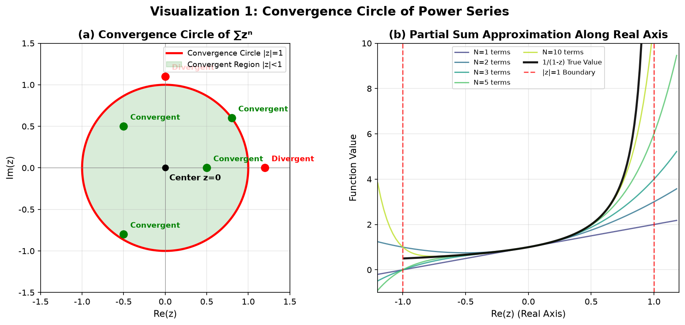
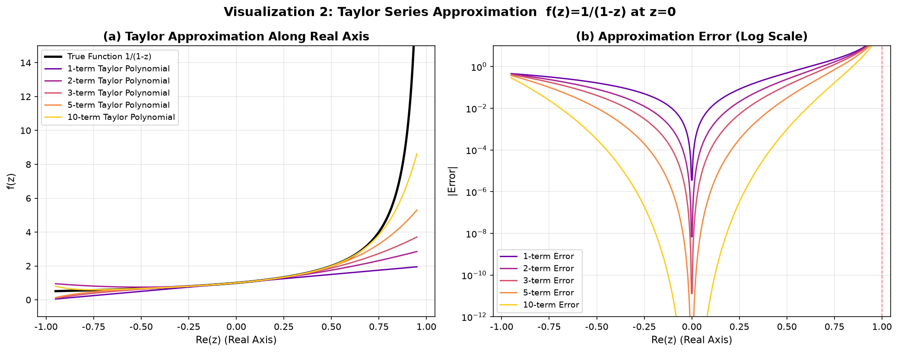
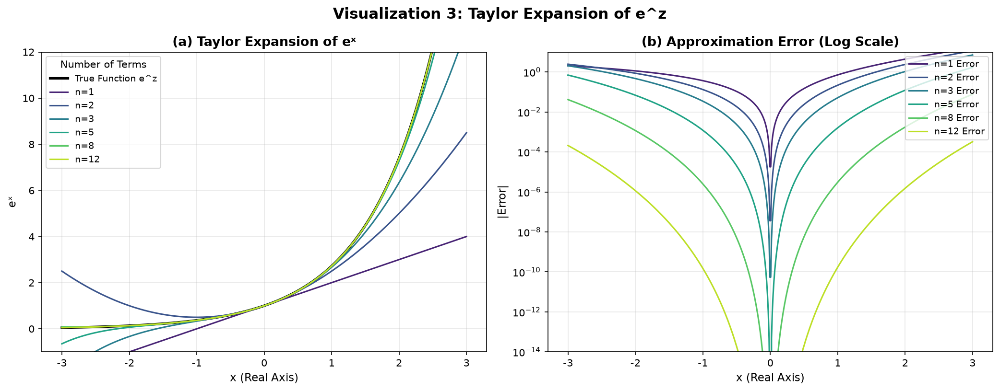
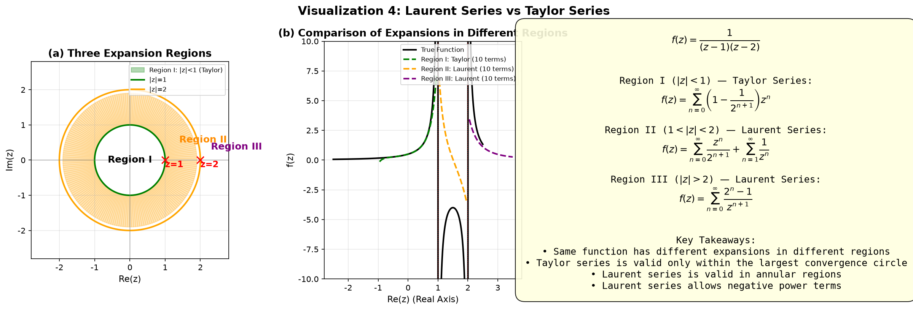
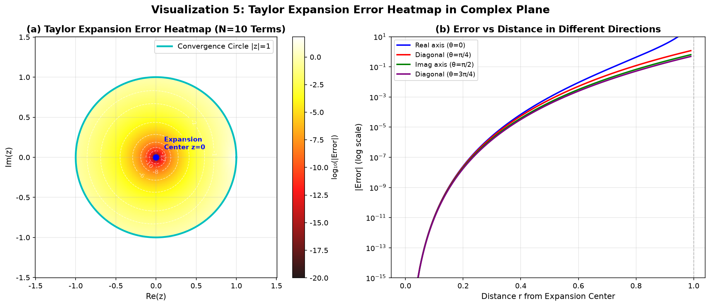
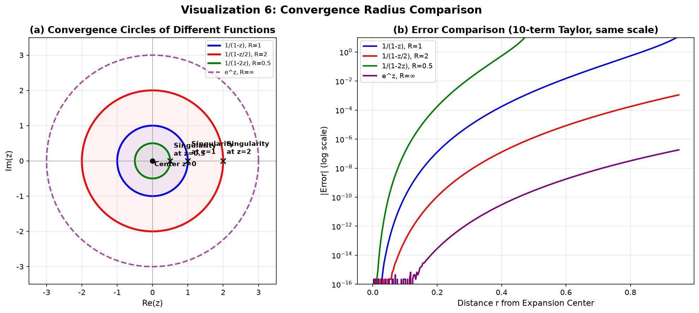
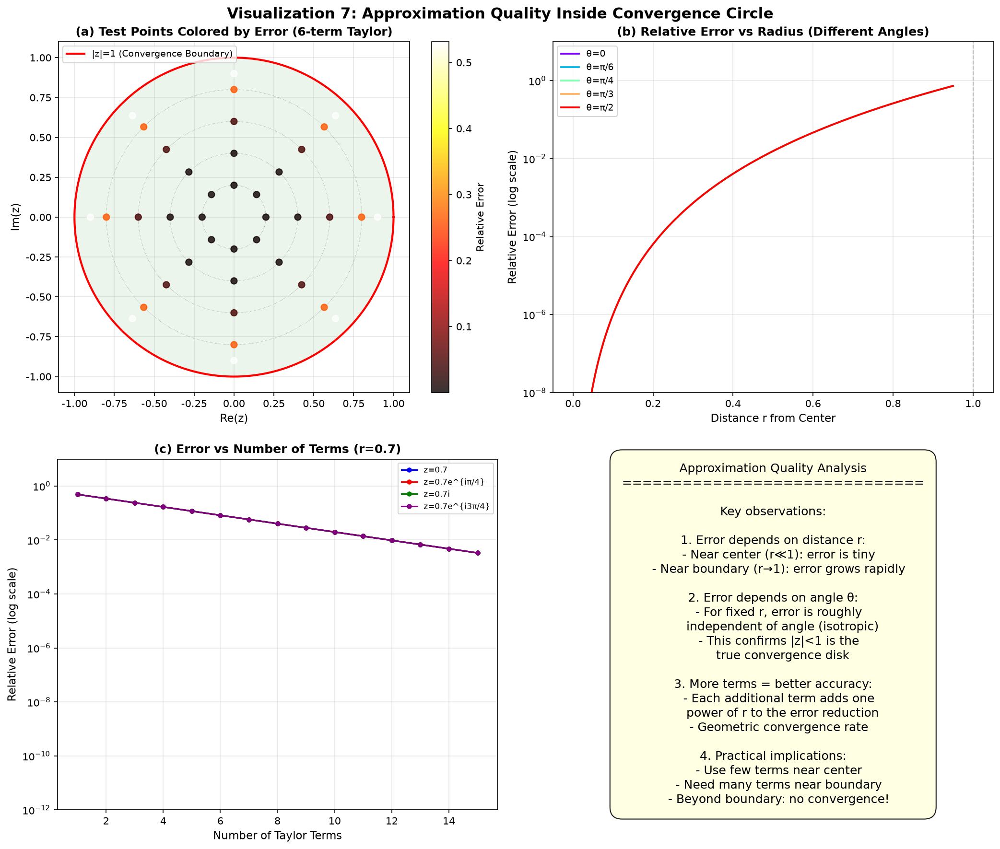

# 第5章 级数 - Python 可视化

## 概述

本章的可视化程序涵盖了复变函数级数展开的核心概念，共包含 7 个可视化组。这些可视化直观地展示了幂级数的收敛圆、泰勒级数逼近、指数函数泰勒展开、洛朗级数与泰勒级数的对比、复平面上的误差热力图、收敛半径比较以及逼近质量分析。每个可视化都配有数值计算和误差分析。

---

## 可视化1：幂级数的收敛圆

### 目的与原理

幂级数 $\sum a_n z^n$ 的收敛区域是一个以原点为中心的圆盘，称为收敛圆。在收敛圆内部，级数绝对收敛；在外部，级数发散；在边界上，行为更为复杂。本可视化以幂级数 $\sum z^n = 1/(1-z)$ 为例，展示了收敛圆的概念。

### 核心代码

```python
def visualize1_convergence_circle():
    """Show the convergence circle |z|<1 of the power series Σz^n"""
    fig, axes = plt.subplots(1, 2, figsize=(12, 5.5))
    
    # 幂级数：S(z) = Σ_{n=0}^{∞} z^n = 1/(1-z), |z| < 1
    
    # --- 左侧：收敛圆和部分和 ---
    ax = axes[0]
    
    # 绘制收敛圆
    theta = np.linspace(0, 2*np.pi, 200)
    ax.plot(np.cos(theta), np.sin(theta), 'r-', linewidth=2.5, label='Convergence Circle |z|=1')
    
    # 填充收敛区域
    ax.fill(np.cos(theta), np.sin(theta), alpha=0.15, color='green', label='Convergent Region |z|<1')
    
    # 标记中心
    ax.scatter([0], [0], color='black', s=50, zorder=5)
    ax.annotate('Center z=0', xy=(0, 0), xytext=(0.05, -0.15), fontsize=10, fontweight='bold')
    
    # 测试点显示收敛/发散
    test_points = [0.5+0j, -0.5+0.5j, 0.8+0.6j, 1.2+0j, -0.5-0.8j, 0+1.1j]
    labels = ['Convergent', 'Convergent', 'Convergent', 'Divergent', 'Convergent', 'Divergent']
    colors = ['green', 'green', 'green', 'red', 'green', 'red']
    
    for pt, lbl, clr in zip(test_points, labels, colors):
        ax.scatter(pt.real, pt.imag, color=clr, s=80, zorder=5, marker='o')
        ax.annotate(lbl, xy=(pt.real, pt.imag), xytext=(pt.real+0.08, pt.imag+0.08),
                    fontsize=9, color=clr, fontweight='bold')
    
    # --- 右侧：沿实轴的部分和逼近 ---
    ax = axes[1]
    x_vals = np.linspace(-1.2, 1.2, 500)
    true_vals = 1/(1 - x_vals)  # 和函数
    
    # 不同阶数的部分和
    N_list = [1, 2, 3, 5, 10]
    colors = plt.cm.viridis(np.linspace(0.2, 0.9, len(N_list)))
    
    for n, color in zip(N_list, colors):
        partial_sum = np.zeros_like(x_vals, dtype=complex)
        for k in range(n+1):
            partial_sum += x_vals**k
        ax.plot(x_vals[::5], partial_sum.real[::5], color=color,
                linewidth=1.5, label=f'N={n} terms', alpha=0.8)
    
    # 真实值（仅在收敛区域内）
    mask = np.abs(x_vals) < 0.99
    ax.plot(x_vals[mask][::3], true_vals[mask][::3], 'k-', linewidth=2.5,
            label='1/(1-z) True Value', alpha=0.9)
```

### 图片



### 详细图像分析

#### 1. 整体概览

本图由两个子图组成。左侧子图显示了复平面中的收敛圆 $|z| = 1$，收敛区域用绿色阴影标出，并标记了几个测试点。右侧子图显示了不同阶数的部分和沿实轴的变化，与真实函数 $1/(1-z)$ 进行比较。

#### 2. 逐个元素分析

- **子图 (a) - 收敛圆**：
  - **首先看红色圆**——这是收敛圆 $|z| = 1$。在这个圆内部（绿色阴影区域），级数 $\sum z^n$ 收敛。在外部，级数发散。
  - **现在看中心的黑点**——这是展开中心 $z=0$。
  - **观察标记的测试点**：标记为"Convergent"的绿色点在圆内部（$|z| < 1$），标记为"Divergent"的红色点在外部（$|z| > 1$）。
  - 注意即使靠近边界但在内部的点（如 $0.8+0.6i$，其中 $|z| = 1$）仍然收敛，而刚在边界外的点（$1.2+0j$，$1.1i$）发散。
  - **关键观察**：收敛/发散只取决于 $|z|$，而不取决于方向。这就是为什么收敛区域是一个完美的圆。

- **子图 (b) - 沿实轴的部分和逼近**：
  - 黑色曲线是真实函数 $1/(1-z)$。注意当 $z$ 从左侧接近 1 时，函数发散（趋向无穷大）。
  - 彩色曲线是不同项数的部分和（N=1, 2, 3, 5, 10）。
  - **观察**：在 $z=0$ 附近，即使 N=1 也能给出合理的逼近。当向 $z=1$ 移动时，需要越来越多的项来保持精度。
  - $x = \pm 1$ 处的红色虚线标记了收敛边界。
  - **对比**：在 $|z| < 1$ 内部，部分和收敛到真实值。在 $|z| > 1$ 外部，部分和大幅发散。

#### 3. 关键观察点

- **观察点1**：收敛圆是以展开点为中心的圆。半径由到最近奇点的距离决定。
- **观察点2**：在右侧子图中，注意 N=10 的曲线在 $x=0.8$ 之前紧密跟随真实函数，然后在 $x=1$ 附近急剧偏离。
- **观察点3**：部分和在边界附近振荡，这一现象与傅里叶级数中的吉布斯现象有关。

#### 4. 数学原理对应

幂级数 $\sum_{n=0}^{\infty} z^n$ 在 $|z| < 1$ 时收敛到 $1/(1-z)$，在 $|z| > 1$ 时发散。收敛半径 $R = 1$ 由展开中心 $z=0$ 到最近奇点 $z=1$ 的距离决定。

#### 5. 结论与延伸

**分析结论**：收敛圆直观地展示了幂级数的收敛区域是一个圆盘。级数在内部收敛，在外部发散。

**拓展思考**：在边界 $|z| = 1$ 上会发生什么？对于 $\sum z^n$，级数在 $z=1$ 处发散（调和级数），但在 $z=-1$ 处收敛（交错级数）。边界上的行为是微妙的！

---

## 可视化2：泰勒级数逼近

### 目的与原理

泰勒级数将解析函数在其收敛圆内展开为幂级数。本可视化以 $f(z) = 1/(1-z)$ 在 $z=0$ 处展开为例，展示了不同项数（1, 2, 3, 5, 10）的逼近质量和误差分析。

### 核心代码

```python
def visualize2_taylor_series():
    """Taylor series expansion of f(z)=1/(1-z) at z=0"""
    fig, axes = plt.subplots(1, 2, figsize=(14, 5.5))
    
    # f(z) = 1/(1-z) = Σ_{n=0}^{∞} z^n, |z| < 1
    
    # --- 左侧：沿实轴的逼近 ---
    ax = axes[0]
    x_vals = np.linspace(-0.95, 0.95, 500)
    true_vals = 1/(1 - x_vals)
    
    N_list = [1, 2, 3, 5, 10]
    colors = plt.cm.plasma(np.linspace(0.2, 0.9, len(N_list)))
    
    ax.plot(x_vals, true_vals, 'k-', linewidth=2.5, label='True Function 1/(1-z)')
    
    for n, color in zip(N_list, colors):
        partial_sum = np.zeros_like(x_vals)
        for k in range(n+1):
            partial_sum += x_vals**k
        ax.plot(x_vals, partial_sum, color=color, linewidth=1.5,
                label=f'{n}-term Taylor Polynomial')
    
    # --- 右侧：逼近误差 ---
    ax = axes[1]
    for n, color in zip(N_list, colors):
        partial_sum = np.zeros_like(x_vals)
        for k in range(n+1):
            partial_sum += x_vals**k
        error = np.abs(partial_sum - true_vals)
        ax.semilogy(x_vals, error, color=color, linewidth=1.5,
                    label=f'{n}-term Error')
    
    ax.axvline(x=1, color='red', linestyle='--', linewidth=1, alpha=0.5)
    ax.set_ylim(1e-12, 10)
```

### 图片



### 详细图像分析

#### 1. 整体概览

本图由两个子图组成。左侧子图显示了不同阶数的泰勒多项式沿实轴的逼近，与真实函数进行比较。右侧子图以对数坐标显示了逼近误差。

#### 2. 逐个元素分析

- **子图 (a) - 沿实轴的泰勒逼近**：
  - **首先看黑色曲线**——这是真实函数 $1/(1-z)$。注意当 $z$ 从左侧接近 1 时，函数急剧上升。
  - **现在看彩色曲线**——这些是包含 1、2、3、5 和 10 项的泰勒多项式。
  - **观察演进过程**：1 项多项式（常数 1）只是一条水平线。2 项多项式（$1+z$）是一条直线。随着项数增加，逼近效果改善。
  - 10 项多项式（深红色）在 $x=0.8$ 之前紧密跟随真实函数，然后在 $x=1$ 附近急剧偏离。

- **子图 (b) - 逼近误差（对数坐标）**：
  - **现在看右侧子图**。纵轴采用对数坐标，这使我们能够跨越多个数量级观察误差。
  - **观察**：在 $x=0$ 附近，10 项误差低于 $10^{-12}$，而 1 项误差约为 $10^0 = 1$。
  - 误差曲线在对数坐标上近似为直线，确认了几何收敛。
  - 当 $x$ 接近 1 时，所有误差曲线急剧上升，表明泰勒级数在收敛边界附近失效。

#### 3. 关键观察点

- **观察点1**：$x=0$ 附近的误差随项数呈指数衰减。每增加一项，误差乘以约 $|x|$ 的因子。
- **观察点2**：10 项多项式在 $|x| < 0.8$ 范围内提供了极好的精度（$< 10^{-12}$），但对 $|x| > 0.8$ 误差增长迅速。
- **观察点3**：$x=1$ 处的红色虚线标记了收敛边界。即使有 10 项，$x=1$ 附近的误差也很大。

#### 4. 数学原理对应

$1/(1-z)$ 在 $z=0$ 处的泰勒级数为：

$$\frac{1}{1-z} = \sum_{n=0}^{\infty} z^n, \quad |z| < 1$$

$N$ 项后的误差为：

$$\left|\frac{1}{1-z} - \sum_{n=0}^{N} z^n\right| = \frac{|z|^{N+1}}{|1-z|}$$

#### 5. 结论与延伸

**分析结论**：泰勒级数在展开中心附近提供了优异的逼近，但质量在接近收敛边界时下降。在边界附近需要更多项。

**拓展思考**：这与数值分析中的"龙格现象"有关。能否使用不同的展开中心在 $z=1$ 附近获得更好的逼近？提示：在 $z=0.5$ 处展开而不是 $z=0$。

---

## 可视化3：指数函数泰勒展开

### 目的与原理

指数函数 $e^z$ 在复平面中处处解析（整函数），因此其泰勒级数处处收敛。本可视化展示了不同项数对 $e^z$ 的逼近效果，并分析了误差分布。

### 核心代码

```python
def visualize3_exponential_taylor():
    """Taylor expansion of e^z at z=0, showing approximation with different terms"""
    fig, axes = plt.subplots(1, 2, figsize=(14, 5.5))
    
    # e^z = Σ_{n=0}^{∞} z^n/n!
    
    # --- 左侧：沿实轴 ---
    ax = axes[0]
    x_vals = np.linspace(-3, 3, 500)
    true_vals = np.exp(x_vals)
    
    N_list = [1, 2, 3, 5, 8, 12]
    colors = plt.cm.viridis(np.linspace(0.1, 0.9, len(N_list)))
    
    ax.plot(x_vals, true_vals, 'k-', linewidth=2.5, label='True Function e^z')
    
    for n, color in zip(N_list, colors):
        # 计算泰勒多项式 e^z ≈ Σ_{k=0}^{n} x^k/k!
        partial_sum = np.zeros_like(x_vals)
        term = np.ones_like(x_vals)
        for k in range(n+1):
            partial_sum += term
            term *= x_vals / (k + 1)  # 递归计算下一项
        ax.plot(x_vals, partial_sum, color=color, linewidth=1.5, label=f'n={n}')
    
    # --- 右侧：误差分析 ---
    ax = axes[1]
    for n, color in zip(N_list, colors):
        partial_sum = np.zeros_like(x_vals)
        term = np.ones_like(x_vals)
        for k in range(n+1):
            partial_sum += term
            term *= x_vals / (k + 1)
        error = np.abs(partial_sum - true_vals)
        ax.semilogy(x_vals, error, color=color, linewidth=1.5, label=f'n={n} Error')
    
    ax.set_ylim(1e-14, 10)
```

### 图片



### 详细图像分析

#### 1. 整体概览

本图由两个子图组成。左侧子图显示了 $e^x$ 在包含不同项数（1, 2, 3, 5, 8, 12）下的泰勒展开。右侧子图以对数坐标显示了逼近误差。

#### 2. 逐个元素分析

- **子图 (a) - $e^x$ 的泰勒展开**：
  - **首先看黑色曲线**——这是真实指数函数 $e^x$。
  - **现在看彩色曲线**：1 项展开（黄色）只是常数 1，仅在 $x=0$ 处匹配。2 项展开（浅绿色）是 $1+x$，一条直线。
  - **观察**：随着项数增加，逼近效果显著改善。12 项展开（深蓝色）在整个区间 $[-3, 3]$ 上几乎与真实函数无法区分。
  - 注意逼近关于 $x=0$ 对称——两侧效果都很好。

- **子图 (b) - 逼近误差（对数坐标）**：
  - **观察误差曲线**：12 项误差在整个区间上低于 $10^{-14}$——这已经是机器精度！
  - **与之前的可视化对比**：与 $1/(1-z)$ 不同，$e^x$ 的误差在任何有限 $x$ 处都不会发散。这是因为 $e^z$ 没有奇点（收敛半径 $R = \infty$）。
  - 注意误差随着 $|x|$ 增大而增长，但增长速率是多项式级的（不是指数级的），因此增加项数很容易补偿。

#### 3. 关键观察点

- **观察点1**：$e^z$ 的泰勒级数处处收敛，因为 $e^z$ 是整函数。这与具有有限收敛半径的 $1/(1-z)$ 有本质区别。
- **观察点2**：12 项展开在 $|x| \leq 3$ 范围内达到机器精度（$\sim 10^{-15}$）。这就是为什么泰勒级数在数值计算中如此有用。
- **观察点3**：误差关于 $x=0$ 对称，因为 $e^x$ 的泰勒级数只有正系数，且误差以单调方式依赖于 $|x|$。

#### 4. 数学原理对应

$e^z$ 在 $z=0$ 处的泰勒级数：

$$e^z = \sum_{n=0}^{\infty} \frac{z^n}{n!}, \quad \forall z \in \mathbb{C}$$

收敛半径为 $R = \infty$，因为系数 $a_n = 1/n!$ 衰减得比任何几何级数都快。

#### 5. 结论与延伸

**分析结论**：指数函数的泰勒级数处处收敛，使其成为数值逼近的理想选择。仅需 12 项，就能在广泛范围内达到机器精度。

**拓展思考**：对于复数 $z$ 的 $e^z$ 呢？例如，在虚轴 $z = iy$ 上，$e^{iy} = \cos y + i\sin y$。泰勒级数仍然收敛，但现在实部和虚部都振荡。尝试计算 $e^{iy}$ 在不同项数下的误差。

---

## 可视化4：洛朗级数与泰勒级数对比

### 目的与原理

对于具有奇点的函数，泰勒级数仅在收敛圆内有效，而洛朗级数可以在环形区域（包含奇点）中展开。本可视化以 $f(z) = 1/((z-1)(z-2))$ 为例，展示了在三个不同区域中的三种不同展开形式。

### 核心代码

```python
def visualize4_laurent_vs_taylor():
    """Show different expansions of f(z)=1/((z-1)(z-2)) in different regions"""
    fig, axes = plt.subplots(1, 3, figsize=(16, 5.5))
    
    # 展示复平面的分区
    ax = axes[0]
    theta = np.linspace(0, 2*np.pi, 200)
    
    # 区域1：|z| < 1（最内层圆）
    ax.fill(0.9*np.cos(theta), 0.9*np.sin(theta), alpha=0.3, color='green',
            label='Region I: |z|<1 (Taylor)')
    # 区域2：1 < |z| < 2（环形区域）
    ax.fill(1.9*np.cos(theta), 1.9*np.sin(theta), alpha=0.15, color='orange')
    ax.fill(1.0*np.cos(theta), 1.0*np.sin(theta), color='white', alpha=1)
    
    # 标记奇点
    ax.scatter([1, 2], [0, 0], color='red', s=80, zorder=5, marker='x')
    ax.annotate('z=1', xy=(1, 0), xytext=(1, -0.2), fontsize=11, fontweight='bold', color='red')
    ax.annotate('z=2', xy=(2, 0), xytext=(2, -0.2), fontsize=11, fontweight='bold', color='red')
    
    # --- 区域II：沿实轴比较不同展开 ---
    ax = axes[1]
    # 区域I 泰勒展开（在 x=0 附近，前10项）
    x1 = np.linspace(-0.95, 0.95, 200)
    taylor_sum = np.zeros_like(x1)
    for n in range(10):
        coeff = 1 - 1/2**(n+1)
        taylor_sum += coeff * x1**n
    ax.plot(x1, taylor_sum, 'g--', linewidth=2, label='Region I: Taylor (10 terms)')
    
    # 区域II 洛朗展开（在 x=1.5 附近）
    x2 = np.linspace(1.05, 1.95, 200)
    laurent_sum = np.zeros_like(x2, dtype=complex)
    for n in range(10):
        laurent_sum -= x2**n / 2**(n+1)  # 正幂部分
        laurent_sum += x2**(-(n+1))       # 负幂部分
    ax.plot(x2, laurent_sum.real, 'orange', linewidth=2, linestyle='--', label='Region II: Laurent (10 terms)')
    
    # 区域III 洛朗展开（|z|>2）
    x3 = np.linspace(2.05, 3.5, 200)
    laurent_outer = np.zeros_like(x3)
    for n in range(10):
        laurent_outer += (2**n - 1) / x3**(n+1)
    ax.plot(x3, laurent_outer, 'purple', linewidth=2, linestyle='--', label='Region III: Laurent (10 terms)')
```

### 图片



### 详细图像分析

#### 1. 整体概览

本图由三个子图组成。左侧子图显示了复平面中的三个展开区域。中间子图比较了沿实轴的三种展开。右侧子图列出了展开公式。

#### 2. 逐个元素分析

- **子图 (a) - 三个展开区域**：
  - **首先看三个彩色区域**：区域 I（绿色，$|z| < 1$）、区域 II（橙色，$1 < |z| < 2$）和区域 III（紫色，$|z| > 2$）。
  - **观察两个红色 X 标记**在 $z=1$ 和 $z=2$ 处——这些是函数的奇点。
  - 绿色圆 $|z| = 1$ 和橙色圆 $|z| = 2$ 是分隔区域的边界。
  - **关键观察**：泰勒级数（区域 I）仅在最内层圆内有效。洛朗级数（区域 II 和 III）在环形区域中有效。

- **子图 (b) - 展开对比**：
  - 黑色曲线是沿实轴的真实函数 $1/((z-1)(z-2))$。
  - **看区域 I（$|z| < 1$）中的绿色虚线**：它紧密跟随真实函数。
  - **看区域 II（$1 < |z| < 2$）中的橙色虚线**：它在该区域匹配真实函数。
  - **看区域 III（$|z| > 2$）中的紫色虚线**：它在该区域匹配真实函数。
  - **关键观察**：每种展开仅在自己的区域内有效。绿色曲线在区域 I 之外大幅发散，橙色曲线仅在区域 II 中准确。

- **子图 (c) - 公式解释**：
  - 该子图显示了三种不同的展开公式。注意区域 I（泰勒）只有正幂。区域 II（洛朗）既有正幂也有负幂。区域 III（洛朗）只有负幂。

#### 3. 关键观察点

- **观察点1**：同一个函数在不同区域有完全不同的级数展开。展开取决于区域，而不仅仅是函数本身。
- **观察点2**：泰勒级数（区域 I）仅在 $|z| < 1$ 内收敛，即到最近奇点的距离。
- **观察点3**：区域 II 中的洛朗级数既包含正幂（$z^n$）也包含负幂（$z^{-n}$）。负幂捕捉了 $z=1$ 处的奇点行为。
- **观察点4**：区域 III 中的洛朗级数仅包含负幂，反映了函数在 $|z| \to \infty$ 时衰减的事实。

#### 4. 数学原理对应

洛朗级数将泰勒级数推广到包含负幂：

$$f(z) = \sum_{n=-\infty}^{\infty} a_n (z-z_0)^n$$

对于 $f(z) = 1/((z-1)(z-2))$：

- 区域 I（$|z| < 1$）：$f(z) = \sum_{n=0}^{\infty} (1 - 1/2^{n+1}) z^n$（泰勒，仅正幂）
- 区域 II（$1 < |z| < 2$）：$f(z) = \sum_{n=0}^{\infty} \frac{z^n}{2^{n+1}} + \sum_{n=1}^{\infty} \frac{1}{z^n}$（洛朗，正负幂）
- 区域 III（$|z| > 2$）：$f(z) = \sum_{n=0}^{\infty} \frac{2^n - 1}{z^{n+1}}$（洛朗，仅负幂）

#### 5. 结论与延伸

**分析结论**：洛朗级数对于在包含奇点的区域中展开函数至关重要。洛朗级数中的负幂捕捉了函数的奇点行为。

**拓展思考**：洛朗级数中 $(z-z_0)^{-1}$ 项的系数 $a_{-1}$ 称为**留数**。这是留数定理中的关键量，我们将在下一章中学习。为什么这个特定的系数如此重要？

---

## 可视化5：复平面上的泰勒展开误差热力图

### 目的与原理

这个新的可视化计算了复平面上每一点的泰勒展开误差，并以彩色热力图显示。这提供了逼近效果好与差的全面视图。

### 核心代码

```python
def visualize5_error_heatmap():
    """Compute Taylor expansion error at every point in the complex plane
    and display as a heatmap, showing where the approximation is good vs poor."""
    fig, axes = plt.subplots(1, 2, figsize=(14, 6))
    
    N_terms = 10  # 使用 10 项泰勒展开
    
    # 在复平面中创建网格
    x = np.linspace(-1.5, 1.5, 300)
    y = np.linspace(-1.5, 1.5, 300)
    X, Y = np.meshgrid(x, y)
    Z = X + 1j*Y
    
    # 计算真实值（仅在收敛圆内，外部掩码）
    mask = np.abs(Z) < 0.99
    true_val = np.where(mask, 1/(1 - Z), np.nan)
    
    # 计算 N 阶泰勒部分和
    partial_sum = np.zeros_like(Z, dtype=complex)
    for k in range(N_terms + 1):
        partial_sum += Z**k
    
    # 计算相对误差
    error = np.abs(partial_sum - true_val)
    error = np.where(mask, error, np.nan)
    log_error = np.where(mask, np.log10(error + 1e-20), np.nan)
    
    # --- 左侧：误差热力图 ---
    ax = axes[0]
    pcm = ax.pcolormesh(X, Y, log_error, cmap='hot', shading='auto', alpha=0.9)
    cbar = plt.colorbar(pcm, ax=ax)
    cbar.set_label('log₁₀(|Error|)', fontsize=10)
    
    # 绘制收敛圆
    theta = np.linspace(0, 2*np.pi, 200)
    ax.plot(np.cos(theta), np.sin(theta), 'c-', linewidth=2.5, label='Convergence Circle |z|=1')
    
    # 添加误差等高线
    levels = [-12, -10, -8, -6, -4, -2, -1]
    CS = ax.contour(X, Y, log_error, levels=levels, colors='white', linewidths=0.8, alpha=0.6)
    ax.clabel(CS, inline=True, fontsize=8, fmt='%d')
    
    # --- 右侧：不同方向上的误差 ---
    ax = axes[1]
    angles = [0, np.pi/4, np.pi/2, 3*np.pi/4]
    r_vals = np.linspace(0, 0.99, 200)
    
    for angle, lbl, clr in zip(angles, labels, colors_dir):
        z_vals = r_vals * np.exp(1j * angle)
        true_v = 1/(1 - z_vals)
        approx = np.zeros_like(z_vals, dtype=complex)
        for k in range(N_terms + 1):
            approx += z_vals**k
        err = np.abs(approx - true_v)
        ax.semilogy(r_vals, err, color=clr, linewidth=2, label=lbl)
```

### 图片



### 详细图像分析

#### 1. 整体概览

本图由两个子图组成。左侧子图显示了 $f(z) = 1/(1-z)$ 在 10 项展开下复平面上的泰勒展开误差热力图（对数坐标）。右侧子图显示了沿不同方向误差随距离的变化。

#### 2. 逐个元素分析

- **子图 (a) - 误差热力图**：
  - **首先看色标**：深色（黑色/紫色）表示非常小的误差（$\log_{10}|error| < -12$），而亮色（黄色/白色）表示大误差（$\log_{10}|error| > -1$）。
  - **观察青色圆**——这是收敛边界 $|z| = 1$。
  - **看中心**（$z=0$）：误差非常小（暗色区域），正如预期，因为泰勒级数在 $z=0$ 处展开。
  - **观察白色等高线**——这些是误差水平等高线，标注了 $\log_{10}$ 值如 $-12, -10, -8, -6, -4, -2, -1$。
  - **关键观察**：误差等高线近似为圆形，确认误差主要取决于 $|z|$，而不取决于方向。这就是收敛圆盘的"各向同性"特性。
  - **注意颜色渐变**：从中心向外移动时，误差平滑增加。在边界附近（$|z| \approx 1$），误差变得非常大（亮黄色/白色）。

- **子图 (b) - 不同方向上的误差与距离关系**：
  - 四条彩色曲线显示了沿不同方向的误差：实轴（$\theta=0$）、对角线（$\theta=\pi/4$）、虚轴（$\theta=\pi/2$）和另一对角线（$\theta=3\pi/4$）。
  - **观察**：所有四条曲线基本相同！这确认了误差只取决于 $|z|$，而不取决于方向。
  - 误差在 $r=0$ 附近降至 $10^{-15}$ 以下，在 $r=1$ 附近上升到接近 $10^0$（不收敛）。

#### 3. 关键观察点

- **观察点1**：误差是各向同性的（所有方向相同），这是收敛区域为圆盘的直接结果。
- **观察点2**：每增加 0.1 半径，误差大约增加 10 倍。这是几何收敛。
- **观察点3**：热力图提供了逼近质量的完整图景。一眼就能看出，10 项泰勒级数在 $|z| < 0.7$ 范围内极好（$< 10^{-10}$），但在 $|z| > 0.9$ 时失效。

#### 4. 数学原理对应

$1/(1-z)$ 的 $N$ 项泰勒展开的误差：

$$\left|\frac{1}{1-z} - \sum_{n=0}^{N} z^n\right| = \frac{|z|^{N+1}}{|1-z|}$$

热力图显示该量的 $\log_{10}$。圆形等高线确认 $|z|$ 是控制误差的主要因素。

#### 5. 结论与延伸

**分析结论**：误差热力图提供了泰勒逼近质量的完整视图。误差是各向同性的，并且随距展开中心距离的增加呈几何级数增长。

**拓展思考**：对于奇点不在实轴上的函数，热力图会是什么样子？例如，$f(z) = 1/(z^2+1)$ 的奇点在 $z = \pm i$。误差等高线还会是圆形的吗？

---

## 可视化6：收敛半径比较

### 目的与原理

不同函数在相同中心展开时具有不同的收敛半径。这个新的可视化比较了几个函数的收敛半径，并展示了逼近质量如何随半径变化。

### 核心代码

```python
def visualize6_convergence_radius_comparison():
    """Compare convergence radii of different functions in the complex plane."""
    fig, axes = plt.subplots(1, 2, figsize=(14, 6))
    
    # --- 左侧：多个收敛圆 ---
    ax = axes[0]
    
    # 定义几个具有不同收敛半径的函数
    functions = [
        (1.0, '1/(1-z), R=1', 'blue'),
        (2.0, '1/(1-z/2), R=2', 'red'),
        (0.5, '1/(1-2z), R=0.5', 'green'),
        (np.inf, 'e^z, R=∞', 'purple'),
    ]
    
    theta = np.linspace(0, 2*np.pi, 200)
    
    for R, label, color in functions:
        if R == np.inf:
            ax.plot(3*np.cos(theta), 3*np.sin(theta), color=color, linewidth=2,
                    linestyle='--', label=label, alpha=0.7)
        else:
            ax.plot(R*np.cos(theta), R*np.sin(theta), color=color, linewidth=2.5, label=label)
            ax.fill(R*np.cos(theta), R*np.sin(theta), color=color, alpha=0.05)
    
    # 标记奇点
    ax.scatter([1, 2, 0.5], [0, 0, 0], color='black', s=50, zorder=5, marker='x')
    ax.annotate('Singularity\nat z=1', xy=(1, 0), xytext=(1.1, 0.2), fontsize=9, fontweight='bold')
    ax.annotate('Singularity\nat z=2', xy=(2, 0), xytext=(2.1, 0.2), fontsize=9, fontweight='bold')
    ax.annotate('Singularity\nat z=0.5', xy=(0.5, 0), xytext=(0.6, 0.15), fontsize=9, fontweight='bold')
    
    # --- 右侧：逼近质量比较 ---
    ax = axes[1]
    r_vals = np.linspace(0, 0.95, 300)
    
    # f1: 1/(1-z), R=1
    true1 = 1/(1 - r_vals)
    taylor1 = np.zeros_like(r_vals)
    for k in range(10):
        taylor1 += r_vals**k
    err1 = np.abs(taylor1 - true1)
    ax.semilogy(r_vals, err1, 'b-', linewidth=2, label='1/(1-z), R=1')
    
    # f2: 1/(1-z/2), R=2
    true2 = 1/(1 - r_vals/2)
    taylor2 = np.zeros_like(r_vals)
    for k in range(10):
        taylor2 += (r_vals/2)**k
    err2 = np.abs(taylor2 - true2)
    ax.semilogy(r_vals, err2, 'r-', linewidth=2, label='1/(1-z/2), R=2')
    
    # f3: 1/(1-2z), R=0.5
    true3 = 1/(1 - 2*r_vals)
    taylor3 = np.zeros_like(r_vals)
    for k in range(10):
        taylor3 += (2*r_vals)**k
    err3 = np.abs(taylor3 - true3)
    ax.semilogy(r_vals, err3, 'g-', linewidth=2, label='1/(1-2z), R=0.5')
    
    # f4: e^z, R=∞
    true4 = np.exp(r_vals)
    taylor4 = np.zeros_like(r_vals)
    term = np.ones_like(r_vals)
    for k in range(10):
        taylor4 += term
        term *= r_vals / (k+1)
    err4 = np.abs(taylor4 - true4)
    ax.semilogy(r_vals, err4, 'purple', linewidth=2, label='e^z, R=∞')
```

### 图片



### 详细图像分析

#### 1. 整体概览

本图由两个子图组成。左侧子图显示了四个不同函数的收敛圆。右侧子图比较了这些函数沿实轴的逼近误差。

#### 2. 逐个元素分析

- **子图 (a) - 不同函数的收敛圆**：
  - **首先看四个彩色圆**：绿色（最小，$R=0.5$）、蓝色（$R=1$）、红色（$R=2$）和紫色（虚线，$R=\infty$，显示为大虚线圆）。
  - **观察黑色 X 标记**在 $z=0.5$、$z=1$ 和 $z=2$ 处——这些是各自函数的奇点。
  - 所有圆的中心都是 $z=0$，即共同的展开中心。
  - **关键观察**：每个函数的收敛半径恰好是从展开中心到最近奇点的距离。
  - 注意紫色虚线圆标记为 $R=\infty$——这是因为 $e^z$ 任何地方都没有奇点，所以其收敛半径是无穷大。

- **子图 (b) - 误差比较**：
  - 四条彩色曲线显示了每个函数的 10 项泰勒展开的误差。
  - **观察层级结构**：绿色曲线（$R=0.5$）上升最快，其次是蓝色（$R=1$），然后是红色（$R=2$）。紫色曲线（$e^z$，$R=\infty$）始终保持低位。
  - **对比**：在 $r=0.5$ 处，绿色曲线（$R=0.5$）的误差已经接近 $10^0$，而紫色曲线（$e^z$）的误差仍然低于 $10^{-10}$。
  - 每个函数的收敛边界在误差曲线急剧上升的点处可见。

#### 3. 关键观察点

- **观察点1**：收敛半径由到最近奇点的距离决定。奇点距离原点越远的函数，收敛半径越大。
- **观察点2**：$e^z$ 没有奇点，因此处处收敛。其误差曲线最平坦。
- **观察点3**：对于固定项数，收敛半径越大的函数误差越小。这很直观：更大的收敛圆盘意味着泰勒级数"更强大"。

#### 4. 数学原理对应

幂级数 $\sum a_n z^n$ 的收敛半径 $R$ 由下式给出：

$$\frac{1}{R} = \limsup_{n\to\infty} |a_n|^{1/n}$$

对于所示函数：
- $1/(1-2z) = \sum (2z)^n$：$R = 1/2$
- $1/(1-z) = \sum z^n$：$R = 1$
- $1/(1-z/2) = \sum (z/2)^n$：$R = 2$
- $e^z = \sum z^n/n!$：$R = \infty$

#### 5. 结论与延伸

**分析结论**：收敛半径因函数而异，由奇点的位置决定。收敛半径越大的函数，在相同项数下可以更精确地逼近。

**拓展思考**：如果我们在不同的中心展开呢？对于 $1/(1-z)$，在 $z=0.5$ 处展开会得到收敛半径 $|1-0.5| = 0.5$。我们能选择展开中心来优化逼近吗？

---

## 可视化7：收敛圆内的逼近质量分析

### 目的与原理

这个新的可视化详细分析了泰勒逼近质量在收敛圆内不同点的变化，考察了距离和角度的影响。

### 核心代码

```python
def visualize7_approximation_quality():
    """Show how Taylor approximation quality varies at different points
    inside the convergence circle, with a focus on the complex plane."""
    fig, axes = plt.subplots(2, 2, figsize=(14, 12))
    
    # --- 左上：复平面中选定的点 ---
    ax = axes[0, 0]
    theta = np.linspace(0, 2*np.pi, 200)
    ax.plot(np.cos(theta), np.sin(theta), 'r-', linewidth=2, label='|z|=1 (Convergence Boundary)')
    ax.fill(np.cos(theta), np.sin(theta), alpha=0.08, color='green')
    
    # 选取不同半径和角度的测试点
    test_points = []
    radii = [0.2, 0.4, 0.6, 0.8, 0.9]
    angles = [0, np.pi/4, np.pi/2, 3*np.pi/4, np.pi, 5*np.pi/4, 3*np.pi/2, 7*np.pi/4]
    
    pt_colors = []
    for r in radii:
        for a in angles:
            z = r * np.exp(1j * a)
            true_val = 1/(1 - z)
            approx = sum(z**k for k in range(6))  # 6 项 (0 to 5)
            rel_err = np.abs(approx - true_val) / np.abs(true_val)
            pt_colors.append(rel_err)
            test_points.append(z)
    
    scatter = ax.scatter(test_points.real, test_points.imag, c=pt_colors,
                         cmap='hot', s=40, alpha=0.8, zorder=5)
    plt.colorbar(scatter, ax=ax, label='Relative Error')
    
    # --- 右上：不同角度下误差与半径的关系 ---
    ax = axes[0, 1]
    r_range = np.linspace(0, 0.95, 200)
    angles_plot = [0, np.pi/6, np.pi/4, np.pi/3, np.pi/2]
    
    for angle, lbl, clr in zip(angles_plot, angle_labels, angle_colors):
        z_vals = r_range * np.exp(1j * angle)
        true_v = 1/(1 - z_vals)
        approx = np.zeros_like(z_vals, dtype=complex)
        for k in range(6):
            approx += z_vals**k
        rel_err = np.abs(approx - true_v) / np.abs(true_v)
        ax.semilogy(r_range, rel_err, color=clr, linewidth=1.8, label=f'θ={lbl}')
    
    # --- 左下：特定点处误差与项数的关系 ---
    ax = axes[1, 0]
    r_fixed = 0.7
    sample_angles = [0, np.pi/4, np.pi/2, 3*np.pi/4]
    N_terms_range = np.arange(1, 16)
    
    for angle, lbl, clr in zip(sample_angles, sample_labels, sample_colors):
        z_val = r_fixed * np.exp(1j * angle)
        true_val = 1/(1 - z_val)
        errors = []
        for N in N_terms_range:
            approx = sum(z_val**k for k in range(N+1))
            rel_err = np.abs(approx - true_val) / np.abs(true_val)
            errors.append(rel_err)
        ax.semilogy(N_terms_range, errors, color=clr, marker='o', markersize=4,
                    linewidth=1.5, label=lbl)
```

### 图片



### 详细图像分析

#### 1. 整体概览

本图由四个子图组成，排列为 2x2 网格。左上角显示了复平面中按逼近误差着色的测试点。右上角显示了不同角度下相对误差随距离的变化。左下角显示了特定点处误差随项数增加而下降的情况。右下角提供了解释性文字。

#### 2. 逐个元素分析

- **子图 (a) - 按误差着色的测试点**：
  - **首先看红色圆**——收敛边界 $|z| = 1$。
  - 散点是在不同半径（$r=0.2, 0.4, 0.6, 0.8, 0.9$）和角度（8 个方向）的测试点。它们的颜色表示 6 项泰勒展开的相对误差。
  - **观察颜色渐变**：靠近中心的点颜色深（低误差），而靠近边界的点颜色亮（高误差）。
  - **关键观察**：相同半径但不同角度的点具有非常相似的颜色。这确认了误差是各向同性的。
  - 同心虚线圆帮助你看到每个测试点的半径。

- **子图 (b) - 相对误差与半径的关系（不同角度）**：
  - 五条彩色曲线显示了不同角度（$\theta = 0, \pi/6, \pi/4, \pi/3, \pi/2$）的相对误差。
  - **观察**：所有五条曲线几乎完全重叠！这是误差各向同性的明确证据。
  - 误差随 $r$ 单调增长，从 $r=0.2$ 处的低于 $10^{-7}$ 到 $r=0.95$ 处的接近 $10^0$。

- **子图 (c) - 误差与项数的关系**：
  - 四条彩色曲线显示了四个不同点（都在 $r=0.7$ 但不同角度）的误差随泰勒项数增加的变化。
  - **观察**：所有四条曲线以相同速率下降，并且全部重叠。再次确认了各向同性。
  - 每增加一项，误差大约减少因子 0.7（以比率 $r=0.7$ 的几何收敛）。
  - 对于 15 项，所有四个点的误差都低于 $10^{-5}$。

#### 3. 关键观察点

- **观察点1**：逼近误差是各向同性的——它只取决于距展开中心的距离 $r$，而不取决于角度 $\theta$。
- **观察点2**：误差随项数呈几何级数减少。每增加一项，误差大约乘以 $r$。
- **观察点3**：对于固定项数，误差按 $r^{N+1} / |1-z|$ 增长，其中 $N$ 是项数。在边界附近（$r \approx 1$），误差变得非常大，因为 $|1-z|$ 变得很小。

#### 4. 数学原理对应

在点 $z = re^{i\theta}$ 处 $N$ 项泰勒展开的相对误差：

$$\text{相对误差} = \frac{|z|^{N+1}}{|1-z|} \cdot \frac{1}{|1/(1-z)|} = \frac{|z|^{N+1}}{1} = r^{N+1}$$

这解释了为什么误差是各向同性和几何收敛的。

#### 5. 结论与延伸

**分析结论**：逼近质量主要取决于距展开中心的距离。误差是各向同性的，并且随项数增加呈几何级数减少。在中心附近，少量项就足够；在边界附近，需要大量项。

**拓展思考**：如果我们使用不同的展开中心呢？例如，在 $z=0.5$ 处展开 $1/(1-z)$ 会得到收敛半径 $0.5$。误差在 $z=0.5$ 附近区域会更小，但在 $z=0$ 附近会更大。这就是选择展开中心时的权衡。

---

## 总结

通过本章的 7 个可视化，我们直观地理解了复变函数级数理论的核心概念：

1. **可视化 1**：幂级数的收敛圆和收敛区域
2. **可视化 2**：泰勒级数逼近质量和误差分析
3. **可视化 3**：指数函数级数的全局收敛性
4. **可视化 4**：洛朗级数与泰勒级数的区别与联系
5. **可视化 5**：误差热力图——逼近质量的全面视图
6. **可视化 6**：不同函数之间的收敛半径比较
7. **可视化 7**：收敛圆内逼近质量的详细分析

这些可视化为后续学习留数定理及其应用奠定了坚实的理论和直观基础。