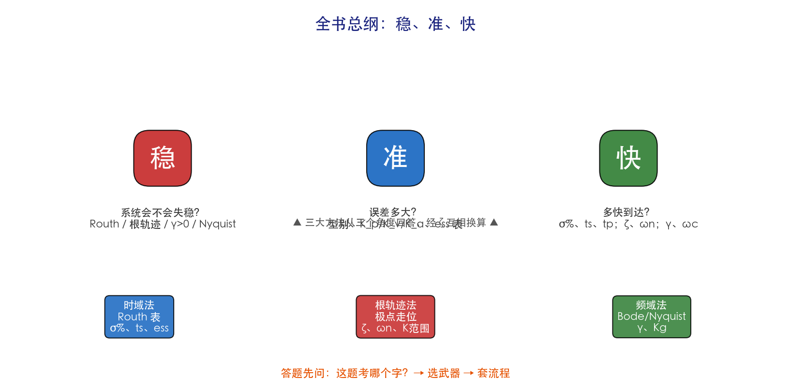
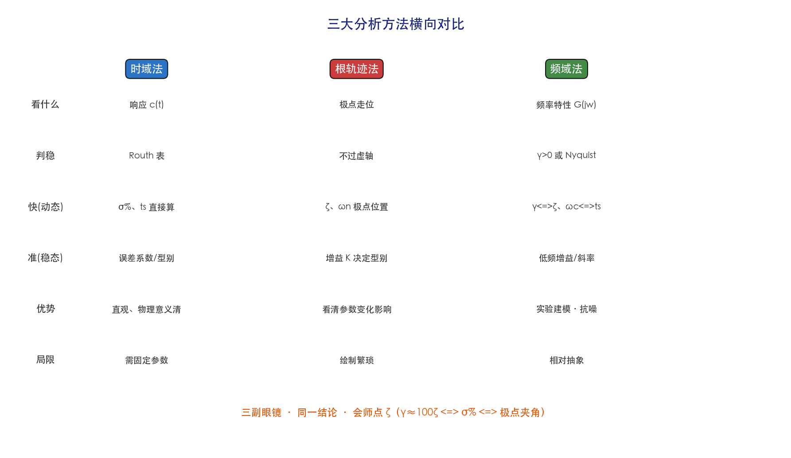
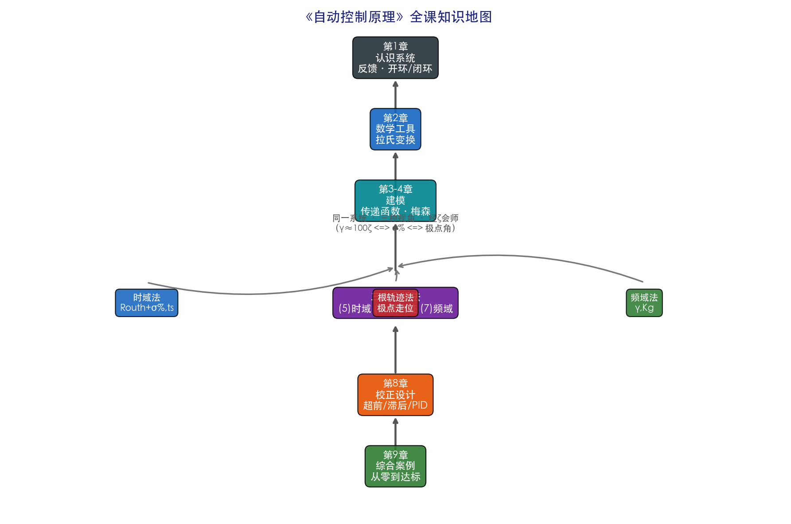
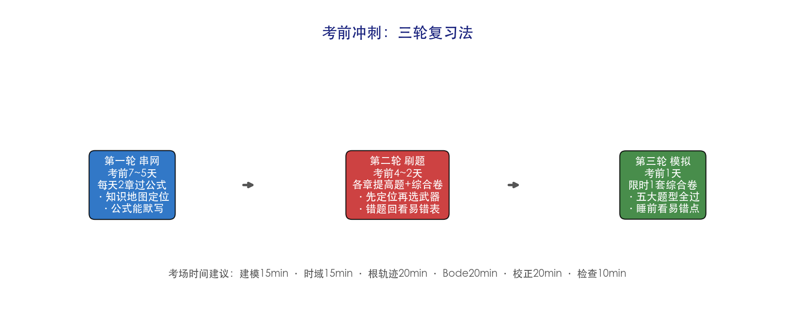

# 第10章 总复习与应试冲刺——公式推导

> 本章是"总装车间"：把全课所有公式按逻辑链条重新编排一遍，并标注"每个公式在哪一章推导过、怎么用"。**复习不是重看，而是把散落的公式串成一张网。**

---

## 1. 第0梯队：核心思想公式（贯穿全书）

### 1.1 反馈与闭环

$$
\boxed{\Phi(s)=\frac{G(s)}{1+G(s)H(s)}} \quad \text{（单位反馈 }H=1\text{ 时简化为 }\frac{G}{1+G}）
$$

**出处**：第4章。**作用**：全课 90% 的推导起点——先有闭环，才谈稳、准、快。

### 1.2 误差与稳态误差（"准"的总公式）

$$
\boxed{e_{ss}=\lim_{s\to0}sE(s)} \quad\text{其中 } E(s)=\frac{R(s)}{1+G(s)H(s)}
$$

**出处**：第5章。**速查表**（对单位反馈、开环增益 K、型别 ν）：

| 输入 | 0型（ν=0） | Ⅰ型（ν=1） | Ⅱ型（ν=2） |
|------|------------|-------------|-------------|
| 阶跃 1/s | $\dfrac{1}{1+K_p}$ | 0 | 0 |
| 速度 1/s² | ∞ | $\dfrac{1}{K_v}$ | 0 |
| 加速度 1/s³ | ∞ | ∞ | $\dfrac{1}{K_a}$ |

### 1.3 稳定性判据速查（"稳"的三件武器）

$$
\boxed{\text{稳} \iff \text{闭环极点全部在左半平面}}
$$

| 方法 | 判据 | 何时用 |
|------|------|--------|
| Routh | 特征方程第一列全正 | 解析判稳、求参数范围 |
| 根轨迹 | 根轨迹不越过虚轴 | 看 K 变化的影响 |
| Nyquist/裕度 | 曲线不包围(-1,j0) 或 γ>0 | 实验数据、延迟系统 |



*图 10-2 "稳、准、快"总纲：稳（会不会失稳）→ Routh/根轨迹/γ；准（误差多大）→ 型别、误差系数表；快（多快到达）→ σ%、ts、tp。任何题目先归类到这三个字之一。*

> **时间视角**：三个字对应时间曲线上的三段信息——**"稳"看曲线的尾巴是否收敛，"快"看曲线爬升的过程形态，"准"看曲线最终停在哪里**。一条阶跃响应曲线，就能读出全部三个答案。

---

## 2. 第1梯队：数学工具（第2章）

### 2.1 常用拉氏变换对（默写级）

$$
\boxed{
\begin{matrix}
1 \leftrightarrow \dfrac{1}{s}, & t \leftrightarrow \dfrac{1}{s^2}, & e^{-at} \leftrightarrow \dfrac{1}{s+a}, \\
\sin\omega t \leftrightarrow \dfrac{\omega}{s^2+\omega^2}, & \cos\omega t \leftrightarrow \dfrac{s}{s^2+\omega^2}
\end{matrix}}
$$

### 2.2 四大性质（默写级）

| 性质 | 公式 | 用处 |
|------|------|------|
| 微分 | $\mathcal{L}\{f'(t)\}=sF(s)-f(0)$ | 微分方程→代数方程 |
| 积分 | $\mathcal{L}\{\int f dt\}=\dfrac{F(s)}{s}$ | 积分环节传递函数 |
| 位移 | $\mathcal{L}\{e^{-at}f(t)\}=F(s+a)$ | 含指数项的反变换 |
| 终值 | $\lim_{t\to\infty}f(t)=\lim_{s\to0}sF(s)$ | 稳态误差（前提：收敛） |

### 2.3 部分分式反变换

$$
F(s)=\frac{B(s)}{A(s)} \Rightarrow f(t)=\sum \text{各极点对应的指数项}
$$

**关键**：一阶极点 $F(s)=\dfrac{A_1}{s-p_1}+\cdots$，$A_1=\lim_{s\to p_1}(s-p_1)F(s)$。

---

## 3. 第2梯队：建模（第3、4章）

### 3.1 传递函数定义与典型环节

$$
\boxed{G(s)=\frac{\mathcal{L}\{\text{输出}\}}{\mathcal{L}\{\text{输入}\}}\Big|_{\text{零初始条件}}}
$$

**六大典型环节**（记传递函数 + 名称）：

| 环节 | G(s) | 环节 | G(s) |
|------|------|------|------|
| 比例 | $K$ | 惯性 | $\dfrac{K}{Ts+1}$ |
| 积分 | $\dfrac{1}{Ts}$ | 振荡 | $\dfrac{\omega_n^2}{s^2+2\zeta\omega_n s+\omega_n^2}$ |
| 微分 | $Ts$ | 延迟 | $e^{-\tau s}$ |

### 3.2 结构图等效变换与梅森公式

**串联**：$G_1G_2$；**并联**：$G_1+G_2$；**反馈**：$\dfrac{G}{1\pm GH}$。

**梅森公式**（信号流图求传递函数）：

$$
\boxed{\Phi=\frac{1}{\Delta}\sum_k P_k\Delta_k},\qquad \Delta=1-\sum L_a+\sum L_bL_c-\cdots
$$

其中 $P_k$ 第 k 条前向通路增益，$\Delta_k$ 与该前向通路不相交的余子式，$L$ 回路增益。

---

## 4. 第3梯队：三大分析法（第5、6、7章）

### 4.1 二阶系统性能指标（时域"快"）

$$
\boxed{
\sigma\%=e^{-\pi\zeta/\sqrt{1-\zeta^2}}\times100\%,\quad
t_p=\frac{\pi}{\omega_d},\quad
t_s\approx\frac{4}{\zeta\omega_n},\quad
\omega_d=\omega_n\sqrt{1-\zeta^2}
}
$$

==**极点与阻尼**：$\zeta=\cos\theta$（θ 为极点与负实轴夹角）；$\zeta=0$ 等幅振荡、$\zeta=1$ 临界阻尼==。

### 4.2 根轨迹条件与规则

$$
\boxed{\text{相角条件：}\angle G(s)H(s)=\pm(2k+1)180°}
$$

**八条规则速记**：起点开环极点 → 终点开环零点 → 实轴右侧偶数个极零点 → 渐近线 → 分离点 → 虚轴交点 → 出射/入射角 → 与增益 K 的幅值条件。

### 4.3 频率特性与裕度

$$
\boxed{G(j\omega)=|G(j\omega)|e^{j\angle G(j\omega)}}
$$

**相位裕度**：$\gamma=180°+\angle G(j\omega_c)$（$\omega_c$ 为幅频穿越 0 dB 处）。

**幅值裕度**：$K_g=\dfrac{1}{|G(j\omega_g)|}$（$\omega_g$ 为相频 -180° 处）。

**频域⇔时域换算**：$\gamma\approx100\zeta°$，$\sigma\%=e^{-\pi\zeta/\sqrt{1-\zeta^2}}$，$t_s\approx\dfrac{4\sim8}{\omega_c}$。



*图 10-3 三大方法六维度对比：看什么 / 判稳 / 快 / 准 / 优势 / 局限。考试常考"用三种方法分析同一系统"，此表就是答题框架。*

> **时间视角**：注意"快"这一行的三种写法——时域直接算 $\sigma\%$、$t_s$，根轨迹看极点位置（$\zeta$、$\omega_n$），频域用 $\gamma\Leftrightarrow\zeta$、$\omega_c\Leftrightarrow t_s$ 换算。**三行说的是同一个时间响应，只是翻译语言不同。**

---

## 5. 第4梯队：设计（第8章）

### 5.1 超前校正

$$
\boxed{G_c=\frac{1+aTs}{1+Ts}},\quad \varphi_m=\arcsin\frac{a-1}{a+1},\quad \omega_m=\frac{1}{T\sqrt a}
$$

**流程**：定 K → 测 γ0 → φm = γ目标−γ0+ε → a → ωm → T → 验证。

> **补充：ωm 的定位方法（对应练习题 5.1）**——超前校正装置在最大超前角频率处有 $\omega_m=\dfrac{1}{T\sqrt a}$，且该处幅值提升 $10\lg a$ dB（因为 $|G_c(j\omega_m)|=\sqrt a$）。所以设计时要在原系统幅频曲线上找幅值为 $-10\lg a$ dB 处的频率作为 $\omega_m$（近似就是校正后的新穿越频率），使校正后该点被抬到 0 dB。练习题 5.1 中"已知原系统在 $-10\lg a$ dB 处频率约 $\omega_m\approx1.4$"正是这一步。

### 5.2 滞后校正

$$
\boxed{G_c=\frac{1+bTs}{1+Ts}}\ (b<1)
$$

**流程**：定 K → 选 ωc'（相角达标处）→ b = 1/|G(jωc')| → T = 10/(b·ωc') → 验证。

### 5.3 PID

$$
\boxed{G_c(s)=K_p+\frac{K_i}{s}+K_d s}
$$

**口诀**：P 快（过大振）、I 准（消除 ess）、D 稳（抑超调、放大噪声）。

---

## 6. 易错点公式（考前提分必看）

| 易错点       | ❌ 错误做法       | ✅ 正确做法                                   |
| --------- | ------------ | ---------------------------------------- |
| 终值定理前提    | 直接对振荡系统用     | 先确认极点全在左半平面（虚轴上不能用）                      |
| 稳态误差      | 忘了除 1+G(0)   | 阶跃：$e_{ss}=\dfrac{1}{1+K_p}$（0型）或 0（有积分） |
| γ 的定义     | 在 ωg 处量      | 在**幅频穿越 0 dB 处（ωc）**量                    |
| Kg 的定义    | 在 ωc 处量      | 在**相频 -180° 处（ωg）**量                     |
| 超前/滞后参数   | 混淆 a、b 谁>1   | 超前 a>1、滞后 b<1                            |
| 分离点       | 忘了验证在实轴上     | 求出的 d 必须满足相角条件才是分离点                      |
| 梅森公式 Δk   | 漏算与前向通路相交的回路 | 只保留**不相交**的回路的组合                         |
| Routh 特殊行 | 遇到全零行就卡住     | 用上一行系数构造辅助方程继续                           |
| 拉氏终值      | f(t) 不收敛硬用   | 系统不稳则没有终值                                |

---

## 7. 全课公式"一张网"（逻辑总览）

```
认识系统（反馈、开环/闭环）
   │  Φ = G/(1+GH)
   ▼
数学工具：拉氏变换（L、部分分式、终值）
   │
   ▼
数学建模：微分方程 → G(s)（典型环节、梅森公式）
   │
   ├──→ 时域法：Routh 判稳 + 二阶指标 σ%、ts、ess
   ├──→ 根轨迹法：相角条件 + 八条规则 → 极点走位
   ├──→ 频域法：G(jω) → Bode/Nyquist → γ、Kg
   │        （三法经 ζ 会师：γ≈100ζ ⇔ σ% ⇔ 极点角）
   ▼
校正设计：超前/滞后/PID/反馈/复合 → 把 γ、ωc 调到目标
   ▼
综合：建模→三法分析→发现问题→校正→三法验证
```



*图 10-1 全课知识地图：第1章认识系统 → 第2章数学工具 → 第3-4章建模 → 三大分析法（第5/6/7章，经 ζ 会师）→ 第8章校正设计 → 第9章综合。这就是整本书的"压缩文件"。*

> **时间视角**：回头看这条主线，全课其实只回答一个问题——**"给定一个系统，它在时间轴上跑起来，稳不稳？准不准？快不快？"**。前4章造工具（把物理系统翻译成可算的数学），5~7章用三副眼镜看它随时间怎么演化，8~9章动手把它调成"理想的时间行为"。

> **复习金句**：公式不是背的，是"串"的——**每个公式都能指出它回答的是"稳、准、快"中的哪一个、用的哪一件武器**。能串起来，就是真正学懂了。



*图 10-4 考前冲刺"三轮复习法"：串网（考前7~5天，过公式）→ 刷题（考前4~2天，找漏洞）→ 模拟（考前1天，实战）。*

> **时间视角（送给考生）**：复习也是一个"动态系统"——第一轮是"建模"（把知识装进脑子），第二轮是"校正"（发现漏洞就回补），第三轮是"验收"（限时模拟检验是否达标）。**不达标就迭代，和设计控制器一模一样。**
