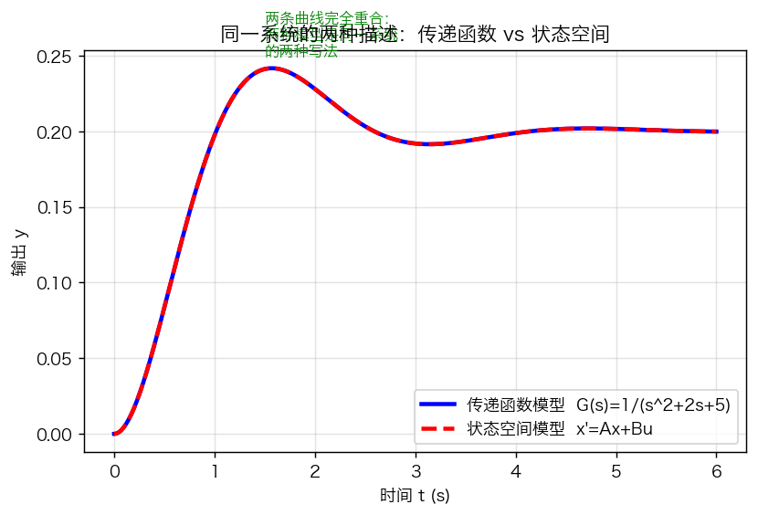
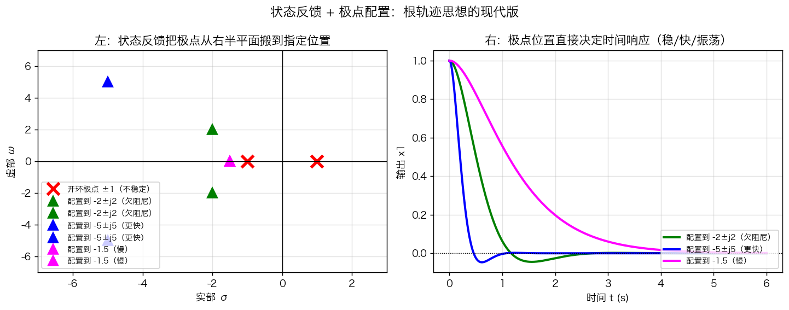
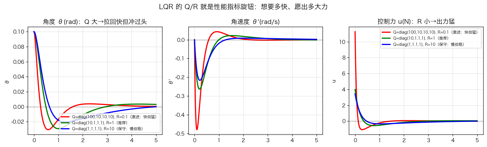
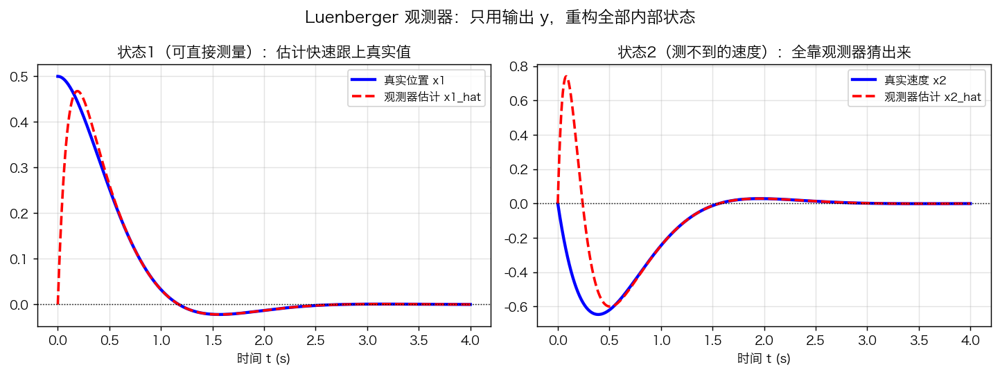

# 第11章 状态空间与现代控制——公式推导

> 本章是全课的"第二座山"，也是通往机器人、自动驾驶、具身智能算法的**必经之路**。
> 经典控制（第3~8章）用**传递函数**描述系统（只看输入输出），本章改用**状态空间**（连内部一起看）。
> 推导主线：状态空间模型 → 方程求解 → 能控能观 → 状态反馈（极点配置）→ LQR → 状态观测器。
> 与经典控制一一对应：**特征值判稳 = Routh/根轨迹的现代版；极点配置 = 根轨迹的推广；LQR = 校正设计的自动化**。

---

**【第一部分：直觉白话版】** 先建立直观，再看作公式。

## 1. 状态空间模型

### 1.1 定义

一个 $n$ 阶系统，用一组一阶微分方程描述**内部状态**：

$$
\boxed{\dot{x}(t) = A x(t) + B u(t), \qquad y(t) = C x(t) + D u(t)}
$$

- $x\in\mathbb{R}^{n}$：状态向量（$n$ 个状态变量，如位置、速度、角度、角速度）；
- $u\in\mathbb{R}^{m}$：输入（控制量，如力、电压）；
- $y\in\mathbb{R}^{p}$：输出（可测量的量）；
- $A(n\times n)$：状态矩阵；$B(n\times m)$：输入矩阵；$C(p\times n)$：输出矩阵；$D(p\times m)$：直接传递矩阵（通常为 0）。

**为什么需要它？** 传递函数 $G(s)$ 只能描述"输入→输出"，且限单输入单输出（SISO）；真实机器人是多输入多输出（MIMO），且必须知道内部状态（如无人机的姿态角）才能控制。
状态空间表达式确实比传递函数抽象一些，因为它从“只关心输入输出”变成了“还要描述系统内部”。下面用尽量直白的方式帮你建立直觉。

---

## 1. 传递函数在做一件什么事？

传递函数：

$$G(s)=\frac{Y(s)}{U(s)}$$

它只告诉你：给定输入 $u(t)$，输出 $y(t)$ 会怎样。就像你在网上订外卖，你只关心“下单 → 外卖送到”，中间的厨房怎么做、骑手怎么走，你并不关心。

经典控制中的传递函数就是这种“黑箱”模型：

$$\text{输入 }u \quad\longrightarrow\quad \boxed{\text{系统}} \quad\longrightarrow\quad \text{输出 }y$$

内部状态一概不管。

这在单输入单输出、系统内部不太复杂时很好用。  
但很多真实系统不够用。

---

## 2. 为什么需要知道“内部”？

以无人机为例：

- 输入 $u$：四个螺旋桨的转速或升力；
- 输出 $y$：我们测量到的高度、位置。

但是，如果只控制输出，可能不够。

比如无人机要稳定悬停，你需要知道：

- 它的姿态角：横滚、俯仰、偏航；
- 角速度；
- 垂直速度；
- 水平速度。

这些量很多不是直接输出，但它们是系统的**内部状态**。如果不知道内部状态，即使位置看起来在正上方，姿态已经倾斜，下一步就可能翻掉。

所以现代控制要建立：

> 输入 $u$ → 内部状态 $x$ 的变化规律 → 状态如何影响输出 $y$

这就是状态空间模型。

---

## 3. 什么是“状态”？

状态 $x(t)$ 是指：

> 在某一时刻，能够完全描述系统运动所需的最少一组变量。

可以把它理解为系统的“记忆”或“能量”的当前分布。

例如单摆：

- 知道角度 $\theta$；
- 知道角速度 $\dot{\theta}$。

有了这两个量，单摆以后怎么运动就完全确定了。  
所以状态可以选为：

$$x_1=\theta,\qquad x_2=\dot{\theta}$$

如果只知道角度，不知道角速度，是无法预测下一秒运动的。  
所以角速度也必须作为状态。

状态就是系统“现在到底怎么样”的完整快照。

---

## 4. 状态方程和输出方程怎么来？

还是用单摆或直流电机等例子。

### 状态方程

$$\dot{x}(t)=Ax(t)+Bu(t)$$

它描述的是：状态变量的变化率 $\dot{x}$ 由什么决定。

- 一部分由当前状态 $x$ 决定，通过 $A$ 矩阵；
- 一部分由外部输入 $u$ 决定，通过 $B$ 矩阵。

例如速度控制直流电机，状态选为：

$$x_1=\omega\quad\text{转速},\qquad x_2=i\quad\text{电流}$$

输入 $u$ 是电压。电机的电压方程和转矩方程联立后，可以整理成：

$$\dot{\omega} = -\frac{b}{J}\omega + \frac{K_t}{J}i$$

$$\dot{i} = -\frac{K_e}{L}\omega - \frac{R}{L}i + \frac{1}{L}u$$

写成矩阵形式：

$$
\begin{bmatrix}
\dot{\omega} \\
\dot{i}
\end{bmatrix}
=
\begin{bmatrix}
-\frac{b}{J} & \frac{K_t}{J} \\
-\frac{K_e}{L} & -\frac{R}{L}
\end{bmatrix}
\begin{bmatrix}
\omega \\
i
\end{bmatrix}
+
\begin{bmatrix}
0 \\
\frac{1}{L}
\end{bmatrix}
u
$$

这就是：

$$\dot{x}=Ax+Bu$$

其中：

$$
A=
\begin{bmatrix}
-\frac{b}{J} & \frac{K_t}{J} \\
-\frac{K_e}{L} & -\frac{R}{L}
\end{bmatrix},
\quad
B=
\begin{bmatrix}
0 \\
\frac{1}{L}
\end{bmatrix}
$$

所以矩阵 $A$ 表示：状态之间如何相互影响，以及它们自身的衰减或增长；  
矩阵 $B$ 表示：输入如何影响各状态的变化率。

---

## 5. 输出方程

$$y(t)=Cx(t)+Du(t)$$

它描述的是：我们实际测量到或关心的输出 $y$，由哪些状态和输入组合而成。

例如直流电机中，我们只测量转速 $\omega$，不测量电流 $i$。那么：

$$y=\omega$$

写成矩阵：

$$
y=
\begin{bmatrix}
1 & 0
\end{bmatrix}
\begin{bmatrix}
\omega \\
i
\end{bmatrix}
+
\begin{bmatrix}
0
\end{bmatrix}
u
$$

所以：

$$
C=
\begin{bmatrix}
1 & 0
\end{bmatrix},
\quad D=0
$$

如果既测量转速又测量电流，则：

$$
y=
\begin{bmatrix}
\omega \\
i
\end{bmatrix}
$$

那么：

$$
C=
\begin{bmatrix}
1 & 0 \\
0 & 1
\end{bmatrix}
$$

---

## 6. 四个矩阵的含义总结

| 矩阵 | 含义 | 作用 |
|---|---|---|
| $A$ | 状态矩阵 | 状态变量之间如何互相影响，决定系统固有特性，如稳定性、振荡频率 |
| $B$ | 输入矩阵 | 控制输入如何影响状态变化 |
| $C$ | 输出矩阵 | 状态如何组合成可测量的输出 |
| $D$ | 直接传递矩阵 | 输入是否直接传到输出，通常为 0 |

可以这样理解：

- $A$：系统“自己怎么变”；
- $B$：输入“推了哪里一把”；
- $C$：我们“能看到什么”；
- $D$：输入“有没有直接漏到输出”。

---

## 7. 为什么传递函数不够用？

### 问题一：单输入单输出限制

传递函数一般只能写：

$$G(s)=\frac{Y(s)}{U(s)}$$

一个输入，一个输出。

但真实系统往往：

- 无人机有四个电机转速输入，多个传感器输出；
- 机器人有多个关节扭矩输入，多个位置、速度输出；
- 化工过程有多个阀门输入，多个温度、压力输出。

这些多输入多输出系统必须用矩阵描述：

$$u\in\mathbb{R}^{m},\qquad y\in\mathbb{R}^{p}$$

状态空间天然支持 MIMO。

### 问题二：不知道内部状态

经典控制只能根据输出误差来调节，而状态空间可以根据内部状态做更优控制。  
例如倒立摆：输出可能只是小车位置，但必须知道摆杆角度和角速度才能稳摆。  
这些内部状态必须建模进去。

### 问题三：初始条件

传递函数通常隐含零初始条件。  
状态空间可以显式处理任意初始状态 $x(0)$，适合分析非零初始状态响应。

### 问题四：时变系统和非线性系统

状态空间形式可以写成：

$$\dot{x}=A(t)x+B(t)u$$

也可以处理非线性：

$$\dot{x}=f(x,u)$$

而传递函数本质上是线性定常系统的工具。

---

## 8. 状态空间与传递函数的关系

对于线性定常系统：

$$\dot{x}=Ax+Bu$$

$$y=Cx+Du$$

可以求出传递函数：

$$G(s)=C(sI-A)^{-1}B+D$$

这说明：

> 状态空间模型比传递函数包含更多信息。  
> 从状态空间可以唯一求出传递函数；  
> 但从传递函数不能唯一还原状态空间，因为可能存在不同的内部状态结构却得到同样的输入输出关系。

这也是经典控制和现代控制的重要区别。

---

## 9. 一个具体小例子

火箭/小车系统：输入 $u$ 是力，状态选为位置 $x$ 和速度 $v$。

运动方程：

$$m\dot{v}=u$$

$$\dot{x}=v$$

输出测量位置 $x$。

列状态方程：

$$
\begin{bmatrix}
\dot{x} \\
\dot{v}
\end{bmatrix}
=
\begin{bmatrix}
0 & 1 \\
0 & 0
\end{bmatrix}
\begin{bmatrix}
x \\
v
\end{bmatrix}
+
\begin{bmatrix}
0 \\
\frac{1}{m}
\end{bmatrix}
u
$$

输出方程：

$$
y=
\begin{bmatrix}
1 & 0
\end{bmatrix}
\begin{bmatrix}
x \\
v
\end{bmatrix}
$$

这里：

- $A$ 表示位置变化由速度决定，速度不受自身影响；
- $B$ 表示力只直接影响速度变化；
- $C$ 表示输出只取位置。

这个模型显然包含内部状态速度 $v$，即使输出只有位置，我们也知道速度是内部状态。

---

## 总结

状态空间表达式：

$$\dot{x}=Ax+Bu,\qquad y=Cx+Du$$

它并不是故意把问题变难，而是因为我们关心：

- 系统内部正在发生什么；
- 多个输入、多个输出如何耦合；
- 任意初始条件；
- 时变或非线性系统。

可以用一句话理解：

> 传递函数是“输入到输出的黑箱”；  
> 状态空间是“输入、内部状态、输出三者关系的完整白箱”。

---

**【第二部分：正式推导版】** 公式主线。

## 1. 状态空间模型（正式推导）

### 1.2 从微分方程 → 状态空间（能控标准型）

已知 $n$ 阶微分方程（输入无导数项）：

$$
y^{(n)} + a_1 y^{(n-1)} + \cdots + a_{n-1}\dot{y} + a_n y = u
$$

取**相变量**（状态 = 输出及其各阶导数）：$x_1=y,\ x_2=\dot y,\ \cdots,\ x_n=y^{(n-1)}$，则：

$$
A = \begin{bmatrix} 0 & 1 & 0 & \cdots & 0 \\ 0 & 0 & 1 & \cdots & 0 \\ \vdots & & & \ddots & \vdots \\ 0 & 0 & 0 & \cdots & 1 \\ -a_n & -a_{n-1} & \cdots & -a_2 & -a_1 \end{bmatrix},\quad
B = \begin{bmatrix} 0 \\ 0 \\ \vdots \\ 0 \\ 1 \end{bmatrix},\quad
C = \begin{bmatrix} 1 & 0 & \cdots & 0 \end{bmatrix}
$$

**关键思路**：把"一个 $n$ 阶方程"改写成"$n$ 个一阶方程"，状态就是输出及其导数——状态空间不引入新物理，只是**换一种记账方式**。

**推导：A/B/C 究竟怎么来的？**
前 $n-1$ 个状态由定义直接给出导数：$\dot x_1=x_2,\ \dot x_2=x_3,\ \cdots,\ \dot x_{n-1}=x_n$，这对应 $A$ 前 $n-1$ 行 $[0\ 1\ 0\cdots0]$ 的"上移位"结构。再把原方程解出最高阶导数：
$$y^{(n)}=u-a_1 y^{(n-1)}-\cdots-a_{n-1}\dot y-a_n y$$
代入状态得 $\dot x_n=-a_n x_1-a_{n-1}x_2-\cdots-a_1 x_n+u$，它对应 $A$ 最后一行 $[-a_n\ -a_{n-1}\ \cdots\ -a_1]$（注意 $a$ 的下标顺序正好反过来、且整体带负号）；$B$ 只有末元素为 1（因 $u$ 只进 $\dot x_n$、系数为 1）；$C=[1\ 0\cdots0]$ 因输出 $y=x_1$。三阶例子：$\dddot y+a_1\ddot y+a_2\dot y+a_3 y=u$ → $A=\begin{bmatrix}0&1&0\\0&0&1\\-a_3&-a_2&-a_1\end{bmatrix},\ B=\begin{bmatrix}0\\0\\1\end{bmatrix},\ C=\begin{bmatrix}1&0&0\end{bmatrix}$。

> **补充：带零点（分子含 $s$ 项）的传递函数怎么写状态空间（对应练习题 2）**——1.2 的能控标准型适用于"输入无导数项"（分子为常数）。若传递函数分子含 $s$ 项，如 $G(s)=\dfrac{b_1 s+b_0}{s^2+a_1 s+a_0}$，则 $A$、$B$ 与 1.2 完全相同，只需把分子系数装进 $C$：
>
> $$
> A=\begin{bmatrix}0&1\\-a_0&-a_1\end{bmatrix},\quad B=\begin{bmatrix}0\\1\end{bmatrix},\quad C=\begin{bmatrix}b_0 & b_1\end{bmatrix}
> $$
>
> 验证：$G(s)=C(sI-A)^{-1}B=\dfrac{b_1 s+b_0}{s^2+a_1 s+a_0}$。练习题 2 中 $G(s)=\dfrac{s+1}{s^2+4s+3}$，故 $A=\begin{bmatrix}0&1\\-3&-4\end{bmatrix}$、$B=[0\ 1]^T$、$C=[1\ 1]$。原理：分子系数决定输出如何由各状态线性组合而成，只改 $C$ 不动 $A$，因此不改变特征方程（分母）。

**补充：实现不唯一（同一方程 → 多种状态空间）**
固定"相变量"选法时 $A,B,C$ 唯一；但状态可作任意可逆线性变换 $z=Tx$，得到
$$A'=TAT^{-1},\qquad B'=TB,\qquad C'=CT^{-1}$$
传递函数不变（输入输出关系不变）。所以同一系统有相变量标准型、能观标准型、对角标准型、约当标准型等多种实现——**状态空间到传递函数是"多对一"**。

**补充：输入系数不是 1 怎么办？**
若方程为 $y^{(n)}+\cdots+a_n y=b_0 u$（$b_0\neq1$），则 $\dot x_n=\cdots+b_0 u$，故 $B$ 末元素为 $b_0$ 而非 1。例：
$$\ddot y+3\dot y+2y=4u$$
取 $x_1=y,\ x_2=\dot y$，则 $\dot x_1=x_2,\ \dot x_2=-2x_1-3x_2+4u$，于是
$$A=\begin{bmatrix}0&1\\-2&-3\end{bmatrix},\quad B=\begin{bmatrix}0\\4\end{bmatrix},\quad C=\begin{bmatrix}1&0\end{bmatrix},\quad D=0$$

**补充：四阶练手例（供 §1.3 对照验证）**
$$y^{(4)}+3y'''+2y''+5y'+7y=u$$
对应 $a_1=3,\ a_2=2,\ a_3=5,\ a_4=7$，故
$$A=\begin{bmatrix}0&1&0&0\\0&0&1&0\\0&0&0&1\\-7&-5&-2&-3\end{bmatrix},\quad B=\begin{bmatrix}0\\0\\0\\1\end{bmatrix},\quad C=\begin{bmatrix}1&0&0&0\end{bmatrix}$$
最后一行即 $[-a_4,-a_3,-a_2,-a_1]$，可直接与上式核对。

### 1.3 从状态空间 → 传递函数

对状态方程两边取拉氏变换（零初始条件）：

$$
sX(s) = AX(s) + BU(s) \ \Rightarrow\ X(s) = (sI - A)^{-1} B U(s)
$$

$$
\boxed{G(s) = \frac{Y(s)}{U(s)} = C\,(sI - A)^{-1} B + D}
$$

**关键思路**：$(sI-A)^{-1}$ 的分母 $\det(sI-A)=0$ 就是**特征方程**——特征值（极点）由 $A$ 完全决定，与控制无关。**A 矩阵 = 传递函数极点的老家**。

**验证（接 §1.2 四阶例）**：对 $A=\begin{bmatrix}0&1&0&0\\0&0&1&0\\0&0&0&1\\-7&-5&-2&-3\end{bmatrix}$，直接计算
$$\det(sI-A)=s^4+3s^3+2s^2+5s+7$$
恰好等于原微分方程 $y^{(4)}+3y'''+2y''+5y'+7y=u$ 的特征多项式。说明状态空间"改写"既不改变极点、也不改变系统本质——只是换了一种记账方式。

### 1.4 实践视角

> **实践视角**：用 `control` 库一行完成互化：`ct.ss(A,B,C,D)` 与 `ct.tf(sys)`。图 11-1 验证了同一系统两种描述输出完全一致。**学会两个方向互化，经典与现代就打通了。**

*图 11-1 弹簧-质量-阻尼系统（$m=1,b=2,k=5$）的阶跃响应：传递函数模型与状态空间模型两条曲线完全重合。它们是同一系统的两种"写法"。*

> **时间视角**：状态 $x$ 本身就是"时间的函数"——$x_1$ 是位置（当前到哪了）、$x_2$ 是速度（现在多快）。状态空间把"时间上的演化规律"写成 $\dot{x}=Ax+Bu$，比传递函数更直白地展示"下一步怎么走"。

---

## 2. 状态方程的求解

### 2.1 拉氏变换法

$$
X(s) = (sI-A)^{-1}x(0) + (sI-A)^{-1}BU(s)
$$

反变换：

$$
x(t) = e^{At}x(0) + \int_0^t e^{A(t-\tau)} B u(\tau)\, d\tau
$$

其中**矩阵指数**：

$$
\boxed{e^{At} = \mathcal{L}^{-1}\left[(sI-A)^{-1}\right] = I + At + \frac{A^2t^2}{2!} + \frac{A^3t^3}{3!} + \cdots}
$$

**关键思路**：矩阵指数 $e^{At}$ 是标量 $e^{at}$ 的推广——它的特征值是 $e^{\lambda_i t}$（$\lambda_i$ 为 $A$ 的特征值）。**因此：所有 $\lambda_i$ 实部 < 0 ⇔ 所有模态 $e^{\lambda_i t}\to 0$ ⇔ 系统稳定。这就是"特征值判稳"**。

**推导：$e^{At}$ 的特征值为什么是 $e^{\lambda_i t}$？**
若 $A$ 可对角化：$A=T\Lambda T^{-1}$（$\Lambda=\operatorname{diag}(\lambda_1,\dots,\lambda_n)$），代入级数定义：
$$e^{At}=I+At+\frac{A^2t^2}{2!}+\cdots=T\left(I+\Lambda t+\frac{\Lambda^2 t^2}{2!}+\cdots\right)T^{-1}=T e^{\Lambda t}T^{-1}$$
其中 $e^{\Lambda t}=\operatorname{diag}(e^{\lambda_1 t},\dots,e^{\lambda_n t})$。故 $e^{At}$ 的特征值正是 $e^{\lambda_i t}$，其模长由 $\operatorname{Re}\lambda_i$ 决定。

**例**：$A=\begin{bmatrix}0&1\\-2&-3\end{bmatrix}$，特征方程 $\det(sI-A)=s^2+3s+2=0$ → 特征根 $\lambda_1=-1,\ \lambda_2=-2$（均实部 $<0$），对应模态 $e^{-t},\ e^{-2t}$ 都趋于 0 → 系统渐近稳定。

### 2.2 与拉普拉斯变换的对照

| 标量一阶（第2章）                                     | 矩阵（本章）                                        |
| --------------------------------------------- | --------------------------------------------- |
| $\dot{x}=ax+bu$                               | $\dot{x}=Ax+Bu$                               |
| $x(t)=e^{at}x(0)+\int e^{a(t-\tau)}bu\,d\tau$ | $x(t)=e^{At}x(0)+\int e^{A(t-\tau)}Bu\,d\tau$ |
| 稳定：$a<0$                                      | 稳定：$\text{Re}\,\lambda_i(A)<0\ \forall i$     |

> **实践视角**：仿真状态方程时，用矩阵指数 $e^{At}$（`scipy.linalg.expm`）比欧拉法更精确；但理解行为只需看特征值——**特征值就是"时间响应"的翻译器**（呼应第2章图 2-2 极点位置决定时间行为）。

---

## 3. 能控性与能观性

### 3.1 能控性（Controllability）

**定义**：能否用有限的控制 $u$，把系统从任意初始状态**驱动到任意目标状态**。

**判据**（能控性矩阵满秩）：

$$
\boxed{Q_c = \begin{bmatrix} B & AB & A^2B & \cdots & A^{n-1}B \end{bmatrix}, \qquad \text{rank}\,Q_c = n}
$$

### 3.2 能观性（Observability）

**定义**：能否从有限时间的输出 $y$，**反推出全部内部状态**。

**判据**（能观性矩阵满秩）：

$$
\boxed{Q_o = \begin{bmatrix} C \\ CA \\ CA^2 \\ \vdots \\ CA^{n-1} \end{bmatrix}, \qquad \text{rank}\,Q_o = n}
$$

### 3.3 直觉与例子

- 能控：小车倒立摆——用力 $u$ 既能推小车又能稳住摆杆 → 能控；若把杆换成"焊死在天花板"，力碰不到它 → 不能控。
- 能观：只能测位置、测不到速度（如只有编码器无陀螺仪）——若能通过位置随时间的变化"推"出速度 → 能观；若状态完全不影响输出 → 不能观。
- **工程意义**：不能控的状态，控制器管不到（白设）；不能观的状态，观测器猜不出（瞎猜）。设计前先查满秩，是机器人/自动驾驶系统设计的"体检"。

> **实践视角**：Python 里就两行：`np.linalg.matrix_rank(np.hstack([B, A@B, ...]))`。**先查能控能观，再谈设计**——这是现代控制与经典控制的本质区别（经典控制从不检查"内部状态"）。

### 3.4 矩阵判据算例 + 对偶原理

**能控性算例**：取 $A=\begin{bmatrix}0&1\\0&0\end{bmatrix}$。

- 若 $B=\begin{bmatrix}0\\1\end{bmatrix}$：

$$Q_c=\begin{bmatrix}B & AB\end{bmatrix}=\begin{bmatrix}0&1\\1&0\end{bmatrix},\qquad \operatorname{rank}Q_c=2=n \ \Rightarrow\ \text{能控}$$

- 若 $B=\begin{bmatrix}1\\0\end{bmatrix}$：

$$AB=\begin{bmatrix}0&1\\0&0\end{bmatrix}\begin{bmatrix}1\\0\end{bmatrix}=\begin{bmatrix}0\\0\end{bmatrix}\ \Rightarrow\ Q_c=\begin{bmatrix}1&0\\0&0\end{bmatrix},\ \operatorname{rank}Q_c=1<2 \ \Rightarrow\ \text{不能控（}x_2\text{不受输入影响）}$$

**能观性算例**：仍取 $A=\begin{bmatrix}0&1\\0&0\end{bmatrix}$。

- 若 $C=\begin{bmatrix}1&0\end{bmatrix}$：

$$Q_o=\begin{bmatrix}C\\CA\end{bmatrix}=\begin{bmatrix}1&0\\0&1\end{bmatrix},\qquad \operatorname{rank}Q_o=2 \ \Rightarrow\ \text{能观}$$

- 若 $C=\begin{bmatrix}0&1\end{bmatrix}$：

$$CA=\begin{bmatrix}0&1\end{bmatrix}\begin{bmatrix}0&1\\0&0\end{bmatrix}=\begin{bmatrix}0&0\end{bmatrix}\ \Rightarrow\ \operatorname{rank}Q_o=1<2 \ \Rightarrow\ \text{不能观（}x_1\text{被隐藏）}$$

**对偶原理**：原系统 $(A,C)$ 能观 $\Leftrightarrow$ 对偶系统 $(A^T,C^T)$ 能控，因为 $Q_o^T(A,C)=Q_c(A^T,C^T)$（能观矩阵转置后即对偶系统的能控矩阵）。这也解释了 §6.3 的"观测器设计 = 对 $(A^T,C^T)$ 做极点配置"。

---

## 4. 状态反馈与极点配置

### 4.1 状态反馈

控制律 $u = -Kx + r$（$r$ 为参考输入），代入状态方程：

$$
\dot{x} = (A - BK)x + Br
$$

**极点由 $A-BK$ 的特征值决定**——通过选 $K$，把极点（特征值）放到想要的位置。

### 4.2 极点配置：解 K

期望极点为 $p_1,\cdots,p_n$，期望特征多项式：

$$
\alpha(s) = \prod_{i=1}^{n}(s - p_i) = s^n + \alpha_{n-1}s^{n-1} + \cdots + \alpha_1 s + \alpha_0
$$

对能控标准型，$K$ 可直接读出（系数对齐法）：

$$
K = \begin{bmatrix} \alpha_0 - a_n & \alpha_1 - a_{n-1} & \cdots & \alpha_{n-1} - a_1 \end{bmatrix}
$$

一般情形用 **Ackermann 公式**：

$$
\boxed{K = \begin{bmatrix}0 & \cdots & 0 & 1\end{bmatrix} Q_c^{-1}\, \alpha(A)}
$$

其中 $\alpha(A) = A^n + \alpha_{n-1}A^{n-1} + \cdots + \alpha_0 I$。

**前提**：$(A,B)$ 能控——否则有些极点放不动（这正是能控性判据存在的意义）。

### 4.3 与根轨迹的对话（关键！）

| 根轨迹（第6章） | 极点配置（本章） |
|---|---|
| 问：$K$ 变，极点往哪走？ | 问：$K$ 取多少，极点到目标？ |
| 只调一个增益 $K$ | 自由配置 $n$ 个极点（更灵活） |
| 几何法（画图） | 代数法（解方程） |
| 本质：$\det(sI-A+BK)=0$ 随 $K$ 变化 | 本质：直接令 $\det(sI-A+BK)=\alpha(s)$ |

**一句话**：根轨迹是"反过来问"，极点配置是"正着做"。

*图 11-2 开环不稳定系统 $\ddot{x}=x$（极点 $\pm1$）经状态反馈：左图为极点从右半平面"搬到"指定位置；右图对应时间响应——极点越靠左越快，带虚部则振荡。*

> **时间视角**：极点位置 = 时间响应的"剧本"。配置到 $-1.5$（实根）→ 单调慢收敛；配置到 $-2\pm j2$ → 衰减振荡；配置到 $-5\pm j5$ → 又快又小幅超调。**选期望极点就是设计你想要的时间曲线**（呼应第5章二阶性能指标）。

---

## 5. LQR：最优的极点配置

### 5.1 问题提法

状态反馈 $u=-Kx$ 中，$K$ 如何选才"最优"？定义**二次型性能指标**：

$$
\boxed{J = \int_0^{\infty} \left( x^T Q x + u^T R u \right) dt}
$$

- $Q\succeq 0$：状态惩罚（偏差大 → 罚得重），$Q$ 大 = 想快点拉回；
- $R \succ 0$：控制惩罚（出力大 → 罚得重），$R$ 大 = 想省力。

**物理意义**：在"拉回快"与"出力小"之间找帕累托最优——这就是**性能指标的最优化**（校正设计第8章的"自动化"）。

### 5.2 推导：最优 K = Riccati 方程的解

设 $u=-Kx$，闭环 $\dot{x}=(A-BK)x$，指标 $J = \int_0^\infty x^T(Q+K^TRK)x\,dt$。

假定存在常数阵 $P=P^T\succeq0$ 使 $x^T P x$ 沿闭环轨迹的导数为 $-x^T(Q+K^TRK)x$：

$$
\frac{d}{dt}(x^TPx) = x^T\left[(A-BK)^TP + P(A-BK)\right]x = -x^T(Q+K^TRK)x
$$

即：

$$
(A-BK)^TP + P(A-BK) = -(Q + K^TRK)
$$

对 $K$ 求极值（配平方）可得最优：

$$
\boxed{K = R^{-1}B^T P, \qquad A^T P + PA - PBR^{-1}B^TP + Q = 0 \ (\text{代数Riccati方程})}
$$

P 是唯一正定解（$A,B$ 能控、$Q$ 半正定、$R$ 正定时）。

**关键思路**：LQR 是"极点配置 + 最优"——极点配置是"我要这个性能"，LQR 是"在代价最小前提下自动得到最优性能"。**LQR 找到的极点位置，自动落在稳定区内最优折中处**。

### 5.3 Q、R 的工程选取（Bryson 规则）

$$
Q = \text{diag}\left(\frac{1}{x_{1,\max}^2}, \cdots, \frac{1}{x_{n,\max}^2}\right), \qquad R = \frac{1}{u_{\max}^2}
$$

把"可接受的最大状态偏差"和"最大可用控制力"的平方倒数当权重——**让不同量纲的状态（角度/位置/速度）在同一个代价函数里可比**。

*图 11-3 倒立摆 LQR：三组 Q/R 的对比。Q 大/R 小（红）→ 拉回快但用力猛、冲过头；Q 小/R 大（蓝）→ 省力但收敛慢；中间（绿）→ 折中。*

> **时间视角**：Q/R 就是"时间性能旋钮"——想要**更快的响应**（短 $t_s$）就加大 Q 或减小 R；想要**更平稳的曲线**（小超调、小控制量）就加大 R。图 11-3 的三条 θ 曲线，正是三套"时间期望"的直接体现。

> **实践视角**：调 LQR 比调极点配置更"物理"——不用想极点放哪，只要回答两个问题：**状态最大能偏多少？控制力最大能出多少？** 这正对应工程上的"性能指标"与"执行器极限"。

---

## 6. 状态观测器与分离定理

### 6.1 问题：状态测不到怎么办

很多内部状态（速度、角速度）没有传感器直接测量。**观测器**：用"模型 + 输出"重构状态。

### 6.2 Luenberger 观测器

$$
\boxed{\dot{\hat{x}} = A\hat{x} + Bu + L\,(y - C\hat{x})}
$$

第三项是**输出误差修正项**：估计输出 $\hat{y}=C\hat{x}$ 与真实输出 $y$ 之差，乘以增益 $L$，把估计"拉向"真实。

### 6.3 误差动力学

令估计误差 $e = x - \hat{x}$：

$$
\dot{e} = (A - LC)\,e
$$

**观测器极点 = $A-LC$ 的特征值**，配置 $L$ 使其快速衰减（通常比控制器快 3~10 倍）。观测器设计 = 对 $(A^T, C^T)$ 做极点配置（**对偶原理**）。

### 6.4 分离定理（全章最重要的结论之一）

控制器用 $u=-K\hat{x}$（估计状态代替真实状态），闭环系统特征多项式：

$$
\det(sI - (A-BK)) \cdot \det(sI - (A-LC)) = 0
$$

$$
\boxed{\text{闭环极点} = \text{控制器极点}(A-BK) \cup \text{观测器极点}(A-LC)}
$$

**控制器与观测器可以独立设计、互不影响**——这就是分离定理。实际工程里"先设计 K，再设计 L"，各配各的。

*图 11-4 只能测量位置 $x_1$（左），观测器"猜"出测不到的速度 $x_2$（右），且随真实值收敛。两者都随时间追踪真实状态。*

> **实践视角**：真实机器人（如无人机）里，陀螺仪测角速度、编码器测位置，但有些状态就是测不到——**卡尔曼滤波就是带噪声的观测器**（LQG 理论）。学懂 Luenberger 观测器，卡尔曼滤波就只剩"加噪声统计"这一步。具身智能里"状态估计"这一层，就是观测器思想的现代形态。

---

## 总结表

| 内容 | 公式/判据 | 与经典控制的对应 |
|------|-----------|------------------|
| 状态空间模型 | $\dot{x}=Ax+Bu,\ y=Cx+Du$ | 传递函数的"内部版" |
| 传递函数 | $G(s)=C(sI-A)^{-1}B+D$ | $\det(sI-A)=0$ = 特征方程 |
| 稳定性 | $\text{Re}\,\lambda_i(A)<0$ | Routh / 根轨迹 / Nyquist 的现代版 |
| 能控性 | $\text{rank}[B\ AB\ \cdots\ A^{n-1}B]=n$ | 经典控制从不检查（新能力） |
| 能观性 | $\text{rank}[C;\ CA;\ \cdots;\ CA^{n-1}]=n$ | 能否"看穿"内部状态 |
| 状态反馈 | $u=-Kx$，闭环 $A-BK$ | 反馈校正的推广 |
| 极点配置 | Ackermann：$K=e_n^TQ_c^{-1}\alpha(A)$ | 根轨迹的"反问题" |
| LQR | $A^TP+PA-PBR^{-1}B^TP+Q=0,\ K=R^{-1}B^TP$ | 校正设计的自动化 |
| 观测器 | $\dot{\hat{x}}=A\hat{x}+Bu+L(y-C\hat{x})$ | 对偶原理：$(A^T,C^T)$ 极点配置 |
| 分离定理 | 闭环极点 = 控制器∪观测器 | 设计与估计解耦 |
