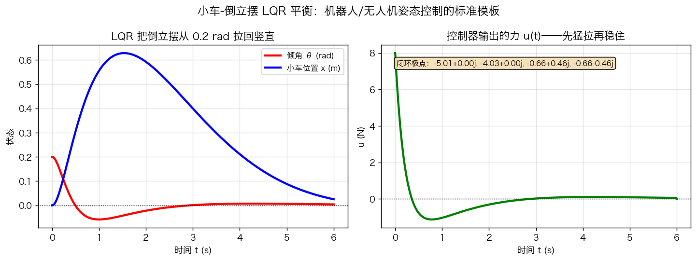

# 第11章 状态空间与现代控制——仿真与绘图

> 本章仿真全用 Python `control` 库 + `numpy`。所有代码在 `第11章绘图.py` 中，可直接运行。
> 环境：`pip install control numpy scipy matplotlib`（可选的 `pybullet` 见第13章）。

---

## 图1 传递函数 vs 状态空间：同一系统的两种"写法"

### 代码核心

```python
import numpy as np
import control as ct
from scipy import signal as sp_sig

m, b, k = 1.0, 2.0, 5.0
A = np.array([[0, 1], [-k/m, -b/m]])
B = np.array([[0], [1/m]])
C = np.array([[1.0, 0.0]])
D = np.array([[0.0]])

t = np.linspace(0, 6, 600)
_, y_tf = sp_sig.step(([1.0], [m, b, k]), T=t)   # 传递函数模型
_, y_ss = sp_sig.step((A, B, C, D), T=t)         # 状态空间模型
# 两条曲线完全重合
```

### 现象解释

- 传递函数：$G(s)=\dfrac{1}{s^2+2s+5}$——只看"输入→输出"；
- 状态空间：$A=\begin{bmatrix}0&1\\-5&-2\end{bmatrix}$——还知道内部状态 $[y,\dot y]$；
- 两条阶跃响应曲线**完全重合**：模型只是描述方式不同，系统没变。


*图 11-1 同一弹簧-质量-阻尼系统：传递函数模型与状态空间模型的阶跃响应完全重合——模型换了，系统没换。*

### 思考题

1. 若把状态变量改为 $x_1=2y,\ x_2=2\dot y$，$A,B,C$ 会怎么变？传递函数变吗？（答案：传递函数不变，状态变量只是"换坐标系"。）

---

## 图2 极点配置：从"看极点"到"放极点"

### 代码核心

```python
A = np.array([[0, 1], [1, 0]])    # 开环 x''=x，极点 ±1（不稳定）
B = np.array([[0], [1.0]])

K = ct.acker(A, B, [-2 + 2j, -2 - 2j])   # 期望极点 -2±j2
print("K =", K)                            # → [9 4]
print("闭环极点:", np.linalg.eigvals(A - B @ K))  # → -2±2j
```

### 现象解释

- 开环极点 $\pm1$ 在右半平面 → 系统不稳定（时间响应发散）；
- 状态反馈把极点"搬"到左半平面指定位置 → 时间响应按极点剧本收敛；
- 三种期望极点 → 三种时间性格：实根（单调慢）、复根（衰减振荡）、更远复根（又快又稳）。


*图 11-2 开环不稳定系统（极点 ±1）经状态反馈稳定化：左图极点位置，右图时间响应。*

### 思考题

2. 用 `ct.root_locus(ct.ss(A,B,C,D))` 画开环根轨迹，再对比极点配置，说说两者"谁问谁答"。

---

## 图3 LQR：Q/R 就是"性能指标旋钮"

### 代码核心

```python
# 小车-倒立摆线性化模型（建模见下）
Q = np.diag([10, 1, 1, 1]);  R = np.array([[1.0]])
K, S, E = ct.lqr(A_pend, B_pend, Q, R)     # 一行求解！
```

### 现象解释

| Q/R | θ 曲线性格 | 控制量 u |
|---|---|---|
| Q 大、R 小 | 拉回快、冲过头 | 猛（峰值大） |
| 折中 | 又快又稳 | 适中 |
| Q 小、R 大 | 慢、稳 | 温柔 |

**工程读图**：R 太小 = 追求"快"到接近执行器极限（红色 u 峰值可能是绿色的几倍）——这就是"执行器饱和"风险。


*图 11-3 同一倒立摆，三组 Q/R 三种"性格"：红=激进（快而猛）、蓝=保守（稳而慢）、绿=折中。*

### 思考题

3. 把 R 改成 0.0001 试试：u 峰值多大？系统还能稳定吗？（答案：能稳定但 u 巨大，工程上必然饱和失效——这为第12章抗饱和、第14章 MPC 埋下伏笔。）

---

## 图4 状态观测器：测不到的状态"猜"出来

### 代码核心

```python
# 观测器设计 = 对 (A.T, C.T) 做极点配置（对偶原理）
L = ct.place(A.T, C.T, [-6, -7]).T        # 观测器极点比控制器快 3~5 倍
# 误差动力学: e' = (A - L@C) e   →  快速收敛
```

### 现象解释

- 只能测量位置 $x_1$（左图蓝色）；
- 观测器"猜"出速度 $x_2$（右图红色虚线），很快贴住真实值；
- 分离定理：即使控制器用的是估计状态 $\hat x$，闭环极点仍是"控制器极点 + 观测器极点"，互不干扰。


*图 11-4 只能测位置 $x_1$（左图蓝色），观测器同时"猜"出速度 $x_2$（右图红色虚线）并快速收敛到真实值。*

### 思考题

4. 若把观测器极点放到 $[-1,-2]$（比控制器慢），估计收敛会怎样？对闭环性能有何影响？（提示：观测误差没收敛前，反馈用的是"错误的状态"。）

---

## 图5 倒立摆 LQR 平衡（大项目第1站）

### 建模（呼应第3章线性化）

小车-倒立摆（$M$ 小车质量，$m$ 摆杆质量，$l$ 摆杆半长，$\theta$ 相对竖直的倾角），平衡点 $\theta=0$ 处 $\sin\theta\approx\theta$ 线性化，得 4 状态方程 $\dot x = Ax+Bu$：

```python
M, m, l, g = 1.0, 0.5, 0.5, 9.81
J = m * l**2 / 3.0
Dm = (M + m) * (J + m*l**2) - (m*l)**2
A = np.array([
    [0, 1, 0, 0],
    [m*l*g*(M+m)/Dm, 0, 0, 0],
    [0, 0, 0, 1],
    [-m**2*l**2*g/Dm, 0, 0, 0]])
B = np.array([[0], [-m*l/Dm], [0], [(J + m*l**2)/Dm]])

K, S, E = ct.lqr(A, B, np.diag([10, 1, 1, 1]), np.array([[1.0]]))
```

### 现象解释

- 初始倾角 0.2 rad（约 11.5°），LQR 把它拉回竖直并稳住小车位置；
- 控制力"先猛拉一下、再稳住"——这就是"先快后稳"的最优策略；
- 闭环极点全在左半平面，响应为快速衰减的轻微振荡。



*图 11-5 小车-倒立摆 LQR 平衡：初始倾角 0.2 rad，LQR 把它拉回竖直并稳住小车位置。*

### 动手任务（必做）

1. 分别改大 Q 的角度权重（如 1000）和改小 R（如 0.01），对比 θ、u 曲线；
2. 尝试极点配置：把闭环极点设成 LQR 的结果，验证 $K$ 与 `ct.lqr` 一致；
3. 把初始倾角改到 0.6 rad（约 34°）：LQR 还稳得住吗？为什么？（提示：线性化失效，超出小偏差范围。）

---

## 完整运行

```bash
cd "第11章-状态空间与现代控制"
python3 第11章绘图.py
```

输出 5 张图到 `figures/`。全部代码可在此基础上改参数、做实验。
