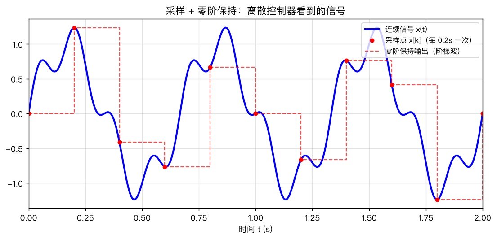
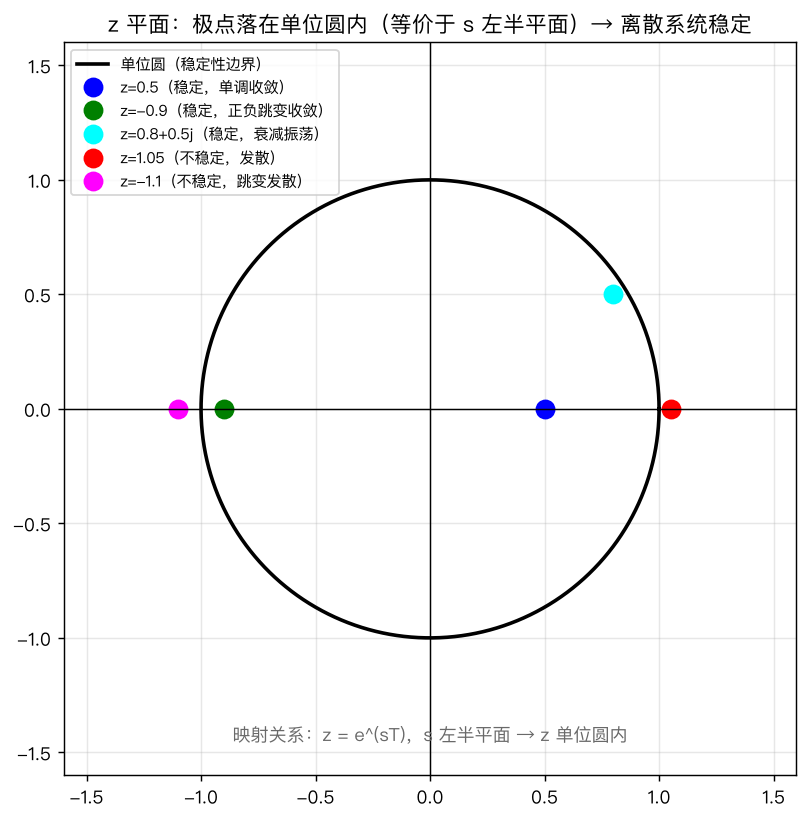
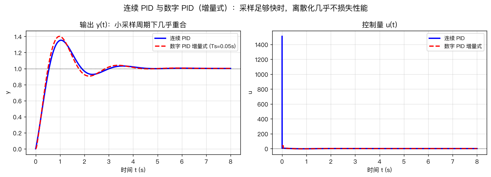
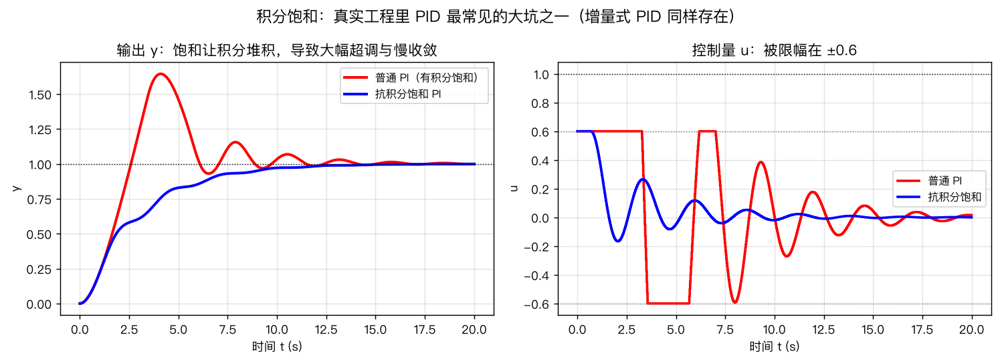
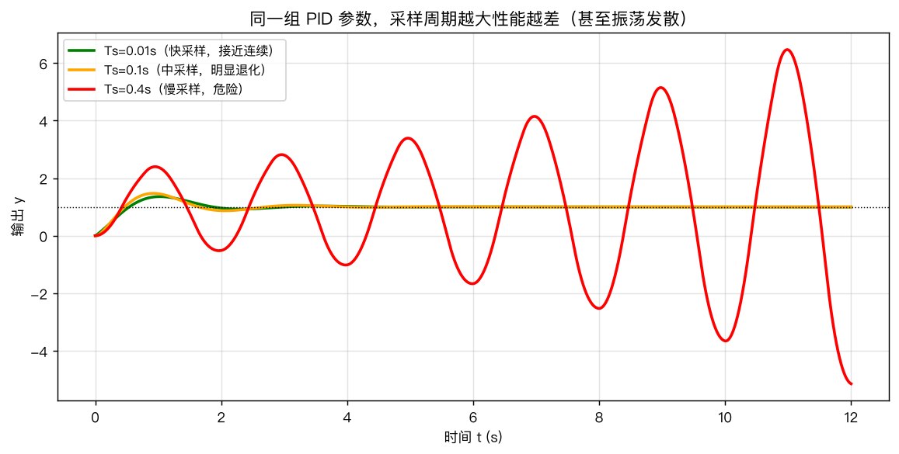

# 第12章 离散控制与数字实现——仿真与绘图

> 本章仿真纯用 `numpy` + `matplotlib`，**手写数字 PID**，不需要额外库——这本身就是"数字实现"的最好练习。
> 所有代码在 `第12章绘图.py` 中，可直接运行。
> 环境：`pip install numpy matplotlib`（如需离散化工具再加 `control`）。

---

## 图1 采样与零阶保持：数字控制器眼里的世界

### 代码核心

```python
import numpy as np

tc = np.linspace(0, 2, 800)
yc = np.sin(2*np.pi*1.5*tc) + 0.3*np.sin(2*np.pi*6*tc)  # 连续信号（含高频成分）

Ts = 0.2                                   # 采样周期 0.2s
tk = np.arange(0, 2.0, Ts)                 # 采样时刻
yk = np.sin(2*np.pi*1.5*tk) + 0.3*np.sin(2*np.pi*6*tk)

plt.plot(tc, yc, label="连续信号 x(t)")
plt.plot(tk, yk, "r.", label="采样点 x[k]")
plt.step(tk, yk, "r--", where="post", label="零阶保持输出")
```

### 现象解释

- 蓝色曲线是真实物理信号，芯片**永远看不到**；
- 芯片只在红点处"看一眼"（采样），然后让输出保持到下一拍（零阶保持 = 阶梯波）；
- 阶梯波是控制对象的**真实输入**——电机、舵机拿到的都是这种"台阶电压"，不是光滑曲线。



*图 12-1 连续信号 → 采样点 → 零阶保持阶梯波。数字控制器只能看到“每 T 秒一个点”，其余时间它“假装”信号保持不变。*
### 思考题

1. 把 `Ts` 从 0.2 改到 0.5，阶梯波和连续信号差多少？把高频成分 6Hz 去掉再试——为什么高频信号"消失"了？（答案：采样定理 $f_s>2f_{max}$，6Hz 分量在 0.5s 采样下被混叠成了低频假信号。）

---

## 图2 z 平面：离散系统的"地盘"

### 代码核心

```python
th = np.linspace(0, 2*np.pi, 400)
plt.plot(np.cos(th), np.sin(th), "k-")     # 单位圆 = 稳定性边界

poles = [0.5, -0.9, 0.8+0.5j, 1.05, -1.1]  # 圆内×3，圆外×2
for p in poles:
    plt.plot(p.real, p.imag, "o")
```

### 现象解释

| 极点位置 | 时间响应性格 |
|---|---|
| $z=0.5$（圆内正实轴） | 单调指数收敛 |
| $z=-0.9$（圆内负实轴） | 正负跳变、幅度收敛 |
| $z=0.8\pm0.5j$（圆内复平面） | 衰减振荡 |
| $z=1.05$（圆外） | 发散 |
| $z=-1.1$（圆外） | 正负跳变、幅度放大 |

**与第5章"极点决定响应"完全平行**：连续看 $s$ 平面左半，离散看单位圆内。一条公式 $z=e^{sT}$ 把它们缝起来。



*图 12-2 z 平面极点位置与时间行为：圆内收敛（正实根单调、负实根跳变、复根振荡），圆外发散。*
### 思考题

2. 对固定采样周期 $T$，s 平面虚轴上频率为 $\omega$ 的极点 $s=j\omega$ 映射到 z 的哪里？（答案：$z=e^{j\omega T}$，在单位圆上转，频率越高转得越快——这就是离散系统频率响应的来源。）
3. 用 $z=e^{sT}$ 解释：为什么采样周期越大，同一个连续极点对应的 z 极点越"靠外"？（提示：$|e^{\sigma T}|$ 随 $T$ 增大。）

---

## 图3 连续 PID vs 数字 PID：采样够快就几乎一样

### 代码核心

```python
Kp, Ki, Kd = 8.0, 3.0, 1.5
t1, yc, _ = run_continuous_pid(Kp, Ki, Kd, 1.0, t_end=8.0)          # 连续版
t2, yd, _ = run_digital_pid(Kp, Ki, Kd, 1.0, t_end=8.0, Ts=0.05)    # 数字版

# 对象：G(s) = 1/(s^2+s)，状态 [y, dy]
def plant_dynamics(x, u):
    y, dy = x
    return np.array([dy, -dy + u])
```

两个函数唯一的区别：数字版只在 `tt >= next_sample` 时算一次控制器（采样），其余时间把上一次的 `u` 原样输出（零阶保持）。

### 现象解释

- 采样 $T_s=0.05$s（控制频率 20Hz）时，两条曲线**几乎重合**——离散化没损失；
- 这印证了工程结论：**采样足够快时，连续设计 + 离散实现 = 无缝衔接**。



*图 12-3 同一对象（$G=1/(s^2+s)$）同一组 PID 参数：采样周期 $T_s=0.05$s 时数字 PID 与连续 PID 几乎重合。采样足够快，离散化损失可忽略。*
### 思考题

4. 把 `Ts` 改成 0.3、0.5，数字 PID 还能跟上吗？什么时候开始振荡？（答案：见图5，采样变慢后相位滞后加大，先退化后振荡。）

---

## 图4 积分饱和：工程第一大坑，一张图看懂

### 代码核心

```python
sat = 0.6                                    # 执行器限幅 ±0.6
# 普通 PI：饱和了还继续累积积分
t3, y_wind, _ = run_digital_pid(6.0, 2.0, 0.0, 1.0, t_end=20.0, Ts=0.02,
                                sat=sat, anti_windup=False)
# 抗积分饱和（条件积分）：饱和时冻结积分
t4, y_anti, _ = run_digital_pid(6.0, 2.0, 0.0, 1.0, t_end=20.0, Ts=0.02,
                                sat=sat, anti_windup=True)

# 抗饱和的关键 3 行：
# u_calc = Kp*e + Ki*integ
# u = clip(u_calc, -sat, sat)
# if u == u_calc:  integ += e*Ts      # 没饱和才累积
```

### 现象解释

- **普通 PI（红色）**：误差大时 u 顶死在 0.6，但积分仍在涨 → 误差反转后积分拖着 u 继续饱和 → 大幅超调 + 迟迟不收敛；
- **抗饱和 PI（蓝色）**：饱和时冻结积分，误差一反转 u 立刻退出饱和 → 干净利落收敛；
- 这是真实工程里 PID 最常见的坑：**凡是有执行器限幅的系统（油门、电机、舵机），抗饱和是标配，不是可选项**。



*图 12-4 饱和限幅 $\pm0.6$ 下：普通 PI 因积分堆积出现大幅超调、长时间收不拢；抗积分饱和 PI 快速恢复。*
### 思考题

5. 为什么说"增量式 PID 天然抗饱和"？（答案：增量式输出的是 $\Delta u$，限幅直接对 $u[k]=u[k-1]+\Delta u$ 做，积分状态就是 $u$ 本身，不会"积到饱和区外"。）
6. 条件积分（本图方法）和"反算积分法"（back-calculation）思路有何不同？（提示：一个冻结积分，一个把积分拉回饱和边界。）

---

## 图5 采样周期：控制回路的"反应速度"

### 代码核心

```python
for name, Ts in {"Ts=0.01s（快）": 0.01, "Ts=0.1s（中）": 0.1, "Ts=0.4s（慢）": 0.4}.items():
    t5, y5, _ = run_digital_pid(8.0, 3.0, 1.5, 1.0, t_end=12.0, Ts=Ts)
    plt.plot(t5, y5, label=name)
```

**同一组 PID 参数**，只改采样周期。

### 现象解释

- $T_s=0.01$s：平滑，接近连续；
- $T_s=0.1$s：明显退化（超调、振荡尾巴）；
- $T_s=0.4$s：接近发散——**不是参数错了，是采样太慢**。

**机理**：采样周期就是控制回路的"反应时间"。采样越慢，控制动作越滞后（相当于在连续系统里加了一个大延迟环节 $e^{-\tau s}$），相位裕度被吃掉，系统先振荡后失稳——这正是第7章"延迟杀稳定裕度"结论的离散版。



*图 12-5 同一 PID 参数三种采样周期：$T_s=0.01$s 接近连续；$T_s=0.1$s 明显退化；$T_s=0.4$s 振荡。采样太慢，好控制器也救不回来。*
### 思考题

7. 图5用的是 $G(s)=1/(s^2+s)$，系统带宽约多少？$T_s=0.4$s 对应控制频率 2.5Hz，大概是多少倍带宽？（提示：$s^2+s=s(s+1)$，极点 0 和 -1，带宽约 1 rad/s，控制频率 2.5Hz≈15.7 rad/s，约 15 倍——看似达标却仍振荡，说明图5的 PID 参数在相位上吃得很紧，也说明"5~20 倍"是下界，宁大勿小。）
8. 采样周期能无限小吗？为什么？（答案：CPU 算不过来、传感器噪声敏感、微分项 $K_d(e[k]-e[k-1])/T_s$ 会被噪声放大——所以是"取合适，不取最小"。）

---

## 动手实验（建议全部亲手做一遍）

> 光看曲线不算懂，**亲手改参数、亲手写代码**才算。每个实验 5 分钟内可完成。

### 实验A：手写增量式 PID（工程首选写法）

改 `run_digital_pid` 为增量式实现，用相同的对象和参数跑一遍：

```python
def run_incremental_pid(Kp, Ki, Kd, r, t_end=10.0, Ts=0.05, dt=0.001, sat=None):
    t = np.arange(0, t_end, dt)
    x = np.array([0.0, 0.0])
    u = 0.0; e_prev = 0.0; e_prev2 = 0.0
    ys, us = [], []
    next_sample = 0.0
    for tt in t:
        if tt >= next_sample:
            e = r - x[0]
            du = Kp*(e - e_prev) + Ki*Ts*e + Kd*(e - 2*e_prev + e_prev2)/Ts
            u = u + du
            if sat is not None:
                u = np.clip(u, -sat, sat)
            e_prev2, e_prev = e_prev, e
            next_sample += Ts
        x = x + dt * plant_dynamics(x, u)
        ys.append(x[0]); us.append(u)
    return t, np.array(ys), np.array(us)
```

对比增量式与位置式输出曲线：应当几乎一致（小采样下）。再验证：**增量式在限幅下不会出现图4的积分饱和**。

### 实验B：采样周期扫描

写个循环，让 `Ts` 从 0.01 到 1.0 取 20 个值，记录每种采样的调节时间 $t_s$（如 2% 误差带），画"$t_s$ vs $T_s$"曲线——你会看到一条先平缓后断崖的曲线，找到断崖位置，那正是系统的"采样极限"。

### 实验C：抗饱和三件套对比

对同一对象实现三种抗饱和：条件积分（本脚本）、反算积分（back-calculation）、增量式。三者曲线应几乎重合——验证"条条大路通罗马"，工程上选实现最简单的。

### 实验D：`control.c2d` 验证（可选，需装 control）

```python
import control as ct
G = ct.tf([1], [1, 1, 0])                       # 连续 G(s)=1/(s^2+s)
Gd = ct.c2d(G, 0.05, method="zoh")              # 零阶保持离散化
print(Gd)
```

观察离散传递函数的极点，验证"连续极点 → z 极点"的映射关系，并用 `Gd` 直接做仿真与手写 PID 对照。

---

## 完整运行

```bash
cd "第12章-离散控制与数字实现"
python3 第12章绘图.py
```

输出 5 张图到 `figures/`。全部代码可在此基础上改参数、做实验。

---

## 本章仿真要回答的三个核心问题

1. **芯片怎么做控制？** —— 采样 → 算一次 → 保持，循环往复（图1）；
2. **离散和连续差多少？** —— 采样够快就一样（图3），采样太慢就崩（图5）；
3. **工程里的坑在哪？** —— 积分饱和（图4）、采样周期选择（图5），一个是"写代码的坑"，一个是"定周期的坑"。
