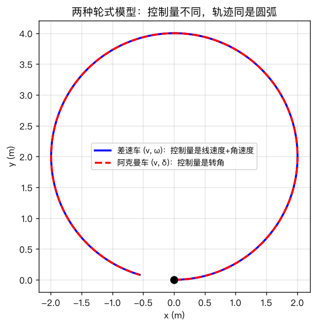
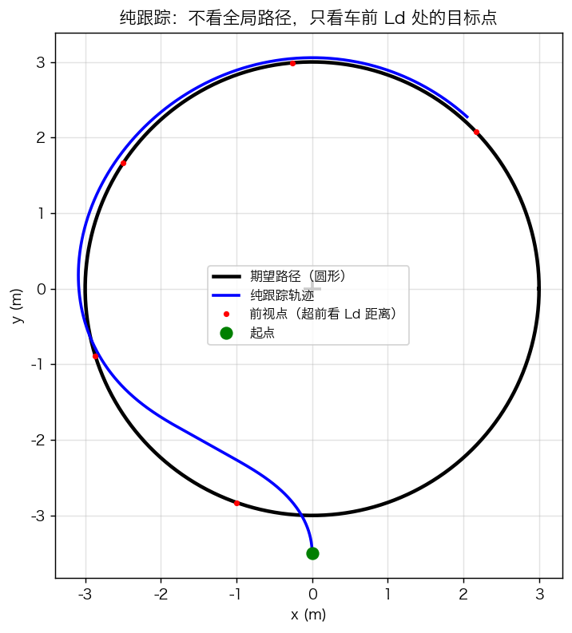
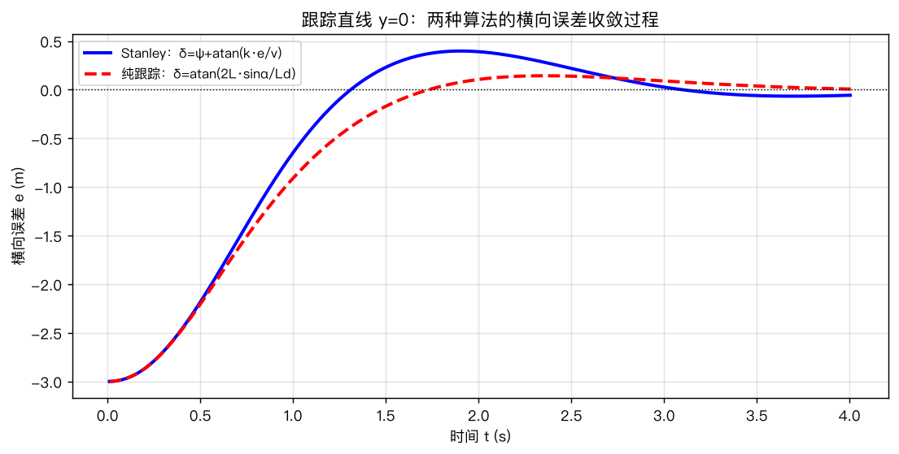
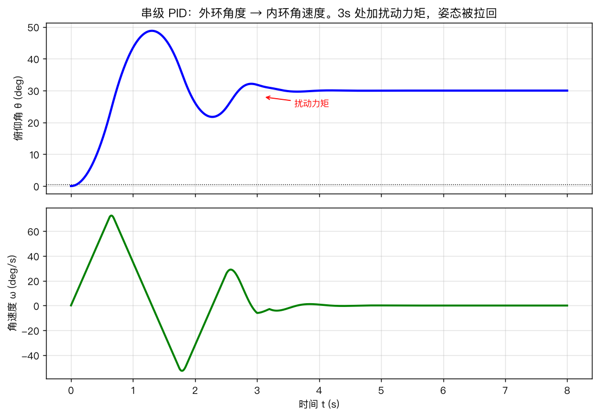
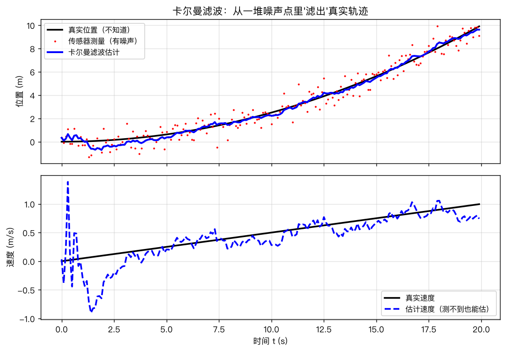

# 第13章 机器人/自动驾驶专题——仿真与绘图

> 本章仿真分两层：
> 1. **纯 Python 层**（本脚本 `第13章绘图.py`）：运动学、纯跟踪、Stanley、串级 PID、卡尔曼滤波——**不依赖任何第三方库**，numpy 即可；
> 2. **PyBullet 物理层**（见附录）：真实重力/碰撞/摩擦环境，跑倒立摆与小车——**可选但强烈推荐**。
> 先跑熟第一层，再进第二层。

---

## 图1 差速车 vs 阿克曼车运动学

### 代码核心

```python
# 差速车：状态 (x,y,θ)，输入 (v, ω)
def step_differential(state, v, w, dt):
    x, y, th = state
    return np.array([x + v*np.cos(th)*dt, y + v*np.sin(th)*dt, th + w*dt])

# 阿克曼车：输入 (v, δ)，轴距 L
def step_ackermann(state, v, delta, L, dt):
    x, y, th = state
    w = v*np.tan(delta)/L
    return np.array([x + v*np.cos(th)*dt, y + v*np.sin(th)*dt, th + w*dt])
```

### 现象解释

- 同样取 $\omega=0.5$（差速直接给，阿克曼靠 $\delta=\arctan(\omega L/v)$ 反推），两车都走半径 $R=v/\omega=2$m 的圆弧；
- 轨迹几乎重合——**模型不同，但"输入→行为"等价**，这就是运动学建模的价值。



*图 13-1 同样走圆弧：差速车靠 ω，阿克曼车靠 δ。控制量不同，但“输入→轨迹”的关系一目了然。*
### 思考题

1. 若阿克曼车 $\delta$ 取 45°，转弯半径是多少？差速车要跟它走一样的圆，$\omega$ 应取多少？（答案：$R=L=2$m，$\omega=v/2=0.5$。）

---

## 图2 纯跟踪（Pure Pursuit）跟踪圆形路径

### 代码核心

```python
def pure_pursuit_differential(state, path_fn, v, Ld, dt, w_max=1.5):
    x, y, th = state
    px, py = path_fn(np.linspace(-np.pi, np.pi, 2000))   # 稠密采样路径
    d = np.hypot(px - x, py - y)
    cand = np.where(np.abs(d - Ld) < 0.3)[0]             # 距车 ≈ Ld 的候选点
    # 选与车头航向最一致的点，避免闭合路径"前后两个点"歧义
    ang = np.arctan2(py[cand] - y, px[cand] - x)
    dth = np.abs(np.angle(np.exp(1j*(ang - th))))
    tx, ty = px[cand[np.argmin(dth)]], py[cand[np.argmin(dth)]]
    alpha = np.arctan2(ty - y, tx - x) - th              # 车头与前视点夹角
    alpha = np.arctan2(np.sin(alpha), np.cos(alpha))
    w = np.clip(2.0*v*np.sin(alpha)/Ld, -w_max, w_max)   # 纯跟踪核心公式
    return step_differential(state, v, w, dt), (tx, ty), alpha
```

### 现象解释

- 车从圆外下方出发，先"瞄"远处的前视点，走出平滑的进入弧，随后贴在圆上；
- 红点（前视点）始终在车前 $L_d=1.5$m 处——**控制器永远只看这一点，不看整条路**。



*图 13-2 红色点为前视点。车不看整条路，只看“前方 Ld 处的那个点”，然后转个合适的弯。前视点画得密的地方，就是车走得稳的地方。*
### 思考题

2. 把 `Ld` 改成 0.5、4.0，分别看轨迹：哪种情况"跟得紧但抖"？哪种"平滑但切弯"？为什么？（答案：见练习题题7。）
3. 路径改成 8 字形（$x=\cos t,\ y=\sin t\cos t$），在曲率突变处纯跟踪表现如何？

---

## 图3 纯跟踪 vs Stanley：横向误差收敛对比

### 代码核心

```python
# Stanley：δ = ψ + atan(k·e/v)
def stanley_ackermann(state, v, k, L, dt):
    x, y, th = state
    e = -y                              # 横向误差（目标直线 y=0）
    psi = -th                           # 航向误差
    delta = psi + np.arctan(k*e/max(v, 0.01))
    return step_ackermann(state, v, np.clip(delta, -0.6, 0.6), L, dt)

# 纯跟踪（阿克曼版）：δ = atan(2L·sinα/Ld)
def pp_ackermann(state, v, L, Ld, dt):
    x, y, th = state
    x_look = x + np.sqrt(max(Ld**2 - y**2, 0.0))        # 直线上距车 Ld 的前视点
    alpha = np.arctan2(-y, x_look - x) - th
    alpha = np.arctan2(np.sin(alpha), np.cos(alpha))
    delta = np.arctan(2*L*np.sin(alpha)/Ld)
    return step_ackermann(state, v, np.clip(delta, -0.6, 0.6), L, dt)
```

### 现象解释

- 两车都从 $y=-3$m（横向误差 3m）起步，速度 5m/s（横轴是时间，前 4s 走完 20m），横向误差收敛到接近 0（Stanley 终值约 5.7cm、纯跟踪约 0.6cm）；
- Stanley 前期收敛更"陡"（因为它直接把误差 $e$ 压进转向角），纯跟踪的收敛由 $L_d$ 决定。



*图 13-3 从 3m 横向误差起步，两种算法都收敛到 0，但收敛的“性格”不同：Stanley 前期更急、更直；纯跟踪跟前视距离 Ld 的选择强相关。*
### 思考题

4. Stanley 的 `k=2.0` 改成 0.5：收敛变慢还是变快？改成 8：曲线会有什么风险？（答案：k 大收敛快但转向猛，模拟时若超过限幅会饱和——回到第12章的"抗饱和"。）

---

## 图4 无人机单轴串级 PID

### 代码核心

```python
def cascade_pid(theta_cmd, Kp_o, Kp_i, Ki_i, I, t_end=8.0, dt=0.001, disturb=None):
    th = 0.0; w = 0.0; integ = 0.0
    for tt in ...:
        e_o  = theta_cmd - th             # 外环：角度误差
        w_cmd = Kp_o * e_o                 # 外环输出 = 角速度指令
        e_i  = w_cmd - w                  # 内环：角速度误差
        integ += e_i * dt
        tau  = Kp_i * e_i + Ki_i * integ   # 内环输出 = 力矩
        tau  = np.clip(tau, -2.0, 2.0)     # 电机限幅
        if 3.0 < tt < 3.2: tau += 0.8     # 模拟一阵风（扰动力矩）
        w  += (tau/I) * dt                 # 角加速度积分
        th += w * dt
```

### 现象解释

- 角度阶跃 30°，串级 PID 平滑跟踪、无超调（内环 PI 提供了足够的阻尼）；
- 3s 处加扰动力矩：角度短暂下挫后被拉回——**内环先吸收扰动，外环几乎感觉不到**；
- 对比：若只用一个角度 P 环（去掉内环），同样的扰动会造成更大、更持久的姿态偏差。



*图 13-4 外环角度环给出“角速度指令”，内环角速度环追指令出力矩。3s 处加扰动力矩，角度被很快拉回——内环先把扰动“吸收”掉，外环几乎感觉不到。*
### 思考题

5. 把内环 `Kp_i` 从 5 改成 1：内环变"软"，观察角度响应变化（振荡？），体会"内环快"为什么重要。
6. 把外环 `Kp_o` 从 8 改成 30：角度响应会怎样？（提示：外环指令角速度太大，内环追不上 → 串级失效。）

---

## 图5 卡尔曼滤波：从噪声里"滤"出真值

### 代码核心

```python
def run_kalman(dt=0.1, n=200, q=0.05, r=0.5):
    F = np.array([[1, dt], [0, 1]])       # 位置-速度模型
    H = np.array([[1, 0]])                # 只测位置
    Q = q * np.array([[dt**3/3, dt**2/2], [dt**2/2, dt]])
    R = np.array([[r]])
    x = np.zeros((2, 1)); P = np.eye(2)*10
    for k in range(n):
        x = F @ x;  P = F @ P @ F.T + Q                    # 预测
        S = H @ P @ H.T + R
        K = P @ H.T / S[0, 0]                              # 卡尔曼增益
        x = x + K*(z[k] - (H @ x)[0, 0])                   # 更新
        P = (np.eye(2) - K @ H) @ P
```

### 现象解释

- 上子图：红点测量噪声很大，蓝线（KF 输出）几乎贴着真实位置；
- 下子图：**速度是"测不到"的物理量**，但 KF 也把它估了出来——模型把位置信息"翻译"成了速度信息；
- 一开始（前 1s）估计有过渡过程（$P$ 初值大、$K$ 大），随后进入稳态——这就是"滤波器收敛"。



*图 13-5 红色散点是带噪声的位置测量，黑色是真实轨迹（机器人自己也不知道），蓝色是卡尔曼滤波输出——几乎贴着真实轨迹，而且“速度”这种测不到的物理量也被估出来了（下子图）。*
### 思考题

7. 把 `q`（过程噪声）改成 0.001：速度估计会怎样？（答案：模型被过度信任，速度估计收敛很慢且可能持续偏离。）
8. 把 `r`（测量噪声）改成 0.05（测量很准）：估计曲线的抖动是变大还是变小？（答案：测量更可信 → 蓝线更贴近红点、更抖；噪声大时蓝线更平滑。这就是 K 的权衡。）

---

## 附录 A：PyBullet 安装与最小例子

> PyBullet 是物理仿真引擎（真实重力、碰撞、摩擦、关节），是"从数学仿真到真实世界"之间最便宜的跳板。

### 安装

```bash
python3 -m pip install pybullet
# 若官方源慢： python3 -m pip install pybullet -i https://pypi.tuna.tsinghua.edu.cn/simple
```

> 注意：macOS 系统自带 Python 在编译安装失败时（新版 SDK 兼容问题），建议改用
> `brew install python` 装独立 Python，再 `pip install pybullet`；或使用 conda 环境。

### 最小例子：小车直线运动

```python
import pybullet as p
import time

p.connect(p.GUI)                     # 打开 3D 窗口
p.setGravity(0, 0, -9.81)
plane = p.loadURDF("plane.urdf")     # 自带地面
car = p.loadURDF("turtlebot.urdf", [0, 0, 0.1])   # 换个 .urdf 就是别的机器人

for _ in range(600):
    p.setJointMotorControlArray(     # 给轮子发速度指令
        car, [0, 1], p.VELOCITY_CONTROL,
        targetVelocities=[1.0, 1.0])
    p.stepSimulation()
    time.sleep(1/240)
```

### 倒立摆大项目（第5站）怎么做

```bash
# 方案1：用现成 URDF（网上搜 cartpole.urdf / inverted_pendulum.urdf）
# 方案2：自己写一个极简 URDF（一个滑块 + 一个铰接杆），如下最小骨架：
```

```xml
<!-- cartpole.urdf：小车 x 轴平移，摆杆绕 z 轴旋转 -->
<robot name="cartpole">
  <link name="cart">
    <visual><geometry><box size="0.4 0.2 0.1"/></geometry></visual>
  </link>
  <link name="pole">
    <inertial><mass value="0.5"/></inertial>
    <visual><geometry><box size="0.04 0.04 0.5"/></geometry></visual>
  </link>
  <joint name="slide" type="prismatic">
    <parent link="world"/><child link="cart"/>
    <axis xyz="1 0 0"/><limit lower="-3" upper="3" effort="100"/>
  </joint>
  <joint name="hinge" type="revolute">
    <parent link="cart"/><child link="pole"/>
    <origin xyz="0 0 0.05"/>
    <axis xyz="0 1 0"/><limit lower="-3.14" upper="3.14" effort="10"/>
  </joint>
</robot>
```

```python
# 控制循环（第11章 LQR 结果 K 直接可用）
p.resetJointState(cartpole, 1, theta0)         # 初始倾角
for _ in range(2400):
    th, _ = p.getJointState(cartpole, 1)        # 读摆角
    x, _  = p.getJointState(cartpole, 0)        # 读小车位置
    u = -K @ np.array([th, dth_est, x, dx_est]) # LQR 反馈（角速度可用差分/观测器）
    p.setJointMotorControl2(cartpole, 0, p.TORQUE_CONTROL, force=u)
    p.stepSimulation()
```

---

## 附录 B：完整运行

```bash
cd "第13章-机器人自动驾驶专题"
python3 第13章绘图.py
```

输出 5 张图到 `figures/`。全部代码可改参数做实验。

---

## 本章仿真要回答的三个核心问题

1. **车怎么动？** —— 运动学模型（图1）；
2. **车怎么跟线？** —— 纯跟踪 vs Stanley，两行公式两种流派（图2、图3）；
3. **扰动来了怎么办？** —— 串级 PID 内外环分工（图4）、卡尔曼滤波去噪（图5），再到 PyBullet 里真实物理环境验证（附录A）。
