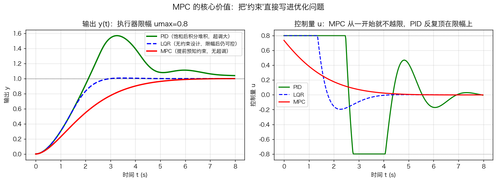
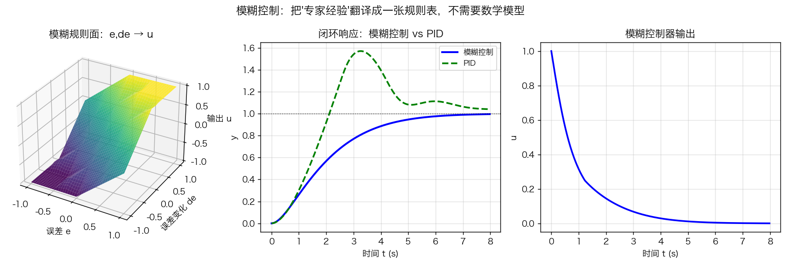
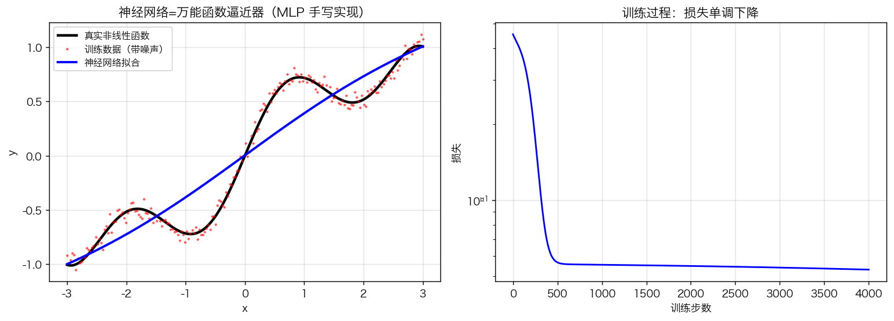
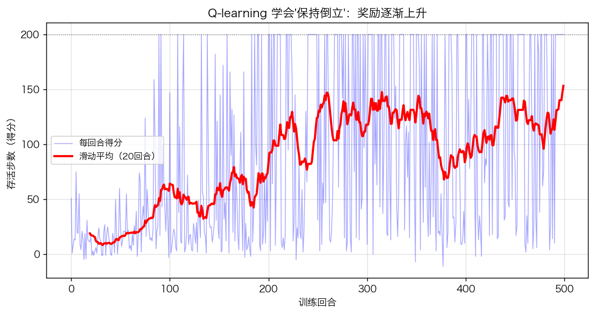
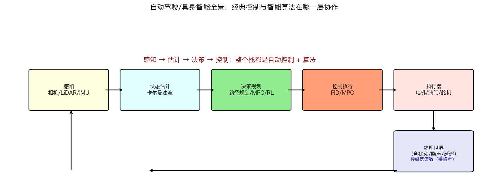

# 第14章 智能控制前沿——知识讲解

> **承上启下**：第11~13章已经把"模型已知、规律清晰"的系统控得很好了。但现实里很多问题**模型难建**（复杂路况、机械臂抓取、无人机集群）——这时候需要"更智能"的控制。本章讲四种主流前沿方法：**MPC、模糊、神经网络、强化学习**，并最终拼出"自动驾驶/具身智能全景"。

---

## 一、为什么还需要"智能控制"？

### 为什么？

经典控制（第5~13章）的基本假设是：**我有对象的数学模型**。但现实：

- 自动驾驶的交通流、机械臂抓豆腐、天气里的无人机——模型要么建不出来，要么建出来也过期；
- 就算有模型，还有**约束**（油门有限、不能压线）——经典方法处理不了硬约束。

**三条出路**：不建模（模糊、PID 调参）、建更好的模型并用优化（MPC）、用数据学模型/策略（神经网络、强化学习）。

### 是什么？（本章地图）

```
智能控制前沿
   │
   ├─ MPC      ：有模型 + 显式约束 + 滚动优化（自动驾驶主流）
   ├─ 模糊控制 ：无模型 + 专家规则表（洗衣机、倒车雷达）
   ├─ 神经网络 ：无模型 + 数据学函数（辨识、逆模型、DQN）
   └─ 强化学习 ：无模型 + 试错学策略（机器人、游戏、具身智能）
```

---

## 二、MPC：把"约束"写进优化

### 为什么？

第11章 LQR 是最优控制，但它**不认约束**——算出来的 $u$ 可能让油门超过 100%。MPC 在每一时刻**向前看 N 步，把"约束"和"代价"一起放进优化问题**，求解后只执行第一步，下个时刻再来一次（滚动时域）。

### 怎么做？是什么？

```
每时刻 k：
  ① 读当前状态 x_k
  ② 求解：min Σ (x^TQx + u^TRu)  限制 u_min ≤ u ≤ u_max
  ③ 执行解出的第一个 u*
  ④ 下一个采样时刻回到 ①
```



*图 14-1 执行器限幅 ±0.8 时三种控制器对比：PID 反复顶在限幅上（积分堆积→超调）；LQR 无约束设计（对象自带积分器，状态反馈即可无静差跟踪，几乎无超调）；MPC 从一开始就把"不超过 0.8"算进优化，几乎无超调、且把 PID 顶限幅的时间压到零。*

把三种控制器在各关键维度上的差别汇总成一张表（配合图 14-1 食用更佳）：

| 维度 | PID | LQR | MPC |
| :--- | :--- | :--- | :--- |
| 看多远 | 现在（靠 D 项 + 斜率猜一点） | 无穷远（一次性算死，增益 $K$ 恒定） | 未来 $N$ 步（滚动时域，每步重算） |
| 预测能力 | 无 / 极弱（仅 D 项微分预测趋势） | 隐含（无穷 horizon 最优） | 显式用模型向前预测 |
| 处理约束 | ❌ 不能 | ❌ 不能（只能事后截断 / 限幅） | ✅ 原生支持（约束直接写进优化） |
| 消除稳态误差 | 靠 I 项积分 | 靠加积分器 / 前馈 | 靠预测 + 终端约束，较自然 |
| 在线计算量 | 极小（几个乘加） | 极小（$K$ 是常数，直接矩阵乘） | 大（每步解一个优化问题 QP） |
| 适用场景 | 简单、快、资源少 | 线性、快、无硬约束 | 多变量、有约束、复杂 |

### 生活类比

MPC = "下棋看三步"：走每步棋之前先模拟接下来 N 步会怎样，选最好的第一步；走完再重新看三步。LQR = "只看一招"（虽然是最优的一招，但不考虑棋盘上"棋子数量有限"这样的约束）。

### 工程要点

- **为什么只执行第一步？** 因为有模型误差和扰动，N 步之后的预测不可靠——"计划赶不上变化，所以边走边计划"；
- **MPC 的三个要素**：预测模型、代价函数、约束——任何一条改了就换了个控制器；
- **代价**：每步要解一个优化问题，比 PID/LQR 贵，但现代计算能力下自动驾驶完全跑得动。

### 递推求解：从"看三步"到 Riccati 递推

MPC 每步怎么"看 N 步"？用的是**动态规划**——不是把 N 步所有可能枚举一遍，而是"**从最后一步倒着推**"。类比"爬山定计划"：先想好"如果我在倒数第 1 个位置，最该往哪走"，再想"倒数第 2 个位置"……一路倒推到"现在"，每个位置的最优走法就都知道了。

数学上，这个"倒推"在"线性 + 二次 + 无约束"下有**闭式解**：一串 **Riccati 递推**（公式推导 §1.2a）从终端倒着算出每一期的最优增益 $K_i$。而 LQR 只是让"N 无限大"后递推收敛到的那个**常数增益**——**MPC = 有限时域的 LQR，LQR = 无限时域的 MPC**。约束加进来后闭式解失效，才改成每步用数值优化（QP）求解，但"倒推"的思想一模一样。


### 预测时域 N 怎么定？

$N$ 是 MPC "看得多远"。$N$ 太小（如只有 3 步）：只能看到眼前，看不到"后面还需要刹车/减速"，性能退化成**"近视的贪婪控制"**——每步只顾眼前利益，超调变大、跟不上路径；$N$ 太大：每步优化耗时随 $N$ 增加，且远处预测已被模型误差污染，多算无益。工程上取"能覆盖系统主导动态的时间尺度"的量级，再结合仿真对比（把 `N_mpc` 从 15 改成 3 重跑，正是体会这一点的最快方式）。（对应练习题13）

### MPC 知识地图（①–㉖ 全景）

MPC 的全部内容可以压缩成一条主线：**问题搭建 → 执行机制 → 特例打通（与 LQR 同源）→ 回到现实（约束才是关键）→ 工程全景**。先看流程，再用表格逐项对照：

```
[①离散模型] + [②向前看N步]
        ↓
[③目标函数(Q,R)] + [④三类约束] ←── MPC的灵魂
        ↓
[⑤只执行第一个] + [⑥滚动时域] ←── 实现机制
        ↓
┌─────────────────────────────┐
│  无约束+线性+二次条件下      │
│  [⑧同一问题][⑨LQR=N→∞]     │
│  [⑩MPC=N有限]               │
│         ↓                   │
│  [⑮DP/Bellman] → [⑯V=x'Px] │
│         ↓                   │
│  [⑰Bellman方程] → [⑱求导]   │
│         ↓                   │
│  [⑲Ki] + [⑳Riccati递推]    │
│         ↓                   │
│  [㉑N→∞→DARE=K∞]           │
│         ↓                   │
│  [⑪关键差别=约束]           │
│  [⑫MPC火因约束][㉒约束破闭式]│
└─────────────────────────────┘
        ↓
[㉓四维对比][㉔计算贵][㉕LMPC/NMPC][㉖自动驾驶]
```

| 阶段 | 编号 | 知识点 | 一句话说明 | 对应笔记 |
| :--- | :---: | :--- | :--- | :--- |
| 问题搭建 | ① | 离散模型 | $x_{k+1}=Ax_k+Bu_k$，预测用的"水晶球" | 公式推导 §1.1 |
| 问题搭建 | ② | 向前看 N 步 | 预测时域 $N$，决定"看多远" | 公式推导 §1.1 |
| 问题搭建 | ③ | 目标函数 $(Q,R)$ | $\sum(x^TQx+u^TRu)$：状态偏差代价 + 控制代价 | 公式推导 §1.1 |
| 问题搭建 | ④ | 三类约束 | $u$ 上下限、状态安全域、终端约束 $x_N=x_{ref}$——**MPC 的灵魂** | 公式推导 §1.1 |
| 执行机制 | ⑤ | 只执行第一个 | 解出最优序列后只执行 $u_k^*$ | 公式推导 §1.1 |
| 执行机制 | ⑥ | 滚动时域 | 下一时刻重新求解，"边走边计划" | 公式推导 §1.1 |
| 特例：无约束+线性+二次 | ⑧ | 同一问题 | MPC 与 LQR 是同一优化问题的两个版本 | 公式推导 §1.2 |
| 特例：无约束+线性+二次 | ⑨ | LQR = $N\to\infty$ | 无限时域，稳态增益 $K_\infty$ 恒定 | 公式推导 §1.2 |
| 特例：无约束+线性+二次 | ⑩ | MPC = $N$ 有限 | 有限时域 LQR，增益随时间变化 | 公式推导 §1.2 |
| 特例：无约束+线性+二次 | ⑮ | DP/Bellman | 动态规划，从最后一步倒着推 | 公式推导 §1.2a |
| 特例：无约束+线性+二次 | ⑯ | $V=x^TPx$ | 猜价值函数为二次型，终端 $P_N=Q_f$ | 公式推导 §1.2a |
| 特例：无约束+线性+二次 | ⑰ | Bellman 方程 | $V_i(x)=\min_u[x^TQx+u^TRu+V_{i+1}(Ax+Bu)]$ | 公式推导 §1.2a |
| 特例：无约束+线性+二次 | ⑱ | 求导 | 对 $u$ 求导令为 0，解出 $u^*$ | 公式推导 §1.2a |
| 特例：无约束+线性+二次 | ⑲ | $K_i$ + Riccati 递推 | 每期增益 $K_i$，$P_i$ 从 $P_N$ 倒着迭代 | 公式推导 §1.2a |
| 特例：无约束+线性+二次 | ㉑ | $N\to\infty$ → DARE | 递推收敛为代数 Riccati 方程，增益定为 $K_\infty$ | 公式推导 §1.2a |
| 回到现实：约束是关键 | ⑪ | 关键差别 = 约束 | LQR 与 MPC 唯一的本质差别 | 公式推导 §1.2 |
| 回到现实：约束是关键 | ⑫ | MPC 火因约束 | 真实世界的约束（不能压线、不能急刹）LQR 处理不了 | 公式推导 §1.3 |
| 回到现实：约束是关键 | ㉒ | 约束破闭式 | Riccati 闭式解失效，改为每步数值解 QP（"倒推"思想不变） | 公式推导 §1.2a |
| 工程全景 | ㉓ | 四维对比 | 约束处理 / 计算量 / 模型要求 / 应用场景 | 公式推导 §1.3 |
| 工程全景 | ㉔ | 计算贵 | 每步解一个 QP/SQP，比 PID/LQR 贵 | 公式推导 §1.3 |
| 工程全景 | ㉕ | LMPC/NMPC | 线性 / 非线性模型预测控制 | 公式推导 §1.3 |
| 工程全景 | ㉖ | 自动驾驶 | 轨迹跟踪、主动安全的主流方案 | 公式推导 §1.3 |

> **用法提示**：复习时先遮住右三列，看编号能否复述出"一句话说明"；再遮住中列，看流程图能否背出推导链。22 个点全部打通，MPC 这一节就没有死角了。

---

## 三、模糊控制：把"老师傅经验"数字化

### 为什么？

有些系统（倒车入库、化工流程）建模极难，但**人凭经验能控好**。模糊控制把这套经验变成"语言规则表"，不需要数学模型。

### 怎么做？是什么？

```
输入 e、de ──①模糊化──> 语言值(负大/负小/零/正小/正大)
        ──②查规则表──> 输出语言值(if-then 规则)
        ──③重心法──> 连续数值 u
```



*图 14-2 左：模糊控制器的"规则面"（输入误差 e、误差变化 de → 输出 u）——它本质是一张"非线性查表控制器"；右：模糊控制对同一对象的闭环响应，与 PID 相当。*

### 生活类比

模糊控制器 = "驾校老师的口头禅"："你偏离路中央太多了，赶紧往右打，别打太狠！"——"太多""赶紧""别太狠"就是语言值，"往右打"就是规则。重心法就是把"打 5°"这个折中数值算出来。

### 与 PID 对比

|       | PID       | 模糊控制          |
| ----- | --------- | ------------- |
| 需要模型  | 不需要       | 不需要           |
| 需要什么  | 3 个参数     | 一张规则表         |
| 调起来   | 参数整定（有套路） | 改规则（更直观但依赖经验） |
| 非线性能力 | 弱（本质是线性的） | 强（规则面可任意形状）   |

> **实践视角**：工程里最常见的是**模糊 PID**——用模糊规则实时调 $K_p,K_i,K_d$，既保留 PID 的简单，又获得非线性自适应能力。

### 规则表怎么避免"过冲回弹"？

规则表不是随便填的：若"误差反方向"（e 还很大、但 de 已经在减小）时仍按 e 的幅值给最大输出，就会刹车过猛、速度反向回弹，形成振荡。对策是在规则里体现"微分作用"：让"误差反方向"时的输出梯度平缓（如 e=PB、de=NB 只给 NS/PS，而不再给 NB/PB），本质是给控制器加阻尼——这正是经典控制 D 项干的事。**规则表里的每一格都是控制器参数，设计规则 = 设计增益与阻尼**，规则写错了系统一样会振。（对应练习题9）

---

## 四、神经网络：能拟合一切函数的"黑箱"

### 为什么？

系统辨识想建模型，但真实的非线性（摩擦、磁滞、饱和）写不出公式。神经网络**只要有数据，就能逼近任意连续函数**——万能逼近定理。

### 怎么做？是什么？

```
输入 x ──> W1·x+b1 ──tanh──> 隐层 ──W2·h+b2──> 输出 y
                    ▲                          ▲
              前向传播（算预测）          反向传播（算梯度，改参数）
```



*图 14-3 左：手写 MLP 从带噪声数据中拟合出非线性函数（红色点是数据，蓝色曲线是网络输出）；右：训练损失单调下降。神经网络 = 可微分函数逼近器。*

### 在控制里的三种用法

1. **系统辨识**：$y_{k+1}=NN(y_k,u_k)$——学"对象"的黑盒模型（对应第3章建模，但不用写物理公式）；
2. **逆模型前馈**：$u_{ff}=NN(y_{desired})$——学"要什么输出给什么输入"，当前馈用（对应第8章复合校正）；
3. **强化学习的策略/价值网络**——控制器的"脑子"（下节）。

> 注意：神经网络本身**不是控制器**，它是函数逼近器。真正的控制结构（反馈、闭环、优化）仍然来自前11章——**神经网络是给经典控制换了个更强大的"组件"**。

---

### 反向传播：误差像"水流"一样倒灌

训练网络靠"反向传播"，它的直觉是：**误差信号沿网络一层层往回传，每经过一层就"分配"一部分给这一层的权重**。像一条水管漏水，你从出水口（输出层）量出"少了多少水"，然后沿水管往回，每到一段（一层）就判断"这一段漏了多少、该拧紧哪个阀门（权重）"。

数学上就是链式法则的三条规则（公式推导 §3.3a）：输出层误差 $\delta$ 已知 → 往前传时乘上"这一层的导数 $f'$" → 得到每层权重的梯度。**"可微"是这一切的前提**——只要每层可导，误差就能一路倒灌到底。理解了它，你也就理解了第 15 章策略梯度（让"奖励"倒灌回策略）和第 16 章姿态求导（让"位姿误差"倒灌回关节角）——**同一条链式法则，三个战场。**


---

## 五、强化学习：让智能体自己学会控制

### 为什么？

当"模型未知"且"环境复杂"（机械臂抓取、机器人走路、自动驾驶复杂场景）时，人写不出规则、也建不了模型——那就**让智能体在环境里试错，自己学会策略**。

### 怎么做？是什么？（核心循环）

```
        ┌────────────── 动作 a（控制量）──────────────┐
        ▼                                            │
   环境（被控对象）◄──────────────────────┐            │
        │                                 │            │
        └─ 状态 s（测量）──► 智能体(策略) ─┘            │
                             ▲                         │
                             └──── 奖励 r（好坏信号）────┘
```



*图 14-4 Q-learning 训练倒立摆（0°=竖直向上的不稳定平衡）：横轴是训练回合，纵轴是"存活步数"。前期乱试（几分），几百回合后学会保持平衡（接近满分）。曲线上升的过程，就是"策略被学到"的过程。*

### 核心概念一句话版

| 概念       | 一句话                  |
| -------- | -------------------- |
| 状态 s     | 我现在看到什么（对应状态空间 x）    |
| 动作 a     | 我现在干什么（对应控制量 u）      |
| 奖励 r     | 刚才干得怎么样（对应 -代价）      |
| 策略 π     | 看到什么就干什么（对应控制器 u=Kx） |
| 价值 Q     | 这个状态做这个动作值多少（对应最优代价） |
| ε-greedy | 前期多乱试（探索），后期多用经验（利用） |

### 关键打通：LQR 就是最简单的强化学习

把 LQR 的代价函数 $\sum(x^TQx+u^TRu)$ 看成奖励，Riccati 方程就是精确的价值函数，$u=-Kx$ 就是最优策略：

- **LQR**：模型已知 + 奖励已知 → 解析解（动态规划）；
- **Q-learning**：模型未知 → 用数据试错逼近同样的最优解。

> **给算法方向的你**：这条桥是你从"控制"走向"强化学习/具身智能"的捷径——你学的状态空间、最优控制、动态规划，正是现代 RL（MPC/DP/DQN/PPO）的数学底座。**LQR 是最简单、可解析验证的 RL 案例。**

---

### 为什么 Q-learning 一定会收敛（压缩映射直觉）

Q-learning 不是"运气好才学会"，它收敛有数学保证：**Bellman 更新是一个"压缩"操作**——每更新一次，当前 Q 值与最优 $Q^*$ 的差距就缩小到原来的 $\gamma$ 倍（$\gamma<1$ 是折扣因子）。像"每天把你和目标的距离缩小一半"，不管起点多远，距离都会趋近于 0。

严格说，Bellman 最优算子 $\mathcal TQ=r+\gamma\max Q'$ 是一个 **$\gamma$-压缩映射**，Banach 不动点定理保证它有唯一不动点 $Q^*$，反复迭代必收敛（公式推导 §4.3a）。Q-learning 只是这个迭代的"采样版"（每次用一条样本近似一步）。**这就是 $\gamma$ 必须小于 1 的深层原因**——它是收敛的"压缩系数"。一句话：**折扣因子不只是"让未来打折扣"，它还是整个算法收敛性的发动机。**


---

## 六、全景：自动驾驶/具身智能的一层一世界



*图 14-5 自动驾驶/具身智能完整闭环：感知（相机/LiDAR/IMU）→ 状态估计（卡尔曼滤波）→ 决策规划（路径规划 + MPC/RL）→ 控制执行（PID/MPC）→ 执行器 → 物理世界 → 回传感器。*

### 每一层用什么（本课程对应）

| 层    | 干什么       | 用什么技术             | 对应章节      |
| ---- | --------- | ----------------- | --------- |
| 感知   | 识别障碍物、车道线 | 深度学习（CNN）         | 第14章（衔接）  |
| 状态估计 | "我在哪、多快"  | 卡尔曼滤波             | 第13章      |
| 决策规划 | "怎么走、走哪条" | 路径规划 + MPC/RL     | 第13/14章   |
| 控制执行 | 贴线走、稳姿态   | PID / 串级PID / MPC | 第8/12/13章 |
| 执行器  | 油门/方向盘/电机 | 限幅（=约束）           | 第12章      |

> **给算法方向的你**：你的目标方向（自动化算法、机器人、具身智能、自动驾驶）恰好横跨这张图：**控制执行（经典）是地基，决策规划（MPC/RL）是主战场，感知（深度学习）是加分项**。学完这门课，你手里已经握着"控制执行 + 决策规划"的两张牌，缺的只是"感知"——那属于下一门课（深度学习/CV）。

---

## 总结：知识体系图

```
智能控制前沿
   │
   ├─ MPC：有模型+约束+滚动优化（自动驾驶横向/纵向主流）
   ├─ 模糊：无模型+专家规则表（工程调参的好帮手）
   ├─ 神经网络：数据学函数（辨识/逆模型/RL 的组件）
   └─ 强化学习：无模型试错（LQR = 最简单的 RL）
        │
        └─ 全景：感知→估计→决策(MPC/RL)→控制(PID/MPC)→执行
             │
             └─ 你的算法方向入口：控制底座 ✓（已学）+ 决策算法（本章）→ 感知（下一步）
```

### 本章应掌握的内容

- [ ] 能用一句话说清 MPC 与 LQR 的差别（约束 + 滚动）
- [ ] 能画出模糊控制四步（模糊化→规则→推理→去模糊化）
- [ ] 能说出神经网络在控制里的三种用法
- [ ] 能把 LQR 翻译成强化学习语言（状态/动作/奖励/策略/价值）
- [ ] 能写一个 Q-learning 更新公式并解释 ε-greedy
- [ ] 能画出自动驾驶/具身智能全栈架构图并标出每层工具
