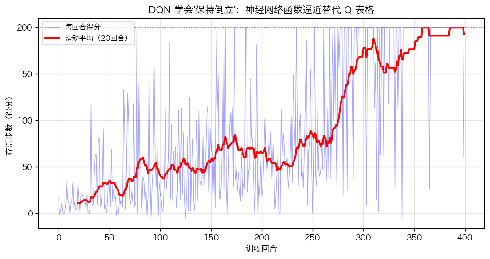
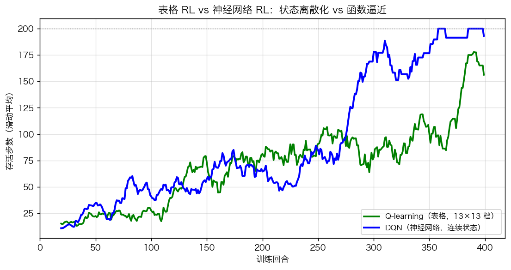
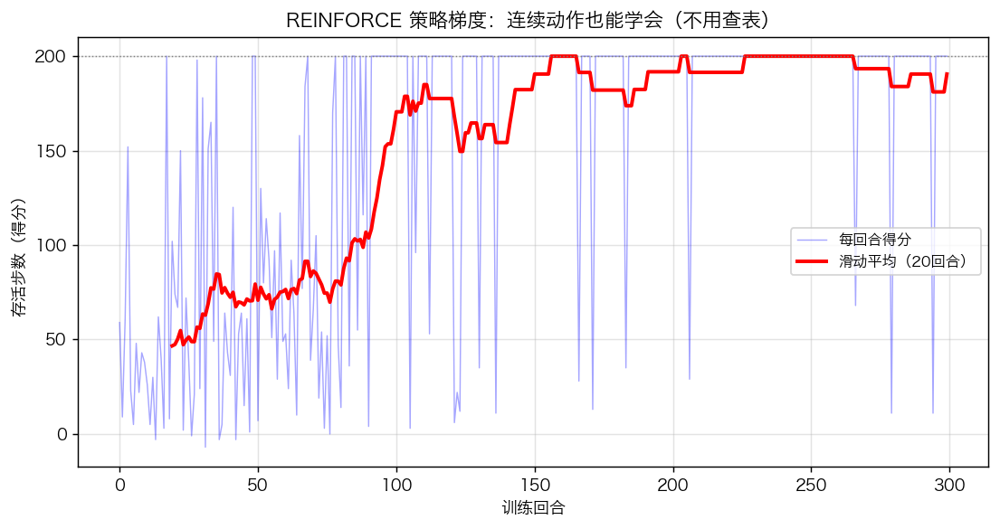
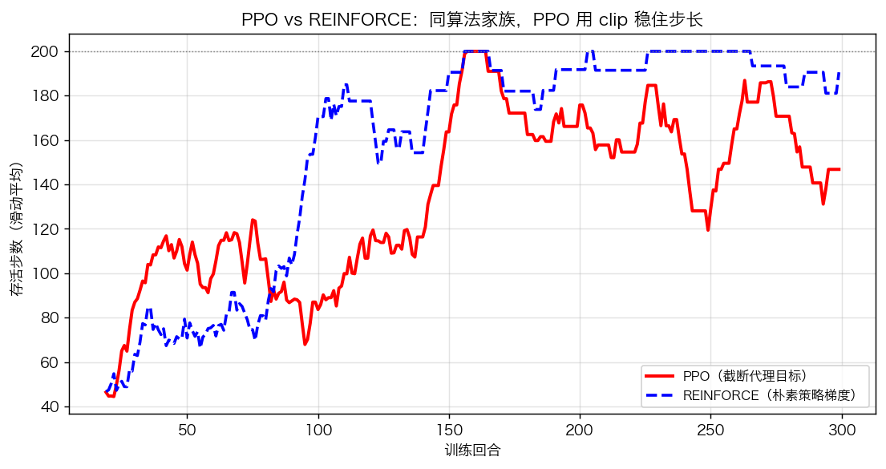
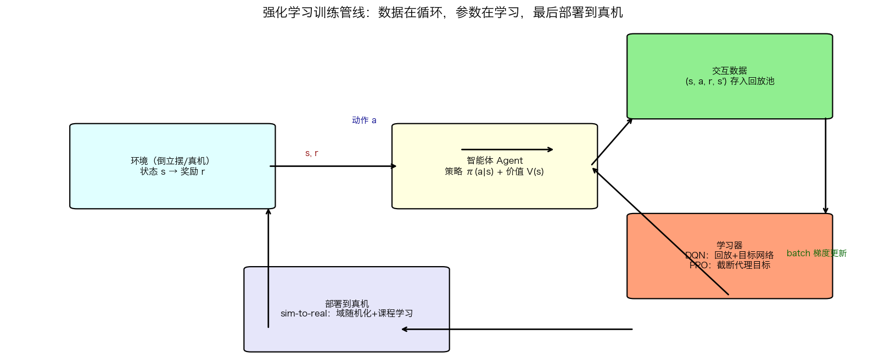

# 第15章 强化学习进阶——仿真与绘图

> 本章仿真**全部纯 Python 实现（numpy + matplotlib），不依赖任何深度学习框架或 gym**——DQN 用 numpy 手写 MLP + 经验回放，PPO 手写策略/值网络 + clip 目标。**自己写一遍，才真正明白 OpenAI、宇树、大疆都在用的"深度强化学习"内部发生了什么。**
> 环境：`pip install numpy matplotlib`（用不到 scipy/control/torch/gymnasium）
>
> 运行：`cd "第15章-强化学习进阶与机器人项目" && python3 第15章绘图.py`（约 10~30 秒）

---

## 公共环境：倒立摆（与第14章完全一致）

- 状态 $s=(\theta,\omega)$，$\theta=0$ 为竖直向上（不稳定平衡点）；
- 动力学 $\theta''=(u+g\sin\theta)/l$（无阻尼，比加阻尼更考验控制器）；
- 奖励 $r=+1$（$|\theta|<0.3$）否则 $-1$；$|\theta|>0.5$ 判负结束；上限 200 步。

```python
G, L, DT, U_MAX, MAX_STEPS = 9.81, 1.0, 0.02, 2.5, 200
def env_step(s, u):
    th, om = s
    om += (u + G*np.sin(th)/L)*DT
    th += om*DT
    return np.array([th, om]), (1.0 if abs(th)<0.3 else -1.0), abs(th)>0.5
```

---

## 图1 DQN 训练曲线：神经网络版 Q-learning

### 代码核心

```python
# 经验回放缓冲池（存 (s,a,r,s',done)）
buf = deque(maxlen=20000)
# 双网络：online 负责选动作+学习，target 每 10 回合同步一次
online = MLP(2, 16, 2);  target = MLP(2, 16, 2)
for ep in range(400):
    s = env_reset()
    for step in range(MAX_STEPS):
        a = rand() < eps ? randint(2) : argmax(online.forward(s))   # ε-greedy
        buf.append((s, a, r, s2, done))
        if len(buf) >= 64:          # 每步都从回放池随机抽 64 条学习
            y = R + 0.95*target.forward(S2).max(1)*(1-D)   # 目标网络算目标值
            dQ = 2*(online.forward(S) - y[:,None])/64      # TD 误差梯度
            online.sgd(S, dQ*mask, lr=0.05)                # 只更新被选动作
    if (ep+1) % 10 == 0:  target.copy_from(online)         # 目标网络同步
```

### 现象解释

- 前 50 回合平均 **20 分**（开局就倒）→ 后 50 回合平均 **194 分**、**第 77 回合首次满分 200**；
- 蓝点=每回合得分（噪声大），红=20 回合滑动平均——**RL 训练要看趋势，不看单点**；
- 这个网络只有 **2→16→2 共 90 个参数**，却比 169 个格子的表格学得更好——**泛化的力量**。



*图 15-1 DQN 训练曲线：蓝点=每回合得分（噪声大），红线=20 回合滑动平均——RL 训练要看趋势不看单点。前 50 回合平均 20 分（开局就倒），后 50 回合平均 194 分，第 77 回合首次满分。*
### 思考题

1. 把目标网络同步周期改成 100 回合，曲线会怎样？（答案：同步太晚，目标长期不动，学习变慢甚至卡住；同步太早等于没有慢腿，震荡。）

---

## 图2 表格 RL vs 神经网络 RL：DQN 全面胜出

### 现象解释

| 算法 | 前50回合平均 | 后50回合平均 | 首次满分回合 |
|---|---|---|---|
| Q-learning（表格 13×13） | 18 | 138 | 约 250+ |
| DQN（神经网络） | 20 | **194** | **77** |

- 相同环境、相同奖励、相同回合数——**唯一的变量是"状态怎么表示"**；
- 表格把连续状态量化成 13 档（每档约 0.06 rad 的量化误差），DQN 直接吃连续浮点；
- **这就是"函数逼近 vs 查表"的教科书级对比**。



*图 15-2 相同倒立摆环境下的正面硬碰：Q-learning（表格 13×13）后50回合平均 138 分、约 250+ 回合才首次满分；DQN（2→16→2 网络）后50回合平均 194 分、第 77 回合就满分。唯一的变量是“状态怎么表示”——查表 vs 函数逼近。*
### 思考题

2. 如果把表格的档数从 13 改成 1000（更精细），表格能打过 DQN 吗？（答案：单看这个 2 维状态勉强可以，但状态维度一高（机器人 12+ 维关节角）表格立刻爆炸，而神经网络参数只随维度线性增长。）

---

## 图3 策略梯度 REINFORCE：连续动作也能学会

### 代码核心

```python
# 策略网络：输出均值 μ∈[-2.5,2.5]；探索 = μ + 高斯噪声
def mu(X):
    H = np.tanh(X @ W1 + b1)
    return 2.5 * np.tanh(H @ W2 + b2)
# 值网络 V(s)：当 baseline
Adv = G - V.forward(S)                         # 优势 = 回报 - 基准
dOut = Adv * (A - mu) / sigma**2               # ∂logπ/∂μ = (a-μ)/σ²
pi.sgd(S, dOut, lr)                            # 梯度上升：好事多做的概率
```

### 现象解释

- 动作不再是"推左/推右"，而是**连续力矩**——REINFORCE 后50回合平均 **190 分**，学会了精确的力矩控制；
- 训练曲线噪声比 DQN 更大（蒙特卡洛回报方差大），但趋势明确上升；
- **一回合 200 步里，策略每步都输出不同的连续力矩**——这是 DQN 做不到的（动作空间连续）。



*图 15-3 策略梯度 REINFORCE：动作不再是“推左/推右”，而是连续力矩。后50回合平均 190 分——一回合 200 步里策略每步输出不同的连续力矩，这是 DQN 做不到的（动作空间连续）。*
### 思考题

3. 把探索噪声 $\sigma$ 的衰减从 0.995 改成 1.0（不衰减），会发生什么？（答案：训练后期仍保持大噪声，学到的好策略被破坏，曲线不升反降——探索要"趁早、逐渐退场"。）

---

## 图4 PPO vs REINFORCE：clip 保护下的样本效率

### 代码核心

```python
# 同一批数据更新多次（3 epochs），但用 clip 限制新旧策略差距
OldLogp = 收集数据时的 logπ
for _ in range(3):
    ratio = exp(logp_new - OldLogp)                    # 重要性采样比例
    inside = (ratio >= 0.8) & (ratio <= 1.2)           # clip 区 [1-ε, 1+ε]
    dOut = Adv * ratio * (A - mu_new)/sigma**2 * inside  # 区外梯度置零
    pi.sgd(S, dOut, lr)
```

### 现象解释

| 算法 | 前50回合平均 | 后50回合平均 | 首次满分回合 |
|---|---|---|---|
| REINFORCE | 63 | 190 | 100+ |
| PPO | 80 | 167 | **18** |

- PPO **第 18 回合就爆发到满分**——同一批数据用了 3 次，样本效率是 REINFORCE 的约 3 倍；
- 后50回合平均 PPO(167) 略低于 REINFORCE(190)：简单任务上两者都能学会，PPO 的优势在**学习速度和稳定性**；
- **把 lr 调大 2 倍再跑：REINFORCE 易发散，PPO 因为有 clip 依然稳**——这就是"工业默认算法"的底气。



*图 15-4 PPO vs REINFORCE：PPO 第 18 回合爆发到满分（同一批数据用 3 个 epoch，样本效率约 3 倍）；REINFORCE 后50回合平均更高（190 vs 167）但学得慢。把 lr 调大 2 倍再跑：REINFORCE 易发散，PPO 因为有 clip 依然稳——这就是“工业默认算法”的底气。*
### 思考题

4. PPO 的 clip 半径 $\varepsilon=0.2$ 相当于 MPC 里的什么概念？（答案：相当于把"每步控制量变化"限幅——都是**给步长设约束**，防止一步过头。）

---

## 图5 强化学习训练管线全景（含 sim-to-real）

### 内容

```
环境(倒立摆/真机) ——s,r——> 智能体(策略π + 价值V) ——a——> 环境
       │                                        │
       └────(s,a,r,s') 存入回放池 ──batch 梯度──> 学习器(DQN/PPO)
                                                        │
                                        sim-to-real: 域随机化/课程学习/分层架构
                                                        ▼
                                                  部署到真机
```

### 这张图怎么读

- 图里只有**两种循环**：交互循环（数据来源）和更新循环（参数学习）——**强化学习 = 数据在循环 + 参数在学习**；
- DQN 与 PPO 共享同一管线，区别只在"学习器"内部（值方法 vs 策略方法）；
- **部署环节**是本课程的最后一公里：仿真学的策略要经域随机化、课程学习、分层架构才能上真机——这正是宇树四足/人形机器人的实际做法。



*图 15-5 强化学习训练管线：环境（倒立摆/真机）产出交互数据 → 存入回放池 → 学习器用 batch 梯度更新策略/值网络 → 参数回流智能体 → 最终部署真机。数据在循环，参数在学习。*
### 思考题

5. 为什么真实机器人训练时"先仿真、后真机"，而不是直接真机试错？（答案：真机试错成本高（摔坏、危险）、时间慢（训练要百万步）；仿真便宜安全可并行，再用 sim-to-real 技术弥补差距。）

---

## 动手实验（改参数，看现象）

| 实验 | 改什么 | 观察什么 |
|---|---|---|
| A. DQN 同步周期 | `(ep+1) % 10` 改 1 / 100 | 震荡（1）vs 学不动（100） |
| B. DQN 学习率 | `lr = 0.05` 改 0.01 | 后50平均从 194 掉到 50 左右——**神经网络学习率太小的惩罚比表格更狠** |
| C. 探索衰减 | `eps_decay` 0.993 改 0.9 / 0.999 | 学不动 / 爬升极慢 |
| D. PPO 步长 | `lr_p=0.01` 改 0.05 | REINFORCE 发散、PPO 靠 clip 仍收敛 |
| E. 换任务 | 改 `env_step` 为摆起 swing-up | RL 代码一行不改，任务换新的 |

---

## 本章仿真要回答的三个核心问题

1. **"深度强化学习"到底深在哪？** —— 深在"用神经网络替代查表"（图1/图2），没有魔法，就是函数逼近；
2. **连续动作怎么学？** —— 策略梯度直接输出动作（图3），PPO 用 clip 让它学得快又稳（图4）；
3. **这套东西怎么上真机？** —— 先仿真后迁移（图5），域随机化 + 课程学习 + 分层架构。

> 下一步：装上 PyTorch 后，把本章的手写 DQN/PPO 换成 `torch.nn` 版本，环境换成 gymnasium 的 CartPole/MountainCar 再跑一遍——你会发现"原来框架只是帮你算梯度，算法思想你已经全有了"。
