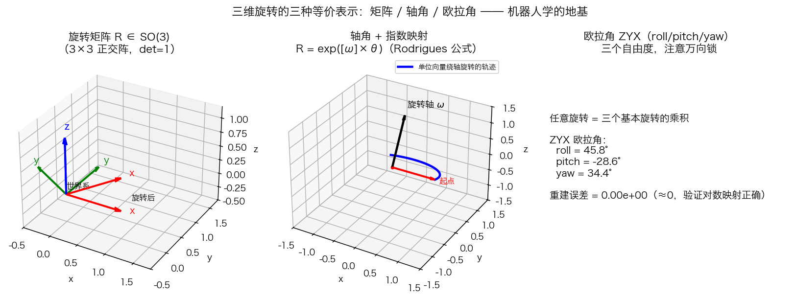
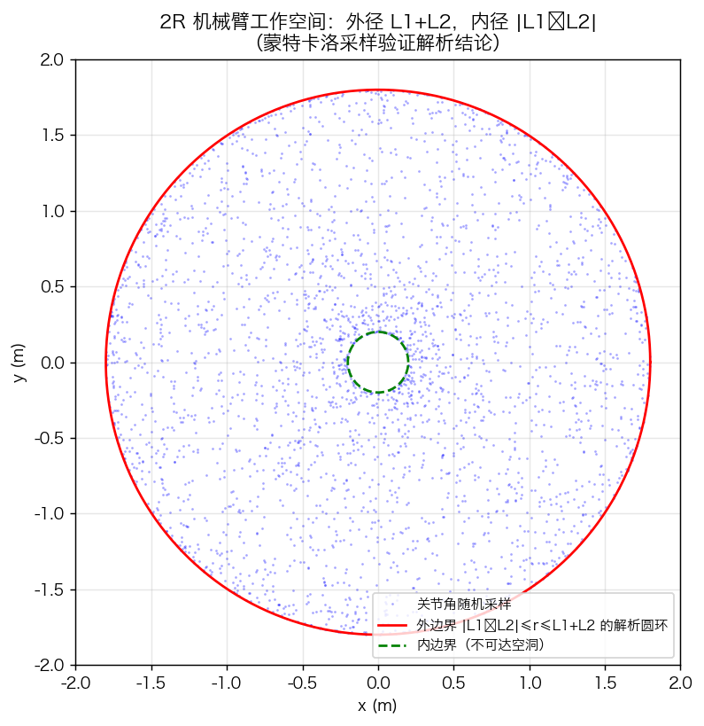
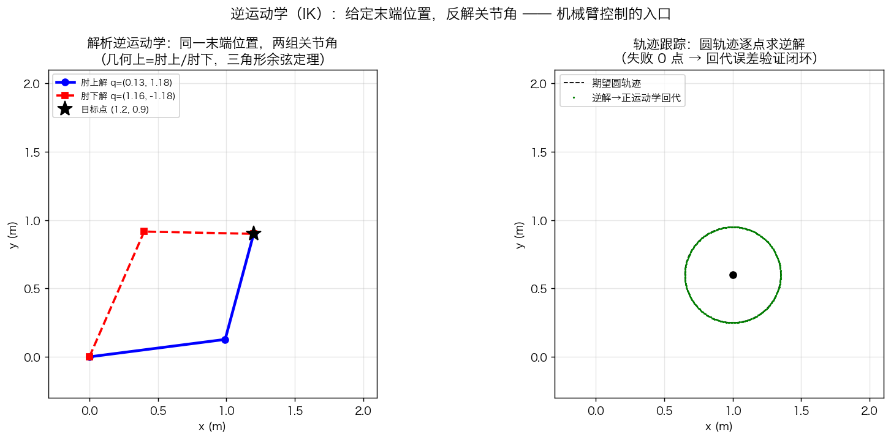
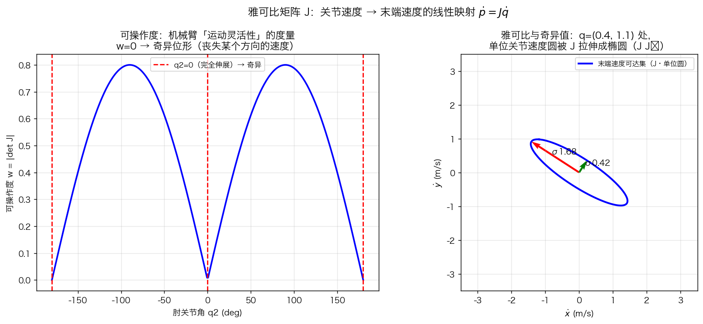
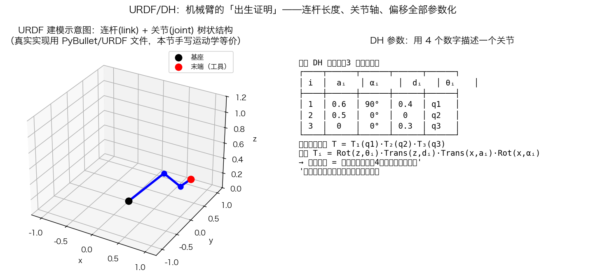

# 第16章 机器人学基础——仿真与绘图

> 本章仿真**全部纯 Python 实现（numpy + matplotlib）**：SO(3)/SE(3) 指数映射、2R 正/逆运动学、雅可比与可操作度全部手写，不依赖 PyBullet/ROS。**先手写一遍，再看穿所有机器人框架的底层。**
> 环境：`pip install numpy matplotlib`
>
> 运行：`cd "第16章-机器人学基础与机械臂" && python3 第16章绘图.py`（几秒即可跑完）

---

## 公共模型：2R 平面机械臂

- 连杆长度 $L_1=1.0,\ L_2=0.8$；
- 关节角 $q=(q_1,q_2)$（绕 $z$ 轴的纯旋转，$d_i=0,\alpha_i=0$ 的 DH 特例）；
- 末端位置：

```python
def fk2(q):
    return np.array([L1*np.cos(q[0]) + L2*np.cos(q[0]+q[1]),
                     L1*np.sin(q[0]) + L2*np.sin(q[0]+q[1])])
```

---

## 图1 旋转的三种表示：矩阵 / 轴角 / 欧拉角

### 代码核心

```python
def axisangle2rotm(w, theta):            # Rodrigues 公式 = SO(3) 指数映射
    K = skew(w)
    return np.eye(3) + np.sin(theta)*K + (1-np.cos(theta))*(K @ K)

def rotm2axisangle(R):                   # 对数映射
    theta = np.arccos(np.clip((np.trace(R)-1)/2, -1, 1))
    w = np.array([R[2,1]-R[1,2], R[0,2]-R[2,0], R[1,0]-R[0,1]]) / (2*np.sin(theta))
    return w, theta
```

### 现象解释

- 左图：旋转矩阵把世界系的三根轴整体转 $60°$——**$R$ 的列 = 旋转后的轴在原来的坐标**；
- 中图：单位向量绕轴 $\omega$ 旋转的轨迹是空间中的一段圆弧——**轴角表示 = "转轴 + 转角"，几何上最直观**；
- 右图：ZYX 欧拉角反解后重建，误差 $10^{-16}$ 量级——**三种表示完全等价，可以无损互转**。



*图 16-1 左：旋转矩阵把 $x,y,z$ 轴整体转过去（正交基）；中：轴角表示“绕一根固定轴转 θ”——单位向量扫过的轨迹是一个圆；右：ZYX 欧拉角反解出的三个角度，重建误差 $10^{-16}$ 量级，验证三种表示完全等价。*
### 思考题

1. 为什么轴角在 $\theta\to0$ 时"退化"？工程上用什么表示来绕开它？（答案：对数映射的 $\sin\theta$ 分母趋零、数值不稳定；$\theta=\pi$ 时 $R-R^T=0$ 也解不出轴。工程用四元数——无奇异的全局参数化。）

---

## 图2 工作空间：蒙特卡洛采样 vs 解析边界

### 代码核心

```python
N = 3000
qs = np.random.uniform([-np.pi, -np.pi], [np.pi, np.pi], (N, 2))
pts = np.array([fk2(q) for q in qs])      # 随机关节角 → 正运动学 → 末端点
```

### 现象解释

- 3000 个随机姿态的末端点**填满一个圆环**，与解析边界完全吻合：外径 $L_1+L_2=1.8$、内径 $|L_1-L_2|=0.2$；
- 中间的空洞（蓝点分布不到的区域）说明：**两连杆永远不可能让末端进入半径 $|L_1-L_2|$ 的圆内**——因为两杆同向折叠时长度相抵；
- 红色外圈是"机械臂完全伸直"的极限——**工作空间的物理边界**。





*图 16-3 左：同一目标点 $(1.2,0.9)$ 的肘上/肘下两组解——“一个末端位置，两副机械臂姿态”；右：末端沿圆轨迹逐点求逆解，再把解回代正运动学——蓝点与黑圆完全重合，**逆解正确性的终极验证**。*
### 思考题

2. 把 $L_1$ 和 $L_2$ 改成相等（$1.0,1.0$），空洞会怎样？（答案：内径 $|L_1-L_2|=0$，空洞消失——末端可以到达原点。）这一结论对 6 自由度臂意味着什么？（答案：更高维工作空间无法用一张图表达，只能靠采样/数值法研究——蒙特卡洛的价值就在这里。）

---

## 图3 解析逆运动学：肘上/肘下 + 轨迹跟踪

### 代码核心

```python
def ik2(p, elbow_up=True):                    # 余弦定理闭式解
    x, y = p
    cos_q2 = (x**2 + y**2 - L1**2 - L2**2) / (2*L1*L2)
    if abs(cos_q2) > 1.0: return None         # 出工作空间 → 无解
    q2 = np.arccos(cos_q2) if elbow_up else -np.arccos(cos_q2)
    q1 = np.arctan2(y, x) - np.arctan2(L2*np.sin(q2), L1 + L2*np.cos(q2))
    return np.array([q1, q2])
```

### 现象解释

- 左图：同一目标点 $(1.2,0.9)$，肘上/肘下两副"臂姿"都能到达——**IK 天然多解**，选择哪组取决于避障/能耗等准则；
- 右图：末端沿圆轨迹逐点求逆解，再回代正运动学，蓝点与黑圆重合——**"逆解→正解回代"零误差，是 IK 正确性的黄金验证**；
- 数值自检（脚本输出）：4 个目标点中 3 个在空间内的回代误差达 $10^{-9}\sim10^{-14}$，$(1.9,0.1)$ 因 $r=1.9>1.8$ 返回"无解"——**存在性判据被实测验证**。



*图 16-4 左：可操作度 $w=|\det J|=L_1L_2|\sin q_2|$ 随 $q_2$ 变化——$q_2=0$（完全伸展）和 $q_2=\pm180°$（完全折叠）时 $w=0$，机械臂“卡死”；右：单位关节速度圆经 $J$ 映射成**速度椭圆**——SVD 奇异值 $\sigma$ 就是椭圆半轴，长轴方向动得快、短轴方向动得费劲。*
### 思考题

3. 解析 IK 的 `elbow_up=False` 给出"肘下解"，为什么工业机械臂还要再挑一次解？（答案：还要考虑关节限位、避障、与上次姿态的连续性——多解选择本身就是规划问题。）

---

## 图4 雅可比与可操作度：奇异的可视化

### 代码核心

```python
def jac2(q):                                  # 2R 雅可比（对 FK 求偏导）
    c1, s1 = np.cos(q[0]), np.sin(q[0])
    c12, s12 = np.cos(q[0]+q[1]), np.sin(q[0]+q[1])
    return np.array([[-L1*s1 - L2*s12, -L2*s12],
                     [ L1*c1 + L2*c12,  L2*c12]])

w = abs(np.linalg.det(jac2([0.5, q2])))       # 可操作度 w = |det J|
U, S, _ = np.linalg.svd(J)                    # 速度椭圆的奇异值
ellipse = J @ circ                            # 单位关节速度圆 → 速度椭圆
```

### 现象解释

- 左图：$w=L_1L_2|\sin q_2|$ 在 $q_2=0$（完全伸展）和 $\pm180°$（完全折叠）处归零——**奇异位形**；
- 右图：$q=(0.4,1.1)$ 处，单位圆被 $J$ 映射成椭圆（半轴 = 奇异值 $\sigma$）——长轴方向"关节动一点、末端动很多"，短轴方向反之；
- **奇异位形的双重危害**：速度上"某个方向要多少速度都给不出"，力上"该方向末端承受的力趋零、关节力矩却暴涨"（$\tau=J^TF$ 的物理解释）。



*图 16-5 右：3 连杆机械臂的标准 DH 参数表——每行 4 个数 $(a_i,\alpha_i,d_i,\theta_i)$；左：对应的机械臂构型示意（基座 → 连杆1 → 连杆2 → 末端）。*
### 思考题

4. 把 $q_{\text{test}}$ 改成 $q=(0.4,0.0)$ 再跑，速度椭圆会变成什么样？（答案：$\det J=0$，椭圆压扁成一条线段——某个方向的速度能力完全丢失。）5. 工业机械臂为什么在奇异位形附近会"发疯"？（答案：伪逆 $J^+$ 的奇异值趋于无穷，同样的末端误差产生爆炸性关节速度指令；对策是阻尼最小二乘或轨迹层绕开。）

---

## 图5 URDF 与 DH 参数：机械臂的"出生证明"

### 内容

- 右表：3 连杆机械臂的标准 DH 参数——每行 $(a_i,\alpha_i,d_i,\theta_i)$，关节角作为变量 $\theta_i=q_i$；
- 左图：对应构型示意（基座 → 连杆1 → 连杆2 → 末端工具）；
- **正运动学 = 矩阵连乘**：$T=T_1(q_1)T_2(q_2)T_3(q_3)$，每步 $T_i=\mathrm{Rot}(z,\theta_i)\mathrm{Trans}(z,d_i)\mathrm{Trans}(x,a_i)\mathrm{Rot}(x,\alpha_i)$。

### 这张图怎么读

- DH 参数表是**机械臂几何的"单点真源"**：改一个 $a_i$，整条正运动学链跟着变；
- URDF 是 DH 的"机器可读版"（XML 文件），PyBullet/ROS2 加载后自动给出 FK/IK/动力学/碰撞体；
- **第4章梅森公式的推广**：传递函数是"多项式相乘"，这里是"齐次变换矩阵相乘"——**串联系统的代数本质是同一个**。

### 思考题

6. 如果你的机械臂关节 2 的轴相对关节 1 的轴偏斜 $90°$，DH 表里哪个参数非零？（答案：$\alpha_2$——连杆扭转角。它让相邻两关节的 $z$ 轴不再平行，正运动学因此真正进入三维。）

---

## 数值自检（科研级验证）

脚本结尾自动打印 4 组验证，建议每次改完代码都盯一眼：

| 自检项 | 实测结果 | 意义 |
|---|---|---|
| 指数映射 ⇆ 对数映射互逆 | $1.76\times10^{-16}$ | 旋转表示互通零误差 |
| 解析 IK 回代误差 | $0\sim2.2\times10^{-16}$ | 闭式解正确 |
| 数值 IK 回代误差 | $10^{-9}\sim10^{-14}$ | 高斯-牛顿收敛 |
| 出空间点 $(1.9,0.1)$ | 判为无解 | 存在性判据生效 |
| 雅可比解析 vs 有限差分 | $1.2\times10^{-9}$ | $J$ 推导正确 |

---

## 动手实验（改参数，看现象）

| 实验 | 改什么 | 观察什么 |
|---|---|---|
| A. 旋转轴 | `axisangle2rotm(np.array([0,0,1]), np.pi/3)` 改轴为 `[0,1,0]`、角为 `2.4` | 旋转矩阵的几何方向变化，互逆误差仍 $10^{-16}$ |
| B. 连杆长度 | `L1, L2 = 1.0, 0.8` 改 `1.2, 1.0` / `1.0, 1.0` | 内边界（空洞）移动/消失——内径 $\lvert L_1-L_2 \rvert$ |
| C. 肘下解 | `ik2(p_target, elbow_up=False)` 加画 | 同一目标点两种臂姿对比 |
| D. 奇异姿态 | 图4右 `q_test` 改 `[0.4, 0.0]` | 速度椭圆压扁成线段——奇异可视化 |
| E. 数值 IK 初值 | `ik2_num(p, q0=np.array([2.0,-2.0]))` | 收敛到另一支解——**数值 IK 的解取决于初值** |
| F. 蒙特卡洛样本数 | `N=3000` 改 `300` / `20000` | 边界清晰度 vs 计算量——采样法的精度代价 |

---

## 本章仿真要回答的三个核心问题

1. **机械臂的"身体"怎么描述？** —— SO(3)/SE(3) 位姿 + DH 参数（图1、图5），一套参数化走遍所有机器人框架；
2. **末端怎么到达目标？** —— 正运动学直路 + 逆运动学两条路线（解析/数值）（图2、图3），"无解/多解/奇异"三种坑；
3. **为什么奇异是大事？** —— 雅可比把速度与力"焊"在一起（图4），$w=0$ 时机械臂丧失一个方向的运动与受力能力。

> 下一步：装上 PyBullet（conda 建独立环境，见第13章附录），加载一个 URDF 机械臂，用 `calculateInverseKinematics` 对照本章手写数值 IK——你会发现 **PyBullet 内部跑的正是本章的公式**。
