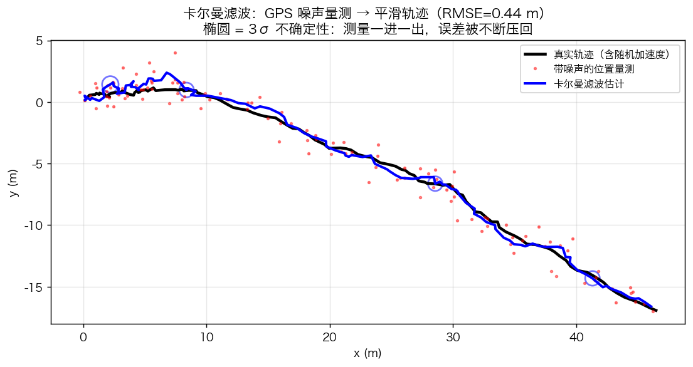
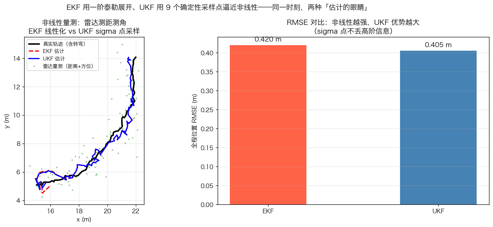
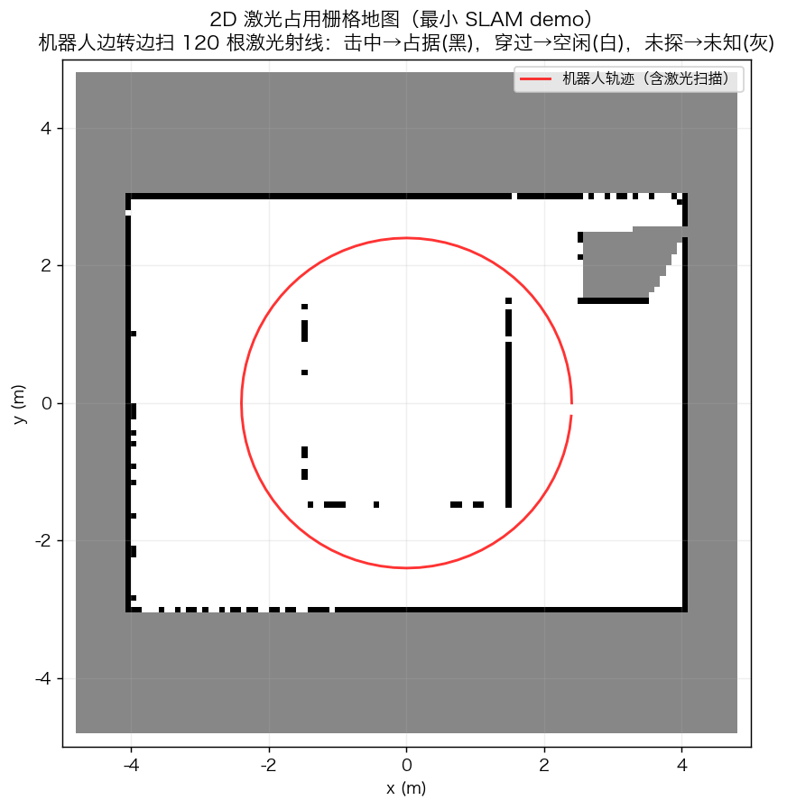
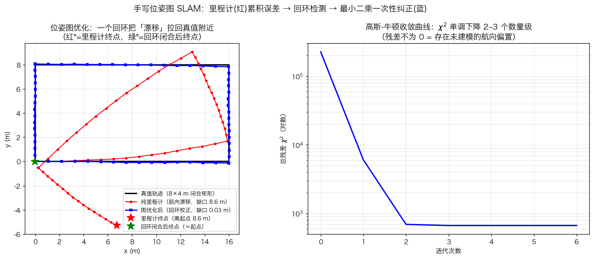
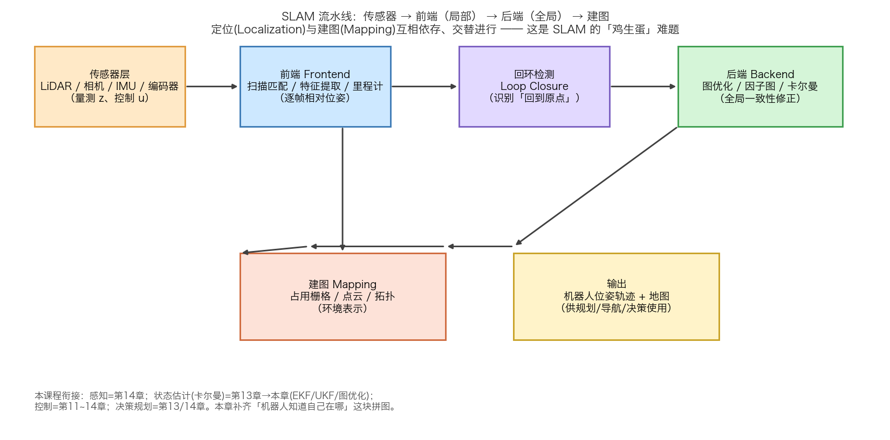
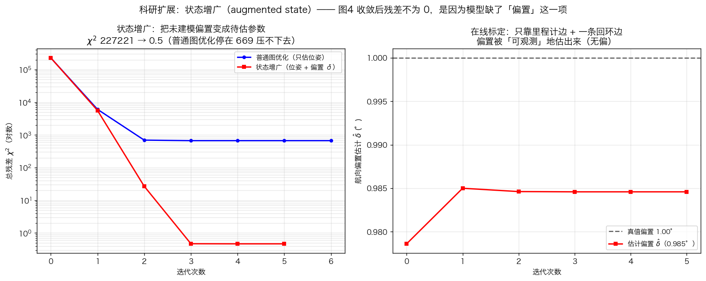

# 第17章 讲解副本

## 零、前置知识补给（读正文前先扫一遍）

> 本章是"机器人蒙眼走路"的数学：核心是**概率论**（你修过）加上**矩阵运算**。先把这几样捡起来。

**1. 高斯分布 $N(μ,Σ)$（概率论核心）**
- 一维：钟形曲线，由均值 $μ$（中心）和方差 $σ^2$（胖瘦）决定。
- 多维：均值向量 $μ$ 加**协方差矩阵 $Σ$**，描述多个量各自的波动以及它们之间的相关性。机器人噪声几乎都用高斯建模。

**2. 协方差矩阵 $Σ$（概率论）**
- 对角线 = 每个变量自己的方差；非对角线 = 两个变量的协方差（正 = 同增同减，负 = 此消彼长）。
- 直观：它同时告诉你"每个量有多不确定"和"哪些量会一起不确定"。

**3. 条件概率与贝叶斯公式（概率论）**
- 条件概率 $P(A\mid B)$："已知 B 发生后，A 的概率"。
- 贝叶斯公式：$P(x\mid z)=\dfrac{P(z\mid x)P(x)}{P(z)}$——把"先验 $P(x)$"和"观测似然 $P(z\mid x)$"合成"后验 $P(x\mid z)$"。**整个滤波就是反复做这件事**。

**4. 矩阵求逆、转置、乘法（线性代数）**
- 卡尔曼增益 $K_t=P^-_t H^T S_t^{-1}$ 里有矩阵求逆 $S_t^{-1}$；预测 / 更新全靠矩阵运算。

**5. 雅可比矩阵（偏导数阵列，高数）**
- 把"非线性函数对每个变量的偏导"排成一张表。EKF 用它在工作点附近把非线性函数"拉直成线性"，才能套用卡尔曼公式。

**6. 最小二乘（拟合 / 优化的基本思想）**
- 目标：让"预测值和观测值的误差平方和"最小。位姿图 SLAM 本质就是解一个超大最小二乘问题。

## 一、贝叶斯滤波总框架

> **原文**（知识讲解 §1.1）：机器人知道自己在哪，只能靠三样东西——控制输入（轮速计/IMU，误差会累积）、外部位姿量测（GPS/UWB，室内经常没有）、环境量测（激光/相机，只有相对信息）。核心矛盾是：运动估计"越来越漂"，环境量测"只有相对"。状态估计就是算一个"最可信"的折中。

**讲解**：打个比方，你蒙着眼睛在屋里走。你靠"我刚才迈了一步"猜自己在哪（控制输入），靠"撞到墙了"知道旁边有东西（环境量测），偶尔睁开眼瞄一眼窗外地标（外部量测）。每一步猜都会偏一点，撞墙只能告诉你"这附近有东西"却不知道绝对位置。状态估计干的事，就是把这三路各有毛病的消息，用数学揉成一个最靠谱的"我在哪、周围长啥样"。

> **原文**（知识讲解 §1.2）：单变量高斯先验 $\mathcal{N}(\mu_1,\sigma_1^2)$ 与高斯量测 $\mathcal{N}(z,\sigma_2^2)$ 融合后，均值为
> $$\mu=\frac{\sigma_2^2}{\sigma_1^2+\sigma_2^2}\mu_1+\frac{\sigma_1^2}{\sigma_1^2+\sigma_2^2}z$$
> 权重是对方方差的占比——信息越准（方差小）说话越算数。

**讲解**：这句是卡尔曼滤波的"一句大白话版"。两个高斯分布相乘（先验×量测），结果还是一个高斯。最终位置的均值是两家意见的加权平均：谁的**方差**大（越不靠谱），谁在式子里占的权重反而越小。卡尔曼滤波不过是把这一维的直觉，推广到多维、递推、随时间变化的系统。**用到的数学**：高斯分布相乘仍是高斯（概率论里的"卷积/乘积"性质）、方差代表不确定度（概率论）。

> **原文**（公式推导 §一）：设 $t$ 时刻状态 $x_t$、观测 $z_t$、控制输入 $u_t$，历史 $z_{1:t}$。机器人状态估计的核心是一个**后验分布**：
> $$\boxed{\,p(x_t\mid z_{1:t},u_{1:t})\,}$$

**讲解**：后验分布就是"在已经看到了到目前为止所有量测和控制的条件下，我此刻状态 $x_t$ 长什么样的概率分布"。打个比方：先验是"我猜自己在这"；后验是"看完传感器后，我更新过的、更靠谱的猜测"。注意它写的是概率分布而不是一个固定数值——因为"到底在哪"本来就带不确定性，用分布才能把这种不确定也估计出来。**用到的数学**：条件概率 $p(A\mid B)$（概率论贝叶斯公式的基础）。

> **原文**（公式推导 §1.1）：预测步利用全概率公式，把 $t-1$ 的后验"推"到 $t$：
> $$p(x_t\mid z_{1:t-1})=\int \underbrace{p(x_t\mid x_{t-1},u_t)}_{\text{运动模型}}\,\underbrace{p(x_{t-1}\mid z_{1:t-1})}_{\text{上一时刻后验}}\,dx_{t-1}$$

**讲解**：这一步叫"预测"，意思是还没来新量测时，机器人只能靠"控制输入 + 运动模型"猜自己挪到哪了。积分符号 $\int$ 在做"对所有可能的上一时刻状态 $x_{t-1}$ 求和/积分"——因为上一时刻本身就有不确定性（是个分布），所以要把每种可能的上一时刻位置都考虑进去，按概率加权推出这一时刻的分布。**用到的数学**：全概率公式 $\int p(x_t\mid x_{t-1})p(x_{t-1})dx_{t-1}$（概率论积分）；积分变换（高数/积分变换）。直觉：没有新观测时，不确定性只会扩散（熵增大，猜测越来越模糊）。

> **原文**（公式推导 §1.2）：观测 $z_t$ 到来后做更新：
> $$p(x_t\mid z_{1:t})=\frac{\underbrace{p(z_t\mid x_t)}_{\text{观测似然}}\;\underbrace{p(x_t\mid z_{1:t-1})}_{\text{预测}}}{\underbrace{p(z_t\mid z_{1:t-1})}_{\text{归一化常数}}}
> \propto p(z_t\mid x_t)\,p(x_t\mid z_{1:t-1})$$

**讲解**：这就是**贝叶斯公式**本尊。分子里第一项是"观测似然"——如果我现在真在 $x_t$，传感器读出 $z_t$ 的概率有多大；第二项是上一行的"预测"（先验）。分母是归一化常数，保证算完概率加起来等于 1。后验 ∝ 似然 × 先验，翻译过来就是"量测教你怎么修正猜测"。$\propto$ 读"正比于"，意思是先不管分母，把分子算出来再归一化就行。**用到的数学**：贝叶斯公式 $p(x\mid z)\propto p(z\mid x)p(x)$（概率论）。

> **原文**（公式推导 §一）：整个状态估计学科（KF/EKF/UKF/粒子滤波/因子图）只是给"预测—更新"这两个公式的不同"计算化"。预测是积分，更新是相乘。

**讲解**：记住这句话就抓住了全章骨架：预测=积分（把上一时刻的分布推过来），更新=相乘（先验×似然）。卡尔曼滤波、扩展卡尔曼、粒子滤波等等，全是"在某种假设下，把这两个积分/相乘步骤化简成加减法和矩阵运算"的具体办法。假设越强（比如线性+高斯），算得越简单精确。

## 二、卡尔曼滤波：线性高斯假设下的精确解

> **原文**（公式推导 §2.1）：三个假设：
> $$x_{t}=A x_{t-1}+B u_t+w_t,\quad w_t\sim\mathcal{N}(0,Q)$$
> $$z_t=H x_t+v_t,\quad v_t\sim\mathcal{N}(0,R)$$
> $$x_0\sim\mathcal{N}(\hat x_0,P_0)$$

**讲解**：卡尔曼滤波"最优"的底气来自三个假设。**线性**：状态怎么变、量测怎么来都是矩阵乘法（没有 sin、√ 这类弯弯绕）；**高斯噪声**：过程噪声 $w_t$ 和量测噪声 $v_t$ 都是零均值高斯（用协方差 $Q$、$R$ 描述），且初始状态也是高斯；**独立**：两种噪声互不相关。三个假设全满足时，KF 给出的后验精确就是高斯分布，均值和协方差一步不漏——它是贝叶斯更新的**精确解**，不是近似。**用到的数学**：高斯分布 $\mathcal{N}(\mu,\Sigma)$、协方差矩阵（概率论+矩阵）；$w_t\sim\mathcal{N}(0,Q)$ 表示"服从均值为 0、协方差为 $Q$ 的高斯"（概率论）。

> **原文**（知识讲解 §2.1）：KF 在线性+高斯+独立三个假设下，后验仍精确是高斯，且均值协方差一步不漏——它是贝叶斯更新的精确解，不是近似。这就是为什么几十年过去 KF 依然是 IMU/GPS 融合的默认算法。

**讲解**：打个比方，KF 就像一条"永远算对"的公式流水线：只要原料（模型、噪声）符合它假设的"配方"，出来的结果就是理论上的最优估计。所以无人机飞控、手机组合导航至今还在用 KF——它又快又准又稳。

> **原文**（公式推导 §2.2）：预测步，高斯经线性变换仍高斯：
> $$\hat x^-_t=A\hat x_{t-1}+B u_t,\qquad P^-_t=A P_{t-1} A^T+Q$$

**讲解**：这两行是"预测"的闭式结果。第一行算**预测均值** $\hat x^-_t$：上一时刻估计 $\hat x_{t-1}$ 经运动模型 $A,B$ 推一步。$A^T$ 是 $A$ 的转置。第二行算**预测协方差** $P^-_t$：不确定性随运动被 $A$ 拉伸（$AP_{t-1}A^T$），再叠加上过程噪声 $Q$。**推导要点**：$\mathbb{E}[Ax]=A\mathbb{E}[x]$（期望是线性算符，能穿过矩阵），$\mathrm{Cov}[Ax]=A\,\mathrm{Cov}[x]A^T$（协方差定义直接代入）。$Q$ 是"加速度抖动、没建模的扰动"带来的不确定度。**用到的数学**：期望的线性性质、协方差传播（概率论）；矩阵转置 $A^T$（线性代数）。

> **原文**（公式推导 §2.3）：把 $(\hat x^-_t, z_t)$ 看作联合高斯，定义**新息**（innovation）$y_t=z_t-H\hat x^-_t$ 及其协方差 $S_t$：
> $$S_t=H P^-_t H^T+R,\qquad K_t=P^-_t H^T S_t^{-1}$$
> $$\boxed{\,\hat x_t=\hat x^-_t+K_t y_t,\qquad P_t=(I-K_t H)P^-_t\,}$$

**讲解**：这是 KF 的"更新"核心，三句话拆开讲：
- **新息 $y_t=z_t-H\hat x^-_t$**：量测值 $z_t$ 减去"按预测该收到的量测 $H\hat x^-_t$"，也就是"预测和量测差了多少"。$H$ 把状态映射到量测空间。新息就是"我猜的 vs 实际看到的"之间的偏差。
- **新息协方差 $S_t$**：这个新息本身有多不确定，等于预测不确定度经 $H$ 投影（$HP^-_tH^T$）加上传感器噪声 $R$。**用到的数学**：协方差（概率论）。
- **卡尔曼增益 $K_t=P^-_t H^T S_t^{-1}$**：决定"更信预测还是更信传感器"。它等于"预测的不确定度 $P^-H^T$"除以"新息的不确定度 $S_t$"。$S_t^{-1}$ 是矩阵求逆。
- **更新式**：$\hat x_t=\hat x^-_t+K_t y_t$ 意思是"最终估计 = 预测 + 增益×偏差"——偏差越大、越信传感器，就修得越多；$P_t=(I-K_tH)P^-_t$ 是更新后的不确定度，一定比预测时更小（信息变多了）。

> **原文**（公式推导 §2.3）：增益视角——$K_t$ 是"预测不确定度 $P^-H^T$"与"量测不确定度 $S$"的比值。量测越可信（$R$ 小），$K\to H^{-1}$，完全相信量测；量测越不可信（$R\to\infty$），$K\to 0$，维持预测。

**讲解**：打个比方：你妈说"你在东头"（量测）和你自己感觉"我在西头"（预测）打架。$K$ 就是"更听谁的"。如果妈妈从不出错（$R$ 小），你就全听她的（$K$ 大）；如果妈妈今天迷糊了（$R$ 大），你就基本不听，维持自己的感觉（$K\to 0$）。这就是增益的本质——**不确定度之比**。

> **原文**（知识讲解 §2.4）：KF 那句 $\hat x=\hat x^-+K(z-H\hat x^-)$ 来自一个纯数学定理：联合高斯的条件分布还是高斯，且均值协方差有闭式。增益 $K=\Sigma_{xz}\Sigma_{zz}^{-1}$ 本质是**回归系数**——"观测每偏离 1 个单位，状态该跟着修正多少"。

**讲解**：这里点破 KF 更新的"数学底气"：它其实就是多元回归里的回归系数。$\Sigma_{xz}$ 是状态和观测的**协方差**（两个变量怎么一起变），$\Sigma_{zz}$ 是观测自己的协方差。回归系数 = 协方差之比，跟上面"不确定度之比"说的是同一件事，只是换了个概率论名词。**用到的数学**：协方差、条件高斯、回归系数（概率论）。

> **原文**（公式推导 §2.3a）：联合高斯的条件分布仍是高斯，设
> $$\begin{bmatrix}x\\ z\end{bmatrix}\sim\mathcal N\!\left(\begin{bmatrix}\mu_x\\ \mu_z\end{bmatrix},
> \begin{bmatrix}\Sigma_{xx}&\Sigma_{xz}\\ \Sigma_{zx}&\Sigma_{zz}\end{bmatrix}\right)$$
> 则 $p(x\mid z)$ 也是高斯，且
> $$\mu_{x|z}=\mu_x+\Sigma_{xz}\Sigma_{zz}^{-1}(z-\mu_z),\qquad \Sigma_{x|z}=\Sigma_{xx}-\Sigma_{xz}\Sigma_{zz}^{-1}\Sigma_{zx}$$

**讲解**：这是 KF 更新为什么成立的"底层定理"，一步步来：把状态 $x$ 和观测 $z$ 打包成一个联合高斯（大括号里是均值向量和协方差矩阵块，$\Sigma_{xz}$ 是交叉协方差）。定理说：在已知 $z$ 的条件下，$x$ 的条件分布还是高斯，均值就是 $\mu_x$ 加上"用 $z$ 的偏差去修正"一项，协方差被"砍掉"一块。KF 的更新式就是把这里的 $x$ 换成状态、$z$ 换成量测直接代入。**用到的数学**：多元高斯分布、分块协方差矩阵（概率论+矩阵）。

> **原文**（公式推导 §2.3a）：推导思路是构造 $y=x-\Sigma_{xz}\Sigma_{zz}^{-1}(z-\mu_z)$，可算得 $\operatorname{Cov}(y,z)=\Sigma_{xz}-\Sigma_{xz}\Sigma_{zz}^{-1}\Sigma_{zz}=0$，故 $y\perp z$（高斯下不相关即独立）。

**讲解**：推导的巧妙处叫"正交化"：我们造一个新变量 $y$，它等于 $x$ 减去"用 $z$ 预测 $x$ 的那部分偏移"。算一下 $y$ 和 $z$ 的协方差，发现恰好等于 0——说明 $y$ 和 $z$ 不相关。在高斯世界里"不相关 = 独立"，所以给定 $z$ 时 $y$ 的分布不变，而 $x=y+\text{只和}z\text{有关的项}$，于是条件均值、条件协方差就直接写出来了。这就是"(不跳步)卡尔曼增益 = 条件高斯回归系数"的完整来历。**用到的数学**：协方差计算、高斯不相关即独立（概率论）。

> **原文**（公式推导 §2.4）：一致性检验 NIS 定义：
> $$\boxed{\,\mathrm{NIS}_t=y_t^T S_t^{-1} y_t\sim\chi^2_d\,}\quad (d=\dim z)$$

**讲解**：NIS（归一化新息平方）是滤波器的"体检指标"。把新息 $y_t$ 用它的协方差 $S_t$ 标准化后平方，得到一个数。在滤波器"诚实"（协方差如实反映误差）的前提下，这个数服从**自由度为 $d$ 的卡方分布 $\chi^2$**，理论均值正好等于量测维数 $d$。$\chi^2$ 分布是"多个独立标准正态变量的平方和"的分布。**用到的数学**：卡方分布 $\chi^2_d$、矩阵二次型 $y^TS^{-1}y$（概率论+矩阵）。

> **原文**（知识讲解 §2.3）：论文审稿人看 NIS 是否落在 $\chi^2$ 置信区间。本章脚本 NIS 均值 2.225（量测维数 $d=2$，理论均值 2）——滤波器"诚实"。NIS 偏小 = 自大（协方差低估），偏大 = 保守（协方差虚高）。

**讲解**：打个比方：NIS 像"估计的不确定度够不够诚实"。如果你说"我有 9 成把握在这"，结果老出错——说明你过度自信（NIS 偏小，协方差太小，太信量测易被带偏）；如果你说"我完全没把握"，结果其实挺准——说明你过度保守（NIS 偏大，不信任量测，估计滞后）。调 $Q/R$ 噪声参数时，看 NIS 比看误差数字靠谱得多。

> **原文**（公式推导 §2.5）：信息滤波存"信息矩阵"$\Lambda=P^{-1}$ 与"信息向量"$\eta=P^{-1}\hat x$，其更新式为
> $$\boxed{\,\Lambda_t=\Lambda_t^-+H^TR^{-1}H,\qquad \eta_t=\eta_t^-+H^TR^{-1}z_t\,}$$

**讲解**：KF 存"均值+协方差"$(\hat x,P)$；它的**对偶**形式信息滤波存协方差的**逆**（信息矩阵 $\Lambda$）和"信息向量"$\eta$。最漂亮的地方：在信息形式下，每来一个传感器，就是把它的"信息量" $H^TR^{-1}H$ 直接**加**到 $\Lambda$ 上，把"信息贡献" $H^TR^{-1}z_t$ 直接加到 $\eta$ 上——**多传感器融合 = 信息矩阵相加**。代价是预测步反而要求逆，比 KF 麻烦。**用到的数学**：矩阵求逆、Woodbury 恒等式 $(A+UCV)^{-1}=A^{-1}-A^{-1}U(C^{-1}+VA^{-1}U)^{-1}VA^{-1}$（线性代数）。

> **原文**（知识讲解 §3.5）：观测多、要融合很多传感器时，信息形式更划算——"融合一个传感器"就是"加一块信息矩阵"。SLAM 恰恰是"成千上万观测要融合"的场景，所以它天然倾向信息形式/图优化。位姿图里的稀疏 $H$ 矩阵，就是信息矩阵 $\Lambda$ 的稀疏结构。

**讲解**：记住这个桥梁：信息矩阵 $\Lambda$ 的"稀疏性"（大部分是 0，只有相连的量才有非零块）就是后面位姿图 $H$ 矩阵稀疏性的前身。理解了信息滤波，第 6 节位姿图优化你就"一眼看懂"了——**现代 SLAM 从滤波转向图优化，数学根源就在这里**。

*图 17-1：位置量测散布 ±0.8m（红点），KF 估计（蓝线）平滑贴合真值（黑线）。椭圆是估计协方差的 3σ 轮廓——每来一次量测，椭圆被压小一截，这就是"不确定性被收回"的可视化。*

## 三、EKF：一阶线性化

> **原文**（公式推导 §3.1）：真实系统 $x_t=f(x_{t-1},u_t)+w_t$、$z_t=h(x_t)+v_t$ 是非线性的（雷达测距测角、IMU 积分）。KF 的"高斯经线性变换仍高斯"失效。

**讲解**：真实机器人没那么乖。雷达告诉你"距离 $r$、方位角 $\theta$"，而状态是直角坐标 $(x,y)$——$r=\sqrt{x^2+y^2}$ 就是非线性；车转弯的运动模型里还有 $\sin\theta,\cos\theta$。这时候 KF 那条"线性变换保高斯"用不了了，需要想办法把非线性凑成线性。

> **原文**（公式推导 §3.2）：在估计值处做一阶泰勒展开：
> $$f(x_{t-1})\approx f(\hat x_{t-1})+\underbrace{\frac{\partial f}{\partial x}\Big|_{\hat x_{t-1}}}_{F_t}(x_{t-1}-\hat x_{t-1})$$

**讲解**：EKF（扩展卡尔曼）的解法：在"当前的最佳估计 $\hat x_{t-1}$"这个点附近，把非线性函数 $f$ 用**一阶泰勒展开**贴一条切线。$F_t$ 是 $f$ 对 $x$ 的**雅可比矩阵**（每个偏导数排成矩阵），它把"离开估计点的小偏差"线性地映射出去。相当于"在这一点附近，假装系统是线性的"。**用到的数学**：一阶泰勒展开（高数）；雅可比矩阵（多元函数偏导数矩阵，线性代数）。

> **原文**（公式推导 §3.2）：预测与更新变为（骨架同 KF，把 $A,B,H$ 换成 $F_t,H_t$）：
> $$\hat x^-_t=f(\hat x_{t-1},u_t),\qquad P^-_t=F_t P_{t-1} F_t^T+Q$$
> $$S_t=H_t P^-_t H_t^T+R,\qquad K_t=P^-_t H_t^T S_t^{-1}$$
> $$\hat x_t=\hat x^-_t+K_t\big(z_t-h(\hat x^-_t)\big),\qquad P_t=(I-K_t H_t)P^-_t$$

**讲解**：你会发现公式和第 2 节的 KF 几乎一模一样，只是把线性矩阵 $A$ 换成雅可比 $F_t$、把量测矩阵 $H$ 换成 $h$ 的雅可比 $H_t$。预测均值直接代非线性函数 $f$；新息变成 $z_t-h(\hat x^-_t)$（因为量测模型也是非线性的 $h$）。一句话：EKF = "在每一步当前估计点，把世界强行当线性，然后套 KF"。

> **原文**（知识讲解 §3.1）：EKF 优点是实现简单、计算快。软肋是非线性强时一阶截断误差大，且误差来源是"线性化"，没法靠多算几次消除（除非用迭代 EKF）。

**讲解**：EKF 的软肋很本质：它只在"线性化点附近、非线性不太强"时才准。如果一开始估计就差得远（线性化点远离真值），或者函数弯得太厉害，那条切线就贴不准，误差会 propagated（传播放大）。而且这只保留了一阶项，把二阶及以上全扔了——在雷达测角这类强非线性下，EKF 会**低估**协方差（盲目乐观）。**用到的数学**：泰勒展开高阶项截断误差（高数）。

> **原文**（公式推导 §3.3）：改进路线（科研谱系）：二阶 EKF → 迭代 EKF（IEKF）→ UKF（免求导、三阶精度）→ 粒子滤波（放弃高斯假设，代价是采样数爆炸）。

**讲解**：如果一个 EKF 不够，工程上就升级：迭代 EKF 在附近反复重估线性化点；再不行用 UKF（下一节）；实在不行用粒子滤波。这条谱系就是"非线性越来越强 → 近似越来越松"的代价阶梯。

## 四、UKF：无迹变换（Unscented Transform）

> **原文**（公式推导 §4.1）：与其逼近一个非线性函数，不如逼近一个分布。UT 的做法：选 $2n+1$ 个确定性 sigma 点，让它们的前两阶矩（均值/协方差）恰好等于当前分布，再让每个点过非线性函数，用输出样本的加权统计量近似输出分布。

**讲解**：UKF 的思路跟 EKF 完全不同。EKF 是"在一点贴切线（逼近函数）"；UKF 是"挑几个能代表整个分布的点，让它们**穿过**非线性函数（逼近分布）"。这 $2n+1$ 个代表点叫 **sigma 点**（$n$ 是状态维数）。打个比方：EKF 像只在山顶放一个温度计猜整座山的温度；UKF 像在山上均匀放几个温度计，再按位置加权算平均——更能反映全貌。**用到的数学**：前两阶矩 = 均值和协方差（概率论）。

> **原文**（公式推导 §4.2）：设状态维 $n$，参数 $\alpha,\kappa,\beta$，尺度 $\lambda=\alpha^2(n+\kappa)-n$。sigma 点：
> $$\mathcal{X}_0=x,\qquad \mathcal{X}_i=x+\big(\sqrt{(n+\lambda)P}\big)_i,\quad \mathcal{X}_{i+n}=x-\big(\sqrt{(n+\lambda)P}\big)_i\quad(i=1..n)$$
> 权重：
> $$W^{(m)}_0=\frac{\lambda}{n+\lambda},\quad W^{(c)}_0=\frac{\lambda}{n+\lambda}+(1-\alpha^2+\beta),\quad W^{(m)}_i=W^{(c)}_i=\frac{1}{2(n+\lambda)}$$

**讲解**：怎么挑这 $2n+1$ 个点：$\mathcal{X}_0$ 就是均值 $x$ 本身；其余 $2n$ 个点是"均值 ± 协方差矩阵平方根的每一列"——这保证了这些点的散布正好等于原分布的形状。$\sqrt{(n+\lambda)P}$ 是**矩阵平方根**（满足 $SS^T=(n+\lambda)P$），必须用对称特征分解算，不能对 $P$ 逐元素开根号（那是常见 bug，会出 NaN）。权重 $W$ 给每个点分配"说话分量"，均值权重 $W^{(m)}$ 和协方差权重 $W^{(c)}$ 略有不同。**用到的数学**：矩阵平方根、对称特征分解 $S=U\sqrt{\Lambda}U^T$（线性代数）。

> **原文**（公式推导 §4.3）：每个 sigma 点过运动模型 $\mathcal{Y}_i=f(\mathcal{X}_i)$，加权得预测：
> $$\hat x^-=\sum_i W^{(m)}_i \mathcal{Y}_i,\qquad P^-=\sum_i W^{(c)}_i(\mathcal{Y}_i-\hat x^-)(\mathcal{Y}_i-\hat x^-)^T+Q$$
> 更新侧过量测模型 $h$ 得 $\hat z$、$P_{xz}$、$S$：
> $$\hat z=\sum_i W^{(m)}_i\mathcal{Z}_i,\quad S=\sum_i W^{(c)}_i(\mathcal{Z}_i-\hat z)(\mathcal{Z}_i-\hat z)^T+R,\quad P_{xz}=\sum_i W^{(c)}_i(\mathcal{Y}_i-\hat x^-)(\mathcal{Z}_i-\hat z)^T$$
> $$\boxed{\,K=P_{xz}S^{-1},\qquad \hat x=\hat x^-+K(z-\hat z),\qquad P=P^--KSK^T\,}$$

**讲解**：预测：把每个 sigma 点都送进非线性运动模型 $f$，再用权重加起来得到预测均值 $\hat x^-$，用"点对均值的散布"加权得到预测协方差 $P^-$。更新同理：点送进量测模型 $h$ 得量测预测 $\hat z$、新息协方差 $S$、以及状态和量测的**交叉协方差** $P_{xz}$。最后增益 $K=P_{xz}S^{-1}$ 和更新式跟 KF 同构，只是协方差来源换了。**用到的数学**：加权求和求均值/协方差（概率论）；交叉协方差（概率论）。

> **原文**（公式推导 §4.4）：对任意非线性函数 $g$，sigma 点采样得到的均值精确到 $g$ 的三阶泰勒项，协方差精确到二阶——EKF 只到一阶。代价是 $2n+1$ 倍计算量。

**讲解**：这是 UKF 比 EKF 强的理论保证：它近似到泰勒展开的**三阶**，而 EKF 只到一阶。直观说，sigma 点是"穿"过非线性函数，而不是在一点"贴切线"，所以弯一点的地方也保得准。代价只是多算 $2n+1$ 个点（状态 4 维才 9 个点，几乎可忽略）。

> **原文**（知识讲解 §3.3）：本章雷达测距测角实验：EKF 0.420m vs UKF 0.405m——差距不大。因为轨迹非线性强度中等、状态维数低（4 维）。真正拉开差距在强非线性、低信噪比、高维状态。

**讲解**：工程上经常"看不出 EKF 和 UKF 谁更好"——因为日常场景非线性没那么狠。但把转弯加大、噪声调猛、维度升高，UKF 的优势就出来了（一阶切线彻底贴不住时，采样点就显神通）。所以选哪个，看你的非线性有多强。

*图 17-2：雷达测距测角（非线性量测）下 EKF vs UKF：绿点是极坐标量测反投影（弧状散开=非高斯）；EKF 0.420m、UKF 0.405m。中段 30 步故意加了滤波器模型未预知的转弯——EKF 在转弯段误差峰更高。把角度噪声从 2° 加到 10°，差距会翻倍以上。*

> **原文**（公式推导 §4.5）：粒子滤波完全放弃高斯假设，用 $N$ 个带权粒子 $\{x^{(i)},w^{(i)}\}_{i=1}^N$ 表示任意分布：
> $$p(x_t)\approx\sum_{i=1}^N w^{(i)}\,\delta(x_t-x^{(i)})$$
> 核心流程（SIR 四步）：预测（粒子过运动模型）→ 加权（按观测似然赋权）→ 重采样（按权重重抽，$N_{\text{eff}}=1/\sum_i(w^{(i)})^2$）→ 估计（加权均值）。

**讲解**：当分布严重非高斯（多峰、重尾）时，高斯家族（KF/EKF/UKF）都扛不住，就得用**粒子滤波**：撒一堆"粒子"代表可能的状态，谁跟观测对得上谁分量重（加权），隔一阵按权重重新抽签（重采样）防止所有粒子塌缩到一个——这是 PF 的灵魂，避免"粒子退化"。重采样的数学：不重采样时有效粒子数 $N_{\text{eff}}$ 会指数衰减到 1，重采样把它重置回 $N$。**代价**：粒子数随状态维数**指数爆炸**（维数灾难），所以只用于低维（如机器人初始重定位）。**用到的数学**：蒙特卡洛估计、狄拉克 δ 函数、有效样本数（概率论）。

> **原文**（知识讲解 §3.4）：记忆锚点：KF 系是"高斯世界"的精确/近似解，粒子滤波是"任意世界"的蒙特卡洛解。当分布严重非高斯时，只有 PF 能扛。

**讲解**：一句话收尾非线性三兄弟：**EKF** 贴切线（快但一阶）、**UKF** 采样点（免求导、三阶、强非线性更稳）、**粒子滤波** 撒点（放弃高斯、能处理任意分布但高维用不起）。按场景选。

## 五、占用栅格地图：贝叶斯对数几率更新

> **原文**（知识讲解 §4.1 / §5.1）：SLAM 的"鸡生蛋"——要建图得知道机器人在哪（哪根射线射进哪个格子）；要定位得有一张地图（拿什么匹配）。两者互相依赖，是 SLAM 被称为"最难问题之一"的原因。

**讲解**：先铺垫 SLAM 的核心难题：定位和建图是"鸡生蛋"。激光每根射线告诉机器人两件事——射线**穿过**的格子是空闲（白），射线**击中**的格子是占据（黑），没扫到的格子是未知（灰）。这就引出了"地图怎么存、怎么增量更新"的问题。

> **原文**（公式推导 §5.1）：对格子 $m_i$ 定义对数几率比：
> $$l_i=\log\frac{p(m_i\mid z_{1:t})}{1-p(m_i\mid z_{1:t})}$$
> 贝叶斯更新退化为加法：
> $$\boxed{\,l_i\leftarrow l_i+\log\frac{p(m_i\mid z_t)}{1-p(m_i\mid z_t)}-l_0\,}$$

**讲解**：每个格子不直接存"被占据的概率 $p$"（0~1 之间），而是存它的**对数几率比** $l_i=\log\frac{p}{1-p}$。好处巨大：贝叶斯更新本来是"概率相乘"，在 log-odds 下变成"加法"——上式的意思是"旧证据 $l_i$ + 这帧新证据 − 先验 $l_0$"。**用到的数学**：对数几率比（逻辑回归里的同一概念，概率论/统计）；贝叶斯更新（概率论）。为什么好：连续相乘概率会数值下溢（变成 0），变成加法就不会；而且天然支持"旧证据遗忘"（移动物体，多帧叠加后地图锐化）。

> **原文**（公式推导 §5.2）：逆传感器模型 $p(m_i\mid z_t)$ 用查表定义：
> $$p(m_i\mid z_t)=
> \begin{cases}
> 0.9 & \text{格子被射线击中（障碍物表面）}\\
> 0.4 & \text{格子在射线路径上（自由空间）}\\
> 0.5 & \text{其他（未知，不更新）}
> \end{cases}$$
> 对应 log-odds 增量：击中 $+\log(9)\approx2.2$，穿过 $-\log(1.5)\approx-0.4$。

**讲解**：注意 $p(m_i\mid z_t)$（给量测反推格子状态）不是直接能测的，要靠**逆传感器模型**这种"经验查表"给出来：打中的格子 90% 是障碍（+2.2），穿过的格子 40% 是障碍即偏空闲（−0.4），没扫到的不更新。打个比方：你用手电照墙，照到的点几乎肯定是墙（加分），光路过的地方几乎肯定空（减分）。多帧叠加后，墙越来越黑、路越来越白，单帧噪声被时间平均掉。

> **原文**（公式推导 §5.3）：射线投射求"传感器到障碍物经过哪些格子"——射线求交取最近交点，再用 Bresenham 直线算法从传感器格到命中格画线，沿途标"自由"、终点标"占据"。

**讲解**：工程实现上：先算激光射线和环境哪条线段最近相交（得到障碍物位置），再用 Bresenham 整数直线算法把"从传感器到交点"沿途的格子标空闲、交点格标占据。全程整数运算、无浮点、速度快。代价：分辨率 $\delta$ 下 $W\times W$ 地图要 $O((W/\delta)^2)$ 内存——地图一大，全状态滤波就存不下了，必须走向"稀疏位姿图 + 独立建图"。

*图 17-3：最小 2D 激光占用栅格 SLAM demo：机器人沿半径 2.4m 的圆边走边扫 120 根激光，射线求交 + Bresenham 逐格更新。墙（黑）被多帧命中叠加锐化，房间内部（白）被射线穿过，未探索区（灰）保持未知——"没扫到 ≠ 空地"。*

## 六、位姿图 SLAM：高斯-牛顿图优化

> **原文**（知识讲解 §4.3）：破解路线二（现代主流）——思维逆转：不估计"当前状态"，一次性估计"整条轨迹的所有位姿"。节点=历史位姿，边=里程计约束/回环约束，目标=让所有边残差最小（非线性最小二乘）。

**讲解**：SLAM 真正的主线是"图优化"。和滤波（只维护当前状态、信息只能往前流）相反，图优化把**整条轨迹的所有位姿**都当作要估计的节点，把"这一步相对上一步怎么动"（里程计边）、"我认出这回到了起点"（回环边）当作约束边。一次性求"让所有边残差最小"的解。为什么好：误差可以在整条链上重分配——一个回环信息，把沿途所有节点的历史漂移一起"拧正"。**用到的数学**：非线性最小二乘（高数最优化）。

> **原文**（公式推导 §6.1）：把整条轨迹位姿 $X=\{x_0,\dots,x_N\}$ 当节点，约束当边。目标：
> $$\boxed{\,X^*=\arg\min_X\sum_{(i,j)\in\mathcal{E}} e_{ij}(X)^T\Omega_{ij}\,e_{ij}(X)\,}$$

**讲解**：这是位姿图优化的总目标函数。$\arg\min$ 是"找让后面式子最小的 $X$"；求和遍历所有边 $(i,j)$；$e_{ij}$ 是第 $(i,j)$ 条边的**残差**（预测相对位姿和量测相对位姿的差）；$\Omega_{ij}$ 是这条边的**信息矩阵**（$=$ 噪声协方差的逆，越可信权重越大）。整体就是"所有边的残差，按可信度加权，平方和最小"——一个加权最小二乘问题。**用到的数学**：最小二乘、信息矩阵=协方差逆（概率论+矩阵）；$\arg\min$（最优化）。

> **原文**（公式推导 §6.2）：位姿 $x_i=(p_i,\theta_i)$，相对变换（SE(2) 群运算）：
> $$z_{ij}=x_i^{-1}\oplus x_j \;\Longleftrightarrow\; T_{ij}=T_i^{-1}T_j$$
> 残差定义（搬回 $x_i$ 局部坐标系）：
> $$e_{ij}(X)=
> \begin{bmatrix}
> R(z_\theta)^T\big(R(x_{i,\theta})^T(p_j-p_i)-z_p\big)\\[4pt]
> \mathrm{wrap}\big(x_{j,\theta}-x_{i,\theta}-z_\theta\big)
> \end{bmatrix}$$

**讲解**：位姿是 $\mathrm{SE}(2)$ 群元素（第 16 章学的旋转+平移）。残差怎么定义？关键是"把 $x_j$ 相对 $x_i$ 的预测相对变换，与量测 $z$ 的差，**搬回 $x_i$ 的局部坐标系**"。上面第一行是位置残差：用旋转矩阵 $R$ 把"$p_j-p_i$（全局差）"转回 $x_i$ 的局部系，再减量测位置 $z_p$；第二行是角度残差，$\mathrm{wrap}$ 把角度折回 $(-\pi,\pi]$ 防止跨过 ±180° 出错。**为什么搬回局部系**：残差只有在局部坐标下才是高斯噪声的合理度量（全局平移/旋转不变）。**用到的数学**：$\mathrm{SE}(2)$ 李群、旋转矩阵 $R(\theta)$、角度 wrap（第 16 章+矩阵）。

> **原文**（知识讲解 §6.1）：机器人走 8×4m 闭合矩形回到起点，但陀螺每步多算 1° 航向偏置，63 步累计 63°——里程计说"终点在 8.6m 外"，真实是"回到起点"（8.6m 回环缺口）。回环检测认出起点 → 加一条"终点≈起点"的边 → 高斯-牛顿在整条 64 节点链上重分配误差。

**讲解**：打个比方：你绕着操场走一圈回起点，但记步器每步多算一点，最后它告诉你"你离起点 8.6 米"——这就是回环缺口。图优化一旦发现"咦这俩地方其实是同一处"（回环边），就把整条轨迹一次性拧正：位置 RMSE 从 4.88m 降到 0.10m（约 50 倍），航向 35.3° 降到 0.7°。这是滤波结构做不到的"整体拧正"。

*图 17-4：手写位姿图高斯-牛顿优化：红=纯里程计（每步 1° 航向偏置 → 终点漂到 8.57m 外），蓝=图优化后。右图 χ² 收敛曲线（227221 → 669），3~4 轮迭代即收敛。收敛后 χ² 不为 0，是下一节（状态增广）的伏笔。*

> **原文**（公式推导 §6.3）：对残差 $e_{ij}$ 求导得解析雅可比。对 $x_i$（$R_i=R(\theta_i)$，$\Delta=p_j-p_i$）：
> $$\frac{\partial e_{ij}}{\partial x_i}=
> \begin{bmatrix}
> -R_z^T R_i^T & R_z^T \frac{dR_i^T}{d\theta_i}\,\Delta\\[2pt]
> 0 & -1
> \end{bmatrix},\qquad
> \frac{dR_i^T}{d\theta_i}=
> \begin{bmatrix}-\sin\theta_i&\cos\theta_i\\ -\cos\theta_i&-\sin\theta_i\end{bmatrix}$$
> 对 $x_j$：
> $$\frac{\partial e_{ij}}{\partial x_j}=
> \begin{bmatrix}
> R_z^T R_i^T & 0\\[2pt]
> 0 & 1
> \end{bmatrix}$$

**讲解**：要解最小二乘，得知道残差对每个位姿怎么变——这就是**雅可比矩阵** $J$（残差对状态求导）。上面两个 $3\times3$ 块分别是"残差对起点 $x_i$"和"对终点 $x_j$"的导数。推导要点：平移部分用链式法则（$R_z^T$、$R_i^T$ 是常量旋转算符，只有 $\Delta=p_j-p_i$ 依赖 $x_i$）；角度部分 $\theta_i$ 只藏在旋转矩阵里，$\frac{dR_i^T}{d\theta_i}$ 是反对称矩阵（把角度微扰转成位置微扰）。本章脚本用中心有限差分校验过，误差 $1.3\times10^{-10}$，证明解析式正确。**用到的数学**：雅可比（多元函数偏导矩阵）、链式法则、旋转矩阵求导（线性代数+矩阵）。

> **原文**（公式推导 §6.4）：在当前估计 $\bar X$ 处一阶展开残差 $e_{ij}(\bar X+\Delta)\approx e_{ij}+J_{ij}\Delta$，极小值条件给出法方程：
> $$\boxed{\,H\Delta x=-b\,}$$
> $$H=\sum_{ij}J_{ij}^T\Omega_{ij}J_{ij},\qquad b=\sum_{ij}J_{ij}^T\Omega_{ij}e_{ij}$$

**讲解**：高斯-牛顿怎么解最小二乘：在当前的估计点把残差线性化（一阶泰勒），目标函数就近似成一个二次型。让它最小的必要条件，就是解这个**法方程** $H\Delta x=-b$。$H$ 是"所有边的雅可比按信息矩阵加权拼起来"的大矩阵，$b$ 是"残差加权拼起来"的向量。求得 $\Delta x$ 后更新 $x\leftarrow x+\Delta x$，反复迭代直到 $\Delta x$ 够小。**用到的数学**：一阶泰勒展开、二次型极小（高数）；法方程/正规方程（线性代数最小二乘）。

> **原文**（公式推导 §6.4）：每条边只连两个节点，$H$ 只在对应 $3\times3$ 块非零——$H$ 是稀疏带状矩阵，这就是大规模 SLAM 能用 Cholesky 高效求解的原因。

**讲解**：$H$ 矩阵"稀疏"（绝大部分是 0），因为只有相邻位姿之间有边。这种稀疏带状结构让求解器（Cholesky 分解）飞快——几十万节点也能秒级解。这正是图优化能碾压滤波（协方差矩阵 $O(M^2)$ 爆炸）的工程关键。

> **原文**（公式推导 §6.5）：位姿只有相对约束，整体可平移/旋转而不改变残差 → $H$ 奇异（存在零空间）。固定一个节点（如 $x_0=0$）消除零空间：把 $H$ 对应 $3\times3$ 块设单位阵、$b$ 对应块置 0。这就是"锚定坐标原点"。

**讲解**：因为所有约束都是"相对的"，你把整张图一起平移或旋转，残差不变——数学上叫 $H$ 奇异（解不唯一）。解决办法：固定一个节点（比如令 $x_0=0$）当坐标原点，相当于"把地图钉在地上"。这就是**规范自由度（Gauge Fix）**。

> **原文**（公式推导 §6.6）：滤波是"序贯贝叶斯"（信息只能前向流动），图优化是"批处理最小二乘"（每条边可反复重线性化、误差整条链重分配）。本章实测：一个回环把位置 RMSE 从 4.883m 压到 0.097m（50.3 倍）。

**讲解**：一句话点透"为什么图优化 > 滤波"：**滤波**像写日记，错了只能往前记，没法回头改；**图优化**像改论文，新证据（回环）来了可以把前面所有历史一起重排修正。所以现代 SLAM 全面倒向图优化。

> **原文**（知识讲解 §6.5）：第11章 LQR 的 Riccati 方程、本章 KF 的 $P$ 递推、位姿图 $H\Delta x=-b$——三者是同一套"线性二次型"数学在不同场合的名字：控制、序贯估计、批处理估计。

**讲解**：记住这个"恍然大悟"：控制和估计本来不分家。LQR（控制）、KF（递推估计）、图优化（批处理估计）背后都是同一套线性二次型数学。学通一个，另两个的直觉就通了。

*图 17-5：SLAM 管线：传感器 → 前端（逐帧相对位姿/局部地图）→ 回环检测 → 后端（全局图优化）→ 建图与输出。定位与建图互相依赖、交替进行——这就是 SLAM 的"鸡生蛋"难题。*

> **原文**（知识讲解 §7）：工业落地分层——扫地机：前端激光匹配+栅格，后端位姿图，回环=扫描相似度；无人机/自动驾驶：前端 IMU 预积分+视觉特征点，后端因子图（GTSAM 类），IMU 偏置显式建模进状态（VINS-Mono、ORB-SLAM3、LIO-SAM）。读任何 SLAM 论文先问：前端什么约束？后端什么优化？回环怎么检测？

**讲解**：把全章知识对到真实产品：扫地机的"前端建栅格、后端拧轨迹、回环靠扫描比对"，和大疆无人机的"视觉惯性 SLAM"是同一套骨架，只是传感器换成相机+IMU、偏置被认真建模进状态。以后看论文，抓住"前端/后端/回环"三问，就能判断它对不对。

## 七、状态增广：把未建模的系统误差建模进状态

> **原文**（知识讲解 §6.3 / 公式推导 §7.1）：本章优化后 $\chi^2$ 从 227221 降到 669，但没到 0——因为航向偏置是**未建模的系统误差**：每步 1° 的陀螺零偏没进模型，无论位姿怎么摆，都无法让"带偏的里程计量测"和"回环闭合"同时满足。唯一出路是把缺的那项变成可估参数。

**讲解**：回到图 17-4 的伏笔：优化后残差（χ²）停在 669 而不是 0。这不是优化器不行，而是**模型漏了一项**——机器人陀螺有每步 1° 的零偏，但我们的模型假设"里程计完美"。于是"带偏的里程计"和"回环闭合"永远不能同时满足。解决办法：把这个偏置也当成要估计的变量，塞进状态里一起优化。

> **原文**（公式推导 §7.2）：在优化变量 $X\in\mathbb{R}^{3N}$ 外，加一个全局标量 $\delta$（航向偏置）。里程计边量测改为"被偏置污染"的真实相对量测：
> $$z_{\text{eff}}=\begin{bmatrix}z_x\\ z_y\\ z_\theta-\delta\end{bmatrix}$$
> 残差只把 $z$ 换成 $z_{\text{eff}}$：
> $$e_{ij}(\delta)=
> \begin{bmatrix}
> R(z_\theta-\delta)^T\big(R(x_{i,\theta})^T(p_j-p_i)-z_p\big)\\[2pt]
> \mathrm{wrap}\big(x_{j,\theta}-x_{i,\theta}-z_\theta+\delta\big)
> \end{bmatrix}$$

**讲解**：做法只有一步：在原本的优化变量（所有位姿）之外，加一个全局标量 $\delta$ 表示航向偏置。里程计边的量测 $z_\theta$ 本来是"脏的"，我们改成"真值 $=z_\theta-\delta$"——相当于先把偏置扣掉再算残差。回环边是"真值、不含偏置"，所以和 $\delta$ 无关。这就是**状态增广 / 在线标定**的最小实现。

> **原文**（公式推导 §7.3）：对 $\delta$ 的雅可比（链式法则），$e$ 只经 $z_{\text{eff}}[2]=z_\theta-\delta$ 依赖 $\delta$，且 $\partial z_{\text{eff}}[2]/\partial\delta=-1$，故：
> $$\boxed{\,J_d=\frac{\partial e}{\partial\delta}=-\frac{\partial e}{\partial z_{\text{eff}}[2]}
> =\begin{bmatrix}
> -\frac{dR_z^T}{d\theta}\big(R_i^T\Delta p-z_p\big)\\[2pt]
> +1
> \end{bmatrix}\,}$$

**讲解**：要一起优化 $\delta$，得知道残差对 $\delta$ 怎么变，即雅可比 $J_d$。因为残差只通过 $z_\theta-\delta$ 这一项依赖 $\delta$，而该项对 $\delta$ 的导数就是 $-1$，所以用**链式法则**：$J_d = -\partial e/\partial z_\theta$。本章有限差分校验误差 $8.2\times10^{-11}$，解析式正确。**用到的数学**：链式法则、雅可比（概率论/矩阵）。

> **原文**（公式推导 §7.4）：未知量变为 $3N+1$ 维，法方程扩成：
> $$\begin{bmatrix}
> \sum J_{ij}^T\Omega_{ij}J_{ij} & \sum J_{ij}^T\Omega_{ij}J_d\\
> \sum J_d^T\Omega_{ij}J_{ij} & \sum J_d^T\Omega_{ij}J_d
> \end{bmatrix}
> \begin{bmatrix}\Delta x\\ \Delta\delta\end{bmatrix}
> =-\begin{bmatrix}\sum J_{ij}^T\Omega_{ij}e_{ij}\\ \sum J_d^T\Omega_{ij}e_{ij}\end{bmatrix}$$
> 可观测性：若只有里程计边（全相对约束），整体旋转 $+\delta$ 不改变残差 → $\delta$ 不可观；加一条回环边后 $\delta$ 被"卡死"，变得可观。

**讲解**：把 $\delta$ 加进状态后，法方程从 $3N$ 维扩成 $3N+1$ 维（右下角多了 $\delta$ 自己的块）。关键 insight 叫**可观测性**：如果只有相对约束（里程计边），你可以偷偷把整张图转一点、同时改一点 $\delta$，残差完全不变——说明 $\delta$ 估不出来（不可观）。但一旦加一条回环边（把两个远处的时刻连起来），$\delta$ 的累积效应就被"卡死"了，变得可估。这就是"回环让系统误差变得可标定"的数学机理。

> **原文**（公式推导 §7.5）：本章实测：普通图优化 $\chi^2:227221\to668.7$ 压不下去；增广后 $\to0.47$（接近量测噪声水平），估计偏置 $\hat\delta=0.985°$（真值 $1.0°$，无偏）。位置 RMSE 反而从 0.097 → 0.143 m。

**讲解**：结果很说明问题：把偏置建模进状态后，χ² 从 669 直接塌到 0.47（基本等于纯噪声水平），偏置估出 0.985°（真值 1.0°，几乎无偏）。有趣的是轨迹 RMSE 反而略升（0.097→0.143m）：普通优化把偏置"憋"进位姿里（过拟合，表面更贴真值但残差大）；增广后偏置被正确分离，残差干净、但轨迹不再虚低。**科研结论**：报告精度必须同时报告模型假设；χ² 对"模型漏项"比 RMSE 敏感得多。VINS/ORB-SLAM3 里的 IMU 偏置、LIO 里的轮径比，全是同一件事——把"不该算到位姿头上的错"拆给专门参数。

*图 17-6：状态增广（在线标定）：左图 χ² 收敛对比——普通图优化停在 669 压不下去，增广后继续降到 0.47（接近量测噪声水平）；右图偏置估计 $\hat\delta$ 收敛到 0.985°，真值 1.0°——只靠 63 条里程计边 + 1 条回环边，偏置被无偏地估出来。*
