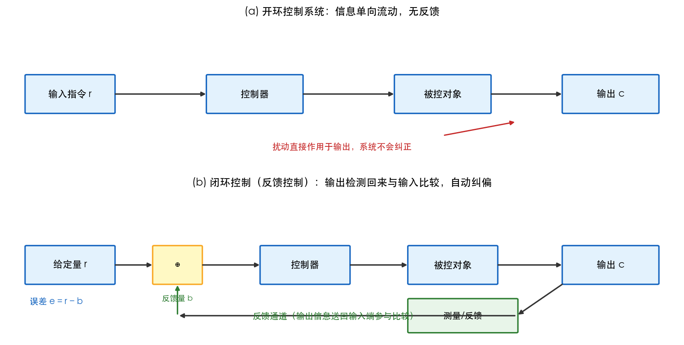
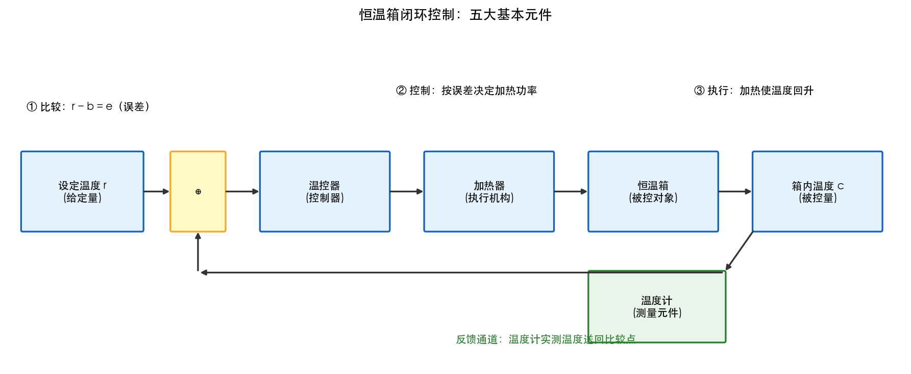
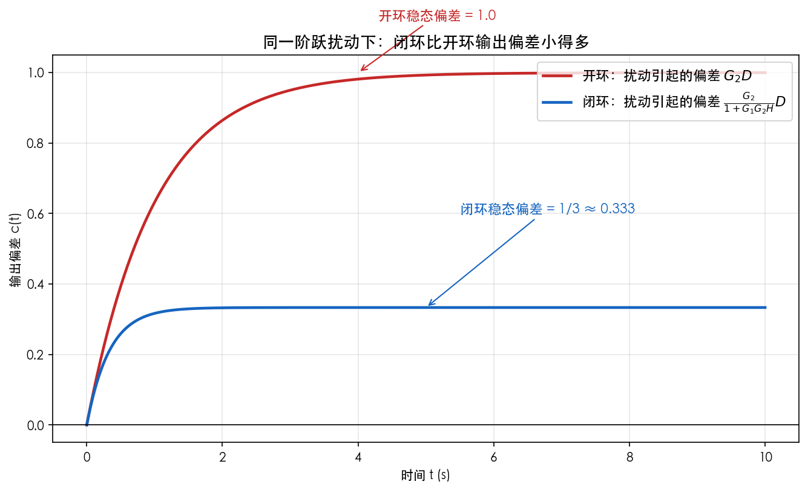

# 第1章 自动控制的基本概念——仿真与绘图

> 本章目标：亲手画出**开环/闭环方框图对比**和**扰动抑制效果对比图**，直观感受"反馈的价值"。
> 工具：Python（numpy + matplotlib）。运行前请确保已安装：`pip3 install numpy matplotlib`

---

## 图1 开环与闭环控制系统方框图对比

### 绘图代码

```python
"""第1章图1：开环 vs 闭环 方框图对比"""
import matplotlib.pyplot as plt
from matplotlib.patches import FancyBboxPatch, Circle

plt.rcParams['font.sans-serif'] = ['PingFang SC', 'STHeiti', 'SimHei', 'DejaVu Sans']
plt.rcParams['axes.unicode_minus'] = False

def box(ax, x, y, w, h, text, fc='#E3F2FD', ec='#1565C0'):
    p = FancyBboxPatch((x, y), w, h, boxstyle="round,pad=0.02",
                       fc=fc, ec=ec, lw=1.6)
    ax.add_patch(p)
    ax.text(x + w/2, y + h/2, text, ha='center', va='center', fontsize=11)

def arrow(ax, x1, y1, x2, y2, text=None, ty=0.02, fs=9):
    ax.annotate('', xy=(x2, y2), xytext=(x1, y1),
                arrowprops=dict(arrowstyle='-|>', color='#333333', lw=1.6))
    if text:
        ax.text((x1+x2)/2, (y1+y2)/2 + ty, text, ha='center', va='center', fontsize=fs)

fig, axes = plt.subplots(2, 1, figsize=(11, 5.4))

# ---- 开环 ----
ax = axes[0]; ax.set_xlim(0, 10); ax.set_ylim(0, 3.2); ax.axis('off')
ax.set_title('(a) 开环控制系统：信息单向流动，无反馈', fontsize=12, pad=6)
box(ax, 0.3, 1.2, 1.3, 0.8, '输入指令 r')
box(ax, 3.0, 1.2, 1.4, 0.8, '控制器')
box(ax, 5.8, 1.2, 1.4, 0.8, '被控对象')
box(ax, 8.3, 1.2, 1.4, 0.8, '输出 c')
arrow(ax, 1.6, 1.6, 3.0, 1.6); arrow(ax, 4.4, 1.6, 5.8, 1.6); arrow(ax, 7.2, 1.6, 8.3, 1.6)
ax.text(5, 0.45, '扰动直接作用于输出，系统不会纠正', ha='center', fontsize=10, color='#C62828')
ax.annotate('', xy=(7.6, 1.0), xytext=(6.5, 0.7), arrowprops=dict(arrowstyle='-|>', color='#C62828', lw=1.4))

# ---- 闭环 ----
ax = axes[1]; ax.set_xlim(0, 10); ax.set_ylim(0, 3.2); ax.axis('off')
ax.set_title('(b) 闭环控制（反馈控制）：输出检测回来与输入比较，自动纠偏', fontsize=12, pad=6)
box(ax, 0.3, 1.2, 1.3, 0.8, '给定量 r')
box(ax, 2.2, 1.2, 0.7, 0.8, '⊕', fc='#FFF9C4', ec='#F9A825')
box(ax, 3.8, 1.2, 1.3, 0.8, '控制器')
box(ax, 6.0, 1.2, 1.3, 0.8, '被控对象')
box(ax, 8.3, 1.2, 1.4, 0.8, '输出 c')
box(ax, 6.0, 0.15, 1.6, 0.7, '测量/反馈', fc='#E8F5E9', ec='#2E7D32')
arrow(ax, 1.6, 1.6, 2.2, 1.6); arrow(ax, 2.9, 1.6, 3.8, 1.6); arrow(ax, 5.1, 1.6, 6.0, 1.6); arrow(ax, 7.3, 1.6, 8.3, 1.6)
arrow(ax, 8.3, 1.2, 7.6, 0.5)                       # 输出引出到反馈
arrow(ax, 7.6, 0.5, 2.55, 0.5)                      # 反馈信号水平返回
arrow(ax, 2.55, 0.5, 2.55, 1.2, text='反馈量 b')     # 进入比较点
ax.text(4.9, 0.45, '反馈通道（输出信息送回输入端参与比较）', ha='center', fontsize=10, color='#2E7D32')
ax.text(0.35, 0.75, '误差 e = r − b', fontsize=10, color='#1565C0')

fig.tight_layout()
fig.savefig('figures/01_开环与闭环方框图对比.png', dpi=150, bbox_inches='tight', facecolor='white')
plt.close(fig)
print('图1 已生成：figures/01_开环与闭环方框图对比.png')
```

### 运行与结果

```bash
python3 该文件名.py
```

生成 `figures/01_开环与闭环方框图对比.png`：



*图1 (a) 开环：指令单向传递到输出，扰动造成偏差无人纠正；(b) 闭环：输出经测量环节送回比较点，产生误差 $e=r-b$，控制器依据误差纠偏。*

**现象解释**：对比两图最直观的差异就是那条"从输出绕回输入的反馈回路"。闭环图中比较点⊕处做的是减法运算——**整个闭环系统围绕"误差"运转**。

---

## 图2 反馈控制系统组成五要素图（恒温箱）

### 绘图代码

```python
"""第1章图2：恒温箱反馈控制系统组成"""
import matplotlib.pyplot as plt
from matplotlib.patches import FancyBboxPatch

plt.rcParams['font.sans-serif'] = ['PingFang SC', 'STHeiti', 'SimHei', 'DejaVu Sans']
plt.rcParams['axes.unicode_minus'] = False

def box(ax, x, y, w, h, text, fc='#E3F2FD', ec='#1565C0'):
    p = FancyBboxPatch((x, y), w, h, boxstyle="round,pad=0.02", fc=fc, ec=ec, lw=1.6)
    ax.add_patch(p)
    ax.text(x + w/2, y + h/2, text, ha='center', va='center', fontsize=10)

def arrow(ax, x1, y1, x2, y2, text=None, ty=0.03, fs=9):
    ax.annotate('', xy=(x2, y2), xytext=(x1, y1),
                arrowprops=dict(arrowstyle='-|>', color='#333333', lw=1.6))
    if text:
        ax.text((x1+x2)/2, (y1+y2)/2 + ty, text, ha='center', va='center', fontsize=fs)

fig, ax = plt.subplots(figsize=(12, 5))
ax.set_xlim(0, 12); ax.set_ylim(0, 4); ax.axis('off')
ax.set_title('恒温箱闭环控制：五大基本元件', fontsize=13)

box(ax, 0.2, 1.6, 1.6, 0.9, '设定温度 r\n(给定量)')
box(ax, 2.2, 1.6, 0.7, 0.9, '⊕', fc='#FFF9C4', ec='#F9A825')
box(ax, 3.4, 1.6, 1.7, 0.9, '温控器\n(控制器)')
box(ax, 5.6, 1.6, 1.7, 0.9, '加热器\n(执行机构)')
box(ax, 7.8, 1.6, 1.7, 0.9, '恒温箱\n(被控对象)')
box(ax, 10.0, 1.6, 1.7, 0.9, '箱内温度 c\n(被控量)')
box(ax, 7.8, 0.3, 1.8, 0.8, '温度计\n(测量元件)', fc='#E8F5E9', ec='#2E7D32')

arrow(ax, 1.8, 2.05, 2.2, 2.05); arrow(ax, 2.9, 2.05, 3.4, 2.05)
arrow(ax, 5.1, 2.05, 5.6, 2.05); arrow(ax, 7.3, 2.05, 7.8, 2.05); arrow(ax, 9.5, 2.05, 10.0, 2.05)
arrow(ax, 10.0, 1.6, 9.6, 1.1)
arrow(ax, 9.6, 1.1, 2.55, 1.1)
arrow(ax, 2.55, 1.1, 2.55, 1.6)
ax.text(6.0, 0.28, '反馈通道：温度计实测温度送回比较点', fontsize=10, color='#2E7D32')
ax.text(0.25, 3.0, '① 比较：r − b = e（误差）', fontsize=10)
ax.text(5.2, 3.2, '② 控制：按误差决定加热功率', fontsize=10)
ax.text(9.2, 3.2, '③ 执行：加热使温度回升', fontsize=10)

fig.tight_layout()
fig.savefig('figures/02_恒温箱反馈控制系统组成.png', dpi=150, bbox_inches='tight', facecolor='white')
plt.close(fig)
print('图2 已生成：figures/02_恒温箱反馈控制系统组成.png')
```

### 运行与结果



*图2 五大元件闭环链：给定量→比较→控制→执行→被控对象→输出，输出经测量送回比较点。闭合成环，误差驱动纠偏。*

**现象解释**：温度计（测量元件）把"箱内温度"变成电信号送回比较点（反馈），比较点把"设定温度−实测温度"变成误差，温控器（控制器）按误差驱动加热器（执行机构）。**五大元件缺一不可，反馈通道是闭环的灵魂**。

---

## 图3 反馈对扰动的抑制效果对比（核心仿真）

### 仿真代码

```python
"""第1章图3：同样扰动下，开环 vs 闭环 的输出偏差对比"""
import numpy as np
import matplotlib.pyplot as plt
from scipy.signal import lti, step

plt.rcParams['font.sans-serif'] = ['PingFang SC', 'STHeiti', 'SimHei', 'DejaVu Sans']
plt.rcParams['axes.unicode_minus'] = False

# 被控对象：一阶惯性环节 G2(s) = 1/(s+1)；前向附加环节 G1(s) = 2
G2 = lti([1.0], [1.0, 1.0])          # 1/(s+1)
G1 = lti([2.0], [1.0])               # 2（比例放大）
H  = lti([1.0], [1.0])               # 单位反馈

t = np.linspace(0, 10, 1000)
D = np.ones_like(t)                  # 单位阶跃扰动

# 开环扰动输出：C_open = G2 * D
_, y_open = step(G2, T=t)
y_open = y_open * D

# 闭环扰动输出：C_closed = G2/(1+G1*G2*H) * D
num = [1.0, 0.0]                                     # G2 分子 1
den = np.polyadd(np.poly1d([1.0, 1.0]),              # (s+1)
                 np.poly1d([2.0]) * np.poly1d([1.0]))  # G1*G2*H 的乘积
den = np.polyadd(np.poly1d([1.0, 1.0]), np.poly1d([2.0]))
sys_cl = lti(num.tolist() if isinstance(num, np.ndarray) else num,
             den.coeffs.tolist())
_, y_closed = step(sys_cl, T=t)

fig, ax = plt.subplots(figsize=(9, 5.5))
ax.plot(t, y_open,  lw=2.2, color='#C62828', label='开环：扰动引起的偏差 $G_2 D$')
ax.plot(t, y_closed, lw=2.2, color='#1565C0', label='闭环：扰动引起的偏差 $\\frac{G_2}{1+G_1G_2H}D$')
ax.axhline(0, color='k', lw=0.8)
ax.set_xlabel('时间 t (s)')
ax.set_ylabel('输出偏差 c(t)')
ax.set_title('同一阶跃扰动下：闭环比开环输出偏差小得多', fontsize=13)
ax.legend(fontsize=11, loc='upper right')
ax.grid(alpha=0.3)
ax.annotate('闭环稳态偏差 = 1/3 ≈ 0.333', xy=(5, 0.333), xytext=(5.5, 0.6),
            arrowprops=dict(arrowstyle='->', color='#1565C0'), color='#1565C0', fontsize=11)
ax.annotate('开环稳态偏差 = 1.0', xy=(4, 1.0), xytext=(4.3, 1.15),
            arrowprops=dict(arrowstyle='->', color='#C62828'), color='#C62828', fontsize=11)

fig.tight_layout()
fig.savefig('figures/03_反馈对扰动的抑制效果.png', dpi=150, bbox_inches='tight', facecolor='white')
plt.close(fig)
print('图3 已生成：figures/03_反馈对扰动的抑制效果.png')
```

> 说明：上例中 $G_2=\frac{1}{s+1}$、$G_1=2$、$H=1$，则闭环扰动输出的稳态值为 $\frac{1}{1+2}=1/3$，开环为 1。**反馈把扰动造成的偏差压缩到原来的 1/3**——增益 $G_1$ 越大，抑制越强（代价是稳定性风险，第5章详谈）。

### 运行与结果



*图3 开环输出偏差（红色）稳定在 1.0，闭环输出偏差（蓝色）稳定在约 0.33。同样扰动，闭环偏差仅为开环的 1/3。*

**现象解释**：扰动阶跃出现后，开环系统的输出偏差"照单全收"（1.0），而闭环系统通过反馈把偏差"吃"掉大部分（0.33）。这就是第1章"反馈能抑制扰动"的定量证据——**也是整个控制理论最核心的价值之一**。

---

## 思考题

1. 把图3代码中的 $G_1$ 从 2 改成 10，闭环稳态偏差会变成多少？这说明了什么工程权衡？（提示：第5章会揭示增益过大的代价）
2. 如果反馈通道 $H$ 测量不准（$H=0.9$），闭环输出会怎样？（提示：$C/R \to 1/H$，系统会"忠于错误的反馈"）——这也是为什么"传感器精度"在控制工程中如此重要。
