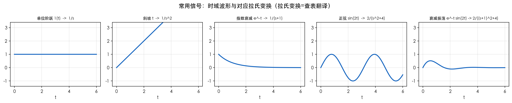
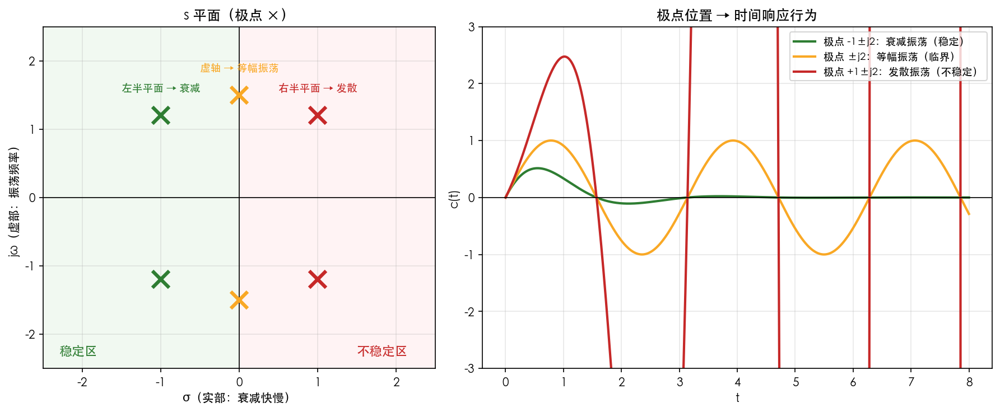
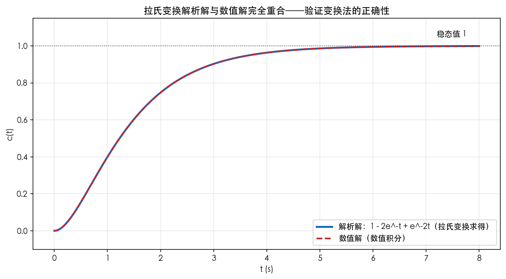

# 第2章 拉普拉斯变换与复变函数基础——仿真与绘图

> 本章目标：画出**常见信号波形**、**"极点位置→时间行为"对应图**（全课最重要的直觉图），并验证用拉氏变换解微分方程。
> 工具：Python（numpy + matplotlib + scipy）。

---

## 图1 常用时间信号波形

### 绘图代码

```python
"""第2章图1：常用信号时域波形"""
import numpy as np
import matplotlib.pyplot as plt

plt.rcParams['font.sans-serif'] = ['PingFang SC', 'STHeiti', 'SimHei', 'DejaVu Sans']
plt.rcParams['axes.unicode_minus'] = False

t = np.linspace(0, 6, 600)
signals = {
    '单位阶跃 1(t)  ⟷  1/s':       np.ones_like(t),
    '斜坡 t  ⟷  1/s²':              t,
    '指数衰减 e⁻ᵗ  ⟷  1/(s+1)':    np.exp(-t),
    '正弦 sin(2t)  ⟷  2/(s²+4)':   np.sin(2*t),
    '衰减振荡 e⁻ᵗ·sin(2t) ⟷ 2/((s+1)²+4)': np.exp(-t)*np.sin(2*t),
}
fig, axes = plt.subplots(1, 5, figsize=(16, 3.2))
for ax, (title, y) in zip(axes, signals.items()):
    ax.plot(t, y, lw=2, color='#1565C0')
    ax.set_title(title, fontsize=10)
    ax.grid(alpha=0.3); ax.set_xlabel('t'); ax.set_ylim(-1.4, 3.4)
fig.suptitle('常用信号：时域波形与对应拉氏变换（拉氏变换=查表翻译）', fontsize=13)
fig.tight_layout()
fig.savefig('figures/01_常用时间信号波形.png', dpi=150, bbox_inches='tight', facecolor='white')
plt.close(fig)
print('图1 已生成')
```

### 运行与结果



*图1 五个常用信号的时域波形。注意"衰减振荡"（最右）正是第5章二阶欠阻尼系统的响应形态，它对应共轭复极点 $-1\pm j2$。*

**现象解释**：前四个是"积木"，第五个是"组合块"。自动控制系统对阶跃输入的响应，几乎都是"常数 + 衰减指数 + 衰减振荡"的组合——**认出信号形态，就等于认出了拉氏变换的构成**。

---

## 图2 极点位置决定时间行为（全课最重要直觉图）

### 绘图代码

```python
"""第2章图2：s平面极点位置 → 时间响应行为 对应图"""
import numpy as np
import matplotlib.pyplot as plt
from matplotlib.patches import Rectangle

plt.rcParams['font.sans-serif'] = ['PingFang SC', 'STHeiti', 'SimHei', 'DejaVu Sans']
plt.rcParams['axes.unicode_minus'] = False

fig, (ax1, ax2) = plt.subplots(1, 2, figsize=(12, 5), gridspec_kw={'width_ratios': [1, 1.3]})

# 左图：s 平面
ax1.set_xlim(-2.5, 2.5); ax1.set_ylim(-2.5, 2.5)
ax1.axhline(0, color='k', lw=0.8); ax1.axvline(0, color='k', lw=0.8)
ax1.add_patch(Rectangle((-2.5, -2.5), 2.5, 5, fc='#E8F5E9', ec='none', alpha=0.6))
ax1.add_patch(Rectangle((0, -2.5), 2.5, 5, fc='#FFEBEE', ec='none', alpha=0.6))
# 三组极点
pts = [((-1, 1.2), '稳定：极点 x'), ((0, 1.5), '临界：极点 x'), ((1, 1.2), '不稳定：极点 x')]
cols = ['#2E7D32', '#F9A825', '#C62828']
labs = ['左半平面 → 衰减', '虚轴 → 等幅振荡', '右半平面 → 发散']
for i, ((re, im), lab) in enumerate(zip(pts, labs)):
    ax1.plot([re], [im], 'x', color=cols[i], ms=14, mew=3)
    ax1.plot([re], [-im], 'x', color=cols[i], ms=14, mew=3)
    ax1.text(re, im+0.25, f'{cols[i]}\n{lab}'.split('\n')[1] if False else lab, fontsize=9, color=cols[i])
ax1.set_title('s 平面（极点 ×）', fontsize=12)
ax1.text(-2.3, -2.3, '稳定区', fontsize=11, color='#2E7D32')
ax1.text(1.5, -2.3, '不稳定区', fontsize=11, color='#C62828')
ax1.set_xlabel('σ（实部：衰减快慢）'); ax1.set_ylabel('jω（虚部：振荡频率）')
ax1.grid(alpha=0.3)

# 右图：对应时域响应
t = np.linspace(0, 8, 800)
cases = [
    ('极点 -1±j2：衰减振荡（稳定）', np.exp(-t)*np.sin(2*t), '#2E7D32'),
    ('极点 ±j2：等幅振荡（临界）',   np.sin(2*t),           '#F9A825'),
    ('极点 +1±j2：发散振荡（不稳定）', np.exp(t)*np.sin(2*t), '#C62828'),
]
for title, y, c in cases:
    ax2.plot(t, y, lw=2, color=c, label=title)
ax2.axhline(0, color='k', lw=0.8); ax2.grid(alpha=0.3)
ax2.set_xlabel('t'); ax2.set_ylabel('c(t)')
ax2.set_title('极点位置 → 时间响应行为', fontsize=12)
ax2.legend(fontsize=9, loc='upper right')
ax2.set_ylim(-3, 3)

fig.tight_layout()
fig.savefig('figures/02_极点位置决定时间行为.png', dpi=150, bbox_inches='tight', facecolor='white')
plt.close(fig)
print('图2 已生成')
```

### 运行与结果



*图2 左图：s 平面被虚轴分成稳定区（左半）与不稳定区（右半）；右图：三组极点的时域响应——左半衰减、虚轴等幅、右半发散。*

**现象解释**：把右图的三种波形和左图的三组极点对上号——**极点的实部 σ 决定"涨落"（衰减/发散），虚部 ω 决定"振荡"**。第5章的稳定性判据、第6章的根轨迹、第7章的频域判据，本质都在回答"极点到底在不在左半平面"。**这张图是理解全课的钥匙**。

---

## 图3 用拉氏变换解微分方程：解析解 vs 数值解验证

### 仿真代码

```python
"""第2章图3：用拉氏变换解二阶微分方程并验证
方程：c'' + 3c' + 2c = 2·1(t)，零初始条件
解析解：c(t) = 1 - 2e^(-t) + e^(-2t)
"""
import numpy as np
import matplotlib.pyplot as plt
from scipy.signal import lti, step

plt.rcParams['font.sans-serif'] = ['PingFang SC', 'STHeiti', 'SimHei', 'DejaVu Sans']
plt.rcParams['axes.unicode_minus'] = False

t = np.linspace(0, 8, 800)
# 解析解（来自部分分式法）
c_analytic = 1 - 2*np.exp(-t) + np.exp(-2*t)
# 数值解：G(s) = C(s)/R(s) = 2/(s²+3s+2)
sys = lti([2.0], [1.0, 3.0, 2.0])
_, c_numeric = step(sys, T=t)

fig, ax = plt.subplots(figsize=(9, 5))
ax.plot(t, c_analytic, lw=2.4, color='#1565C0', label='解析解：1 − 2e⁻ᵗ + e⁻²ᵗ（拉氏变换求得）')
ax.plot(t, c_numeric, '--', lw=2, color='#C62828', label='数值解（数值积分）')
ax.axhline(1, color='k', ls=':', lw=1, alpha=0.6)
ax.text(7.2, 1.05, '稳态值 1', fontsize=10)
ax.set_xlabel('t (s)'); ax.set_ylabel('c(t)')
ax.set_title('拉氏变换解析解与数值解完全重合——验证变换法的正确性', fontsize=12)
ax.legend(fontsize=10); ax.grid(alpha=0.3)
ax.set_ylim(-0.1, 1.15)

fig.tight_layout()
fig.savefig('figures/03_拉氏变换解微分方程验证.png', dpi=150, bbox_inches='tight', facecolor='white')
plt.close(fig)
print('图3 已生成')
```

### 运行与结果



*图3 解析解与数值解完全重合。解析解的三项 $1 - 2e^{-t} + e^{-2t}$ 分别对应极点 $0$（常数项）、$-1$、$-2$。*

**现象解释**：这个二阶系统（$G(s)=\frac{2}{s^2+3s+2}$）就是第3、5章要反复分析的对象。看到响应"先快后慢地爬到 1"——**动态过程（过渡）由极点 $-1$、$-2$ 决定，稳态值由终值定理给出**。拉氏变换法一行代数就解出了微分方程，这就是它的威力。

---

## 思考题

1. 把图3的 $G(s)$ 改为 $G(s) = \dfrac{2}{s^2+4}$（极点 $\pm j2$），解析解会变成什么形态？为什么？这对应图2中的哪一组？
2. 用终值定理验算图3：$c(\infty) = \lim_{s\to0} s\cdot \frac{2}{s(s^2+3s+2)} = ?$，与图中稳态值 1 相符吗？
