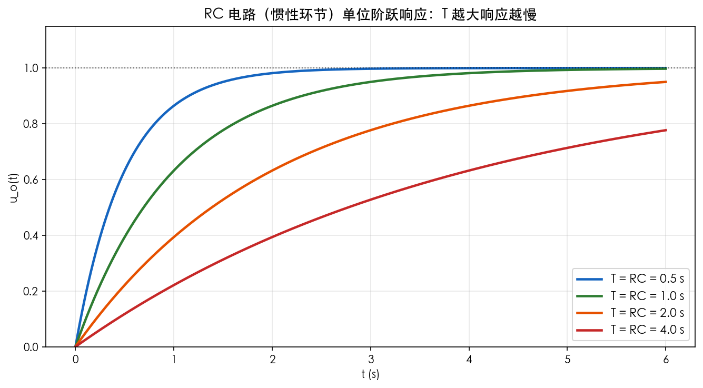

# 第3章 控制系统的数学模型——公式推导

> 本章核心：把物理系统变成"能算的数学形式"。总线索：**物理规律 → 微分方程 → 拉氏变换 → 传递函数**。
> 传递函数是本课的主角，从本章开始，后面所有章节都在围绕它做文章。

---

## 1. 传递函数的定义

### 1.1 定义

线性定常系统，在**零初始条件下**，输出量的拉普拉斯变换 $C(s)$ 与输入量的拉普拉斯变换 $R(s)$ 之比，称为系统的**传递函数**：

$$
\boxed{G(s) = \frac{C(s)}{R(s)} = \frac{b_m s^m + b_{m-1} s^{m-1} + \cdots + b_0}{a_n s^n + a_{n-1} s^{n-1} + \cdots + a_0}}
$$

**说明**：
- **零初始条件**是定义的前提：系统在 $t=0$ 时处于静止状态（$c(0)=0,\ c'(0)=0,\ \cdots$）；
- 分子分母多项式系数由系统**自身的结构参数**决定，与输入无关——**传递函数是系统固有属性的数学描述**；
- $n \ge m$（物理可实现：分母阶次不低于分子）。

### 1.2 推导过程（从微分方程到传递函数）

设系统的 $n$ 阶微分方程：

$$
a_n \frac{d^n c}{dt^n} + \cdots + a_1 \frac{dc}{dt} + a_0 c = b_m \frac{d^m r}{dt^m} + \cdots + b_1 \frac{dr}{dt} + b_0 r
$$

两边取拉氏变换（利用微分定理 $\mathcal{L}[f^{(k)}]=s^k F(s)$，零初始条件使初始项全部消失）：

$$
\begin{aligned}
a_n s^n C(s) + \cdots + a_1 s C(s) + a_0 C(s) & = b_m s^m R(s) + \cdots + b_0 R(s) \\
(a_n s^n + \cdots + a_1 s + a_0) C(s) & = (b_m s^m + \cdots + b_0) R(s) \\
\frac{C(s)}{R(s)} & = \frac{b_m s^m + \cdots + b_0}{a_n s^n + \cdots + a_0} = G(s)
\end{aligned}
$$

**关键思路**：**微分运算被 $s$ 代换**，微分方程变成代数方程——这就是拉氏变换"翻译官"的作用。零初始条件保证 $\mathcal{L}[c']=sC(s)$ 不带初始项，否则会有 $c(0)$ 等残项。

### 1.3 从传递函数还原微分方程

给定 $G(s)=\dfrac{C(s)}{R(s)}$，交叉相乘：

$$
(a_n s^n + \cdots + a_0) C(s) = (b_m s^m + \cdots + b_0) R(s)
$$

再反变换（$s^k \to \frac{d^k}{dt^k}$）即还原微分方程。**传递函数与微分方程一一对应**，只是"换个写法"。

---

## 2. 典型案例推导：RC 电路

### 2.1 建立微分方程

电路：电阻 $R$ 串联电容 $C$，输入电压 $u_i$，输出电压 $u_o$（电容两端电压）。

基尔霍夫电压定律：$u_i = Ri + u_o$，其中 $i = C \dfrac{du_o}{dt}$。代入消去 $i$：

$$
RC \frac{du_o}{dt} + u_o = u_i
$$

令 $T = RC$（时间常数），得：

$$
\boxed{T \frac{du_o}{dt} + u_o = u_i}
$$

### 2.2 取拉氏变换求传递函数

零初始条件下两边变换：$T s U_o(s) + U_o(s) = U_i(s)$

$$
\boxed{G(s) = \frac{U_o(s)}{U_i(s)} = \frac{1}{Ts + 1}}
$$

**关键思路**：RC 电路 = **一阶惯性环节** $G(s)=\dfrac{1}{Ts+1}$。$T=RC$ 越大，充放电越慢，响应越"慵懒"。这是最常见的"惯性"直觉来源——为什么水箱水位、房间温度都不会瞬间变化？因为有"容量"在拖后腿。

*图 3-3 同一 RC 电路取不同时间常数 T 的阶跃响应：T 越小上升越快（曲线陡），T 越大上升越慢（曲线缓）。时间常数 T 就是"达到 63.2% 所用的时间"。*

> **时间视角**：$T$ 不是抽象参数——它就是阶跃响应上升到 $1-e^{-1}\approx63.2\%$ 所花的时间。**看曲线坡度就能估出 T，工程上常用这个办法实测时间常数。**

---

## 3. 典型环节的传递函数推导

### 3.1 比例环节

输出与输入成正比，无惯性：

$$
\boxed{G(s) = K}
$$

**说明**：放大器、比例阀、杠杆。

### 3.2 积分环节

输出是输入的积分：

$$
G(s) = \frac{K}{s}
$$

**推导**：微分方程 $\dfrac{dc}{dt} = K r \Rightarrow C(s) = \dfrac{K}{s}R(s)$。

**说明**：电机转速对电压有积分关系、水箱水位对流入量的关系。**积分环节的存在使系统能消除稳态误差**（第5、8章重点）。

### 3.3 微分环节

$$
\boxed{G(s) = K s}
$$

**说明**：理想微分在物理上不可单独实现（放大器噪声放大），工程上用"实际微分"近似。

### 3.4 惯性环节

$$
\boxed{G(s) = \frac{K}{Ts + 1}}
$$

**说明**：RC 电路、恒温箱、水箱。**"惯性"= 输出落后于输入**，$T$ 是惯性大小。

### 3.5 振荡环节

对二阶系统 $\dfrac{d^2 c}{dt^2} + 2\zeta\omega_n \dfrac{dc}{dt} + \omega_n^2 c = \omega_n^2 r$ 两边取变换并整理：

$$
\boxed{G(s) = \frac{\omega_n^2}{s^2 + 2\zeta\omega_n s + \omega_n^2}}
$$

**说明**：$\omega_n$ 自然频率、$\zeta$ 阻尼比——**第5章的核心主角**。弹簧-质量-阻尼系统、RLC 电路都是振荡环节。

### 3.6 延迟环节

$$
\boxed{G(s) = e^{-\tau s}}
$$

**说明**：由实位移定理 $f(t-\tau)\Longleftrightarrow e^{-\tau s}F(s)$ 得来。物料输送带、管道传输、网络延迟都是纯延迟。
当然，我们可以在原有基础上，从**数学本质、物理建模、响应细节、能量观点**等多个维度进行更深层的剖析，让每一个典型环节都立体起来。

---

### 1. 比例环节——无记忆的瞬时缩放

**数学模型与传递函数**
时域方程： $y(t) = K u(t)$
拉氏变换： $Y(s) = K U(s) \Rightarrow G(s) = K$

**阶跃响应的深层分析**
输入单位阶跃 $u(t)=\varepsilon(t)$ ，其拉氏变换为 $1/s$。输出：
$Y(s) = \frac{K}{s} \Rightarrow y(t) = K\varepsilon(t)$
在 $t=0^+$ 瞬间，输出从 0 **垂直跳变**至 $K$，过渡时间为零。这要求系统具备**无限带宽**和**无穷大功率**才能瞬间完成能量转换——现实中并不存在理想比例环节，但只要系统的动态过程远快于我们关心的时间尺度，就可理想化为此。

**更多物理实例与建模**
- **运算放大器反相比例电路**： $V_o = -\frac{R_f}{R_1}V_i$，在高增益、深度负反馈下，截至频率很高，在低频段近似比例。
- **应变片+电桥测力**：在弹性范围内，电桥输出电压与应变（力）成正比，动态响应可达微秒级，对宏观机械系统即视为比例。
- **液压滑阀**：阀芯位移与输出流量可近似比例关系，如果阀的动态远高于负载动态。

**关键特征**：无储能、无时间滞后、输出完全取决于当前输入，是控制系统中精度和刚度的基础。

---

### 2. 积分环节——能量的累积与记忆

**数学模型与传递函数**
时域： $y(t) = K\int_0^t u(\tau)d\tau + y(0)$
通常设初始为零： $Y(s) = \frac{K}{s}U(s) \Rightarrow G(s)=\frac{K}{s}$

**阶跃响应数学推导**
输入 $U(s)=1/s$：
$Y(s) = \frac{K}{s^2} \Rightarrow y(t)=Kt$
输出是一条斜率为 $K$ 的直线。只要有恒定的输入，输出就永无止境地增长——这体现了积分的**无自衡特性**。

**能量/物理本质**
积分环节描述的是**单一储能元件的净积累过程**。在电路、流体、机械系统中对应：
- **电容**：电压是电流的积分 $v(t) = \frac{1}{C}\int i\,dt$，$K=1/C$。
- **水箱液位**：底面积为 $A$，液位 $h(t)=\frac{1}{A}\int Q_{in}\,dt$，$K=1/A$。
- **旋转机械的转角**：转角是转速的积分 $\theta = \int \omega\, dt$，$K=1$（若 ω 为输入）。
- **电机转速控制模型**：若输入为转矩 $T$，作用于转动惯量 $J$，有 $\omega = \frac{1}{J}\int T\, dt$，这才是表中所提“电机转速”的准确解释。

**重要性质**：
- **记忆功能**：当输入变为零，输出保持最后的值不变，积分器“记住”了历史。
- **相位滞后**：在正弦信号下，输出相位始终滞后输入90°，这是造成系统不稳定的主要原因之一，但也是消除稳态误差的法宝。

---

### 3. 微分环节——变化的预言者

**理想模型的不可实现性**
理想微分方程： $y(t) = K\frac{du(t)}{dt}$
传递函数： $G(s)=Ks$
阶跃输入时，$u(t)$ 在 $t=0$ 处变化率为无穷大，因而输出是强度为 $K$ 的**狄拉克δ函数**，在物理上是一个瞬时无穷大的脉冲，无法实现。

**实际微分环节的实现与近似**
工程中用带有惯性的一阶微分：
$G_{real}(s) = \frac{K s}{T_d s + 1}$
这相当于一个高通滤波器。阶跃响应不再是δ脉冲，而是：在 $t=0^+$ 时跳变到 $K/T_d$，然后按指数规律衰减到零。时间常数 $T_d$ 越小，越接近理想微分，但噪声放大越严重。

**更多物理实现**
- **测速发电机**：输入为转角 $\theta$，输出电动势 $e = K_e \frac{d\theta}{dt}$，是一种机电微分。
- **变压器（弱耦合时）**：输出感应电动势正比于磁通变化率，对电流微分。
- **液压阻尼器**：力与活塞相对运动速度成正比 $F = B v = B\frac{dx}{dt}$，即位移的微分。

**在控制中的角色**
微分控制像“提前刹车”：当误差变化率增大时，微分环节输出一个提前的修正量，抑制超调，增加系统阻尼。但需特别注意**高频噪声放大**问题，常串联低通滤波器使用。

---

### 4. 惯性环节——一阶阻容系统的渐变

**动力学方程与传递函数**
典型一阶微分方程：
$T\frac{dy}{dt} + y = K u$
拉氏变换得： $(Ts+1)Y(s) = K U(s) \Rightarrow G(s) = \frac{K}{Ts+1}$
其中 $T$ 为**时间常数**，$K$ 为**静态增益**。

**阶跃响应详细推导**
单位阶跃 $U(s)=1/s$：
$Y(s) = \frac{K}{s(Ts+1)} = \frac{K}{s} - \frac{KT}{Ts+1}$
拉氏逆变换：
$y(t) = K(1 - e^{-t/T})$

**曲线的关键特征值**：
- $t=0^+$：初始斜率 $\dot{y}(0)=K/T$，输出以这个斜率开始上升。
- $t=T$：达到稳态的63.2%；
- $t=3T$：95%；
- $t=5T$：99.3%，常认为此时达到稳态。
- 无超调，无振荡，最大斜率在起始点。

**物理实例建模**
- **RC低通**： $U_{in}$ 经电阻 $R$ 对电容 $C$ 充电，输出电容电压 $U_c$。方程： $RC\frac{dU_c}{dt} + U_c = U_{in}$，$T=RC$，$K=1$。
- **直流电机转速（电枢控制，忽略电感）**：电压平衡和转矩平衡给出 $J\frac{d\omega}{dt} + B\omega = K_T i$，合并后常为一阶惯性环节。
- **温度计**：热容量 $C_t$ 与热阻 $R_t$ 构成一阶系统，时间常数 $T=R_tC_t$。
- **单容水箱**：液容（底面积）与液阻（阀门）决定时间常数。

**能量观点**：只含一个独立储能元件，能量以指数形式单向流入或流出，不会过冲。

---

### 5. 振荡环节——两个储能元件的能量舞蹈

**通用二阶模型**
开环或闭环二阶标准形式：
$\frac{d^2y}{dt^2} + 2\zeta\omega_n\frac{dy}{dt} + \omega_n^2 y = \omega_n^2 u$
传递函数：
$G(s) = \frac{\omega_n^2}{s^2 + 2\zeta\omega_n s + \omega_n^2}$

**阶跃响应分类**
特征方程 $s^2 + 2\zeta\omega_n s + \omega_n^2=0$，根为 $s_{1,2} = -\zeta\omega_n \pm \omega_n\sqrt{\zeta^2-1}$。

| 阻尼比 ζ      | 极点性质                 | 阶跃响应形式                                                                                                 |
| ---------- | -------------------- | ------------------------------------------------------------------------------------------------------ |
| ζ=0（无阻尼）   | 虚轴共轭 $\pm j\omega_n$ | 等幅振荡 $y=1-\cos\omega_n t$                                                                              |
| 0<ζ<1（欠阻尼） | 左半复平面共轭              | 衰减振荡 $y=1-\dfrac{e^{-\zeta\omega_n t}}{\sqrt{1-\zeta^2}}\sin(\omega_d t+\phi),\quad \phi=\arccos\zeta$ |
| ζ=1（临界阻尼）  | 重实根 $-\omega_n$      | 单调无超调，响应较快                                                                                             |
| ζ>1（过阻尼）   | 两不等负实根               | 单调无超调，响应慢                                                                                              |

其中阻尼振荡频率 $\omega_d = \omega_n\sqrt{1-\zeta^2}$。
好的，我们来深入剖析二阶振荡环节的阶跃响应，重点从**数学推导、物理内涵和动态指标**三个角度详细展开。

---

## 一、从微分方程到传递函数

二阶系统最通用的微分方程为：

$$ \frac{d^2y}{dt^2} + 2\zeta\omega_n\frac{dy}{dt} + \omega_n^2 y = \omega_n^2 u $$

在零初始条件下进行拉普拉斯变换：

$$ s^2 Y(s) + 2\zeta\omega_n s Y(s) + \omega_n^2 Y(s) = \omega_n^2 U(s) $$

整理得到传递函数：

$$ G(s) = \frac{Y(s)}{U(s)} = \frac{\omega_n^2}{s^2 + 2\zeta\omega_n s + \omega_n^2} $$

当输入为单位阶跃信号 $U(s) = 1/s$ 时，输出为：

$$ Y(s) = \frac{\omega_n^2}{s(s^2 + 2\zeta\omega_n s + \omega_n^2)} $$

系统的动态特性完全取决于**特征方程**的根（即闭环极点）：

$$ s^2 + 2\zeta\omega_n s + \omega_n^2 = 0 $$

其根为：

$$ s_{1,2} = -\zeta\omega_n \pm \omega_n\sqrt{\zeta^2-1} $$

判别式 $\Delta = \zeta^2 - 1$ 的符号决定了极点在复平面上的位置，进而决定了响应的形式。

---

## 二、四种阻尼情况的详细推导

### 1. ζ = 0：无阻尼（等幅振荡）

**极点位置**：
$$ s_{1,2} = \pm j\omega_n $$
两极点位于虚轴上，共轭纯虚数。

**输出拉氏变换**：
$$ Y(s) = \frac{\omega_n^2}{s(s^2 + \omega_n^2)} $$
部分分式展开：
$$ Y(s) = \frac{1}{s} - \frac{s}{s^2 + \omega_n^2} $$

**时域响应**（查拉氏逆变换表）：
$$ y(t) = 1 - \cos(\omega_n t), \quad t \ge 0 $$

**物理图像**：输出围绕稳态值 1 做**等幅振荡**，振幅为 1，角频率为自然频率 $\omega_n$，永远不衰减。因为系统没有阻尼元件消耗能量，弹簧与质量之间反复交换动能和势能，总能量守恒。

---

### 2. 0 < ζ < 1：欠阻尼（衰减振荡）

这是**工程实践中最常见**的情况，也是动态性能分析的重点。

**极点位置**：
$$ s_{1,2} = -\zeta\omega_n \pm j\omega_d $$
其中
$$ \omega_d = \omega_n\sqrt{1-\zeta^2} $$
称为**阻尼自然振荡频率**。两极点位于 s 平面左半部，共轭复数。

**输出拉氏变换与逆变换推导**：
$$ Y(s) = \frac{\omega_n^2}{s(s^2 + 2\zeta\omega_n s + \omega_n^2)} $$
配方分母：
$$ s^2 + 2\zeta\omega_n s + \omega_n^2 = (s + \zeta\omega_n)^2 + \omega_d^2 $$
标准部分分式（留数法）：
$$ Y(s) = \frac{1}{s} - \frac{s + \zeta\omega_n}{(s + \zeta\omega_n)^2 + \omega_d^2} - \frac{\zeta\omega_n}{\omega_d} \cdot \frac{\omega_d}{(s + \zeta\omega_n)^2 + \omega_d^2} $$
利用频移性质及正余弦变换对：
$$ \mathcal{L}^{-1}\left\{\frac{s+a}{(s+a)^2+\omega^2}\right\} = e^{-at}\cos(\omega t) $$
$$ \mathcal{L}^{-1}\left\{\frac{\omega}{(s+a)^2+\omega^2}\right\} = e^{-at}\sin(\omega t) $$
可求出：
$$ y(t) = 1 - e^{-\zeta\omega_n t}\left[\cos(\omega_d t) + \frac{\zeta}{\sqrt{1-\zeta^2}}\sin(\omega_d t)\right] $$
利用三角恒等式 $A\cos\theta + B\sin\theta = \sqrt{A^2+B^2}\sin(\theta+\phi)$，合并为单项：
$$ y(t) = 1 - \frac{e^{-\zeta\omega_n t}}{\sqrt{1-\zeta^2}}\sin(\omega_d t + \phi) $$
其中
$$ \phi = \arctan\left(\frac{\sqrt{1-\zeta^2}}{\zeta}\right) = \arccos(\zeta) $$

**物理图像**：指数衰减包络线为 $1 \pm \frac{e^{-\zeta\omega_n t}}{\sqrt{1-\zeta^2}}$，振荡频率 $\omega_d < \omega_n$。阻尼越强（ζ 越大），衰减越快，振荡频率越低。

---

### 3. ζ = 1：临界阻尼

**极点位置**：
$$ s_{1,2} = -\omega_n $$
两重负实根。

**输出拉氏变换**：
$$ Y(s) = \frac{\omega_n^2}{s(s + \omega_n)^2} $$
部分分式展开：
$$ Y(s) = \frac{1}{s} - \frac{1}{s+\omega_n} - \frac{\omega_n}{(s+\omega_n)^2} $$

**时域响应**：
$$ y(t) = 1 - e^{-\omega_n t} - \omega_n t e^{-\omega_n t} = 1 - e^{-\omega_n t}(1 + \omega_n t) $$

**特点**：无超调，无振荡，**是所有无超调响应中最快达到稳态的**。实际工程中，有些高精度定位系统会故意将阻尼调到接近 1，以获得平稳而快速的动作。

---

### 4. ζ > 1：过阻尼

**极点位置**：
$$ s_{1,2} = -\zeta\omega_n \pm \omega_n\sqrt{\zeta^2-1} = -p_1, -p_2 \quad (p_1 < p_2) $$
两个不相等的负实根。

**输出拉氏变换**：
$$ Y(s) = \frac{\omega_n^2}{s(s+p_1)(s+p_2)} $$

**时域响应**（部分分式展开后逆变换）：
$$ y(t) = 1 - \frac{p_2}{p_2-p_1}e^{-p_1 t} + \frac{p_1}{p_2-p_1}e^{-p_2 t} $$
其中两个指数衰减项叠加，较慢的极点 $p_1$ 主导响应的尾部。

**特点**：无超调，但随着 ζ 增大，响应越来越慢。系统“过于黏稠”，能量被迅速消耗，但恢复力相对微弱，所以趋向稳态的过程拖沓。

---

## 三、欠阻尼响应的关键动态指标推导

欠阻尼响应最具振荡特征，需用客观指标衡量其“好”与“快”。

### 1. 峰值时间 $t_p$

峰值出现在响应第一次达到最大值的时刻，即输出曲线的切线斜率为零：
$$ \left.\frac{dy}{dt}\right|_{t=t_p} = 0 $$
对
$$ y(t) = 1 - \frac{e^{-\zeta\omega_n t}}{\sqrt{1-\zeta^2}}\sin(\omega_d t + \phi) $$
求导并令其为 0，解得：
$$ \sin(\omega_d t_p) = 0 \quad \Rightarrow \quad \omega_d t_p = \pi $$
所以
$$ t_p = \frac{\pi}{\omega_d} = \frac{\pi}{\omega_n\sqrt{1-\zeta^2}} $$

**物理含义**：峰值时间取决于阻尼振荡频率，阻尼越大，$\omega_d$ 越小，峰值来得越晚。

---

### 2. 超调量 $\sigma\%$

超调量定义为输出最大峰值超出稳态值的百分比：
$$ \sigma\% = \frac{y(t_p) - y(\infty)}{y(\infty)} \times 100\% $$
将 $t_p = \pi/\omega_d$ 代入 $y(t)$：
$$ y(t_p) = 1 - \frac{e^{-\zeta\omega_n \cdot \pi/\omega_d}}{\sqrt{1-\zeta^2}}\sin(\pi + \phi) $$
由于 $\sin(\pi+\phi) = -\sin\phi = -\sqrt{1-\zeta^2}$，代入：
$$ y(t_p) = 1 + e^{-\frac{\zeta\pi}{\sqrt{1-\zeta^2}}} $$
所以
$$ \sigma\% = e^{-\frac{\pi\zeta}{\sqrt{1-\zeta^2}}} \times 100\% $$

**物理含义**：超调量**仅取决于阻尼比 ζ**，ζ 越小超调越大。当 ζ=0.4 时超调约 25%；ζ=0.7 时超调约 5%。

---

### 3. 调节时间 $t_s$

调节时间定义为响应进入并保持在稳态值的 ±2%（或 ±5%）误差带内所需的最短时间。

由于指数包络线 $1 \pm \frac{e^{-\zeta\omega_n t}}{\sqrt{1-\zeta^2}}$ 决定衰减幅度，忽略 $\frac{1}{\sqrt{1-\zeta^2}}$ 因子（在 ζ 适中时接近 1），由衰减项 $e^{-\zeta\omega_n t}$ 到达 0.02 或 0.05 解得：
- 2% 准则：$e^{-\zeta\omega_n t_s} = 0.02 \Rightarrow t_s \approx \frac{4}{\zeta\omega_n}$
- 5% 准则：$t_s \approx \frac{3}{\zeta\omega_n}$

**物理含义**：调节时间取决于时间常数 $\tau = 1/(\zeta\omega_n)$，ζ 和 ω_n 共同决定响应快慢。为提高速度，可增大 ω_n，或选择 ζ 在 0.7 左右（此时调节时间相对较短且超调适中）。

---

## 四、物理系统的二阶建模

### 1. 弹簧-质量-阻尼系统
方程：
$$ m\ddot{x} + b\dot{x} + kx = F(t) $$
改写为标准形式：
$$ \ddot{x} + \frac{b}{m}\dot{x} + \frac{k}{m}x = \frac{1}{m}F(t) $$
对比标准二阶形式：
$$ \omega_n = \sqrt{\frac{k}{m}}, \quad 2\zeta\omega_n = \frac{b}{m} \Rightarrow \zeta = \frac{b}{2\sqrt{mk}} $$

能量角度：$E = \frac{1}{2}mv^2 + \frac{1}{2}kx^2$，动能与势能交换产生振荡，阻尼器功率 $b v^2$ 持续耗能。

### 2. RLC 串联电路（电容电压输出）
方程：
$$ LC\frac{d^2v_c}{dt^2} + RC\frac{dv_c}{dt} + v_c = v_{in} $$
标准形式对比：
$$ \omega_n = \frac{1}{\sqrt{LC}}, \quad 2\zeta\omega_n = \frac{R}{L} \Rightarrow \zeta = \frac{R}{2}\sqrt{\frac{C}{L}} $$
电感存储磁能 $\frac{1}{2}Li^2$，电容存储电能 $\frac{1}{2}Cv_c^2$，电阻消耗功率。当 $R$ 很小时 ζ 很小，回路会剧烈振荡。

### 3. 双容水箱
两个水箱串联，第一个水箱液位 $h_1$ 为中间变量，第二个水箱液位 $h_2$ 为输出。两阶微分方程导出后会得到二阶传递函数，但在被动流体系统中通常总阻尼大于 1（过阻尼），不会振荡。通过引入比例控制反馈调节进水阀，可以将闭环极点调整到欠阻尼区，使液位调节出现超调和振荡。

---

## 五、总结：阻尼比的选择艺术

| ζ 范围 | 超调 | 速度 | 应用场景 |
|--------|------|------|----------|
| 0.4~0.6 | 较大(10%~25%) | 快 | 快速随动系统（允许少量超调） |
| 0.7 左右 | 约 5% | 较快 | **工程最常用**，兼顾速度与平稳 |
| 0.8~1.0 | 极小/无 | 较慢 | 精密定位、不允许超调的场合 |

通过以上完整推导，你应该能深刻理解为什么“==调节时间看阻尼和自然频率，超调只看阻尼比==”，以及从微分方程到动态响应的逻辑链条是如何建立的。这些公式也是控制系统设计和参数整定的理论基石。
**欠阻尼响应细节**：
- **峰值时间**： $t_p = \frac{\pi}{\omega_d}$，峰值出现在响应第一次达到最大值的时刻，即输出曲线的切线斜率为零
- **物理含义**：峰值时间取决于阻尼振荡频率，阻尼越大，$\omega_d$ 越小，峰值来得越晚。
- **超调量**：超调量定义为输出最大峰值超出稳态值的百分比：
- $\sigma\% = e^{-\pi\zeta/\sqrt{1-\zeta^2}} \times 100\%$，仅与 ζ 有关。
- **调节时间**（2%误差带）： $t_s \approx \frac{4}{\zeta\omega_n}$

**物理系统建模**
1. **弹簧-质量-阻尼系统**：
   方程： $m\ddot{x} + b\dot{x} + kx = F(t)$
   自然频率 $\omega_n = \sqrt{k/m}$，阻尼比 $\zeta = \frac{b}{2\sqrt{mk}}$。阶跃力作用下，位移呈衰减振荡。
2. **RLC串联电路**（输出电容电压）：
   $LC\frac{d^2v_c}{dt^2} + RC\frac{dv_c}{dt} + v_c = v_{in}$
   $\omega_n = 1/\sqrt{LC}$，$\zeta = \frac{R}{2}\sqrt{C/L}$。
3. **双容水箱（两个串联水箱）**：两个储能元件（液容）通过液阻耦合，会呈现二阶振荡特性，但通常 ζ>1 表现为过阻尼，除非加入特殊反馈。

**能量观点**：系统含有两个性质不同的储能元件（如弹簧存储势能、质量存储动能），它们之间可以周期性地交换能量，而阻尼元件持续消耗能量，决定了振荡的衰减速度。

---

### 6. 延迟环节——信息的纯滞后传递

**数学模型**
时域： $y(t) = u(t-\tau)$
拉氏变换： $\mathcal{L}\{f(t-\tau)\} = e^{-\tau s}F(s)$，因此 $G(s)=e^{-\tau s}$

**阶跃响应**
$u(t)=\varepsilon(t)$，则 $y(t)=\varepsilon(t-\tau)$。波形丝毫不失真，只是在时间轴上平移了 $\tau$。

**不可实现性与近似**
$e^{-\tau s}$ 不是关于 $s$ 的有理函数，意味着无法用有限个集中参数（R、L、C、弹簧、质量等）实现。在仿真和设计中常使用**帕德近似**：
一阶帕德： $e^{-\tau s} \approx \frac{1 - \tau s/2}{1 + \tau s/2}$
这就在有理函数框架下引进了右半平面零点，保留了主要的相位滞后特性。

**物理实例**
- **传送带**：物料厚度检测点在传送带起点，执行点在 L 米之后，带速 v，则延迟 $\tau = L/v$。
- **管道流体**：加热器在管道入口，感温点在出口，延迟为管道容积/体积流量。
- **数字控制系统**：采样保持与计算耗时造成的滞后，通常近似为 $e^{-T_s s}$。
- **生物系统/经济系统**：潜伏期、决策传递时间等。

**控制难点**
延迟环节的相频特性为 $\angle G(j\omega) = -\omega\tau$ (弧度)，随着频率增加相位线性滞后，会急剧降低系统的相位裕度，很容易导致振荡失稳。因此大延迟系统是控制界的难题，需要史密斯预估器这类特殊策略。

---

### 各环节的联系与识别

真实系统往往是这些环节的**串联组合**。例如：
- **直流电机位置伺服**：比例（功放）× 积分（电流→转角？严格说是电机一阶惯性 + 积分） ≈ 二阶或三阶。
- **液位控制系统**：积分（水箱） + 延迟（传输管线）+ 惯性（执行阀）。

**==掌握这些典型环节的阶跃响应“指纹”：**==
- ==**瞬间跳变 → 比例（或微分）。**==
- ==**直线持续上升 → 积分。**==
- ==**指数趋稳无超调 → 惯性。**==
- ==**衰减振荡 → 振荡环节（欠阻尼）。**==
- ==**输入和输出完全相同但滞后一段时间 → 延迟。==**

从波形诊断环节组成，是系统辨识和故障诊断的基本功。希望这个深度的解析能让这些经典环节在你的知识体系中彻底“活”起来。

### 3.7 典型环节总结表

| 环节  | 传递函数                                                  | 物理例子  | 阶跃响应特点          |
| --- | ----------------------------------------------------- | ----- | --------------- |
| 比例  | $K$                                                   | 放大器   | 立即成比例跟随         |
| 积分  | $\dfrac{K}{s}$                                        | 电机转速  | 线性增长（无穷大）       |
| 微分  | $Ks$                                                  | （理想）  | 瞬时冲激            |
| 惯性  | $\dfrac{K}{Ts+1}$                                     | RC电路  | 指数上升，渐近稳态       |
| 振荡  | $\dfrac{\omega_n^2}{s^2+2\zeta\omega_n s+\omega_n^2}$ | 弹簧-质量 | 衰减/等幅振荡         |
| 延迟  | $e^{-\tau s}$                                         | 管道传输  | 平移 $\tau$ 后原样输出 |

*图 3-2 六大典型环节的阶跃响应曲线对比。这张图是"识别环节"的依据：看到斜线→积分、渐近→惯性、振荡→二阶。*

---

## 4. 非线性系统的线性化（小偏差线性化）

### 4.1 为什么需要

实际系统普遍存在非线性（如 $y = x^2$、$y = \sin x$、饱和、死区），传递函数法只能处理线性系统。**在平衡点附近的小范围内，用直线近似曲线**——这就是线性化。

### 4.2 推导过程（泰勒展开取一阶）

设非线性函数 $y = f(x)$，在平衡点 $x_0$ 处展开泰勒级数：

$$
y = f(x_0) + f'(x_0)(x - x_0) + \frac{f''(x_0)}{2!}(x-x_0)^2 + \cdots
$$

忽略二阶及以上高阶项（小偏差假设 $|x-x_0|$ 很小），并令增量 $\Delta y = y - f(x_0)$，$\Delta x = x - x_0$：

$$
\boxed{\Delta y \approx K \, \Delta x, \qquad K = f'(x_0) = \left.\frac{df}{dx}\right|_{x=x_0}}
$$

### 4.3 示例：$y = \sin x$ 在 $x_0 = 0$ 处线性化

$$
f'(x) = \cos x \Rightarrow f'(0) = 1 \Rightarrow \boxed{\Delta y \approx \Delta x}
$$

**说明**：小角度摆动的单摆 $\sin\theta \approx \theta$ 就是典型例子——**小摆角时非线性系统"变"线性系统**。
你的直觉**对了一半**！线性化确实是在找“倍数”（也就是**斜率**），但**不完全正确**——它不仅仅是“YY 等于多少倍的 XX”，而是 **“YY 等于斜率乘以变化量，再加上一个初始偏移量”**。

用数学公式说，就是 **$y \approx f(x_0) + f'(x_0) \cdot (x - x_0)$**
### 4.4 线性化条件（务必记住）

1. 系统在平衡点附近工作（小偏差）；
2. 非线性函数在工作点处可导（光滑）；
3. 强非线性（饱和、死区、间隙）不能简单线性化，需用相平面/描述函数等方法（超出本课范围）。

**关键思路**：线性化是"局部"的。不同工作点，斜率 $K$ 不同——所以同一非线性系统在不同工况下会"表现"出不同的传递函数。这也是为什么实际工程调试时要"逐点整定"。

---

## 总结表

| 概念        | 公式                                                         | 要点           |
| --------- | ---------------------------------------------------------- | ------------ |
| 传递函数定义    | $G(s)=\dfrac{C(s)}{R(s)}$                                  | 零初始条件；系统固有属性 |
| 微分方程→传递函数 | $s^k \to \dfrac{d^k}{dt^k}$                                | 拉氏变换翻译       |
| RC电路      | $G(s)=\dfrac{1}{Ts+1}$                                     | 一阶惯性环节       |
| 振荡环节      | $G(s)=\dfrac{\omega_n^2}{s^2+2\zeta\omega_n s+\omega_n^2}$ | 第5章主角        |
| 延迟环节      | $G(s)=e^{-\tau s}$                                         | 平移不改变形态      |
| 线性化       | $\Delta y = f'(x_0)\Delta x$                               | 平衡点附近小偏差     |
