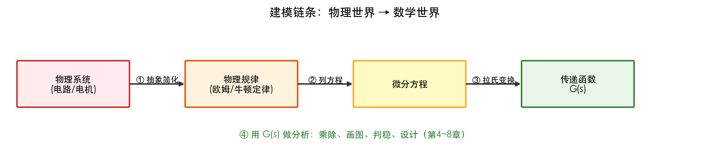
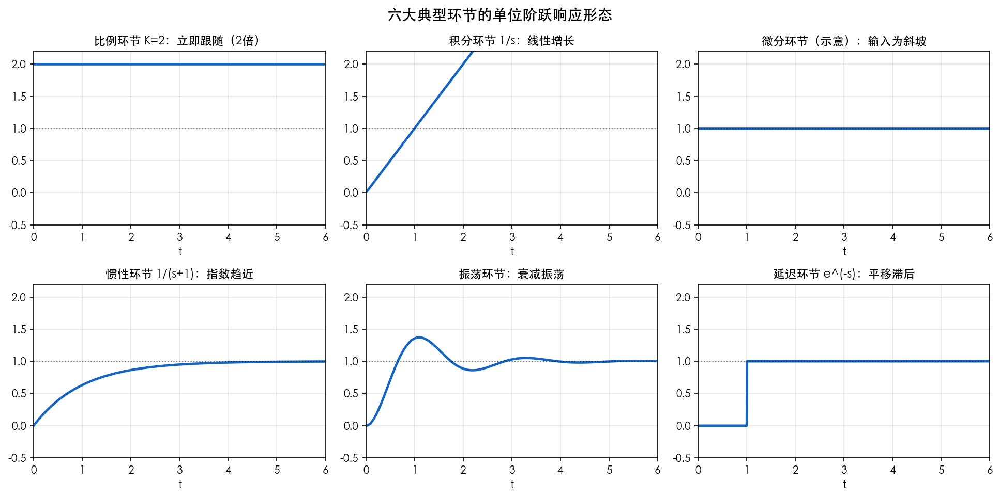
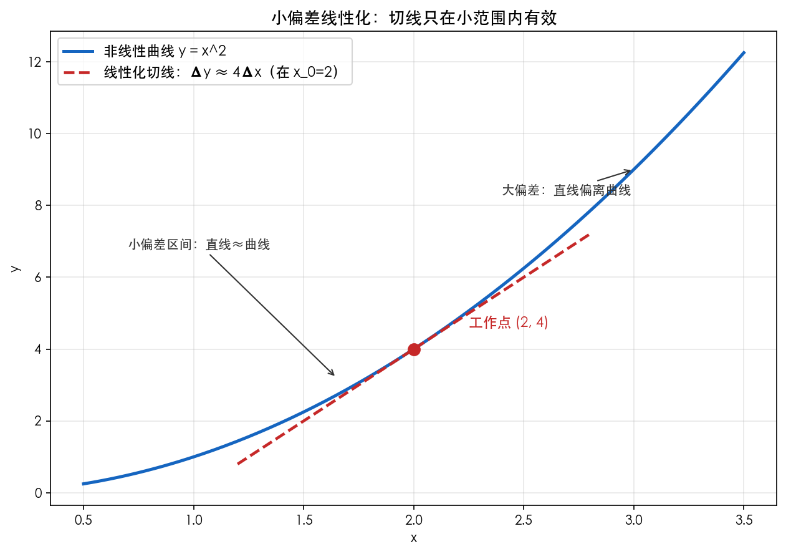

# 第3章 控制系统的数学模型——知识讲解

> **本章内容**
> 
> 1. 为什么要建模：从物理世界到数学世界
> 2. 微分方程建模：步骤与实例（RC电路、弹簧-质量-阻尼）
> 3. 传递函数：定义、含义与求法
> 4. 典型环节：六大积木
> 5. 非线性系统的线性化
> 6. 直流电机调速系统建模（完整案例）
> 7. 本章总结

### 承上启下

第2章我们掌握了拉普拉斯变换这把"翻译官"。但翻译什么呢？——**把控制系统的微分方程翻译成传递函数**。本章就是"建模"：把真实的物理系统（电路、机械、电机）变成数学表达式。这是全课的第二个台阶：没有模型，后面第5~8章的所有分析都是空中楼阁。学完本章，你会掌握"物理系统 → 微分方程 → 传递函数 → 典型环节"的完整建模链。

### 问题导向

带着以下问题学习本章，你会更有方向感：

1. **同一个物理系统，为什么可以有不同的数学描述方式？哪种最方便分析？**
2. **传递函数到底"传递"了什么？它为什么能代表系统的"性格"？**
3. **真实系统几乎都是非线性的，凭什么能用线性方法分析？**

---

## 一、为什么要建模？

### 为什么？

工程师手里有一个物理系统（比如一台电机、一个恒温箱），他想回答三个问题：它稳不稳？响应快不快？误差大不大？——**物理系统本身不能"算"，必须把它变成公式才能用数学去分析**。这就是建模：**用数学语言描述物理规律**。

### 怎么做？

建模的通用链条：

```
物理系统
   │  ① 抽象：抓主要矛盾，忽略次要因素（摩擦、热损耗、噪声……）
   ▼
物理规律（牛顿定律/基尔霍夫定律/能量守恒）
   │  ② 列方程：用微分方程写出"动态关系"
   ▼
微分方程
   │  ③ 拉氏变换：微分变 s，得到代数关系
   ▼
传递函数  ←——— 控制理论最通用的"系统名片"
```



*图 3-1 建模链：物理系统 → 抽象 → 物理规律 → 微分方程 → 拉氏变换 → 传递函数。每一步"翻译"一次，最终得到系统的数学名片。*

### 是什么？

> **数学模型** = 系统动态特性的数学描述。本课主要用两种：
> - **微分方程**（时间域）：$a_n c^{(n)} + \cdots = b_m r^{(m)} + \cdots$
> - **传递函数**（复频域）：$G(s) = C(s)/R(s)$
>
> 两者等价，传递函数更方便乘除、画图、分析，所以是本课主角。

---

## 二、微分方程建模：步骤与实例

### 为什么？

微分方程是"最原始、最物理"的模型，是传递函数的源头。列微分方程的能力=把物理规律翻译成数学的能力。

### 怎么做？（通用四步法）

```
① 确定输入量、输出量（明确"算什么"）
② 依据物理定律列基本关系式
③ 消去中间变量，整理成"输出—输入"的标准形式
④ 按输出导数降阶排列，写成规范式
```

### 实例1：RC 电路

- 输入：$u_i$，输出：$u_o$；
- 基尔霍夫定律：$u_i = Ri + u_o$，$i = C \dfrac{du_o}{dt}$；
- 消去 $i$：$RC \dfrac{du_o}{dt} + u_o = u_i$；
- 标准式：$T \dfrac{du_o}{dt} + u_o = u_i$，其中 $T = RC$。

### 实例2：弹簧-质量-阻尼系统（机械系统经典）

- 输入：外力 $F$，输出：位移 $y$；
- 牛顿第二定律：$m\ddot{y} = F - c\dot{y} - ky$；
- 整理：$m \ddot{y} + c \dot{y} + k y = F$。

### 是什么？

| 元件类型 | 基本规律   | 数学形式                       |
| ---- | ------ | -------------------------- |
| 电阻   | 欧姆定律   | $u = Ri$                   |
| 电容   | 电荷积累   | $u = \frac{1}{C}\int i dt$ |
| 电感   | 磁场储能   | $u = L\frac{di}{dt}$       |
| 弹簧   | 胡克定律   | $F = ky$                   |
| 阻尼器  | 粘性摩擦   | $F = c\dot{y}$             |
| 质量块  | 牛顿第二定律 | $F = m\ddot{y}$            |

> 注意一个美妙的"类比"：**电感和质量、电容和弹簧、电阻和阻尼器**在数学上行为相同。所以电路和机械系统可以互相"翻译"——这就是"机电类比"，也是为什么控制理论能统一处理各种系统。

---

## 三、传递函数：定义、含义与求法

### 为什么？

微分方程好是好，但每输入一个信号就要解一次方程。**传递函数一次性刻画出"系统的性格"，输入输出直接相乘即可**，还能用于画图、判稳、设计——所以它是控制理论的"通用货币"。

### 怎么做？

$$
G(s) = \frac{C(s)}{R(s)} \bigg|_{\text{零初始条件}}
$$

求法三途径：
1. 由微分方程直接变换（最常见）；
2. 由实验测频率响应（第7章）；
3. 由已知环节的传递函数组合（第4章结构图）。

### 是什么？

传递函数的三层含义：

1. **系统属性**：只由系统结构参数决定，与输入无关；
2. **运算规则**：$C(s) = G(s) \cdot R(s)$——输出=系统×输入（复频域乘法）；
3. **结构信息**：分子分母的根 = 零点、极点——**极点是系统的"命运"**（第2章结论）。

> 类比：传递函数像"餐馆的菜单+配方"。不管客人点什么菜（输入），餐厅的厨艺（$G(s)$）是固定的。想知道端上来的菜（输出）什么样？拿菜单和配方算一下就行。

> **零极点对消**：若传递函数分子与分母含有**相同的因式**（如 $G(s)=\dfrac{s+2}{(s+2)(s+3)}$），则该零点与极点位置重合，可数学约去得 $G(s)=\dfrac{1}{s+3}$——这就是"零极点对消"。物理含义：被消掉的极点模式**在输入输出响应中永远不会被激励**（零点把它"堵死"了），所以化简前后系统的外部行为等价。对消在化简传递函数和设计中有用（例如用零点去抵消不希望出现的极点）；但工程上须警惕——对消依赖**精确的模型参数**，若参数有误差，被消的极点会"漏"进响应，且被消去的是动态模式，内部状态仍可能被激发，故对消前要确认模型的准确性（对应练习题 1.4）。

---

## 四、典型环节：六大积木

### 为什么？

任何复杂系统都是典型环节的**串联/并联/反馈组合**。先认识"积木"，才能看懂"高楼"。

### 怎么做？是什么？

| 环节 | 传递函数 | 一句话本质 | 生活类比 |
|------|----------|-----------|----------|
| 比例 K | $K$ | 立刻按比例放大 | 扩音器 |
| 积分 | $K/s$ | 慢慢积累 | 水箱储水 |
| 微分 | $Ks$ | 看变化趋势 | 天气预报"变化率" |
| 惯性 | $\dfrac{K}{Ts+1}$ | 有容量，慢半拍 | 房间升温 |
| 振荡 | $\dfrac{\omega_n^2}{s^2+2\zeta\omega_n s+\omega_n^2}$ | 有弹性会晃 | 秋千/弹簧秤 |
| 延迟 | $e^{-\tau s}$ | 输出平移滞后 | 回音、管道输送 |



*图 3-2 各典型环节对阶跃输入的响应曲线：比例=立即跳变、积分=直线斜升、惯性=渐近逼近、振荡=超调后收敛、微分=冲激式脉冲、延迟=平移滞后。看一眼曲线，就能对应上传递函数。*

> **时间视角：每个环节"阶跃响应长什么样"是必须会的**——考试常给曲线让你反推环节类型。图 3-2 就是"识图题"的答案库：斜线→积分、渐近→惯性、振荡→二阶、平移→延迟。

> **记忆锚点**：
> - 惯性环节 = "比例 + 一个极点在 $-1/T$"；
> - 振荡环节 = "两个共轭复极点"；
> - 积分环节 = "极点在原点"。
> **每个环节 = 极点位置的一种形态**——再一次呼应第2章的"极点决定行为"。

---

## 五、非线性系统的线性化

### 为什么？

真实系统几乎都是非线性的：电阻会发热漂移、摩擦力不线性、饱和/死区普遍存在。而传递函数只能描述线性系统。**出路：在平衡点附近的小范围内，把非线性"拉直"成线性**。

### 怎么做？

在平衡点 $(x_0, y_0)$ 处泰勒展开，取一阶近似：

$$
\Delta y \approx \left.\frac{df}{dx}\right|_{x_0} \Delta x
$$

### 是什么？

| 事项 | 说明 |
|------|------|
| 适用前提 | 工作点附近小偏差；函数光滑可导 |
| 数学工具 | 泰勒展开（一阶） |
| 物理含义 | 用切线代替曲线 |
| 不适用情形 | 强非线性（饱和、死区、间隙） |



*图 3-4 在平衡点 $(x_0,y_0)$ 处，用切线（红色）代替非线性曲线（蓝色）：小偏差范围内两者几乎重合，偏差越大误差越大。这就是"小偏差线性化"的几何本质。*

> 经典例子：单摆小角度摆动 $\sin\theta \approx \theta$——摆角小于 $5°$ 时，摆动规律近似线性。**这就是为什么你可以用传递函数分析"微小的扰动响应"，但不能分析"大幅度的跳变"**。

---

## 六、直流电机调速系统建模（完整案例）

### 为什么？

把前五节串起来，走一遍"真实系统全流程建模"——这是后续第9章综合案例的预演，也是考试最爱的题型。

### 怎么做？

**对象**：他励直流电机，输入 $u_a$（电枢电压），输出 $\Omega$（转速）。

**建模步骤**：

```
① 电枢回路方程：u_a = R_a i_a + L_a di_a/dt + E
                    （E = C_e Ω，反电动势）
② 电磁转矩方程：T = C_m i_a = J dΩ/dt + T_L
                    （J 转动惯量，T_L 负载转矩）
③ 忽略电感 L_a（电气时间常数远小于机械时间常数），
   消去 i_a、E、T  →  一阶惯性关系：
       T_m dΩ/dt + Ω = K_m u_a − K_d T_L
④ 令 T_L=0，取拉氏变换：
       G(s) = Ω(s)/U_a(s) = K_m / (T_m s + 1)
```

### 是什么？

电枢电压控制的直流电机（忽略电感时）= **一阶惯性环节** $\dfrac{K_m}{T_m s+1}$。其中：

- $T_m$：机电时间常数（决定电机转速响应快慢）；
- $K_m$：电压-转速增益。

> 结论：**直流电机调速的核心模型并不复杂**——一阶惯性。控制工程师的工作，就是给这个"惯性很大、易受负载扰动"的对象，配上合适的控制器（第8章PID），让转速又快又准又稳。

---

## 总结：知识体系图

```
物理系统（电路/机械/电机）
   │ 物理定律
   ▼
微分方程 ──拉氏变换──► 传递函数 G(s)
   │                        │
   │                        ├─ 典型环节识别（比例/积分/微分/惯性/振荡/延迟）
   │                        ├─ 零点/极点（系统指纹）
   ▼                        ▼
非线性系统 ──小偏差线性化──► 线性模型（本课分析的前提）
```

### 核心脉络

1. 建模链：物理规律 → 微分方程 → 传递函数；
2. 关键思想：**传递函数是系统名片，极点是名片上的指纹**；任何系统都是典型环节的组合；
3. 下一章：系统由多个环节组成时，如何用结构图/信号流图求总传递函数。

---

## 附录：阻尼比 $c = 2\zeta\sqrt{km}$ 的推导

> 这段内容是对弹簧-质量-阻尼系统中阻尼比 $\zeta$ 定义的深入解释。

这个公式 $c = 2\zeta\sqrt{km}$ 不是靠"经验"拍脑门定的，也不是拿卡尺量出来的，它其实是一个**严格的数学定义**。我们是在**"反向工程"**——为了让物理方程匹配完美的数学标准型，我们**强行规定**了 $\zeta$ 必须这么算。

### 1. 从物理方程出发（除以质量 $m$）

已知物理方程：

$$
m\ddot{y} + c\dot{y} + ky = 0
$$

为了数学上好看，两边同时除以质量 $m$：

$$
\ddot{y} + \frac{c}{m}\dot{y} + \frac{k}{m}y = 0
$$

### 2. 引入"固有频率" $\omega_n$

我们观察最后一项 $\frac{k}{m}$，发现它的单位是 $1/s^2$（因为 $N/m \div kg = 1/s^2$），这刚好是"频率的平方"。

所以我们**给它起个名字**，令：

$$
\omega_n = \sqrt{\frac{k}{m}} \quad \Longrightarrow \quad \frac{k}{m} = \omega_n^2
$$

### 3. 灵魂操作：强行构造"中间项"

现在看中间那一项 $\frac{c}{m}$。为了把方程写成统一的"震荡标准型"，我们想把它表示为 **$2 \times (\text{某个数}) \times (\text{固有频率})$** 的形式。

于是我们**定义一个符号 $\zeta$**（阻尼比），令：

$$
\frac{c}{m} = 2\zeta\omega_n
$$

**注意：这一步不是物理发现，而是纯粹的数学"配凑"！** 我们人为地把阻尼系数 $c$ 拆成了这个模样。

既然 $\frac{c}{m} = 2\zeta\omega_n$，我们把 $\omega_n = \sqrt{\frac{k}{m}}$ 代进去：

$$
\frac{c}{m} = 2\zeta \sqrt{\frac{k}{m}}
$$

### 4. 解出 $c$（见证奇迹的时刻）

两边同时乘以 $m$：

$$
c = 2\zeta m \sqrt{\frac{k}{m}}
$$

把 $m$ 拿进根号里（因为 $m = \sqrt{m^2}$）：

$$
c = 2\zeta \sqrt{m^2 \cdot \frac{k}{m}} = 2\zeta\sqrt{km}
$$

**推导完毕。** 我们不是"算"出了阻尼系数，而是"定义"了阻尼比 $\zeta$。

### 5. 为什么要费尽心机这么"凑"？

这么凑的目的，是为了把方程变成**全世界统一的二阶震荡标准型**：

$$
\ddot{y} + 2\zeta\omega_n \dot{y} + \omega_n^2 y = 0
$$

凑成这个形式后，我们直接写出它的**特征方程**（令 $s$ 代替微分算子）：

$$
s^2 + 2\zeta\omega_n s + \omega_n^2 = 0
$$

用求根公式解这个方程：

$$
s = -\zeta\omega_n \pm \omega_n\sqrt{\zeta^2 - 1}
$$

**看这里的关键判断：**

- 当 $\zeta < 1$ 时，根号里面是负数，出现**共轭复根**（必然震荡）——这就是**欠阻尼**。
- 当 $\zeta = 1$ 时，根号为零，出现**重根**（刚好不震荡）——这就是**临界阻尼**。
- 当 $\zeta > 1$ 时，根号为正，出现**两个负实根**（纯衰减）——这就是**过阻尼**。

### 总结

**何以知之？** —— 通过**数学配凑法**知之。

这个公式的本质是：**物理世界给了我们 $m$、$c$、$k$，但控制理论为了统一判断震荡特性，强行把这三个物理量打包成了一个无量纲的数 $\zeta$。** 所以，你要先有物理参数（质量、弹簧、阻尼器），才能算出 $\zeta$；反过来，如果你设计时先定下想要的 $\zeta$（比如想要 0.7），才能反推出需要买多大阻尼系数的零件（选型 $c$）。

---

## 动手实践（本章任务）

> 建模是"从物理到数学"的第一关，实践任务是**亲手搭模型 + 验证它是对的**。

1. **弹簧-质量-阻尼建模**：运行 `第3章绘图.py`，先手写微分方程 → 求传递函数 → 仿真对比"微分方程数值解"和"传递函数阶跃响应"，确认两条曲线重合（验证建模正确）。
2. **线性化实验**：对非线性系统 $y'' = -g\sin y$（单摆）在 $y=0$ 处线性化得 $y''=-gy$，仿真对比两者在 $y_0=0.1$（小偏差）和 $y_0=1.0$（大偏差）时的误差——**直观看到"线性化的适用范围"**。
3. **电机建模**：直流电机电枢控制，自己列微分方程得出 $G(s)=K/(s(Ts+1))$，再对着第9章的直流电机案例核对参数含义。

---

## 本章应掌握的内容

- [ ] 能按四步法列出 RC 电路、弹簧-质量-阻尼系统的微分方程
- [ ] 能写出传递函数定义并解释"零初始条件"的意义
- [ ] 能说出六大典型环节的传递函数与物理例子
- [ ] 能对 $y = \sin x$、$y=x^2$ 等函数在给定点线性化
- [ ] 能说明线性化的适用条件与不适用情形
- [ ] 能完成直流电机等简单对象的建模并得出传递函数
