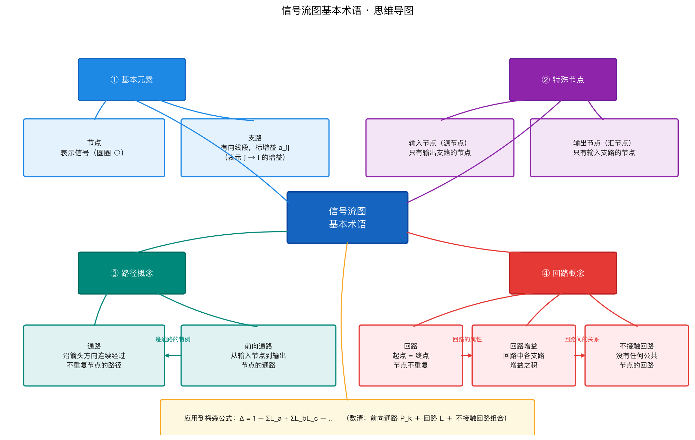
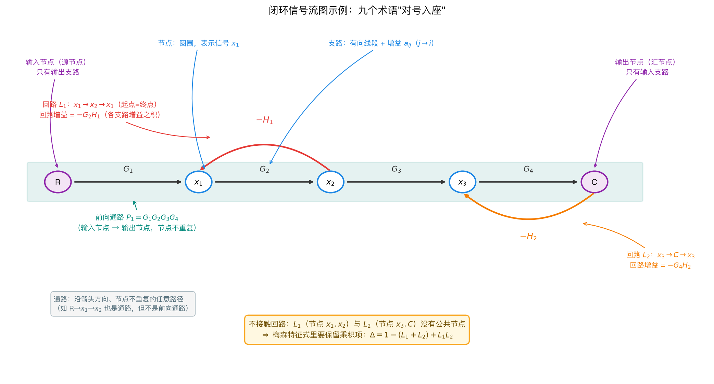

# 第4章 结构图与信号流图——公式推导

> 本章核心：复杂系统由多个环节组成，怎么求**总传递函数**？两种工具：结构图等效变换、信号流图+梅森公式。
> 全章重点公式：串联、并联、反馈等效变换 + 梅森增益公式。

---

## 1. 结构图的三种基本连接等效变换

### 1.1 串联连接

**结构**：$R(s) \to [G_1] \to [G_2] \to C(s)$

**推导**：$C = G_2 \cdot X$，$X = G_1 \cdot R$，代入得 $C = G_2 G_1 R$。

$$
\boxed{G(s) = \frac{C(s)}{R(s)} = G_1(s)\, G_2(s)}
$$

**说明**：串联 = 传递函数相乘。推广到 $n$ 个环节：$G = \prod G_i$。

### 1.2 并联连接

**结构**：$R(s) \to [G_1] \searrow$，$R(s) \to [G_2] \searrow$，两路输出在比较点相加得 $C(s)$。

**推导**：$C = G_1 R + G_2 R = (G_1 + G_2) R$。

$$
\boxed{G(s) = G_1(s) + G_2(s)}
$$

**说明**：并联 = 传递函数相加（符号相同才可直接相加；带负号按减法处理）。

### 1.3 反馈连接（最重要）

**结构**：

$$R \to \boxed{\oplus} \to \boxed{G} \to C$$
$$\quad\ \ \uparrow\!\!- \boxed{H} \leftarrow\!\!-$$

**推导**：

$$
\begin{aligned}
E & = R - H\, C & \text{① 比较点} \\
C & = G\, E & \text{② 前向通道} \\
C & = G(R - HC) & \text{③ 代入} \\
C(1 + GH) & = GR \\
\frac{C}{R} & = \frac{G}{1 + GH} & \text{④ 得结论}
\end{aligned}
$$

$$
\boxed{\Phi(s) = \frac{C(s)}{R(s)} = \frac{G(s)}{1 + G(s)H(s)}}
$$

**说明**：
- 分子 $G$ 是**前向通道**，分母 $1+GH$ 的 $GH$ 是**回路增益**，在控制理论里就是**"信号在闭合环路里完整跑一圈，总共被放大了多少倍（以及相位转了多少度）"**；
- 负反馈取 $+$，正反馈取 $-$（分母 $1-GH$）；
- 比较器是**减号（负反馈）** ➔ 分母是**加号（$1+GH$）**；
- 比较器是**加号（正反馈）** ➔ 分母是**减号（$1-GH$）**；
- $1+GH = 0$ 时系统特征方程——**$1+GH=0$ 即闭环极点所在**（第6章根轨迹就是解这个方程随 $K$ 的变化）。在数学上，**分母为零的点（$1+GH=0$）被称为系统的"极点"**。

### 1.4 三种连接总结表

| 连接 | 等效传递函数 | 口诀 |
|------|--------------|------|
| 串联 | $G_1 G_2$ | 串乘 |
| 并联 | $G_1 + G_2$ | 并加 |
| 反馈（负） | $\dfrac{G}{1+GH}$ | 反馈"除以 1+GH" |


*图 4-1 三种基本连接的等效变换：串联相乘、并联相加、负反馈"除以 $1+GH$"。绿色方框就是化简后的等效环节——任何复杂结构图最终都能化简成这三种形式的嵌套。*

> **时间视角**：反馈连接不只是"多画一条线"，它**改变了系统的时间行为**。以 $G=\dfrac{K}{Ts+1}$ 为例：开环时极点在 $-1/T$、时间常数 $T$；加单位负反馈后闭环 $\dfrac{K}{Ts+1+K}$，时间常数变为 $\dfrac{T}{1+K}$——**反馈增益 $K$ 越大，系统时间常数越小、响应越敏捷**。这是"闭环优于开环"在时间域的第一个代数证据，第8章校正设计还会用到这个结论。反馈把开环的时间常数 $T$ 变成了 $\dfrac{T}{1+K}$。**增益 $K$ 越大，系统被"逼"得越紧，反应就越快；但永远会差一点点追不上目标（稳态误差），且容易晃（欠阻尼）。**

**“先化简局部法**
”这个叫法非常形象！它其实就是**框图化简（等效变换）**的核心操作手法。

相比于梅森公式那种“全局一把抓”的代数硬算，**局部化简法**更像是**“解九连环”**——不急于看整体，而是从系统最**内部、最嵌套**的小闭环开始，一层一层地“剥洋葱”，逐步把复杂的结构简化成你熟悉的**串联、并联、单位反馈**。

我把它拆解成一套**“三步走”的操作规程**，帮你把思路彻底捋顺：

---

### 第一步：识别“最小内环”（执行闭环公式）

这是最核心的一步。看到一个复杂的框图，别急着看全局，先找**“最里面那个圈”**（即没有任何其他方框夹在它中间的反馈回路）。

- **操作**：遇到这种单纯的小闭环（前向 \( G \)，反馈 \( H \)），直接套用你背得滚瓜烂熟的**闭环传递函数公式**：
  - **负反馈**：\( \frac{G}{1+GH} \)
  - **正反馈**：\( \frac{G}{1-GH} \)
- **结果**：把这一整个“环”**“打包”**成一个新的等效方框 \( G_{new} \)。（原来里面的信号线、比较点全都被“吞并”了，图纸瞬间少了好几个元件）。

---

### 第二步：执行“四则运算”（合并串并联）

把内环打包成新方框后，它就会和旁边的方框形成简单的**串联**或**并联**关系（或者刚好处在单位负反馈的前向通道上）。这时候进行第二步：

- **串联**：方框一个接一个（\( G_1 \to G_2 \)），直接相乘：\( G_{new} = G_1 \times G_2 \)。
- **并联**：方框并排走（分两路汇合），直接相加/减：\( G_{new} = G_1 \pm G_2 \)。

---

### 第三步（避坑难点）：迫不得已时，进行“搬家”移动

如果你发现化简到某一步，**局部小闭环外面有引出点或比较点挡住了去路**，导致你没法直接串并联，这时候才轮到**你之前问的“引出点/比较点移动”规则**登场。

- **原则**：能不搬就不搬（搬了容易算错）。如果非要搬，记住我们之前的黄金法则：
  - **引出点前移（往输入挪）乘 \( G \)，后移（往输出挪）乘 \( 1/G \)；**
  - **比较点前移（往输入挪）乘 \( 1/G \)，后移（往输出挪）乘 \( G \)。**
- **目的**：移动这些“分叉点”或“汇合点”，目的只有一个——**把挡路的点移开，强行制造出可以进行“第一步（闭环）”或“第二步（串并联）”的结构**。

---

### 🍔 用一个“汉堡包”例子现场走一遍

假设有一个系统（如下图），看起来有两层反馈，我们一步步“吃掉”它：

```text
      R ──►[ G1 ]──►⊕──►[ G2 ]──► C
                    ▲ │
                    │ ▼
                    └─[ H1 ]      (内部小环)
                    
      (外层还有一个大反馈 H2，从 C 引回到 R 下方)
```

**化简步骤：**

1. **吃内层（先化简局部）**：
   先看右边那个由 \( G2 \) 和 \( H1 \) 组成的小环（负反馈）。它和外面不牵扯。
   **操作**：把它打包成一个新方框 \( G_{inner} = \frac{G_2}{1 + G_2 H_1} \)。

2. **化简串联**：
   打包后，现在的结构变成了：`R --> [G1] --> [G_inner] --> C`，并且外层大反馈 \( H2 \) 从 C 引回 R。此时，前向通道变成了 \( G_1 \times G_{inner} \) 的串联。
   **操作**：把 \( G_1 \) 和 \( G_{inner} \) 乘起来，得到 \( G_{forward} = G_1 \cdot \frac{G_2}{1 + G_2 H_1} \)。

3. **吃外层（闭环公式）**：
   现在整个系统变成了一个单纯的单位负反馈结构（前向是 \( G_{forward} \)，反馈是 \( H2 \)）。
   **操作**：套闭环公式，得出总传递函数：
   \[
   G(s) = \frac{G_{forward}}{1 + G_{forward}H_2} = \frac{G_1 G_2}{1 + G_2 H_1 + G_1 G_2 H_2}
   \]

---

### 和梅森公式的“分工”区别（帮你选方法）

- **什么时候用“先化简局部”？** 
  当框图比较规整，**反馈回路嵌套层次分明**（一层包一层）时。它直观、不易漏项，而且能帮你深刻理解信号在物理上是怎么流的。

- **什么时候用“梅森公式”？**
  当框图**绕得乱七八糟**，有很多交叉的前馈通路，或者移动引出点/比较点极其困难时。用梅森公式可以跳过图形变换，直接“数回路”写答案。

**总结口诀**：
> **“见环先套闭环式，串并直接乘加减；**  
> **若遇点卡住路，迫不得已再搬家；**  
> **层层剥茧往里吃，最后只剩一比一。”**

你现在手头有没有一道具体的化简题目被卡住了？有的话直接发那个框图给我，我带你一步步“剥洋葱”走一遍，保证比光看文字痛快十倍！😊

---

## 2. 比较点与引出点的移动规则

### 2.1 引出点移动

**引出点往输入（左边）挪，信号变小了，要乘 $G$ 补回来；引出点往输出（右边）挪，信号变大了，要乘 $1/G$ 衰减回去。**

**引出点前移**（跨过 $G(s)$）：

$$
\boxed{\text{原：引出 } C \quad \Rightarrow \quad \text{前移后：引出 } E，\text{支路增益乘 } G}
$$

**引出点后移**（跨过 $G(s)$）：

$$
\boxed{\text{原：引出 } E \quad \Rightarrow \quad \text{后移后：引出 } C，\text{支路增益乘 } \frac{1}{G}}
$$

### 2.2 比较点移动，**引出点移动要保证“取出的信号”不变；比较点移动要保证“整个系统的最终输出 $Y$”不变**

**比较点往前（左）走，外面的信号太瘦，除以 $G$ 补一补；**  
**比较点往后（右）走，外面的信号太糗，乘以 $G$ 变队友。**

**比较点前移**（跨过 $G(s)$，越过方框）：

$$
\boxed{\text{前移：输入支路乘 } \frac{1}{G}}
$$

**比较点后移**（跨过 $G(s)$）：

$$
\boxed{\text{后移：输入支路乘 } G}
$$
              【比较点移动方向】
               
   左边（输入侧）         右边（输出侧）
        ▲                     ▲
        │                     │
    ────┼──[ G ]──────────────┼───
        │                     │
   前移（向左越过G）      后移（向右越过G）
        │                     │
   外部信号要 ÷ G         外部信号要 × G
### 2.3 移动规则背后的思想

> **变换的本质**：等效变换不改变"输入到输出的数学关系"。移动比较点/引出点时，只需给被移动的支路**乘上或除以所跨过环节的传递函数**，保持信号大小不变。

**关键思路**：移动的目的是"消除交叉连接"，让结构变成"串联+并联+反馈"的嵌套——就可以套用 §1 的三个公式。**先化简并联/反馈，再处理交叉**是常见顺序。

---

## 3. 信号流图与梅森增益公式

### 3.1 信号流图的基本术语



*图 4-0 信号流图基本术语思维导图：九个术语分成四组——**① 基本元素**（节点、支路）是"砖块"；**② 特殊节点**（输入/源节点、输出/汇节点）是"起点和终点"；**③ 路径概念**（通路 → 前向通路，前向通路是通路的特例）；**④ 回路概念**（回路 → 回路增益是它的属性，不接触回路是回路之间的关系）。这四组正是梅森公式的"计数对象"：数前向通路 $P_k$、数回路 $L$、数不接触回路组合，就能套公式。*



*图 4-0b 一个双回路闭环信号流图，把九个术语"对号入座"：紫色是输入节点 $R$ 与输出节点 $C$，蓝色是中间节点与带增益的支路，青色衬底框出前向通路 $P_1=G_1G_2G_3G_4$；红色回路 $L_1$（$x_1 \to x_2 \to x_1$，回路增益 $-G_2H_1$）与橙色回路 $L_2$（$x_3 \to C \to x_3$，回路增益 $-G_4H_2$）**没有公共节点**，所以是一对**不接触回路**——梅森特征式因此写成 $\Delta = 1-(L_1+L_2)+L_1L_2$，乘积项 $L_1L_2$ 必须保留。这张图就是 §3.3 梅森公式"数三条清单"的最小完整样板。*

九个术语的完整定义：

- **节点**：表示信号（圆圈）；
- **支路**：有向线段，标增益 $a_{ij}$（表示从节点 $j$ 到节点 $i$ 的增益）；
- **输入节点**（源节点）：只有输出的节点；
- **输出节点**（汇节点）：只有输入的节点；
- **通路**：沿箭头方向连续经过不重复节点的路径；
- **前向通路**：从输入节点到输出节点的通路；
- **回路**：起点=终点且不重复经过其他节点的闭环路径；
- **回路增益**：回路中各支路增益之积；
- **不接触回路**：没有任何公共节点的回路。

**术语之间的关系**（看图抓这三条主线）：

1. **构成关系**：信号流图 = 节点 + 支路（基本元素搭出整张图）；
2. **包含关系**：前向通路 $\subset$ 通路——所有前向通路都是通路，但通路不一定通向输出节点；
3. **派生关系**：回路增益是回路的"属性"（算出来的数），不接触回路是回路之间的"关系"（用来判断 $\Delta$ 里哪些乘积项要保留）。

### 3.2 梅森增益公式（本课最值钱的公式）
梅森增益公式确实是现代控制理论里**“含金量最高”**的公式，没有之一。它之所以值钱，是因为它给了一张**“万能藏宝图”**——无论多复杂的系统框图（绕来绕去几十条线），只要照着这个公式“数数”和“乘乘”，就能直接写出总传递函数，完全不用痛苦地化简框图。

你觉得难，是因为**三个符号（$P_k$、$\Delta$、$\Delta_k$）**和**“互不接触”**这个概念太抽象了。别怕，我用**“地铁线路图”**的比喻，帮你把这张藏宝图彻底撕开揉碎。

---

### 0. 灵魂比喻：把系统当成“地铁网”

想象系统是一个**地铁网络**：

- **输入 $R$**：起点站。
- **输出 $C$**：终点站。
- **方框（增益）**：两站之间的路程长度（倍数）。
- **前向通路（$P_k$）**：从起点到终点**不经过重复站**的直达/换乘路线。
- **回路（$L$）**：能绕一圈回到原站点的**环线**（比如地铁2号线环线）。

梅森公式就是：**“根据所有路线长度和环线干扰，精确计算从起点到终点的总耗时（传递函数）。”**

---

### 1. 拆解三大主角（$P_k$、$\Delta$、$\Delta_k$）

#### ① $P_k$（第 k 条前向通路增益）
**定义**：从输入 $R$ 走到输出 $C$，**不重复经过任何节点**的路径上，所有方框增益的乘积。

- **注意**：走这条路的时候，不能“掉头”走回头路，也不能重复经过同一个点。

#### ② $\Delta$（特征式 / 系统总基因）
**定义**：整个系统的“健康状态总得分”，它把所有**回路（环线）**的干扰都算进去了。
公式给的是：
$$
\Delta = 1 - \sum L_a + \sum L_b L_c - \sum L_d L_e L_f + \cdots
$$

把它拆成三个部分看：

- **第一项（1）**：系统的基础底盘。
- **第二项（$-\sum L_a$）**：减去**所有单个回路**的增益。
- **第三项（$+\sum L_b L_c$）**：加上**所有“两两互不接触”回路**的增益乘积（注意是乘起来再加）。
- **第四项（$-\sum L_d L_e L_f$）**：减去**所有“三三互不接触”回路**的增益乘积。

> **关键痛点**：什么叫“互不接触”？
> **答**：两个回路（环线）**没有任何共享的节点（车站）**。如果它们连一个共同的车站都没有，完全隔离，就叫“互不接触”。

#### ③ $\Delta_k$（余子式 / 第 k 条路的专用通行证）
**定义**：在总特征式 $\Delta$ 里，**“砍掉”所有与第 k 条前向通路接触过的回路**，剩下的部分就是 $\Delta_k$。

- **操作手法**：找到第 k 条路径（$P_k$）经过了哪些节点。然后从 $\Delta$ 的表达式里，**把经过这些节点的回路全部“划掉”**（一个都不留），剩下的就是 $\Delta_k$。

---

### 2. 公式究竟在算什么？（看公式的骨架）

梅森公式写着：
$$
G(s) = \frac{P_1\Delta_1 + P_2\Delta_2 + \cdots}{\Delta}
$$
实际上是在说：
**总传递函数 = （每条前向路线的“自身长度” × 该路线“独有的不受干扰系数”）之和，再除以“全系统的总干扰系数”。**

---

### 3. 手把手实战推演（含 ASCII 信号流图）

为了让你看明白，我画一个最常见的包含**两个回路、一条前向通路**的系统（信号流图）。

```text
      R ──►[ G1 ]──►[ G2 ]──► C
            ▲         │
            │         │
            └──[ H1 ]─┘        (回路 L1：G2 * H1)

      （另外还有一个独立的回路 L2 单独存在，不碰这条主路）
```

**第一步：找前向通路（$P_1$）**
从 R 到 C 只有一条路，经过 G1 和 G2：
$$
P_1 = G_1 \times G_2
$$

**第二步：找所有回路（算 $\Delta$）**

- 回路1（$L_1$）：从 G2 后面绕 H1 回到 G1 后面。增益 $L_1 = G_2 H_1$。
- 假设还有一个完全独立的回路2（$L_2 = G_3$）在别处，且和 $L_1$ **不共享任何节点**。

那么特征式 $\Delta$ 就是：
$$
\Delta = 1 - (L_1 + L_2) + (L_1 \times L_2)
$$
（因为 $L_1$ 和 $L_2$ 互不接触，所以两两乘积要加上去；没有三三，就到这里）

**第三步：算余子式（$\Delta_1$）**
$P_1$ 经过了节点（G1的输入和输出）。我们看到：

- $L_1$（G2-H1）**接触**了 P1 的节点（因为它接在 G2 上），所以 **砍掉**！
- $L_2$ 完全不接触 P1 的节点，所以 **保留**！

因此，$\Delta_1$ 就是在 $\Delta$ 里把 $L_1$ 删除，只剩下 $L_2$ 的贡献：
$$
\Delta_1 = 1 - (仅剩下的 L_2) = 1 - L_2
$$

**第四步：代入梅森公式**
只有一个前向通路，所以分子就是 $P_1 \times \Delta_1$：
$$
G(s) = \frac{G_1 G_2 \cdot (1 - L_2)}{1 - (L_1 + L_2) + L_1 L_2}
$$

---

### 4. 死记硬背的口诀（保命版）

如果做题时一时反应不过来，默念这三句：

1. **前向找路（$P$）**：从入到出不重样，连乘得 $P$。
2. **回路写 $\Delta$**：1 - 单环和 + 两两不接触乘积和 - 三三不接触乘积和。
3. **余子式 $\Delta_k$**：看第 $k$ 条路碰过谁，碰过的回路全划掉，剩下照抄。

---

### 5. 和你的“前几轮知识”握手

- 你之前苦算的 RC 电路（$G = \frac{1}{s+1}$）只有单个回路，代入梅森公式：$\Delta = 1 - L$，算出来的结果和框图化简一模一样，但快多了。
- 第6章的**根轨迹**，其实就是看着 $\Delta = 0$（即 $1+GH=0$）去画图。现在你明白为什么根轨迹只跟 $\Delta$ 有关了吧？因为系统稳定性**只看分母 $\Delta$ 是否为零**，不看分子！

---

**最后给你一颗定心丸**：梅森公式的难点不在计算，在“找全回路”和“判断互不接触”。做题时，**先用铅笔把所有回路编号（L1, L2, L3...）列出来，再两两看有没有共享节点**，只要这一步不出错，代入公式就是纯粹的四则运算了。

如果愿意，你可以随便丢一个带前向通路和回路的框图给我，我带你现场“开刀”算一遍！ 😊
系统总传递函数为：

$$
\boxed{
G(s) = \frac{C(s)}{R(s)} = \frac{\sum_{k} P_k \, \Delta_k}{\Delta}
}
$$

其中：

$$
\boxed{\Delta = 1 - \sum L_a + \sum L_b L_c - \sum L_d L_e L_f + \cdots}
$$

**符号说明**：
- $P_k$：第 $k$ 条前向通路的增益；
- $\Delta$：**特征式** = $1 -$（所有回路增益和）+（所有两两互不接触回路增益乘积和）$-$（三三互不接触回路乘积和）$+\cdots$；
- $\Delta_k$：**余子式** = 去掉与第 $k$ 条前向通路**接触**的所有回路后的 $\Delta$。
1. **前向找路（$P$）**：从入到出不重样，连乘得 $P$。
    
2. **回路写 $\Delta$**：1 - 单环和 + 两两不接触乘积和 - 三三不接触乘积和。
    
3. **余子式 $\Delta_k$**：看第 $k$ 条路碰过谁，碰过的回路全划掉，剩下照抄。
### 3.3 梅森公式应用示例推导

**系统信号流图**：

```
R ──G1──► ○ ──G2──► ○ ──G3──► C
          ▲                    │
          └───── H1 ◄──────────┘
```

**步骤**：

$$
\begin{aligned}
\text{前向通路} & : P_1 = G_1 G_2 G_3 \quad (\text{仅 } 1 \text{ 条}) \\
\text{回路} & : L_1 = G_2 G_3 H_1 \\
\text{特征式} & : \Delta = 1 - L_1 = 1 - G_2 G_3 H_1 \\
\text{余子式} & : P_1 \text{ 与 } L_1 \text{ 接触（共用 } G_2,G_3\text{），故 } \Delta_1 = 1 \\
\boxed{G = \frac{P_1 \Delta_1}{\Delta} = \frac{G_1 G_2 G_3}{1 - G_2 G_3 H_1}}
\end{aligned}
$$

**关键思路**：梅森公式把"看图求传函"变成"数三条清单"：**① 前向通路清单；② 回路清单；③ 不接触组合清单**。数清楚，直接套公式，不用化简。


*图 4-2 一个双前向通路、双回路的信号流图示例：紫色是前向通路 $P_1,G_1G_2G_3$与$P_2,G_1G_2G_4$，红色是回路 $L_1,L_2$。梅森公式的任务就是"数清楚"这三样东西，再代入 $G=\dfrac{\sum P_k\Delta_k}{\Delta}$。*

> **时间视角**：梅森公式求出的 $G(s)$代入$C(s)=G(s)R(s)$，反变换就是时间响应——**分母 $\Delta$的根就是闭环极点（决定快慢与稳不稳），分子$\sum P_k\Delta_k$ 决定响应的具体幅度**。所以"数回路"不是机械劳动：数漏一个回路，你就看错了时间曲线。

### 3.4 梅森公式使用要点（易错点预警）

1. 前向通路必须从输入到输出、**节点不重复**；
2. 回路必须闭合、**节点不重复**；
3. $\Delta_k$只去掉与$P_k$**接触**的回路——**不接触的仍要留在$\Delta_k$ 里**；
4. 符号：$\Delta = 1 - \sum L + \sum L_iL_j - \cdots$ 正负交替。

---

## 4. 等效变换与梅森公式的联系

**同一个系统**：
- 结构图等效变换：一步一步"化简"，直觉强、步骤多；
- 信号流图+梅森：一步到位，公式化、不易错（数清楚即可）。

两者结果必然一致——练习题里会出"双解法对照"的题来验证。


*图 4-3 同一个系统，手算化简（结构图法，蓝色）与仿真库自动反馈运算（红色虚线）的阶跃响应完全重合。曲线单调上升、无超调——一阶闭环系统 $1/(s+2)$ 的典型时间响应。*

> **时间视角**：图中的响应来自 $1/(s+2)$——极点 $s=-2$在左半平面，所以曲线收敛；时间常数$T=1/2=0.5$s，约$3T=1.5$ s 后基本进入稳态。**"化简 → 得传函 → 看时间响应"的完整链路，从这里正式打通，第5章就是这条链路的系统化。**

---

## 总结表

| 工具 | 核心公式 | 适用场景 | 主要风险 |
|------|----------|----------|----------|
| 结构图等效变换 | 串乘/并加/反馈 $\dfrac{G}{1+GH}$；引出点移动乘除 $G$ | 小型结构、思路训练 | 移动规则记错 |
| 梅森公式 | $G = \dfrac{\sum P_k\Delta_k}{\Delta}$ | 复杂多回路系统 | 前向通路/回路数漏、接触判断错 |
