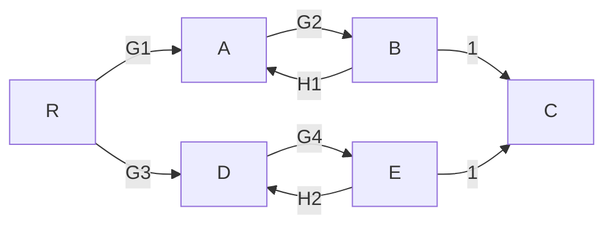
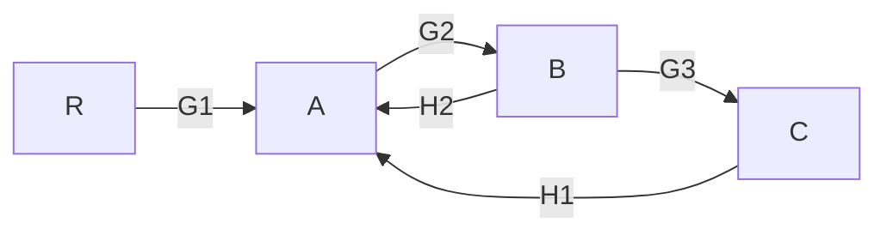

# 第4章 结构图与信号流图——练习题

> 题型覆盖：等效变换、结构图化简、梅森公式。
> **参考答案折叠在每道题下方**，先独立完成，再展开检查。

---

## 一、基础题

### 1.1 三种基本连接

**题目**：求下列连接的等效传递函数：
(1) 串联：$G_1 = \dfrac{2}{s+1}$，$G_2 = \dfrac{3}{s+2}$
(2) 并联：$G_1 = \dfrac{1}{s}$，$G_2 = 2$
(3) 负反馈：$G = \dfrac{4}{s+1}$，$H = 1$

> [!example]- 参考答案 1.1
> (1) 串联相乘：
> 
> $$G = \dfrac{2}{s+1} \cdot \dfrac{3}{s+2} = \dfrac{6}{(s+1)(s+2)}$$
> 
> (2) 并联相加：
> 
> $$G = \dfrac{1}{s} + 2 = \dfrac{1+2s}{s}$$
> 
> (3) 负反馈：
> 
> $$
> \Phi = \dfrac{G}{1+GH} = \dfrac{\frac{4}{s+1}}{1 + \frac{4}{s+1}} = \dfrac{4}{s+5}
> $$

### 1.2 结构图化简（一级反馈）

**题目**：系统结构为：$R \to \oplus \to G_1(s) \to G_2(s) \to C$，负反馈 $H(s)$ 从 $C$ 接回 $\oplus$。
(1) 画出结构图；
(2) 写出闭环传递函数 $\Phi(s) = C(s)/R(s)$。

> [!example]- 参考答案 1.2
> (1) 结构图（同第1章闭环标准结构）。
> (2) 
> 
> $$\Phi(s) = \dfrac{G_1 G_2}{1 + G_1 G_2 H}$$
> 
> （前向 $G_1 G_2$ 串联，负反馈公式）。

### 1.3 梅森公式基础

**题目**：信号流图：$R \xrightarrow{G_1} \bullet \xrightarrow{G_2} C$，且从 $C$ 到 $\bullet$ 之间有一条反馈支路 $H$（即回路：$\bullet \xrightarrow{G_2} C \xrightarrow{H} \bullet$）。
(1) 前向通路有几条？增益多少？
(2) 回路有几条？增益多少？
(3) 求总传递函数 $G(s)$。

> [!example]- 参考答案 1.3
> (1) 前向通路 1 条：$P_1 = G_1 G_2$。
> (2) 回路 1 条：$L_1 = G_2 H$。
> (3) $P_1$ 与 $L_1$ 接触（共用 $G_2$ 与节点），$\Delta_1 = 1$；$\Delta = 1 - G_2 H$；

> $$G(s) = \dfrac{G_1 G_2}{1 - G_2 H}$$

---

## 二、提高题

### 2.1 结构图化简（含引出点）

**题目**：系统结构：
$$
R \to \oplus_1 \to G_1 \to \oplus_2 \to G_2 \to C
$$
其中：
- 负反馈回路1：$H_1$ 从 $C$ 接回 $\oplus_1$；
- 负反馈回路2：$H_2$ 从 $G_2$ 输出处（即 $C$ 处）引出接回 $\oplus_2$。

(1) 画出结构图；
(2) 用"先化简局部"的方法求 $\Phi(s)$。

> [!example]- 参考答案 2.1
> (1) 结构图按题意画出（含两个反馈环、一个引出点）。
> (2) 化简顺序：
> - 先化简内环（$\oplus_2$ 处）：$\oplus_2 \to G_2 \to C$，$H_2$ 从 $C$ 引回 $\oplus_2$ 构成反馈，
> 
> $$\Phi_{内} = \dfrac{G_2}{1 + G_2 H_2}$$
> 
> - 再与外环串联：
> 
> $$G_1 \cdot \Phi_{内} = \dfrac{G_1 G_2}{1 + G_2 H_2}$$
> 
> - 最后整体负反馈（$H_1$）：
> $$
> \Phi(s) = \dfrac{\dfrac{G_1 G_2}{1+G_2H_2}}{1 + \dfrac{G_1 G_2 H_1}{1+G_2H_2}} = \dfrac{G_1 G_2}{1 + G_2 H_2 + G_1 G_2 H_1}
> $$

### 2.2 梅森公式（两条前向通路）

**题目**：信号流图如下（$B \to C$、$E \to C$ 为增益 $1$ 的支路，画图时常省略不画）：

其中回路有：$L_1 = G_2 H_1$（$A \to B \to A$ 局部回路）、$L_2 = G_4 H_2$（$D \to E \to D$ 局部回路）。
已知前向通路两条：$P_1 = G_1 G_2$、$P_2 = G_3 G_4$，且 $L_1$ 与 $L_2$ **互不接触**。
(1) 求特征式 $\Delta$；
(2) 求 $\Delta_1$、$\Delta_2$（判断每条前向通路与哪些回路接触）；
(3) 求总传递函数 $G(s)$。

> [!example]- 参考答案 2.2
> (1) $L_1$ 与 $L_2$ 互不接触，特征式：
> 
> $$
> \Delta = 1 - (L_1 + L_2) + L_1 L_2 = 1 - G_2 H_1 - G_4 H_2 + G_2 G_4 H_1 H_2
> $$
> 
> (2) $P_1 = G_1 G_2$：与 $L_1$（含 $G_2$）**接触**，与 $L_2$ 不接触 → $\Delta_1 = 1 - L_2 = 1 - G_4 H_2$；
> 
> $P_2 = G_3 G_4$：与 $L_2$（含 $G_4$）**接触**，与 $L_1$ 不接触 → $\Delta_2 = 1 - L_1 = 1 - G_2 H_1$。
> (3)
> 
> $$
> G(s) = \dfrac{G_1 G_2(1 - G_4 H_2) + G_3 G_4(1 - G_2 H_1)}{1 - G_2 H_1 - G_4 H_2 + G_2 G_4 H_1 H_2}
> $$
> 
> > **易错点**：余子式只去掉"接触"回路。$P_1$ 与 $L_2$ 不接触，所以 $L_2$ 必须留在 $\Delta_1$ 中（本题 $1-L_2$），不能把 $L_2$ 也删掉。

### 2.3 移动规则

**题目**：原结构：$R \to [G(s)] \to$ 引出点（引出 $C$ 供反馈）。现将**引出点前移到 $R$ 侧（跨过 $G$）**。说明移动后支路增益应为多少，为什么？移动后系统是否仍与原系统等效？

> [!example]- 参考答案 2.3
> 引出点前移跨过 $G$ 后，引出点从 $C$ 移到 $R$ 处，引出的信号不再是 $C$ 而是 $R$，为保持引出信号与原一致（等于 $C = GR$），支路增益需乘 **$G$**，即新引出点处支路增益为 $G$，引出信号 $= R \cdot G = C$ 不变。等效成立。

---

## 三、拓展题

### 3.1 复杂系统综合（梅森公式完整演练）

**题目**：某系统信号流图含两个嵌套回路：

其中回路：$L_1 = G_2 G_3 H_1$（大回路 $A \to B \to C \to A$），$L_2 = G_2 H_2$（局部反馈 $B \to A$）。
前向通路：$P_1 = G_1 G_2 G_3$。
(1) 检查 $L_1$ 与 $L_2$ 是否接触；
(2) 求 $\Delta$；
(3) 求 $\Delta_1$；
(4) 求 $G(s)$，并指出若 $H_2=0$ 时退化成什么形式。

> [!example]- 参考答案 3.1
> (1) $L_1 = G_2 G_3 H_1$ 经过节点 $A, B, C$；$L_2 = G_2 H_2$ 经过节点 $A, B$。两者共用节点 $A, B$ → **接触**。
> (2) 因 $L_1$、$L_2$ 接触，无"两两不接触"组合：
> 
> $$\Delta = 1 - L_1 - L_2 = 1 - G_2 G_3 H_1 - G_2 H_2$$
> (3) $P_1 = G_1 G_2 G_3$ 与两个回路都接触（共用节点/支路）→ $\Delta_1 = 1$。
> (4) 
> 
> $$G(s) = \dfrac{G_1 G_2 G_3}{1 - G_2 G_3 H_1 - G_2 H_2}$$
> 
> 若 $H_2 = 0$：退化为单回路系统
> 
> $$G(s) = \dfrac{G_1 G_2 G_3}{1 - G_2 G_3 H_1}$$

### 3.2 工程思考

**题目**：梅森公式的 $\Delta=0$ 意味着什么？它与本章 §1.3 的闭环特征方程 $1+GH=0$ 有何联系？这为第6章根轨迹法埋下了什么伏笔？

> [!example]- 参考答案 3.2
> $\Delta = 0$ 即 
> 
> $$1 - \sum L + \sum L_i L_j - \cdots = 0$$
> 
> ，这正是**闭环系统的特征方程**（分母为零）。它和本章 §1.3 的 $1+GH=0$ 是同一件事：$\Delta=0$ 的根就是**闭环极点**。伏笔：第6章根轨迹法，就是研究当某个参数（如 $K$）连续变化时，$\Delta=0$ 的根（闭环极点）在复平面如何移动——所以梅森公式的 $\Delta$ 是根轨迹法的"出发点"。