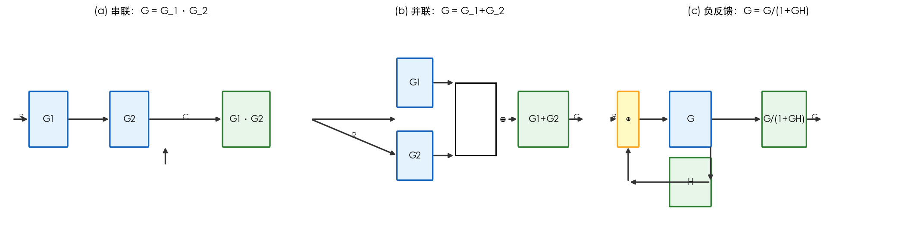
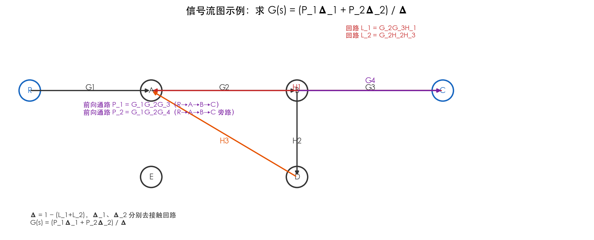
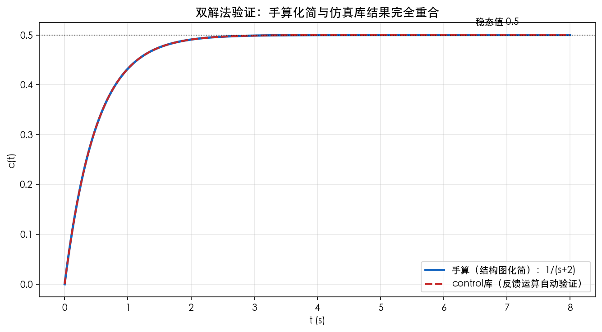

# 第4章 结构图与信号流图——仿真与绘图

> 本章目标：画出**三种基本连接**、**信号流图示例**、并用 control 库验证手算的传递函数。
> 工具：Python（numpy + matplotlib + control）。

---

## 图1 三种基本连接的等效变换

### 绘图代码

```python
"""第4章图1：串联/并联/反馈等效变换"""
import matplotlib.pyplot as plt
from matplotlib.patches import FancyBboxPatch

plt.rcParams['font.sans-serif'] = ['PingFang SC', 'STHeiti', 'SimHei', 'DejaVu Sans']
plt.rcParams['axes.unicode_minus'] = False

def box(ax, x, y, w, h, text, fc='#E3F2FD', ec='#1565C0', fs=10):
    p = FancyBboxPatch((x, y), w, h, boxstyle="round,pad=0.02", fc=fc, ec=ec, lw=1.6)
    ax.add_patch(p)
    ax.text(x + w/2, y + h/2, text, ha='center', va='center', fontsize=fs)

def arrow(ax, x1, y1, x2, y2, text=None, ty=0.03, fs=9):
    ax.annotate('', xy=(x2, y2), xytext=(x1, y1),
                arrowprops=dict(arrowstyle='-|>', color='#333333', lw=1.6))
    if text:
        ax.text((x1+x2)/2, (y1+y2)/2 + ty, text, ha='center', va='center', fontsize=fs)

fig, axes = plt.subplots(1, 3, figsize=(14, 3.6))

# (a) 串联
ax = axes[0]; ax.set_xlim(0, 10); ax.set_ylim(0, 3); ax.axis('off')
ax.set_title('(a) 串联：G = G_1*G_2', fontsize=11)
box(ax, 0.8, 1.1, 1.3, 0.8, 'G1'); box(ax, 3.6, 1.1, 1.3, 0.8, 'G2')
box(ax, 7.5, 1.1, 1.6, 0.8, 'G1*G2', fc='#E8F5E9', ec='#2E7D32')
arrow(ax, 0.2, 1.5, 0.8, 1.5, 'R'); arrow(ax, 2.1, 1.5, 3.6, 1.5); arrow(ax, 4.9, 1.5, 7.5, 1.5, 'C')

# (b) 并联
ax = axes[1]; ax.set_xlim(0, 10); ax.set_ylim(0, 3); ax.axis('off')
ax.set_title('(b) 并联：G = G_1+G_2', fontsize=11)
box(ax, 3.2, 1.7, 1.2, 0.7, 'G1'); box(ax, 3.2, 0.6, 1.2, 0.7, 'G2')
box(ax, 7.4, 1.1, 1.7, 0.8, 'G1+G2', fc='#E8F5E9', ec='#2E7D32')
arrow(ax, 0.2, 1.5, 3.2, 1.5); arrow(ax, 0.2, 1.5, 3.2, 0.95, 'R')
arrow(ax, 4.4, 2.05, 5.2, 2.05); arrow(ax, 4.4, 0.95, 5.2, 0.95)
ax.plot([5.2, 5.2], [0.95, 2.05], color='k', lw=1.4)
ax.plot([5.2, 6.6], [2.05, 2.05], color='k', lw=1.4)
ax.plot([5.2, 6.6], [0.95, 0.95], color='k', lw=1.4)
ax.plot([6.6, 6.6], [0.95, 2.05], color='k', lw=1.4)
ax.text(6.85, 1.5, '⊕', fontsize=13, ha='center', va='center')
arrow(ax, 7.0, 1.5, 7.4, 1.5); arrow(ax, 9.1, 1.5, 9.7, 1.5, 'C')

# (c) 负反馈
ax = axes[2]; ax.set_xlim(0, 10); ax.set_ylim(0, 3); ax.axis('off')
ax.set_title('(c) 负反馈：G = G/(1+GH)', fontsize=11)
box(ax, 0.5, 1.1, 0.7, 0.8, '⊕', fc='#FFF9C4', ec='#F9A825')
box(ax, 2.3, 1.1, 1.4, 0.8, 'G')
box(ax, 5.5, 1.1, 1.5, 0.8, 'G/(1+GH)', fc='#E8F5E9', ec='#2E7D32')
box(ax, 2.3, 0.2, 1.4, 0.7, 'H', fc='#E8F5E9', ec='#2E7D32')
arrow(ax, 0.2, 1.5, 0.5, 1.5, 'R'); arrow(ax, 1.2, 1.5, 2.3, 1.5)
arrow(ax, 3.7, 1.5, 5.5, 1.5); arrow(ax, 7.0, 1.5, 7.6, 1.5, 'C')
arrow(ax, 3.7, 1.1, 3.7, 0.55); arrow(ax, 3.7, 0.55, 0.85, 0.55); arrow(ax, 0.85, 0.55, 0.85, 1.1)

fig.tight_layout()
fig.savefig('figures/01_三种基本连接等效变换.png', dpi=150, bbox_inches='tight', facecolor='white')
plt.close(fig)
print('图1 已生成')
```

### 运行与结果



*图1 三种基本连接：串联相乘、并联相加、负反馈"除以 1+GH"。绿色方框为等效结果。*

**现象解释**：负反馈的分母 $1+GH$ 是"闭环印记"——它来自第2章的推导。后续化简复杂系统，就是反复套这三条公式。

---

## 图2 信号流图与梅森公式

### 绘图代码

```python
"""第4章图2：信号流图示例"""
import matplotlib.pyplot as plt
from matplotlib.patches import Circle

plt.rcParams['font.sans-serif'] = ['PingFang SC', 'STHeiti', 'SimHei', 'DejaVu Sans']
plt.rcParams['axes.unicode_minus'] = False

fig, ax = plt.subplots(figsize=(11, 4.5))
ax.set_xlim(0, 12); ax.set_ylim(0, 4.5); ax.axis('off')
ax.set_title('信号流图示例：求 G(s) = (P_1Δ_1 + P_2Δ_2) / Δ', fontsize=13)

R = (0.5, 3.0); A = (3.0, 3.0); B = (6.0, 3.0); C = (9.0, 3.0)
n2 = (6.0, 1.2); n3 = (3.0, 1.2)
for pos, lab, color in [(R, 'R', '#1565C0'), (A, 'A', '#333'), (B, 'B', '#333'),
                        (C, 'C', '#1565C0'), (n2, 'D', '#333'), (n3, 'E', '#333')]:
    ax.add_patch(Circle(pos, 0.22, fc='white', ec=color, lw=1.8))
    ax.text(pos[0], pos[1], lab, ha='center', va='center', fontsize=10, color=color)

def sarrow(p1, p2, text, color='#333333', dy=0.06, fs=10):
    ax.annotate('', xy=p2, xytext=p1,
                arrowprops=dict(arrowstyle='-|>', color=color, lw=1.6))
    ax.text((p1[0]+p2[0])/2, (p1[1]+p2[1])/2 + dy, text, ha='center', va='center',
            fontsize=fs, color=color)

sarrow(R, A, 'G1'); sarrow(A, B, 'G2'); sarrow(B, C, 'G3')
sarrow(C, A, 'H1', color='#C62828')
sarrow(B, n2, 'H2', dy=-0.15); sarrow(n2, A, 'H3', dy=-0.15, color='#E65100')
sarrow(B, C, 'G4', dy=0.2, color='#7B1FA2')

ax.text(1.6, 2.5, '前向通路 P_1 = G_1G_2G_3（R→A→B→C）\n前向通路 P_2 = G_1G_2G_4（旁路）', fontsize=9, color='#7B1FA2')
ax.text(7.0, 4.1, '回路 L_1 = G_2G_3H_1\n回路 L_2 = G_2H_2H_3', fontsize=9, color='#C62828')
ax.text(0.5, 0.2, 'Δ = 1 − (L_1+L_2)，Δ_1、Δ_2 分别去接触回路\nG(s) = (P_1Δ_1 + P_2Δ_2) / Δ', fontsize=9)

fig.tight_layout()
fig.savefig('figures/02_信号流图与梅森公式.png', dpi=150, bbox_inches='tight', facecolor='white')
plt.close(fig)
print('图2 已生成')
```

### 运行与结果



*图2 紫色为两条前向通路，红色为回路。按梅森公式"数清单→套公式"即可求出总传递函数。*

**现象解释**：图中两个回路 $L_1$（C→A）、$L_2$（B→D→E→A）——注意它们是否"接触"，直接影响 $\Delta$ 中是否出现 $L_1L_2$ 项。这是梅森公式最容易错的地方，务必按"不接触才相乘"处理。

---

## 图3 双解法验证：手算化简 vs 仿真库

### 仿真代码

```python
"""第4章图3：手算化简 vs control 库验证
系统：G1=1/(s+1)，G2=2（内反馈 H2=0.5），外反馈 H3=1
手算：内环 = G2/(1+G2*H2) = 1；串联 G1 → 1/(s+1)；外环 → 1/(s+2)
"""
import numpy as np
import matplotlib.pyplot as plt
import control
from scipy.signal import lti, step

plt.rcParams['font.sans-serif'] = ['PingFang SC', 'STHeiti', 'SimHei', 'DejaVu Sans']
plt.rcParams['axes.unicode_minus'] = False

s = control.TransferFunction.s
G1 = 1/(s+1); G2 = 2
H2 = 0.5; H3 = 1
inner = control.feedback(G2, H2)            # 内环
open_chain = G1 * inner                     # 串联
Phi = control.feedback(open_chain, H3)      # 外环
print('control 库求得的闭环传递函数：', Phi)

phi_sys = lti([1.0], [1.0, 2.0])            # 手算结果 1/(s+2)
t = np.linspace(0, 8, 500)
_, y_manual = step(phi_sys, T=t)
T_ctl, y_ctl = control.step_response(Phi, t)

fig, ax = plt.subplots(figsize=(9, 5))
ax.plot(t, y_manual, lw=2.4, color='#1565C0', label='手算（结构图化简）：1/(s+2)')
ax.plot(T_ctl, y_ctl, '--', lw=2, color='#C62828', label='control库（反馈运算自动验证）')
ax.axhline(0.5, color='k', ls=':', lw=1, alpha=0.6)
ax.text(6.5, 0.52, '稳态值 0.5', fontsize=10)
ax.set_xlabel('t (s)'); ax.set_ylabel('c(t)')
ax.set_title('双解法验证：手算化简与仿真库结果完全重合', fontsize=13)
ax.legend(fontsize=10); ax.grid(alpha=0.3)
fig.tight_layout()
fig.savefig('figures/03_双解法传递函数验证.png', dpi=150, bbox_inches='tight', facecolor='white')
plt.close(fig)
print('图3 已生成')
```

### 运行与结果



*图3 手算的 $1/(s+2)$ 与 control 库自动反馈运算的阶跃响应完全重合，验证了结构图化简的正确性。*

**现象解释**：手算过程——内环把 $G_2=2$ 变成 1（局部反馈的"吃掉"作用），再与 $G_1$ 串联、与外反馈闭合，得到 $1/(s+2)$。**用代码验证手算，是防止"化简规则记错"的最可靠方法**，后续章节每求一个传递函数都建议这样自查。

---

## 思考题

1. 在图3中把内反馈 $H_2$ 改为 2，闭环传函会变成什么？（提示：内环 $G_2/(1+G_2H_2) = 2/(1+4) = 0.4$）这说明了什么？
2. 信号流图里，如果两条回路共享一个节点，$\Delta$ 中会不会出现它们的乘积项？为什么？
