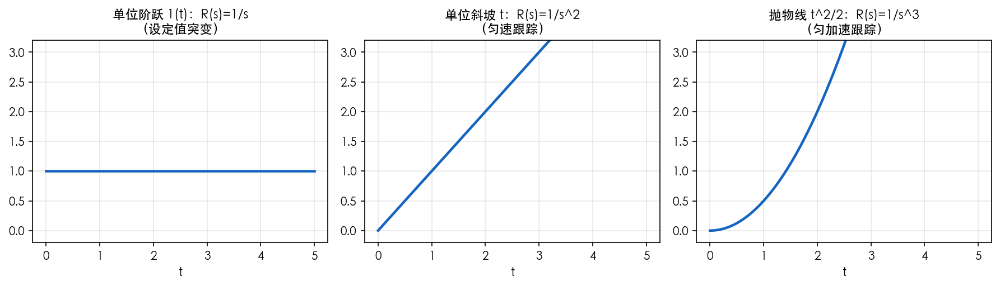
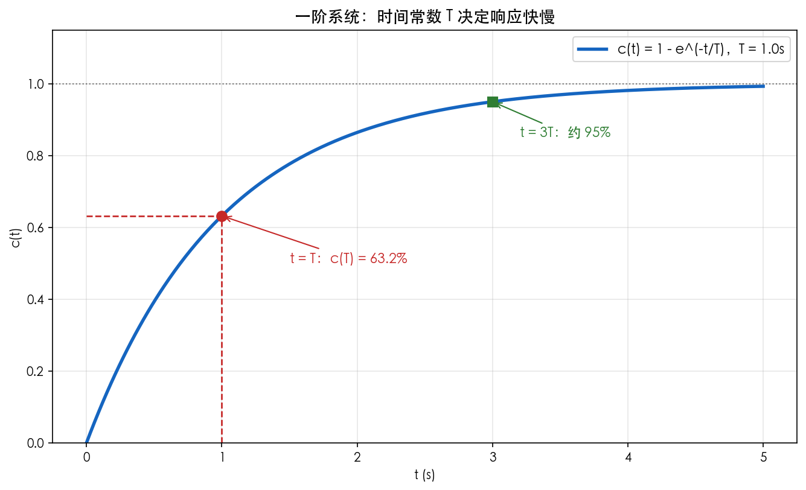
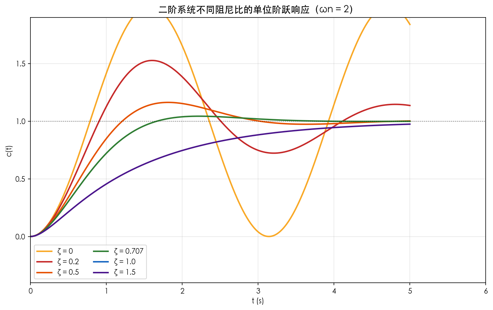
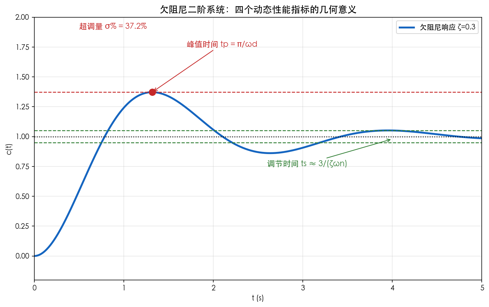
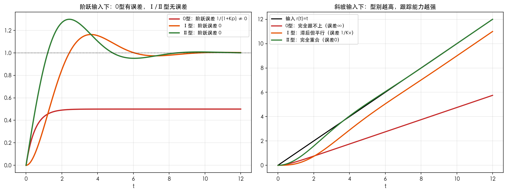

# 第5章 时域分析法——仿真与绘图

> 本章目标：画出**典型输入**、**一阶/二阶响应**、**性能指标标注**、**型别与稳态误差**，让"稳准快"看得见。
> 工具：Python（numpy + matplotlib + scipy）。

---

## 图1 典型输入信号

### 绘图代码

```python
"""第5章图1：典型输入信号"""
import numpy as np
import matplotlib.pyplot as plt

plt.rcParams['font.sans-serif'] = ['PingFang SC', 'STHeiti', 'SimHei', 'DejaVu Sans']
plt.rcParams['axes.unicode_minus'] = False

t = np.linspace(0, 5, 500)
fig, axes = plt.subplots(1, 3, figsize=(12, 3.5))
axes[0].plot(t, np.ones_like(t), lw=2.2, color='#1565C0')
axes[0].set_title('单位阶跃 1(t)：R(s)=1/s\n（设定值突变）', fontsize=11)
axes[1].plot(t, t, lw=2.2, color='#1565C0')
axes[1].set_title('单位斜坡 t：R(s)=1/s^2\n（匀速跟踪）', fontsize=11)
axes[2].plot(t, 0.5*t**2, lw=2.2, color='#1565C0')
axes[2].set_title('抛物线 t^2/2：R(s)=1/s^3\n（匀加速跟踪）', fontsize=11)
for ax in axes:
    ax.grid(alpha=0.3); ax.set_xlabel('t'); ax.set_ylim(-0.2, 3.2)
fig.tight_layout()
fig.savefig('figures/01_典型输入信号.png', dpi=150, bbox_inches='tight', facecolor='white')
plt.close(fig)
print('图1 已生成')
```

### 运行与结果



*图1 三种典型输入：阶跃（基准测试）、斜坡（匀速跟踪）、抛物线（匀加速跟踪）。*

**现象解释**：输入信号的阶次越高，对系统的"跟踪能力"要求越高——第5章§7的型别表就是回答"谁跟得上谁"。

---

## 图2 一阶系统：时间常数的意义

### 绘图代码

```python
"""第5章图2：一阶系统响应"""
import numpy as np
import matplotlib.pyplot as plt

plt.rcParams['font.sans-serif'] = ['PingFang SC', 'STHeiti', 'SimHei', 'DejaVu Sans']
plt.rcParams['axes.unicode_minus'] = False

t = np.linspace(0, 5, 500); T = 1.0
c = 1 - np.exp(-t/T)
fig, ax = plt.subplots(figsize=(9, 5.5))
ax.plot(t, c, lw=2.6, color='#1565C0', label=f'c(t) = 1 - e^(-t/T)，T = {T}s')
ax.axhline(1, color='k', ls=':', lw=1, alpha=0.5)
ax.plot([T, T], [0, 1-np.exp(-1)], '--', color='#C62828', lw=1.3)
ax.plot([0, T], [1-np.exp(-1), 1-np.exp(-1)], '--', color='#C62828', lw=1.3)
ax.plot(T, 1-np.exp(-1), 'o', ms=8, color='#C62828')
ax.annotate('t = T：c(T) = 63.2%', xy=(T, 1-np.exp(-1)), xytext=(1.5, 0.5),
            arrowprops=dict(arrowstyle='->', color='#C62828'), color='#C62828', fontsize=11)
ax.plot(3*T, 1-np.exp(-3), 's', ms=8, color='#2E7D32')
ax.annotate('t = 3T：约 95%', xy=(3*T, 1-np.exp(-3)), xytext=(3.2, 0.85),
            arrowprops=dict(arrowstyle='->', color='#2E7D32'), color='#2E7D32', fontsize=11)
ax.set_xlabel('t (s)'); ax.set_ylabel('c(t)')
ax.set_title('一阶系统：时间常数 T 决定响应快慢', fontsize=13)
ax.legend(fontsize=11); ax.grid(alpha=0.3); ax.set_ylim(0, 1.15)
fig.tight_layout()
fig.savefig('figures/02_一阶系统响应与时间常数.png', dpi=150, bbox_inches='tight', facecolor='white')
plt.close(fig)
print('图2 已生成')
```

### 运行与结果



*图2 $T=1$s 时：$t=T$ 达 63.2%，$t=3T$ 达约 95%。*

**现象解释**：时间常数是"惯性"的量化——记住 63.2% 和 3T~5T 两个数，一阶系统的一切尽在掌握。

---

## 图3 二阶系统：阻尼比决定响应形态（核心图）

### 绘图代码

```python
"""第5章图3：不同阻尼比的二阶响应"""
import numpy as np
import matplotlib.pyplot as plt

plt.rcParams['font.sans-serif'] = ['PingFang SC', 'STHeiti', 'SimHei', 'DejaVu Sans']
plt.rcParams['axes.unicode_minus'] = False

t = np.linspace(0, 6, 800); wn = 2.0
fig, ax = plt.subplots(figsize=(9.5, 6))
for zeta, c in [(0, '#F9A825'), (0.2, '#C62828'), (0.5, '#E65100'),
                (0.707, '#2E7D32'), (1.0, '#1565C0'), (1.5, '#4A148C')]:
    wd = wn*np.sqrt(max(1-zeta**2, 0))
    if zeta == 0:
        y = 1 - np.cos(wn*t)
    elif zeta < 1:
        beta = np.arccos(zeta)
        y = 1 - np.exp(-zeta*wn*t)/np.sqrt(1-zeta**2)*np.sin(wd*t + beta)
    else:
        s1 = -zeta*wn + wn*np.sqrt(zeta**2-1)
        s2 = -zeta*wn - wn*np.sqrt(zeta**2-1)
        y = 1 - (s2*np.exp(s1*t) - s1*np.exp(s2*t))/(s2-s1)
    ax.plot(t, y, lw=2.0, color=c, label=f'ζ = {zeta}')
ax.axhline(1, color='k', ls=':', lw=1, alpha=0.5)
ax.set_xlabel('t (s)'); ax.set_ylabel('c(t)')
ax.set_title('二阶系统不同阻尼比的单位阶跃响应（ωn = 2）', fontsize=13)
ax.legend(fontsize=10, ncol=2); ax.grid(alpha=0.3)
ax.set_xlim(0, 6); ax.set_ylim(-0.4, 1.9)
fig.tight_layout()
fig.savefig('figures/03_二阶系统阻尼比对比.png', dpi=150, bbox_inches='tight', facecolor='white')
plt.close(fig)
print('图3 已生成')
```

### 运行与结果



*图3 六种阻尼比的阶跃响应：ζ=0 等幅振荡，0<ζ<1 衰减振荡，ζ≥1 单调收敛。ζ=0.707 超调仅 4.3%，又快又稳。*

**现象解释**：这是本课**最重要的图之一**——它把"阻尼比 ζ"这一抽象参数直接变成眼睛看得见的曲线。请反复观察：ζ 越小，第一波冲得越高、晃得越久；ζ 越大，越"木讷"。**ζ≈0.707 是"又快又不超调太多"的最佳折中。**

---

## 图4 性能指标的几何标注

### 绘图代码

```python
"""第5章图4：欠阻尼响应性能指标标注"""
import numpy as np
import matplotlib.pyplot as plt

plt.rcParams['font.sans-serif'] = ['PingFang SC', 'STHeiti', 'SimHei', 'DejaVu Sans']
plt.rcParams['axes.unicode_minus'] = False

t = np.linspace(0, 5, 800)
zeta = 0.3; wn = 2.5
wd = wn*np.sqrt(1-zeta**2); beta = np.arccos(zeta)
tp = np.pi/wd
y = 1 - np.exp(-zeta*wn*t)/np.sqrt(1-zeta**2)*np.sin(wd*t + beta)
Mp = np.exp(-zeta*np.pi/np.sqrt(1-zeta**2))
ts = 3/(zeta*wn)

fig, ax = plt.subplots(figsize=(9.5, 6))
ax.plot(t, y, lw=2.6, color='#1565C0', label='欠阻尼响应 ζ=0.3')
ax.axhline(1, color='k', ls=':', lw=1.2)
ax.axhline(1+Mp, color='#C62828', ls='--', lw=1.2)
ax.axhline(1.05, color='#2E7D32', ls='--', lw=1.2)
ax.axhline(0.95, color='#2E7D32', ls='--', lw=1.2)
idx_tp = int(tp/(t[1]-t[0]))
ax.plot(tp, y[idx_tp], 'o', ms=9, color='#C62828')
ax.annotate('峰值时间 tp = π/ωd', xy=(tp, y[idx_tp]), xytext=(1.7, 1.75),
            arrowprops=dict(arrowstyle='->', color='#C62828'), color='#C62828', fontsize=11)
ax.annotate(f'超调量 σ% = {Mp*100:.1f}%', xy=(1.2, 1+Mp+0.02), xytext=(0.5, 1.9), color='#C62828', fontsize=11)
ax.annotate('调节时间 ts ≈ 3/(ζωn)', xy=(ts, 0.98), xytext=(2.6, 0.75),
            arrowprops=dict(arrowstyle='->', color='#2E7D32'), color='#2E7D32', fontsize=11)
ax.set_xlabel('t (s)'); ax.set_ylabel('c(t)')
ax.set_title('欠阻尼二阶系统：四个动态性能指标的几何意义', fontsize=13)
ax.legend(fontsize=10); ax.grid(alpha=0.3)
ax.set_xlim(0, 5); ax.set_ylim(-0.2, 2.0)
fig.tight_layout()
fig.savefig('figures/04_二阶系统性能指标标注.png', dpi=150, bbox_inches='tight', facecolor='white')
plt.close(fig)
print('图4 已生成')
```

### 运行与结果



*图4 ζ=0.3 系统的响应：红色虚线为峰值水平（超调量），绿色虚线为 ±5% 误差带（调节时间边界）。*

**现象解释**：把公式和曲线对应起来——$t_p$ 是最高点横坐标，$\sigma\%$ 是最高点高出 1 的比例，$t_s$ 是曲线**最后一次**进入误差带的时间。**背公式前先看懂这张图，公式就不会记错。**

---

## 图5 系统型别与稳态误差

### 仿真代码

```python
"""第5章图5：0型/Ⅰ型/Ⅱ型对阶跃与斜坡输入的稳态误差"""
import numpy as np
import matplotlib.pyplot as plt
from scipy.signal import lti, step, lsim

plt.rcParams['font.sans-serif'] = ['PingFang SC', 'STHeiti', 'SimHei', 'DejaVu Sans']
plt.rcParams['axes.unicode_minus'] = False

t = np.linspace(0, 12, 800)
# 0型、Ⅰ型、Ⅱ型的闭环（取能稳定的小参数）
phi0 = lti([1.0], [1.0, 2.0])     # 0型闭环
phi1 = lti([1.0], [1.0, 1.0, 1.0])  # Ⅰ型闭环
phi2 = lti([1.0, 1.0], [1.0, 1.0, 1.0])  # Ⅱ型闭环

fig, axes = plt.subplots(1, 2, figsize=(13, 5))
_, y0, _ = lsim(phi0, np.ones_like(t), t)
_, y1, _ = lsim(phi1, np.ones_like(t), t)
_, y2, _ = lsim(phi2, np.ones_like(t), t)
axes[0].plot(t, y0, lw=2.2, color='#C62828', label='0型：阶跃误差 1/(1+Kp) ≠ 0')
axes[0].plot(t, y1, lw=2.2, color='#E65100', label='Ⅰ型：阶跃误差 0')
axes[0].plot(t, y2, lw=2.2, color='#2E7D32', label='Ⅱ型：阶跃误差 0')
axes[0].axhline(1, color='k', ls=':', lw=1)
axes[0].set_title('阶跃输入下：0型有误差，Ⅰ/Ⅱ型无误差', fontsize=11)
axes[0].legend(fontsize=9); axes[0].grid(alpha=0.3); axes[0].set_xlabel('t')

ramp = t
_, y0r, _ = lsim(phi0, ramp, t)
_, y1r, _ = lsim(phi1, ramp, t)
_, y2r, _ = lsim(phi2, ramp, t)
axes[1].plot(t, ramp, 'k-', lw=1.8, label='输入 r(t)=t')
axes[1].plot(t, y0r, lw=2.0, color='#C62828', label='0型：完全跟不上（误差∞）')
axes[1].plot(t, y1r, lw=2.0, color='#E65100', label='Ⅰ型：滞后但平行（误差 1/Kv）')
axes[1].plot(t, y2r, lw=2.0, color='#2E7D32', label='Ⅱ型：完全重合（误差0）')
axes[1].set_title('斜坡输入下：型别越高，跟踪能力越强', fontsize=11)
axes[1].legend(fontsize=9); axes[1].grid(alpha=0.3); axes[1].set_xlabel('t')

fig.tight_layout()
fig.savefig('figures/05_系统型别与稳态误差.png', dpi=150, bbox_inches='tight', facecolor='white')
plt.close(fig)
print('图5 已生成')
```

### 运行与结果



*图5 左：阶跃输入下 0 型系统留下有限误差，Ⅰ/Ⅱ型误差为零；右：斜坡输入下 0 型跟不上、Ⅰ型滞后但平行、Ⅱ型完全重合。*

**现象解释**：这张图一眼看懂"型别表"——**积分环节越多，能跟上的输入阶次越高**。注意右图中 0 型系统的响应发散（误差趋于无穷），这正是理论表里"$\infty$"的含义。

---

## 思考题

1. 在图3中，为什么 ζ=0 的系统不衰减？（提示：极点在虚轴上，无实部）
2. 图5右图：Ⅰ 型系统对斜坡输入的"滞后量"是多少？能否用第5章公式 $e_{ss}=1/K_v$ 解释？
3. 若把图4系统的 $\omega_n$ 调大一倍、ζ 不变，四个指标里哪些会变、哪些不变？为什么？（提示：σ% 只与 ζ 有关）
