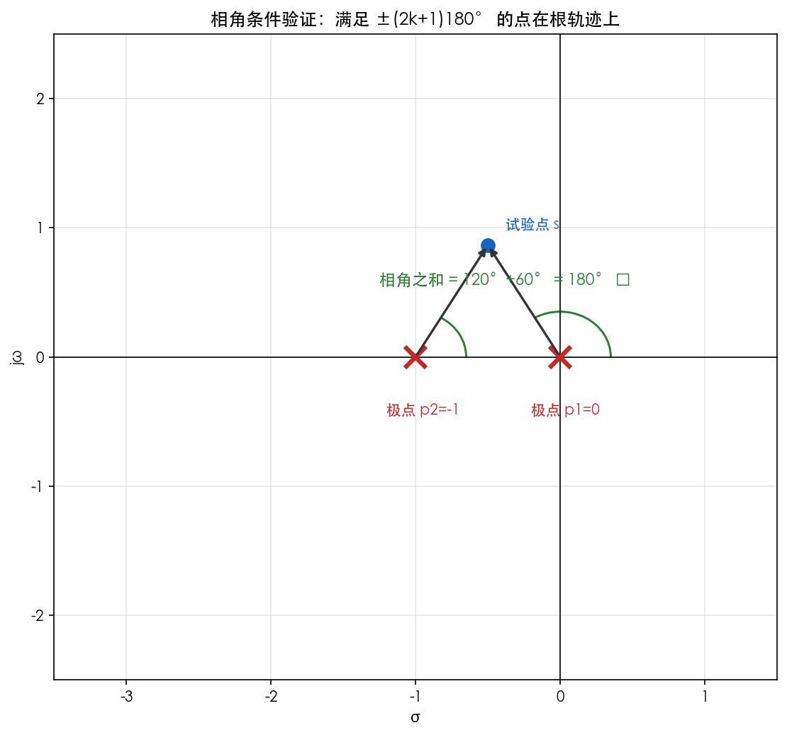
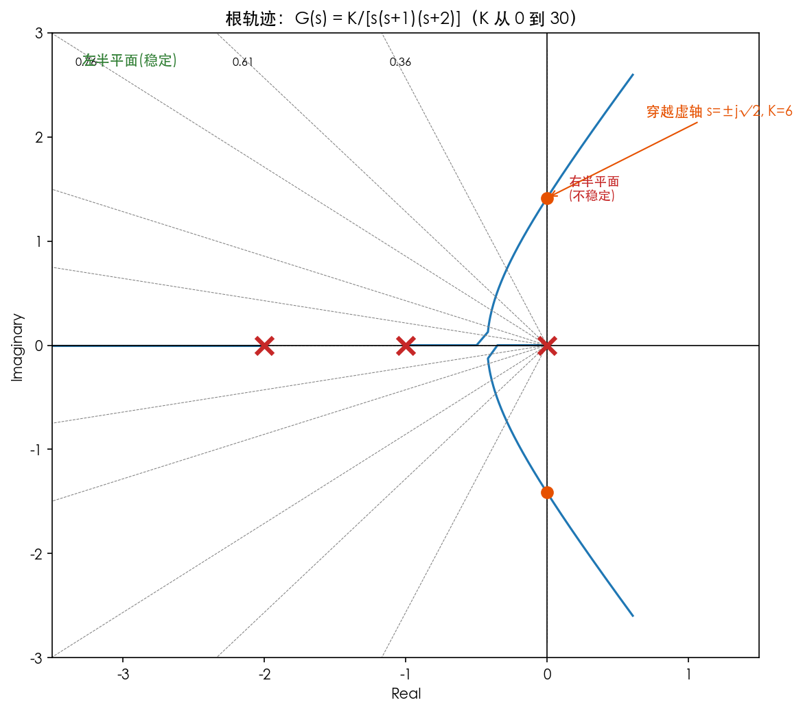
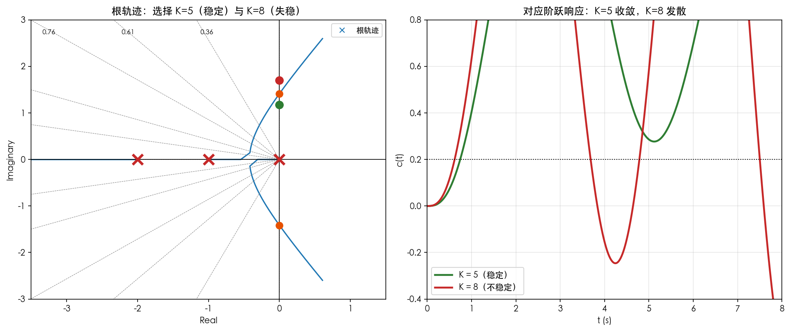

# 第6章 根轨迹法——公式推导

> 本章核心：当系统参数（通常为增益 $K$）连续变化时，**闭环极点如何移动**？这移动的轨迹就是"根轨迹"。
> 全章根基：幅值条件 + 相角条件。掌握这两条，绘制规则全部可以推导/理解。

---

## 1. 根轨迹的概念

### 1.1 定义

系统闭环特征方程：$1 + K G_0(s) H(s) = 0$（把增益 $K$ 单独提出来）。

$$
\boxed{1 + K \frac{M(s)}{N(s)} = 0}
$$

当 $K$ 从 $0 \to +\infty$ 变化时，闭环极点在 $s$ 平面上描出的轨迹称为**根轨迹**。

**说明**：
- 闭环极点 $=$ 特征方程 $1+KG_0H=0$ 的根；
- 每给一个 $K$，就有一组极点位置；$K$ 连续变化，极点连成曲线。

### 1.2 根轨迹方程变形（推导出发点）

$$
1 + K\frac{M(s)}{N(s)} = 0 \ \Rightarrow\ K\frac{M(s)}{N(s)} = -1
$$

**相角条件**（取幅角）：

$$
\angle \frac{M(s)}{N(s)} = \pm (2k+1)180^\circ, \quad k = 0,1,2,\cdots
$$

**幅值条件**（取模）：

$$
K = \left| \frac{N(s)}{M(s)} \right|
$$

### 1.3 推导过程（为什么有两个条件）

复方程 $K \cdot G_0H = -1$ 等价于两个实方程：

$$
\begin{aligned}
\lvert K \cdot G_0(s)H(s) \rvert & = 1 & \text{① 幅值条件} \\
\angle \left[K G_0(s)H(s)\right] & = \pm 180^\circ(2k+1) & \text{② 相角条件（K>0 不影响幅角）}
\end{aligned}
$$

$$
\boxed{\angle G_0(s)H(s) = \pm (2k+1)180^\circ \quad \text{(相角条件，决定轨迹形状)}}
$$

$$
\boxed{K = \frac{1}{|G_0(s)H(s)|} \quad \text{(幅值条件，决定轨迹上的 K 值)}}
$$

非常抱歉！刚才回答里的 `\circ` 和 `\frac` 这类 LaTeX 数学符号，在您的显示设备上可能没有正常渲染，变成了乱码。这次我**全程使用纯文字和通用数学符号**重新写一遍，保证清晰无障碍！

### 1.4 通俗解读：相角条件与幅值条件的“直觉版”（零基础）

**第零步：先忘掉公式，回答一个“灵魂问题”**

**为什么要搞根轨迹？**
因为系统里有个参数 K（比如放大倍数）我们不知道怎么调。调大了系统抖（振荡），调小了系统慢（迟钝）。
**根轨迹就是：当 K 从 0 变到无穷大时，系统闭环极点（特征方程的根）在复数平面上“走过的脚印”**。

而下面三个公式，就是我们追踪这个“脚印”的**两条铁律**。

---

**第一步：推导出发点（为什么是 K × M / N = -1 ？）**

你之前学过：**闭环传递函数的分母 = 0** 就是特征方程（决定系统稳不稳）。

- 开环传函一般写成 G(s) = K × [ M(s) / N(s) ] （分子是 M，分母是 N）。
- 单位反馈时，闭环特征方程是 **1 + G(s) = 0**。
- 把 G(s) 代进去：**1 + K × [ M(s) / N(s) ] = 0**

**移项（初中数学）**：
$$
K × [ M(s) / N(s) ] = -1
$$

> **物理含义**：我们不再把 s 当作未知数硬解方程，而是反问——**在复平面上，哪些点 s 能让这个等式成立？** 如果成立，这个 s 就是闭环极点。

---

**第二步：相角条件（ ∠ = ±(2k+1) × 180° ）—— 决定“走哪条路”**

在复数世界里，**两个复数相等，不仅要“长度”相等，还要“方向（角度）”相等**。

等式左边是 K × [ M(s) / N(s) ]，右边是 **-1**。

- **-1 在复平面上的角度是多少？**  
  在复平面上，负实轴上的“-1”这个点，与正实轴的夹角是 **180°**（或者 -180°，因为转一圈 360° 又回来，所以是 180° + 360° × k，也就是 ±(2k+1) × 180°）。

**所以，为了让等式成立，左边那一大坨分数的总角度，也必须等于 180°（或奇数倍的 180°）。**

取幅角（角度）：
$$
\angle [ M(s) / N(s) ] = \pm (2k+1) \times 180°
$$

> **用大白话翻译（物理直觉）**：
> 把 s 想象成复平面上的一个“探测针”。  
> **相角条件告诉我们：只要这个“探测针”放在某个位置，使得“从零点指向它的箭头角度之和”减去“从极点指向它的箭头角度之和”正好等于 180°，那么这个点就在根轨迹的“路线图”上！**  
> *（注意：这里没有出现 K，说明 K 的大小不影响根轨迹的“形状”，只影响 K 在轨迹上的“具体位置”。）*

---

**第三步：幅值条件（ K = | N(s) / M(s) | ）—— 决定“走到哪了”**

既然角度条件保证了方向对，那怎么求出此时对应的 K 值呢？

看回等式 K × [ M(s) / N(s) ] = -1，两边同时取“模（长度）”：

- 左边模长：|K| × | M(s) / N(s) |
- 右边模长：|-1| = 1

所以：
$$
\lvert K \rvert \times \lvert M(s) / N(s) \rvert = 1
$$

把绝对值里的分数挪到右边（初中的移项）：
$$
\lvert K \rvert = \lvert N(s) / M(s) \rvert
$$

> **用大白话翻译（物理直觉）**：
> 当你在根轨迹（相角条件画出的线）上选定了一个点 s，  
> **这个点对应的 K 值，就等于“所有极点到该点距离的乘积”除以“所有零点到该点距离的乘积”**。
> 换句话说，**K 就是把这个点“拉”到当前位置所需的力量大小**。

---

**第四步：把“两大条件”串起来（脑中成像）**

我把整个过程浓缩成一张“逻辑对照表”，方便你随时复习：

| 条件名称 | 数学表达式（纯文字） | 决定什么？ | 与 K 有关吗？ |
| --- | --- | --- | --- |
| **相角条件**（方向） | ∠ [ M / N ] = ±(2k+1)×180° | **决定根轨迹的“形状”和“路径”**（即 s 点在复平面上走的轨迹线） | **无关！** 只要角度满足，不管 K 是多少，根都在这些线上。 |
| **幅值条件**（长度） | K = \| N / M \| | **决定根轨迹的“刻度”**（即在这条轨迹线上，哪个具体位置对应哪个具体的 K 值） | **有关！** K 就是靠这个公式算出来的。 |

---

**第五步：用“生活类比”彻底焊死记忆（高中毕业生专属）**

想象你在**开手动挡汽车上坡**：

- **相角条件** = **方向盘**。  
  方向盘打多少度（角度条件为 180°），决定了车（闭环极点）走哪条路（轨迹形状）。方向盘只负责方向，不负责速度。

- **幅值条件** = **油门（K值）**。  
  油门踩多深（K 的大小），决定了车在这条坡道上走到哪个具体位置。油门不改变方向盘的方向，只改变前进的距离。

- **最终的 K 值** = 你松开油门让车停在坡道上的那个点。  
  你要先找到路（相角），然后用尺子量距离（幅值），算出此时油门该踩多深。

---

**给你的“考场抢分锦囊”（如果考概念填空/选择）**

1. **根轨迹的充要条件**：**“相角条件是根轨迹的充分必要条件”**（即只要角度满足，就在根轨迹上，K 一定能通过幅值条件求出来）。
2. **相角条件不涉及 K**：所以**开环增益 K 的变化不改变根轨迹的形状，只改变极点在这条轨迹上的位置**。
3. **幅值条件的作用**：主要用于**求解根轨迹上某一点对应的具体开环增益 K**。

现在你回头再看那三个公式：  
第一个是“总方程”，第二个是“找路准则”，第三个是“标刻度尺”。闭上眼睛默念一遍，是不是感觉它们瞬间活过来了？ 😊

如果你愿意，下一步我可以教你用这两条规则，**手把手在纸上推导出“根轨迹的几条基本绘制法则”**（比如有几条分支、往哪跑），想听吗？
**关键思路**：
- **相角条件决定"点在哪"**——$s$ 平面上所有满足相角条件的点构成根轨迹；
- **幅值条件决定"对应的 K 是多少"**——在轨迹上标出各点的 $K$；
- 所以：**画轨迹看相角，标参数看幅值**。这是根轨迹法的灵魂。



*图 6-1 相角条件的几何验证：试验点 $s=-0.5+j0.866$ 到两个开环极点 $0$、$-1$ 的矢量角分别为 $120^\circ$ 与 $60^\circ$，和为 $180^\circ$，满足相角条件，因此该点位于根轨迹上。*

> **时间视角**：相角条件是"极点走向"的隐形导航——凡满足 $180^\circ$ 的点，都是某个 $K$ 下闭环极点的位置，而极点的位置直接决定对应系统的时间响应（收敛/振荡/发散）。**相角条件决定"轨迹往哪走"，时间响应决定"走到那边好不好"。**

---

## 2. 绘制规则（由相角条件推导出的几何规则）

设开环传递函数有 $n$ 个极点、$m$ 个零点（$n\ge m$）。

### 规则1：根轨迹的起点与终点

**陈述**：根轨迹起于开环极点（$K=0$），终于开环零点（$K=\infty$）；零点数 $m$ 不足 $n$ 时，其余 $n-m$ 条终止于无穷远。

**推导**：$K\to0$ 时，由 $N(s) + KM(s)=0$，根 $\to$ $N(s)=0$ 的根（开环极点）；$K\to\infty$ 时，根 $\to M(s)=0$ 的根（开环零点）。

$$
\boxed{\text{起点} = \text{开环极点} \ (K=0),\qquad \text{终点} = \text{开环零点} \ (K\to\infty)}
$$

### 规则2：根轨迹的分支数

**陈述**：根轨迹分支数 $= n$（开环极点个数）= 闭环特征方程阶数。

### 规则3：根轨迹关于实轴对称

**陈述**：特征方程系数为实数，复根必共轭成对出现，故根轨迹**关于实轴对称**。

### 规则4：实轴上的根轨迹区段

**陈述**：实轴上某区段，若其**右侧**开环零、极点总数（含重数）为**奇数**，则该区段是根轨迹。

**推导（直觉）**：实轴上的点，其左侧的零极点对该点相角贡献 $0^\circ$，右侧的贡献 $180^\circ$。要满足相角条件 $\pm180^\circ(2k+1)$，右侧零极点总数必须为奇数。

### 规则5：渐近线

当 $n>m$ 时，$n-m$ 条根轨迹趋向无穷远，其渐近线与实轴交角为：

$$
\boxed{\varphi_a = \frac{(2k+1)180^\circ}{n-m}, \qquad k=0,1,\cdots,n-m-1}
$$

渐近线与实轴交点为：

$$
\boxed{\sigma_a = \frac{\sum p_i - \sum z_j}{n-m}}
$$

**说明**：$\sum p_i$ 开环极点之和，$\sum z_j$ 开环零点之和。

### 规则6：分离点/会合点

**陈述**：分离点 $d$ 满足（用根轨迹方程求重根）：

$$
\boxed{\frac{d}{ds}\big[G_0(s)H(s)\big] = 0 \ \Rightarrow\ \sum \frac{1}{d-p_i} = \sum \frac{1}{d-z_j}}
$$

**推导**：分离点处特征方程有重根，即 $1+KG_0H=0$ 与 $\frac{d}{ds}(1+KG_0H)=0$ 同时成立，两式相除消去 $K$ 得 $\frac{d}{ds}[G_0H]=0$。也可由 $\sum\frac{1}{d-p_i} = \sum\frac{1}{d-z_j}$ 直接求解。

### 规则7：根轨迹与虚轴的交点

**陈述**：令 $s=j\omega$ 代入特征方程，分别令实部、虚部为零：

$$
\boxed{\mathrm{Re}\big[1 + KG_0(j\omega)H(j\omega)\big] = 0,\quad \mathrm{Im}\big[\cdots\big] = 0}
$$

解得 $\omega$ 与对应的临界增益 $K_{cr}$。

### 规则8：出射角/入射角（选学）

复极点 $p$ 的出射角：

$$
\theta_{出} = 180^\circ + \angle \big(\text{其他极点指向 }p\text{ 的矢量角之和} - \text{零点指向 }p\text{ 的矢量角之和}\big)
$$

---

## 3. 典型示例：$G(s) = \dfrac{K}{s(s+1)}$ 的完整根轨迹推导

系统：开环两个极点 $p_1=0,\ p_2=-1$，无零点（$n=2,\ m=0$）。

**推导过程**：

```
① 起点：K=0 → s=0, -1（两个开环极点）
② 分支数：2
③ 对称性：关于实轴对称
④ 实轴区段：[-1, 0]（右侧零极点数为 1，奇数）→ 是轨迹；(-∞,-1) 右侧有2个，不是
⑤ 渐近线：n-m=2，交角 φa = ±90°；交点 σa = (0-1)/2 = -0.5
⑥ 分离点：1/d + 1/(d+1) = 0 → 2d+1=0 → d=-0.5
⑦ 与虚轴交点：特征方程 s²+s+K=0，令 s=jω：
    -ω² + jω + K = 0 → ω=0, K=0（与虚轴只在原点相切，本例无穿越）
```

**结论**：根轨迹从 $0$ 和 $-1$ 出发，在 $-0.5$ 处分离，沿两条与实轴垂直的渐近线向上下无穷延伸。**对所有 $K>0$，闭环极点始终在左半平面 → 系统恒稳定**（这与 Routh：$s^2+s+K$ 第一列 $1,1,K>0$ 一致）。

---

## 4. 用根轨迹分析系统

### 4.1 判断稳定性与临界增益

若根轨迹**穿越虚轴**，穿越点对应的 $K_{cr}$ 即临界稳定增益：

$$
\boxed{0 < K < K_{cr} \ \Rightarrow \ \text{稳定}; \qquad K = K_{cr} \ \text{临界}; \qquad K > K_{cr} \ \text{不稳定}}
$$



*图 6-2 $G(s)=K/[s(s+1)(s+2)]$ 的根轨迹：三个开环极点（红 ×）出发，$K$ 增大后一对共轭极点向右移动，在 $K=6$ 处穿越虚轴（$s=\pm j\sqrt2$）进入右半平面，橙色圈即临界点。这与 Routh 判据求出的 $K_{cr}=6$ 完全一致。*

> **时间视角**：看轨迹就是"预演"时间响应——$K$ 很小时极点全在实轴上（过阻尼、无振荡）；$K$ 增大，极点变成共轭复根（出现衰减振荡）；$K=6$ 时极点到达虚轴（等幅振荡，临界）；$K>6$ 后极点进入右半平面（发散）。**一条轨迹把"从无振荡到失稳"的完整时间形态全部装下了。**

### 4.2 由极点位置估计动态性能

- 主导极点若在左半平面、离虚轴越近 → 调节时间越长（$t_s \propto 1/|\sigma|$）；
- 主导极点虚部与实部之比 $\omega_d/|\sigma| = \dfrac{\sqrt{1-\zeta^2}}{\zeta}$ → 决定阻尼比与超调；
- **等阻尼比线**（$\zeta$ 常数线）：从原点出发的射线，$\cos\beta = \zeta$（$\beta$ 为射线与负实轴夹角）。
这个问题问得非常精准！**“根据主导极点位置估计性能”**，是连接“根轨迹几何画图”和“课本公式计算”的桥梁。

说白了，就是**看坐标、算距离、套公式**。你只要能在复平面上找到一个点，就能立刻报出它的“速度”（调节时间）和“脾气”（超调量）。

我带你用**几何尺子**（不是微积分）来搞定它。

---

**第一步：回顾两个“铁打的公式”（直接套用）**

我们在讲二阶系统时，已经背过这两个公式（现在把它们和复平面坐标绑定）：

1. **极点标准写法**：任一闭环极点（复数），在复平面上横轴是衰减系数 $\sigma$，纵轴是阻尼振荡频率 $\omega_d$，写成：  
$$
s = -\sigma \pm j\omega_d
$$

2. **性能公式（必记）**：
   - **调节时间（速度）**：$t_s \approx \frac{3}{\sigma}$ （5%误差带，看横坐标绝对值）
   - **超调量（振荡幅度）**：$\sigma\% = e^{-\frac{\pi \zeta}{\sqrt{1-\zeta^2}}} \times 100\%$ （这里的 $\zeta$ 看角度）

---

**第二步：在图上“拆解”极点坐标（几何眼光）**

假设我们用根轨迹法，在图上找到了**一对主导极点**（离虚轴最近的那对），比如图上的交点 **A**。坐标是：
$$
s = -2.5 + j4.33
$$

**请你在草稿纸上把这个点标出来**：

1. **看横坐标（$-\sigma$）**：横坐标是 -2.5，所以 **$\sigma = 2.5$**。  
   *物理直觉*：这根极点离纵轴（虚轴）有 2.5 个单位。**离得越远，刹车越猛，调节时间越短！**

2. **看纵坐标（$\omega_d$）**：纵坐标是 4.33。这是它振荡的频率。

3. **看斜边（极点到原点的距离 $\omega_n$）**：用勾股定理（初中数学）：
$$
\omega_n = \sqrt{\sigma^2 + \omega_d^2} = \sqrt{2.5^2 + 4.33^2} = \sqrt{6.25 + 18.75} = \sqrt{25} = 5
$$

4. **求阻尼比 $\zeta$（核心动作）**：
   在直角三角形里，**$\zeta$ 等于“横坐标”除以“斜边”**，即：
$$
\zeta = \frac{\sigma}{\omega_n} = \frac{2.5}{5} = 0.5
$$
   *几何直觉*：你也可以看极点和原点连线与负实轴的夹角 $\beta$。$\cos\beta = \zeta$。这里 $\beta = 60°$，$\cos60° = 0.5$。

---

**第三步：代入公式，报出“诊断结果”**

现在我们手里有两个数：**$\sigma = 2.5$，$\zeta = 0.5$**。

**（1）算调节时间 $t_s$（只管横坐标）**
$$
t_s \approx \frac{3}{\sigma} = \frac{3}{2.5} = 1.2 \text{秒}
$$
> **结论**：系统大约 1.2 秒后进入稳定带。如果你想要更快（比如 0.5 秒），你就得让极点横坐标更大（更靠左）。

**（2）算超调量 $\sigma\%$（只管阻尼比 $\zeta$）**
$$
\sigma\% = e^{-\frac{\pi \zeta}{\sqrt{1-\zeta^2}}} \times 100\% = e^{-\frac{3.14 \times 0.5}{\sqrt{1-0.25}}} \times 100\% = e^{-\frac{1.57}{0.866}} \times 100\%
$$
$e^{-1.813} \approx 0.163$（用计算器算一下），所以：
$$
\sigma\% \approx 16.3\%
$$
> **结论**：系统会有约 16% 的超调（稍微晃一下）。

---

**第四步：回到你的“根轨迹设计”场景（反推 K）**

你在上一轮提到的“等阻尼比线”就是干这个的：

1. 如果你想要超调量 **4.3%（即 $\zeta=0.707$）**，你就从原点画一条 **45° 的射线**（因为 $\cos45°=0.707$）。
2. 这条射线穿过根轨迹的交点，假设交点是 **$s = -1 + j1$**。
3. 那你立即读出：
   - $\sigma = 1$，所以 $t_s \approx 3/1 = 3$ 秒。
   - $\zeta = 0.707$，代入公式得超调 4.3%。
4. 最后，用幅值条件（量距离）算出这个交点对应的 $K$ 值，你就知道**“把旋钮拧到这个 K，系统就是 4.3% 超调、3 秒稳下来”**。

---

**给你的“考场保命清单”（绝对防错）**

| 步骤 | 容易踩的坑 | 正确做法 |
| --- | --- | --- |
| **找 $\sigma$** | 把虚部（纵坐标）当成了衰减系数。 | **只看横坐标的绝对值**！纵坐标只影响振荡频率，不影响调节时间！ |
| **算 $\zeta$** | 只看了夹角，但忘了夹角是跟负实轴的夹角。 | 必须是从原点向左拉的那条线。角度 $\beta$ 越大，$\zeta$ 越小（振荡越猛）。 |
| **套公式** | 把调节时间写成 $4/\zeta\omega_n$ 还是 $3/\zeta\omega_n$？ | 如果题目**没说误差带**，默认写 **$t_s \approx 3/\sigma$**（5%误差带）。如果题目强调“2%”，再写 $4/\sigma$。 |
| **开根号** | 复数极点 $a \pm jb$ 的 $\omega_n$ 是斜边。 | 必须是 $\sqrt{a^2 + b^2}$。比如 $-2 \pm j3$，$\omega_n = \sqrt{13}$。 |

---

**终极总结（一句话）**

> **主导极点的横坐标决定“快不快”**（$t_s$），**主导极点的角度决定“稳不稳”**（$\sigma\%$）。拿到根轨迹图，盯住最靠近虚轴的那个极点，**量横轴算时间，量角度算超调**，K 值只是把极点“钉”在那个位置上的力量。

现在，闭上眼睛想一遍：有个极点在 $-1.5 \pm j2$，你心里默算一下它的 $t_s$ 和超调量大概是多少？（答案是：$t_s=2$ 秒，$\zeta≈0.6$，超调≈9.5%）。想通了，你就算彻底出师了！😎

### 4.3 关键思路（与第5章呼应）

> 根轨迹法是第5章的"动态版"：第5章固定参数看响应，本章**看极点随 $K$ 走位**。极点一旦越过虚轴进入右半平面，系统就不稳定——这正是第2章"极点决定行为"的图形化应用。



*图 6-3 在根轨迹上"选点"并验证：左图 $K=5$（绿）与 $K=8$（红）的极点位置，右图对应阶跃响应——$K=5$ 收敛、$K=8$ 发散。图上一点对应一个系统，其行为直接反映在时间曲线上。*

> **时间视角（全章点睛）**：把左右两图连起来读——**根轨迹就是"时间响应的温度计"**：极点离虚轴的远近决定收敛快慢，极点实部的正负决定最终收敛还是发散，虚部大小决定振荡频率。设计时在根轨迹上"选点"，本质是**提前挑选你想要的时间响应形态**。


---

## 5. 总结表

| 内容 | 公式/规则 |
|------|-----------|
| 根轨迹方程 | $1 + K G_0H = 0$ |
| 相角条件 | $\angle G_0H = \pm(2k+1)180^\circ$（画轨迹） |
| 幅值条件 | $K = 1/\lvert G_0H \rvert$（标参数） |
| 起点/终点 | 开环极点 $K=0$ → 开环零点 $K=\infty$ |
| 分支数 | $n$（开环极点数） |
| 实轴区段 | 右侧零极点数为奇数 |
| 渐近线 | $\varphi_a=\dfrac{(2k+1)180^\circ}{n-m}$，$\sigma_a=\dfrac{\sum p-\sum z}{n-m}$ |
| 分离点 | $\sum \dfrac{1}{d-p_i} = \sum \dfrac{1}{d-z_j}$ |
| 虚轴交点 | $s=j\omega$ 代入，实部虚部为零 |
| 稳定性 | $K < K_{cr}$ 稳定；越虚轴即失稳 |

| K 的变化 | 极点与阻尼的变化 |
|----------|------------------|
| K 增大 | 极点外翘，夹角变大，阻尼变小； |
| K 减小 | 极点内收，夹角变小，阻尼变大。 |