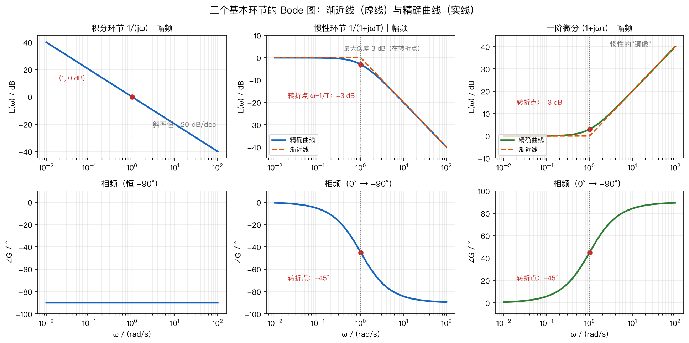
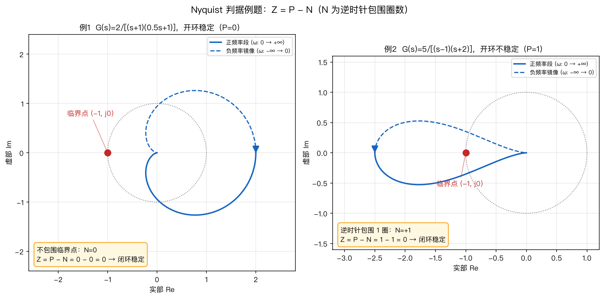

# 第7章 频域分析法——公式推导

> 本章核心：令 $s = j\omega$，把传递函数变成"频率响应"，在**频率域**分析稳定性与性能。
> 三大方法在本章"会师"：Nyquist 判据判稳，相位裕度 ⇔ 超调量（回第5章），临界增益 ⇔ 根轨迹（回第6章）。
> 本章推导主线：**定义（§1）→ 零件（§2 典型环节）→ 装配（§3 Bode 图）→ 判稳（§4 Nyquist）→ 量化（§5 裕度）→ 回家（§6 换算回时域）**。

---

## 0. 本章地图：为什么要换到"频率"这个角度

第5章在**时间轴**上看响应，第6章在**复平面**上看极点走位，本章在**频率轴**上看系统。为什么要再开一个新视角？三个硬理由：

| 理由                    | 时域/根轨迹的难处           | 频域法的优势                                            |
| --------------------- | ------------------- | ------------------------------------------------- |
| **建模难**               | 化工、飞机气动等对象写不出准确微分方程 | 扫频实验直接测出 $G(j\omega)$，**不需要解析模型**                 |
| **纯延迟 $e^{-\tau s}$** | 特征方程是超越方程，无法代数求解    | $e^{-j\tau\omega}$ 只贡献相角 $-\tau\omega$，**处理干净利落** |
| **噪声与带宽**             | 时域里"高频噪声"说不清        | 频域里噪声就在高频段，**看图即知抗扰能力**                           |

**本章逻辑链**（环环相扣，必须按顺序学）：

```
频率特性 G(jω) 是什么（§1）
   → 五种"零件"的频率特性（§2 典型环节）
   → 把零件"装配"成整机图（§3 Bode 图叠加法）
   → 用图判稳（§4 Nyquist 判据）
   → 量化"有多稳"（§5 稳定裕度 γ、Kg）
   → 换算回时域指标（§6 γ⇔ζ⇔σ%，ωc⇔ts）
```

**预备知识检查**（第2、3章的底子）：复数的模与辐角（$|a+jb|=\sqrt{a^2+b^2}$，$\angle=\arctan(b/a)$）、拉氏变换表、部分分式法。这三样不熟，先回炉再看本章。

---

## 1. 频率特性的定义与物理意义

### 1.1 从一个实验说起：给系统"放正弦波"

想象一套**音响均衡器**：你给它输入一个纯音（正弦波），然后慢慢拧频率旋钮，从低音（20 Hz）拧到高音（20000 Hz），同时盯着输出。你会看到：

| 输入频率 | 系统的输出表现 |
|---------|---------------|
| 低频（如 1 Hz） | 输出几乎完美跟随：幅度一样大、几乎无延迟 |
| 中频（如 10 Hz） | 输出幅度略变小，且慢了半拍（相位滞后） |
| 高频（如 100 Hz） | 输出幅度变得极小（几乎被滤掉），滞后严重 |

**把"输入频率 $\omega$ 从 0 扫到 $\infty$ 时，输出幅度缩了几倍、相位慢了几度"全部记录下来画成图——这就是频率特性。**

**数学上的"灵魂转换"**：此前（第6章根轨迹）我们在复平面 $s=\sigma+j\omega$ 上打点，$\sigma$ 管衰减、$\omega$ 管振荡。频率法干脆**只看纯振荡状态**——令 $\sigma=0$，即：

$$
\boxed{G(j\omega) = G(s)\Big|_{s=j\omega} = |G(j\omega)|\,e^{j\angle G(j\omega)}}
$$

代入后 $G(j\omega)$ 不再是传递函数，而是一个**随 $\omega$ 变化的复数**，每个复数同时携带两条信息：

1. **幅频特性** $A(\omega)=|G(j\omega)|$：输出幅值 ÷ 输入幅值（放大还是缩小）；
2. **相频特性** $\varphi(\omega)=\angle G(j\omega)$：输出比输入滞后（或超前）多少度。

> **一句话**：把开环传函里的 $s$ 全部换成 $j\omega$；所得复数的**模**是"放大倍数"，**辐角**是"延迟角度"。

### 1.2 严格推导：为什么稳态输出一定是"同频、变幅、移相"的正弦

上面是实验直觉，现在用第2章的拉氏变换把它**证出来**——这步很重要，它是"频率特性 = 传递函数在 $s=j\omega$ 处取值"的合法性来源。

**设定**：稳定系统 $G(s)$，输入 $r(t)=A\sin\omega t$。

**第1步：写输入的拉氏变换**（查第2章变换表）：

$$
R(s) = \frac{A\omega}{s^2+\omega^2}
$$

**第2步：输出的拉氏变换**：

$$
C(s) = G(s)\cdot\frac{A\omega}{s^2+\omega^2}
$$

**第3步：部分分式分解**。$C(s)$ 的极点分两类：$G(s)$ 自己的极点 $p_1,p_2,\dots$（都在左半平面，因为系统稳定），以及输入带来的两个共轭极点 $s=\pm j\omega$。于是：

$$
C(s) = \underbrace{\sum_i \frac{B_i}{s-p_i}}_{\text{暂态项（衰减至0）}} + \frac{a}{s-j\omega} + \frac{\bar{a}}{s+j\omega}
$$

**第4步：求留数 $a$**（部分分式法，两边乘 $(s-j\omega)$ 再令 $s\to j\omega$）：

$$
a = \lim_{s\to j\omega}(s-j\omega)C(s) = G(j\omega)\cdot\frac{A\omega}{j\omega+j\omega} = \frac{A\,G(j\omega)}{2j}
$$

**第5步：反变换稳态项**。暂态项因 $p_i$ 在左半平面而衰减为零，稳态只剩下两个共轭项：

$$
\begin{aligned}
c_{ss}(t) &= a\,e^{j\omega t} + \bar a\,e^{-j\omega t} \\
&= \frac{A}{2j}\Big[G(j\omega)e^{j\omega t} - G(-j\omega)e^{-j\omega t}\Big] \\
&= A\,\operatorname{Im}\Big[G(j\omega)e^{j\omega t}\Big] \quad\text{（共轭配对）}\\
&= A\,|G(j\omega)|\,\sin\big(\omega t + \angle G(j\omega)\big) \quad\text{（欧拉公式）}
\end{aligned}
$$

**结论**：

$$
\boxed{c_{ss}(t) = A\,|G(j\omega)|\,\sin\big(\omega t + \angle G(j\omega)\big)}
$$

——**稳态输出与输入同频率，幅值乘 $|G(j\omega)|$、相位平移 $\angle G(j\omega)$**。这正是 §1.1 实验观察到的现象，也是"令 $s=j\omega$ 即可"的严格依据。同时它还说明：**逐点扫频做实验，就能测出整条频率特性**（无需先建立精确模型）——这是频域法对时域法的降维打击。

**数值验证例（把结论落到具体数字上）**：$G(s)=\dfrac{1}{0.5s+1}$，输入 $r(t)=\sin t$（$\omega=1$）。

$$
G(j1)=\frac{1}{1+j0.5} \;\Rightarrow\; |G(j1)|=\frac{1}{\sqrt{1+0.5^2}}\approx0.894,\qquad \angle G(j1)=-\arctan0.5\approx-26.6°
$$

代入结论公式：

$$
c_{ss}(t) = 1\times0.894\cdot\sin(t-26.6°)
$$

**读数字**：输入幅值 1 的正弦，稳态输出只有 0.894 大、且滞后 26.6°——和图 7-1 低频曲线（幅度 ×0.89、滞后 27°）完全对上。**公式不再是符号游戏，而是可验证的预测**：下次给任何系统输入任何频率，都能先算后验。


*图 7-1 频率特性的物理意义：同一惯性环节 $G=1/(0.5s+1)$ 对两种频率正弦输入的稳态响应。输出始终是同频率正弦，但低频（$\omega=1$）几乎"照单全收"（幅度 ×0.89、滞后 27°），高频（$\omega=4$）被大幅削弱（幅度 ×0.45、滞后 63°）。*

> **时间视角**：这就是"为什么系统跟不上快速变化"的数学解释——**高频信号在时间轴上变化太快，惯性系统的输出来不及反应，幅值就"跟不上"了**。频率特性里的"衰减"与"滞后"，翻译成时间语言就是"反应慢半拍"。

### 1.3 手算示例：$G(s)=\dfrac{1}{s+1}$ 的频率特性（照着做一遍就会）

用一个一阶惯性环节（相当于一个 RC 低通滤波器）走完全流程。

**第1步：灵魂替换** $s=j\omega$：

$$
G(j\omega) = \frac{1}{1+j\omega}
$$

**第2步：拆成"模"与"辐角"**（复数求模、求角）：

- 幅频：==分母 $1+j\omega$ 的模是 $\sqrt{1+\omega^2}$，故==

$$
A(\omega) = |G(j\omega)| = \frac{1}{\sqrt{1+\omega^2}}
$$

- 相频：复数相除，==辐角 = 分子辐角 − 分母辐角==。分子 $1$ 的辐角 $0°$，分母 $1+j\omega$ 的辐角 $\arctan\omega$，故

$$
\varphi(\omega) = 0° - \arctan\omega = -\arctan\omega
$$

**第3步：代几个频率进去，建立体感**：

| 输入频率 $\omega$ | 幅值 $A(\omega)$ | 相位 $\varphi(\omega)$ | 物理含义 |
|---|---|---|---|
| $\omega=0$（直流） | $1$（100% 通过） | $0°$（完全同步） | 完全跟随，不衰减 |
| $\omega=1$（转折频率） | $1/\sqrt2\approx0.707$（70.7%） | $-45°$ | 幅度缩水，开始跟不上 |
| $\omega=10$（高频） | $1/\sqrt{101}\approx0.1$（10%） | $-84.3°$ | 几乎传不过去，严重滞后 |

**记忆锚点**：$\omega=1$（即 $1/T$）是分水岭——幅值降到 70.7%（即 $-3$ dB）、相位滞后 $45°$。频率越高，信号越传不过去。这就是"低通滤波器"的全部秘密。

**与前两章的串联**（打通任督二脉）：

- **根轨迹法**：看 $K$ 变化时极点怎么跑（看绝对稳定性）；
- **频率法**：看系统对不同频率信号的放大能力（看相对稳定性）。
- 第5章的**阻尼比 $\zeta$**，在频域里对应**相位裕度 $\gamma$**（§6 给出换算）；
- 根轨迹图上的"虚轴交点（临界 $K$）"，在 Bode 图上对应**相位交界频率 $\omega_g$** 和**幅值裕度 $K_g$**。

> **一句话**：根轨迹是"极限跑步测试"（看能跑多远不摔倒）；频率特性是"听力测试"（看对不同频率的反应）。两者描述的是同一个系统的同一副身板。

### 1.4 频率特性的三种图形表示

同一个 $G(j\omega)$，有三种画法，本章主攻前两种：

| 图                   | 画法                                                               | 用途             |
| ------------------- | ---------------------------------------------------------------- | -------------- |
| **Nyquist 图**（极坐标图） | $\omega:0\to+\infty$，把复数 $G(j\omega)$ 的轨迹画在复平面                   | §4 判稳（数圈数）     |
| **Bode 图**（对数图）     | 两张：$20\lg\lvert G \rvert$ 对 $\lg\omega$、$\angle G$ 对 $\lg\omega$ | §3 手绘分析、§5 读裕度 |
| Nichols 图（对数幅相图）    | $20\lg\lvert G \rvert$ 对 $\angle G$                              | 了解即可，本科少用      |

---

## 2. 典型环节的频率特性

复杂系统都是五种"零件"（典型环节）的乘积。本节把每个零件的幅频、相频**从头算出来**，并给出它们的 Bode 渐近线形状——这是 §3 叠加法手绘的弹药库。

### 2.1 比例环节 $G(s)=K$

$$
G(j\omega)=K,\qquad |G|=K,\qquad \angle G=0°
$$

**说明**：与频率无关——任何频率都放大 $K$ 倍、不产生相移。Bode 图上是一条 $20\lg K$ 的水平线（幅频）和 $0°$ 水平线（相频）。**它只负责"抬高度"，不改变形状**。

### 2.2 积分环节 $G(s)=\dfrac{1}{s}$ 与微分环节 $G(s)=s$

**积分环节**：

$$
G(j\omega)=\frac{1}{j\omega}=-\frac{j}{\omega},\qquad |G|=\frac{1}{\omega},\qquad \angle G=-90°
$$

**为什么相角恒为 $-90°$**：$j=e^{j90°}$ 在分母上，相当于"除以 $j$"= 相位减 $90°$。物理直觉：积分是"累积"，输出天然比输入慢四分之一周期（$90°$）。

**幅频的对数刻度**（关键计算，后面反复用）：

$$
20\lg|G| = 20\lg\frac{1}{\omega} = -20\lg\omega
$$

$\omega$ 每扩大 10 倍（一个"十倍频程"），$\lg\omega$ 增加 1，幅值下降 20 dB——**斜率恒为 $-20$ dB/dec**，且过点 $(\omega=1,\ 0\text{ dB})$。

**微分环节** $G(s)=s$ 是镜像：$|G|=\omega$，$20\lg|G|=+20\lg\omega$（斜率 $+20$ dB/dec），$\angle G=+90°$。

### 2.3 惯性环节 $G(s)=\dfrac{1}{Ts+1}$（全章最重要的零件）

**第1步：代入** $s=j\omega$：

$$
G(j\omega)=\frac{1}{1+j\omega T}
$$

**第2步：求幅频**（复数求模）：

$$
\boxed{|G(j\omega)| = \frac{1}{\sqrt{1+(\omega T)^2}}}
$$

**第3步：求相频**（辐角 = 分子角 − 分母角）：

$$
\boxed{\angle G(j\omega) = -\arctan(\omega T)}
$$

**第4步：看三个特征点**（抓两头和中间）：

| 频率                     | 幅值                              | 相角         | 物理含义     |
| ---------------------- | ------------------------------- | ---------- | -------- |
| $\omega\to 0$（低频）      | $\to 1$                         | $\to 0°$   | 慢信号照单全收  |
| $\omega=1/T$（**转折频率**） | $1/\sqrt2\approx0.707$（$-3$ dB） | $-45°$     | 开始衰减的分水岭 |
| $\omega\to\infty$（高频）  | $\approx 1/(\omega T)\to 0$     | $\to -90°$ | 快信号被滤掉   |

**第5步：Bode 渐近线**（手绘的灵魂）。对幅值取对数：

$$
L(\omega)=20\lg|G|=-20\lg\sqrt{1+(\omega T)^2}=-10\lg\big[1+(\omega T)^2\big]
$$

- 当 $\omega T\ll1$：$L\approx -10\lg 1=0$ dB —— **一条 0 dB 水平线**；
- 当 $\omega T\gg1$：$L\approx -10\lg(\omega T)^2=-20\lg\omega-20\lg T$ —— **斜率 $-20$ dB/dec 的直线**。

两条渐近线在 $\omega=1/T$ 处相交。精确曲线与渐近线的**最大误差只有 3 dB（恰好在转折点）**——这就是手绘时"先画折线、转折点处修圆 3 dB"的依据。

**相频的速记**：转折点前约 $0.1/T$ 处相角约 $-6°$，转折点 $-45°$，转折点后 $10/T$ 处约 $-84°$，全程单调从 $0°$ 滑到 $-90°$。

### 2.4 一阶微分环节 $G(s)=\tau s+1$

$$
G(j\omega)=1+j\omega\tau,\qquad |G|=\sqrt{1+(\omega\tau)^2},\qquad \angle G=+\arctan(\omega\tau)
$$

**说明**：与惯性环节**互为镜像**（分子 vs 分母）：幅频渐近线在 $\omega=1/\tau$ 处**上折** $+20$ dB/dec，相角从 $0°$ 升到 $+90°$（转折处 $+45°$）。它是"提前感知趋势"的环节（PID 里的 D 项就是它）。

### 2.5 振荡环节 $G(s)=\dfrac{\omega_n^2}{s^2+2\zeta\omega_n s+\omega_n^2}$

**第1步：代入并整理**（除以 $\omega_n^2$，用无量纲频率 $u=\omega/\omega_n$）：

$$
G(j\omega)=\frac{1}{1-u^2+j\,2\zeta u},\qquad u=\frac{\omega}{\omega_n}
$$

**第2步：幅频与相频**：

$$
|G(j\omega)|=\frac{1}{\sqrt{(1-u^2)^2+(2\zeta u)^2}},\qquad
\angle G(j\omega)=-\arctan\frac{2\zeta u}{1-u^2}
$$

（相角过 $u=1$ 时注意象限：$0<u<1$ 时分母为正、取主值；$u>1$ 时 $-180°<\angle<-90°$。）

**第3步：谐振峰推导**（当 $\zeta$ 小时幅值会"鼓包"，求极值点）。幅值最大 ⇔ 分母最小。令 $v=u^2$，分母平方：

$$
D(v)=(1-v)^2+4\zeta^2 v
$$

对 $v$ 求导并令为零：

$$
\frac{dD}{dv}=-2(1-v)+4\zeta^2=0 \;\Rightarrow\; v=1-2\zeta^2
$$

$v>0$ 要求 $\zeta<\dfrac{1}{\sqrt2}\approx0.707$。代回得：

$$
\boxed{\omega_r=\omega_n\sqrt{1-2\zeta^2},\qquad M_r=|G(j\omega_r)|=\frac{1}{2\zeta\sqrt{1-\zeta^2}}\quad(\zeta<0.707)}
$$

**第4步：特征行为**：

- $\omega\ll\omega_n$：$|G|\to1$（0 dB 水平线）；
- $\omega=\omega_n$：$|G|=\dfrac{1}{2\zeta}$（$\zeta$ 越小越高），$\angle G=-90°$；
- $\omega\gg\omega_n$：$|G|\approx(\omega_n/\omega)^2$ —— 渐近线斜率 **$-40$ dB/dec**（比惯性环节陡一倍，因为有两个极点）；
- $\zeta\ge0.707$：无谐振峰，曲线单调下降。

**关键思路**：$\zeta$ 越小谐振峰越高——**$M_r$ 是阻尼的"频域镜子"**：$M_r$ 大 ⇔ $\zeta$ 小 ⇔ 时域超调大（§6.4 给出 $M_r$ 与 $\sigma\%$ 的换算）。物理上这就是"共振"：秋千在固有频率附近越推越高。

**数值例（看 $\zeta$ 怎么"捏"谐振峰）**：取 $\omega_n=1$，算三个阻尼下的峰值：

| $\zeta$ | $\omega_r=\sqrt{1-2\zeta^2}$ | $M_r=\dfrac{1}{2\zeta\sqrt{1-\zeta^2}}$ | 峰值解读               |     |
| ------- | ---------------------------- | --------------------------------------- | ------------------ | --- |
| $0.2$   | $\sqrt{0.92}\approx0.96$     | $\dfrac{1}{0.4\times0.98}\approx2.55$   | 峰高 2.55 倍——很尖的"鼓包" |     |
| $0.5$   | $\sqrt{0.5}\approx0.71$      | $\dfrac{1}{1\times0.866}\approx1.15$    | 峰很矮，接近平坦           |     |
| $0.8$   | 无（$\zeta>0.707$）             | 无峰                                      | 单调下降，共振消失          |     |

**手感**：$\zeta=0.2$ 时谐振峰高 2.55 倍——对应时域超调大（$\sigma\%\approx52\%$，查第5章）；$\zeta=0.5$ 时峰几乎消失——对应超调约 16%。**同一张图，$\zeta$ 一拧，峰高和时域超调同步变化**，这就是 $M_r$ 被称为"频域镜子"的原因。

### 2.6 延迟环节 $G(s)=e^{-\tau s}$

$$
\boxed{G(j\omega)=e^{-j\tau\omega},\qquad |G|=1,\qquad \angle G=-\tau\omega\ \text{rad}}
$$

**说明**：延迟环节**幅值恒为 1**（完全不改变增益），只贡献随 $\omega$ **线性增长**的滞后相角。Bode 图上幅频是 0 dB 水平线、相频一路向下冲；Nyquist 图上幅值不变、只是曲线多绕圈——所以含延迟的系统用 Nyquist 判稳照常可数圈。**这就是"频域法对纯延迟轻松、时域法难受"的根源**：时域里 $e^{-\tau s}$ 是超越函数，特征方程 $s+1+Ke^{-0.5s}=0$ 无法用代数方法求根（第5章 Routh 判据直接失效）。

### 2.7 增益 $K$ 的作用（极易被忽视的一条）

开环增益 $K$（正实数）只把各频率处的幅值**同比放大 $K$ 倍**、**不改变相角**：

$$
|KG|=K|G|,\qquad \angle KG=\angle G
$$

所以 $K$ 增大时：Bode 图上幅频曲线**整体上移** $20\lg K$ dB（相频不动），Nyquist 曲线整体**向外膨胀**、离临界点 $(-1,j0)$ 越来越近——最终可能包围它导致失稳。**这正是"调大增益系统更容易振荡"的频域解释**，与第6章"$K$ 增大极点越过虚轴"完全同一件事。



*图 7-5 三个基本环节的 Bode 图（渐近线为虚线、精确曲线为实线）：积分环节是恒 $-20$ dB/dec 的直线、相角恒 $-90°$；惯性环节在转折点 $\omega=1/T$ 处幅值 $-3$ dB、相角 $-45°$，高频渐近线 $-20$ dB/dec；一阶微分环节是惯性环节的镜像（上折 $+20$ dB/dec、相角升到 $+90°$）。手绘 Bode 图 = 把这些"积木"按转折频率拼起来。*

---

## 3. Bode 图的绘制

### 3.1 为什么取对数：乘法变加法

串联系统的总频率特性是各环节**相乘**：

$$
G(j\omega)=G_1(j\omega)\,G_2(j\omega)\cdots G_n(j\omega)
$$

直接画乘积没法手绘。但对数有个神性质：

$$
20\lg|G_1G_2\cdots| = 20\lg|G_1| + 20\lg|G_2| + \cdots
$$

而复数相乘时**辐角本来就是相加的**：

$$
\angle(G_1G_2\cdots) = \angle G_1 + \angle G_2 + \cdots
$$

**于是乘法全变成了加法**——各环节的图可以直接**叠加**：幅频（dB）相加、相角相加。这就是 Bode 图"叠加法"的全部数学依据。横轴取 $\lg\omega$ 则是因为渐近线在对数坐标下恰好是**直线**（$\omega$ 变化 10 倍 = 横轴走一格，斜率自然是"每十倍频程多少 dB"）。

$$
\boxed{L(\omega)=20\lg|G(j\omega)|\ \text{(dB)},\qquad \text{横轴}\ \lg\omega}
$$

### 3.2 叠加法五步法（手绘核心技能）

```
① 标准化：把 G(jω) 写成"时间常数形式"的环节乘积：
     K、(jω)^(-ν)、1/(1+jωT)、(1+jωτ)、振荡环节…
     【注意】必须先把每个括号化成 (1+jωT) 形式（常数项为 1），增益全部并进 K！
② 定转折频率：ωi = 1/Ti，从小到大排好
③ 画低频段：由积分环节决定斜率 -20ν dB/dec，高度由 K 决定：
     L(ω) = 20lgK - 20ν·lgω   （ν=0 时是 20lgK 的水平线）
④ 逐个过转折频率：每到 ωi 斜率改变（惯性 -20，一阶微分 +20，振荡 -40）
⑤ 相频图：各环节相角曲线逐点相加（可先标出各转折点相角再连光滑曲线）
```

**第①步的"标准化"是初学者最容易翻船的地方**，务必看下面的对照：

$$
\frac{10}{s(s+1)(s+5)} \;\text{不是时间常数形式！}\qquad
\frac{10}{s(s+1)(s+5)}=\frac{10}{s(s+1)\cdot 5(0.2s+1)}=\frac{2}{s(s+1)(0.2s+1)}
$$

——只有右边这种"每个括号常数项为 1"的形式，才能直接读出 $K=2$、转折频率 $1$ 和 $1/0.2=5$。

### 3.3 完整手绘例题：$G(s)=\dfrac{10}{s(s+1)(s+5)}$

**第1步：标准化**（如上）：

$$
G(s)=\frac{2}{s(s+1)(0.2s+1)}\quad\Rightarrow\quad K=2,\ \ \nu=1,\ \ T_1=1,\ \ T_2=0.2
$$

**第2步：转折频率**：$\omega_1=1/T_1=1$，$\omega_2=1/T_2=5$。

**第3步：低频段**。$\nu=1$，斜率 $-20$ dB/dec，过点 $(\omega=1,\ L=20\lg 2\approx6\text{ dB})$：

$$
L(\omega)=20\lg 2-20\lg\omega \quad (\omega<1)
$$

**第4步：过转折点改斜率**：

| 频段           | 斜率           | 渐近线表达式                      |
| ------------ | ------------ | --------------------------- |
| $\omega<1$   | $-20$ dB/dec | $6-20\lg\omega$             |
| $1<\omega<5$ | $-40$ dB/dec | $6-40\lg\omega$             |
| $\omega>5$   | $-60$ dB/dec | $6-40\lg 5-60\lg(\omega/5)$ |
|              |              |                             |

**第5步：读穿越频率**（令 $L(\omega_c)=0$，假设 $\omega_c$ 落在 $1<\omega_c<5$ 段）：

$$
6-40\lg\omega_c=0 \;\Rightarrow\; \lg\omega_c=0.15 \;\Rightarrow\; \omega_c\approx1.41\ \text{（渐近线近似值）}
$$

精确值由 $|G(j\omega_c)|=1$ 解得 $\omega_c\approx1.23$——**渐近线会高估一点，这是正常的**；手绘估算用渐近线，精确校核用 `control.margin()`。

**第6步：相频叠加**。三个环节的相角：

$$
\angle G=\underbrace{-90°}_{\text{积分}}-\arctan\omega-\arctan(0.2\omega)
$$

代几个点：

| $\omega$ | $-90°$ | $-\arctan\omega$ | $-\arctan(0.2\omega)$ | $\angle G$ 合计 |
|----------|--------|-------------------|------------------------|-----------------|
| $0.1$ | $-90°$ | $-5.7°$ | $-1.1°$ | $-96.8°$ |
| $1$ | $-90°$ | $-45°$ | $-11.3°$ | $-146.3°$ |
| $5$ | $-90°$ | $-78.7°$ | $-45°$ | $-213.7°$ |

将这些点连成光滑曲线即得相频图。

**第7步：顺手把裕度也算出来**（§5 的预习）。在 $\omega_c\approx1.23$（精确值）处：

$$
\angle G(j\omega_c)=-90°-\arctan1.23-\arctan(0.2\times1.23)\approx-90°-50.9°-13.8°\approx-154.7°
$$

$$
\gamma=180°-154.7°\approx25.3°
$$

对照图 7-2 的仿真值 $\gamma=25.4°$、$\omega_c=1.23$——手算与仿真一致。


*图 7-2 $G(s)=10/[s(s+1)(s+5)]$ 的 Bode 图：幅频曲线（上）在 $\omega_c=1.23$ 处穿越 0 dB，相频曲线（下）在 $\omega_g=2.24$ 处穿越 $-180°$。读出的相位裕度 $\gamma=25.4°$、幅值裕度 $K_g=+9.5$ dB——系统稳定但偏"脆"（$\gamma<30°$），正是第8章要校正的对象。*

> **时间视角**：$\omega_c$ 越大，系统能"跟上"的频率范围越宽，时间响应越快；但若 $\omega_c$ 附近相角太接近 $-180°$，时间响应就会振荡加剧。**裕度小 = 时间响应"脆"**：参数一漂移，振荡就从"衰减"变成"发散"。

### 3.4 由 Bode 图反推传递函数（最小相位系统）

叠加法是可逆的——实验测出 Bode 图，就能反推 $G(s)$（这叫**实验建模**，频域法独有）：

```
① 看低频段斜率定型别：0 dB/dec → 0 型；-20 → Ⅰ 型；-40 → Ⅱ 型
② 由低频段高度定 K（Ⅰ 型：低频渐近线与 0 dB 的交点频率 = K）
③ 每个"斜率变化 ±20"对应一个 (1+s/ωi)^(∓1)，±40 对应振荡环节（由峰高定 ζ）
④ 写出 G(s) 后用相频图校验：最小相位系统幅相一一对应，对不上说明有非最小相位环节
```

**关键思路**：Bode 图的"看家本领"——**低频段**决定稳态精度（型别与 $K$，回第5章 §5），**$\omega_c$ 附近**决定稳定性与动态性能（裕度，§5），**高频段**决定抗噪声能力（衰减越快越抗噪）。手绘熟练后，"看图说话"就是频域分析的全部。

**反推例题（实验建模走一遍）**：某系统实验测得的 Bode 图具有如下特征，反推 $G(s)$。

```
① 低频段斜率 -20 dB/dec          → Ⅰ 型，G(s) 含一个 s 在分母
② 低频渐近线延长后与 0 dB 交于 ω=2 → Kv = 2
③ 转折频率 ω=1：斜率 -20→-40      → 对应因子 1/(s+1)
④ 转折频率 ω=5：斜率 -40→-60      → 对应因子 1/(s/5+1)
```

拼起来：

$$
G(s)=\frac{2}{s(s+1)(\frac{s}{5}+1)}=\frac{2}{s(s+1)(0.2s+1)}=\frac{10}{s(s+1)(s+5)}
$$

——正是 §3.3 手绘例题那个系统！**这说明 Bode 图不仅能正着画（传函→图），还能反着读（图→传函）**：以后拿到实验数据，三步就能重建数学模型。

---

## 4. Nyquist 判据

Bode 图判稳要"两张图对照着看"，Nyquist 判据则把信息压缩进**一条复平面曲线**，数它绕临界点 $(-1,j0)$ 的圈数即可判稳——严格、能处理延迟、能直接用实验数据。它是三大稳定性判据的"最高形式"。

### 4.1 预备：辐角原理（判据的数学地基）

**辐角原理**：设 $F(s)$ 是复变函数，$s$ 沿复平面上的闭合曲线 $C$ **顺时针**走一圈，则 $F(s)$ 的像曲线绕原点的净圈数（顺时针为正，用 $N$ 表示）：

$$
\boxed{N = Z - P}
$$

其中 $Z$、$P$ 分别是 $F(s)$ 在 $C$ **内部**的零点数和极点数。

**直觉理解**（不证，但要建立画面感）：$F(s)$ 在 $C$ 内每有一个零点，$s$ 绕一圈时向量 $F(s)$ 的辐角就多转 $+360°$；每有一个极点，辐角反而少转 $360°$（极点贡献"负方向"的转角）。零点贡献 $+1$ 圈、极点贡献 $-1$ 圈，合起来就是 $Z-P$ 圈。

### 4.2 D 形围线与映射：把"闭环极点在哪"翻译成"曲线绕几圈"

**目标**：判断**闭环**特征方程 $1+G(s)H(s)=0$ 在**右半平面**有没有根（有 = 不稳定）。

**第1步：构造函数**。令

$$
F(s)=1+G(s)H(s)
$$

则 $F(s)=0$ 的根 = 闭环极点；$F(s)$ 的极点 = 开环极点（因为 $GH\to\infty$ 时 $F\to\infty$）。

**第2步：选围线**。取包围整个右半平面的 **D 形围线**：从 $-j\infty$ 沿虚轴走到 $+j\infty$，再沿右半无限大圆弧绕回来。这个围线是**顺时针**的。

**第3步：套辐角原理**。$F(s)=1+GH$ 绕原点 ⟺ $GH$ 绕 $(-1,j0)$ 点（图像左移 1）。D 形围线顺时针走，所以 $N$ 是顺时针圈数。关键转化：

$$
\boxed{Z = P + N}
$$

其中 **$N$ 为 $G(j\omega)H(j\omega)$ 曲线（$\omega$ 从 $0^+$ 到 $+\infty$）绕 $(-1,j0)$ 点的顺时针净圈数**。

> ⚠️ **符号约定预警**：本课程采用"顺时针为正"约定，**判据为 $Z=P+N$**。部分教材用"逆时针为正"则写成 $Z=P-N$。两种写法等价，代数值前先确认约定方向！本书统一：$N$ = 顺时针圈数，$Z = P + N$。

**第4步：最常用的特例**（$P=0$，开环稳定）：

$$
\boxed{\text{闭环稳定} \iff \text{Nyquist 曲线不包围 } (-1,j0)\ \text{点}}
$$

### 4.3 Nyquist 稳定判据（操作三步法）

```
① 画出 G(jω)H(jω) 的 Nyquist 曲线（ω 从 0→+∞，利用对称性画负频率镜像）
② 数曲线顺时针绕 (-1,j0) 的净圈数 N
③ 查开环右半平面极点数 P，算 Z = P + N；Z=0 稳定，Z>0 不稳定
```

### 4.4 完整例题（含 $P=0$ 与 $P=1$ 两种情形）

**例1（$P=0$，常规情形）**：$G(s)H(s)=\dfrac{2}{(s+1)(0.5s+1)}$

- 开环极点 $-1,\ -2$，均在左半平面，$P=0$；
- $G(j\omega)H(j\omega)=\dfrac{2}{(1+j\omega)(1+j0.5\omega)}$：
  - $\omega=0$ 时 $=2$（正实轴）；
  - $\omega\to\infty$ 时 $\to0$、相角 $\to-180°$；
  - 曲线从 $(2,j0)$ 出发，经第四象限卷向原点；
- **不包围** $(-1,j0)$：$N=0$；
- $Z=P+N=0+0=0$ → **闭环稳定**。

验证：闭环特征方程 $(s+1)(0.5s+1)+2=0.5s^2+1.5s+3=0$，系数全正 → 稳定 ✓。

**例2（$P=1$，开环不稳定！）**：$G(s)H(s)=\dfrac{5}{(s-1)(s+2)}$

- 开环极点 $+1,\ -2$，**有一个在右半平面**，$P=1$；
- 画出 Nyquist 曲线：从 $(-2.5,j0)$ 出发，曲线**逆时针绕 $(-1,j0)$ 一圈**——按"顺时针为正"约定，这等价于 $N=-1$（即逆时针一圈）；
- $Z=P+N=1+(-1)=0$ → **闭环稳定**！

**验证**（手算闭环特征方程）：$(s-1)(s+2)+5=s^2+s+3=0$，根 $s=\dfrac{-1\pm j\sqrt{11}}{2}$，实部 $-\dfrac12<0$ → 稳定 ✓。

**例2 的震撼之处**：**开环不稳定的系统，闭环反而可以稳定**——这只有 Nyquist 判据能干净处理（Routh 也能判，但无法给你"曲线怎么绕"的几何图像）。



*图 7-6 Nyquist 判据两个例题对比。左：$P=0$，曲线不包围 $(-1,j0)$，$N=0$，$Z=0$ → 闭环稳定。右：$P=1$，曲线逆时针绕 $(-1,j0)$ 一圈（$N=-1$），$Z=1+(-1)=0$ → 闭环稳定——"开环不稳、闭环稳"的经典例证。蓝实线为正频率段、蓝虚线为负频率镜像、红点为临界点。*


*图 7-3 Nyquist 曲线（蓝线，含对称的负频率部分）与 $(-1,j0)$ 临界点（红点）。曲线离红点最近处对应的频率，正是 Bode 图上裕度最小的位置。*

> **时间视角**：把 $(-1,j0)$ 想成"振荡的临界开关"——曲线贴着它转，意味着闭环极点贴在虚轴上，时间响应呈等幅振荡；离得越远，振荡衰减越快。**Nyquist 图上"离悬崖的距离"与时间曲线上"振荡收敛的快慢"是一回事**。

### 4.5 虚轴上有极点怎么办：增补无限大圆弧

Ⅰ 型、Ⅱ 型系统的开环含积分环节 $1/s^\nu$，极点在原点——正好骑在 D 形围线的虚轴上，辐角原理不适用（围线不能穿过极点）。

**处理办法**：让 D 形围线在原点处向右绕一个**无限小半圆** $s=\varepsilon e^{j\theta}$（$\theta:-90°\to+90°$），把原点极点"划到"围线外面。

**这个小半圆映射成什么**？代入 $G(s)H(s)\approx\dfrac{K}{s^\nu}$（低频主导项）：

$$
GH\Big|_{s=\varepsilon e^{j\theta}} \approx \frac{K}{\varepsilon^\nu}e^{-j\nu\theta}
$$

模 $\to\infty$，辐角从 $+\nu\cdot90°$ 转到 $-\nu\cdot90°$——即**半径无限大、顺时针转 $\nu\times180°$ 的圆弧**。

**补线规则**（直接背）：从 Nyquist 曲线 $\omega=0^{-}$ 端出发，顺时针补画 $\nu\times180°$ 的无限大圆弧，接到 $\omega=0^{+}$ 端。补完线再正常数圈。

例如：Ⅰ 型补 $180°$ 半圆，Ⅱ 型补 $360°$ 整圆。

**补线完整例题（Ⅰ 型系统）**：$G(s)=\dfrac{10}{s(s+1)(s+5)}$——就是 §3.3 那个系统，它含一个积分环节（$\nu=1$）。

**第1步：画 $\omega>0$ 段**。$\omega\to0^+$ 时幅值 $\to\infty$、相角 $\to-90°$（积分环节主导），曲线从第三象限"深处"出发。

**第2步：找实轴交点**（虚部为零处，即相角 $-180°$）：

$$
-90°-\arctan\omega-\arctan(0.2\omega)=-180° \;\Rightarrow\; \arctan\omega+\arctan(0.2\omega)=90° \;\Rightarrow\; \omega^2\cdot0.2=1
$$

$$
\omega=\sqrt5\approx2.24,\qquad |G(j\sqrt5)|=\frac{10}{\sqrt5\cdot\sqrt6\cdot\sqrt{30}}\approx\frac{1}{3}
$$

曲线穿过实轴于点 $(-\dfrac13,j0)$，然后继续在第三象限卷向原点。

**第3步：补线**。从 $\omega=0^{-}$ 端出发，顺时针补画 $180°$ 无限大圆弧接回 $\omega=0^{+}$ 端。

**第4步：数圈**。临界点 $(-1,j0)$ 在实轴交点 $-\dfrac13$ 的**左侧**，补线后的闭合曲线不包围它，$N=0$；开环极点全在左半平面（$0,-1,-5$），$P=0$：

$$
Z = P + N = 0 \quad\to\quad \text{闭环稳定} \checkmark
$$

（呼应 §5.3：该系统的 $\omega_g=\sqrt5$ 正是这里的实轴交点频率——Nyquist 图和 Bode 图在数字上完全自洽。）

### 4.6 对数判据：不想画 Nyquist 曲线？在 Bode 图上也能数圈

手绘 Nyquist 曲线较麻烦，工程上常用等价的**对数判据**（直接用 Bode 图）：

**穿越的定义**：在 $L(\omega)>0$ dB 的频段内，看相频曲线穿越 $(2k+1)\times180°$ 线（对负反馈系统就是 $-180°$ 线）：

- **正穿越** $N_+$：相角**向上**穿过（从更负变到不那么负）；
- **负穿越** $N_-$：相角**向下**穿过；
- 起于/止于 $-180°$ 线的算**半次**穿越（×0.5）。

**对数判据**：

$$
\boxed{Z = P + 2\,(N_- - N_+),\qquad \text{稳定} \iff Z = 0}
$$

**为什么有系数 2**：Nyquist 全曲线（含镜像）绕一圈对应 Bode 图上相频两次穿越（$+\omega$ 和 $-\omega$ 各一次）。Bode 图只画了 $\omega\ge0$，故圈数差要乘 2。

**补线提醒**：开环含 $\nu$ 个积分环节时，相频图低频端要从 $\omega=0^+$ 的相角**向下补** $\nu\times90°$ 的虚线（与 §4.5 的无限大圆弧对应），再数穿越。

**数值例（对着 Bode 图数一遍）**：仍用 $G=\dfrac{10}{s(s+1)(s+5)}$。已知（§5 将算）：$\omega_c=1.23$、$\omega_g=2.24$、$L(\omega_g)=-9.5$ dB。

```
L>0 dB 的频段是 ω < 1.23（幅频在 ωc 处过 0 dB）
该段内相频从 -90° 单调降到约 -146°，从未碰到 -180° 线
→ 正负穿越都是 0 次：N+ = N- = 0
→ Z = P + 2(0-0) = 0 → 稳定 ✓
```

**关键易错点**：$\omega_g=2.24$ 处相频确实穿过了 $-180°$，但那时幅值只有 $-9.5$ dB（$L<0$）——**"信号已经小到看不见"的穿越不算数**。这正是对数判据"只在 $L>0$ 段计数"的用意：Nyquist 判据看的是曲线绕临界点的圈数，增益小于 1 的部分绕不到临界点。

---

## 5. 稳定裕度

"稳定"只有是/否，但工程需要知道**"有多稳"**——差 1% 就失稳的系统没人敢用。裕度就是量化的"安全距离"。

### 5.1 两个关键频率

| 频率                        | 定义                                      | 在哪里读               |     |     |
| ------------------------- | --------------------------------------- | ------------------ | --- | --- |
| **穿越频率** $\omega_c$（增益交界） | $G(j\omega_c)H(j\omega_c)=1$（$0$ dB）    | 幅频曲线与 0 dB 线的交点    |     |     |
| **相位交界频率** $\omega_g$     | $\angle G(j\omega_g)H(j\omega_g)=-180°$ | 相频曲线与 $-180°$ 线的交点 |     |     |
|                           |                                         |                    |     |     |

**记忆**：$\omega_c$ 问的是"**幅值什么时候缩到 1**"；$\omega_g$ 问的是"**相位什么时候拖到 $-180°$**"（$-180°$ = 负反馈变正反馈的临界角）。

### 5.2 相位裕度 $\gamma$

在 $\omega_c$ 处看相角离 $-180°$ 还有多远：

$$
\boxed{\gamma = 180° + \angle G(j\omega_c)H(j\omega_c)\quad(\angle GH\text{ 为负值，}\gamma\text{ 取正})}
$$

**物理含义**：在 $\omega_c$ 处，系统**还能再容忍 $\gamma$ 度的额外相位滞后**才到达失稳边界（比如时延 $\tau$ 最大允许 $\gamma/\omega_c$ 弧度）。

**计算例题**（接 §3.3）：$\omega_c\approx1.23$ 处 $\angle G\approx-154.7°$：

$$
\gamma = 180° - 154.7° = 25.3°
$$

工程推荐 $\gamma=30°\sim60°$——**25° 偏低**，系统"能稳但脆"，需要校正（第8章）。

### 5.3 幅值裕度 $K_g$

在 $\omega_g$ 处看幅值离 1 还差几倍：

$$
\boxed{K_g = \frac{1}{|G(j\omega_g)H(j\omega_g)|},\qquad K_g(\text{dB}) = 20\lg K_g = -L(\omega_g)}
$$

**物理含义**：开环增益还能再放大 $K_g$ 倍才失稳（临界增益 = 当前增益 × $K_g$）。

**计算例题**（同系统）。先求 $\omega_g$：令 $\angle G=-180°$：

$$
-90°-\arctan\omega-\arctan(0.2\omega)=-180°
\;\Rightarrow\; \arctan\omega+\arctan(0.2\omega)=90°
$$

利用恒等式 $\arctan a+\arctan b=90°\iff ab=1$：

$$
\omega\cdot0.2\omega=1 \;\Rightarrow\; \omega_g=\sqrt5\approx2.24
$$

代入幅值：

$$
|G(j\omega_g)|=\frac{10}{\omega_g\sqrt{1+\omega_g^2}\sqrt{25+\omega_g^2}}
=\frac{10}{2.24\times\sqrt6\times\sqrt{30}}\approx\frac{1}{3}
$$

$$
K_g=3,\qquad K_g(\text{dB})=20\lg3\approx9.5\ \text{dB}
$$

**与根轨迹交叉验证**：闭环特征方程 $s^3+6s^2+5s+K=0$，Routh 表 $s^1$ 行为 $(30-K)/6$，临界 $K^*=30$。当前 $K=10$，故 $K_g=30/10=3$ ✓——三大方法再次给出同一答案。工程推荐 $K_g\ge6$ dB。

### 5.4 为什么两个裕度缺一不可

只用一个裕度可能"误判安全"：

- **$\gamma$ 大但 $K_g$ 小**：$\omega_c$ 处离 $-180°$ 远，但在别的频率处幅值已近 1 且相位已贴 $-180°$——增益稍增即失稳；
- **$K_g$ 大但 $\gamma$ 小**：$\omega_c$ 处相位已接近 $-180°$——稍有延迟（传感器、通信）即失稳。

**几何本质**：$(-1,j0)$ 是个**点**，"离它多远"需要两个坐标方向都安全——$\gamma$ 管角度方向，$K_g$ 管模长方向。工程验收是**双指标同时合格**：

$$
\boxed{\gamma>0\ \text{且}\ K_g>1\ (0\ \text{dB})\iff\text{稳定；}\quad \gamma\ 30°\sim60°\ \text{且}\ K_g\ge6\ \text{dB}\iff\text{好用}}
$$

**关键思路**：裕度 = **离失稳边界的"安全距离"**。它们既是稳定性的量化，也是设计指标——第8章校正设计的目标就是"把 $\gamma$ 和 $K_g$ 调进合格区间"。

---

## 6. 频域与时域性能的换算（三大方法会师）

对欠阻尼二阶系统，频域指标与时域指标可以**精确互算**——这就是第5章（时域）与本章（频域）的握手处，也是第8章校正设计的桥梁。

### 6.1 相位裕度 ⇔ 阻尼比（完整推导）

**第1步：写二阶系统的开环**。标准二阶闭环 $\Phi(s)=\dfrac{\omega_n^2}{s^2+2\zeta\omega_n s+\omega_n^2}$ 对应单位反馈开环：

$$
G(s)=\frac{\omega_n^2}{s(s+2\zeta\omega_n)}
$$

（验证：$\dfrac{G}{1+G}=\dfrac{\omega_n^2}{s^2+2\zeta\omega_n s+\omega_n^2}$ ✓）

**第2步：求 $\omega_c$**。令 $|G(j\omega_c)|=1$：

$$
\frac{\omega_n^2}{\omega_c\sqrt{\omega_c^2+4\zeta^2\omega_n^2}}=1
\;\Rightarrow\; \omega_c^4+4\zeta^2\omega_n^2\omega_c^2-\omega_n^4=0
$$

视其为 $\omega_c^2$ 的一元二次方程，解出正根：

$$
\boxed{\omega_c=\omega_n\sqrt{\sqrt{1+4\zeta^4}-2\zeta^2}}
$$

**第3步：求 $\gamma$**。$\angle G(j\omega_c)=-90°-\arctan\dfrac{\omega_c}{2\zeta\omega_n}$，故：

$$
\gamma=90°-\arctan\frac{\omega_c}{2\zeta\omega_n}=\arctan\frac{2\zeta\omega_n}{\omega_c}
$$

代入 $\omega_c$ 得精确公式：

$$
\boxed{\gamma=\arctan\frac{2\zeta}{\sqrt{\sqrt{1+4\zeta^4}-2\zeta^2}}}
$$

**第4步：工程近似**。对上式在 $\zeta\le0.7$ 范围做数值检验：

| $\zeta$ | 0.2 | 0.3 | 0.4 | 0.5 | 0.6 | 0.7 |
|---------|-----|-----|-----|-----|-----|-----|
| $\gamma$（精确）| 22.6° | 33.3° | 43.1° | 51.8° | 59.2° | 65.2° |
| $100\zeta$（近似）| 20° | 30° | 40° | 50° | 60° | 70° |

误差在几度以内，故得**工程速算式**：

$$
\boxed{\gamma \approx 100\,\zeta\ \text{（度）}\quad(\zeta\le0.7\ \text{有效})}
$$

### 6.2 相位裕度 ⇔ 超调量

把 $\zeta\approx\gamma/100$ 代入第5章超调量公式 $\sigma\%=e^{-\pi\zeta/\sqrt{1-\zeta^2}}\times100\%$ 即得。常用对照（精确值）：

| ==$\gamma$== | ==对应 $\zeta$（精确）== | ==$\sigma\%$==    |
| -------- | -------------- | ------------- |
| ==$30°$==    | ==0.30==           | ==$\approx37\%$== |
| ==$45°$==    | ==0.42==           | ==$\approx23\%$== |
| ==$60°$==    | ==0.61==           | ==$\approx9\%$==  |

> ⚠️ 注意：常见说法"$\gamma=45°\Rightarrow\sigma\%\approx30\%$"偏大——精确值是约 **23%**。记忆锚点：**$\gamma=60°$ 是"黄金点"**（$\zeta\approx0.61$、$\sigma\%\approx9\%$，又快又稳）。

### 6.3 穿越频率 ⇔ 调节时间

联立 $t_s=\dfrac{3\sim4}{\zeta\omega_n}$（第5章）与 §6.1 的 $\omega_c$ 表达式。对 $\zeta=0.3\sim0.7$ 逐点计算：

| $\zeta$ | $\omega_c/\omega_n$ | $t_s\omega_c$（2% 误差带）|
|---------|--------------------|--------------------------|
| 0.3 | 0.91 | ≈12.1 |
| 0.5 | 0.79 | ≈6.3 |
| 0.7 | 0.65 | ≈3.7 |

工程上取常用设计区 $\zeta\approx0.4\sim0.7$，得速算式：

$$
\boxed{t_s\approx\frac{4\sim7}{\omega_c}\quad(\text{2% 误差带，}\zeta\text{ 在设计区内})}
$$

**物理直觉**：$\omega_c$ 是"系统能跟上的最高频率"，自然与时间响应速度成反比——$\omega_c$ 越大，$t_s$ 越小。

### 6.4 高阶系统的经验公式（$M_r$ 做桥梁）

高阶系统没有精确换算，工程上用谐振峰 $M_r$ 做中间量（对 $1\le M_r\le1.8$ 的系统）：

$$
\sigma\%\approx\big[0.16+0.4(M_r-1)\big]\times100\%
$$

$$
t_s\approx\frac{\pi}{\omega_c}\Big[2+1.5(M_r-1)+2.5(M_r-1)^2\Big]
$$

**关键思路**：频域指标（$\gamma,\omega_c,M_r$）⇔ 时域指标（$\sigma\%,t_s$）——**三大方法在这里正式"会师"**：同一系统，时域、根轨迹、频域给出完全一致的设计依据。


*图 7-4 频域⇔时域换算总览：阻尼比 $\zeta$ 同时决定超调量 $\sigma\%$（红实线）与相位裕度 $\gamma\approx100\zeta$（蓝虚线）。工程推荐区 $\gamma=30°\sim60°$ 对应 $\zeta\approx0.3\sim0.6$、$\sigma\%\approx10\%\sim37\%$。*

> **时间视角（本章点睛）**：这张图说明**"三大方法看的是同一个时间响应"**——在时域里它是超调量，在频域里它是相位裕度，在根轨迹里它是极点的角度。校正设计的本质，就是想办法把 $\zeta$ 推进 $0.4\sim0.7$ 这个"时间响应最舒服"的区间。

---

## 总结表

| 内容                              | 公式                                                                                   | 要点                                         |                                                       |                                |               |
| ------------------------------- | ------------------------------------------------------------------------------------ | ------------------------------------------ | ----------------------------------------------------- | ------------------------------ | ------------- |
| 频率特性                            | $G(j\omega)=G(s)_{s=j\omega}=Ge^{j\angle G}$                                         | _{s=j\omega}=                              | G                                                     | e^{j\angle G}$                 | 正弦稳态：同频、变幅、移相 |
| 惯性环节                            | $                                                                                    | G                                          | =1/\sqrt{1+(\omega T)^2}$，$\angle G=-\arctan\omega T$ | 转折 $\omega=1/T$：$-3$ dB、$-45°$ |               |
| 积分环节                            | $                                                                                    | G                                          | =1/\omega$，$\angle G=-90°$                            | 恒 $-20$ dB/dec                 |               |
| 谐振峰值                            | $M_r=\frac{1}{2\zeta\sqrt{1-\zeta^2}}$，$\omega_r=\omega_n\sqrt{1-2\zeta^2}$          | $\zeta<0.707$ 时存在                          |                                                       |                                |               |
| 延迟环节                            | $                                                                                    | G                                          | =1$，$\angle G=-\tau\omega$                            | 只吃相角，不动幅值                      |               |
| Bode 图                          | $L=20\lg                                                                             | G                                          | $；幅相加、相角加                                             | 先标准化成时间常数形式                    |               |
| Nyquist 判据                      | $\boxed{Z=P+N}$（$N$ 顺时针为正）                                                           | $P=0$：不包围 $(-1,j0)$ 即稳                     |                                                       |                                |               |
| 虚轴极点                            | 补 $\nu\times180°$ 圆弧                                                                 | Ⅰ 型补半圆，Ⅱ 型补整圆                              |                                                       |                                |               |
| 相位裕度                            | $\gamma=180°+\angle G(j\omega_c)$                                                    | $\gamma\approx100\zeta$（度）；推荐 $30°\sim60°$ |                                                       |                                |               |
| 幅值裕度                            | $K_g=1/                                                                              | G(j\omega_g)                               | $，$K_g(\text{dB})=-L(\omega_g)$                       | 推荐 $\ge6$ dB                   |               |
| 对数判据                            | $Z=P+2(N_--N_+)$                                                                     | 对着 Bode 图数穿越即可                             |                                                       |                                |               |
| $\gamma\Leftrightarrow\sigma\%$ | $\gamma=45°\Rightarrow\sigma\%\approx23\%$，$\gamma=60°\Rightarrow\sigma\%\approx9\%$ | 从频域换算回时域                                   |                                                       |                                |               |
| $\omega_c\Leftrightarrow t_s$   | $t_s\approx(4\sim7)/\omega_c$                                                        | $\omega_c$ 越大越快                            |                                                       |                                |               |
