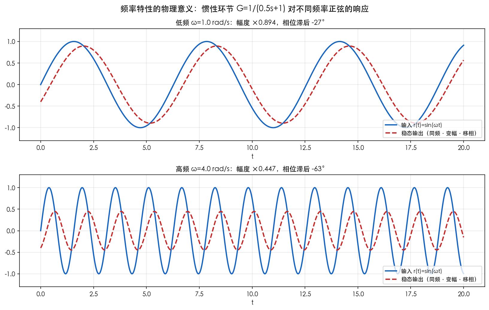
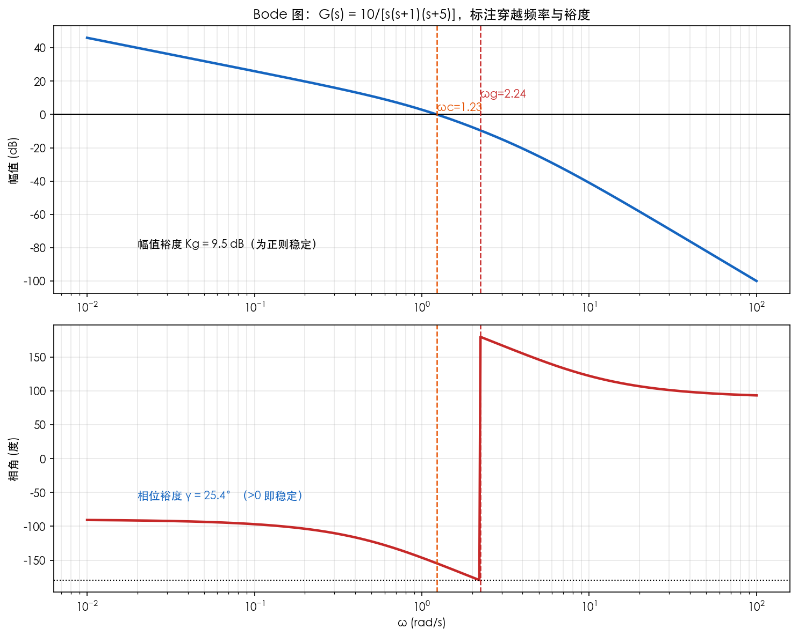
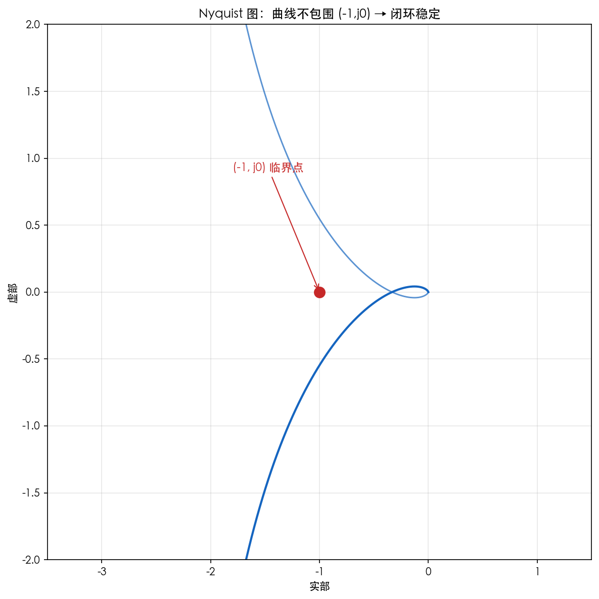
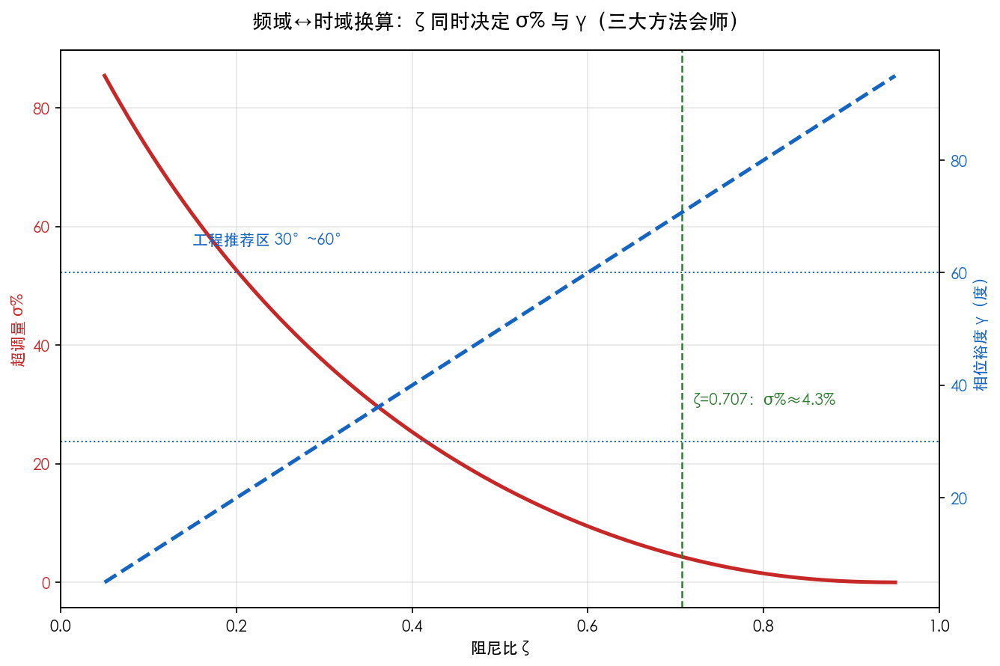

# 第7章 频域分析法——仿真与绘图

> 本章目标：直观看到**频率特性的物理意义**、**Bode 图与裕度**、**Nyquist 图与临界点**，并验证**频域⇔时域指标换算**。
> 工具：Python（numpy + matplotlib + control 库）。安装：`pip3 install control`

---

## 图1 频率特性的物理意义

### 绘图代码

```python
"""第7章图1：惯性环节 G=1/(0.5s+1) 对不同频率正弦的稳态响应"""
import numpy as np
import matplotlib.pyplot as plt

plt.rcParams['font.sans-serif'] = ['PingFang SC', 'STHeiti', 'SimHei', 'DejaVu Sans']
plt.rcParams['axes.unicode_minus'] = False

t = np.linspace(0, 20, 1000)
w1, w2 = 1.0, 4.0
T = 0.5
mag1 = 1/np.sqrt(1+(w1*T)**2); phi1 = -np.arctan(w1*T)
mag2 = 1/np.sqrt(1+(w2*T)**2); phi2 = -np.arctan(w2*T)

fig, axes = plt.subplots(2, 1, figsize=(11, 7))
for ax, (w, mag, phi, title) in zip(axes, [
    (w1, mag1, phi1, f'低频 ω={w1} rad/s：幅度 ×{mag1:.3f}，相位滞后 {np.degrees(phi1):.0f}°'),
    (w2, mag2, phi2, f'高频 ω={w2} rad/s：幅度 ×{mag2:.3f}，相位滞后 {np.degrees(phi2):.0f}°')]):
    ax.plot(t, np.sin(w*t), lw=2, color='#1565C0', label='输入 r(t)=sin(ωt)')
    ax.plot(t, mag*np.sin(w*t+phi), lw=2, color='#C62828', ls='--', label='稳态输出（同频·变幅·移相）')
    ax.set_title(title, fontsize=11)
    ax.legend(fontsize=9, loc='lower right'); ax.grid(alpha=0.3); ax.set_xlabel('t')
    ax.set_ylim(-1.3, 1.3)
fig.suptitle('频率特性的物理意义：惯性环节 G=1/(0.5s+1) 对不同频率正弦的响应', fontsize=13)
fig.tight_layout()
fig.savefig('figures/01_频率特性物理意义.png', dpi=150, bbox_inches='tight', facecolor='white')
plt.close(fig)
print('图1 已生成')
```

### 运行与结果



*图1 对同一惯性环节输入不同频率的正弦：低频（ω=1）输出几乎"照单全收"（幅度 ×0.89、滞后 27°），高频（ω=4）输出被大幅削弱（幅度 ×0.45、滞后 63°）。*

**现象解释**：输出始终是**同频率**的正弦，只是幅值被乘了一个系数 $\lvert G(j\omega)\rvert$、相位被移了一个角度 $\angle G(j\omega)$。这两个量随频率变化，就构成频率特性。**"低频放行、高频衰减"正是惯性环节的本性**——它像一个低通滤波器，也解释了为什么系统跟不上快速变化的输入。

---

## 图2 Bode 图与稳定裕度

### 绘图代码

```python
"""第7章图2：G(s)=10/[s(s+1)(s+5)] 的 Bode 图，标注穿越频率与裕度"""
import numpy as np
import matplotlib.pyplot as plt
import control

plt.rcParams['font.sans-serif'] = ['PingFang SC', 'STHeiti', 'SimHei', 'DejaVu Sans']
plt.rcParams['axes.unicode_minus'] = False

s = control.TransferFunction.s
G = 10/(s*(s+1)*(s+5))
gm, pm, wg, wc = control.margin(G)          # 幅值裕度、相位裕度、相穿越频率、增益穿越频率
omega = np.logspace(-2, 2, 600)
mag, phase, _ = control.frequency_response(G, omega)
mag_db = 20*np.log10(np.maximum(mag, 1e-6))
phase_deg = np.degrees(phase)

fig, (ax0, ax1) = plt.subplots(2, 1, figsize=(10, 8))
ax0.semilogx(omega, mag_db, lw=2.2, color='#1565C0')
ax0.axhline(0, color='k', lw=1)
ax0.axvline(wc, color='#E65100', ls='--', lw=1.2)
ax0.axvline(wg, color='#C62828', ls='--', lw=1.2)
ax0.text(wc, 2, f'ωc={wc:.2f}', color='#E65100', fontsize=10)
ax0.text(wg, 10, f'ωg={wg:.2f}', color='#C62828', fontsize=10)
ax0.text(0.02, -80, f'幅值裕度 Kg = {20*np.log10(gm):.1f} dB（为正则稳定）', fontsize=10)
ax0.set_ylabel('幅值 (dB)'); ax0.grid(alpha=0.3, which='both')
ax0.set_title('Bode 图：G(s) = 10/[s(s+1)(s+5)]，标注穿越频率与裕度', fontsize=12)

ax1.semilogx(omega, phase_deg, lw=2.2, color='#C62828')
ax1.axhline(-180, color='k', lw=1, ls=':')
ax1.axvline(wc, color='#E65100', ls='--', lw=1.2)
ax1.axvline(wg, color='#C62828', ls='--', lw=1.2)
ax1.text(0.02, -60, f'相位裕度 γ = {pm:.1f}°（>0 即稳定）', fontsize=10, color='#1565C0')
ax1.set_xlabel('ω (rad/s)'); ax1.set_ylabel('相角 (度)')
ax1.grid(alpha=0.3, which='both')
fig.tight_layout()
fig.savefig('figures/02_Bode图与稳定裕度.png', dpi=150, bbox_inches='tight', facecolor='white')
plt.close(fig)
print('图2 已生成')
```

### 运行与结果



*图2 上：幅频曲线（蓝色）在 ωc=1.23 处穿越 0 dB；下：相频曲线在 ωg=2.24 处穿越 -180°。相位裕度 γ=25.4°（>0），幅值裕度 Kg=+9.5 dB（>0）→ 系统稳定，但 γ 小于工程推荐值 30°，偏"脆"。*

**现象解释**：
- **增益穿越频率 ωc**：幅频曲线第一次穿过 0 dB 的地方。此处的相角离 -180° 还差多少，就是相位裕度 γ。
- **相穿越频率 ωg**：相角到达 -180° 的地方。此处幅值离 0 dB 还差多少，就是幅值裕度 Kg。
- γ=25.4° 说明系统虽然稳定，但**安全距离不够**——一旦参数漂移或建模误差引入额外延迟，就可能失稳。这正是第8章"校正"要解决的事。

---

## 图3 Nyquist 图与临界点

### 绘图代码

```python
"""第7章图3：G(s)=10/[s(s+1)(s+5)] 的 Nyquist 曲线与 (-1,j0) 临界点"""
import numpy as np
import matplotlib.pyplot as plt
import control

plt.rcParams['font.sans-serif'] = ['PingFang SC', 'STHeiti', 'SimHei', 'DejaVu Sans']
plt.rcParams['axes.unicode_minus'] = False

s = control.TransferFunction.s
G = 10/(s*(s+1)*(s+5))
omega_n = np.logspace(-2, 2, 800)
re_part = np.zeros_like(omega_n); im_part = np.zeros_like(omega_n)
for i, w in enumerate(omega_n):
    g = G(1j*w)
    re_part[i] = g.real
    im_part[i] = g.imag

fig, ax = plt.subplots(figsize=(8, 8))
ax.plot(re_part, im_part, lw=2, color='#1565C0')
ax.plot(re_part, -im_part, lw=1.4, color='#1565C0', alpha=0.7)   # 负频率部分（对称）
ax.plot(-1, 0, 'o', ms=10, color='#C62828')
ax.annotate('(-1, j0) 临界点', xy=(-1, 0), xytext=(-1.8, 0.9),
            arrowprops=dict(arrowstyle='->', color='#C62828'), color='#C62828', fontsize=11)
ax.set_title('Nyquist 图：曲线不包围 (-1,j0) → 闭环稳定', fontsize=12)
ax.grid(alpha=0.3); ax.set_xlim(-3.5, 1.5); ax.set_ylim(-2, 2)
ax.set_xlabel('实部'); ax.set_ylabel('虚部')
fig.tight_layout()
fig.savefig('figures/03_Nyquist图与临界点.png', dpi=150, bbox_inches='tight', facecolor='white')
plt.close(fig)
print('图3 已生成')
```

### 运行与结果



*图3 G(jω) 曲线（蓝线，含对称的负频率部分）没有包围 (-1,j0) 红点；开环无右半平面极点（P=0）→ 闭环稳定。曲线距离红点最近的部位（虚轴下方的包围区）越贴近红点，裕度越小。*

**现象解释**：**(-1,j0) 点就是"悬崖"**。曲线绕它绕一整圈（含负频率，净圈数为 N）时闭环失稳一次。这里曲线从左侧绕过、没有包住红点，N=0，P=0，所以 Z=0，稳定。**曲线离红点越近，γ、Kg 越小**——所以 Nyquist 图和 Bode 图读出的结论完全一致，只是画法不同。

---

## 图4 频域⇔时域指标换算

### 绘图代码

```python
"""第7章图4：阻尼比 ζ 同时决定超调量 σ% 与相位裕度 γ（三大方法会师）"""
import numpy as np
import matplotlib.pyplot as plt

plt.rcParams['font.sans-serif'] = ['PingFang SC', 'STHeiti', 'SimHei', 'DejaVu Sans']
plt.rcParams['axes.unicode_minus'] = False

zeta = np.linspace(0.05, 0.95, 200)
sigma = np.exp(-np.pi*zeta/np.sqrt(1-zeta**2)) * 100
gamma = 100*zeta  # 近似：γ≈100ζ（度）

fig, ax1 = plt.subplots(figsize=(9, 6))
ax1.plot(zeta, sigma, lw=2.4, color='#C62828', label='超调量 σ% = e^(-πζ/√(1-ζ²))')
ax1.set_xlabel('阻尼比 ζ'); ax1.set_ylabel('超调量 σ%', color='#C62828')
ax1.tick_params(axis='y', labelcolor='#C62828')
ax1.grid(alpha=0.3); ax1.set_xlim(0, 1)
ax1.axvline(0.707, color='#2E7D32', ls='--', lw=1.2)
ax1.text(0.72, 30, 'ζ=0.707：σ%≈4.3%', color='#2E7D32', fontsize=10)

ax2 = ax1.twinx()
ax2.plot(zeta, gamma, lw=2.4, color='#1565C0', ls='--', label='相位裕度 γ≈100ζ（度）')
ax2.set_ylabel('相位裕度 γ（度）', color='#1565C0')
ax2.tick_params(axis='y', labelcolor='#1565C0')
ax2.axhline(60, color='#1565C0', ls=':', lw=1)
ax2.axhline(30, color='#1565C0', ls=':', lw=1)
ax2.text(0.15, 65, '工程推荐区 30°~60°', color='#1565C0', fontsize=10)
fig.suptitle('频域⇔时域换算：ζ 同时决定 σ% 与 γ（三大方法会师）', fontsize=13)
fig.tight_layout()
fig.savefig('figures/04_频域与时域性能换算.png', dpi=150, bbox_inches='tight', facecolor='white')
plt.close(fig)
print('图4 已生成')
```

### 运行与结果



*图4 红色实线：σ% 随 ζ 增大而减小；蓝色虚线：γ≈100ζ。工程推荐 γ 落在 30°~60°，对应 ζ≈0.3~0.6，此时 σ% 约 10%~37%——两组指标完全对应。*

**现象解释**：阻尼比 ζ 是**连接三大方法的中枢**：
- 时域看：ζ 决定超调量 σ%（红线）；
- 频域看：ζ 近似决定相位裕度 γ（蓝线）；
- 根轨迹看：ζ 决定闭环极点在 s 平面上的角度（$\zeta=\cos\theta$，θ 是极点与负实轴的夹角）。

**同一系统，无论用哪种方法分析，落到同一个 ζ 上，结论必然一致**。这就是"三大方法会师"的数学本质。第8章校正设计的任务，就是设法把系统的 ζ（或者说 γ）调到工程推荐区。

---

## 动手实验：自己改参数

```python
# 把图2中的开环增益从 10 改成 30，重跑一遍
# 观察：γ 会从 25.4° 降到多少？系统何时失稳？（提示：用 control.margin 输出 gm<1 即为失稳）
G2 = 30/(s*(s+1)*(s+5))
gm2, pm2, _, _ = control.margin(G2)
print('K=30 时: γ = %.1f°, Kg = %.2f' % (pm2, gm2))
```

---

## 思考题

1. 图1 中为什么高频正弦的输出幅值更小？这对应惯性环节在 Bode 图上哪一段斜率？
2. 结合图2：若要求 γ≥45°，开环增益 K 应调大还是调小？为什么？（提示：K 只抬高幅频曲线、不改变相频）小，
3. 图3 的曲线"最靠近 (-1,j0) 点"的位置与图2 中哪个频率对应？验证两图结论一致。
4. 用换算公式：某系统 γ=45°，估算 ζ 和 σ%，再在时域仿真正弦阶跃验证（可调用第5章绘图脚本思路）。
5. 如果系统含纯延迟 $e^{-0.2s}$，Bode 图会怎样变化？这对 γ 有什么影响？（提示：延迟只附加相角 $-0.2\omega$，不改变幅值）
好，这个问题非常经典，而且比较简单，我们把它讲透。

---

## 1. 先看纯延迟环节在频域里是什么样

纯延迟环节：

\[
e^{-0.2s}
\]

在频域里，把 \(s\) 换成 \(j\omega\)：

\[
e^{-j0.2\omega}
\]

它是一个复数，但它的模永远是 1：

\[
|e^{-j0.2\omega}|=1
\]

所以它对幅值没有任何影响，幅频图完全不变。

它的相位是：

\[
\angle e^{-j0.2\omega} = -0.2\omega \quad \text{单位：弧度}
\]

在 Bode 图上，相频图纵轴是度，所以换算成度：

\[
-0.2\omega \times \frac{180^\circ}{\pi} \approx -11.46\omega \quad \text{单位：度}
\]

因此，延迟环节在 Bode 图上的表现就是：

> **幅频图：一条 0 dB 的水平线，完全不变。**  
> **相频图：附加了一个随频率线性增长的滞后角度，频率越高，滞后越多。**

---

## 2. Bode 图会怎样变化？

假设原来系统不含延迟，开环频率特性为 \(G_0(j\omega)\)。

加入延迟后：

\[
G(j\omega)=G_0(j\omega)\,e^{-j0.2\omega}
\]

### ① 幅频图

因为：

\[
|G(j\omega)|=|G_0(j\omega)|\cdot |e^{-j0.2\omega}|=|G_0(j\omega)|
\]

所以幅频图**一点不变**。

### ② 相频图

因为：

\[
\angle G(j\omega)=\angle G_0(j\omega)+\angle e^{-j0.2\omega}
\]

所以相频图整体**向下偏移**，偏移量是：

\[
-0.2\omega \ \text{rad} = -11.46\omega^\circ
\]

而且这个偏移量随着 \(\omega\) 增大而增大，不是固定值。

所以相频曲线会变得更低、更陡，高频段下降得特别快。

---

## 3. 对相位裕度 \(\gamma\) 有什么影响？

相位裕度 \(\gamma\) 的定义是在**增益穿越频率 \(\omega_c\)** 处看：

\[
\gamma = 180^\circ + \angle G(j\omega_c)
\]

### 关键点 1：\(\omega_c\) 不变

因为加入延迟后幅频图不变，所以增益穿越频率 \(\omega_c\) 不变。

也就是说：

\[
|G(j\omega_c)|=|G_0(j\omega_c)|=1
\]

仍然成立。

### 关键点 2：相位更负，\(\gamma\) 减小

在 \(\omega_c\) 处，新增的相位滞后为：

\[
-0.2\omega_c \ \text{rad} = -11.46\omega_c^\circ
\]

所以新的相位裕度为：

\[
\gamma_{\text{新}} = \gamma_{\text{原}} - 11.46\omega_c^\circ
\]

如果原来系统相位裕度是 \(50^\circ\)，\(\omega_c=2\ \text{rad/s}\)，那么：

\[
\gamma_{\text{新}} = 50^\circ - 11.46 \times 2^\circ
\]

\[
\gamma_{\text{新}} = 50^\circ - 22.92^\circ = 27.08^\circ
\]

工程上一般要求 \(\gamma \ge 30^\circ\)，这时系统已经偏振荡了。

如果延迟再大一点，或者 \(\omega_c\) 更高，相位裕度可能变成负值，系统就完全不稳定了。

---

## 4. 用“慢半拍”来理解

延迟环节就像一个人反应慢半拍：

- 低频信号变化慢，慢半拍影响不大；
- 高频信号变化快，慢半拍就相当于落后了很大角度。

所以在 Bode 图上：

- 低频段，附加滞后小，相位曲线下降不明显；
- 高频段，附加滞后大，相位曲线下降得很厉害。

这种“高频相位严重滞后”会让系统在 \(\omega_c\) 处的相位裕度减小，稳定性变差。

---

## 5. 总结

| 项目 | 变化 |
|---|---|
| 幅频图 | **完全不变**，因为延迟环节模为 1 |
| 相频图 | **整体向下偏**，附加滞后 \( -11.46\omega^\circ \) |
| \(\omega_c\) | **不变**，因为幅值不变 |
| \(\gamma\) | **减小**，减小量约 \(11.46\omega_c^\circ\) |
| 稳定性 | **变差**，延迟越大或 \(\omega_c\) 越高，越容易失稳 |

所以，含有纯延迟的系统，频域分析特别直观：  
**幅值不变，相位多滞后，相位裕度下降，系统更容易不稳定。**