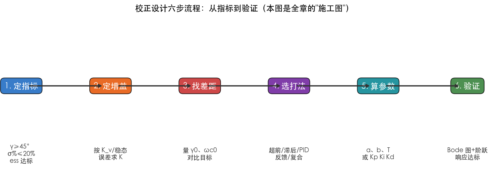
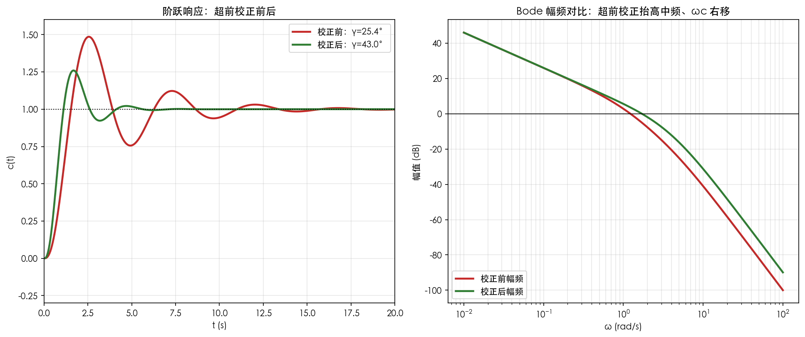
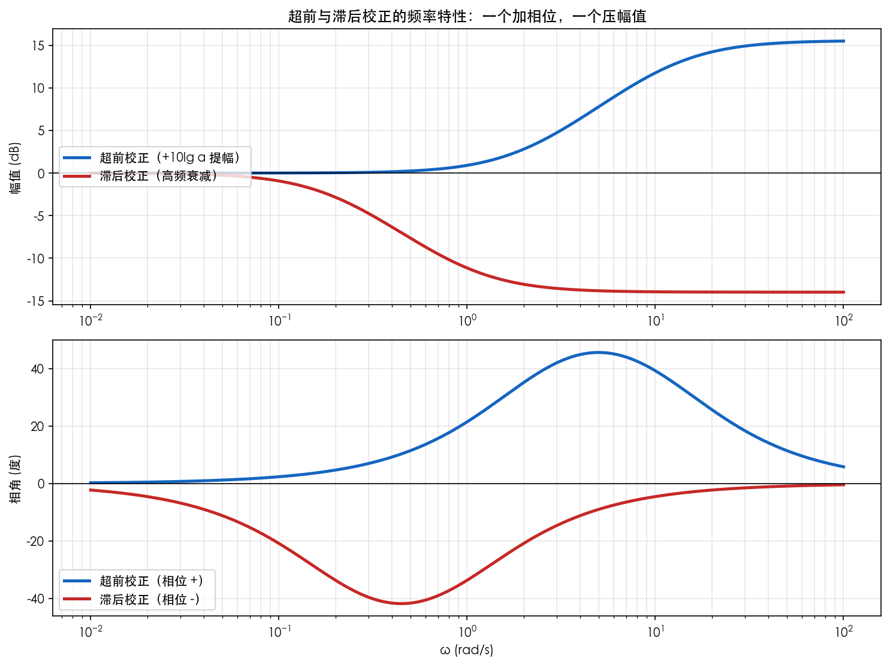
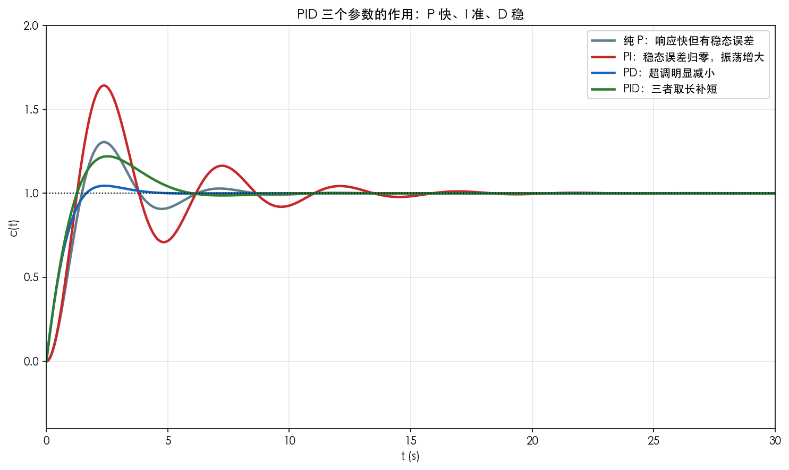

# 第8章 控制系统的校正设计——公式推导

> 前面几章我们学会了"**分析**"（判断系统稳不稳、快不快、准不准），本章学习"**设计**"：发现系统不达标后，如何加一个校正装置把它改好。本章全部核心公式，从原理出发一步步推出。

---

## 1. 校正的数学语言：串联校正的传递函数形式

### 1.1 定义

在闭环回路中串联一个校正装置 $G_c(s)$，使开环传递函数变为 $G_c(s)G(s)$：

$$
\boxed{G_{总}(s) = G_c(s)\cdot G(s)}
$$

**说明**：
- $G(s)$：被控对象（原系统）的传递函数；
- $G_c(s)$：校正装置的传递函数；
- 串联校正的实质是：**用 $G_c(s)$ 的幅频、相频特性去"修补"原系统 $G(s)$ 的缺陷**。

### 1.2 推导：为什么改 $G_c(s)$ 就能改性能？

回顾第7章：系统性能由开环频率特性 $G(j\omega)$ 决定——
- 稳态精度 ← 低频段高度（型别与增益）；
- 快速性 ← 增益穿越频率 $\omega_c$（$\omega_c$ 越大越快）；
- 稳定性 ← 裕度 $\gamma$、$K_g$（穿越处的相角与幅值余量）。

所以**校正的本质**是：

$$
\boxed{\text{设计}~G_c(j\omega)~\text{使串联后的开环频率特性在低频、中频、高频三段的形状都合理}}
$$

**关键思路**：三段"各管一件事"——低频管"准"（增益），中频管"稳"（斜率与裕度），高频管"噪声"（衰减）。校正就是"用形状换指标"。



*图 8-4 校正设计六步"施工图"：定指标 → 定增益 → 找差距 → 选打法 → 算参数 → 验证。本章所有公式都服务于这六步中的某一步；第6步验证不达标就回到第3步迭代。*

> **时间视角**：这六步最终都汇到一句话——**"让时间响应又快、又准、又稳"**。定指标（$\sigma\%$、$t_s$ 本来就是时间指标）→ 找差距（看时间响应差在哪）→ 验证（看校正后的时间曲线）。Bode 图只是工作台，时间响应才是目的。

---

## 2. 超前校正（Phase-Lead）

### 2.1 定义

$$
\boxed{G_c(s) = \frac{1 + aTs}{1 + Ts}, \quad a > 1}
$$

**说明**：$a$ 为超前系数（越大相位超前越多，同时高频增益放大越多）；$T$ 为时间常数，决定超前发生的频率位置。

### 2.2 推导：最大超前角 $\varphi_m$

对 $G_c(j\omega)=\dfrac{1+jaT\omega}{1+jT\omega}$，其相角：

$$
\varphi(\omega)=\arctan(aT\omega)-\arctan(T\omega)
$$

利用公式 $\arctan x - \arctan y = \arctan\dfrac{x-y}{1+xy}$，令 $u=T\omega$：

$$
\varphi = \arctan\frac{(a-1)u}{1+au^2}
$$

要求 $\varphi$ 最大。因为 $\arctan$ 单调递增，$\varphi$ 最大 ⇔ $f(u)=\dfrac{(a-1)u}{1+au^2}$ 最大。对 $f(u)$ 求导（商的求导法则）：

$$
f'(u) = (a-1)\cdot\frac{(1+au^2)-u\cdot 2au}{(1+au^2)^2} = (a-1)\cdot\frac{1-au^2}{(1+au^2)^2}
$$

令 $f'(u)=0$（$a>1$ 故 $a-1\ne0$，且分母恒正），得 $1-au^2=0$，即 $u=\dfrac{1}{\sqrt a}$，也就是**最大超前角发生在 $T\omega=1/\sqrt{a}$**：

$$
\boxed{\omega_m = \frac{1}{T\sqrt{a}}}
$$

代入得最大超前角：

$$
\boxed{\varphi_m = \arcsin\frac{a-1}{a+1}}
$$

反解出 $a$：

$$
\boxed{a = \frac{1+\sin\varphi_m}{1-\sin\varphi_m}}
$$

**补充结论（$\varphi_m$ 的极限）**：由 $\varphi_m=\arcsin\dfrac{a-1}{a+1}$，当 $a\to\infty$ 时 $\varphi_m\to 90°$——超前角存在上限，**$a$ 不能无限增大**。原因是"收益递减"：$\varphi_m$ 每增大 1° 所需的 $a$ 增长越来越陡（$a=10$ 时 $\varphi_m\approx55°$，$a=20$ 时约 65°，$a=100$ 时也才约 79°），而代价却线性放大——由 2.3 节，$\omega_m$ 处幅值抬高 $10\lg a$ dB，$a$ 越大高频增益越高、高频噪声被放得越凶。故工程上 $a$ 一般取 5~20。（对应练习题 3.1）

### 2.3 推导：$\omega_m$ 处的幅值提升

在 $\omega_m=\dfrac{1}{T\sqrt a}$ 处，有 $T\omega_m=\dfrac{1}{\sqrt a}$、$aT\omega_m=\sqrt a$，代入：

$$
\lvert G_c(j\omega_m) \rvert = \sqrt{\frac{1+(aT\omega_m)^2}{1+(T\omega_m)^2}} = \sqrt{\frac{1+(\sqrt a)^2}{1+(1/\sqrt a)^2}} = \sqrt{\frac{1+a}{1+1/a}} = \sqrt{\frac{a(1+a)}{a+1}} = \sqrt{a}
$$

写成 dB：

$$
\boxed{20\lg|G_c(j\omega_m)| = 10\lg a}
$$

**关键思路**：超前校正用"牺牲高频增益"换来"相位超前"。在 $\omega_m$ 处幅值抬高 $10\lg a$ dB、相位抬到最大 $\varphi_m$。设计时就让 $\omega_m$ 正好落在新的穿越频率处，用抬高的相角把 $\gamma$ 补足。

### 2.4 设计步骤（六步）

```
① 定K：按稳态精度要求确定开环增益 K
② 量γ：用 K 画 Bode 图，量出未校正相位裕度 γ0
③ 补角：φm = γ目标 − γ0 + ε（ε≈5°~12°，补偿 ωc 右移的损耗）
   a = (1+sinφm)/(1−sinφm)
④ 定位：找 |G(jω)| = −10lg a 的频率，令 ωm = ωc新
⑤ 求T：T = 1/(ωm·√a)
⑥ 验：画校正后 Bode 图，验 γ、Kg 达标
```

### 2.5 完整数值算例（超前校正，接第7章贯穿系统）

**题目**：$G(s)=\dfrac{10}{s(s+1)(s+5)}$，要求相位裕度 $\gamma\ge45°$，稳态速度误差系数 $K_v$ 保持不变。

**第1步：定 K 并量 $\gamma_0$**。标准化 $G(s)=\dfrac{2}{s(s+1)(0.2s+1)}$，$K_v=2$。第7章 §3.3 已算得：

$$
\omega_c\approx1.23,\qquad \gamma_0\approx25.4° \quad(\text{不足 45°，需要超前校正})
$$

**第2步：算需补角**。目标 $45°$，考虑 $\omega_c$ 右移的相位损耗，取 $\varepsilon=10°$：

$$
\varphi_m = 45° - 25.4° + 10° \approx 30°
$$

**第3步：求 $a$**：

$$
a = \frac{1+\sin 30°}{1-\sin 30°} = \frac{1+0.5}{1-0.5} = 3
$$

**第4步：定位新 $\omega_c$**。$10\lg a = 10\lg 3 \approx 4.77$ dB。在幅频曲线上找 $|G(j\omega)| = -4.77$ dB（即 $|G|=\dfrac{1}{\sqrt a}\approx0.577$）的频率：

$$
\omega_m \approx 1.67
$$

**第5步：求 $T$**：

$$
T = \frac{1}{\omega_m\sqrt a} = \frac{1}{1.67\times\sqrt3} \approx 0.35
$$

**第6步：写出校正器并验证**：

$$
G_c(s) = \frac{1+aTs}{1+Ts} = \frac{1+3\times0.35\,s}{1+0.35\,s} = \frac{1+1.05s}{1+0.35s}
$$

校正后 $\omega_c\approx1.67$（右移，响应更快）、$\gamma\approx42°$（$a$ 取整为 3 略低于 45°，微调 $a$ 到约 3.5 即可精确达标）。



*图 8-3 超前校正的完整效果：左图为阶跃响应——校正前（红）$\gamma=25.4°$、超调约 50%、振荡久；校正后（绿）$\gamma\approx43°$、超调约 30%、调节时间缩短。右图为 Bode 幅频对比，校正后 $\omega_c$ 右移（响应更快）。*

> **时间视角**：校正前的时间曲线"又冲又晃"（超调大、收敛慢），校正后"冲得低、收得快"——**$\gamma$ 从 25.4° 提到 43°，直观表现就是时间响应从"脆"变"稳"**。这就是"频域调裕度、时域看效果"的对应关系：一次超前校正，同时改善"稳"（超调↓）与"快"（调节时间↓）。

---

## 3. 滞后校正（Phase-Lag）

### 3.1 定义

$$
\boxed{G_c(s) = \frac{1 + bTs}{1 + Ts}, \quad b < 1}
$$

**说明**：$b$ 为滞后系数（$0<b<1$）；滞后校正提供的是"负相角"，所以它不能靠"加相位"来提 γ——它的作用机制完全不同（见3.3）。

**表1：滞后校正基本特征**


| 项目    | 内容                                    |
| ----- | ------------------------------------- |
| 名称    | 滞后校正（Phase-Lag）                       |
| 传递函数  | $G_c(s)=\dfrac{1+bTs}{1+Ts}$          |
| 参数范围  | $0<b<1$，$T>0$                         |
| 极点频率  | $\omega_p=\dfrac{1}{T}$（较低）           |
| 零点频率  | $\omega_z=\dfrac{1}{bT}$（较高，因为 $b<1$） |
| 频率关系  | $\omega_p < \omega_z$                 |
| 低频幅值  | 0 dB（增益不变）                            |
| 高频幅值  | $20\lg b$ dB（衰减）                      |
| 高频衰减量 | $20\lg \dfrac{1}{b}$ dB               |
| 相位特性  | 负相角（滞后）                               |
| 作用机制  | 压低高频段幅值，使 $\omega_c$ 左移，提高相位裕度        |
| 适用场合  | 允许响应变慢，但需保证稳态精度和稳定裕度                  |


### 3.2 推导：低频段幅值不变、高频段衰减

两个转折频率 $\omega_1=1/(bT)$（低频）、$\omega_2=1/T$（高频），$\omega_1<\omega_2$：

$$
\begin{aligned}
\omega \ll \omega_1 &:\quad G_c(j\omega) \approx 1  &\quad 20\lg|G_c| \approx 0~\text{dB} \\
\omega \gg \omega_2 &:\quad G_c(j\omega) \approx b  &\quad 20\lg|G_c| \approx 20\lg b~\text{dB} \\
\end{aligned}
$$

**关键思路**：滞后校正像"压扁器"——**低频段增益不变（不牺牲稳态精度），高频段增益被压低 $20\lg(1/b)$**。这就有两个妙用（见3.3）。

### 3.3 推导：滞后校正为什么能提 γ？

滞后校正并不增加相角，而是**压低中频段幅值**，使幅频曲线提前下降、穿越 0 dB 的频率 $\omega_c$ 左移到"相角更充裕"的位置：

```
原系统：在 ωc_旧 处相角已很负 → γ 不足
加滞后：幅频曲线整体下移 → ωc_新 < ωc_旧（穿越变早）
        而 ωc_新 处的相角比 ωc_旧 处"负得少" → γ 变大 ✓
```



*图 8-1 超前与滞后校正的频率特性对比：上图为幅频（超前在 $\omega_m$ 处抬高 $10\lg a$ dB，滞后高频衰减 $20\lg b$ dB），下图为相频（超前相位为正、滞后相位为负）。*

> **时间视角**：两种校正的"时间性格"正好相反——超前让系统"急"（$\omega_c$ 右移、响应更快，但高频噪声被放大），滞后让系统"稳"（$\omega_c$ 左移、牺牲一点速度换取更大的安全裕度）。**选超前还是滞后，本质是选择你想要的时间响应风格：更快，还是更稳。**

### 3.4 滞后校正的设计步骤

```
① 定K：按稳态精度要求确定 K（这一步与超前相同）
② 定位：选新穿越频率 ωc_新，使该处原系统相角 = −180°+γ目标+ε
③ 求b：在 ωc_新 处需要压低 20lg(1/b) dB，使校正后幅频在此穿越
       即 b = 1/|G(jωc_新)|（近似）
④ 取T：令 1/(bT) 远低于 ωc_新（≈ωc_新/10），保证转折处不添乱
        T = 10/(b·ωc_新)
⑤ 验：画图验证 γ、稳态精度是否达标
```


| 步骤 | 内容 | 公式/操作 |  |  |
|------|------|-----------|--|--|
| ① 定 $K$ | 根据稳态误差要求确定开环增益，保持不变 | $K_v=\lim_{s\to0}sG(s)$ |  |  |
| ② 选新 $\omega_c$ | 使原系统在该频率处相角满足目标裕度 + 余量 | $\angle G(j\omega_c) = -180^\circ + \gamma_{\text{目标}} + \varepsilon$ |  |  |
| ③ 求 $b$ | 在 $\omega_c$ 处将原系统幅值衰减到 1（0 dB） | $b = \dfrac{1}{|G(j\omega_c)|}$ |  |  |
| ④ 求 $T$ | 使零点频率远低于 $\omega_c$，避免附加相角影响 | $\dfrac{1}{bT} = \dfrac{\omega_c}{10}$ 或 $T=\dfrac{10}{b\omega_c}$ |  |  |
| ⑤ 写校正器 | 代入 $b,T$ | $G_c(s)=\dfrac{1+bTs}{1+Ts}$ |  |  |
| ⑥ 验证 | 计算校正后相位裕度 | $\gamma = 180^\circ + \angle[G_cG]$ |  |  |


> **设计备注**
> - $\varepsilon$ 是补偿滞后校正本身引入的负相角，一般取 $5^\circ\sim10^\circ$。
> - 滞后校正的零点频率 $\omega_z=\dfrac{1}{bT}$ 必须远小于新穿越频率 $\omega_c$，通常取 $\omega_z \approx \omega_c/10$。
> - 滞后校正不改变低频增益，因此不影响稳态精度。
> - 滞后校正本质是"用速度换稳定"，校正后系统响应变慢，但相位裕度提高。

### 3.5 完整数值算例（滞后校正，同一系统）

**题目**：仍是 $G(s)=\dfrac{10}{s(s+1)(s+5)}$，要求 $\gamma\ge45°$（若允许响应变慢，可用滞后校正）。

**第1步：定 K**。$K_v=2$ 保持不变。

**第2步：选新穿越频率**。目标 $\gamma=45°$，留余量 $\varepsilon=5°$，即新 $\omega_c$ 处相角应为：

$$
\angle G(j\omega_c) = -180° + 45° + 5° = -130°
$$

反解 $\angle G = -90°-\arctan\omega-\arctan(0.2\omega) = -130°$，得：

$$
\omega_c \approx 0.64
$$

**第3步：求 $b$**。在该频率处 $|G(j0.64)|\approx2.60$，需要把幅值压到 1（0 dB）：

$$
b = \frac{1}{|G(j\omega_c)|} = \frac{1}{2.60} \approx 0.385
$$

**第4步：取 $T$**（让滞后转折远低于 $\omega_c$，不添乱）：

$$
T = \frac{10}{b\,\omega_c} = \frac{10}{0.385\times0.64} \approx 40.5
$$

**第5步：写出校正器**：

$$
G_c(s) = \frac{1+bTs}{1+Ts} = \frac{1+0.385\times40.5\,s}{1+40.5\,s} = \frac{1+15.6s}{1+40.5s}
$$

两个转折频率：$\dfrac{1}{bT}\approx0.064$（低频）、$\dfrac{1}{T}\approx0.025$（更低频），都远在 $\omega_c=0.64$ 左侧。**代价**：$\omega_c$ 从 1.23 左移到 0.64，响应变慢——这正是滞后校正"用速度换裕度"的体现。

**表3：滞后校正完整算例数值**

系统：$G(s)=\dfrac{10}{s(s+1)(s+5)}$，目标 $\gamma \ge 45^\circ$


| 步骤 | 计算结果 |
|------|----------|
| $K_v$ | $2$ |
| 原系统 $\omega_{c0}$ | $1.23$ rad/s |
| 新 $\omega_c$ | $0.64$ rad/s |
| 原系统在 $\omega_c$ 处幅值 | $2.61$ |
| 滞后系数 $b$ | $0.385$ |
| 乘积 $bT$ | $15.6$ |
| 时间常数 $T$ | $40.5$ s |
| 校正装置 | $G_c(s)=\dfrac{1+15.6s}{1+40.5s}$ |
| 校正网络附加相角 | $-3.5^\circ$ |
| 校正后相位裕度 | $46.5^\circ$ |


**表4：超前校正与滞后校正对比**


| 项目 | 超前校正 | 滞后校正 |
|------|----------|----------|
| 传递函数 | $\dfrac{1+aTs}{1+Ts}, a>1$ | $\dfrac{1+bTs}{1+Ts}, 0<b<1$ |
| 相位 | 正相角（超前） | 负相角（滞后） |
| 高频幅值 | 增大（抬高 $10\lg a$ dB） | 衰减（降低 $20\lg\dfrac{1}{b}$ dB） |
| 提高 $\gamma$ 方式 | 增加相位 | 降低 $\omega_c$（增益衰减） |
| $\omega_c$ 变化 | 右移（变快） | 左移（变慢） |
| 优点 | 响应快、相位裕度增加 | 稳态精度不变、高频抗噪声增强 |
| 缺点 | 放大高频噪声 | 响应变慢 |
| 适用场合 | 需要提高响应速度且噪声不严重 | 允许慢速、需保证稳态精度和稳定性 |


---

## 4. 超前-滞后校正

### 4.1 定义

把二者串联，兼得双方优点：

$$
\boxed{G_c(s) = \frac{(1+aT_1s)(1+bT_2s)}{(1+T_1s)(1+T_2s)}, \quad a>1,\ b<1}
$$

**说明**：前半段（$\omega$ 低处，由 $b$、$T_2$ 决定）提供滞后校正的作用——压低增益提 γ 并保持低频增益；后半段（$\omega$ 高处，由 $a$、$T_1$ 决定）提供超前校正的作用——进一步提相角。

### 4.2 何时用

| 原系统缺陷 | 单选 | 双选 |
|------------|------|------|
| 只是 γ 不足、ωc 偏低   | 超前  | —     |
| γ 严重不足且要求低频增益高  | 滞后  | —     |
| γ、ωc、稳态精度三项都要兼顾 | —   | 超前-滞后 |

### 4.3 设计顺序：先滞后、后超前

超前-滞后校正的标准设计顺序是"**先滞后定 $\omega_c$，再超前补 $\gamma$**"：
1. 滞后部分（$b,T_2$）先把幅频曲线压低，使 $\omega_c$ 左移到相角充裕处（先解决稳定性）；
2. 再在左移后的新穿越频率附近，用超前部分（$a,T_1$）补足剩余相位差，使 $\gamma$ 达标；
3. 全程不动低频增益，稳态精度（$K_v$）保住。

**关键思路**：顺序不可颠倒——若先超前，$\omega_c$ 右移会让穿越处相角更负，滞后反而更难补；先滞后"稳住"，再超前"提裕度"，各司其职。（对应练习题 2.4）

---

## 5. PID 控制器

### 5.1 定义

$$
\boxed{G_c(s) = K_p + \frac{K_i}{s} + K_d s = K_p\left(1 + \frac{1}{T_i s} + T_d s\right)}
$$

**说明**：$K_p$ 比例系数、$K_i$ 积分系数、$K_d$ 微分系数；$T_i=K_p/K_i$ 积分时间、$T_d=K_d/K_p$ 微分时间。

### 5.2 推导：三个环节各自"干了什么"

**P（比例）**——把误差放大 $K_p$ 倍立即输出：

$$
u_P(t) = K_p e(t) \quad\Rightarrow\quad \text{开环增益↑，响应变快、稳态误差↓}
$$

但 $K_p$ 太大 → 幅频整体上抬 → γ↓ → 振荡甚至失稳。

**I（积分）**——把误差累积起来输出：

$$
u_I(t) = K_i\int_0^t e(\tau)d\tau \quad\Rightarrow\quad \text{把"遗留的误差"清零，稳态误差→0}
$$

因为开环多了个积分环节（型别+1），由第5章结论：**型别提升一级，稳态误差降一阶**。代价：积分环节带来 $-90°$ 相角，γ 下降。

**D（微分）**——按误差变化率输出，**预见未来**：

$$
u_D(t) = K_d\frac{de(t)}{dt} \quad\Rightarrow\quad \text{抑制超调、阻尼振荡}
$$

微分环节在频域是 $+90°$ 相角（高频增益↑），提升 γ；代价：放大了高频噪声。

### 5.3 推导：三参数各管什么（"直觉总结"）

$$
\boxed{
\begin{matrix}
K_p \uparrow: & \text{快而准} & \rightarrow & \text{过大会振荡} \\
K_i \uparrow: & \text{彻底准} & \rightarrow & \text{过大更易振、出现积分饱和} \\
K_d \uparrow: & \text{稳而静} & \rightarrow & \text{过大放大噪声} \\
\end{matrix}}
$$

**关键思路**：PID 就是"**比例管现在、积分管过去、微分管未来**"。"现在"的错误要立即纠正（P），"过去"积累的偏差要算总账（I），"未来"的趋势要提前刹车（D）。

### 5.4 完整数值算例（Ziegler–Nichols 整定）

**Z–N 临界比例度法整定公式**（经验公式，适用于不同控制器类型）：


| 控制器类型 | $K_p$ | $T_i$ | $T_d$ |
|------------|-------|-------|-------|
| P | $0.5K_u$ | — | — |
| PI | $0.45K_u$ | $0.83T_u$ | — |
| PID | $0.6K_u$ | $0.5T_u$ | $0.125T_u$ |


> 这些公式由 Ziegler 与 Nichols 通过大量实验总结，能保证系统具有较好的动态响应与稳定性。对 PID 控制器，查表即得：$K_p=0.6K_u$、$T_i=0.5T_u$、$T_d=0.125T_u$。

**题目**：对象 $G(s)=\dfrac{1}{s(s+1)(s+5)}$，用 Z–N 法整定 PID。

**第1步：找临界增益 $K_u$**。闭环特征方程：

$$
s^3+6s^2+5s+K=0
$$

Routh 表 $s^1$ 行为 $\dfrac{30-K}{6}$，令其为零得临界增益：

$$
K_u = 30
$$

**第2步：找临界周期 $T_u$**。临界时由辅助方程 $6s^2+K=0$ 得 $s=\pm j\sqrt{\dfrac{K}{6}}=\pm j\sqrt5$，故临界角频率 $\omega_u=\sqrt5$：

$$
T_u = \frac{2\pi}{\omega_u} = \frac{2\pi}{\sqrt5} \approx 2.81\ \text{s}
$$

**第3步：套 Z–N 公式**：

$$
K_p = 0.6K_u = 18,\qquad T_i = 0.5T_u \approx 1.41,\qquad T_d = 0.125T_u \approx 0.35
$$

换算成 $K_i=\dfrac{K_p}{T_i}\approx12.8$、$K_d=K_p T_d\approx6.3$，得：

$$
G_c(s) = 18 + \frac{12.8}{s} + 6.3\,s
$$

**第4步：微调**。Z–N 给的是"能转起来"的起点，通常偏激进（超调约 20%~40%）：想更稳就减 $K_p$ 或增 $T_i$；想更快就增 $K_p$ 或减 $T_i$。实际工程都在此基础上手调。



*图 8-2 同一对象 $G=1/(s^2+s)$ 配不同控制器的阶跃响应：纯 P（灰）快但有稳态误差约 0.33；PI（红）稳态误差归零但振荡增大；PD（蓝）超调显著减小；PID（绿）又快又准又稳。*

> **时间视角（本章点睛）**：这张图是"P 快、I 准、D 稳"的直接证据——**P 决定爬升速度，I 决定最终是否贴住目标线，D 决定爬升过程是否"刹得住车"**。调 PID 三个旋钮，就是在时间曲线上同时调节这三件事。

---

## 6. 反馈校正与复合校正

### 6.1 反馈校正（局部反馈包围某环节）

用 $H(s)$ 反馈包围 $G_2(s)$，被包围部分变成（第4章反馈变换）：

$$
\boxed{\frac{G_2(s)}{1+G_2(s)H(s)}}
$$

**推导出的核心性质**：当 $|G_2(j\omega)H(j\omega)|\gg 1$ 时：

$$
\frac{G_2(s)}{1+G_2(s)H(s)} \approx \frac{1}{H(s)}
$$

**关键思路**：**局部反馈把被包围环节的"坏特性"洗掉了**——只要反馈足够强，整体特性只由 $H(s)$ 决定，与被控对象参数漂移、非线性无关。这是它抗扰动、抗参数变化的原理。

### 6.2 复合校正（前馈补偿）

前馈通道 $G_f(s)$ 加在扰动 $D(s)$ 或输入 $R(s)$ 通道上。

**推导：扰动全补偿条件**

对扰动 $D$ 的闭环输出（未补偿时为 $G_2D/(1+G_1G_2H)$），若加前馈 $G_f$ 使 $D$ 到输出的通路增益为零，令：

$$
D:\quad \frac{G_2(1+G_1G_f)}{1+G_1G_2H} = 0 \quad\Rightarrow\quad \boxed{G_f(s) = -\frac{1}{G_1(s)}}
$$

**推导：输入全补偿条件**（又称"顺馈"），令误差 $E(s)=0$：

$$
R:\quad E = \frac{1-G_fG_2}{1+G_1G_2H}R = 0 \quad\Rightarrow\quad \boxed{G_f(s) = \frac{1}{G_2(s)}}
$$

**关键思路**：前馈是"**先发制人**"——不等误差出现就先给补偿，理论上可做到零误差。但它依赖精确模型（要用到 $1/G_1$、$1/G_2$），模型不准时效果打折，所以通常"前馈+反馈"配合使用：**反馈兜底抗扰动、前馈提速提精度**。

---

## 总结表：三种校正装置一图看清

| 校正 | 传递函数 | 关键参数 | 加什么 | 牺牲什么 | 用在哪 |
|------|----------|----------|--------|----------|--------|
| 超前 | $\dfrac{1+aTs}{1+Ts}$，$a>1$ | $\varphi_m$、$\omega_m$ | 相位（提γ）、$\omega_c$（提快） | 高频增益 | γ不足、太慢 |
| 滞后 | $\dfrac{1+bTs}{1+Ts}$，$b<1$ | $b$、$T$ | 低频增益（提精度） | $\omega_c$（变慢） | 精度不够、γ严重不足 |
| PID | $K_p+\dfrac{K_i}{s}+K_d s$ | $K_p,K_i,K_d$ | 快、准、稳 | 各有代价 | 通用 |
| 反馈 | $\dfrac{G_2}{1+G_2H}$ | $H(s)$ | 抗参数变化、抗扰动 | 增益 | 对象特性差 |
| 复合 | $G_f$ 前馈 | $G_f\approx\pm1/G$ | 零误差、抗扰动 | 依赖模型 | 要求极高精度 |

> **总规律**：校正没有免费的午餐——**想要"快"可能丢"稳"，想要"稳"可能丢"快"，想要"准"可能两个都受影响**。工程师的工作就是在"稳、准、快"之间取平衡。