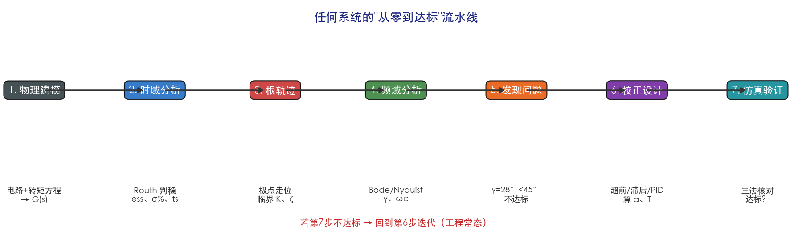
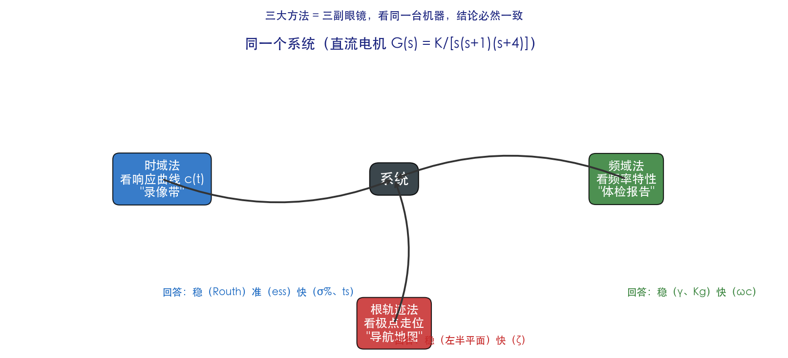
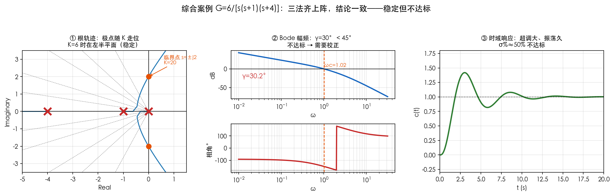
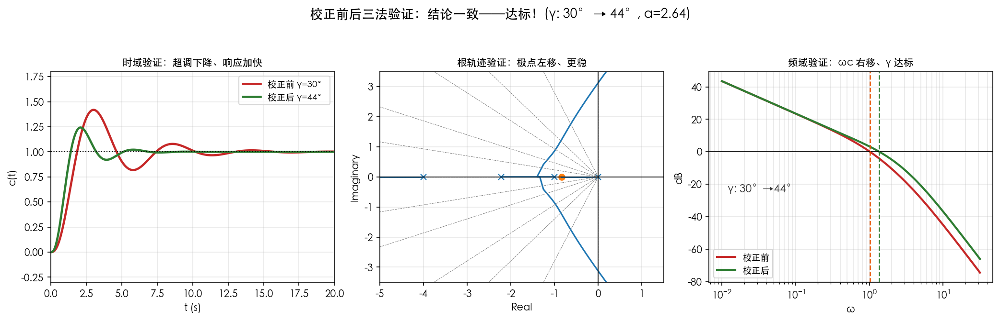

# 第9章 三大方法对比与综合案例——公式推导

> 本章是"总决战"：把第2~8章所有工具串成一条完整的"分析-设计"流水线，通过**直流电机调速系统**一个案例，把三大方法（时域/根轨迹/频域）全部跑一遍。本章公式推导围绕"同一系统、三种视角"展开，你会发现**殊途同归**。

---

## 1. 直流电机调速系统的物理建模

### 1.1 物理背景与方程

直流电机（电枢控制）由三部分方程构成：

**电路方程**（电枢回路，基尔霍夫电压定律）：

$$
u_a(t) = R_a i_a(t) + L_a\frac{di_a(t)}{dt} + e_b(t)
$$

其中 $e_b$ 为反电动势，$e_b = K_e\omega$（$K_e$ 为反电动势系数）。

**转矩方程**（牛顿第二定律，转动部分）：

$$
J\frac{d\omega(t)}{dt} = K_T i_a(t) - b\,\omega(t)
$$

其中 $J$ 为转动惯量，$b$ 为阻尼系数，$K_T$ 为转矩系数。

**说明**：$u_a$ 电枢电压（输入）、$\omega$ 转速（输出）。

### 1.2 推导：从方程到传递函数

对三个方程做拉氏变换（初始条件为 0）：

$$
\begin{aligned}
U_a(s) &= (R_a + L_a s)I_a(s) + K_e\Omega(s) \\
Js\,\Omega(s) &= K_T I_a(s) - b\Omega(s)
\end{aligned}
$$

由转矩方程解出 $I_a(s)=\dfrac{Js+b}{K_T}\Omega(s)$，代入电路方程消去 $I_a(s)$：

$$
U_a(s) = (R_a+L_as)\frac{Js+b}{K_T}\Omega(s) + K_e\Omega(s)
$$

$$
\frac{\Omega(s)}{U_a(s)} = \frac{K_T}{(R_a+L_as)(Js+b)+K_TK_e}
$$

**关键思路**：消去中间变量（电流）→ 得到输入到输出的唯一关系。这正是第3章建模四步法的核心：**列方程 → 消中间变量 → 拉氏变换 → 整理成传递函数**。

### 1.3 工程简化

电枢电感 $L_a$ 通常很小，忽略后（$L_a=0$）得**一阶惯性模型**：

$$
\boxed{G(s)=\frac{\Omega(s)}{U_a(s)}=\frac{K_m}{T_m s+1}}
$$

其中 $K_m=\dfrac{K_T}{R_a b+K_TK_e}$（电机增益），$T_m=\dfrac{JR_a}{R_a b+K_TK_e}$（机电时间常数）。

> 若考虑驱动器/功率放大器的惯性，常写成二阶模型 $G(s)=\dfrac{K}{(T_1s+1)(T_2s+1)}$ 或更典型的三阶 $G(s)=\dfrac{K}{s(T_1s+1)(T_2s+1)}$（含转速反馈的积分效应）。**本章综合案例就用典型三阶模型**，把三大方法全部用上。

### 1.4 本章综合案例的"正式模型"

为让三大方法都有发挥空间，采用教科书经典三阶系统：

$$
\boxed{G(s)=\frac{K}{s(s+1)(s+4)}}
$$

**说明**：含一个积分环节（Ⅰ型，速度误差系数 $K_v=K$）+ 两个惯性环节。$K$ 是待设计的增益。下面所有推导都围绕它进行。

*图 9-4 从建模到验证的七步流水线：物理建模 → 时域 → 根轨迹 → 频域 → 发现问题 → 校正设计 → 仿真验证。每一步对应本书一个章节，不达标就回到第6步迭代。*

> **时间视角**：注意流水线里"发现问题"用的是频域语言（$\gamma<45°$），但"验证达标"用的是时间语言（$\sigma\%$、$t_s$）——**设计全程用频域/复域工具，验收时回到时间响应**，这就是控制工程师的工作节奏。

---

## 2. 视角一：时域分析（第5章武器）

### 2.1 稳定性：Routh 判据

闭环特征方程 $s^3+5s^2+4s+K=0$，列 Routh 表：

$$
\begin{matrix}
s^3 & 1 & 4 \\
s^2 & 5 & K \\
s^1 & \dfrac{20-K}{5} & 0 \\
s^0 & K &
\end{matrix}
$$

稳定条件：$K>0$ 且 $20-K>0$，即：

$$
\boxed{0<K<20}
$$

**关键思路**：Routh 给出的是**临界值**，不能直接给出性能，但它是一切设计的前提——先确保稳定，再谈快和准。

### 2.2 稳态误差

Ⅰ型系统对阶跃输入 $e_{ss}=0$；对速度输入 $e_{ss}=\dfrac{1}{K_v}=\dfrac{1}{K}$。

$$
\boxed{e_{ss}(\text{速度}) = \frac{1}{K}}
$$

**关键思路**："准"由增益 $K$ 决定——$K$ 越大越准（但 $K$ 受稳定性上限 20 限制）。

### 2.3 动态性能

$K$ 取中间值（如 $K=6$）时，闭环极点为一对共轭主导极点 $+$ 一个实极点，时域指标直接用第5章公式：

$$
\sigma\% = e^{-\pi\zeta/\sqrt{1-\zeta^2}}, \qquad t_s \approx \frac{4}{\zeta\omega_n}
$$

（具体数值见 4-仿真与绘图 的仿真结果——**理论公式算一遍，再让仿真验证一遍**。）

---

## 3. 视角二：根轨迹分析（第6章武器）

### 3.1 根轨迹绘制要点

开环极点：$0,\ -1,\ -4$；无零点。规则给出：

- **实轴区段**：$[-1,0]$ 和 $(-\infty,-4]$；
- **渐近线**：与实轴交点 $\sigma_a=\dfrac{0-1-4}{3}=-\dfrac{5}{3}$，夹角 $\pm60°,\ 180°$；
- **分离点**：$\dfrac{1}{d}+\dfrac{1}{d+1}+\dfrac{1}{d+4}=0 \Rightarrow d\approx-0.47$；
- **虚轴交点**：令 $s=j\omega$ 代入特征方程：

$$
(j\omega)^3+5(j\omega)^2+4j\omega+K=0 \Rightarrow \begin{cases} -\omega^3+4\omega=0 \Rightarrow \omega=2\\ K=5\omega^2=20 \end{cases}
$$

即穿越点 $s=\pm j2$，临界增益 $K=20$——**与 Routh 判据完全一致**。

### 3.2 用根轨迹"选点"求阻尼比

要求 $\zeta=0.5$：在根轨迹上找与射线 $\theta=\arccos0.5=60°$ 的交点，用**幅值条件**求该点增益：

$$
\boxed{K = \lvert s\rvert\cdot\lvert s+1\rvert\cdot\lvert s+4\rvert \Big|_{s 在根轨迹上}}
$$

代入交点坐标即可求出对应 $K$（数值见仿真验证）。

**关键思路**：根轨迹的价值在于**"一眼看清 K 从 0 到 ∞ 极点怎么走"**——时域只能算"某一个 K"的性能，根轨迹看"所有 K"。

---

## 4. 视角三：频域分析（第7章武器）

### 4.1 开环频率特性

$$
G(j\omega)=\frac{K}{j\omega(j\omega+1)(j\omega+4)}
$$

幅频、相频：

$$
\lvert G(j\omega) \rvert=\frac{K}{\omega\sqrt{\omega^2+1}\sqrt{\omega^2+16}}, \qquad \angle G=-90°-\arctan\omega-\arctan\frac{\omega}{4}
$$

### 4.2 相位裕度

令 $|G(j\omega_c)|=1$ 解出穿越频率 $\omega_c$，则：

$$
\boxed{\gamma = 180°+\angle G(j\omega_c) = 90°-\arctan\omega_c-\arctan\frac{\omega_c}{4}}
$$

$K$ 只抬升幅频不改变相频，所以 **$K$ 增大 → $\omega_c$ 右移 → $\gamma$ 减小**。

> **补充：Nyquist 判据（对应练习题 1.2）**——它是频域判"稳"的另一件工具，从开环频率特性间接判断闭环稳定性：设开环传递函数 $G(s)H(s)$ 在右半平面有 $P$ 个极点，当 $\omega$ 从 $-\infty$ 扫到 $+\infty$ 时，Nyquist 曲线（$G(j\omega)H(j\omega)$ 构成的完整闭合曲线）逆时针包围 $(-1,j0)$ 点的圈数为 $N$，则闭环右半平面极点数为
>
> $$
> Z = P - N
> $$
>
> 闭环稳定 $\Leftrightarrow Z=0$，即 $N=P$。对含积分环节（$s=0$ 极点）的系统，作图时需在 $\omega=0$ 附近沿无穷小半径圆弧"补线"；最常见的情形是开环稳定（$P=0$），此时只要曲线不包围 $(-1,j0)$（$N=0$）就闭环稳定。练习题 1.2 正是用它：$P=0$ 且曲线不包围 $(-1,j0)$，故 $Z=0$，与 Routh 判据结论一致——两种方法判的是同一事实（闭环特征根位置），结论必然相同。

### 4.3 频域与时域的换算（三大方法会师的"桥"）

对主导极点近似成立：

$$
\boxed{\gamma \approx 100\zeta°, \qquad \sigma\% \approx e^{-\pi\zeta/\sqrt{1-\zeta^2}}, \qquad t_s \approx \frac{4\sim8}{\omega_c}}
$$

**关键思路**：$\gamma$（频域）→ $\zeta$（根轨迹的射线角）→ $\sigma\%$（时域超调），**一条链全打通**。这就是"三大方法会师"的数学表达。

> **补充：参数漂移如何影响相位裕度 γ（对应练习题 3.1）**——开环含惯性环节时，相频项为 $-\arctan(\tau\omega)$。若时间常数 $\tau$ 因参数漂移而变大（惯性增大），该负相角变大，相频曲线整体下移，穿越频率 $\omega_c$ 处相角更负，故 $\gamma$ 变小；反之 $\tau$ 变小则 $\gamma$ 变大。总趋势：**惯性增大使稳定性变差**。因此设计时若把 $\gamma$ 定在恰好 45°（无余量），参数一漂移 $\gamma$ 就可能跌破 0 导致失稳——工程上应把目标定在 50°~60° 留足余量，或用反馈校正抑制参数变化的影响。

*图 9-1 三大方法 = 三副眼镜看同一台机器：时域法看"响应曲线"（录像带）、根轨迹法看"极点走位"（导航地图）、频域法看"频率特性"（体检报告）。三副眼镜回答同一套问题：稳、准、快。*

> **时间视角**：三副眼镜里只有时域法是"直接看时间"，另外两副都是"间接预言时间"——根轨迹用极点位置预言响应形态，频域用裕度预言振荡收敛的快慢。**它们最终都要落到时间曲线上才能兑现。**

*图 9-2 综合案例 $G=6/[s(s+1)(s+4)]$ 的三法分析：①根轨迹——$K=6$ 时闭环极点全在左半平面（稳定）；②Bode——$\gamma\approx30°<45°$（不达标）；③阶跃响应——超调约 50%、振荡持久（不达标）。三法结论一致：稳定，但"脆"且"慢"。*

> **时间视角**：右图那条"冲高又晃"的时间曲线，就是中图 $\gamma$ 太小在时间域的"真身"——**同一件事，频域说成"裕度不够"，时域表现为"超调过大、收不住"**。看懂这种对应，你就真正掌握了三大方法。

---

## 5. 校正设计（第8章武器）

### 5.1 发现不达标

设要求 $\gamma\ge45°$。用频域算得某 $K$ 下 $\gamma<45°$，需要校正。

### 5.2 超前校正公式（回顾）

$$
G_c(s)=\frac{1+aTs}{1+Ts},\quad \varphi_m=\arcsin\frac{a-1}{a+1},\quad \omega_m=\frac{1}{T\sqrt a}
$$

设计步骤同第8章：补角 → 求 $a$ → 定位 $\omega_m$ → 求 $T$。

### 5.3 校验闭环（三大方法终局验证）

校正后的闭环系统，再分别用**三种方法**验证：

| 验证方法 | 怎么做                          | 预期结果    |
| ---- | ---------------------------- | ------- |
| 时域   | Routh 判稳 + 阶跃响应测 σ%、ts       | 稳定且达标   |
| 根轨迹  | 极点全部在左半平面且 $\zeta\approx0.5$ | 稳定且阻尼合适 |
| 频域   | $\gamma\ge45°$、$K_g>6$dB     | 稳定且裕度充足 |

**关键思路**：三种方法如果结论一致，说明你的设计**真正可靠**；若不一致，一定是哪里算错了——**用三种方法互相验算，是工程师最强大的"自检手段"**。

*图 9-3 校正前后三法验证：左图时域——校正后超调大幅下降、调节时间缩短；中图根轨迹——极点左移、更稳；右图频域——$\gamma$ 从 30° 提到 44°、$\omega_c$ 右移。三法独立给出同一个结论：达标。*

> **时间视角（全章点睛）**：比较图 9-2 与图 9-3 左图的时间曲线——**校正把"又冲又晃"变成了"稳而快"**。这就是为什么三个频域/复域的复杂工具，最终都要回到"时间曲线好不好看"这个唯一标准上来。

---

## 总结表：三大方法对"稳、准、快"的回答

| 方法  | 稳（能不能定住）        | 准（误差多大）   | 快（多快达到）    |
| --- | --------------- | --------- | ---------- |
| 时域  | Routh 判据        | 误差系数/型别   | σ%、ts 直接算  |
| 根轨迹 | 极点是否在左半平面       | 增益 K 决定型别 | 极点位置（ζ、ωn） |
| 频域  | Nyquist/裕度 γ、Kg | 低频增益      | γ⇔ζ、ωc⇔ts  |

> **一句话总结**：三种方法像三副眼镜——时域看"响应曲线"，根轨迹看"极点走位"，频域看"频率特性"。看的是同一台电机，结论必然一致；**考试和工程中，用三副眼镜互相核对，就不怕出错。**
