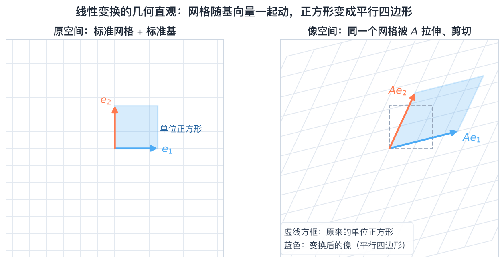
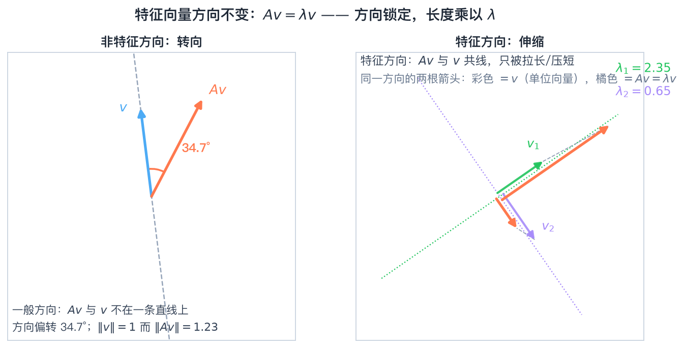
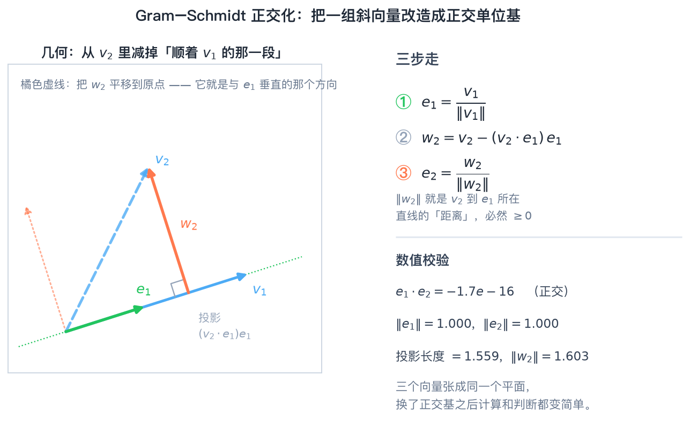

# 第1章 线性空间与线性变换——知识讲解

> **本章内容**
>
> 1. 线性空间：什么样的集合可以像向量一样"加"和"数乘"
> 2. 基与坐标：如何用一组"最小的"向量表示空间中一切
> 3. 基变换与坐标变换：换一把尺子，坐标怎么变
> 4. 线性子空间与交、和：空间里的"小空间"及其关系
> 5. 线性变换及其矩阵表示：本章的核心——矩阵到底是什么
> 6. 特征值、特征向量与可对角化：能不能让矩阵变简单
> 7. 不变子空间与 Jordan 标准形：不能对角化时怎么办
> 8. Euclid 空间、正交性、正交矩阵、对称矩阵与酉空间

### 承上启下

在《线性代数》里，向量就是"箭头"或"数的列表"，矩阵就是"数的表格"。本章要完成一次**观念升级**：把这两样东西抽象化——**"向量"可以指多项式、矩阵、连续函数；"矩阵"其实是"线性变换在一组基下的坐标表示"。** 从本章起，全课的核心动作就是一句话："**能不能换一组基，让这个变换的矩阵变简单？**"后面第 3 章矩阵函数、第 4 章矩阵分解、第 6 章广义逆，全都依赖本章 1.2 建立的"相似变换"这个动作。所以本章不是"复习"，而是整门课的入口地图。

### 问题导向

带着以下问题学习本章，你会更有方向感：

1. **为什么"向量"可以是多项式、矩阵、连续函数？它们凭什么和 $\mathbb{R}^2$ 里的箭头享有同一个名字？**
2. **同一个线性变换，在不同基下的矩阵是相似的——这到底在说什么？为什么"必然"相似？**
3. **一个矩阵能否对角化，本质取决于什么？不能对角化时，Jordan 标准形"补救"了什么？**

---

## 一、线性空间：从集合到空间

### 预备：集合与映射

在正式定义线性空间之前，先把教材 1.1 开头的那层"语言"补齐——它后面反复用到：

- **集合与子集**：$a\in S$（属于）、$S_1\subseteq S_2$（子集）、$S_1=S_2$（互相包含）；
- **集合运算**：交 $S_1\cap S_2$、并 $S_1\cup S_2$、直积 $S_1\times S_2$；
- **数域** $F$：对加、减、乘、除（除数非零）封闭的数集，本书主要用 $\mathbb{R}$ 与 $\mathbb{C}$，它是"数乘"中系数的来源；
- **映射** $T:S_1\to S_2$：单射（不同元素映到不同元素）、满射（$S_2$ 被覆盖）、双射（一一对应）。

**为什么先讲这些**：本章后面的三个核心对象都是"特殊的映射"——线性变换是保持加法与数乘的映射，同构是双射的线性变换，坐标 $\alpha\mapsto x$ 是"抽象向量 → 列向量"的双射。把"集合 + 映射"这层语言立住，线性空间的定义才不显得突然；也正因为坐标映射是双射，才会有 $\dim V=n\Rightarrow V$ 与 $F^n$ 同构，从而一切都能"翻译"成矩阵运算。

### 为什么？

我们在中学就知道"向量可以相加、可以乘一个数"，还能画箭头、算长度。但工程里的很多对象——信号、多项式、矩阵、函数——也想做这两件事：两个信号相加还是信号，信号乘一个系数还是信号。**想让它们也能"像向量一样被运算"，就得把"能加、能数乘"这件事抽象成公理。** 这就是线性空间。

### 怎么做？（判断一个集合是不是线性空间）

```
① 先看集合非空、运算定义明确（加法、数乘都"不跑出集合"）
② 逐条验证 8 条公理：加法交换/结合、零元、负元、单位元、数乘结合、两条分配律
③ 最快的"否决办法"：先找零元——零元不在集合里，立刻否决
④ 常用结论：线性空间必含零元；0α=θ；(–1)α=–α
```

### 是什么？

> **线性空间** $V$：定义了加法与数乘、且满足 8 条公理的集合。它的元素称为"向量"，但不一定是箭头——只要 8 条公理成立，叫它向量就名正言顺。

**常见例子**：$\mathbb{R}^n$、所有 $m\times n$ 实矩阵（$\mathbb{R}^{m\times n}$）、次数不超过 $n$ 的多项式（$P_n$）、区间 $[a,b]$ 上的连续函数（$C[a,b]$）。

**反例速记**：$\{(x_1,x_2)^T\mid x_1+x_2=1\}$ **不是**（不过原点、无零元）；$\{(x_1,x_2)^T\mid x_1,x_2\ge0\}$ **不是**（数乘不封闭，乘个负数就出界）。

### 生活类比

把"线性空间"想成一个**健身房**：8 条公理就是"会员规则"。两条核心规则是"**两个会员拉手（相加）还是会员**""**会员办张倍数卡（数乘）还是会员**"。规则齐全，这个健身房就合法运营；少一条（比如没有"休息区=零元"），就不是合格的线性空间。

---

## 二、基与坐标：给空间装一套"骨架"

### 为什么？

光有空间还不够——空间里有无穷多向量，总不能一个个列出来。我们需要找一小组"代表性"的向量，让**所有向量都能由它们拼出来**，且拼法唯一。这就是"基"。有了基，抽象的向量就能翻译成具体的数组（坐标），为后面"用矩阵算"铺路。

### 怎么做？（求一个向量在某基下的坐标）

```
① 写方程 ξ = x₁α₁ + x₂α₂ + … + xₙαₙ
② 按已知的"标准基"（或另一组基）把两边展开，比较分量
③ 解这个线性方程组，解出的 (x₁,…,xₙ) 就是坐标
④ 检验：坐标唯一，因为基向量线性无关
```

### 是什么？

> **基**：一组线性无关、且能表出全空间的向量。**维数**：基中含向量个数（良定义，与基的选取无关）。**坐标**：$\xi=x_1\alpha_1+\cdots+x_n\alpha_n$ 中的系数数组 $(x_1,\dots,x_n)^T$。

$$
\xi=(\alpha_1,\dots,\alpha_n)\begin{pmatrix}x_1\\ \vdots\\ x_n\end{pmatrix}
$$

**关键性质**：坐标唯一——这是"基"存在的意义，保证"向量↔数组"是一一对应的。

### 生活类比

基就像"三原色"。任何颜色都能用红、绿、蓝按固定比例调出，且调法唯一——红绿蓝就是色彩空间的"基"，比例就是"坐标"。$\mathbb{R}^2$ 的坐标 $(3,2)$ 就是"3 份 $e_1$、2 份 $e_2$"。

---

## 三、基变换与坐标变换：换尺子

### 为什么？

同一个向量，选不同的基（尺子），坐标就不一样。工程上我们经常要换基——比如"用特征向量作基"能让矩阵变对角。所以必须搞清楚：**新基由旧基怎么表达（过渡矩阵），以及坐标怎么跟着变**。

### 怎么做？

```
① 把新基每个向量用旧基表出，坐标作"列"拼成过渡矩阵 C：(β₁,…,βₙ)=(α₁,…,αₙ)C
② 检验 C 可逆（新基是基 ⇒ C 必可逆）
③ 坐标变换：若 x 是旧坐标、y 是新坐标，则 x = C y，即 y = C⁻¹x
④ 记忆口诀：基"顺"着 C 变，坐标"逆"着 C⁻¹ 变
```

### 是什么？

> **过渡矩阵** $C$：由基 $\alpha$ 到基 $\beta$ 的换基矩阵 $(\beta)=(\alpha)C$。**坐标变换公式**：$x=Cy$，$y=C^{-1}x$。

### 生活类比

同一段距离，用"米"量是 1.5，用"厘米"量是 150。刻度尺换了，读数就换了——但**长度本身没变**。基变换公式就是"米"和"厘米"之间的换算率。因为新单位更大（新基更斜更"长"），读数反而更小，所以坐标要乘**逆矩阵**。

---

## 四、线性子空间与交、和

### 为什么？

空间太大，我们常常只关心其中一部分（比如"所有满足 $x_1+x_2+x_3=0$ 的向量"）。这些"小空间"如果自身也是线性空间，就叫子空间。两个子空间叠起来（交）或拼起来（和），能生成什么、维数是多少，是分析问题的常用工具。

### 怎么做？（判断子空间 + 算交与和的维数）

```
① 判子空间：只需验证"加法封闭 + 数乘封闭"（即 kα+lβ ∈ W），并且 W 非空
② 求交：把两组约束条件联立，解线性方程组，得到交的基
③ 维数公式：dim(W₁+W₂) = dim W₁ + dim W₂ − dim(W₁∩W₂)
④ 判直和：W₁∩W₂={θ}（等价于上面公式右边取等号）
```

### 是什么？

> **线性子空间**：对加法、数乘封闭的非空子集。**交** $W_1\cap W_2$：两空间公共部分。**和** $W_1+W_2$：形如 $\alpha_1+\alpha_2$ 的全部向量。**直和** $W_1\oplus W_2$：交为零的和，此时表示法唯一。

$$
\boxed{\dim(W_1+W_2)=\dim W_1+\dim W_2-\dim(W_1\cap W_2)}
$$

### 生活类比

两个班同学的"交集"是兼报两个社团的人，两个班的"并集"是所有人。"并集人数 = 甲班人数 + 乙班人数 − 交集人数"就是维数公式；如果没人兼报（交为空），就是"直和"。

---

## 五、线性变换及其矩阵表示：全章的心脏

### 为什么？

现实中的"变换"很多：旋转、投影、求导、平移（不是线性的）……它们都想用计算机算。**只要能找到一个矩阵代表这个变换，剩下的就全是矩阵乘法。** 这一步把"几何/分析语言"翻译成"代数语言"，是全章最重要的思想。

### 怎么做？（求线性变换在给定基下的矩阵）

```
① 验证 T 是线性的：T(kα+lβ) = kT(α)+lT(β)
② 逐个求出基向量的像 T(α₁), …, T(αₙ)
③ 把每个像用"同一组基"表出，坐标作为矩阵的一列
④ 拼成矩阵 A，则向量运算 y = Ax
⑤ 换基时：B = C⁻¹AC（A、B 相似）——同一变换、不同基下的矩阵
```

### 是什么？

> **线性变换**：保持加法与数乘的映射 $T(k\alpha+l\beta)=kT(\alpha)+lT(\beta)$。**矩阵表示**：$T(\alpha_j)=\sum_i a_{ij}\alpha_i$，$A=(a_{ij})$。**相似**：$B=C^{-1}AC$，即同一变换在不同基下的两个矩阵的关系。



*图1 线性变换的几何直观：旋转（det=1，面积不变）、投影（det=0，正方形压成线段）、剪切（det=1，形状歪斜）。三种变换对应三个 $2\times2$ 矩阵，这就是"矩阵=变换"的直接证据。*

> **动力学视角**：看图中的投影变换——正方形被"压扁成一条线段"，det=0，这对应矩阵奇异、信息丢失；旋转矩阵不改变形状（正交变换，det=1）。**一个矩阵的这三个数字（两个特征值、行列式）就刻画了变换的全部"性格"。**

### 生活类比

矩阵就是变换的"身份证"。同一个人在不同城市（基）用不同的身份证号（矩阵），但本质是同一个人——**这就是"相似"的含义**。我们总希望找到"最简洁的身份证号"，即对角矩阵。

---

## 六、特征值、特征向量与可对角化

### 为什么？

一般矩阵乘一个向量，方向和长度都变，很难分析。但有那么几个特殊方向，矩阵作用后**方向不变，只被伸缩**——这些方向就是特征向量，伸缩倍数就是特征值。如果我们用这些特殊方向作基，矩阵就"塌缩"成对角阵，一切都变得简单。

### 怎么做？（判断能否对角化）

```
① 解特征方程 det(λE − A) = 0，得全部特征值及各自的代数重数 mᵢ
② 对每个特征值解 (λᵢE − A)x = 0，求几何重数 gᵢ = n − rank(λᵢE − A)
③ 逐个比较：gᵢ = mᵢ 全部成立 ⇒ 可对角化；否则不可对角化
④ 可对角化时：把特征向量作列拼成 P，则 P⁻¹AP = diag(λᵢ)
```

### 是什么？

> **特征值/特征向量**：非零向量 $x$ 满足 $Ax=\lambda x$。**代数重数**：$\lambda$ 作为特征方程根的重数。**几何重数**：特征子空间的维数。**核心不等式**：几何重数 $\le$ 代数重数。

$$
\boxed{Ax=\lambda x,\qquad \det(\lambda E-A)=0,\qquad A\ \text{可对角化}\iff \text{几何重数}=\text{代数重数}}
$$



*图2 特征值的几何含义：左图单位圆被 $A$ 拉成椭圆，只有绿色特征方向只被伸缩、方向不变（$\lambda=3$ 拉长、$\lambda=1$ 保持）；右图任取方向 $x$（灰）与其像 $Ax$（红），只有落在特征方向上的 $x$ 与 $Ax$ 共线。*

> **动力学视角**：特征方向是变换的"不变骨架"。图2 右图里，红色像和灰色原向量几乎都在"拧"，唯有绿色特征方向的 $\{x,Ax\}$ 严格共线——**这就是 $Ax=\lambda x$ 的视觉证据**。若一个系统能找到 $n$ 个这样的方向，它就"解耦"了，可以逐轴独立分析。

### 生活类比

一间房子被"拉长变宽"（变换），但如果你正好站在"只被拉高、不变宽窄"的方向上，你会觉得自己只是长高了——这就是特征向量。找特征值就是找这些"感觉只是被拉伸"的特殊方向。

---

## 七、不变子空间与 Jordan 标准形

### 为什么？

不是所有矩阵都能对角化——有时特征向量"不够用"（几何重数 < 代数重数）。工程上这种矩阵非常常见（比如带重极点的系统）。Jordan 标准形是"**最接近对角阵的替代品**"，它告诉我们不可对角化时可以退到多远。

### 怎么做？

```
① 找不变子空间：子空间 W 满足 T(W) ⊆ W；它对应矩阵分块上三角
② 若不可对角化：对每个"缺向量"的特征值 λ₀ 解 Jordan 链
   (A−λ₀E)x₂ = x₁，(A−λ₀E)x₃ = x₂，…
③ 拼出 Jordan 块 J_k(λ₀)（对角为 λ₀，上次对角为 1）
④ 标准形 J = diag(J_{k₁}(λ₁), …, J_{kₛ}(λₛ))
```

### 是什么？

> **不变子空间**：$T(W)\subseteq W$ 的子空间。**Jordan 块** $J_k(\lambda)$：对角为 $\lambda$、上次对角为 1 的 $k$ 阶方阵。**Jordan 标准形**：若干 Jordan 块的直和，是复矩阵相似类的"标准代表"。

$$
J_k(\lambda)=\begin{pmatrix}\lambda&1&&\\&\lambda&\ddots&\\&&\ddots&1\\&&&\lambda\end{pmatrix},\qquad A\sim\operatorname{diag}(J_{k_1}(\lambda_1),\dots,J_{k_s}(\lambda_s))
$$

### 生活类比

对角化像"把一堆杂乱的线整理成一束互相平行的线"；如果线本身打了结（特征向量不够），Jordan 标准形就把结"顺着捋"成一串链——**每节链上一个"1"表示"差一点就自由了"**。

---

## 八、Euclid 空间与正交性

### 为什么？

$n$ 维空间里光有"加减数乘"还不够，我们还想谈"长度""夹角""垂直"——这些需要**内积**。有了内积，就能构造"正交基"（像直角坐标系），让计算变得极其方便（正交基下求坐标只需做内积）。

### 怎么做？（Schmidt 正交化）

```
① u₁ = α₁
② u₂ = α₂ − (α₂,u₁)/(u₁,u₁) · u₁        （扣掉 α₂ 在 u₁ 上的投影）
③ u₃ = α₃ − (α₃,u₁)/(u₁,u₁)·u₁ − (α₃,u₂)/(u₂,u₂)·u₂
④ 一般式：uₖ = αₖ − Σᵢ<ₖ (αₖ,uᵢ)/(uᵢ,uᵢ) · uᵢ
⑤ 单位化：eₖ = uₖ / ‖uₖ‖
```

### 是什么？

> **内积** $(\alpha,\beta)$：满足对称、线性、正定的二元实函数。**Euclid 空间**：带内积的实线性空间。**正交**：$(\alpha,\beta)=0$。**范数**：$\|\alpha\|=\sqrt{(\alpha,\alpha)}$。**正交基**：两两正交的基；**标准正交基**：再加单位长度。

$$
\boxed{u_k=\alpha_k-\sum_{i=1}^{k-1}\frac{(\alpha_k,u_i)}{(u_i,u_i)}u_i,\qquad e_k=\frac{u_k}{\|u_k\|}}
$$



*图3 Schmidt 正交化的三步：蓝=原始斜交向量组 $\{\alpha_i\}$，绿=$u_1$，蓝=$u_2$，红=$u_3$。每一步都"扣掉在前面方向上的投影"，最终 $\{u_1,u_2,u_3\}$ 两两垂直。*

> **工程视角**：正交化的本质是"**去相关**"。图中第一步 $u_1=\alpha_1$；第二步把 $\alpha_2$ 里混着的 $u_1$ 成分减掉（橙色虚线就是被扣掉的投影），得到垂直于 $u_1$ 的 $u_2$；第三步再扣掉 $u_1,u_2$ 两个方向的分量。**信号处理中的 QR 分解、通信里的正交多址，用的都是这套"去投影"逻辑。**

### 生活类比

三个斜着乱插的旗杆（$\alpha_1,\alpha_2,\alpha_3$），要改造成"互相垂直"。做法：第一根不动；第二根在"第一根的方向上趴下一点"，直到站正；第三根分别朝前两根"趴下一点"。**Schmidt 正交化就是"把旗杆一根根扶正"。**

---

## 九、正交变换、对称矩阵与酉空间

### 为什么？

工程中最"听话"的两类变换是：**正交变换**（不改变长度和夹角，比如旋转、反射）和**对称变换**（实对称矩阵）。它们有极强的性质——实对称矩阵**一定能**正交对角化，特征值全实。这为第 4 章 SVD、第 5 章二次型打下基础。复数域上对应的概念是酉变换、Hermite 矩阵。

### 怎么做？（正交对角化一个实对称矩阵）

```
① 求特征值（必为实数）
② 对每个特征值求特征向量（不同特征值的向量自动正交）
③ 若某特征值的特征子空间维数>1，对它内部再做 Schmidt 正交化
④ 全部单位化，拼成正交矩阵 Q，则 QᵀAQ = diag(λᵢ)
```

### 是什么？

> **正交变换/正交矩阵**：保持内积的变换；等价条件 $A^TA=E$，$A^{-1}=A^T$。**对称变换/实对称矩阵**：$A^T=A$，特征值全实、不同特征值的特征向量正交、必可正交对角化。**酉空间/酉矩阵/Hermite 矩阵**：复数域版本，$U^HU=E$、$A^H=A$。

$$
\boxed{A^TA=E\iff A^{-1}=A^T,\qquad A^T=A\ \Longrightarrow\ Q^TAQ=\operatorname{diag}(\lambda_1,\dots,\lambda_n),\ Q^TQ=E}
$$

### 生活类比

正交矩阵像"**刚体运动**"——旋转、翻转，绝不把物体拉伸或压扁，所以长度角度全不变。实对称矩阵像"**沿互相垂直的轴各自伸缩**"——它的特征向量就是那些轴，天然正交。这两种矩阵是线性代数里最"友好"的矩阵。

---

## 总结：知识体系图

```
线性空间与线性变换
   │
   ├─ 【语言】线性空间
   │     ├─ 8 条公理 → 判定集合是否成空间
   │     ├─ 基与坐标 ξ=(α₁,…,αₙ)x （抽象 → 数组）
   │     └─ 基变换与坐标变换 (β)=(α)C, x=Cy, y=C⁻¹x
   │
   ├─ 【结构】子空间
   │     ├─ 判定：kα+lβ ∈ W
   │     └─ 交与和：dim(W₁+W₂)=dim W₁+dim W₂−dim(W₁∩W₂)
   │          直和 W₁⊕W₂ ⇔ W₁∩W₂={θ}
   │
   ├─ 【核心】线性变换 ↔ 矩阵
   │     ├─ T(αⱼ)=Σᵢ aᵢⱼαᵢ ⇒ 矩阵 A；作用 = y=Ax
   │     ├─ 换基 ⇒ 相似 B=C⁻¹AC   ← 全章心脏
   │     ├─ 特征值 Ax=λx；可对角化 ⇔ 几何重数=代数重数
   │     └─ 不可对角化 ⇒ 不变子空间 ⇒ Jordan 标准形
   │
   └─ 【度量】内积空间
         ├─ 内积 → 长度、夹角、正交
         ├─ Schmidt 正交化 → 标准正交基
         ├─ 正交矩阵 AᵀA=E；实对称矩阵 QᵀAQ=Λ
         └─ 复数域推广：酉空间、酉矩阵、Hermite 矩阵
```

### 核心脉络

1. **一条主线**：线性空间 → 基与坐标 → 线性变换与矩阵 → 相似变换 → 标准形。每一步都在回答"**怎样用最简单的数组描述一个变换**"。
2. **一个观念**：**矩阵不是"数的表格"，而是"线性变换在一组基下的坐标表示"**。换基就是做相似变换 $B=C^{-1}AC$，目标是把矩阵变简单（对角形、Jordan 形）。
3. **一个指标**：可对角化的判据是"几何重数 = 代数重数"；不满足时用 Jordan 标准形兜底。
4. **下一步**：第 2 章引入矩阵的范数与极限，第 3 章开始算矩阵函数——它们都建立在"相似对角化"之上。

---

## 动手实践（本章任务）

> 本章的任务是**亲手"造"一次从抽象到具体的完整链条**：抽象空间 → 选定基 → 写出矩阵 → 换基化简。

1. **建一个"非 $\mathbb{R}^n$"的线性空间**：以次数不超过 2 的多项式 $P_2$ 为例，验证它是线性空间，取基 $\{1,x,x^2\}$，求 $p(x)=2-3x+x^2$ 的坐标；再验证 $\{1+x,\ 1-x,\ x^2\}$ 也是一组基（算行列式），并求 $p$ 在这组新基下的坐标。
2. **完成一次相似变换**：取 $A=\begin{pmatrix}2&1\\1&2\end{pmatrix}$，手算特征值、特征向量，验证 $P^{-1}AP=\operatorname{diag}(3,1)$；再用 `第1章绘图.py` 生成图2，对照"特征方向不变"的几何图像。
3. **跑一遍绘图脚本**：运行 `python3 第1章绘图.py`，观察图1（旋转/投影/剪切）与图3（Schmidt 正交化三步），并尝试把图1 的剪切矩阵从 $\begin{pmatrix}1&1\\0&1\end{pmatrix}$ 改成 $\begin{pmatrix}1&2\\0&1\end{pmatrix}$，看图形如何变化。
4. **手算一个"不可对角化"的例子**：对 $\begin{pmatrix}2&1\\0&2\end{pmatrix}$ 求 Jordan 链、写出 $P$ 与 $J$，体会"特征向量不够用"时 Jordan 块的补位方式。

---

## 本章应掌握的内容

- [x] 能复述线性空间的 8 条公理，并判断一个给定集合是不是线性空间
- [ ] 能由公理推出 $0\alpha=\theta$、$(-1)\alpha=-\alpha$ 等基本性质
- [x] 能求一个向量在给定基下的坐标，并说明坐标为什么唯一
- [ ] 能写出两组基之间的过渡矩阵 $C$，并正确使用坐标变换公式 $x=Cy$、$y=C^{-1}x$
- [x] 能判断一个子集是否为子空间，并用维数公式计算交与和的维数
- [ ] 能判断"和"是否为"直和"
- [x] 能写出线性变换在指定基下的矩阵，并解释"矩阵 = 变换的坐标表示"
- [ ] 能推导不同基下矩阵的相似关系 $B=C^{-1}AC$
- [x] 能求特征值、特征向量，并用"几何重数 = 代数重数"判断可对角化
- [ ] 能对不可对角化矩阵求 Jordan 标准形与相应的过渡矩阵
- [x] 能用 Schmidt 正交化把线性无关组化为标准正交基
- [ ] 能写出正交矩阵、实对称矩阵的等价条件，并正交对角化一个实对称矩阵
- [x] 知道酉空间、酉矩阵、Hermite 矩阵的概念与符号