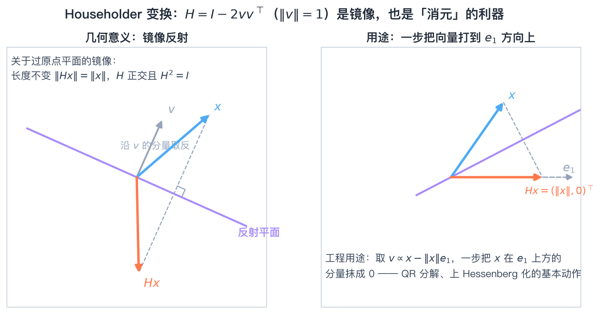
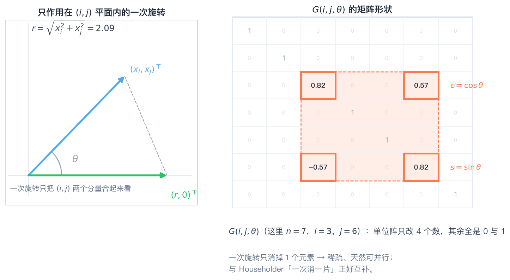
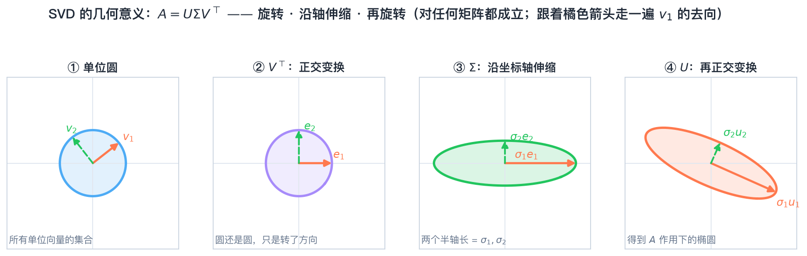
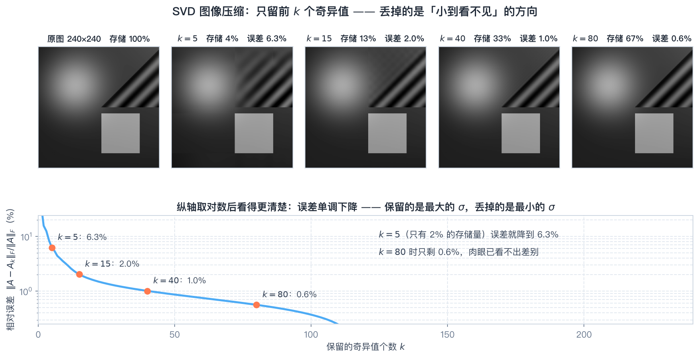

# 第4章 矩阵分解——知识讲解

> **本章内容**
> 
> 1. LU 分解：Gauss 消去法的"矩阵账本"，解方程组的发动机
> 2. 其他三角分解：LDU、Crout、Cholesky（正定矩阵专用）
> 3. 拟 LU 与拟 LDU 分解：Schur 补与分块计算
> 4. Givens 变换与 Householder 变换：两种"消零手术刀"
> 5. QR 分解：正交三角分解与最小二乘
> 6. Hessenberg 正交相似：QR 算法的"预处理"
> 7. 满秩分解：通往广义逆的桥梁
> 8. 奇异值分解（SVD）：本章皇冠，降阶、压缩、伪逆全靠它
> 9. 矩阵正交相抵：SVD 背后的"等价观"

### 承上启下

前三章研究**线性空间、线性变换、矩阵分析**——回答的是"矩阵是什么、像什么函数"；本章回答的是"**矩阵能怎么用**"。前者是"认识"，后者是"使用"。分解思想其实是全书方法论的缩影：**把复杂对象拆成简单对象，把复杂运算化成简单运算**。学完本章，你将获得四件"工具"：LU（解方程组）、QR（最小二乘）、满秩分解（求广义逆）、SVD（降阶/压缩/求伪逆）。其中 SVD 还会在第 5 章（奇异值的极小极大性质）和第 6 章（广义逆 $A^{+}$）中反复出现——**本章是后面两章的共同地基**。

### 问题导向

带着以下问题学习本章，你会更有方向感：

1. **一个矩阵的 LU 分解在什么条件下存在且唯一？条件不满足时，用什么办法补救？**
2. **Householder 变换与 Givens 变换都能"消零"，工程上分别在什么场合使用？**
3. **同一个矩阵的"满秩分解"有无穷多组，它们之间差了什么？为什么 SVD 对任意矩阵都一定存在？**

---

## 一、Gauss 消去法与 LU 分解：解方程组的"发动机"

### 为什么？

中学解二元一次方程组时用"消元法"：把某个未知数消掉，化为一个方程解出来，再回代。Gauss 消去法把这套手工流程写成**矩阵语言**，就得到了 LU 分解。它的价值在两处：

- **理论价值**：第一次揭示了"任意（顺序主子式非零的）方阵 $=$ 单位下三角 $\times$ 上三角"，把矩阵结构讲清楚了；
- **工程价值**：解 $A\mathbf{x}=\mathbf{b}$ 时，分解只做一次，之后换任何右端项都只需 $O(n^{2})$ 的代入——**这是所有数值计算软件解方程组的底层逻辑**。

### 怎么做？

```
① 检查顺序主子式 Δ1,…,Δn 是否都不为零
   （有一个为零 → 无法直接 LU；改用列主元 PA = LU）
② 逐列消元：用 a_kk 消去该列下方元素，把乘子 m_ik = a_ik/a_kk 记下来
③ 乘子直接填进 L 的下三角（不取逆、不做乘法）；消元结果就是 U
④ 用分解解方程：Ly = b（前代）→ Ux = y（回代）
```

**关键**：$L$ 的元素就是**乘子本身**，这是 Gauss 消去法与 LU 分解之间最容易考、也最容易记错的一点。

### 是什么？

> **LU 分解**：$A=LU$，其中 $L$ 为单位下三角（对角元全为 $1$、下三角元素是消元乘子），$U$ 为上三角。**存在唯一的充要条件是 $A$ 的各阶顺序主子式 $\Delta_k\ne0$**（$k=1,\cdots,n$）。此时
> $$u_{kk}=\frac{\Delta_k}{\Delta_{k-1}},\qquad \det A=\prod_{k=1}^{n}u_{kk}$$

**配套结论（必记）**：
- 若某 $\Delta_k=0$：直接 LU 可能不存在，但**非奇异矩阵总有 $PA=LU$**（$P$ 为置换矩阵，即"先换行再分解"）；
- 数值上必须选主元（列主元/全主元），否则乘子可能巨大，误差被放大；
- **主要用途**：解方程组（多右端项时优势巨大）、求行列式（$\det A=\prod u_{kk}$）。

### 生活类比

LU 分解像"**拆快递**"：$L$ 是拆箱时留下的"胶带痕迹"（记录了你每一步怎么动手），$U$ 是拆好的整齐内容（上三角，一目了然）。下一次再拆同款快递（同一 $A$、不同 $\mathbf{b}$），照着上次的胶带痕迹走（用 $L$）就行，不用重新研究箱子。

---

## 二、其他三角分解：LDU、Crout 与 Cholesky

### 为什么？

LU 分解里 $L$ 是"单位"的、$U$ 不是，这种**不对称**在理论分析时不方便。把对角信息单独抽出来（LDU），或者把"单位"换到另一侧（Crout），能让公式更对称、算法更清晰。而对**正定对称矩阵**，还有一种更省、更稳、更漂亮的分解——Cholesky。

### 怎么做？

**（1）LDU 分解**：先做 LU，再把 $U$ 的对角元提出成 $D$：

```
A = LU = L·D·(D⁻¹U) = L D Û,   D = diag(u11,…,unn), Û 为单位上三角
```

**（2）Crout 分解**：把 $D$ 并入左边，即 $L_C=LD$、$U_C=\hat U$：

```
A = L_C U_C,   L_C 下三角（对角元 = u_kk）, U_C 单位上三角
```

**（3）Cholesky 分解**（$A$ Hermite 正定时）：

```
对 j = 1,2,…,n 依次计算：
  g_jj = sqrt( a_jj − Σ_{k<j} |g_jk|² )        ← 先算对角线上的元素
  g_ij = ( a_ij − Σ_{k<j} g_ik·conj(g_jk) ) / conj(g_jj)   ← 再算该列下方元素
结果 A = GG^H
```

**关键**：正定保证根号内恒为正（$\Delta_k>0$），所以**Cholesky 永远不需要选主元**。

### 是什么？

> **LDU 分解**：$A=LDU$（$L$ 单位下三角、$D$ 对角、$U$ 单位上三角），存在唯一条件同 LU。
>
> **Cholesky 分解**：$A$ Hermite 正定 $\Longleftrightarrow$ 存在唯一的下三角 $G$（对角元为正）使
> $$A=GG^{H}\quad(\text{实对称时}\ A=GG^{T})$$
> 它由 LDU 分解"抽根号"得到：$A=LDL^{H}$ 中 $d_k=\Delta_k/\Delta_{k-1}>0$，令 $G=LD^{1/2}$。

**对比记忆**：

| 分解 | 要求 | 运算量 | 是否需要选主元 |
|------|------|--------|----------------|
| LU | $\Delta_k\ne0$ | 约 $\frac23n^3$ | 需要（数值稳定） |
| Cholesky | 正定 | 约 $\frac13n^3$（**省一半**） | **不需要** |

**主要用途**：解正定方程组、判断（并证明）矩阵正定、为最小二乘的正规方程 $A^{H}A$ 提供 Cholesky 因子（这正是 QR 分解中 $R$ 的来历）。

### 生活类比

Cholesky 分解像"**给正定矩阵开平方**"：正实数都有正的平方根，于是解 $a x=b$ 只需除以 $\sqrt a$；正定矩阵也一样，"除以 $\sqrt A$"的具体算法就是 Cholesky。**正定性就是矩阵世界的"正数"**。

---

## 三、拟 LU 分解与拟 LDU 分解：分块的力量

### 为什么？

矩阵一大，$O(n^{3})$ 就吃不消了；而且实际问题常常"分块出现"（多个子系统、多个变量组）。这时希望**把大问题拆成几个小问题**：先处理一块，把它的影响"折算"到剩下的块上——这就是 **Schur 补** 的作用。

### 怎么做？

```
① 把 A 按 p+q=n 分块：[[A11, A12],[A21, A22]]，要求 A11 可逆
② 算 Schur 补：S = A22 − A21·A11⁻¹·A12
③ 拟 LU：  A = [[I,0],[A21A11⁻¹, I]] · [[A11, A12],[0, S]]
④ 拟 LDU： 再把右上块归一：
   A = [[I,0],[A21A11⁻¹, I]] · [[A11,0],[0,S]] · [[I, A11⁻¹A12],[0, I]]
⑤ 用行列式/求逆推论：det A = det A11 · det S；
   若 A11、S 都可逆，可写出 A⁻¹ 的分块公式
```

**递推**：把 $A_{11}$ 与 $S$ 各自再分解，就得到"分块 LU"；若 $A$ 正定，则 $S$ 也正定，于是可以**分块 Cholesky**——这是大规模并行算法的基本框架。

### 是什么？

> **Schur 补**：$S=A_{22}-A_{21}A_{11}^{-1}A_{12}$。它是"把前 $p$ 个变量消掉后，后 $q$ 个变量所满足的有效矩阵"。
>
> **拟 LU 分解**：$A=\begin{bmatrix}I&0\\A_{21}A_{11}^{-1}&I\end{bmatrix}\begin{bmatrix}A_{11}&A_{12}\\0&S\end{bmatrix}$，即"分块版的消元"。

**主要用途**：分块求解与分块求逆、行列式的分块计算、**系统降阶**（消去中间变量）、卡尔曼滤波递推、把大矩阵问题化成小矩阵问题。

### 生活类比

拟 LU 分解像"**分组做项目**"：先由第 1 组（$A_{11}$）把活干出来，剩下的人（$S$）只需要处理"扣掉第 1 组影响后剩下来的部分"。$S$ 就是"扣减之后的净任务量"。

---

## 四、Givens 变换与 Householder 变换：两把"消零手术刀"

### 为什么？

QR 分解、Hessenberg 化的共同动作都是"**把一个向量的某些分量变成零**"，而且要求这个动作**不改变长度**（否则解最小二乘、求特征值都会走样）。能实现"保长度 + 制造零"的变换只有两类最简单的：**旋转**与**反射**——这就是 Givens 变换与 Householder 变换。

### 怎么做？

**Givens 变换（旋转，一次消一个）**：要消掉 $(x_i,x_j)$ 中的 $x_j$：

```
r = sqrt(x_i² + x_j²)
c = x_i / r,  s = x_j / r
G(i,j) 是单位阵，改四个位置：(i,i)=c, (i,j)=s, (j,i)=−s, (j,j)=c
则 G(i,j)x 的第 j 个分量变成 0，第 i 个分量变成 r（长度不变）
```

**Householder 变换（反射，一次消一整列）**：要消掉 $\mathbf{x}$ 第 2 个分量以后的全部元素：

```
ρ = ||x||,  σ = x₁/|x₁|   （实情形就是 σ = sign(x₁)）
v = x + σρe₁,  w = v/||v||
H = I − 2ww^H
则 Hx = −σρe₁     （长度不变，方向被反射到坐标轴上）
```

**σ 的符号为什么这样取？** 让 $\mathbf{x}$ 与 $\sigma\rho\mathbf{e}_1$ **同号相加**，避免"两个几乎相等的大数相减"造成有效数字丢失——这是两种变换能数值稳定工作的前提。

### 是什么？

> **Givens 变换**（初等旋转）$G(i,j)$：正交（$\det=1$），只动两个分量，**一次消掉一个元素**。
>
> **Householder 变换**（初等反射）$H=I-2\mathbf{w}\mathbf{w}^{H}$：酉且 Hermite（$H^{H}H=I$，$H^{-1}=H^{H}=H$）、对合（$H^{2}=I$）、$\det H=-1$。几何意义是**关于超平面 $\mathbf{w}^{H}\mathbf{y}=0$ 的镜面反射**：平行于 $\mathbf{w}$ 的分量变号，垂直的分量不动。



*图 4-1 把 $x=(3,4)$ 反射到第一坐标轴：镜面是 $2y_1+y_2=0$（虚线），反射结果 $Hx=(-5,0)$，长度不变。*



*图 4-2 Givens 旋转：左图把 $x=(3,4)$ 旋转到 $(5,0)$（长度不变）；右图用一次 $G(1,3)$ 把矩阵的 $a_{31}$ 消成零，只动两行。*

**选择原则**：

| 场合 | 选谁 | 理由 |
|------|------|------|
| 稠密矩阵 QR、Hessenberg 化 | **Householder** | 一步消一整列，总运算量小 |
| 稀疏矩阵、只需消个别位置 | **Givens** | 只动两行两列，不破坏稀疏性 |
| 大规模并行计算 | **Givens** | 各位置的旋转互不依赖，天然可并行 |

### 生活类比

Householder 是"**照镜子**"：想把光打到坐标轴上，不必旋转人，只要摆一面合适的镜子；Givens 是"**转方向**"：慢慢转到想要的角度。照镜子一步到位但动作大，转方向动作小但要转很多次。

---

## 五、QR 分解：正交三角分解与最小二乘

### 为什么？

两件事需要它。第一是**最小二乘**：工程里"方程个数大于未知数"（数据比参数多）时无精确解，只能求使残差平方和最小的解；用正规方程 $A^{H}A\mathbf{x}=A^{H}\mathbf{b}$ 会把条件数**平方**，病态问题直接崩掉。第二是**求特征值**：现代 QR 算法每步都要做一次 QR 分解。

### 怎么做？

```
用 Householder（稠密）或 Givens（稀疏）：
① 造 H1 把 A 第 1 列第 2 行以下消零 → H1A
② 造 H2 = diag(1, H̃2) 把第 2 列第 3 行以下消零 → H2H1A
③ … 做 n−1 步，得到 R = H_{n−1}…H1A（上三角）
④ Q = H1H2…H_{n−1}（酉），于是 A = QR
（也可直接用 Schmidt 正交化：把每一列逐个投影、减去、单位化）
解最小二乘：把 A = QR 代进 ||Ax−b||²，令 Rx = Q^Hb，回代即得
```

### 是什么？

> **QR 分解**：$A=QR$，$Q$ 列正交规范（$Q^{H}Q=I$），$R$ 上三角（对角元取正实数时**分解唯一**）。$A$ 列满秩时称"经济型"，$m=n$ 时可取 $Q$ 为酉矩阵。
>
> **与 Cholesky 的关系**：$A^{H}A=R^{H}R$——**$R$ 就是 $A^{H}A$ 的 Cholesky 因子**。所以 QR 分解比 Cholesky"信息更多"，它同时给出了 $A$ 的正交化过程。

**最小二乘公式（工程最常用的一条）**：

$$
\boxed{R\mathbf{x}=Q^{H}\mathbf{b}}
$$

**主要用途**：最小二乘（拟合、辨识、参数估计）、QR 算法求特征值、正交基构造。

### 生活类比

最小二乘像"**给一群散点找一条最贴合的直线**"：没有任何一条线能穿过所有点（方程太多、未知数太少），于是选"总偏差平方和最小"的那条。QR 分解做的事是：**先把数据"摆正"（正交化），再在这个整齐的坐标系里量偏差**——比在歪斜的坐标系里硬算稳得多。

---

## 六、矩阵与 Hessenberg 矩阵的正交相似

### 为什么？

QR 算法能求全部特征值，但直接对稠密矩阵跑 QR 迭代，每步要 $O(n^{3})$。若先把矩阵**正交相似**化成上 Hessenberg 形（次对角元以下全为零），则每步迭代降到 $O(n^{2})$——**特征值不变、计算量大减**。这就是"预处理"的价值。

### 怎么做？

```
① 看第 1 列的次对角以下向量 x = (a21, a31, …, an1)^T
② 造 Householder 矩阵 H1 = diag(1, H̃1)（只作用在第 2 行以下），使 H̃1x 只剩第一个分量
③ 左乘消零，再右乘 H1^H 保持"相似"：
     A2 = H1 A H1^H
   注意 H1 的第 1 列是 e1，所以右乘不改变第 1 列 → 已消好的零不会被破坏
④ 对右下角的 (n−1) 阶子块重复，共做 n−2 步
⑤ 结果 H = Q^H A Q 为上 Hessenberg 形，Q 为酉矩阵
```

### 是什么？

> **上 Hessenberg 矩阵**：$h_{ij}=0\ (i>j+1)$，即"次对角线以下全为零"的近似上三角矩阵。
>
> **正交相似**：$B=Q^{H}AQ$（$Q$ 酉）。它是**相似变换**（特征值不变），同时保持 Frobenius 范数、迹等量。

**为什么"左乘 + 右乘"两步不能省？** 只左乘 $H_1A$ 只是"化行"，不保持相似（特征值会变）；必须左右都乘，才是换基。**而右乘不会破坏左乘制造的零**（靠 $H_1$ 第一列为 $\mathbf{e}_1$ 这个结构）。

### 生活类比

这像"**整理房间时先把大件家具摆正**"：特征值（房间的功能）不变，但摆放方式（矩阵形状）变得整齐，后面每次打扫（QR 迭代）都快得多。

---

## 七、满秩分解：通往广义逆的桥

### 为什么？

非满秩矩阵不可逆、不能直接求逆，但工程上偏偏常遇到（冗余数据、约束方程）。**满秩分解把"秩为 $r$ 的矩阵"拆成"列满秩 $\times$ 行满秩"**，于是可以分别求左右逆，再拼出广义逆 $A^{+}$——这是第 6 章最省力的计算路线。

### 怎么做？

```
① 对 A 作初等行变换 → 行最简形（Hermite 标准形），记下主元所在列的编号 j1<…<jr
② G = 行最简形的前 r 行（行满秩）
③ F = A 的第 j1,…,jr 列（列满秩）
④ 验算 A = FG；若要广义逆，用 A⁺ = G⁺F⁺ = G^H(GG^H)⁻¹(F^HF)⁻¹F^H
（另一种求法：直接取 A 的 r 个线性无关列构成 F，再令 G = (F^HF)⁻¹F^HA）
```

### 是什么？

> **满秩分解**：$A=FG$，$F$ 列满秩（$m\times r$）、$G$ 行满秩（$r\times n$），$r=\operatorname{rank}A$。
>
> **与 Hermite 标准形的关系**：对 $A$ 作行变换得 $\begin{bmatrix}G\\0\end{bmatrix}$，则 $G$ 就是前 $r$ 行，而 **$F$ 恰是 $A$ 中对应 $G$ 主元列位置的那 $r$ 列**。
>
> **不同满秩分解的关系**：$A=F_1G_1=F_2G_2\Rightarrow$ 存在 $r$ 阶可逆矩阵 $S$ 使
> $$F_2=F_1S,\qquad G_2=S^{-1}G_1$$
> 即**满秩分解有无穷多组，彼此只差一个可逆矩阵 $S$**。

**主要用途**：求广义逆 $A^{+}$、把非满秩问题降成满秩问题、秩分解式的理论分析（第 6 章直接用）。

### 生活类比

满秩分解像"**给一支乐队分工**"：$F$ 是 $r$ 位"真正独立的乐手"（列满秩），$G$ 是"每个声部的乐谱"（怎么组合）。换一位乐手（换 $S$）、并把乐谱相应改写（$S^{-1}$），演奏出来的效果（$A$）**完全不变**——这就是不同满秩分解等价的原因。

---

## 八、奇异值分解（SVD）：本章的皇冠

### 为什么？

特征值分解 $A=X\Lambda X^{-1}$ 有两个硬伤：**只有可对角化的方阵才有**，而且**特征向量一般不正交**（矩阵一病态，$X$ 的逆就算不准）。工程需要一种"**对任意矩阵都存在、且因子都是正交（酉）矩阵**"的分解——这就是 SVD。它把"矩阵的作用"解释得极其干净：**旋转 → 拉伸 → 旋转**。

### 怎么做？

```
① 算 A^HA（Hermite 半正定）的特征值 λ1 ≥ … ≥ λn ≥ 0
② 奇异值 σi = sqrt(λi)；非零奇异值的个数 = rank A
③ 求 A^HA 的单位特征向量 v1,…,vn（右奇异向量）
④ 左奇异向量 ui = A vi / σi（i = 1,…,r），并补全成标准正交基
⑤ A = U Σ V^H
应用：
  伪逆   A⁺ = V Σ⁺ U^H   （Σ⁺ 把非零奇异值取倒数）
  降阶   A ≈ A_k = Σ_{i≤k} σi ui vi^H （保留前 k 个，误差 = σ_{k+1}）
  条件数 cond₂ = σ1 / σr
```

### 是什么？

> **奇异值**：$\sigma_i=\sqrt{\lambda_i(A^{H}A)}$。等价地也可以用 $AA^{H}$ 的特征值（两者非零特征值完全相同）。
>
> **奇异值分解**：任意 $A\in\mathbb{C}^{m\times n}$ 都存在酉矩阵 $U,V$ 使
> $$A=U\begin{bmatrix}\Sigma_r&0\\0&0\end{bmatrix}V^{H},\qquad \Sigma_r=\operatorname{diag}(\sigma_1,\cdots,\sigma_r)$$

**为什么对任意矩阵都存在？** 因为证明只用到"**$A^{H}A$ 永远是 Hermite 半正定、必可正交对角化**"这一条；再把左奇异向量 $\mathbf{u}_i=A\mathbf{v}_i/\sigma_i$ 补进标准正交基即可。**不需要 $A$ 可对角化，也不需要 $A$ 是方阵。**

**必记性质**：

| 性质 | 公式 |
|------|------|
| 秩 | $\operatorname{rank}A=$ 非零奇异值个数 |
| 谱范数 / F 范数 | $\|A\|_2=\sigma_1$，$\|A\|_F^{2}=\sum\sigma_i^{2}$ |
| 条件数 | $\operatorname{cond}_2(A)=\sigma_1/\sigma_{\min}$ |
| 伪逆 | $A^{+}=V\Sigma^{+}U^{H}$ |
| 低秩逼近 | $A_k=\sum_{i\le k}\sigma_i\mathbf{u}_i\mathbf{v}_i^{H}$，$\|A-A_k\|_2=\sigma_{k+1}$ |
| 正规矩阵特例 | $\sigma_i=|\lambda_i|$（Hermite 矩阵：$\sigma_i=|\lambda_i|$） |



*图 4-3 SVD 的几何意义：左图为输入侧单位圆与右奇异向量 $v_1,v_2$，右图为像集——单位圆被 $A$ 拉成椭圆，两个半轴长恰为 $\sigma_1,\sigma_2$（方向为 $u_1,u_2$）。*



*图 4-4 用 SVD 做图像压缩：只保留前 $k=5,20,50$ 个奇异值重建，$k=20$ 时已能还原出几乎相同的图像，而存储量大幅下降；下方是对数坐标下的奇异值衰减曲线——衰减越快，越能"低秩逼近"。*

**四大用途（本章必背）**：

1. **降阶/降维**：系统降阶、主成分分析（PCA）——保留 $A_k$ 即保留"主要方向"；
2. **压缩**：图像、数据只存 $\sigma_i$ 与 $\mathbf{u}_i,\mathbf{v}_i$，用 $A_k$ 近似 $A$；
3. **求伪逆**：$A^{+}=V\Sigma^{+}U^{H}$，对任意矩阵（含秩亏、非方阵）统一处理最小二乘；
4. **鲁棒性分析**：$\operatorname{cond}_2=\sigma_1/\sigma_r$ 越大，问题越病态、对扰动的放大越严重。

### 生活类比

SVD 像"**给矩阵做体检 + 摄影**"：$\sigma_1$ 是"最强壮的方向"，$\sigma_i$ 依次变弱；$\mathbf{u}_i,\mathbf{v}_i$ 是"输入和输出两侧的对应方向"。体检报告（奇异值谱）一眼告诉你：这个矩阵最有能量的方向在哪（降维）、有多少有效信息（秩）、对扰动敏不敏感（条件数）。

---

## 九、矩阵的正交相抵：SVD 背后的"等价观"

### 为什么？

既然 SVD 说"任何矩阵都能通过两次酉变换变成对角形"，那么"**哪些矩阵本质上是同一个？**"这个问题就有了答案——**奇异值相同，就本质相同**。正交相抵正是刻画这种"本质相同"的等价关系。

### 怎么做？

```
判断 A、B 是否正交相抵：
① 分别算奇异值（即 A^HA 与 B^HB 的特征值）
② 奇异值完全相同（含重数）→ 正交相抵；否则不正交相抵
用途：把 A 化成标准形 diag(σ1,…,σr,0,…,0)；判断秩、范数、条件数是否为不变量
```

### 是什么？

> **正交相抵**：若存在 $m$ 阶酉矩阵 $U$ 与 $n$ 阶酉矩阵 $V$ 使 $B=U^{H}AV$，则称 $A$ 与 $B$ 正交相抵。它是**等价关系**（自反、对称、传递）。
>
> **标准形**：任意 $A\in\mathbb{C}^{m\times n}_r$ 都正交相抵于 $\begin{bmatrix}\operatorname{diag}(\sigma_1,\cdots,\sigma_r)&0\\0&0\end{bmatrix}$。
>
> **判定定理**：$A$ 与 $B$ 正交相抵 $\Longleftrightarrow$ **$A$ 与 $B$ 的奇异值完全相同**。

**推论**：奇异值是正交相抵下的**完全不变量**；由奇异值决定的量（秩、$\|A\|_2$、$\|A\|_F$、$\operatorname{cond}_2$）也都是正交相抵不变量。

> **注意区分**：**正交相似**（$Q^{H}AQ$，要求方阵、特征值不变）与**正交相抵**（$U^{H}AV$，不要求方阵、奇异值不变）。前者是"换同一组基"，后者是"输入输出各换一组基"。

---

## 总结：知识体系图

```
矩阵分解（把复杂矩阵拆成简单因子）
   │
   ├─ 三角分解（Gauss 消去法的矩阵形式）
   │    ├─ LU / Doolittle：A = LU         → 解方程组、求行列式
   │    ├─ LDU：A = LDU                   → 理论分析、抽取对角
   │    ├─ Crout：A = L_C U_C             → 算法实现
   │    ├─ Cholesky：A = GG^H（正定专用）  → 正定方程组、正规方程
   │    └─ 拟 LU / 拟 LDU：Schur 补 S      → 分块求逆、系统降阶
   │
   ├─ 正交三角分解（两把消零手术刀）
   │    ├─ Givens 旋转：一次消一个         → 稀疏矩阵、并行
   │    ├─ Householder 反射：一次消一列    → 稠密矩阵
   │    ├─ QR：A = QR                     → 最小二乘、QR 算法
   │    └─ Hessenberg 正交相似：Q^H A Q   → QR 算法预处理
   │
   ├─ 满秩分解：A = FG（F 列满秩、G 行满秩）
   │    └─ 用途：求广义逆 A⁺ = G⁺F⁺、降维；不同分解差一个可逆 S
   │
   └─ 奇异值分解（皇冠）
        ├─ 正交对角分解：U^H A U = Λ（正规/Hermite 矩阵）
        ├─ SVD：A = U Σ V^H（任意矩阵都存在）
        │    ├─ 几何：旋转 → 拉伸 → 旋转（单位球 → 椭球）
        │    ├─ 用途1 降阶：A ≈ A_k（PCA、系统降阶）
        │    ├─ 用途2 压缩：只存前 k 个奇异值
        │    ├─ 用途3 伪逆：A⁺ = VΣ⁺U^H
        │    └─ 用途4 鲁棒性：cond₂ = σ₁/σ_r
        └─ 正交相抵：U^H A V，奇异值是完全不变量
```

### 核心脉络

1. **一条主线**：分解 = 把矩阵拆成结构简单的因子。**结构越强的分解要求越高**（Cholesky 要正定），**适用面越广的分解信息越标准化**（SVD 对任意矩阵都存在）。
2. **四件工具四个用途**：LU 解方程组、QR 最小二乘、满秩分解求广义逆、SVD 降阶/压缩/伪逆。
3. **两个"不变量思维"**：相似（正交相似）保特征值，正交相抵保奇异值——**判断两个矩阵是否"本质相同"，就看对应的不变量**。
4. **承上启下**：第 5 章用 SVD 与 Rayleigh 商研究奇异值的极小极大性质；第 6 章用满秩分解与 SVD 求广义逆 $A^{+}$。**本章的分解是后面两章的计算基础。**

---

## 动手实践（本章任务）

> 分解是"手上的功夫"——**能手算小矩阵，才算真的会**。

1. **手算四连**：任取一个 $3\times3$ 矩阵，依次完成 LU、QR（Householder 或 Schmidt）、满秩分解、SVD 各一遍，并用"反乘回去"的方法逐项验算。
2. **解方程组的前后对比**：对同一个 $A$，分别用"直接求逆"和"LU 分解 + 前代/回代"解 $A\mathbf{x}=\mathbf{b}$，对 $10$ 个不同的 $\mathbf{b}$ 比较耗时——**亲手体会"分解一次、复用多次"的收益**。
3. **SVD 压缩实验**：运行目录下的 `第4章绘图.py`，观察 `figures/04_SVD图像压缩.png`：把 $k$ 从 5 调到 50，看图像怎么从"糊"变"清晰"，并记录每个 $k$ 对应的能量占比 $\sum_{i\le k}\sigma_i^{2}/\sum_i\sigma_i^{2}$。**用 20% 的存储量还原出几乎无差的图像，就算完成任务**。
4. **病态体会**：自己找一个 $\operatorname{cond}_2$ 很大的 $2\times2$ 矩阵（例如两列几乎平行的矩阵），分别用正规方程与 QR 解最小二乘，比较结果差异——**理解"为什么工程上不直接解 $A^{H}A$"**。

---

## 本章应掌握的内容

- [x] 能说出矩阵分解的四种类型及其各自最典型的用途
- [ ] 能手算 $3\times3$ 矩阵的 LU 分解，并写出存在唯一性条件
- [x] 能用顺序主子式判断 LU 是否唯一存在，会写 $PA=LU$ 的补救方式
- [x] 会对对称正定矩阵作 Cholesky 分解，并解释"根号内恒为正"的原因
- [x] 能写出 Schur 补并作拟 LU / 拟 LDU 分解
- [x] 会构造 Givens 与 Householder 变换，能把指定向量消到坐标轴上
- [ ] 会用 Householder 或 Schmidt 正交化求 QR 分解，并用它解最小二乘
- [x] 能说明为什么要把矩阵化成 Hessenberg 形
- [ ] 会用行最简形求满秩分解，并说清它与 Hermite 标准形的关系
- [x] 能说出不同满秩分解之间差一个可逆矩阵 $S$
- [ ] 能手算 $2\times2$、$2\times3$ 矩阵的 SVD，求出奇异值与伪逆
- [x] 能用 SVD 说明"秩 = 非零奇异值个数"，并解释低秩逼近为什么能压缩
- [x] 能说清正交相似与正交相抵的区别与各自的不变量
- [x] 能解释"为什么 SVD 对任意矩阵都存在"