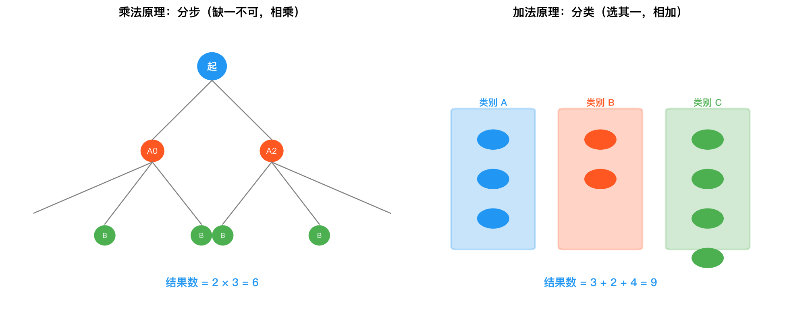
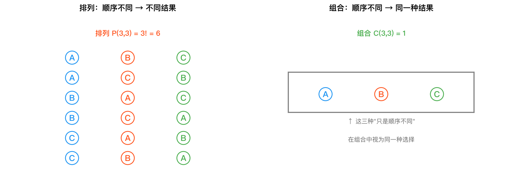
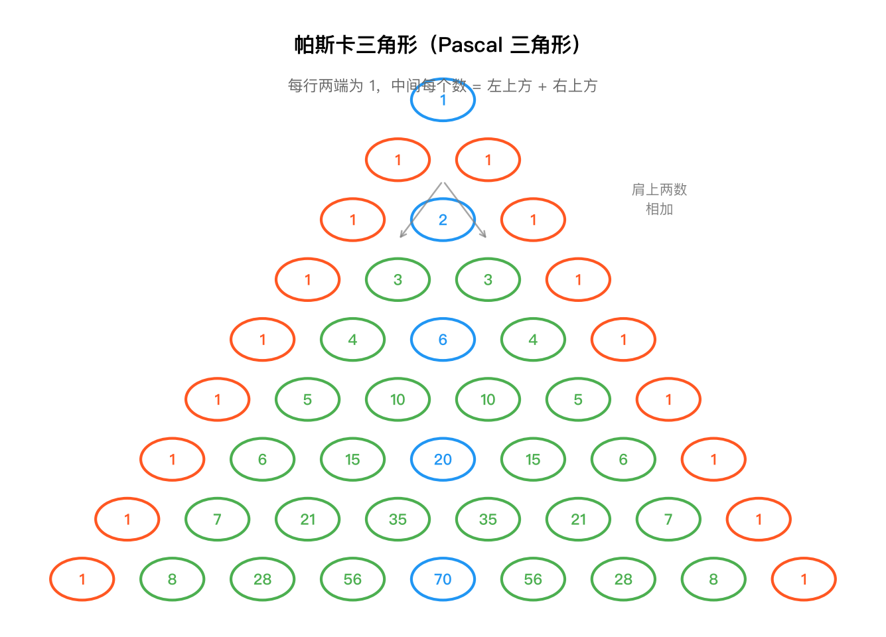

# 组合分析知识讲解

> **本章导航**
> - 一、为什么需要组合分析？
> - 二、乘法原理 vs 加法原理
> - 三、排列 vs 组合
> - 四、Pascal 三角形
> - 五、二项式系数的直观含义
> - 小结

---

### 本章导读

**承上启下**：这是概率论的第一章，不需要回顾上一章。概率论的基础是"数数"——在进入概率之前，先学会如何高效计数。组合分析是概率论的"前置技能"，没有它，我们连"有多少种可能"都说不清楚。

**带着这些问题学习本章**：
1. 抛一枚硬币3次，有几种可能的结果？
2. 从10个人中选3个人组成委员会，和选3个人排成一列，为什么结果不一样？
3. (a+b)⁵展开后a²b³的系数是多少？怎么算最快？

---

## 一、为什么需要组合分析？

概率论的核心思想可以概括为一句话：

> **事件概率 = 该事件的结果数 ÷ 所有可能结果的总数**

这一思想建立在"等可能"假设之上——如果每个基本结果发生的可能性相同，那么一个事件发生的概率就等于该事件包含的结果数除以总结果数。

例如，掷一枚均匀的骰子，出现偶数点的概率为：

$$
P(\text{偶数}) = \frac{\text{偶数点结果数}}{\text{总结果数}} = \frac{3}{6} = \frac{1}{2}
$$

这个计算很简单，因为总结果数只有6个，可以一个一个数出来。但现实中的问题远比这复杂：

- 从52张扑克牌中发5张，有多少种不同的牌型？
- 一个班级40人，至少两人同一天生日的概率是多少？
- 买彩票中头奖的概率是多大？

这些问题的共同点是：**结果数量巨大，无法逐一枚举**。组合分析就是研究如何高效、系统地计数的一门工具。没有它，概率论将寸步难行。

---

## 二、乘法原理 vs 加法原理

这两个原理是计数的基础，区别在于它们是应对两种不同的逻辑结构。

### 乘法原理：分步（缺一不可）

一件事需要**依次完成多个步骤**，每个步骤都有若干种选择，且所有步骤都完成了，这件事才算完成。

**举例**：小明有3件上衣、2条裤子、4双鞋。他出门穿衣的组合方式有多少？

要完成"穿衣出门"这件事，需要依次完成三个步骤：
1. 选上衣：3种方式
2. 选裤子：2种方式
3. 选鞋：4种方式

三个步骤缺一不可，总方式数为：$3 \times 2 \times 4 = 24$ 种。

**关键词**：依次、先...再...、缺一不可、"和"的关系。

### 加法原理：分类（选其一）

一件事有**多种互斥的类别**，只要选择其中一类中的一种方式，这件事就算完成。

**举例**：从北京到上海，可以坐飞机（3趟航班）、坐高铁（5趟车次）、坐大巴（2趟班次）。有多少种不同的出行方式？

要完成"从北京到上海"这件事，只要选择其中一种交通工具的一趟班次即可：

$$
3 + 5 + 2 = 10 \text{ 种}
$$

**关键词**：分类、互斥、任选其一、"或"的关系。

### 直观对比

| 对比维度 | 乘法原理        | 加法原理      |
| ---- | ----------- | --------- |
| 逻辑结构 | 分步（且）       | 分类（或）     |
| 完成条件 | 所有步骤都完成     | 任选一类即可    |
| 操作符  | 乘号 $\times$ | 加号 $+$    |
| 典型场景 | 搭配、排列、逐层选择  | 分类讨论、分支选择 |


*示意图对比了乘法原理（分步、缺一不可、相乘）与加法原理（分类、任选其一、相加）的计数逻辑。*

---

## 三、排列 vs 组合

排列和组合都是从 $n$ 个不同元素中选取 $r$ 个，唯一的区别是：**是否考虑顺序**。

### 对比表格

| 对比维度     | 排列 $P(n,r)$                       | 组合 $C(n,r)$                           |
| -------- | --------------------------------- | ------------------------------------- |
| 顺序是否重要   | ✅ 是                               | ❌ 否                                   |
| 公式       | $\displaystyle \frac{n!}{(n-r)!}$ | $\displaystyle \frac{n!}{r!\,(n-r)!}$ |
| 举例       | 10本书选3本送给3位不同的朋友                  | 10本书选3本捐给图书馆                          |
| 选元素 + 排序 | 一步到位                              | 只选不排                                  |


*示意图展示了排列（选人还要安排岗位、考虑顺序）与组合（只选不排、成员不分先后）的本质区别。*

### 核心关系

排列数 = 组合数 × 排序方式数

$$
P(n, r) = C(n, r) \times r!
$$

这个关系非常直观：先把 $r$ 个元素选出来（组合），再给它们排个顺序（$r!$ 种排列方式），就得到了所有排列。

### 判断口诀

- **排列**：选人还要安排岗位（班长、副班长、学习委员）
- **组合**：选人加入同一个小组（成员不分先后）

---

## 四、Pascal 三角形

Pascal 三角形是组合数的一个直观几何表示。

```
n=0              1
n=1            1   1
n=2          1   2   1
n=3        1   3   3   1
n=4      1   4   6   4   1
n=5    1   5  10  10   5   1
n=6  1   6  15  20  15   6   1
```

其中第 $n$ 行第 $r$ 个数（从0开始编号）就是 $C(n, r)$。

### 两个重要规律

**1. 每个数是上方两数之和**

这正是 Pascal 恒等式的几何体现：

$$
C(n, r) = C(n-1, r-1) + C(n-1, r)
$$

例如 $n=5$ 行的 $10$ 等于 $n=4$ 行上方的 $4 + 6$。

**2. 每行之和为 $2^n$**

$$
\sum_{k=0}^{n} C(n, k) = 2^n
$$

例如 $n=3$ 行：$1 + 3 + 3 + 1 = 8 = 2^3$。


*帕斯卡三角形是组合数的几何排列，每一行依次为 C(n,0) 到 C(n,n)，且每个数等于上方两数之和。*

---

## 五、二项式系数的直观含义

### 为什么叫"二项式系数"？

组合数 $C(n, k)$ 还有一个名字——**二项式系数**。这个名字来源于二项式定理：

$$
(x + y)^n = \sum_{k=0}^{n} C(n, k) \, x^k y^{n-k}
$$

$C(n, k)$ 恰好是 $(x + y)^n$ 展开式中 $x^k y^{n-k}$ 项的系数，因此得名。

### 展开式的结构

以 $(x + y)^3$ 为例：

$$
(x + y)^3 = (x + y)(x + y)(x + y)
$$

展开时，每个括号要么选 $x$，要么选 $y$。要得到 $x^2 y$ 这一项，需要从3个括号中选2个取 $x$（其余1个取 $y$），选法有 $C(3, 2) = 3$ 种，所以系数为3：

$$
(x + y)^3 = C(3,0)x^0y^3 + C(3,1)x^1y^2 + C(3,2)x^2y^1 + C(3,3)x^3y^0 = y^3 + 3xy^2 + 3x^2y + x^3
$$

### 与概率论的联系

二项式系数是**二项分布**的直接来源。在概率论中，如果做 $n$ 次独立重复试验，每次成功概率为 $p$，则恰好成功 $k$ 次的概率为：

$$
P(X = k) = C(n, k) \, p^k (1-p)^{n-k}
$$

这正是二项式定理的形式——将 $x = p$、$y = 1-p$ 代入展开式得到的结果。

---

## 小结

| 概念 | 一句话总结 |
|------|-----------|
| 组合分析 | 为概率论提供高效计数的工具 |
| 乘法原理 | 分步，缺一不可，用乘法 |
| 加法原理 | 分类，任选其一，用加法 |
| 排列 | 选出来还要排序，$P = C \times r!$ |
| 组合 | 只选不排，核心是 $C(n,r) = \frac{n!}{r!(n-r)!}$ |
| Pascal 三角形 | 组合数的直观排列，每个数是上方两数之和 |
| 二项式系数 | 组合数在 $(x+y)^n$ 展开中的角色，是二项分布的基础 |

---

## 本章应掌握的内容

学完本章后，你应该能回答以下问题：

1. 你能区分什么时候用乘法原理、什么时候用加法原理吗？
2. 你能说出排列和组合的本质区别是什么吗？
3. 你能从组合角度推导出二项式定理吗？
4. 你能用隔板法解决"相同物品分配"问题吗？
5. 你知道Pascal三角形与组合数之间的关系吗？