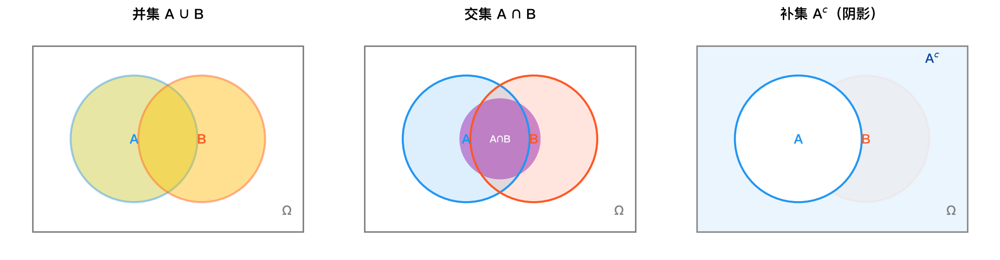
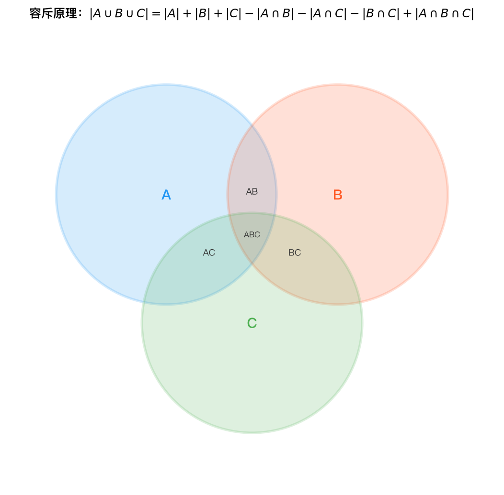
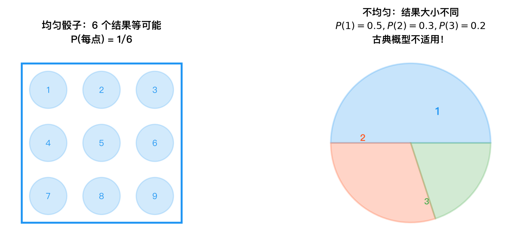

# 概率公理与基本性质 — 公式推导

## 1. 基本概念定义

- **样本空间 Ω**：一个随机试验所有可能结果的集合。
- **事件**：样本空间 Ω 的子集。
- **必然事件**：Ω 本身，即每次试验一定会发生的事件。
- **不可能事件**：空集 ∅，即每次试验一定不会发生的事件。

---

## 2. Kolmogorov 概率公理

设 P 为定义在事件域上的实值函数，满足以下三条公理：

**公理 1（非负性）**：对任意事件 A，有

$$
P(A) \ge 0
$$

**公理 2（规范性）**：必然事件的概率为 1，即

$$
P(\Omega) = 1
$$

**公理 3（可列可加性）**：对任意两两互不相容的事件列 $A_1, A_2, \dots$（即当 $i \ne j$ 时 $A_i \cap A_j = \emptyset$），有

$$
P\left(\bigcup_{i=1}^{\infty} A_i\right) = \sum_{i=1}^{\infty} P(A_i)
$$

---

## 3. 从公理推导性质

### 性质 1：不可能事件的概率为零

$$
\boxed{P(\emptyset) = 0}
$$

**推导**：

令 $A_1 = \Omega$，$A_2 = A_3 = \cdots = \emptyset$。这些事件两两互不相容（因为 $\Omega \cap \emptyset = \emptyset$，且 $\emptyset \cap \emptyset = \emptyset$）。

由公理 3（可列可加性）：

$$
P\left(\bigcup_{i=1}^{\infty} A_i\right) = \sum_{i=1}^{\infty} P(A_i)
$$

左边为 $P(\Omega \cup \emptyset \cup \emptyset \cup \cdots) = P(\Omega)$（因为 $\Omega$ 与任意个空集之并仍为 $\Omega$）。

右边为 $P(\Omega) + P(\emptyset) + P(\emptyset) + \cdots$。

因此：

$$
P(\Omega) = P(\Omega) + \sum_{i=2}^{\infty} P(\emptyset)
$$

由公理 2，$P(\Omega) = 1$，代入得：

$$
1 = 1 + \sum_{i=2}^{\infty} P(\emptyset)
$$

故 $\displaystyle\sum_{i=2}^{\infty} P(\emptyset) = 0$。由公理 1，$P(\emptyset) \ge 0$，所以无穷个非负数之和为 0 必须每个都为 0，即 $P(\emptyset) = 0$。

---

### 性质 2：有限可加性

若 $A_1, A_2, \dots, A_n$ 两两互不相容，则

$$
\boxed{P\left(\bigcup_{i=1}^{n} A_i\right) = \sum_{i=1}^{n} P(A_i)}
$$

**推导**：

构造无穷事件列：令 $B_1 = A_1, B_2 = A_2, \dots, B_n = A_n$，$B_{n+1} = B_{n+2} = \cdots = \emptyset$。

则 $\{B_i\}$ 两两互不相容（因为 $\emptyset$ 与任何事件互不相容）。由公理 3：

$$
P\left(\bigcup_{i=1}^{\infty} B_i\right) = \sum_{i=1}^{\infty} P(B_i)
$$

左边：
$$
\bigcup_{i=1}^{\infty} B_i = A_1 \cup A_2 \cup \cdots \cup A_n \cup \emptyset \cup \emptyset \cup \cdots = \bigcup_{i=1}^{n} A_i
$$

右边：
$$
\sum_{i=1}^{\infty} P(B_i) = \sum_{i=1}^{n} P(A_i) + \sum_{i=n+1}^{\infty} P(\emptyset)
$$

由性质 1，$P(\emptyset) = 0$，故 $\displaystyle\sum_{i=n+1}^{\infty} P(\emptyset) = 0$。

因此：

$$
P\left(\bigcup_{i=1}^{n} A_i\right) = \sum_{i=1}^{n} P(A_i)
$$

---

### 性质 3：补事件的概率

$$
\boxed{P(A^c) = 1 - P(A)}
$$

**推导**：

由于 $A \cup A^c = \Omega$，且 $A \cap A^c = \emptyset$，即 $A$ 与 $A^c$ 互不相容。

由有限可加性（性质 2）：

$$
P(A \cup A^c) = P(A) + P(A^c)
$$

但 $A \cup A^c = \Omega$，由公理 2，$P(\Omega) = 1$，故：

$$
1 = P(A) + P(A^c)
$$

移项即得：

$$
P(A^c) = 1 - P(A)
$$

---

### 性质 4：单调性

若 $A \subseteq B$，则

$$
\boxed{P(A) \le P(B)}
$$

**推导**：

当 $A \subseteq B$ 时，$B$ 可以分解为两个互不相容事件的并：

$$
B = A \cup (B \setminus A)
$$

其中 $B \setminus A = B \cap A^c$，且 $A \cap (B \setminus A) = \emptyset$。

由有限可加性（性质 2）：

$$
P(B) = P(A) + P(B \setminus A)
$$

由公理 1，$P(B \setminus A) \ge 0$，因此：

$$
P(B) = P(A) + P(B \setminus A) \ge P(A)
$$

即 $P(A) \le P(B)$。

---

### 性质 5：加法公式（两个事件）

$$
\boxed{P(A \cup B) = P(A) + P(B) - P(A \cap B)}
$$

**推导**：

将 $A \cup B$ 分解为三个互不相容的部分：

$$
A \cup B = (A \setminus B) \cup (A \cap B) \cup (B \setminus A)
$$

其中 $A \setminus B = A \cap B^c$，$B \setminus A = B \cap A^c$，且三者两两互不相交。

由有限可加性（性质 2）：

$$
P(A \cup B) = P(A \setminus B) + P(A \cap B) + P(B \setminus A) \tag{1}
$$

同时，$A$ 也可分解为两个互不相容的部分：

$$
A = (A \setminus B) \cup (A \cap B)
$$

由有限可加性：

$$
P(A) = P(A \setminus B) + P(A \cap B) \quad \Rightarrow \quad P(A \setminus B) = P(A) - P(A \cap B) \tag{2}
$$

同理：

$$
P(B) = P(B \setminus A) + P(A \cap B) \quad \Rightarrow \quad P(B \setminus A) = P(B) - P(A \cap B) \tag{3}
$$

将 (2)(3) 代入 (1)：

$$
\begin{aligned}
P(A \cup B) &= [P(A) - P(A \cap B)] + P(A \cap B) + [P(B) - P(A \cap B)] \\
&= P(A) + P(B) - P(A \cap B)
\end{aligned}
$$

*文氏图直观展示了事件 A 与 B 的交、并、差等运算关系，对应加法公式中需减去重叠部分 P(A∩B)。*

---

### 性质 6：三个事件的加法公式

$$
\boxed{P(A \cup B \cup C) = P(A) + P(B) + P(C) - P(A \cap B) - P(A \cap C) - P(B \cap C) + P(A \cap B \cap C)}
$$

**推导**：

反复应用两个事件的加法公式（性质 5）。

令 $D = A \cup B$，则 $A \cup B \cup C = D \cup C$。

由性质 5：

$$
P(A \cup B \cup C) = P(D \cup C) = P(D) + P(C) - P(D \cap C) \tag{1}
$$

先计算 $P(D)$，由性质 5：

$$
P(D) = P(A \cup B) = P(A) + P(B) - P(A \cap B) \tag{2}
$$

再计算 $P(D \cap C)$：

$$
D \cap C = (A \cup B) \cap C = (A \cap C) \cup (B \cap C)
$$

由性质 5：

$$
\begin{aligned}
P(D \cap C) &= P[(A \cap C) \cup (B \cap C)] \\
&= P(A \cap C) + P(B \cap C) - P[(A \cap C) \cap (B \cap C)] \\
&= P(A \cap C) + P(B \cap C) - P(A \cap B \cap C) \tag{3}
\end{aligned}
$$

将 (2)(3) 代入 (1)：

$$
\begin{aligned}
P(A \cup B \cup C) &= [P(A) + P(B) - P(A \cap B)] + P(C) \\
&\quad - [P(A \cap C) + P(B \cap C) - P(A \cap B \cap C)] \\
&= P(A) + P(B) + P(C) - P(A \cap B) - P(A \cap C) - P(B \cap C) + P(A \cap B \cap C)
\end{aligned}
$$

*三集合文氏图展示了两两相交与三者共同重叠的区域，对应容斥原理中先减去两两重叠、再加回三者重叠 P(A∩B∩C) 的步骤。*

---

D \cap C = (A \cup B) \cap C = (A \cap C) \cup (B \cap C)

---

## 4. 古典概型

若试验满足：
1. **有限性**：样本空间 $\Omega$ 只有有限个样本点，即 $|\Omega| = N$；
2. **等可能性**：每个样本点发生的可能性相同。

则对任意事件 $A$，有

$$
\boxed{P(A) = \frac{|A|}{|\Omega|}}
$$

**推导**：

设 $\Omega = \{\omega_1, \omega_2, \dots, \omega_N\}$，由等可能性，每个样本点发生的概率相同，设为 $p$，即：

$$
P(\{\omega_1\}) = P(\{\omega_2\}) = \cdots = P(\{\omega_N\}) = p
$$

由于 $\Omega = \bigcup_{i=1}^{N} \{\omega_i\}$，且各样本点互不相容，由有限可加性（性质 2）：

$$
P(\Omega) = \sum_{i=1}^{N} P(\{\omega_i\}) = N \cdot p
$$

由公理 2，$P(\Omega) = 1$，所以 $N \cdot p = 1$，即：

$$
p = \frac{1}{N}
$$

设事件 $A$ 包含 $|A|$ 个样本点，即 $A = \bigcup_{\omega_i \in A} \{\omega_i\}$，由有限可加性：

$$
P(A) = \sum_{\omega_i \in A} P(\{\omega_i\}) = |A| \cdot \frac{1}{N} = \frac{|A|}{|\Omega|}
$$

*示意图展示了古典概型的等可能性假设：每个样本点概率相同，均为 1/|Ω|，事件概率等于其样本点数除以总样本点数。*