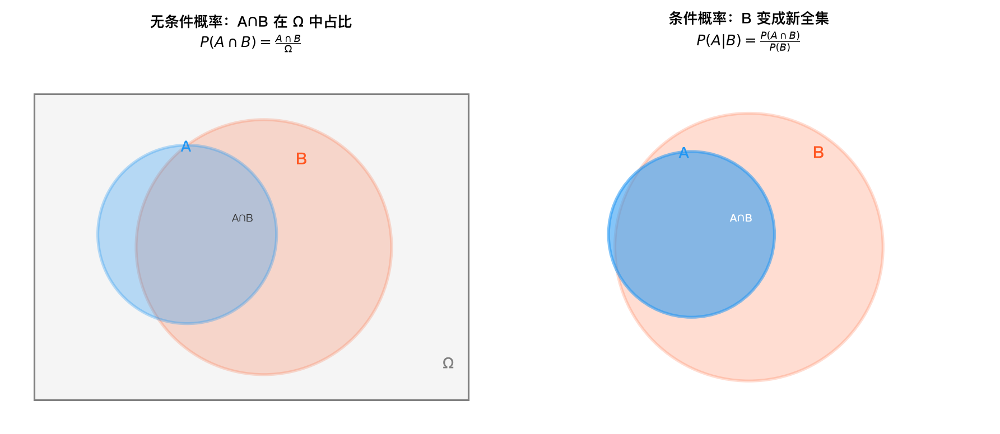
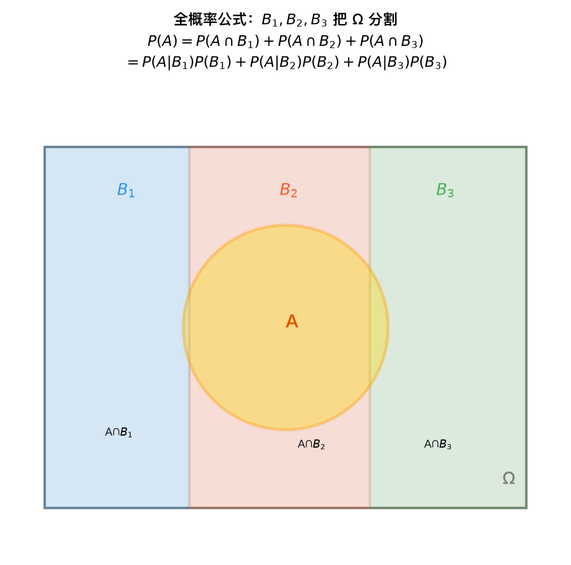
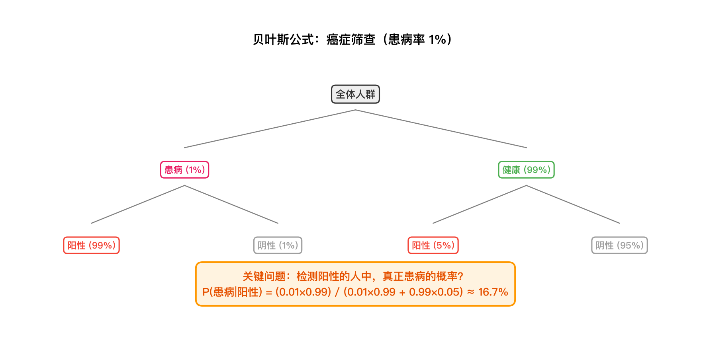

# 条件概率与独立性——公式推导

## 1. 条件概率的定义

**定义**：对于两个事件 $A$ 和 $B$，且 $P(B) > 0$，称

$$
\boxed{P(A|B) = \frac{P(A \cap B)}{P(B)}}
$$

为在事件 $B$ 发生的条件下事件 $A$ 发生的**条件概率**。

**古典概型直观推导**：

设样本空间 $\Omega$ 包含 $n$ 个等可能的基本事件，事件 $B$ 包含 $m_B$ 个基本事件，事件 $A \cap B$ 包含 $m_{A \cap B}$ 个基本事件。

- 无条件概率：$P(A) = \dfrac{m_A}{n}$
- 在 $B$ 已发生的条件下，样本空间缩小为 $B$（共 $m_B$ 个基本事件），此时 $A$ 发生等价于 $A \cap B$ 发生，因此

$$
P(A|B) = \frac{m_{A \cap B}}{m_B} = \frac{m_{A \cap B} / n}{m_B / n} = \frac{P(A \cap B)}{P(B)}
$$

*在事件 $B$ 发生的条件下，样本空间从 $\Omega$ 缩小为 $B$，$A$ 的概率按比例重新分配，得到 $P(A|B)$。*

---

## 2. 乘法公式

由条件概率定义直接可得：

$$
\boxed{P(A \cap B) = P(B) \cdot P(A|B)}
$$

同理有 $P(A \cap B) = P(A) \cdot P(B|A)$。

**推广到 $n$ 个事件**（乘法公式的一般形式）：

$$
\boxed{P(A_1 \cap A_2 \cap \cdots \cap A_n) = P(A_1) \cdot P(A_2|A_1) \cdot P(A_3|A_1 \cap A_2) \cdots P(A_n|A_1 \cap \cdots \cap A_{n-1})}
$$

**归纳法推导**：

- $n=2$ 时，由条件概率定义得 $P(A_1 \cap A_2) = P(A_1) P(A_2|A_1)$，成立。
- 假设 $n=k$ 时公式成立，即

$$
P(A_1 \cap \cdots \cap A_k) = P(A_1) P(A_2|A_1) \cdots P(A_k|A_1 \cap \cdots \cap A_{k-1})
$$

- 则 $n=k+1$ 时，令 $B = A_1 \cap \cdots \cap A_k$，有

$$
\begin{aligned}
P(A_1 \cap \cdots \cap A_{k+1}) &= P(B \cap A_{k+1}) \\
&= P(B) \cdot P(A_{k+1}|B) \\
&= P(A_1) P(A_2|A_1) \cdots P(A_k|A_1 \cap \cdots \cap A_{k-1}) \cdot P(A_{k+1}|A_1 \cap \cdots \cap A_k)
\end{aligned}
$$

公式对 $n=k+1$ 也成立。由数学归纳法，公式对任意正整数 $n$ 成立。

---

## 3. 全概率公式

**定理**：设 $A_1, A_2, \dots, A_n$ 是样本空间 $\Omega$ 的一个**划分**（即两两互斥且 $\bigcup_{i=1}^n A_i = \Omega$），且 $P(A_i) > 0$，则对任意事件 $B$，有

$$
\boxed{P(B) = \sum_{i=1}^n P(A_i) \cdot P(B|A_i)}
$$

**推导**：

1. 由于 $\{A_i\}$ 是 $\Omega$ 的划分，$B$ 可分解为互不相交的部分：

$$
B = B \cap \Omega = B \cap \left( \bigcup_{i=1}^n A_i \right) = \bigcup_{i=1}^n (B \cap A_i)
$$

2. 由概率的有限可加性（各 $B \cap A_i$ 两两互斥）：

$$
P(B) = \sum_{i=1}^n P(B \cap A_i)
$$

3. 对每一项应用乘法公式 $P(B \cap A_i) = P(A_i) P(B|A_i)$，即得：

$$
P(B) = \sum_{i=1}^n P(A_i) P(B|A_i)
$$

*划分 $\{A_i\}$ 将样本空间 $\Omega$ 分割为互斥区域，$B$ 的总概率等于各区域中 $B$ 概率的加权和。*

---

## 4. 贝叶斯公式

**定理**：设 $A_1, A_2, \dots, A_n$ 是 $\Omega$ 的一个划分，$P(A_i) > 0$，且 $P(B) > 0$，则

$$
\boxed{P(A_k|B) = \frac{P(A_k) \cdot P(B|A_k)}{\displaystyle \sum_{i=1}^n P(A_i) \cdot P(B|A_i)}}
$$

**推导**：

由条件概率定义：

$$
P(A_k|B) = \frac{P(A_k \cap B)}{P(B)}
$$

分子用乘法公式 $P(A_k \cap B) = P(A_k) \cdot P(B|A_k)$，分母用全概率公式 $P(B) = \sum_{i=1}^n P(A_i) P(B|A_i)$，代入即得。

**名词解释**：
- $P(A_k)$ —— **先验概率**（prior）
- $P(B|A_k)$ —— **似然**（likelihood）
- $P(A_k|B)$ —— **后验概率**（posterior）

*树状图展示由果溯因的推理路径：从各原因 $A_k$ 出发，结合先验与似然，经全概率归一化得到后验概率 $P(A_k|B)$。*

---

## 5. 事件的独立性

### 5.1 两个事件的独立性

**定义**：若事件 $A$ 与 $B$ 满足

$$
\boxed{P(A \cap B) = P(A) \cdot P(B)}
$$

则称 $A$ 与 $B$ **相互独立**。

**从条件概率角度的推导**：

若 $P(B) > 0$，且 $A$ 与 $B$ 独立，则

$$
P(A|B) = \frac{P(A \cap B)}{P(B)} = \frac{P(A) P(B)}{P(B)} = P(A)
$$

即 $B$ 的发生不影响 $A$ 发生的概率。反之，若 $P(A|B) = P(A)$，则 $P(A \cap B) = P(A) P(B)$。

### 5.2 独立的推论

**推论 1**：若 $A$ 与 $B$ 独立，则 $A$ 与 $B^c$ 也独立。

**证明**：

$$
\begin{aligned}
P(A \cap B^c) &= P(A) - P(A \cap B) \\
&= P(A) - P(A) P(B) \\
&= P(A) \left[ 1 - P(B) \right] \\
&= P(A) P(B^c)
\end{aligned}
$$

**推论 2**：若 $A$ 与 $B$ 独立，则 $A^c$ 与 $B^c$ 也独立。

**证明**：

$$
\begin{aligned}
P(A^c \cap B^c) &= P\left( (A \cup B)^c \right) \\
&= 1 - P(A \cup B) \\
&= 1 - \left[ P(A) + P(B) - P(A \cap B) \right] \\
&= 1 - P(A) - P(B) + P(A) P(B) \\
&= (1 - P(A))(1 - P(B)) \\
&= P(A^c) P(B^c)
\end{aligned}
$$

### 5.3 三个事件的相互独立

**定义**：事件 $A, B, C$ **相互独立** 当且仅当以下四个条件同时成立：

$$
\begin{cases}
P(A \cap B) = P(A) P(B) &\text{（两两独立）} \\
P(A \cap C) = P(A) P(C) &\text{（两两独立）} \\
P(B \cap C) = P(B) P(C) &\text{（两两独立）} \\
P(A \cap B \cap C) = P(A) P(B) P(C) &\text{（三者乘积）}
\end{cases}
$$

**两两独立 ≠ 相互独立**：

两两独立只保证任意两个事件的乘积等于概率之积，但无法保证三个事件同时发生的概率等于三者概率之积。经典反例：

> 投掷两枚均匀硬币，设：
> - $A$ = 第一枚正面
> - $B$ = 第二枚正面
> - $C$ = 两枚结果相同
>
> 则 $P(A)=P(B)=P(C)=1/2$，且 $P(A \cap B) = 1/4 = P(A)P(B)$，$P(A \cap C)=1/4=P(A)P(C)$，$P(B \cap C)=1/4=P(B)P(C)$，但 $P(A \cap B \cap C) = 1/4 \neq 1/8 = P(A)P(B)P(C)$。因此 $A,B,C$ 两两独立但不相互独立。

### 5.4 $n$ 个事件的相互独立

**一般定义**：事件 $A_1, A_2, \dots, A_n$ **相互独立**，当且仅当对任意 $k$ 个指标 $1 \le i_1 < i_2 < \cdots < i_k \le n$（$k=2,3,\dots,n$），都有

$$
\boxed{P(A_{i_1} \cap A_{i_2} \cap \cdots \cap A_{i_k}) = P(A_{i_1}) P(A_{i_2}) \cdots P(A_{i_k})}
$$

即任意子集的事件同时发生的概率等于各事件概率的乘积。共需满足 $2^n - n - 1$ 个等式。

---

## 6. 条件独立性（选学）

**定义**：给定事件 $C$（$P(C) > 0$），若事件 $A$ 与 $B$ 满足

$$
\boxed{P(A \cap B|C) = P(A|C) \cdot P(B|C)}
$$

则称 $A$ 与 $B$ 在给定 $C$ 下**条件独立**。

**说明**：条件独立与独立是两个不同的概念。条件独立不蕴含独立，独立也不蕴含条件独立。例如，某些变量在整体上相关，但分组后变得无关（Simpson 悖论的反面）。