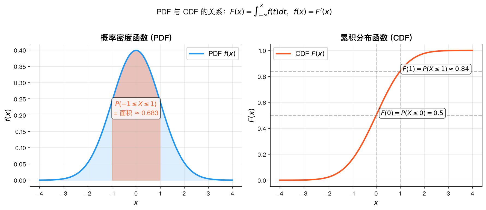
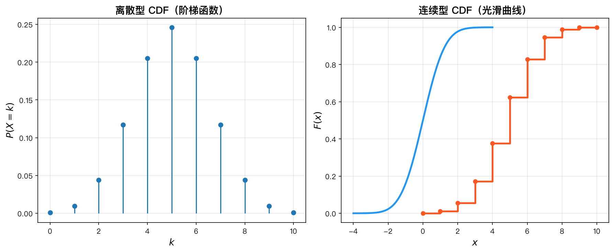

# 第4章 随机变量及其分布 · 知识讲解

> **本章目录**：为什么引入随机变量 | 离散 vs 连续的对偶性 | 理解密度函数 | CDF的万能特性 | 求随机变量函数分布的技巧
>
> **承上启下**：前三章用事件语言研究概率——事件、概率、条件概率、独立性。但事件语言有一个根本局限：事件不是数字，不能做加减乘除，也无法用微积分处理。本章引入随机变量，将随机结果映射为实数，从而可以用微积分工具研究概率。
>
> **带着问题学习**：
> 1. "抛硬币得到正面"是一个事件，但"正面朝上的次数"是什么？两者有什么区别？
> 2. 连续型随机变量取某个特定值的概率为什么是0？那怎么计算概率？
> 3. 已知X的分布，如何求X²的分布？一定要先求X²的分布吗？

## 1. 为什么引入随机变量？

**传统事件语言的局限：**

| 局限 | 说明 |
|------|------|
| 无法量化 | 事件 $\{下雨\}$ 不能说"下雨的程度"，但随机变量 $X = \text{降雨量}$ 可以 |
| 无法运算 | 事件 $A \cap B$ 不能做加法乘法，但随机变量 $X + Y$ 可以 |
| 无法处理连续量 | 事件只能描述"是/否"，但连续型随机变量需要"密度"的概念 |

**随机变量的本质：** 将随机试验的结果映射到实数轴上，使得我们可以用微积分工具（极限、导数、积分、级数）来研究随机现象。

> 一句话：**随机变量 = 给随机结果贴上数字标签，从而引入数学分析工具。**

---

## 2. 离散 vs 连续的对偶性

离散型和连续型随机变量在概念上完全对偶，理解这一点能极大简化记忆：

| 概念   | 离散型                                | 连续型                                |
| ---- | ---------------------------------- | ---------------------------------- |
| 核心函数 | PMF $p(x)$                         | PDF $f(x)$                         |
| 非负性  | $p(x) \ge 0$                       | $f(x) \ge 0$                       |
| 归一化  | $\sum p(x) = 1$                    | $\int f(x)\,dx = 1$                |
| 概率计算 | $P(X \in A) = \sum_{x \in A} p(x)$ | $P(X \in A) = \int_A f(x)\,dx$     |
| CDF  | $F(x) = \sum_{t \le x} p(t)$       | $F(x) = \int_{-\infty}^x f(t)\,dt$ |
| 期望   | $E[X] = \sum x\,p(x)$              | $E[X] = \int x\,f(x)\,dx$          |
| 逆运算  | $p(x) = F(x) - F(x^-)$             | $f(x) = F'(x)$                     |

**核心思想：** 离散型求和 $\sum$ 对应连续型积分 $\int$，两者是同一概念在不同框架下的表现。

**直观感受：PDF 与 CDF 的关系**

下图展示了正态分布 $N(0,1)$ 的 PDF 和 CDF：
- 左图：PDF 曲线下的**面积** = 概率
- 右图：CDF 在 $x$ 处的**高度** = $P(X \leq x)$
- 两者通过微积分基本定理互逆：$F(x) = \int_{-\infty}^x f(t)dt$，$f(x) = F'(x)$



*图：正态分布 N(0,1) 的 PDF（左）与 CDF（右），阴影面积为 P(-1 ≤ X ≤ 1) ≈ 0.683*

---

## 3. 理解密度函数：$f(x)$ 不是概率！

初学者最容易犯的错误：把 $f(x)$ 当作概率。

**关键理解：**
- $f(x)$ 是**密度**，不是概率
- $f(x)\,\Delta x \approx P(x \le X < x+\Delta x)$，这才是近似概率
- $f(x)$ 可以大于 1（只要曲线下的总面积是 1 即可）

**类比：** 物理中的密度 $\rho$。$\rho(x)$ 是质量密度，$\rho(x)\,\Delta x$ 才是小段的质量，而不是 $\rho(x)$ 本身是质量。

**举例：** 若 $f(x) = 2$ 在 $[0, 0.5]$ 上，则 $f(0.1) = 2$，但 $P(X = 0.1) = 0$，$P(0 \le X \le 0.5) = 1$。

---

## 4. CDF 的万能特性

**累积分布函数 CDF 是所有随机变量的统一语言：**

- **离散型**：阶梯函数，跳跃点对应 PMF 的非零值
- **连续型**：连续函数，导数对应 PDF
- **混合型**：既有连续上升段，也有跳跃点

**CDF 的优势：**
1. 定义统一，无需区分离散/连续
2. 概率计算直观：$P(a < X \le b) = F(b) - F(a)$
3. 分位数：$F^{-1}(p)$ 是逆变换抽样的基础
4. 收敛性：$X_n \to X$ 在分布上的收敛定义为 $F_{X_n} \to F_X$

**CDF 的三大性质（必须记住）：**
1. **单调不减**：$x_1 < x_2 \Rightarrow F(x_1) \le F(x_2)$
2. **极限**：$F(-\infty) = 0,\; F(\infty) = 1$
3. **右连续**：$F(x) = F(x^+)$

> CDF 是描述随机变量最基础、最通用的工具。PMF 和 PDF 只是 CDF 的"衍生品"。

**离散 vs 连续 CDF 对比**



*图：左图为离散型 Binomial(10, 0.5) 的 PMF（杆状图）和 CDF（阶梯状、右连续）；右图为连续型 Normal(0,1) 的 CDF（光滑曲线、处处连续）*

---

## 5. 求随机变量函数分布的技巧

### 5.1 CDF 法——最通用的方法

求 $Y = g(X)$ 的分布，**CDF 法**总是第一选择：

```
第1步：写 CDF     →  F_Y(y) = P(Y ≤ y) = P(g(X) ≤ y)
第2步：解不等式   →  将 {g(X) ≤ y} 转化为关于 X 的不等式
第3步：用 F_X 表示 →  F_Y(y) = F_X(...) 或 1 - F_X(...)
第4步：求导       →  f_Y(y) = F_Y'(y)
```

### 5.2 逐段处理

当 $g$ 不是单调函数时（如 $Y = X^2$），需要分段处理：

$$F_Y(y) = P(g(X) \le y) = P(X \in \{x: g(x) \le y\})$$

例如 $Y = X^2$：
- 当 $y < 0$：$F_Y(y) = 0$
- 当 $y \ge 0$：$F_Y(y) = P(-\sqrt{y} \le X \le \sqrt{y}) = F_X(\sqrt{y}) - F_X(-\sqrt{y})$

### 5.3 单调变换法（快捷方式）

当 $g$ 是严格单调且可导时，可以直接用公式：
$$f_Y(y) = f_X(g^{-1}(y)) \cdot \left|\frac{d}{dy}g^{-1}(y)\right|$$

**使用条件：** $g$ 必须是严格单调函数，且 $g^{-1}$ 可导。

### 5.4 实战建议

| 情况 | 推荐方法 |
|------|----------|
| 离散型 $Y = g(X)$ | 直接合并相同 $y$ 值的概率 |
| 连续型，$g$ 单调 | 单调变换法（最快） |
| 连续型，$g$ 非单调 | CDF 法（通用） |
| 连续型，$Y = aX + b$ | 线性变换公式 |
| 不确定 | CDF 法（永远不会错） |

---

## 6. 关键概念对比

| 概念 | 含义 | 数学表达 |
|------|------|----------|
| PMF | 离散型：单点概率 | $p(x) = P(X = x)$ |
| PDF | 连续型：概率密度 | $f(x) = \lim_{\Delta x \to 0} \frac{P(x \le X < x+\Delta x)}{\Delta x}$ |
| CDF | 累积概率 | $F(x) = P(X \le x)$ |
| 分位数 | CDF 逆函数 | $Q(p) = F^{-1}(p)$ |

---

## 7. 与高等数学的联系

| 高数知识 | 在本章的应用 |
|----------|-------------|
| 极限 | 密度函数的定义 $f(x) = \lim_{\Delta x \to 0} \frac{P(\cdots)}{\Delta x}$ |
| 导数 | $f(x) = F'(x)$，微积分基本定理 |
| 积分 | $F(x) = \int_{-\infty}^x f(t)\,dt$，归一化条件 |
| 级数求和 | 离散型归一化 $\sum p(x) = 1$ |
| 反函数 | 分位数函数 $Q(p) = F^{-1}(p)$ |
| 链式法则 | 单调变换法中的导数计算 |

---

## 本章应掌握的内容

学完本章后，你应该能回答以下问题：

1. 你能说出随机变量和事件的区别与联系吗？
2. 你能区分离散型和连续型随机变量吗？各自的工具是什么？
3. 你能解释概率密度函数f(x)为什么不是概率吗？
4. 你知道CDF为什么是"万能"的分布描述工具吗？
5. 你能用CDF法求随机变量函数的分布吗？
6. 你知道概率积分变换定理及其在随机模拟中的应用吗？