# 常见分布族的全部公式推导

## 一、离散型分布

### 1. Bernoulli 分布

$$X \sim \text{Bernoulli}(p), \quad 0 \leq p \leq 1$$

**分布律：**

$$
P(X=1) = p, \quad P(X=0) = 1-p
$$

统一写成：

$$
\boxed{P(X=x) = p^x (1-p)^{1-x}, \quad x = 0, 1}
$$

**验证归一化：**

$$
\sum_{x=0}^{1} p^x (1-p)^{1-x} = (1-p) + p = 1
$$

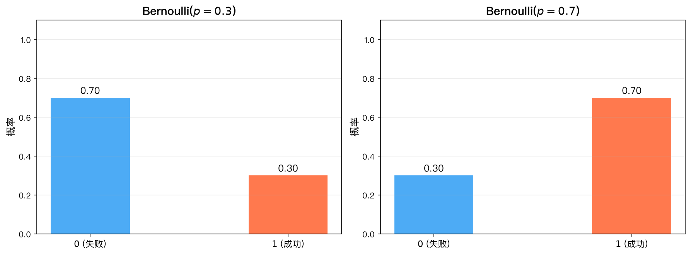

*该图展示了不同参数 $p$ 下 Bernoulli 分布的分布律：$P(X=1)=p$、$P(X=0)=1-p$。*

---

### 2. Binomial 分布

$$X \sim B(n, p), \quad n \in \mathbb{N}^+, \; 0 \leq p \leq 1$$

**分布律：**

$$
\boxed{P(X=k) = \binom{n}{k} p^k (1-p)^{n-k}, \quad k = 0, 1, \dots, n}
$$

**推导：**

从 $n$ 次独立 Bernoulli($p$) 试验中，恰好 $k$ 次成功：

- 指定某 $k$ 次成功、其余 $n-k$ 次失败的概率为 $p^k (1-p)^{n-k}$。
- 从 $n$ 次中选择哪 $k$ 次成功，有 $\binom{n}{k}$ 种选择。

二者相乘即得。

**验证归一化（二项式定理）：**

$$
\sum_{k=0}^{n} \binom{n}{k} p^k (1-p)^{n-k} = [p + (1-p)]^n = 1^n = 1
$$

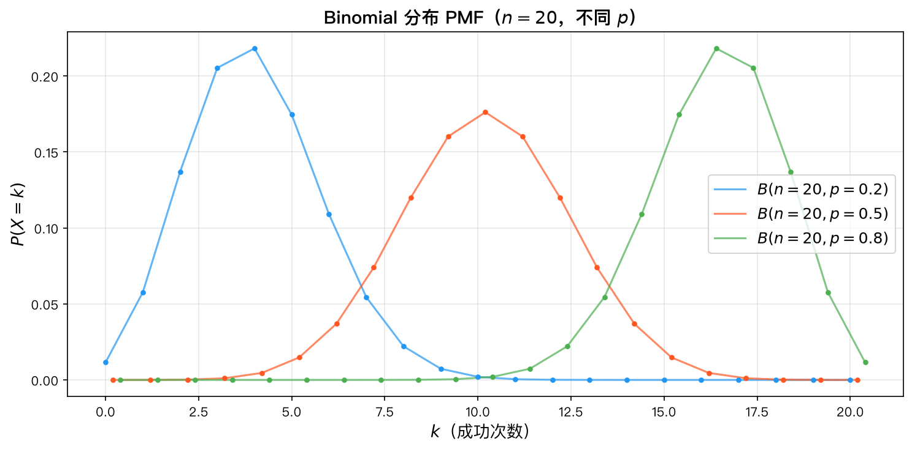

*该图展示了不同参数 $(n, p)$ 下二项分布的分布律形态。*

---

### 3. Poisson 分布

$$X \sim P(\lambda), \quad \lambda > 0$$

**分布律：**

$$
\boxed{P(X=k) = \frac{\lambda^k e^{-\lambda}}{k!}, \quad k = 0, 1, 2, \dots}
$$

**从二项分布推导（泊松极限定理）：**

设 $X_n \sim B(n, p_n)$，当 $n \to \infty$，$p_n \to 0$，且 $\lambda = n p_n$ 固定。则：

$$
P(X_n = k) = \binom{n}{k} p_n^k (1-p_n)^{n-k}
= \frac{n(n-1)\cdots(n-k+1)}{k!} \left(\frac{\lambda}{n}\right)^k \left(1-\frac{\lambda}{n}\right)^{n-k}
$$

$$
= \frac{\lambda^k}{k!} \cdot \frac{n(n-1)\cdots(n-k+1)}{n^k} \cdot \left(1-\frac{\lambda}{n}\right)^n \cdot \left(1-\frac{\lambda}{n}\right)^{-k}
$$

分别取极限：

- 第一个因子：$\displaystyle \frac{\lambda^k}{k!}$ 保持不变。
- 第二个因子：$\displaystyle \frac{n(n-1)\cdots(n-k+1)}{n^k} = 1 \cdot \left(1-\frac{1}{n}\right) \cdots \left(1-\frac{k-1}{n}\right) \xrightarrow{n\to\infty} 1$。
- 第三个因子：$\displaystyle \left(1-\frac{\lambda}{n}\right)^n \xrightarrow{n\to\infty} e^{-\lambda}$（重要极限 $\lim_{n\to\infty}(1+\frac{x}{n})^n = e^x$）。
- 第四个因子：$\displaystyle \left(1-\frac{\lambda}{n}\right)^{-k} \xrightarrow{n\to\infty} 1$。

因此：

$$
\lim_{n\to\infty} P(X_n = k) = \frac{\lambda^k}{k!} \cdot 1 \cdot e^{-\lambda} \cdot 1 = \frac{\lambda^k e^{-\lambda}}{k!}
$$

**验证归一化（$e^x$ 的泰勒展开）：**

$$
\sum_{k=0}^{\infty} \frac{\lambda^k e^{-\lambda}}{k!} = e^{-\lambda} \sum_{k=0}^{\infty} \frac{\lambda^k}{k!} = e^{-\lambda} \cdot e^{\lambda} = 1
$$

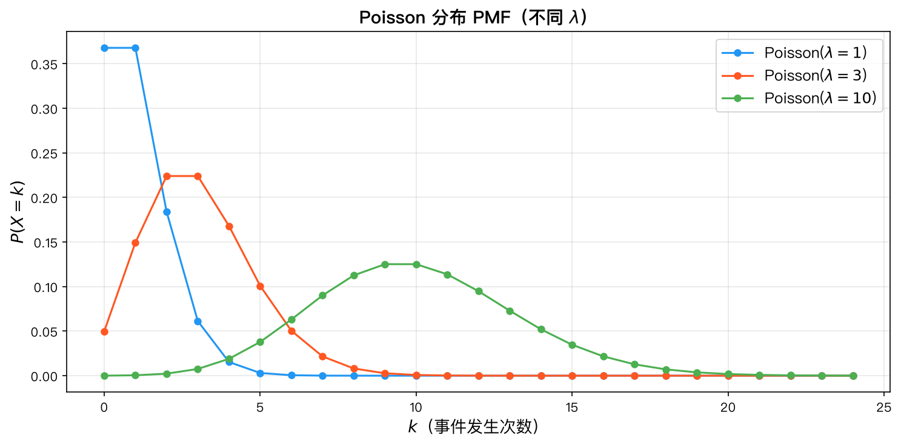

*该图展示了不同参数 $\lambda$ 下 Poisson 分布的分布律。*

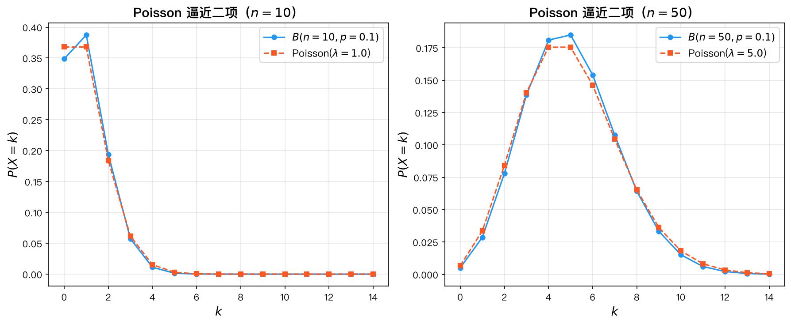

*该图对比了 Poisson 分布对二项分布的逼近效果，直观体现泊松极限定理。*

---

### 4. Geometric 分布

$$X \sim \text{Geom}(p), \quad 0 < p \leq 1$$

**分布律（首次成功所需次数）：**

$$
\boxed{P(X=k) = (1-p)^{k-1} p, \quad k = 1, 2, 3, \dots}
$$

**推导：**

前 $k-1$ 次均失败（每次概率 $1-p$），第 $k$ 次成功（概率 $p$），由独立性得：

$$
P(X=k) = (1-p)^{k-1} p
$$

**验证归一化（等比级数求和）：**

$$
\sum_{k=1}^{\infty} (1-p)^{k-1} p = p \sum_{m=0}^{\infty} (1-p)^m
= p \cdot \frac{1}{1-(1-p)} = p \cdot \frac{1}{p} = 1
$$

这里 $|1-p| < 1$，等比级数收敛。

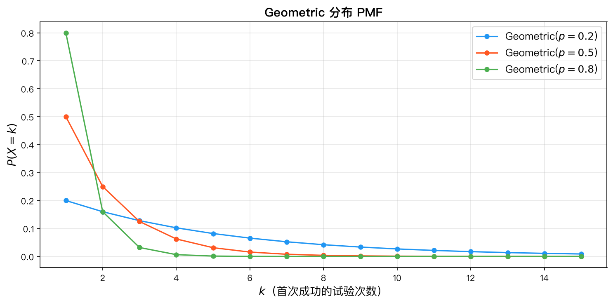

*该图展示了不同参数 $p$ 下 Geometric 分布的分布律，呈递减的几何级数形态。*

---

### 5. Negative Binomial 分布（帕斯卡分布）

$$X \sim \text{NB}(r, p), \quad r \in \mathbb{N}^+, \; 0 < p \leq 1$$

**分布律（第 $r$ 次成功发生的试验次数）：**

$$
\boxed{P(X=k) = \binom{k-1}{r-1} p^r (1-p)^{k-r}, \quad k = r, r+1, r+2, \dots}
$$

**推导：**

第 $r$ 次成功发生在第 $k$ 次试验，意味着：

- 前 $k-1$ 次试验中恰好有 $r-1$ 次成功，$k-r$ 次失败。
- 第 $k$ 次试验成功。

前 $k-1$ 次中选择 $r-1$ 个位置成功，有 $\binom{k-1}{r-1}$ 种方式，每种的概率为 $p^{r-1}(1-p)^{k-r}$，再乘上第 $k$ 次成功的概率 $p$：

$$
P(X=k) = \binom{k-1}{r-1} p^{r-1} (1-p)^{k-r} \cdot p = \binom{k-1}{r-1} p^r (1-p)^{k-r}
$$

**验证归一化（负二项展开）：**

$$
\sum_{k=r}^{\infty} \binom{k-1}{r-1} p^r (1-p)^{k-r}
= p^r \sum_{m=0}^{\infty} \binom{r+m-1}{m} (1-p)^m
= p^r \cdot (1-(1-p))^{-r} = p^r \cdot p^{-r} = 1
$$

其中用到 $\displaystyle \sum_{m=0}^{\infty} \binom{r+m-1}{m} x^m = (1-x)^{-r}$（负二项式定理）。

---

## 二、连续型分布

### 6. Uniform 分布

$$X \sim U(a, b), \quad a < b$$

**概率密度函数：**

$$
\boxed{f(x) = \begin{cases}
\displaystyle \frac{1}{b-a}, & a \leq x \leq b \\[6pt]
0, & \text{其他}
\end{cases}}
$$

**CDF 推导：**

$$
F(x) = P(X \leq x) = \int_{-\infty}^{x} f(t) \, dt
$$

- 当 $x < a$ 时：$F(x) = 0$
- 当 $a \leq x \leq b$ 时：$\displaystyle F(x) = \int_{a}^{x} \frac{1}{b-a} \, dt = \frac{x-a}{b-a}$
- 当 $x > b$ 时：$F(x) = 1$

$$
\boxed{F(x) = \begin{cases}
0, & x < a \\[4pt]
\displaystyle \frac{x-a}{b-a}, & a \leq x \leq b \\[10pt]
1, & x > b
\end{cases}}
$$

**验证归一化：**

$$
\int_{-\infty}^{\infty} f(x) \, dx = \int_{a}^{b} \frac{1}{b-a} \, dx = \frac{b-a}{b-a} = 1
$$

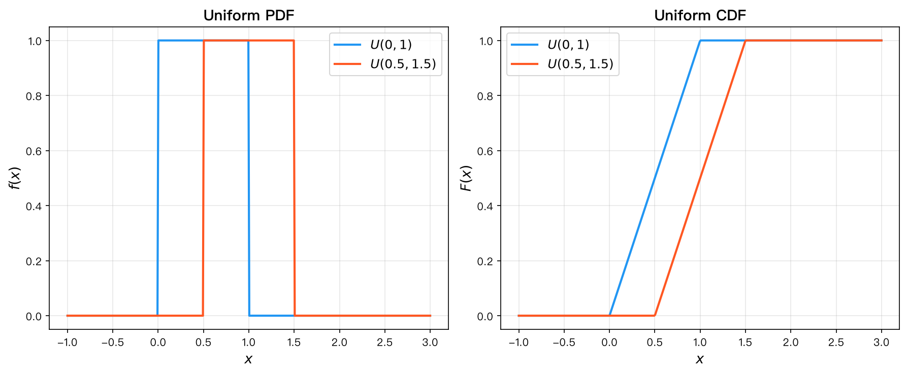

*该图展示了均匀分布的 PDF 与 CDF 图形。*

---

### 7. Exponential 分布

$$X \sim \text{Exp}(\lambda), \quad \lambda > 0$$

**概率密度函数：**

$$
\boxed{f(x) = \lambda e^{-\lambda x}, \quad x \geq 0}
$$

**从无记忆性推导：**

无记忆性定义为：

$$
P(X > s + t \mid X > s) = P(X > t), \quad \forall s, t \geq 0
$$

设 $S(t) = P(X > t)$，则：

$$
\frac{S(s+t)}{S(s)} = S(t) \quad \Longrightarrow \quad S(s+t) = S(s) S(t)
$$

这是经典的 Cauchy 函数方程。在 $S(t)$ 连续（或单调）的条件下，解为：

$$
S(t) = e^{-\lambda t}, \quad \lambda > 0
$$

因此：

- 生存函数：$P(X > t) = e^{-\lambda t}$
- CDF：$F(t) = P(X \leq t) = 1 - e^{-\lambda t}$
- PDF：$f(x) = F'(x) = \lambda e^{-\lambda x}, \; x \geq 0$

**验证归一化：**

$$
\int_{0}^{\infty} \lambda e^{-\lambda x} \, dx = \left[-e^{-\lambda x}\right]_{0}^{\infty} = 0 - (-1) = 1
$$

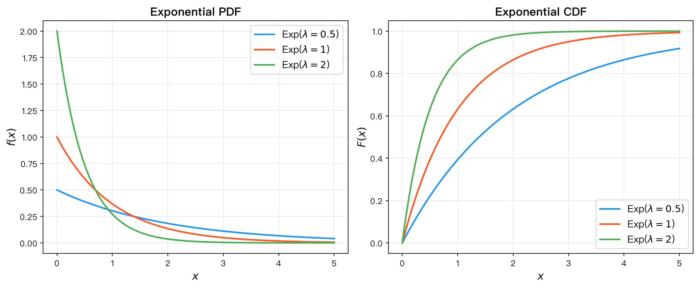

*该图展示了不同参数 $\lambda$ 下指数分布的 PDF 与 CDF 图形。*

---

### 8. Gamma 分布

$$X \sim \text{Gamma}(\alpha, \lambda), \quad \alpha > 0, \; \lambda > 0$$

**预备知识——Gamma 函数：**

$$
\Gamma(\alpha) = \int_{0}^{\infty} x^{\alpha-1} e^{-x} \, dx, \quad \alpha > 0
$$

重要性质：

- $\Gamma(\alpha+1) = \alpha \Gamma(\alpha)$（分部积分证明）
- 对正整数 $n$：$\Gamma(n) = (n-1)!$
- $\Gamma(1) = 1$
- $\Gamma\left(\frac{1}{2}\right) = \sqrt{\pi}$

**概率密度函数：**

$$
\boxed{f(x) = \frac{\lambda^{\alpha} x^{\alpha-1} e^{-\lambda x}}{\Gamma(\alpha)}, \quad x > 0}
$$

**验证归一化（变量代换）：**

令 $t = \lambda x$，则 $x = t/\lambda$，$dx = dt/\lambda$：

$$
\int_{0}^{\infty} \frac{\lambda^{\alpha} x^{\alpha-1} e^{-\lambda x}}{\Gamma(\alpha)} \, dx
= \frac{1}{\Gamma(\alpha)} \int_{0}^{\infty} \lambda^{\alpha} \left(\frac{t}{\lambda}\right)^{\alpha-1} e^{-t} \cdot \frac{dt}{\lambda}
= \frac{1}{\Gamma(\alpha)} \int_{0}^{\infty} t^{\alpha-1} e^{-t} \, dt
= \frac{\Gamma(\alpha)}{\Gamma(\alpha)} = 1
$$

**特例：** $\alpha = 1$ 时：

$$
f(x) = \frac{\lambda^{1} x^{0} e^{-\lambda x}}{\Gamma(1)} = \lambda e^{-\lambda x}
$$

退化为 $\text{Exp}(\lambda)$。

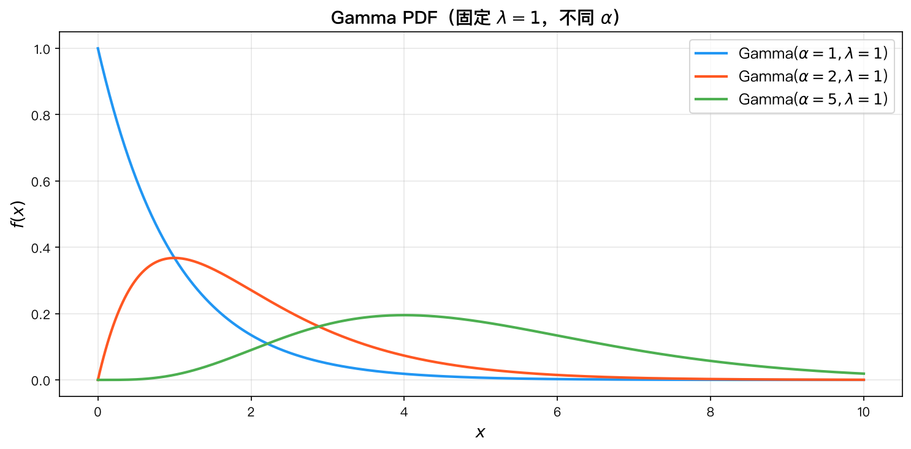

*该图展示了不同参数 $(\alpha, \lambda)$ 下 Gamma 分布的密度函数形态。*

---

### 9. Normal 分布（正态分布）

$$X \sim N(\mu, \sigma^2), \quad \mu \in \mathbb{R}, \; \sigma > 0$$

**概率密度函数：**

$$
\boxed{f(x) = \frac{1}{\sigma \sqrt{2\pi}} e^{-\frac{(x-\mu)^2}{2\sigma^2}}, \quad x \in \mathbb{R}}
$$

**标准正态分布：** $Z \sim N(0, 1)$

$$
\boxed{\varphi(z) = \frac{1}{\sqrt{2\pi}} e^{-\frac{z^2}{2}}, \quad z \in \mathbb{R}}
$$

**归一化证明（极坐标变换）：**

要证明 $\displaystyle \int_{-\infty}^{\infty} e^{-x^2/2} \, dx = \sqrt{2\pi}$，先计算平方：

$$
I = \int_{-\infty}^{\infty} e^{-x^2/2} \, dx
$$

$$
I^2 = \int_{-\infty}^{\infty} \int_{-\infty}^{\infty} e^{-(x^2 + y^2)/2} \, dx \, dy
$$

转换为极坐标 $(r, \theta)$，$x = r\cos\theta$，$y = r\sin\theta$，雅可比行列式为 $r$：

$$
I^2 = \int_{0}^{2\pi} \int_{0}^{\infty} e^{-r^2/2} \cdot r \, dr \, d\theta
= 2\pi \int_{0}^{\infty} r e^{-r^2/2} \, dr
$$

令 $u = r^2/2$，$du = r\,dr$：

$$
I^2 = 2\pi \int_{0}^{\infty} e^{-u} \, du = 2\pi \cdot 1 = 2\pi
$$

因此：

$$
I = \sqrt{2\pi} \quad \Longrightarrow \quad \int_{-\infty}^{\infty} \frac{1}{\sqrt{2\pi}} e^{-x^2/2} \, dx = 1
$$

**一般正态的归一化：** 令 $z = (x-\mu)/\sigma$，$dx = \sigma\,dz$：

$$
\int_{-\infty}^{\infty} \frac{1}{\sigma\sqrt{2\pi}} e^{-\frac{(x-\mu)^2}{2\sigma^2}} \, dx
= \int_{-\infty}^{\infty} \frac{1}{\sqrt{2\pi}} e^{-z^2/2} \, dz = 1
$$

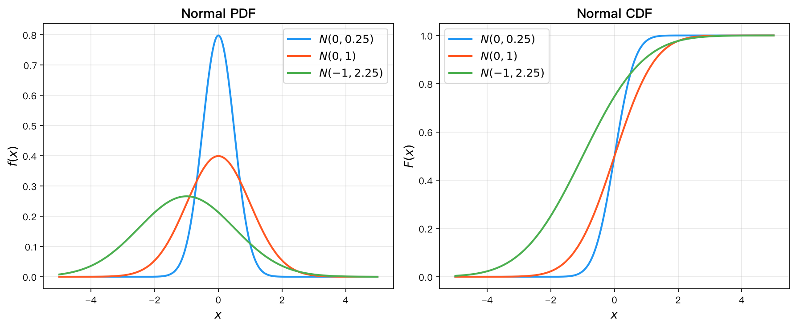

*该图展示了正态分布的 PDF 与 CDF 图形，以及参数 $\mu, \sigma$ 对曲线形态的影响。*

---

### 10. Beta 分布

$$X \sim \text{Beta}(\alpha, \beta), \quad \alpha > 0, \; \beta > 0$$

**预备知识——Beta 函数：**

$$
B(\alpha, \beta) = \int_{0}^{1} x^{\alpha-1} (1-x)^{\beta-1} \, dx
$$

Beta 函数与 Gamma 函数的关系：

$$
B(\alpha, \beta) = \frac{\Gamma(\alpha) \Gamma(\beta)}{\Gamma(\alpha + \beta)}
$$

**概率密度函数：**

$$
\boxed{f(x) = \frac{x^{\alpha-1} (1-x)^{\beta-1}}{B(\alpha, \beta)} = \frac{\Gamma(\alpha+\beta)}{\Gamma(\alpha)\Gamma(\beta)} x^{\alpha-1} (1-x)^{\beta-1}, \quad 0 < x < 1}
$$

**验证归一化：**

由 Beta 函数的定义直接可得：

$$
\int_{0}^{1} \frac{x^{\alpha-1} (1-x)^{\beta-1}}{B(\alpha, \beta)} \, dx = \frac{B(\alpha, \beta)}{B(\alpha, \beta)} = 1
$$

**特例：** $\alpha = \beta = 1$ 时，退化为 $U(0, 1)$：

$$
f(x) = \frac{x^{0} (1-x)^{0}}{B(1,1)} = \frac{1}{\Gamma(1)\Gamma(1)/\Gamma(2)} = \frac{1}{1 \cdot 1 / 1} = 1, \quad 0 < x < 1
$$

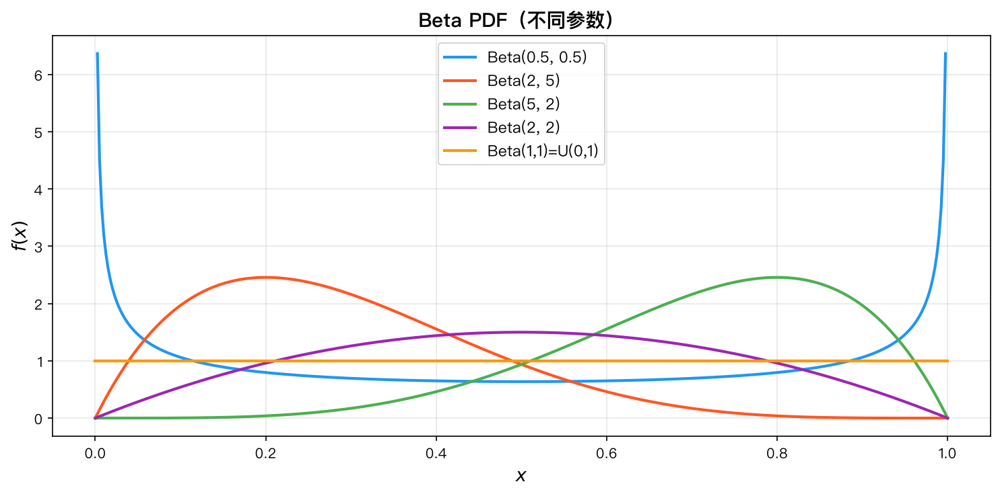

*该图展示了不同参数 $(\alpha, \beta)$ 下 Beta 分布的密度函数形态。*

---

## 三、分布之间的关系


*该图以谱系图形式展示了常见分布之间通过特例化或极限过程相互转化的关系。*

```mermaid
graph TD
    Bernoulli["Bernoulli(p)"] -->|"n次独立试验"| Binomial["Binomial(n, p)"]
    Binomial -->|"n→∞, p→0, λ=np 固定"| Poisson["Poisson(λ)"]
    Geometric["Geometric(p)"] -->|"r 次成功之和"| NegBin["Negative Binomial(r, p)"]
    Bernoulli -->|"首次成功"| Geometric
    Bernoulli -->|"r 次成功"| NegBin
    
    subgraph 连续型
    Exp["Exponential(λ)"] -->|"α=1"| Gamma["Gamma(α, λ)"]
    Gamma -->|"α = n/2, λ = 1/2"| ChiSq["χ²(n)"]
    End
    
    Normal["Normal(μ, σ²)"] -->|"μ=0, σ²=1"| StdNormal["Standard Normal N(0,1)"]
    Gamma -->|"α → ∞"| Normal
    Binomial -->|"n → ∞"| Normal
    
    Beta["Beta(α, β)"] -->|"α=β=1"| Uniform["Uniform(0, 1)"]
    Uniform -->|"一般化"| Beta
```

**关键关系总结：**

| 关系                              | 说明                                               |
| ------------------------------- | ------------------------------------------------ |
| Bernoulli $\to$ Binomial        | $n$ 次独立 Bernoulli 试验之和                           |
| Binomial $\to$ Poisson          | $n \to \infty$，$p \to 0$，$np = \lambda$ 固定（稀有事件） |
| Binomial $\to$ Normal           | $n \to \infty$，$p$ 固定（中心极限定理）                    |
| Geometric $\to$ NegBin          | $r$ 个独立 Geometric 变量之和                           |
| Exp(λ) $\to$ Gamma(1, λ)        | 指数分布是 Gamma 分布的特例                                |
| Gamma $\to$ χ²                  | $\chi^2(n) = \text{Gamma}(n/2, 1/2)$             |
| Gamma $\to$ Normal              | $\alpha \to \infty$ 时 Gamma 近似正态                 |
| Beta(1, 1) $\to$ U(0, 1)        | 均匀分布是 Beta 分布的特例                                 |
| Negative Binomial $\to$ Poisson | $r \to \infty$，$p \to 1$，$r(1-p) = \lambda$ 固定   |

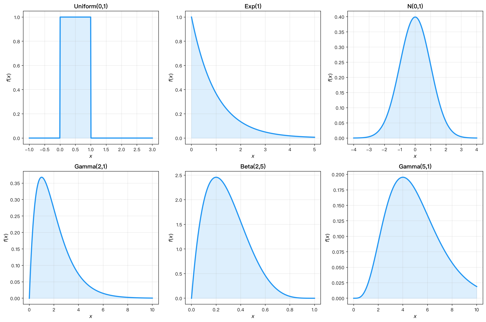

*该图总览对比了各连续型分布的密度函数形态，便于直观比较。*