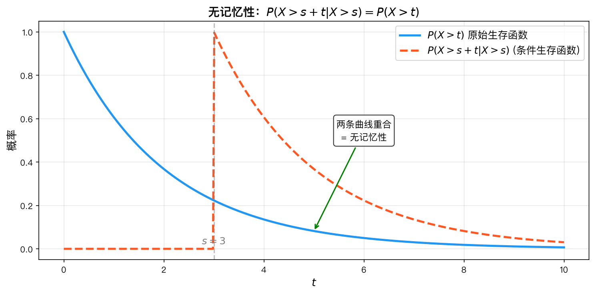

# 常见分布族知识讲解

> **本章目录**：为什么需要常见分布 | 分布族谱系 | 各分布的直观理解 | 无记忆性 | 总结对照表
>
> **承上启下**：上一章学习了随机变量的一般理论——PMF、PDF、CDF。但随机变量有无数种可能的分布，而现实世界中反复出现的随机现象往往可以用少数几种标准分布来建模。本章学习这些"基本词汇"。
>
> **带着问题学习**：
> 1. 抛10次硬币，恰好3次正面的概率怎么算？如果抛1000次呢？
> 2. 某网站每小时平均收到5封邮件，下一小时收到0封的概率是多少？
> 3. 灯泡的寿命分布有什么特点？"已经用了1000小时和新的差不多"这句话数学上怎么表达？

## 一、为什么需要常见分布

现实世界中的随机现象千变万化，但并非毫无规律。大量实际问题可以归结为少数几种标准概率模型：

- 抛硬币、产品质量检验 → **Bernoulli/Binomial**
- 客服电话到达数、放射性衰变 → **Poisson**
- 设备寿命、服务时间 → **Exponential/Gamma**
- 测量误差、考试成绩 → **Normal**

**常见分布是概率模型的"基本词汇"。** 掌握了它们，就可以用寥寥几个参数描述一个随机现象的完整概率特征，而不必每次都从最底层的概率空间重新推导。它们是统计推断、机器学习和工程建模的基石。

---

## 二、分布族谱系

### 2.1 离散型分布族

```
Bernoulli(p) ──n次独立试验──→ Binomial(n, p) ──n→∞, p→0──→ Poisson(λ)
     │
     ├── 首次成功 ──→ Geometric(p)
     └── r次成功  ──→ Negative Binomial(r, p)
```

- **Bernoulli** 是最基本的"原子"分布——单次试验。
- **Binomial** 是 Bernoulli 的**重复**——"抛 $n$ 次硬币，正面朝上的次数"。
- **Poisson** 是 Binomial 的**极限**——事件很罕见（$p \to 0$），但试验次数非常大（$n \to \infty$），使得平均发生次数 $\lambda = np$ 稳定。
- **Geometric** 是 Bernoulli 的**等待时间**——"首次成功需要多少次试验"。
- **Negative Binomial** 是 Geometric 的**推广**——"第 $r$ 次成功需要多少次试验"。

### 2.2 连续型分布族

```
Exponential(λ) ──α=1──→ Gamma(α, λ) ──α=n/2, λ=1/2──→ χ²(n)
     │                      │
     │                      └── α→∞ ──→ Normal
     └── 无记忆性 ──→ 唯一具有无记忆性的连续分布

Uniform(a, b) ──→ Beta(1,1) = U(0,1) ──一般化──→ Beta(α, β)
Normal(μ, σ²) ──标准化──→ N(0,1)
```

- **Exponential** 描述"两次事件之间的时间间隔"，**Gamma** 是 $r$ 个独立指数随机变量之和。
- **Normal** 是所有分布中最重要的——由中心极限定理（CLT）保证，大量独立随机变量之和趋近于正态分布。
- **Beta** 定义在 $[0,1]$ 上，常用于建模概率本身的分布。

### 2.3 正态分布的特殊地位

正态分布是概率论中最重要的分布，原因有三：

1. **中心极限定理**：无论原始数据服从什么分布（只要方差有限），样本均值在 $n$ 较大时近似服从正态分布。
2. **数学性质优良**：正态分布在线性变换下封闭，且与许多分布（如 $\chi^2$、$t$、$F$）有密切联系。
3. **自然现象普遍**：测量误差、身高体重、IQ 分数等大量自然和社会现象都近似服从正态分布。

---

## 三、各分布的直观理解

### 3.1 Bernoulli 分布——单次抛硬币

> **一次试验，两个结果：成功或失败。**

最简单的随机变量。$p$ 是成功的概率。例如：
- 抛一枚硬币：$p = 0.5$
- 检查一个产品是否为次品：$p =$ 次品率
- 用户是否点击广告：$p =$ 点击率


*Bernoulli 分布的 PMF：横轴为取值 0 和 1，纵轴为概率，不同 $p$ 值决定了分布的形状。*

### 3.2 Binomial 分布——抛 $n$ 次硬币

> **$n$ 次独立 Bernoulli 试验中成功的总次数。**

Binomial 序列由两个关键假设定义：
- **独立性**：每次试验的结果互不影响。
- **同分布**：每次成功的概率 $p$ 相同。

例如：抛 10 次硬币，正面朝上的次数 $X \sim B(10, 0.5)$。


*Binomial 分布的 PMF：$n$ 决定横轴范围，$p$ 决定分布的偏斜方向，$p=0.5$ 时对称。*

### 3.3 Poisson 分布——单位时间内稀有事件发生次数

> **适合描述"单位时间（或单位空间）内随机事件发生的次数"。**

Poisson 分布是"稀有事件"的极限模型。典型的应用场景：
- 一分钟内客服电话的到达数
- 一页书上的印刷错误数
- 一小时内某路口经过的车辆数
- 一段 DNA 序列中的突变数

**关键性质：** 均值等于方差，即 $E(X) = \text{Var}(X) = \lambda$。


*Poisson 分布的 PMF：$\lambda$ 越大，分布越向右移且越接近对称。*


*Poisson 逼近二项分布：当 $n$ 足够大、$p$ 足够小时，Binomial($n, p$) 的 PMF 与 Poisson($\lambda=np$) 几乎重合。*

### 3.4 Geometric 分布——首次成功等待时间

> **"第一次成功需要多少次试验？"**

每次试验成功概率为 $p$，Geometric 分布回答"首次成功出现在第几次试验"。

**直觉：** 成功概率 $p$ 越小，等待时间越长的可能性越大。例如：
- 掷骰子直到出现 6 点，所需次数 $X \sim \text{Geom}(1/6)$
- 连续射击直到命中目标


*Geometric 分布的 PMF：$p$ 越小，分布越分散，尾部拖得越长，等待时间的不确定性越大。*

### 3.5 Exponential 分布——两次事件的时间间隔

> **"下一个事件还要等多久？"**

指数分布是连续时间版本的无记忆几何分布。它刻画的是**无记忆的等待时间**——无论你已经等了多久，再等一会儿的概率不变。

典型应用：
- 设备从开始使用到首次故障的时间
- 两个相邻地震之间的时间间隔
- 电话通话的持续时间


*Exponential 分布的 PDF 和 CDF：PDF 呈单调递减，CDF 逐渐趋近于 1，$\lambda$ 越大曲线下降越快。*

### 3.6 Normal 分布——自然界中最常见的分布

> **"误差、测量、均值——一切都在向正态收敛。"**

正态分布之所以无处不在，是因为**中心极限定理**：大量独立同分布的随机变量之和（或均值）近似服从正态分布，无论原始分布是什么。

例如：
- 全班同学的身高分布
- 多次测量同一物体得到的误差分布
- 一个城市居民每天的消费金额

**标准正态分布 $N(0,1)$** 是所有正态分布的"母版"：任何正态变量 $X \sim N(\mu, \sigma^2)$ 都可以通过标准化 $Z = (X-\mu)/\sigma$ 转化为标准正态。


*Normal 分布的 PDF 和 CDF：PDF 呈钟形曲线，$\mu$ 决定中心位置，$\sigma$ 决定分布的宽窄。*

### 3.7 Gamma 分布——$r$ 个指数变量之和

> **"等待 $\alpha$ 个事件发生所需的总时间。"**

Gamma 分布是指数分布的推广：
- 当 $\alpha = 1$ 时，Gamma 退化为指数分布。
- 当 $\alpha = n$（整数）时，Gamma 是 $n$ 个独立指数变量之和，描述"第 $n$ 个事件发生的时刻"。

**例子：** 某银行柜台，每位顾客服务时间服从 Exp(λ)，则第 $r$ 位顾客离开的时刻服从 Gamma($r$, λ)。


*Gamma 分布的 PDF：$\alpha$ 控制形状（$\alpha=1$ 时退化为指数分布），$\lambda$ 控制尺度（速率）。*

### 3.8 Beta 分布——概率的概率分布

> **"不确定的概率本身服从什么分布？"**

Beta 分布定义在 $[0,1]$ 上，天然适合建模"概率"这个随机变量。它是 Binomial 的**共轭先验**——在贝叶斯统计中，用 Beta 先验结合 Binomial 数据，后验仍是 Beta 分布。

- $\alpha$ 和 $\beta$ 可以理解为"成功次数 $+1$"和"失败次数 $+1$"。
- $\alpha = \beta = 1$ 时，Beta 退化为 $U(0,1)$，即对概率没有任何先验偏见。


*Beta 分布的 PDF：定义在 $[0,1]$ 上，$\alpha$ 和 $\beta$ 控制分布的形状，可呈对称、左偏或右偏。*

---

## 四、无记忆性

### 4.1 定义

一个随机变量 $X$ 具有无记忆性，当且仅当：

$$
P(X > s + t \mid X > s) = P(X > t), \quad \forall s, t \geq 0
$$

### 4.2 直观理解

**"已经等了多久，不影响还要等多久。"**

- 一台机器已经用了 $s$ 小时没有坏，它再撑 $t$ 小时的概率，和新机器撑 $t$ 小时的概率一样。
- 你已经等了 10 分钟公交车，再等 5 分钟的概率，和刚到站的人等 5 分钟的概率一样。

### 4.3 唯一性

**定理：** 在连续型分布中，**只有指数分布**具有无记忆性；在离散型分布中，**只有几何分布**具有无记忆性。

### 4.4 数学推导

对于连续型分布，设 $S(t) = P(X > t)$，无记忆性给出：

$$
\frac{S(s+t)}{S(s)} = S(t) \quad \Longrightarrow \quad S(s+t) = S(s)S(t)
$$

该函数方程的解为 $S(t) = e^{-\lambda t}$，从而 $F(t) = 1 - e^{-\lambda t}$，$f(t) = \lambda e^{-\lambda t}$。

### 4.5 为什么无记忆性很重要？

- 它简化了计算——"剩余寿命"的分布与"原始寿命"的分布相同。
- 它是**马尔可夫性**（Markov property）的连续版本——未来只依赖于当前状态，与过去历史无关。
- 在排队论、可靠性工程中，无记忆性假设使得模型可解且结果简洁。


*无记忆性示意图：无论已经等待了多久，剩余等待时间的分布与原始分布相同，即"已用时间不影响剩余寿命"。*

---

## 五、总结对照表

| 分布            | 类型  | 参数                | 支撑集               | 核心特征      | 典型场景  |
| ------------- | --- | ----------------- | ----------------- | --------- | ----- |
| Bernoulli     | 离散  | $p$               | $\{0,1\}$         | 单次试验      | 抛硬币   |
| Binomial      | 离散  | $n, p$            | $\{0,\dots,n\}$   | 多次试验之和    | 质检    |
| Poisson       | 离散  | $\lambda$         | $\{0,1,\dots\}$   | 均值=方差     | 事件计数  |
| Geometric     | 离散  | $p$               | $\{1,2,\dots\}$   | 无记忆性（离散）  | 首次成功  |
| Neg. Binomial | 离散  | $r, p$            | $\{r,r+1,\dots\}$ | 第 $r$ 次成功 | 批量试验  |
| Uniform       | 连续  | $a, b$            | $[a,b]$           | 等可能       | 随机数   |
| Exponential   | 连续  | $\lambda$         | $[0,\infty)$      | 无记忆性（连续）  | 寿命/等待 |
| Gamma         | 连续  | $\alpha, \lambda$ | $(0,\infty)$      | 指数之和      | 总等待时间 |
| Normal        | 连续  | $\mu, \sigma^2$   | $\mathbb{R}$      | 中心极限定理    | 测量误差  |
| Beta          | 连续  | $\alpha, \beta$   | $(0,1)$           | 概率的分布     | 贝叶斯先验 |

---


*连续分布对比总览：将各连续分布的 PDF 在同一坐标系下展示，便于直观比较形状、支撑集和参数影响。*


*分布关系谱系图：清晰地展示了 Bernoulli → Binomial → Poisson、Exponential → Gamma → Normal 等分布之间的演进与联系。*

---

## 本章应掌握的内容

学完本章后，你应该能回答以下问题：

1. 你能说出Bernoulli、Binomial、Poisson分布各自的适用场景吗？
2. 你知道Poisson分布是二项分布什么条件下的极限吗？
3. 你能解释指数分布的"无记忆性"是什么意思吗？
4. 你知道正态分布PDF中的参数μ和σ²分别代表什么吗？
5. 你能说出Gamma分布和指数分布的关系吗？
6. 你能画出一个简单的"分布关系谱系图"吗？