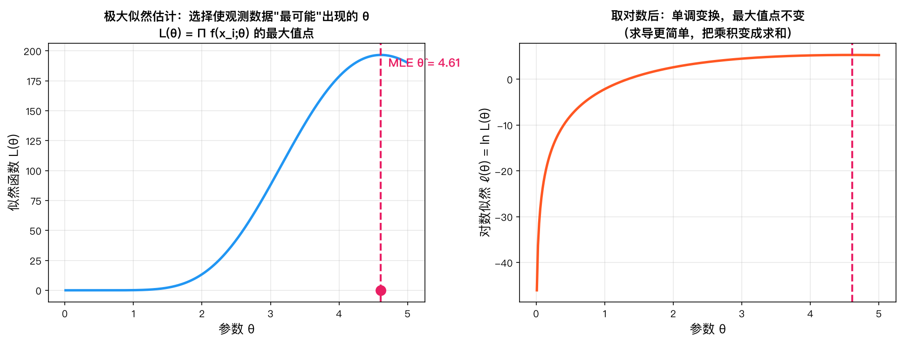
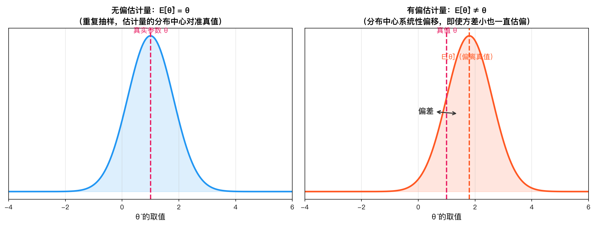
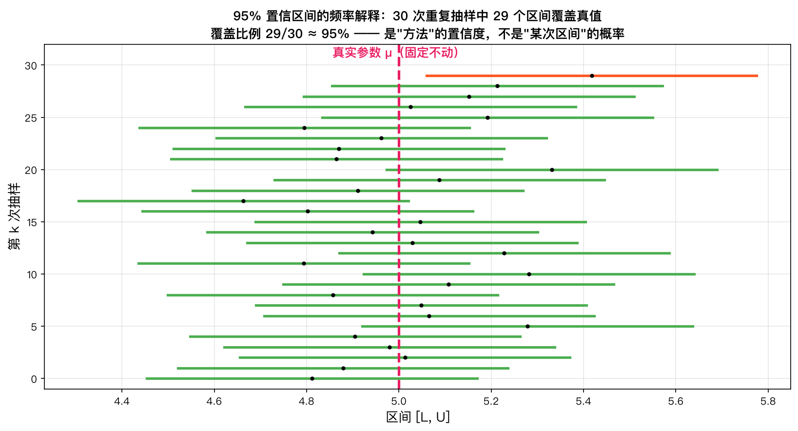

# 第10章 参数估计 — 知识讲解

---

> **本章导读**
> 
> - 矩估计与极大似然估计（MLE）
> - 估计量的评价标准（无偏性、有效性、一致性）
> - 置信区间的构造与理解
> 
> **回顾与前瞻**：上一章学习了抽样分布——知道了统计量（如 $\bar{X}$, $S^2$）服从什么分布。但统计量的价值在于用它来"估计"总体参数。本章进入参数估计：如何用样本数据"猜"出总体参数的值，以及这个猜测有多可靠。
> 
> **带着这些问题学习本章：**
> 1. 已知某校学生的平均身高未知，随机测量100人得到 $\bar{X}=172\text{cm}$，全校真实平均身高是多少？怎么"猜"才合理？
> 2. "极大似然估计"中的"似然"是什么意思？为什么要选使数据出现概率最大的参数？
> 3. 为什么天气预报说"明天降水概率30%"，而不是"明天降水概率是30%或32%"？——这就是点估计和区间估计的区别。
> 
> ---

## 1. 为什么需要估计？

### 1.1 问题背景

在现实世界中，我们很少能直接知道总体的真实参数。例如：

- 某城市居民的平均收入 $\mu$ 是多少？
- 某批电子元件的寿命方差 $\sigma^2$ 有多大？
- 某药品的有效率 $p$ 是多少？

这些参数是客观存在的，但通常是**未知的**。我们不可能调查所有居民、测试所有元件、给所有患者用药——这既不经济也不现实。

### 1.2 解决方案

我们能做的，是从总体中抽取一个**样本**，然后利用样本数据来"猜测"总体参数。这就是**参数估计**要解决的问题。

### 1.3 两种估计方式

- **点估计**：用一个具体的数值来估计参数。例如"平均收入约为 8500 元"。
- **区间估计**：给出一个区间，声称参数以一定概率落在这个区间内。例如"平均收入在 8200 到 8800 元之间，置信水平 95%"。

区间估计比点估计多提供了一层**可靠性**的信息——它告诉我们这个估计有多可信。

---

## 2. 矩估计的思想

### 2.1 为什么可以这样估计？

矩估计的出发点是直观的：

> 样本来自总体，因此样本的特征应该与总体的特征相似。

"矩"是分布的重要数字特征。一阶矩（均值）描述位置，二阶矩描述分散程度，三阶矩描述偏斜程度，等等。如果样本矩和总体矩相差很大，那这个样本就不太可能来自这个总体。

### 2.2 怎么做——具体步骤

矩估计的流程可以用三步概括：

| 步骤 | 操作 | 数学表达 |
|------|------|----------|
| ① 计算总体矩 | 用参数表示 $E[X^k]$ | $E[X] = \mu$，$E[X^2] = \mu^2 + \sigma^2$ |
| ② 计算样本矩 | 直接计算样本数据的 $k$ 阶矩 | $\hat{\mu}_1 = \bar{X}$，$\hat{\mu}_2 = \frac{1}{n}\sum X_i^2$ |
| ③ 令相等，解参数 | 建立方程，解出未知参数 | $\mu = \bar{X}$，$\mu^2+\sigma^2 = \frac{1}{n}\sum X_i^2$ |

**关键点**：有多少个未知参数，就需要列多少个方程。

### 2.3 矩估计的本质是什么

矩估计的实质是：**用样本的经验分布去逼近总体的真实分布**。样本矩是总体矩的相合估计（由大数定律保证），所以令它们相等是合理的。

### 2.4 矩估计的优缺点

| 优点 | 缺点 |
|------|------|
| 计算简单，通常不需要复杂的数值计算 | 有时会得到不合理的估计（如方差为负） |
| 不需要知道分布的具体形式，只需知道矩 | 估计量可能不是最有效的（方差较大） |
| 大样本下具有一致性 | 对分布参数的估计有时不够精确 |

---

## 3. 极大似然估计（MLE）的思想

### 3.1 为什么——核心直觉

先思考一个简单例子：

> 一个袋子里有红球和白球，比例未知。你随机摸出 10 个球，发现 8 个是红球。那么你会猜测红球比例是多少？

直觉上，你会猜 $p = 0.8$。为什么？因为如果 $p=0.8$，那么摸出"8 红 2 白"的概率最大。这就是极大似然估计的核心思想：

> **在一次试验中，已经发生的事件应该具有最大的概率。**

换句话说，我们选择参数 $\theta$，使得在当前观测数据下，似然函数 $L(\theta)$ 达到最大。

*似然函数曲线在参数 $\hat{\theta}$ 处达到最大值，对应的参数值即为极大似然估计（MLE）。*

### 3.2 怎么做——MLE 的求解步骤

**步骤 1：写出似然函数**

对于连续型总体，联合概率密度为：
$$
L(\theta) = \prod_{i=1}^{n} f(x_i; \theta)
$$

对于离散型总体，联合概率为：
$$
L(\theta) = \prod_{i=1}^{n} p(x_i; \theta)
$$

**步骤 2：取对数，得到对数似然函数**

$$
\ell(\theta) = \ln L(\theta) = \sum_{i=1}^{n} \ln f(x_i; \theta)
$$

为什么取对数？因为：
- 将乘积变成求和，简化求导运算
- 对数函数是单调递增的，最大化 $L(\theta)$ 等价于最大化 $\ell(\theta)$

**步骤 3：对 $\theta$ 求导，令导数为 0**

$$
\frac{\partial \ell(\theta)}{\partial \theta} = 0
$$

**步骤 4：解方程，检查二阶导数确认是最大值**

**注意**：并非所有情形都通过解似然方程得到 MLE。当似然函数在参数边界处取得最大值时（如 $U(0,\theta)$ 的 MLE），需要通过**单调性分析**来确定。

### 3.3 MLE 的本质是什么

MLE 的本质是**在参数空间中搜索，使得观测数据出现的概率最大的那个参数值**。

从贝叶斯角度看，MLE 等价于在**均匀先验**下的最大后验估计（MAP）。从信息论角度看，MLE 等价于最小化 KL 散度（模型分布与经验分布之间的差异）。

### 3.4 MLE 的优良性质

MLE 是参数估计中最常用的方法，因为它具有一系列优良的**大样本性质**：

1. **渐近无偏**：$E[\hat{\theta}_{\text{MLE}}] \to \theta$ 当 $n \to \infty$
2. **渐近有效**：在大样本下，MLE 的方差达到 Cramér-Rao 下界
3. **一致性**：$\hat{\theta}_{\text{MLE}} \xrightarrow{P} \theta$
4. **不变性**：若 $\hat{\theta}$ 是 $\theta$ 的 MLE，则 $g(\hat{\theta})$ 也是 $g(\theta)$ 的 MLE

**不变性的证明**：设 $\eta = g(\theta)$，则似然函数可写为 $L(\theta) = L(g^{-1}(\eta))$。使 $L(\theta)$ 最大的 $\hat{\theta}$ 对应的 $\hat{\eta} = g(\hat{\theta})$ 必然使 $L(g^{-1}(\eta))$ 最大。因此 $\hat{\eta} = g(\hat{\theta})$ 是 $\eta$ 的 MLE。

---

## 4. 矩估计 vs MLE

### 4.1 对比

| 对比维度 | 矩估计 | MLE |
|---------|--------|-----|
| **计算难度** | 简单，只需解方程 | 较复杂，可能需要数值优化 |
| **小样本性质** | 可能不太好 | 通常较好 |
| **大样本性质** | 一致性 | 一致性 + 渐近有效性 |
| **需要的信息** | 只需矩的信息 | 需要完整的分布形式 |
| **正态分布结果** | $\hat{\mu}=\bar{X},\hat{\sigma}^2=\frac{1}{n}\sum(X_i-\bar{X})^2$ | 完全相同 |
| **不变性** | 不具有不变性 | 具有不变性 |

### 4.2 何时用哪个？

- 如果分布形式已知且计算可行，**优先选择 MLE**
- 如果分布形式复杂，或者只需要粗略估计，**矩估计更方便**
- 在正态分布中，两者给出相同结果

---

## 5. 为什么用无偏性？

### 5.1 无偏性的意义

无偏性意味着：**如果反复抽样多次，每次用 $\hat{\theta}$ 估计 $\theta$，这些估计值的平均值正好等于 $\theta$。**

换句话说，无偏估计没有系统性偏差——它不会倾向于高估或低估参数。

*无偏估计的长期平均恰好等于真实参数，有偏估计则存在系统性偏差，会倾向于高估或低估真值。*

### 5.2 无偏性不是万能的

考虑一个极端例子：对于 $N(\mu, \sigma^2)$ 的方差 $\sigma^2$，估计量 $\hat{\sigma}^2 = 0$ 在 $\sigma^2=0$ 时是无偏的，但显然这是个糟糕的估计——它完全忽略了数据。

无偏性关注的是**长期平均表现**，但单次估计的精度由方差决定。所以评价一个估计量需要同时考虑**无偏性**和**有效性**。

### 5.3 为什么 MLE 的方差估计是有偏的？

MLE 的 $\hat{\sigma}^2 = \frac{1}{n}\sum (X_i - \bar{X})^2$ 有偏，原因是：

$$
E[\hat{\sigma}^2] = \frac{n-1}{n}\sigma^2 < \sigma^2
$$

它系统性**低估**了方差。这是因为我们用 $\bar{X}$ 代替了 $\mu$，而 $\bar{X}$ 本身会"靠近"样本数据，使得 $(X_i - \bar{X})^2$ 平均上比 $(X_i - \mu)^2$ 小一点。

**修正**：将分母从 $n$ 改为 $n-1$，得到 $S^2 = \frac{1}{n-1}\sum (X_i - \bar{X})^2$，这就是无偏的样本方差。

### 5.4 偏差随样本量变化

$$
\text{Bias}(\hat{\sigma}^2_{\text{MLE}}) = -\frac{\sigma^2}{n}
$$

当 $n=10$ 时，偏差为 $-0.1\sigma^2$（约 10% 的低估）；当 $n=100$ 时，偏差为 $-0.01\sigma^2$（仅 1%）。所以大样本下偏差可以忽略——这就是**渐近无偏**。

---

## 6. 置信区间的理解

### 6.1 一个常见的误解

很多初学者会这样理解置信区间：

> "μ 有 95% 的概率落在区间 [10.2, 11.4] 内。"

**这是错误的。**

为什么？因为 $\mu$ 是常数（虽然未知），不是随机变量。一个常数要么在区间内，要么不在，不存在"概率"的概念。

### 6.2 正确的理解

置信区间的正确理解是：

> 如果重复抽样很多次（每次样本量相同），每次构造一个置信区间，那么大约有 $95\%$ 的区间会包含真正的 $\mu$。

换句话说，**置信水平是对构造方法的可靠性声明，而不是对特定区间的概率声明**。

可以用一个比喻来理解：

> 置信区间就像捕鱼网。如果一张网有 95% 的概率捕到鱼，并不意味着某一次撒网后，鱼有 95% 的概率在网里——鱼要么在网里，要么不在。而是说，如果撒很多次网，大约 95% 的网能捕到鱼。

*重复抽样构造的众多置信区间中，约有 $1-\alpha$ 比例的区间覆盖真实参数，而非单个区间以 $1-\alpha$ 的概率包含 $\mu$。*

### 6.3 置信区间的构造思路

构造置信区间的一般步骤：

1. **找一个枢轴量**：一个同时包含样本和待估参数、且分布已知的统计量
2. **写出概率等式**：利用枢轴量的分布，写出一个概率为 $1-\alpha$ 的区间
3. **反解出参数**：将不等式变形，使参数在中间，统计量在两端

**示例**（$\sigma^2$ 已知时 $\mu$ 的置信区间）：

- 枢轴量：$Z = \frac{\bar{X} - \mu}{\sigma/\sqrt{n}} \sim N(0,1)$
- 概率等式：$P(-z_{\alpha/2} \le Z \le z_{\alpha/2}) = 1-\alpha$
- 反解：$P(\bar{X} - z_{\alpha/2}\frac{\sigma}{\sqrt{n}} \le \mu \le \bar{X} + z_{\alpha/2}\frac{\sigma}{\sqrt{n}}) = 1-\alpha$

---

## 7. 如何选择置信水平？

### 7.1 常用的置信水平

| 置信水平 $1-\alpha$ | $\alpha$ | $z_{\alpha/2}$ |
| --------------- | -------- | -------------- |
| 90%             | 0.10     | 1.645          |
| 95%             | 0.05     | 1.960          |
| 99%             | 0.01     | 2.576          |

### 7.2 精度 vs 可靠性的权衡

置信水平越高（如 99%），区间越宽，**可靠性**越高——但估计的**精度**越低（区间太宽没有实际意义）。

置信水平越低（如 90%），区间越窄，精度越高——但可靠性降低，区间更容易"漏掉"真值。

**如何选择？**

- **探索性研究**：可用 90%，区间较窄，便于发现规律
- **常规科学研究**：95% 是标准做法
- **高 stakes 决策**（如药物审批、质量控制）：用 99% 甚至更高

### 7.3 影响区间宽度的因素

置信区间的宽度受三个因素影响：

1. **样本量 $n$**：$n$ 越大，区间越窄（宽度 $\propto 1/\sqrt{n}$）
2. **数据变异 $\sigma$ 或 $S$**：变异越大，区间越宽
3. **置信水平 $1-\alpha$**：置信水平越高，区间越宽

---

## 8. 总结

| 概念       | 一句话总结            |
| -------- | ---------------- |
| **点估计**  | 用一个数值估计参数        |
| **矩估计**  | 令样本矩等于总体矩，解出参数   |
| **MLE**  | 选择使当前数据出现概率最大的参数 |
| **无偏性**  | 长期平均等于真值         |
| **有效性**  | 无偏估计中方差越小越好      |
| **一致性**  | 样本量越大，估计越准       |
| **置信区间** | 给出一个区间，附带可靠程度    |

---

## 本章应掌握的内容

学完本章后，你应该能回答以下问题：

1. 你能说出矩估计法的基本原理和步骤吗？
2. 你能用MLE求解常见分布（Bernoulli、正态、指数）的参数吗？
3. 你能解释无偏性、有效性、一致性各自的含义吗？
4. 你能证明样本方差 $S^2$ 是总体方差 $\sigma^2$ 的无偏估计吗？
5. 你能构造正态总体均值的置信区间吗（$\sigma$ 已知和 $\sigma$ 未知两种情况）？
6. 你能构造正态总体方差的置信区间吗？
7. 你能解释"置信区间"的正确含义吗？（不是"$\mu$ 有95%的概率落在区间内"）