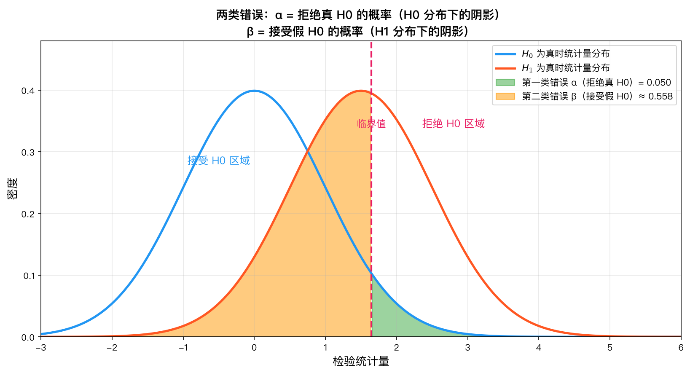
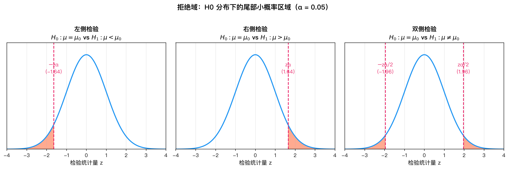
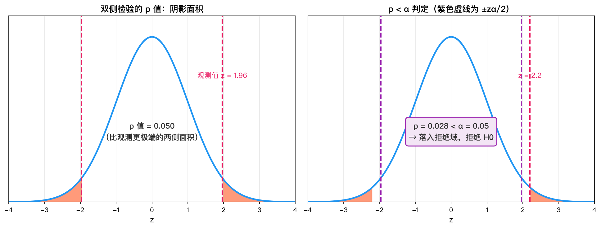

# 第11章 假设检验 — 公式推导

---

## 1. 假设检验的基本概念

### 1.1 原假设与备择假设

**原假设（Null Hypothesis）** $H_0$：通常表述为"无差异"或"参数等于某个特定值"，是我们希望找到证据反对的命题。

**备择假设（Alternative Hypothesis）** $H_1$（或 $H_a$）：与原假设对立的命题，是研究者希望证明的结论。

**双侧检验：**
$$
H_0: \mu = \mu_0 \quad \text{vs} \quad H_1: \mu \neq \mu_0
$$

**单侧检验（右侧）：**
$$
H_0: \mu \leq \mu_0 \quad \text{vs} \quad H_1: \mu > \mu_0
$$

**单侧检验（左侧）：**
$$
H_0: \mu \geq \mu_0 \quad \text{vs} \quad H_1: \mu < \mu_0
$$

> **为什么有时用单侧，有时用双侧？**  
> 这取决于研究问题。如果新药不可能比安慰剂更差，则用单侧；如果只是想知道是否有差异（无论方向），则用双侧。

### 1.2 检验统计量与拒绝域

**检验统计量（Test Statistic）**：一个由样本数据计算出的统计量，其分布在 $H_0$ 成立下是已知的。通过它来判断是否拒绝 $H_0$。

**拒绝域（Rejection Region）**：使检验统计量落在其中就拒绝 $H_0$ 的样本空间区域。拒绝域的边界称为**临界值（Critical Value）**。

**接受域（Acceptance Region）**：拒绝域的补集，即不拒绝 $H_0$ 的区域。

---

## 2. 两类错误与检验功效

### 2.1 定义

|  决策\真实状态  |       $H_0$ 为真        |       $H_0$ 为假       |
| :-------: | :-------------------: | :------------------: |
| 不拒绝 $H_0$ | ✅ 正确决策（概率 $1-\alpha$） | ❌ 第二类错误（概率 $\beta$）  |
| 拒绝 $H_0$  | ❌ 第一类错误（概率 $\alpha$）  | ✅ 正确决策（概率 $1-\beta$） |

**第一类错误（Type I Error）**：弃真错误，即 $H_0$ 为真时拒绝了 $H_0$。

$$
\alpha = P(\text{拒绝 }H_0 \mid H_0\text{ 为真})
$$

$\alpha$ 称为**显著性水平（Significance Level）**，通常取 0.05 或 0.01。

**第二类错误（Type II Error）**：纳伪错误，即 $H_0$ 为假时接受了 $H_0$。

$$
\beta = P(\text{不拒绝 }H_0 \mid H_0\text{ 为假})
$$

**检验功效（Power）**：正确拒绝 $H_0$ 的概率。

$$
\text{Power} = 1 - \beta = P(\text{拒绝 }H_0 \mid H_0\text{ 为假})
$$

### 2.2 两类错误的关系：以 z 检验为例推导

考虑一个右侧检验：
$$
H_0: \mu = \mu_0 \quad \text{vs} \quad H_1: \mu > \mu_0
$$

已知 $\sigma$，样本量 $n$，显著性水平 $\alpha$。

**第一步：确定拒绝域**

在 $H_0$ 下，检验统计量 $Z = \frac{\bar{X} - \mu_0}{\sigma / \sqrt{n}} \sim N(0,1)$。

拒绝域为：
$$
Z \geq z_\alpha \quad \Leftrightarrow \quad \bar{X} \geq \mu_0 + z_\alpha \frac{\sigma}{\sqrt{n}}
$$

记临界值 $c = \mu_0 + z_\alpha \frac{\sigma}{\sqrt{n}}$。

**第二步：计算 $\beta$**

假设真实均值为 $\mu_1 > \mu_0$，在 $\mu = \mu_1$ 下：
$$
\bar{X} \sim N\left(\mu_1, \frac{\sigma^2}{n}\right)
$$

$\beta$ 是当 $H_0$ 为假（即 $\mu = \mu_1$）时，样本均值 $\bar{X}$ 落在接受域（即 $\bar{X} < c$）的概率：
$$
\begin{aligned}
\beta &= P(\bar{X} < c \mid \mu = \mu_1) \\
&= P\left(\frac{\bar{X} - \mu_1}{\sigma / \sqrt{n}} < \frac{c - \mu_1}{\sigma / \sqrt{n}} \mid \mu = \mu_1\right) \\
&= \Phi\left(\frac{c - \mu_1}{\sigma / \sqrt{n}}\right)
\end{aligned}
$$

其中 $c = \mu_0 + z_\alpha \frac{\sigma}{\sqrt{n}}$，代入得：
$$
\beta = \Phi\left(\frac{\mu_0 - \mu_1}{\sigma / \sqrt{n}} + z_\alpha\right)
$$

**第三步：分析 $\alpha$ 与 $\beta$ 的关系**

从公式可以看出：
- $\alpha$ 越小 → $z_\alpha$ 越大 → $c$ 越大 → $\beta$ 越大
- 样本量 $n$ 越大 → $\frac{\sigma}{\sqrt{n}}$ 越小 → $\beta$ 越小
- $\mu_1$ 与 $\mu_0$ 差距越大 → $\beta$ 越小

**结论：在样本量固定时，$\alpha$ 和 $\beta$ 此消彼长，无法同时减小。**

> **为什么通常控制 $\alpha$ 而非 $\beta$？**  
> 第一类错误相当于"冤枉好人"，在科学研究的伦理上更为严重。我们通常设定一个较小的 $\alpha$（如 0.05），确保不轻易冤枉 $H_0$。

*当 $H_0$ 为真时误拒绝即第一类错误（$\alpha$），当 $H_0$ 为假时误接受即第二类错误（$\beta$），二者此消彼长。*

---

## 3. 正态总体均值的检验

### 3.1 z 检验（$\sigma^2$ 已知）

**问题：** $X_1, X_2, \dots, X_n \overset{\text{i.i.d.}}{\sim} N(\mu, \sigma^2)$，$\sigma^2$ 已知，检验 $H_0: \mu = \mu_0$ vs $H_1: \mu \neq \mu_0$。

**推导过程：**

在 $H_0$ 成立的条件下，$\mu = \mu_0$，样本均值 $\bar{X}$ 的分布为：
$$
\bar{X} \sim N\left(\mu_0, \frac{\sigma^2}{n}\right)
$$

这是因为：
- $E[\bar{X}] = \frac{1}{n}\sum_{i=1}^n E[X_i] = \frac{1}{n} \cdot n\mu_0 = \mu_0$
- $Var(\bar{X}) = \frac{1}{n^2}\sum_{i=1}^n Var(X_i) = \frac{1}{n^2} \cdot n\sigma^2 = \frac{\sigma^2}{n}$
- 正态分布的线性组合仍为正态分布

对 $\bar{X}$ 进行标准化：
$$
Z = \frac{\bar{X} - \mu_0}{\sigma / \sqrt{n}} \sim N(0, 1)
$$

**双侧检验的拒绝域：**

我们要控制 $P(\text{拒绝 }H_0 \mid H_0\text{ 为真}) = \alpha$。

对于双侧检验，拒绝域在两侧各占 $\alpha/2$：
$$
P(|Z| \geq z_{\alpha/2}) = \alpha
$$

即：
$$
P(Z \leq -z_{\alpha/2}) = \frac{\alpha}{2}, \quad P(Z \geq z_{\alpha/2}) = \frac{\alpha}{2}
$$

其中 $z_{\alpha/2}$ 是标准正态分布的 $\alpha/2$ 上侧分位数，满足 $\Phi(z_{\alpha/2}) = 1 - \alpha/2$。

因此拒绝域为：
$$
|Z| \geq z_{\alpha/2}
$$

$$
\boxed{Z = \frac{\bar{X} - \mu_0}{\sigma / \sqrt{n}}, \quad \text{拒绝域：}|Z| \geq z_{\alpha/2}}
$$

**单侧检验（右侧）的拒绝域：**

$H_1: \mu > \mu_0$，只关心 $\bar{X}$ 显著大于 $\mu_0$ 的情况：
$$
P(Z \geq z_\alpha) = \alpha
$$

拒绝域为：
$$
Z \geq z_\alpha
$$

$$
\boxed{Z \geq z_\alpha}
$$

**单侧检验（左侧）的拒绝域：**

$H_1: \mu < \mu_0$，只关心 $\bar{X}$ 显著小于 $\mu_0$ 的情况：
$$
P(Z \leq -z_\alpha) = \alpha
$$

拒绝域为：
$$
Z \leq -z_\alpha
$$

$$
\boxed{Z \leq -z_\alpha}
$$

*双侧检验的拒绝域分布在分布两侧各占 $\alpha/2$，单侧检验的拒绝域集中在分布一侧占 $\alpha$。*

### 3.2 t 检验（$\sigma^2$ 未知）

**问题：** $X_1, X_2, \dots, X_n \overset{\text{i.i.d.}}{\sim} N(\mu, \sigma^2)$，$\sigma^2$ **未知**，检验 $H_0: \mu = \mu_0$ vs $H_1: \mu \neq \mu_0$。

**推导过程：**

当 $\sigma^2$ 未知时，我们无法直接使用 $Z = \frac{\bar{X} - \mu_0}{\sigma / \sqrt{n}}$，因为 $\sigma$ 未知。

一个自然的思路是用样本标准差 $S$ 代替 $\sigma$：
$$
S^2 = \frac{1}{n-1}\sum_{i=1}^n (X_i - \bar{X})^2
$$

**由抽样分布定理可知：**

在 $H_0$ 成立的条件下（$\mu = \mu_0$）：

1. $\bar{X} \sim N(\mu_0, \frac{\sigma^2}{n})$
2. $\frac{(n-1)S^2}{\sigma^2} \sim \chi^2(n-1)$
3. $\bar{X}$ 与 $S^2$ 相互独立

因此：
$$
T = \frac{\bar{X} - \mu_0}{S / \sqrt{n}} = \frac{\frac{\bar{X} - \mu_0}{\sigma / \sqrt{n}}}{\sqrt{\frac{(n-1)S^2}{\sigma^2} / (n-1)}} \sim t(n-1)
$$

**具体推导：**

分子：$Z = \frac{\bar{X} - \mu_0}{\sigma / \sqrt{n}} \sim N(0,1)$

分母：$V = \frac{(n-1)S^2}{\sigma^2} \sim \chi^2(n-1)$

由 t 分布的定义：
$$
T = \frac{Z}{\sqrt{V/(n-1)}} = \frac{\frac{\bar{X} - \mu_0}{\sigma / \sqrt{n}}}{\sqrt{\frac{(n-1)S^2}{\sigma^2} / (n-1)}} = \frac{\bar{X} - \mu_0}{S / \sqrt{n}} \sim t(n-1)
$$

**双侧检验的拒绝域：**
$$
|T| \geq t_{\alpha/2}(n-1)
$$

其中 $t_{\alpha/2}(n-1)$ 是自由度为 $n-1$ 的 t 分布的 $\alpha/2$ 上侧分位数。

$$
\boxed{T = \frac{\bar{X} - \mu_0}{S / \sqrt{n}} \sim t(n-1), \quad \text{拒绝域：}|T| \geq t_{\alpha/2}(n-1)}
$$

**单侧检验：**

- 右侧 $H_1: \mu > \mu_0$：拒绝域 $T \geq t_\alpha(n-1)$
- 左侧 $H_1: \mu < \mu_0$：拒绝域 $T \leq -t_\alpha(n-1)$

> **t 分布与正态分布的关系：** 当 $n \to \infty$ 时，$t(n-1) \to N(0,1)$。因此当样本量很大时，t 检验与 z 检验结果相近。但在小样本时，t 分布尾部更厚，需要更大的临界值，体现了"不确定性更大"这一事实。

---

## 4. 正态总体方差的检验（$\chi^2$ 检验）

**问题：** $X_1, X_2, \dots, X_n \overset{\text{i.i.d.}}{\sim} N(\mu, \sigma^2)$，检验 $H_0: \sigma^2 = \sigma_0^2$ vs $H_1: \sigma^2 \neq \sigma_0^2$。

**推导过程：**

在 $H_0$ 成立的条件下，$\sigma^2 = \sigma_0^2$。

由抽样分布定理，样本方差 $S^2$ 满足：
$$
\frac{(n-1)S^2}{\sigma_0^2} \sim \chi^2(n-1)
$$

**证明思路：**

设 $X_i \sim N(\mu, \sigma_0^2)$，则：
$$
\frac{X_i - \mu}{\sigma_0} \sim N(0,1)
$$

由卡方分布的定义，$\sum_{i=1}^n \left(\frac{X_i - \mu}{\sigma_0}\right)^2 \sim \chi^2(n)$。

但 $\mu$ 未知，用 $\bar{X}$ 代替 $\mu$ 后，自由度减少 1：
$$
\sum_{i=1}^n \left(\frac{X_i - \bar{X}}{\sigma_0}\right)^2 = \frac{(n-1)S^2}{\sigma_0^2} \sim \chi^2(n-1)
$$

**双侧检验的拒绝域：**

当 $H_0$ 成立时，$\frac{(n-1)S^2}{\sigma_0^2}$ 应在 $\chi^2(n-1)$ 分布的中间区域。如果它太大或太小，说明 $\sigma^2$ 偏离了 $\sigma_0^2$。

因此拒绝域为：
$$
\frac{(n-1)S^2}{\sigma_0^2} \leq \chi^2_{1-\alpha/2}(n-1) \quad \text{或} \quad \frac{(n-1)S^2}{\sigma_0^2} \geq \chi^2_{\alpha/2}(n-1)
$$

其中 $\chi^2_{p}(n-1)$ 表示 $\chi^2(n-1)$ 分布的 $p$ 上侧分位数，即 $P(\chi^2 \geq \chi^2_p) = p$。

$$
\boxed{\chi^2 = \frac{(n-1)S^2}{\sigma_0^2} \sim \chi^2(n-1), \quad \text{拒绝域：}\chi^2 \leq \chi^2_{1-\alpha/2}(n-1) \text{ 或 } \chi^2 \geq \chi^2_{\alpha/2}(n-1)}
$$

**单侧检验：**

- 右侧 $H_1: \sigma^2 > \sigma_0^2$：拒绝域 $\chi^2 \geq \chi^2_\alpha(n-1)$
- 左侧 $H_1: \sigma^2 < \sigma_0^2$：拒绝域 $\chi^2 \leq \chi^2_{1-\alpha}(n-1)$

---

## 5. 两正态总体均值差的检验

### 5.1 方差相等但未知（合并方差 t 检验）

**问题：** 设 $X_1, \dots, X_m \sim N(\mu_1, \sigma^2)$ 和 $Y_1, \dots, Y_n \sim N(\mu_2, \sigma^2)$ 独立，$\sigma^2$ 未知但相等。检验 $H_0: \mu_1 = \mu_2$ vs $H_1: \mu_1 \neq \mu_2$。

**推导过程：**

**第一步：构造枢轴量**

由抽样分布定理：
$$
\bar{X} \sim N\left(\mu_1, \frac{\sigma^2}{m}\right), \quad \bar{Y} \sim N\left(\mu_2, \frac{\sigma^2}{n}\right)
$$

两样本独立，所以：
$$
\bar{X} - \bar{Y} \sim N\left(\mu_1 - \mu_2, \sigma^2\left(\frac{1}{m} + \frac{1}{n}\right)\right)
$$

在 $H_0$ 下，$\mu_1 - \mu_2 = 0$，所以：
$$
\bar{X} - \bar{Y} \sim N\left(0, \sigma^2\left(\frac{1}{m} + \frac{1}{n}\right)\right)
$$

标准化：
$$
\frac{\bar{X} - \bar{Y}}{\sigma\sqrt{\frac{1}{m} + \frac{1}{n}}} \sim N(0,1)
$$

**第二步：估计合并方差**

由于 $\sigma$ 未知，需要估计。两个样本的样本方差分别为：
$$
S_X^2 = \frac{1}{m-1}\sum_{i=1}^m (X_i - \bar{X})^2, \quad S_Y^2 = \frac{1}{n-1}\sum_{j=1}^n (Y_j - \bar{Y})^2
$$

由抽样分布定理：
$$
\frac{(m-1)S_X^2}{\sigma^2} \sim \chi^2(m-1), \quad \frac{(n-1)S_Y^2}{\sigma^2} \sim \chi^2(n-1)
$$

两样本独立，所以：
$$
\frac{(m-1)S_X^2}{\sigma^2} + \frac{(n-1)S_Y^2}{\sigma^2} \sim \chi^2(m+n-2)
$$

**合并方差（Pooled Variance）** 定义为：
$$
S_p^2 = \frac{(m-1)S_X^2 + (n-1)S_Y^2}{m+n-2}
$$

这是 $\sigma^2$ 的无偏估计，因为：
$$
E[S_p^2] = \frac{(m-1)E[S_X^2] + (n-1)E[S_Y^2]}{m+n-2} = \frac{(m-1)\sigma^2 + (n-1)\sigma^2}{m+n-2} = \sigma^2
$$

**第三步：构造 t 统计量**

$$
T = \frac{(\bar{X} - \bar{Y}) - (\mu_1 - \mu_2)}{S_p\sqrt{\frac{1}{m} + \frac{1}{n}}}
$$

在 $H_0$ 下，$\mu_1 - \mu_2 = 0$：
$$
T = \frac{\bar{X} - \bar{Y}}{S_p\sqrt{\frac{1}{m} + \frac{1}{n}}} \sim t(m+n-2)
$$

$$
\boxed{T = \frac{\bar{X} - \bar{Y}}{S_p\sqrt{\frac{1}{m} + \frac{1}{n}}} \sim t(m+n-2), \quad S_p^2 = \frac{(m-1)S_X^2 + (n-1)S_Y^2}{m+n-2}}
$$

**拒绝域：** $|T| \geq t_{\alpha/2}(m+n-2)$

### 5.2 方差不相等（Welch t 检验）

当 $\sigma_1^2 \neq \sigma_2^2$ 时，不能使用合并方差。此时使用近似 t 分布：

$$
T = \frac{\bar{X} - \bar{Y}}{\sqrt{\frac{S_X^2}{m} + \frac{S_Y^2}{n}}}
$$

其分布近似为 t 分布，自由度由 Welch-Satterthwaite 公式给出：
$$
df \approx \frac{\left(\frac{S_X^2}{m} + \frac{S_Y^2}{n}\right)^2}{\frac{(S_X^2/m)^2}{m-1} + \frac{(S_Y^2/n)^2}{n-1}}
$$

$$
\boxed{T = \frac{\bar{X} - \bar{Y}}{\sqrt{\frac{S_X^2}{m} + \frac{S_Y^2}{n}}}, \quad df \approx \frac{\left(\frac{S_X^2}{m} + \frac{S_Y^2}{n}\right)^2}{\frac{(S_X^2/m)^2}{m-1} + \frac{(S_Y^2/n)^2}{n-1}}}
$$

---

## 6. 两正态总体方差比的检验（F 检验）

**问题：** 设 $X_1, \dots, X_m \sim N(\mu_1, \sigma_1^2)$ 和 $Y_1, \dots, Y_n \sim N(\mu_2, \sigma_2^2)$ 独立。检验 $H_0: \sigma_1^2 = \sigma_2^2$ vs $H_1: \sigma_1^2 \neq \sigma_2^2$。

**推导过程：**

**第一步：回忆 F 分布的定义**

设 $U \sim \chi^2(d_1)$，$V \sim \chi^2(d_2)$ 且 $U$ 与 $V$ 独立，则：
$$
F = \frac{U/d_1}{V/d_2} \sim F(d_1, d_2)
$$

**第二步：构造检验统计量**

由抽样分布定理：
$$
\frac{(m-1)S_X^2}{\sigma_1^2} \sim \chi^2(m-1), \quad \frac{(n-1)S_Y^2}{\sigma_2^2} \sim \chi^2(n-1)
$$

两样本独立，所以这两个卡方变量也独立。由 F 分布的定义：
$$
F = \frac{\frac{(m-1)S_X^2}{\sigma_1^2} / (m-1)}{\frac{(n-1)S_Y^2}{\sigma_2^2} / (n-1)} = \frac{S_X^2 / \sigma_1^2}{S_Y^2 / \sigma_2^2} \sim F(m-1, n-1)
$$

**第三步：在 $H_0$ 下简化**

在 $H_0: \sigma_1^2 = \sigma_2^2$ 成立的条件下：
$$
F = \frac{S_X^2}{S_Y^2} \sim F(m-1, n-1)
$$

**第四步：确定拒绝域**

如果 $\sigma_1^2 > \sigma_2^2$，则 $S_X^2/S_Y^2$ 倾向于大于 1；反之则倾向于小于 1。

双侧检验的拒绝域为：
$$
F \leq F_{1-\alpha/2}(m-1, n-1) \quad \text{或} \quad F \geq F_{\alpha/2}(m-1, n-1)
$$

其中 $F_{p}(d_1, d_2)$ 是 $F(d_1, d_2)$ 分布的 $p$ 上侧分位数。

**注意：** F 分布的下侧分位数可通过以下关系求得：
$$
F_{1-p}(d_1, d_2) = \frac{1}{F_p(d_2, d_1)}
$$

$$
\boxed{F = \frac{S_X^2}{S_Y^2} \sim F(m-1, n-1), \quad \text{拒绝域：}F \leq F_{1-\alpha/2}(m-1, n-1) \text{ 或 } F \geq F_{\alpha/2}(m-1, n-1)}
$$

---

## 7. p 值法

### 7.1 p 值的定义

**p 值（p-value）**：在 $H_0$ 成立的条件下，观察到比当前样本结果更极端（即更不利于 $H_0$）的结果的概率。

==p 值越小，说明当前样本在 $H_0$ 下出现的概率越低，对 $H_0$ 的反对证据越强。==

### 7.2 不同检验下的 p 值计算

**z 检验（双侧）：**
$$
p = 2P(Z \geq |z_0|)
$$

其中 $z_0 = \frac{\bar{x} - \mu_0}{\sigma / \sqrt{n}}$ 是观测到的检验统计量值，$Z \sim N(0,1)$。

**推导：** 双侧检验中，"更极端的结果"指在 $H_0$ 下，$Z$ 的观测值偏离 0 的程度比 $|z_0|$ 更大，即 $Z \leq -|z_0|$ 或 $Z \geq |z_0|$。这两部分概率相等，各为 $P(Z \geq |z_0|)$。

**z 检验（右侧）：**
$$
p = P(Z \geq z_0)
$$

**z 检验（左侧）：**
$$
p = P(Z \leq z_0)
$$

**t 检验（双侧）：**
$$
p = 2P(T \geq |t_0|), \quad T \sim t(n-1)
$$

其中 $t_0 = \frac{\bar{x} - \mu_0}{s / \sqrt{n}}$。

### 7.3 决策规则

$$
\boxed{p < \alpha \Rightarrow \text{拒绝 } H_0, \quad p \geq \alpha \Rightarrow \text{不拒绝 } H_0}
$$

> **p 值的常见误解：** p 值**不是** "$H_0$ 为真的概率"。$H_0$ 要么为真要么为假（非随机事件），p 值是在 $H_0$ 为真的假设下，观测到当前数据的概率。这是条件概率 $P(\text{数据} \mid H_0)$，而不是 $P(H_0 \mid \text{数据})$。

*p 值是在 $H_0$ 成立下观察到比当前结果更极端数据的概率；==p 值越小，反对 $H_0$ 的证据越强。*==

---

## 8. 假设检验与置信区间的关系

### 8.1 对偶性原理

对于一个给定的显著性水平 $\alpha$，双侧假设检验与 $(1-\alpha)$ 置信区间之间存在对偶关系：

**水平为 $\alpha$ 的检验不拒绝 $H_0: \mu = \mu_0$ 当且仅当 $\mu_0$ 在 $(1-\alpha)$ 置信区间内。**

### 8.2 证明

以 z 检验为例：

**检验角度：** 不拒绝 $H_0: \mu = \mu_0$ 的条件是检验统计量落在接受域内：
$$
\left|\frac{\bar{X} - \mu_0}{\sigma / \sqrt{n}}\right| < z_{\alpha/2}
$$

即：
$$
-z_{\alpha/2} < \frac{\bar{X} - \mu_0}{\sigma / \sqrt{n}} < z_{\alpha/2}
$$

整理得：
$$
\bar{X} - z_{\alpha/2} \frac{\sigma}{\sqrt{n}} < \mu_0 < \bar{X} + z_{\alpha/2} \frac{\sigma}{\sqrt{n}}
$$

**置信区间角度：** $\mu$ 的 $(1-\alpha)$ 置信区间为：
$$
\left(\bar{X} - z_{\alpha/2} \frac{\sigma}{\sqrt{n}}, \quad \bar{X} + z_{\alpha/2} \frac{\sigma}{\sqrt{n}}\right)
$$

**结论：** $H_0: \mu = \mu_0$ 不被拒绝 $\iff$ $\mu_0$ 在置信区间内。两者等价。

$$
\boxed{\text{水平 }\alpha\text{ 的检验不拒绝 }H_0: \mu = \mu_0 \iff \mu_0 \in (1-\alpha)\text{ 置信区间}}
$$

### 8.3 意义

置信区间给出了所有不被拒绝的参数值，因此比单一的假设检验提供更多信息：
- 检验回答"是/否"
- 置信区间回答"在什么范围内"

---

## 9. 总结公式表

| 检验类型            | 条件                         | 检验统计量                                             | 分布            | 双侧拒绝域                                                               |
| :-------------- | :------------------------- | :------------------------------------------------ | :------------ | :------------------------------------------------------------------ |
| z 检验（单样本均值）     | $\sigma^2$ 已知              | $Z = \frac{\bar{X} - \mu_0}{\sigma / \sqrt{n}}$   | $N(0,1)$      | $\|Z\| \geq z_{\alpha/2}$                                           |
| t 检验（单样本均值）     | $\sigma^2$ 未知              | $T = \frac{\bar{X} - \mu_0}{S / \sqrt{n}}$        | $t(n-1)$      | $\|T\| \geq t_{\alpha/2}(n-1)$                                      |
| $\chi^2$ 检验（方差） | $\mu$ 未知                   | $\chi^2 = \frac{(n-1)S^2}{\sigma_0^2}$            | $\chi^2(n-1)$ | $\chi^2 \leq \chi^2_{1-\alpha/2}$ 或 $\chi^2 \geq \chi^2_{\alpha/2}$ |
| 两样本 t 检验        | $\sigma_1^2=\sigma_2^2$ 未知 | $T = \frac{\bar{X} - \bar{Y}}{S_p\sqrt{1/m+1/n}}$ | $t(m+n-2)$    | $\|T\| \geq t_{\alpha/2}(m+n-2)$                                    |
| F 检验（方差比）       | 两正态总体                      | $F = \frac{S_X^2}{S_Y^2}$                         | $F(m-1,n-1)$  | $F \leq F_{1-\alpha/2}$ 或 $F \geq F_{\alpha/2}$                     |