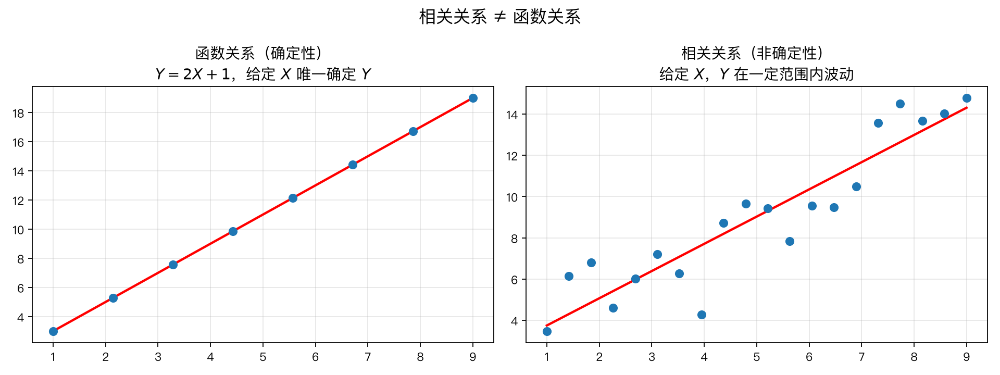
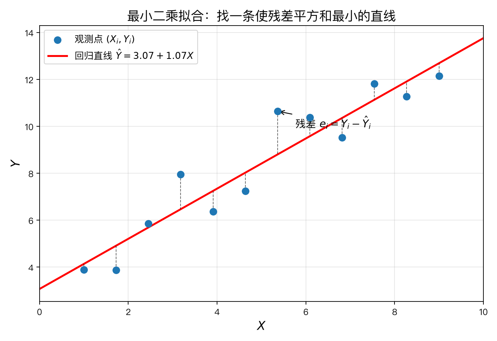
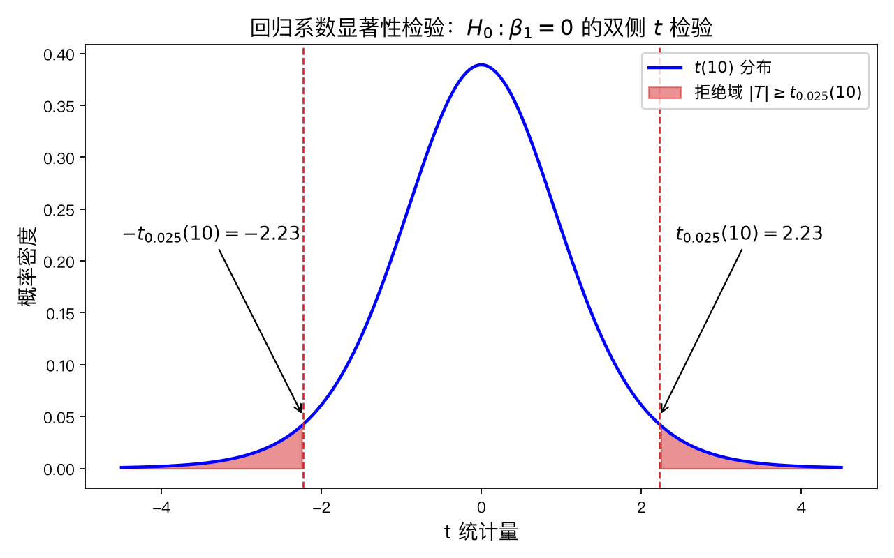
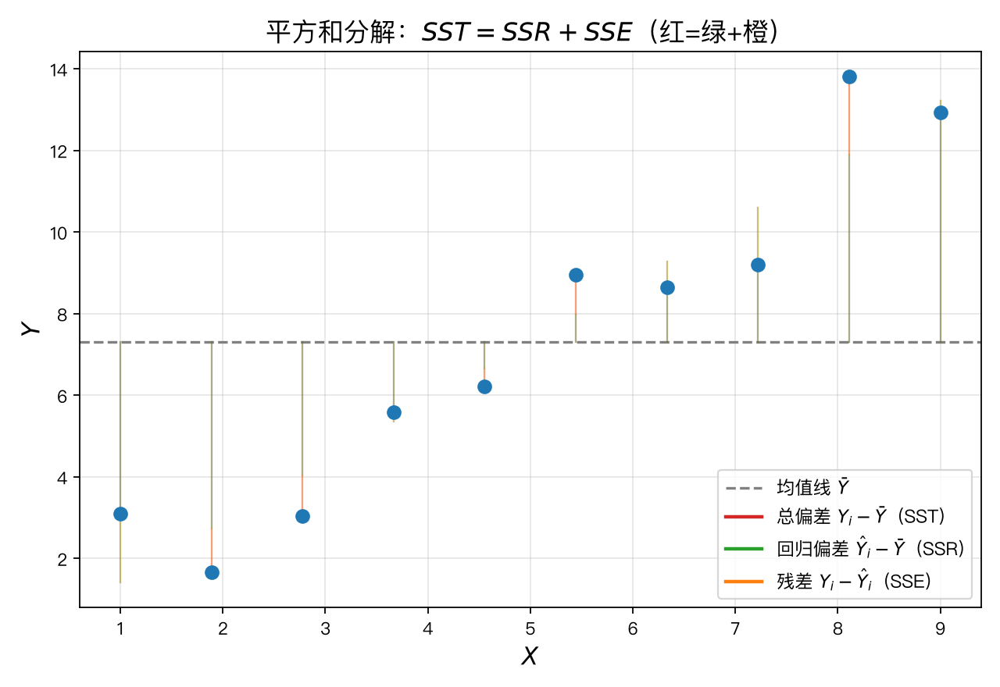
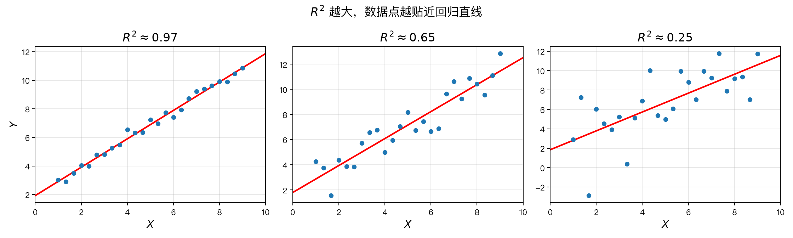
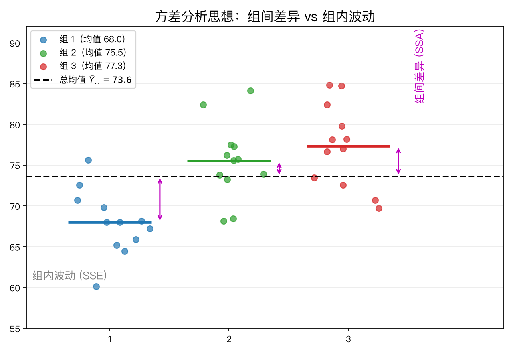
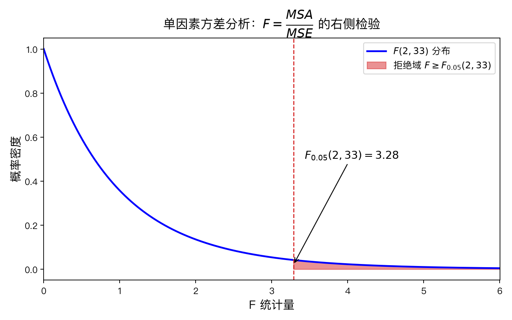

# 第12章 线性回归与方差分析 — 知识讲解

> 本文档按"**为什么→怎么做→是什么**"的逻辑链条，把线性回归和方差分析讲明白：它们解决什么问题、凭什么这么做、结果怎么解读。

---

> **本章导航**
> - 一、为什么要研究变量之间的关系？（相关关系 vs 函数关系）
> - 二、如何找到那条"最好的直线"？（最小二乘法）
> - 三、估计出的直线可信吗？（回归系数的统计推断）
> - 四、模型拟合得到底好不好？（$R^2$ 与平方和分解）
> - 五、多组均值如何比较？（方差分析的思想与 $F$ 检验）
> - 六、回归和方差分析是什么关系？（统一视角）
>
> **回顾与前瞻**：前面几章研究的都是**单个总体或多个总体的比较**——估计均值、检验均值是否相等。但现实中我们更常问的是：**变量之间的关系**——学习时间与成绩有什么关系？广告投入能带来多少销售额？本章的两大主角——回归分析（处理连续变量）和方差分析（处理分类变量）——将给出答案，而且你会发现它们背后是同一个数学结构：**平方和分解**。
>
> **带着这些问题学习本章：**
> 1. 广告投入增加 100 万，销售额预计增加多少？为什么答案是"一个区间"而不是"一个精确数"？
> 2. 三种教学方法的效果是否相同？为什么不能两两做 $t$ 检验，而要用方差分析一次性检验？
> 3. 回归中的 $R^2=0.8$ 和方差分析中的 $F$ 值，讲的是不是同一件事？

---

## 一、为什么需要回归分析？

### 1.1 变量之间的两种关系

现实生活中，变量之间相互影响的情况无处不在：

- 广告投入 ↑ → 销售额？可能上升
- 学习时间 ↑ → 考试成绩？可能上升
- 气温 ↑ → 用电量？可能上升

但这些"上升"并不严格。变量之间的关系分为两类：

**① 函数关系（确定性关系）**：给定 $x$ 就能唯一确定 $y$。

- 例：圆面积 $S = \pi r^2$。给定半径，面积没有悬念。
- 特征是：**没有随机性**。

**② 相关关系（非确定性关系）**：变量有趋势，但存在随机波动。

- 例：同是投入 10 万广告费，不同月份的销售额仍然不同。
- 特征是：**同一 $X$ 对应一群 $Y$**。

> **关键区分**：回归分析处理的是**相关关系**，不是函数关系。它承认"给定 $X$，$Y$ 依然随机"，只是假设 $Y$ 的**平均位置**（期望）随 $X$ 线性变化。

### 1.2 回归分析要做的三件事

| 任务 | 内容 | 例子 |
|------|------|------|
| **描述** | 找到 $Y$ 随 $X$ 变化的平均规律 | 广告每多 1 万，销售额平均多 0.8 万 |
| **解释** | 量化 $X$ 对 $Y$ 的影响强度 | 影响是否显著？贡献了多大比例？ |
| **预测** | 给定新的 $X$，预测 $Y$ 的可能范围 | 下月投 20 万，销售额预计在什么区间？ |

### 1.3 最重要的一条警示：相关 ≠ 因果

回归只能说"有关联"，不能说"谁导致谁"：

- 冰淇淋销量与溺水人数高度正相关——但不是吃冰淇淋导致溺水。
- 真相是"气温"这个**第三变量**同时影响了两者。

所以看到回归结果 $\beta_1 \neq 0$，只能说：**数据支持 $X$ 与 $Y$ 存在线性关联**。至于因果，需要实验设计来保证，统计工具本身证明不了。

---

## 二、最小二乘法——如何找到"最好的"直线？

### 2.1 问题的数学化

给定 $n$ 个点 $(X_i, Y_i)$，假设存在真实直线被噪声污染：

$$
Y_i = \beta_0 + \beta_1 X_i + \varepsilon_i
$$

我们的任务：**在看不到 $\varepsilon_i$ 的情况下，估计 $\beta_0, \beta_1$**。

"最好的直线"的定义是：让所有点"总体偏离"最小。偏离用**残差** $e_i = Y_i - (\beta_0 + \beta_1 X_i)$ 度量，整体偏离用**残差平方和**度量：

$$
Q(\beta_0, \beta_1) = \sum_{i=1}^{n} e_i^2 = \sum_{i=1}^{n} (Y_i - \beta_0 - \beta_1 X_i)^2
$$

### 2.2 为什么偏偏用"平方"？

| 方案        | 表达式                     | 致命缺陷                              |
| --------- | ----------------------- | --------------------------------- |
| 残差求和      | $\sum e_i$              | 正负抵消：乱画一条水平线，若上下对称，和还是 0          |
| 残差绝对值求和   | $\sum \lvert e_i\rvert$ | 绝对值在 0 处不可导，微积分用不上                |
| **残差平方和** | $\sum e_i^2$            | 处处可导，且越大的误差惩罚越重（$2^2=4$，$4^2=16$） |

第三个理由尤其重要：**大误差被平方放大了**。最小化平方和，就是"宁可分散的小误差，也不要一个大误差"——这符合直观的拟合目标。

### 2.3 怎么做：从直觉到数学

$Q$ 是 $\beta_0,\beta_1$ 的**二次函数**（开口向上的抛物面，像一个碗）。高数告诉我们：碗底就是最小值点，条件是**两个偏导数同时为 0**：

$$
\frac{\partial Q}{\partial \beta_0} = 0, \qquad \frac{\partial Q}{\partial \beta_1} = 0
$$

解这个二元一次方程组（详细过程见公式推导第 2 节），得到：

$$
\boxed{\hat\beta_1 = \frac{\sum (X_i-\bar X)(Y_i-\bar Y)}{\sum (X_i-\bar X)^2}, \qquad \hat\beta_0 = \bar Y - \hat\beta_1 \bar X}
$$

> **为什么"最优"？** 高数里有结论：$\sum e_i^2$ 达到全局最小的点正是这两个公式给出的点——不需要怀疑，不需要试错，直接代入计算即可。这就是"最小二乘估计"名字的由来。

### 2.4 记住三个直观结论

1. **回归直线必过重心点** $(\bar X, \bar Y)$：因为 $\hat\beta_0 = \bar Y - \hat\beta_1\bar X$。
2. **$\hat\beta_1$ 是"协方差/方差"**：分子是 $X,Y$ 的样本协方差，分母是 $X$ 的样本方差，所以它度量"$X$ 每变 1 个单位，$Y$ 平均变多少"。
3. **残差和必为 0**：$\sum e_i = 0$，即拟合值"上下均匀地"包围数据点。

---

## 三、估计出的直线可信吗？——回归系数的统计推断

### 3.1 问题：$\hat\beta_1 \neq 0$ 就说明有关联吗？

不一定。**抽样有随机性**：就算 $X$ 与 $Y$ 毫无关系（真值 $\beta_1 = 0$），随机抽到的数据算出的 $\hat\beta_1$ 也很少恰好等于 0。

好比抛 10 次硬币，即使硬币公平，正面次数也未必是 5。$\hat\beta_1$ 就是这样的"随机结果"——我们需要判断：**观察到的斜率，是真实信号，还是随机噪声？**

### 3.2 工具：把"信号"和"噪声"分开

沿用第11章的假设检验框架：

- $H_0: \beta_1 = 0$（无线性关系）；$H_1: \beta_1 \neq 0$（有线性关系）
- 检验统计量（信号/噪声比）：

$$
T = \frac{\hat\beta_1}{s/\sqrt{S_{XX}}}
$$

| 部分 | 含义 |
|------|------|
| 分子 $\hat\beta_1$ | 观测到的斜率 = **信号** |
| 分母 $s/\sqrt{S_{XX}}$ | 斜率的**标准误** = 噪声的平均水平（$s$ 是第 4 节的 $\sigma^2$ 估计） |

- $|T|$ 很大：信号远大于噪声 → 斜率不太可能是随机波动 → 拒绝 $H_0$
- $|T|$ 很小：信号淹没在噪声里 → 无法证明斜率非零

### 3.3 直觉与决策

$T$ 在 $H_0$ 下服从 $t(n-2)$ 分布（自由度为什么是 $n-2$？见公式推导第 4 节）。给定 $\alpha=0.05$，查表得临界值：

- $|T| \geq t_{0.025}(n-2)$：拒绝 $H_0$，**$X$ 对 $Y$ 有显著线性影响**；
- 否则：没有足够证据说 $\beta_1 \neq 0$。

> **常见困惑：什么叫"显著"？** "显著"是统计术语，意思是"这个结果不太可能由随机误差造成"，**不代表影响很大**。样本量极大时，微小的斜率也能"显著"——所以既要看 $p$ 值，也要看 $\hat\beta_1$ 本身的大小（效应量）。

### 3.4 为什么自由度是 $n-2$（一个值得停下来想的问题）

第9章学过：样本方差分母是 $n-1$，因为 $\sum (Y_i-\bar Y)=0$ 吃掉 1 个自由度。

这里要估计 $\sigma^2$ 用的是**残差** $e_i = Y_i - \hat Y_i$。残差受**两条约束**：

$$
\sum e_i = 0, \qquad \sum X_i e_i = 0
$$

所以 $n$ 个残差真正独立的只有 $n-2$ 个。用公式说：

$$
s^2 = \frac{SSE}{n-2}, \qquad E[s^2] = \sigma^2
$$

> **记忆口诀**：估计几个参数，就损失几个自由度。回归估了 $\beta_0,\beta_1$ 两个参数 → $n-2$。方差分析估了 $r$ 个组均值（由 $\bar Y$ 系统吃掉 $r$ 个），组内自由度 $N-r$——后面会看到同样的规律。

---

## 四、模型拟合得到底好不好？——$R^2$ 与平方和分解

### 4.1 一个直觉问题

把广告投入 $X$ 换成"是否下雨"来预测销售额，肯定预测不准；换成"历史销售额"可能准得多。如何**量化**"模型解释了多少"？

### 4.2 平方和分解：总变异 = 解释的变异 + 未解释的变异

对每个点，总偏差可以拆成两段：

$$
\underbrace{Y_i - \bar Y}_{\text{总偏差}} = \underbrace{(\hat Y_i - \bar Y)}_{\text{回归解释的}} + \underbrace{(Y_i - \hat Y_i)}_{\text{残差}}
$$

平方求和后（交叉项恰好为 0，证明见公式推导第 6 节）：

$$
\boxed{SST = SSR + SSE}
$$

| 记号 | 全称 | 含义 |
|------|------|------|
| $SST$ | 总平方和 | $Y$ 相对均值的总波动 |
| $SSR$ | 回归平方和 | 被直线"吸收"的波动 = **模型解释的** |
| $SSE$ | 残差平方和 | 散落在直线周围的波动 = **模型解释不了的** |

### 4.3 决定系数 $R^2$

$$
R^2 = \frac{SSR}{SST} = 1 - \frac{SSE}{SST}
$$

**一句话含义**：$Y$ 的变异中，被 $X$ 的线性关系解释掉的比例。

- $R^2 = 1$：所有点落在线/面上，完美拟合（SSE=0）
- $R^2 = 0$：直线毫无帮助（SSR=0）
- $R^2 = 0.8$：**80% 的变异被解释，20% 来自其他因素和随机误差**

### 4.4 $R^2$ 的局限（务必记住，考试和实战都爱考）

| 误区 | 真相 |
|------|------|
| $R^2$ 高 = 模型好 | 增加任何自变量都会提高 $R^2$，可能过拟合；多元回归要看**调整 $R^2$** |
| $R^2$ 低 = 模型没用 | 可能 $Y$ 与 $X$ 是**非线性**关系，线性模型本就不该用 |
| $R^2$ 衡量预测力 | 它只反映对**已有数据**的拟合，不能保证预测未来 |
| $R^2$ 能证明因果 | 不能。$R^2=0.99$ 也不能说 $X$ 导致 $Y$ |

---

## 五、多组均值如何比较？——方差分析

### 5.1 为什么不能两两做 $t$ 检验？

要比较 $r=3$ 种肥料的产量。直观想法：两两比较，做 $C_3^2 = 3$ 次 $t$ 检验。

**问题出在"多重比较"**：每次检验犯第一类错误的概率是 $\alpha=0.05$，3 次都正确的概率是 $0.95^3 \approx 0.857$——即**总错误率涨到约 14%**，远超 5%。组越多，错得越离谱。

> 方差分析的价值：**只做一次检验**，一次性回答"这些组均值是否全相等"，把总错误率控制住。

### 5.2 方差分析的核心思想：把总变异"归因"

我们想看的是"**组间差异**"是否比"**组内随机波动**"大。于是把总变异拆开：

$$
\underbrace{SST}_{\text{总变异}} = \underbrace{SSA}_{\text{组间变异}} + \underbrace{SSE}_{\text{组内变异}}
$$

- **组间变异 SSA**：各组均值与总均值的差异 = **处理效应 + 随机误差**
- **组内变异 SSE**：各组内部的波动 = **纯随机误差**

### 5.3 逻辑链条（重点，务必理顺）

| 情形 | 组间变异 SSA | 组内变异 SSE | 比值 MSA/MSE |
|------|-------------|-------------|-------------|
| 处理无效（$H_0$ 真） | 只有随机误差 | 随机误差 | 接近 1 |
| 处理有效（$H_1$ 真） | 效应 + 随机误差 | 随机误差 | **明显大于 1** |

所以：**$F = \dfrac{MSA}{MSE} = \dfrac{SSA/(r-1)}{SSE/(N-r)}$ 是信号/噪声比**，与回归中 $T$ 的思路完全一致。$F$ 很大 → 拒绝 $H_0$ → 各组均值不全相等。

### 5.4 为什么除以自由度？

$F$ 的定义里除以自由度是为了**公平比较**：组间变异有 $r-1$ 个"独立来源"，组内变异有 $N-r$ 个。各除以自己的自由度后，才是"每个独立来源的平均贡献"，这才可比。

### 5.5 决策与一张表

- 若 $F \geq F_{\alpha}(r-1, N-r)$：拒绝 $H_0$，认为**至少有一组**均值不同；
- 否则：不能认为各组有差异。

> **注意**：$F$ 显著 ≠ "所有组两两不同"。它只说"至少一对不同"。想知道具体哪组不同，要再做**多重比较**（如 Tukey HSD）。

完整结果汇成**方差分析表**（软件都会输出这张表）：

| 来源 | 平方和 | 自由度 | 均方 | $F$ |
|------|--------|--------|------|-----|
| 组间（处理） | $SSA$ | $r-1$ | $MSA=SSA/(r-1)$ | $F=MSA/MSE$ |
| 组内（误差） | $SSE$ | $N-r$ | $MSE=SSE/(N-r)$ | |
| 总和 | $SST$ | $N-1$ | | |

> **自由度守恒**：$N-1 = (r-1) + (N-r)$——分解在"自由度"层面也成立，不是巧合。

---

## 六、回归与方差分析：一个统一的故事

### 6.1 都是同一个模型

把它们都写成"线性模型 + 误差"：

$$
Y = \text{可预测部分} + \varepsilon
$$

| 方法 | 可预测部分 | 自变量类型 | 问的问题 |
|------|-----------|-----------|----------|
| 回归 | $\beta_0 + \beta_1 X$ | 连续变量（温度、时间…） | $Y$ 如何随 $X$ 变化？ |
| 方差分析 | $\mu + \alpha_i$ | 分类变量（组别、品种…） | 各组均值是否相同？ |

方差分析还能"伪装"成回归：给每组定义一个 0/1 虚拟变量 $I_{ik}$，模型变成

$$
Y_{ij} = \mu + \alpha_1 I_{i1} + \cdots + \alpha_{r-1}I_{i,r-1} + \varepsilon_{ij}
$$

检验 $\alpha_1=\cdots=\alpha_{r-1}=0$ 就是一次"回归系数的联合检验"。

### 6.2 结构上的惊人对称

|        | 回归                                | 方差分析                |
| ------ | --------------------------------- | ------------------- |
| 总变异    | $SST$                             | $SST$               |
| 分解     | $SST = SSR + SSE$                 | $SST = SSA + SSE$   |
| 解释的部分  | $SSR$（回归平方和）                      | $SSA$（组间平方和）        |
| 未解释的部分 | $SSE$（残差）                         | $SSE$（组内）           |
| 检验统计量  | $T=\hat\beta_1/(s/\sqrt{S_{XX}})$ | $F=MSA/MSE$         |
| 本质     | 信号/噪声比                            | 信号/噪声比              |
| 自由度模式  | $n-1 = 1 + (n-2)$                 | $N-1 = (r-1)+(N-r)$ |

**甚至可以做"回归的方差分析表"**：一元回归本身也能写成 $F$ 检验形式，此时 $F = t^2$（$t$ 是斜率检验的统计量）——两种方法在两组情形下完全等价。

> **一句话总结本章**：回归和方差分析，都是**把总变异拆成"可解释的"和"随机的"两部分，再看前者是否显著大于后者**。换汤不换药。

---

## 附：常见误区与澄清

### 误区 1：回归系数显著 = 变量重要

**澄清**：显著只说明"线性关联不太可能是随机造成的"，不说明影响大。还要看系数大小和 $X$ 的取值范围。样本一大，再小的效应也会显著。

### 误区 2：$R^2$ 越大模型越好

**澄清**：$R^2$ 随自变量增加只增不减，可能过拟合。多元回归要用调整 $R^2$；此外 $R^2$ 高也可能是异常值"撑着"的。

### 误区 3：方差分析 $F$ 显著 = 所有组两两不同

**澄清**：$F$ 显著只说"至少有一组与其余不同"。具体哪些组不同需要多重比较（Tukey HSD、Bonferroni 等）。

### 误区 4：回归和方差分析是两门不相干的方法

**澄清**：它们都是线性模型的特殊情形，计算上可互相转化。回归里 $X$ 是连续值，方差分析里 $X$ 是类别（0/1 虚拟变量）。

### 误区 5：p 值很小 = 实际意义很大

**澄清**：大样本下微小差异也能 p<0.05。结论要同时报告效应量（$R^2$、均值差等）和 $p$ 值，避免"统计显著、实际无聊"。

---

## 本章应掌握的内容

学完本章，你应该能回答：

1. 你能说出相关关系与函数关系的区别，以及回归分析适用哪种吗？
2. 你能推导出 $\hat\beta_1$ 的公式，并解释它为什么是"协方差/方差"吗？
3. 你能解释为什么用平方和而不是绝对值来定义"拟合得好"吗？
4. 你能说出 $s^2 = SSE/(n-2)$ 中的 $n-2$ 是怎么来的吗？
5. 你能完成"回归系数显著性 $t$ 检验"的完整流程并解读结果吗？
6. 你能证明 $SST = SSR + SSE$，并解释 $R^2$ 的含义与局限吗？
7. 你能说出为什么多组比较不能两两做 $t$ 检验，而要用方差分析吗？
8. 你能完成单因素方差分析的 $F$ 检验并读懂方差分析表吗？
9. 你能说出回归分析与方差分析在数学结构上的共同点吗？
