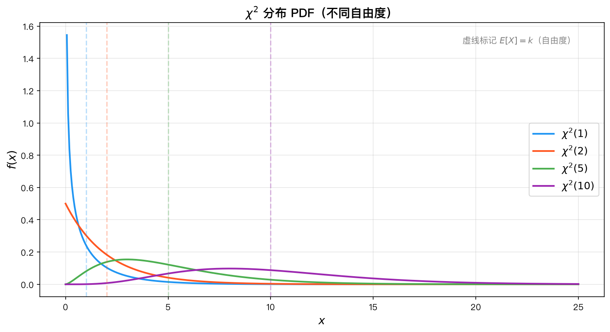
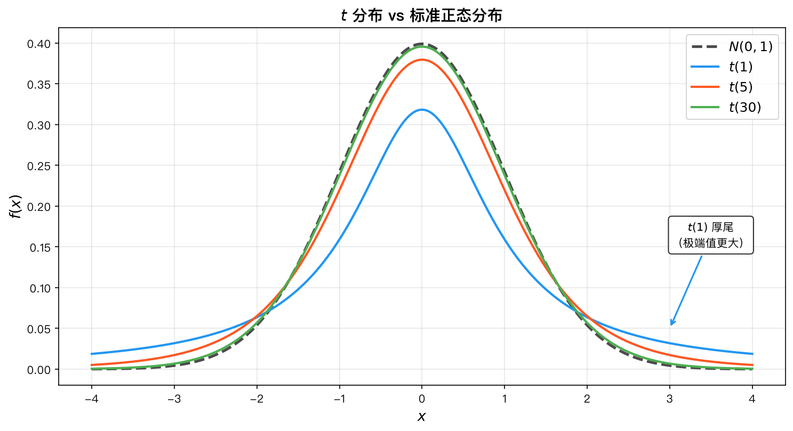
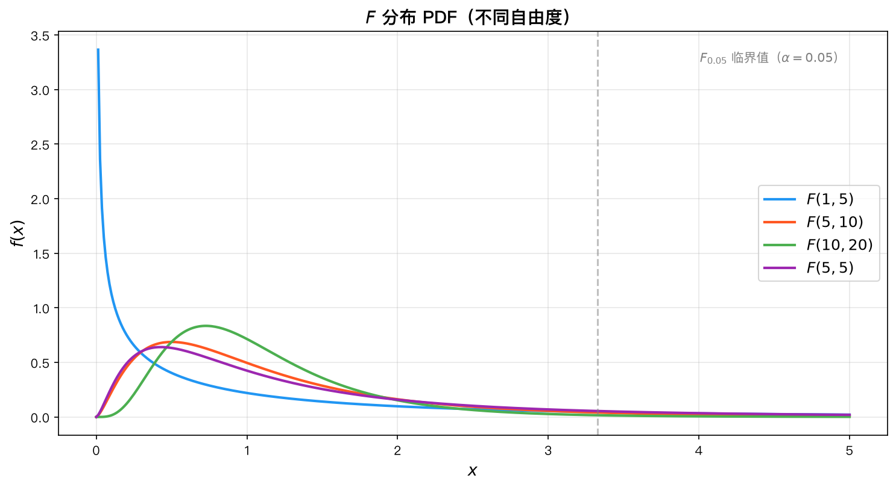
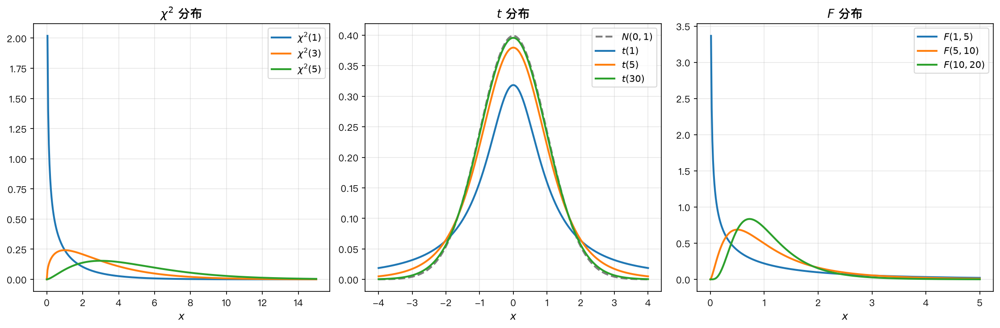

# 第9章 抽样分布与描述统计——知识讲解

---

> **本章内容**
> 
> 1. 从概率论到数理统计的转变
> 2. 为什么样本方差除以n-1？
> 3. χ²分布的意义
> 4. t分布的意义
> 5. F分布的意义
> 6. 三大分布的关系
> 7. 抽样分布定理的核心
> 8. 总结

### 承上启下

前八章是概率论——已知分布，研究数据的规律。从本章开始进入数理统计——已知数据，反推分布的参数。大数定律和CLT告诉我们样本均值会趋近总体均值，但我们需要更精确的工具来描述样本统计量的分布。

### 问题导向

带着以下问题学习本章，你会更有方向感：

1. **样本方差为什么除以n-1而不是n？这背后有什么数学原理？**
2. **当总体方差σ²未知时，如何研究样本均值的分布？**
3. **要比较两个总体的方差是否相等，应该用什么统计量、什么分布？**

---

## 一、从概率论到数理统计的转变

### 为什么？

在概率论中，我们面对的是"已知的世界"：给定一个随机变量 $X$ 的分布（如 $X \sim N(\mu, \sigma^2)$），我们可以计算出 $X$ 取某个值的概率、期望、方差等一切特征。概率论的方向是 **分布 → 数据特征**。

但在现实世界中，我们面临的是"未知的世界"：我们不知道总体的真实分布，只能通过抽样得到少量数据，然后反过来推断总体的性质。数理统计的方向是 **数据 → 分布推断**。

### 怎么做？

这个转变带来两个关键问题：

1. **抽样误差**：样本只是总体的一小部分，由样本计算出的数字（样本均值、样本方差）必然会与总体真实值有偏差。我们需要量化这种偏差。
2. **统计量的分布**：既然样本均值 $\bar{X}$ 是一个随机变量（因为每次抽样结果不同），我们需要知道它的分布——这就是**抽样分布**。

### 是什么？

**抽样分布**（Sampling Distribution）是指统计量的概率分布。例如：

- 如果总体 $X \sim N(\mu, \sigma^2)$，那么 $\bar{X} \sim N(\mu, \sigma^2/n)$
- 这个结论告诉我们：样本均值的期望等于总体均值，而方差只有总体方差的 $1/n$——样本量越大，$\bar{X}$ 越稳定

**核心思想**：统计量本身也是随机变量，既然 $X_1, \dots, X_n$ 是随机变量，那么它们的函数 $\bar{X} = \frac{1}{n}\sum X_i$ 也是随机变量，有其自身的分布。

---

## 二、为什么样本方差除以 $n-1$？

### 为什么？

直观上，计算样本方差时，我们想度量"数据点偏离中心的程度"。自然的想法是用 $\frac{1}{n}\sum_{i=1}^n (X_i - \bar{X})^2$。但为什么标准定义要用 $n-1$？

### 怎么做？

回到无偏估计的概念：一个好的估计量应该满足 $E[\text{估计量}] = \text{真实值}$。

我们之前推导了：

$$
E\left[\frac{1}{n}\sum_{i=1}^n (X_i - \bar{X})^2\right] = \frac{n-1}{n}\sigma^2
$$

这个推导的关键在于理解 $\bar{X}$ 不是 $\mu$。当我们用 $\bar{X}$ 代替 $\mu$ 时，$(X_i - \bar{X})$ 会比 $(X_i - \mu)$ 系统性地偏小——因为 $\bar{X}$ 本身就是从数据中计算出来的，它"适配"了样本，使得平方和最小化。

具体来说，对于任意实数 $c$，有 $\sum_{i=1}^n (X_i - c)^2$ 在 $c = \bar{X}$ 时取最小值。因此 $\sum_{i=1}^n (X_i - \bar{X})^2 \leq \sum_{i=1}^n (X_i - \mu)^2$，从而期望上偏小。

### 是什么？

**自由度**（Degrees of Freedom）的概念：在计算 $S^2$ 时，$n$ 个偏差 $X_1 - \bar{X}, \dots, X_n - \bar{X}$ 满足一个线性约束 $\sum_{i=1}^n (X_i - \bar{X}) = 0$，因此只有 $n-1$ 个是自由变化的。除以 $n-1$ 正是对这种"损失了一个自由度"的修正。

**结论**：$S^2 = \frac{1}{n-1}\sum_{i=1}^n (X_i - \bar{X})^2$ 是 $\sigma^2$ 的无偏估计量。

---

## 三、$\chi^2$ 分布的意义

### 为什么？

在许多统计问题中，我们需要衡量"观测值与期望值的偏离程度"。例如，在拟合优度检验中，我们想知道一组观测数据是否符合某个理论分布。

### 怎么做？

考虑一个简单情形：$Z_1, \dots, Z_k$ 是独立的标准正态变量。每个 $Z_i^2$ 度量了 $Z_i$ 偏离 0 的平方距离。将这些平方距离加起来：

$$
\chi^2_k = \sum_{i=1}^k Z_i^2
$$

$\chi^2_k$ 度量了 $k$ 个独立标准正态变量"整体偏离 0 的程度"。$\chi^2_k$ 的值越大，说明这些变量偏离 0 越远。

### 是什么？

**$\chi^2$ 分布**是 $k$ 个独立标准正态变量的平方和所服从的分布，记作 $\chi^2(k)$。

其中 $k$ 称为**自由度**，表示独立的标准正态变量的个数。

**关键性质**：

- $E[\chi^2_k] = k$，$\text{Var}(\chi^2_k) = 2k$——期望和方差都随自由度增大而增大
- **可加性**：两个独立的 $\chi^2$ 变量之和仍服从 $\chi^2$ 分布，自由度相加
- $\chi^2$ 分布是**非对称**的（右偏），但随着自由度增大，趋近于正态分布

**典型应用**：

- 样本方差与总体方差的关系：$\frac{(n-1)S^2}{\sigma^2} \sim \chi^2(n-1)$
- 拟合优度检验：$\sum \frac{(O_i - E_i)^2}{E_i} \sim \chi^2$
- 独立性检验（列联表）


*图1：不同自由度下χ²分布的概率密度函数，自由度越大，分布越向右偏移且越趋近正态*

---

## 四、$t$ 分布的意义

### 为什么？

当总体方差 $\sigma^2$ 已知时，我们可以用 $Z = \frac{\bar{X} - \mu}{\sigma/\sqrt{n}} \sim N(0,1)$ 来进行关于 $\mu$ 的推断。但现实中，$\sigma^2$ 通常是未知的。

### 怎么做？

当 $\sigma^2$ 未知时，一个自然的想法是用样本标准差 $S$ 来代替 $\sigma$，得到：

$$
T = \frac{\bar{X} - \mu}{S/\sqrt{n}}
$$

但这时 $T$ 不再服从标准正态分布！因为 $S$ 本身也是一个随机变量，它的波动性使得 $T$ 的分布比 $N(0,1)$ 有更大的方差——尾部更厚。

### 是什么？

**$t$ 分布**（也称为 Student $t$ 分布）是当总体方差未知时，标准化的样本均值所服从的分布。

$$
T = \frac{Z}{\sqrt{V/k}} \sim t(k)
$$

其中 $Z \sim N(0,1)$，$V \sim \chi^2(k)$ 独立。

**核心特征**：

1. **对称性**：$t$ 分布关于 $0$ 对称，形状类似于标准正态分布
2. **厚尾**：$t$ 分布的尾部比正态分布更厚——这意味着在 $t$ 分布下，极端值出现的概率更大，反映了方差估计的不确定性
3. **收敛性**：当自由度 $k \to \infty$ 时，$t(k) \to N(0,1)$。这是因为 $S$  converges 到 $\sigma$（由大数定律），不确定性消失

**直观理解**：当样本量 $n$ 很小时，$S$ 对 $\sigma$ 的估计很不准确，所以 $T$ 的分布有较大的不确定性（厚尾）。当 $n$ 很大时，$S$ 非常接近 $\sigma$，$T$ 的分布就接近正态分布。

**典型应用**：

- 单样本 $t$ 检验：检验 $H_0: \mu = \mu_0$
- 两样本 $t$ 检验：检验 $H_0: \mu_1 = \mu_2$
- 回归系数的显著性检验


*图2：t分布（自由度较小）与标准正态分布的对比，t分布尾部更厚*

---

## 五、$F$ 分布的意义

### 为什么？

在许多统计问题中，我们需要**比较两个方差**是否相等。例如，在方差分析（ANOVA）中，我们要比较不同组之间的变异是否显著大于组内的变异。

### 怎么做？

如果我们有两个独立的 $\chi^2$ 变量 $U \sim \chi^2(m)$ 和 $V \sim \chi^2(n)$，它们的比值（经过自由度调整后）可以反映两个总体方差的相对大小。

$$
F = \frac{U/m}{V/n}
$$

### 是什么？

**$F 分布$** 是两个独立 $\chi^2$ 变量除以其自由度后的比值所服从的分布，记作 $F(m, n)$。

**核心特征**：

1. **非对称性**：$F$ 分布是右偏的，取值范围为 $(0, \infty)$
2. **倒数性质**：若 $F \sim F(m, n)$，则 $1/F \sim F(n, m)$——这为计算提供了便利
3. **与 $t$ 分布的关系**：$t(k)^2 \sim F(1, k)$——$t$ 检验和 $F$ 检验在单变量情形下等价

**典型应用**：

- **方差分析（ANOVA）**：比较多个组均值是否相等
  - 组间变异（处理效应）与组内变异（随机误差）的比值服从 $F$ 分布
  - 如果 $F$ 值很大，说明处理效应显著
- **方差齐性检验**：比较两个总体方差是否相等
  - $F = S_1^2/S_2^2$（在正态总体下）
- **回归模型的整体显著性检验**


*图3：不同自由度下F分布的概率密度函数，呈右偏形态*

---

## 六、三大分布的关系

### 为什么？

三大分布不是孤立的，它们之间存在深刻的数学联系。理解这些联系有助于建立统一的统计推断框架。

### 怎么做？

从定义出发，逐一揭示它们之间的内在关系：

1. **$t$ 分布与 $F$ 分布**：$t(k)^2 \sim F(1, k)$
   - $t$ 统计量是标准正态与 $\chi^2$ 的比值，平方后分子变成 $\chi^2(1)$，分母不变，自然成为 $F$ 统计量

2. **$t$ 分布与正态分布**：$t(k) \xrightarrow{k\to\infty} N(0,1)$
   - 当自由度足够大时，样本标准差 $S$ 几乎等于总体标准差 $\sigma$，$t$ 统计量退化为标准正态

3. **$\chi^2$ 分布的可加性**：$\chi^2(m) + \chi^2(n) = \chi^2(m+n)$
   - 独立正态变量的平方和，变量越多，$\chi^2$ 值越大

4. **$F$ 分布与 $\chi^2$ 分布**：$F(m,n)$ 是两个 $\chi^2$ 变量的比值

### 是什么？

**三大分布的关系图**：

```
正态分布 N(0,1)
    │
    ├── 平方 ──→ χ²(1) ──→ χ²(k)（可加性）
    │
    ├── 除以 √(χ²/k) ──→ t(k) ──→ 平方 ──→ F(1,k)
    │
    └── 两个 χ² 的比值 ──→ F(m,n)
```

所有三大分布都源于正态分布——它们是正态分布派生出来的"工具分布"，用于在不同的推断场景下处理不同的不确定性来源。


*图4：三大抽样分布的关系总览图*

---

## 七、抽样分布定理的核心

### 为什么？

在实际的统计推断中，我们面对的核心问题是：**从样本数据中能获得关于总体的哪些信息？** 抽样分布定理给出了精确的答案——当总体服从正态分布时，样本均值和样本方差的分布可以精确描述，无需大样本近似。

### 怎么做？

四大定理构成了一个完整的体系：

1. **定理1**（$\bar{X}$ 的分布）：$\bar{X} \sim N(\mu, \sigma^2/n)$
   - 告诉我们样本均值的抽样误差是 $\sigma/\sqrt{n}$，与样本量的平方根成反比
   - 如果将样本量扩大 4 倍，标准误减半

2. **定理2**（$S^2$ 的分布）：$\frac{(n-1)S^2}{\sigma^2} \sim \chi^2(n-1)$
   - 告诉我们样本方差的分布可以通过 $\chi^2$ 分布来刻画
   - 自由度为 $n-1$ 而非 $n$，反映了估计 $\mu$ 时损失的一个自由度

3. **定理3**（独立性）：$\bar{X}$ 与 $S^2$ 独立
   - 这是一个非常重要的性质——在正态总体下，样本均值和样本方差不相关（事实上独立）
   - 这使得我们可以分别处理关于 $\mu$ 和关于 $\sigma^2$ 的推断

4. **定理4**（$t$ 统计量）：$\frac{\bar{X} - \mu}{S/\sqrt{n}} \sim t(n-1)$
   - 当 $\sigma^2$ 未知时，用 $S$ 代替 $\sigma$，得到的统计量服从 $t$ 分布
   - 这是单样本 $t$ 检验的理论基础

### 是什么？

**抽样分布定理**（Sampling Distribution Theorem）是关于正态总体样本均值和样本方差分布的一系列结论。

**为什么不需要大样本近似？**

因为正态分布具有可加性——独立正态变量的线性组合仍然是正态变量。这使得我们可以精确地推导出 $\bar{X}$ 的分布（无论 $n$ 多大或多小，只要总体是正态的）。

相比之下，对于非正态总体，$\bar{X}$ 的分布通常依赖于中心极限定理的大样本近似。

**实践意义**：

- 当 $n=5$ 时，我们仍然可以用 $t$ 分布进行精确推断（前提是总体近似正态）
- 这些定理构成了经典统计推断的基石——置信区间、假设检验、方差分析都建立在此之上

---

## 八、总结

| 概念          | 解决什么问题            | 关键思想                    | 与正态分布的关系                     |
| :---------- | :---------------- | :---------------------- | :--------------------------- |
| $\chi^2$ 分布 | 度量偏离程度            | 标准正态的平方和                | 定义为 $Z_1^2 + \cdots + Z_k^2$ |
| $t$ 分布      | $\sigma$ 未知时的均值推断 | 用 $S$ 代替 $\sigma$，尾部更厚  | $t = Z/\sqrt{V/k}$           |
| $F$ 分布      | 比较两个方差            | 两个 $\chi^2$ 的比值         | $F = \frac{U/m}{V/n}$        |
| 抽样分布定理      | 正态总体的精确推断         | $\bar{X}$ 和 $S^2$ 的分布已知 | 全部基于正态假设                     |

**一句话总结**：三大抽样分布都是从正态分布派生出来的工具分布，它们使得我们可以在总体方差已知或未知、需要比较方差等不同情形下进行精确的统计推断；而抽样分布定理则告诉我们，在正态总体下，样本均值和样本方差具有简单、精确、独立的分布，这构成了经典统计推断的理论基础。

### 本章应掌握的内容

学完本章后，你应该能回答以下问题：

1. 你能解释样本方差除以n-1的原因吗？
2. 你能写出χ²分布、t分布、F分布的定义式吗？
3. 你知道χ²分布、t分布、F分布之间的关系吗？
4. 你能说出正态总体的四大抽样分布定理吗？
5. 你能证明(n-1)S²/σ²~χ²(n-1)吗？
6. 你能证明T=(X̄-μ)/(S/√n)~t(n-1)吗？