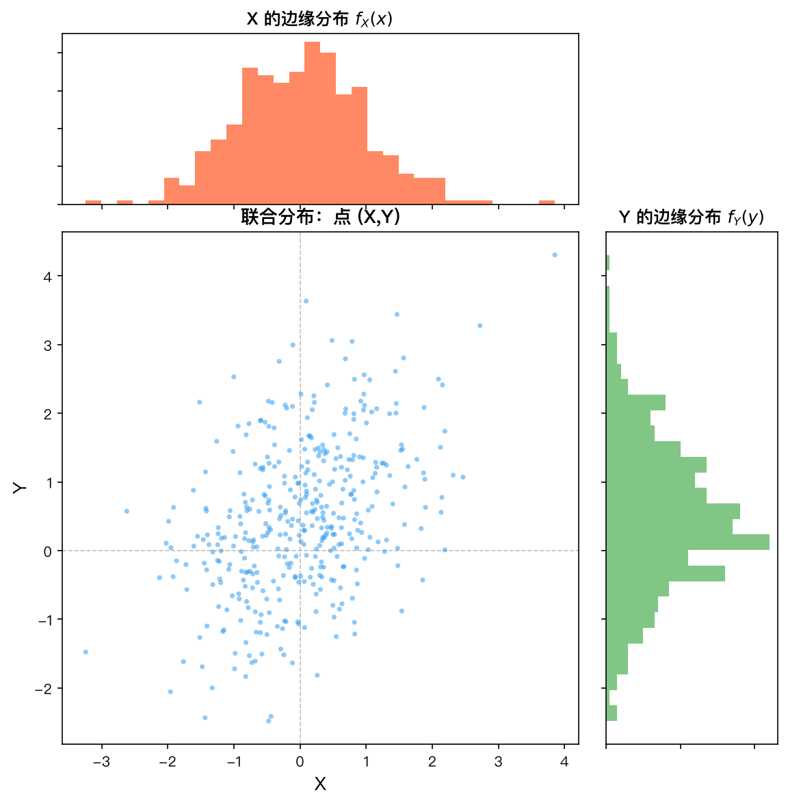
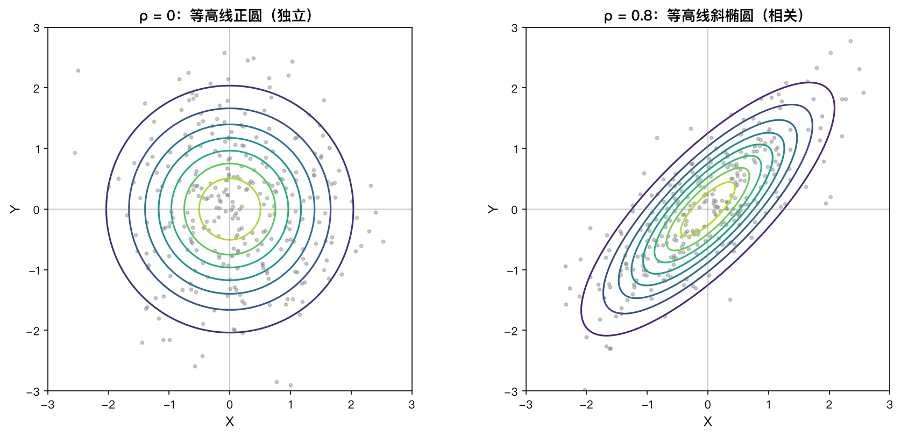
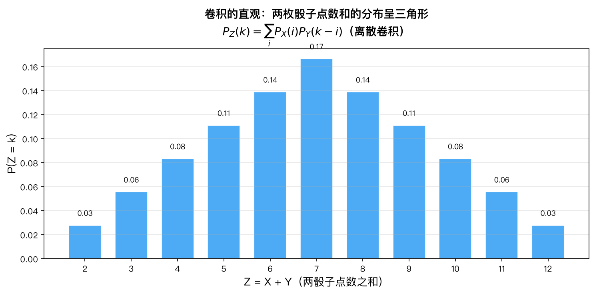

# 第6章 多维随机向量——知识讲解

> **本章目录**：为什么需要多维随机变量 | 联合分布的思想 | 边缘分布 vs 联合分布 | 条件分布的思想 | 独立性的含义 | 卷积公式 | max和min的分布 | 变量变换法
>
> **承上启下**：前五章研究的都是单个随机变量。但现实问题中，多个变量往往同时出现（身高和体重、温度和湿度、股票A和股票B），单独研究每个变量会丢失变量间的关系。本章将单变量推广到多变量。
>
> **带着问题学习**：
> 1. 知道一个人的身高后，对他的体重的预测会改变吗？数学上如何描述这种"改变"？
> 2. 两个随机变量独立是什么意思？为什么独立一定不相关，但不相关不一定独立？
> 3. 已知X和Y的分布，如何求X+Y的分布？

---

## 1. 为什么需要多维随机变量

### 为什么？

现实世界中的问题很少只涉及一个随机变量。例如：

- 研究一个人的健康状况，需要同时考虑**身高**和**体重**
- 研究一个地区的气候，需要同时考虑**温度**、**湿度**、**降水量**
- 研究股票市场，需要同时考虑多只**股票收益率**之间的关系

如果分别单独研究每个变量，就会丢失变量之间至关重要的关系信息。例如：

> 身高和体重分别服从正态分布，这是否意味着身高180cm的人体重也服从同样的分布？显然不是——身高较高的人通常体重也较重，这就是**变量间的依赖关系**。

### 怎么做？

为了刻画多个随机变量同时取值的规律，我们需要引入**多维随机向量**的概念。将多个随机变量放在一起组成一个向量：

$$
\mathbf{X} = (X_1, X_2, \ldots, X_n)
$$

然后研究这个向量的联合分布规律。对于二维的情况，就是 $(X,Y)$。

### 是什么？

**多维随机向量**（或称随机向量）是由多个随机变量组成的向量。其联合分布描述了所有分量同时取值的概率规律，也包含了分量之间的依赖结构信息。

---

## 2. 联合分布的思想

### 为什么？

单变量时，我们用 $F_X(x) = P(X \le x)$ 来描述分布。对于二维，我们需要同时描述"$X$不超过某个值"**且**"$Y$不超过某个值"的概率。

### 怎么做？

自然地将单变量的"$\le x$"推广到两个维度：

$$
F(x,y) = P(X \le x,\; Y \le y)
$$

这个推广看似简单，但包含了所有需要的信息。为什么？因为只要知道联合CDF，就能算出 $(X,Y)$ 落**任何**矩形区域的概率，从而可以逼近任意形状区域。

### 是什么？

**联合累积分布函数（Joint CDF）** $F(x,y)$ 是一个定义在 $\mathbb{R}^2$ 上的函数，具有以下关键特征：

- **边界行为**：当 $x\to -\infty$ 或 $y\to -\infty$ 时，$F(x,y)\to 0$；当 $x\to\infty$ 且 $y\to\infty$ 时，$F(x,y)\to 1$。
- **单调性**：对每个变量分别单调不减。
- **矩形概率公式**：$P(a<X\le b, c<Y\le d) = F(b,d)-F(a,d)-F(b,c)+F(a,c)$

**直观理解**：可以把 $F(x,y)$ 想象成一个"累积概率池"，$(x,y)$ 是池子的右下角，池子覆盖了从 $(-\infty,-\infty)$ 到 $(x,y)$ 的整个左下象限。

---

## 3. 边缘分布 vs 联合分布

### 为什么？

当我们有了联合分布后，有时需要"忽略"其中一个变量，只关注另一个变量的分布。例如，研究身高和体重的联合分布后，我们可能只想看**身高的分布**（不考虑体重）。

### 怎么做？

**核心操作：求和/积分掉另一个变量。**

- **离散型**：$p_X(x) = \sum_y p(x,y)$ — 对 $y$ 的所有可能取值求和
- **连续型**：$f_X(x) = \int_{-\infty}^{\infty} f(x,y)\,dy$ — 对 $y$ 积分

为什么求和/积分就能得到边缘分布？因为事件 $\{X=x\}$ 可以分解为互不相交的事件 $\{X=x, Y=y\}$ 对所有 $y$ 的并集。概率的可加性告诉我们，$P(X=x)$ 就是所有 $P(X=x,Y=y)$ 之和。

### 是什么？

**边缘分布**描述了单个随机变量的分布，它从联合分布中"边缘化"（即求和/积分掉）另一个变量得到。

**类比：** 想象联合PDF $f(x,y)$ 是一座山的海拔高度。边缘PDF $f_X(x)$ 就像是这座山在 $x$ 轴方向上的"投影"——将 $y$ 方向的所有高度累加起来。

**关键洞察：从联合分布可以推出边缘分布，但反过来不行。** 不同的联合分布可以有相同的边缘分布。例如：

$$
f_1(x,y) = 1,\; 0<x<1, 0<y<1 \quad(\text{独立均匀分布})
$$

$$
f_2(x,y) = 1 + \left(x-\frac{1}{2}\right)\left(y-\frac{1}{2}\right),\; 0<x<1, 0<y<1
$$

这两个联合PDF的边缘PDF都是 $f_X(x)=1, f_Y(y)=1$（在 $[0,1]$ 上均匀），但一个是独立分布，另一个不是。这说明**边缘分布不包含变量间的依赖信息**。



*联合分布包含 $(X,Y)$ 的全部信息，边缘分布是通过求和/积分"投影"掉一个变量后得到的单变量分布。*

---

## 4. 条件分布的思想

### 为什么？

联合分布描述的是"无条件的"整体规律，但有时候我们掌握了部分信息（比如已知 $X$ 的值），想知道在这种情况下 $Y$ 的分布会如何变化。

例如：

- 已知某人身高180cm，他的体重分布是什么？
- 已知今天气温30°C，明天降雨的概率分布是什么？

这就是条件分布要回答的问题。

### 怎么做？

**离散型：** 直接用条件概率公式。

$$
P(Y=y|X=x) = \frac{P(X=x, Y=y)}{P(X=x)} = \frac{p(x,y)}{p_X(x)}
$$

这和一维条件概率完全一致，只要 $p_X(x) > 0$。

**连续型：** 不能直接用条件概率公式，因为 $P(X=x)=0$。我们需要用极限方法：

$$
P(Y\le y|X=x) = \lim_{\Delta x\to 0} P(Y\le y\,|\, x\le X < x+\Delta x)
$$

通过积分中值定理，最终得到：

$$
f_{Y|X}(y|x) = \frac{f(x,y)}{f_X(x)}
$$

**为什么除以 $f_X(x)$？** 因为条件PDF需要满足归一化条件：

$$
\int_{-\infty}^{\infty} f_{Y|X}(y|x)\,dy = \frac{\int_{-\infty}^{\infty} f(x,y)\,dy}{f_X(x)} = \frac{f_X(x)}{f_X(x)} = 1
$$

除以 $f_X(x)$ 起到了"归一化"的作用，确保条件PDF的总积分为1。

### 是什么？

**条件分布**是在已知部分随机变量取值的条件下，剩余变量的概率分布。它刻画了变量之间的**依赖关系**——$X$ 的取值如何影响 $Y$ 的分布。

**几何意义：** 条件PDF $f_{Y|X}(y|x)$ 是在联合PDF $f(x,y)$ 上沿 $x$ 方向"切一刀"，得到 $x$ 处的截面曲线，然后归一化使曲线下的面积为1。

---

## 5. 独立性的含义

### 为什么？

独立性是概率论中最重要的概念之一。它描述了"一个变量不提供另一个变量的任何信息"这一极端情况。

### 怎么做？

**定义：** $X$ 与 $Y$ 独立当且仅当联合CDF等于边缘CDF的乘积：

$$
F(x,y) = F_X(x)F_Y(y),\quad \forall x,y
$$

**等价形式：**
- 离散型：$p(x,y) = p_X(x)p_Y(y)$
- 连续型：$f(x,y) = f_X(x)f_Y(y)$

**另一种等价定义（更符合直觉）：** $X$ 与 $Y$ 独立当且仅当条件分布等于无条件分布：

$$
f_{Y|X}(y|x) = f_Y(y),\quad \forall x,y
$$

**推导：** 若 $f(x,y) = f_X(x)f_Y(y)$，则：

$$
f_{Y|X}(y|x) = \frac{f(x,y)}{f_X(x)} = \frac{f_X(x)f_Y(y)}{f_X(x)} = f_Y(y)
$$

反之，若 $f_{Y|X}(y|x) = f_Y(y)$，则 $f(x,y) = f_X(x)f_{Y|X}(y|x) = f_X(x)f_Y(y)$。

这意味着：**知道 $X$ 的值不改变 $Y$ 的分布**。

### 是什么？

**独立性**意味着两个随机变量之间没有任何依赖关系。知道一个变量的值不提供关于另一个变量的任何信息。

**重要性质：**

1. 若 $X$ 与 $Y$ 独立，则 $g(X)$ 与 $h(Y)$ 也独立（对任意函数 $g,h$）。
2. 独立意味着不相关（$Cov(X,Y)=0$），但反之不成立。
3. 独立性的判断通常需要结合实际问题背景，不能仅凭数据。

**常见误区：** 边缘分布相同 $\nRightarrow$ 独立。两个变量可以分别服从相同的分布，但同时高度相关。



*二维正态分布的等高线为椭圆，相关系数 $\rho$ 决定其形状与倾斜；$\rho=0$ 时 $X$ 与 $Y$ 独立，等高线退化为正圆。*

---

## 6. 卷积公式的直观理解

### 为什么？

$Z = X + Y$ 是最常见的随机变量函数之一。例如，两个独立随机误差的和、投资组合的总收益等。我们需要一个有效的方法来求 $Z$ 的分布。

### 怎么做？

**一般方法（CDF法）：**

$$
F_Z(z) = P(X+Y \le z) = \iint_{x+y\le z} f(x,y)\,dx\,dy
$$

先固定 $x$，$y$ 从 $-\infty$ 到 $z-x$ 积分，再对 $x$ 积分：

$$
F_Z(z) = \int_{-\infty}^{\infty}\left[\int_{-\infty}^{z-x} f(x,y)\,dy\right]dx
$$

对 $z$ 求导，用莱布尼茨法则：

$$
f_Z(z) = \int_{-\infty}^{\infty} f(x, z-x)\,dx
$$

**当 $X$ 与 $Y$ 独立时**，$f(x,y) = f_X(x)f_Y(y)$，代入得：

$$
\boxed{f_Z(z) = \int_{-\infty}^{\infty} f_X(x)\,f_Y(z-x)\,dx}
$$

这个公式称为**卷积公式**。

### 是什么？

**卷积公式** $f_Z = f_X * f_Y$ 给出了两个独立随机变量之和的PDF。

**直观理解：** 要计算 $Z=z$ 的概率密度，我们需要考虑所有可能的 $(x,y)$ 使得 $x+y=z$。每个这样的 $(x,y)$ 对的概率密度是 $f_X(x)f_Y(y)$，但我们需要"沿着直线 $x+y=z$ 求和"（积分）。
**为什么是卷积？** 卷积的本质就是"一个函数翻转后滑动，与另一个函数相乘再积分"。$f_Y(z-x)$ 正是 $f_Y$ 翻转后滑动的结果。

**类比：** 两个独立随机变量之和的分布，就像两个信号的卷积——这是概率论和信号处理中共同的核心概念。



*两个均匀骰子之和 $Z=X+Y$ 的分布呈对称三角形，中间值（和为 7）概率最大，直观展示了离散卷积的结果。*

---

## 7. max和min的分布

### 为什么？

最大值和最小值在实际问题中非常常见：

- **系统可靠性**：$n$ 个组件串联时，系统寿命是各组件寿命的 $\min$（最短的那个决定系统寿命）
- **并联系统**：$n$ 个组件并联时，系统寿命是各组件寿命的 $\max$（最长的那个决定系统寿命）
- **极值理论**：洪水水位、极端温度等都是最大值问题

### 怎么做？

**最大值 $\max(X,Y)$：**

核心思想：$\max(X,Y) \le z$ 等价于 $X\le z$ **且** $Y\le z$。

$$
F_{\max}(z) = P(\max(X,Y) \le z) = P(X\le z,\; Y\le z) = F(z,z)
$$

若 $X,Y$ 独立：$F_{\max}(z) = F_X(z)F_Y(z)$。

**为什么是乘法？** 因为 $\max \le z$ 要求**两个变量都** $\le z$，相当于两个条件同时成立，独立时概率相乘。

**最小值 $\min(X,Y)$：**

核心思想：$\min(X,Y) > z$ 等价于 $X>z$ **且** $Y>z$。用"大于"处理最小值比"小于"更方便。

$$
F_{\min}(z) = 1 - P(\min(X,Y) > z) = 1 - P(X>z,\; Y>z)
$$

若 $X,Y$ 独立：$F_{\min}(z) = 1 - [1-F_X(z)][1-F_Y(z)]$。

**为什么不是直接乘？** 因为 $\min \le z$ 是一个"或"关系——只要**至少一个**变量 $\le z$ 即可。用补集 $\min > z$ 转化为"且"关系，再取补。

### 是什么？

**max和min的分布**是顺序统计量的基础。$n$ 个独立同分布随机变量的最大值和最小值分布有着简洁的表达式：

- $F_{\max}(z) = [F(z)]^n$（同分布时）
- $F_{\min}(z) = 1 - [1-F(z)]^n$（同分布时）

**关键区别：** max的CDF是各CDF的乘积（所有变量都要 $\le z$），min的CCDF（生存函数）是各CCDF的乘积（所有变量都要 $>z$）。

---

## 8. 变量变换法

### 为什么？

有时候我们关心的不是原始变量 $(X,Y)$，而是它们的某个函数 $(U,V) = \mathbf{g}(X,Y)$。例如：

- 极坐标变换：$(X,Y) \to (R,\Theta)$，其中 $R=\sqrt{X^2+Y^2},\; \Theta = \arctan(Y/X)$
- 线性变换：$(X,Y) \to (X+Y, X-Y)$
- 比值变换：$(X,Y) \to (X/Y, Y)$

### 怎么做？

**核心思想：概率守恒。**

对任意区域 $A$，变换前后的事件概率相等：

$$
P((U,V) \in A) = P((X,Y) \in \mathbf{g}^{-1}(A))
$$

用PDF表示：

$$
\iint_A f_{U,V}(u,v)\,du\,dv = \iint_{\mathbf{g}^{-1}(A)} f_{X,Y}(x,y)\,dx\,dy
$$

对右边做变量代换 $(x,y) \to (u,v)$，由重积分变量代换公式：

$$
dx\,dy = |J|\,du\,dv,\quad J = \frac{\partial(x,y)}{\partial(u,v)}
$$

因此：

$$
\iint_{\mathbf{g}^{-1}(A)} f_{X,Y}(x,y)\,dx\,dy = \iint_A f_{X,Y}(h_1(u,v), h_2(u,v)) \cdot |J|\,du\,dv
$$

由于 $A$ 任意，被积函数相等：

$$
\boxed{f_{U,V}(u,v) = f_{X,Y}(h_1(u,v), h_2(u,v)) \cdot |J|}
$$

### 是什么？

**变量变换法**（或Jacobian法）是求多维随机向量函数分布的通用方法。它通过重积分变量代换，将联合PDF从原变量空间变换到新变量空间。

**关键点：**
- 变换必须是**双射**（一一对应），否则需要分区讨论
- **Jacobian行列式的绝对值** $|J|$ 是面积伸缩因子，确保概率守恒
- 可以类比单变量变换法：$f_Y(y) = f_X(h(y)) \cdot |h'(y)|$，其中 $|h'(y)|$ 是长度伸缩因子

**为什么需要Jacobian？** 因为 $dx\,dy$ 和 $du\,dv$ 代表的"面积元"大小不同。变换会拉伸或压缩空间，$|J|$ 就是这种伸缩的度量。没有 $|J|$，概率就不会守恒。

**类比：** 想象一块橡皮泥，你把它捏成不同的形状。体积（质量）不变，但局部密度发生了变化。$|J|$ 就是描述这种局部密度变化的因子。

---

## 总结：知识脉络图

```
单变量分布
    ↓ (推广)
联合分布 (X,Y) ─── 联合CDF F(x,y)
    ├── 离散型: 联合PMF p(x,y) ── 求和 ──→ 边缘PMF
    ├── 连续型: 联合PDF f(x,y) ── 积分 ──→ 边缘PDF
    │
    ├── 条件分布: f_{Y|X}(y|x) = f(x,y)/f_X(x)
    ├── 独立性: f(x,y) = f_X(x)f_Y(y)
    │
    └── 函数分布:
        ├── Z = X+Y (卷积公式)
        ├── Z = max/min(X,Y)
        └── 变量变换法 (Jacobian)
```

**核心思想回顾：**
1. 联合分布包含所有信息，边缘分布是"投影"
2. 条件分布描述依赖关系，独立性是"无依赖"
3. 函数分布是"输入分布 → 输出分布"的映射
4. 变量变换法用Jacobian保证概率守恒

---

## 本章应掌握的内容

学完本章后，你应该能回答以下问题：

1. 你能说出联合分布、边缘分布、条件分布之间的关系吗？
2. 你能从联合PDF推导出边缘PDF和条件PDF吗？
3. 你能判断两个随机变量是否独立吗？
4. 你能用卷积公式求两个独立随机变量之和的分布吗？
5. 你能用变量变换法求二维随机向量函数的分布吗？
6. 你能推导max(X,Y)和min(X,Y)的分布吗？