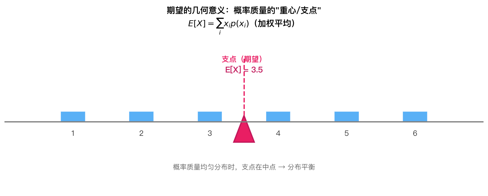
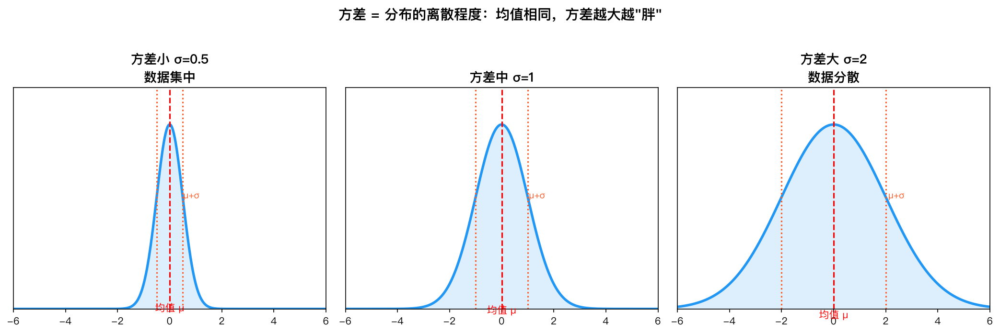
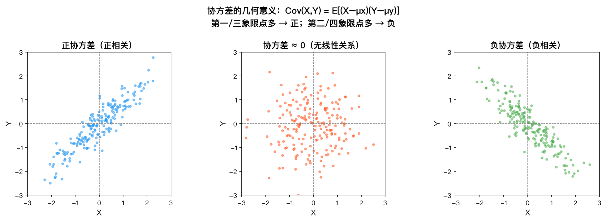

# 第7章 数学期望与矩——公式推导

---

## 1. 数学期望的定义

### 1.1 离散型随机变量

设离散型随机变量 $X$ 的概率质量函数为 $p(x)=P(X=x)$，则其数学期望（均值）定义为：

$$
\boxed{E[X] = \sum_{x} x \cdot p(x)}
$$

**条件**：该级数必须绝对收敛，即 $\sum_{x} |x| \cdot p(x) < \infty$，否则称期望不存在。

**解释**：期望就是概率加权平均。比如掷骰子，$X$ 取 $1,2,3,4,5,6$ 各以 $1/6$ 概率，则 $E[X] = \frac{1+2+3+4+5+6}{6} = 3.5$，即长期平均结果。

### 1.2 连续型随机变量

设连续型随机变量 $X$ 的概率密度函数为 $f(x)$，则其数学期望定义为：

$$
\boxed{E[X] = \int_{-\infty}^{\infty} x \cdot f(x) \, dx}
$$

**条件**：该积分必须绝对收敛，即 $\int_{-\infty}^{\infty} |x| f(x) \, dx < \infty$，否则期望不存在。

**推导思路**：将连续型视为离散型的极限。将 $(-\infty, \infty)$ 分割成小区间 $[x_i, x_i+\Delta x]$，则 $X$ 落在该区间的概率约为 $f(x_i)\Delta x$，加权平均 $\sum x_i f(x_i)\Delta x$，取极限 $\Delta x \to 0$ 即得积分形式。

*期望可以理解为分布密度函数（或概率质量）的"重心"位置：每个取值 $x$ 按概率 $p(x)$ 加权后，分布的"中心"落在 $E[X]$ 处。*

---

## 2. 随机变量函数的期望（LOTUS）

### 2.1 问题的提出

已知 $X$ 的分布，要求 $Y = g(X)$ 的期望 $E[Y]$。直观方法：先求 $Y$ 的分布，再求期望。但 LOTUS 告诉我们：可以直接用 $X$ 的分布计算。

### 2.2 离散型 LOTUS

$$
\boxed{E[g(X)] = \sum_{x} g(x) \cdot p(x)}
$$

**推导**：设 $Y = g(X)$，$Y$ 的概率质量函数为 $p_Y(y) = \sum_{x: g(x)=y} p_X(x)$。则

$$
E[Y] = \sum_{y} y \cdot p_Y(y) = \sum_{y} y \sum_{x: g(x)=y} p_X(x) = \sum_{y} \sum_{x: g(x)=y} g(x) p_X(x)
$$

由于对所有 $y$ 求和，且每个 $x$ 恰好对应一个 $y = g(x)$，双重求和遍历所有 $x$：

$$
E[Y] = \sum_{x} g(x) p_X(x)
$$

### 2.3 连续型 LOTUS

$$
\boxed{E[g(X)] = \int_{-\infty}^{\infty} g(x) \cdot f_X(x) \, dx}
$$

**推导**：设 $Y = g(X)$，其中 $g$ 是单调可微函数（严格单调以保证可逆）。$Y$ 的密度函数为：

$$
f_Y(y) = f_X(g^{-1}(y)) \cdot \left| \frac{d}{dy} g^{-1}(y) \right|
$$

则：

$$
E[Y] = \int_{-\infty}^{\infty} y \cdot f_Y(y) \, dy = \int_{-\infty}^{\infty} y \cdot f_X(g^{-1}(y)) \cdot \left| \frac{d}{dy} g^{-1}(y) \right| \, dy
$$

令 $x = g^{-1}(y)$，即 $y = g(x)$，则 $dy = g'(x) \, dx$，且 $\left| \frac{d}{dy} g^{-1}(y) \right| = \frac{1}{|g'(x)|}$，代入得：

$$
E[Y] = \int_{-\infty}^{\infty} g(x) \cdot f_X(x) \cdot \frac{1}{|g'(x)|} \cdot |g'(x)| \, dx = \int_{-\infty}^{\infty} g(x) f_X(x) \, dx
$$

对于非单调的 $g$，需将定义域分段，每段上单调，最终结果相同。因此 LOTUS 对任意（可测）函数 $g$ 成立。

---

## 3. 期望的线性性质

### 3.1 基本性质

$$
\boxed{E[aX + bY] = aE[X] + bE[Y]}
$$

其中 $a, b$ 为常数，$X, Y$ 为任意随机变量（不要求独立）。

### 3.2 离散型推导

设 $(X, Y)$ 的联合概率质量函数为 $p(x, y)$，则：

$$
\begin{aligned}
E[aX + bY] &= \sum_{x} \sum_{y} (ax + by) \cdot p(x, y) \\
&= \sum_{x} \sum_{y} ax \cdot p(x, y) + \sum_{x} \sum_{y} by \cdot p(x, y) \\
&= a \sum_{x} x \sum_{y} p(x, y) + b \sum_{y} y \sum_{x} p(x, y) \\
&= a \sum_{x} x \cdot p_X(x) + b \sum_{y} y \cdot p_Y(y) \\
&= aE[X] + bE[Y]
\end{aligned}
$$

其中第二步交换求和顺序利用了级数的线性性，第三步利用了边缘分布 $p_X(x) = \sum_y p(x,y)$，$p_Y(y) = \sum_x p(x,y)$。

### 3.3 连续型推导

设 $(X, Y)$ 的联合密度函数为 $f(x, y)$，则：

$$
\begin{aligned}
E[aX + bY] &= \int_{-\infty}^{\infty} \int_{-\infty}^{\infty} (ax + by) \cdot f(x, y) \, dx \, dy \\
&= a \int_{-\infty}^{\infty} \int_{-\infty}^{\infty} x f(x, y) \, dx \, dy + b \int_{-\infty}^{\infty} \int_{-\infty}^{\infty} y f(x, y) \, dx \, dy \\
&= a \int_{-\infty}^{\infty} x \left( \int_{-\infty}^{\infty} f(x, y) \, dy \right) dx + b \int_{-\infty}^{\infty} y \left( \int_{-\infty}^{\infty} f(x, y) \, dx \right) dy \\
&= a \int_{-\infty}^{\infty} x f_X(x) \, dx + b \int_{-\infty}^{\infty} y f_Y(y) \, dy \\
&= aE[X] + bE[Y]
\end{aligned}
$$

其中利用了二重积分的线性性和边缘密度 $f_X(x) = \int_{-\infty}^{\infty} f(x,y) dy$。

### 3.4 推广

由数学归纳法，线性性质可推广到任意有限个随机变量的线性组合：

$$
E\left[ \sum_{i=1}^{n} a_i X_i \right] = \sum_{i=1}^{n} a_i E[X_i]
$$

---

## 4. 方差与标准差

### 4.1 方差的定义

方差衡量随机变量围绕期望的离散程度：

$$
\boxed{\operatorname{Var}(X) = E\left[ (X - E[X])^2 \right]}
$$

### 4.2 方差的计算公式

由期望的线性性质，展开平方项：

$$
\begin{aligned}
\operatorname{Var}(X) &= E\left[ (X - E[X])^2 \right] \\
&= E\left[ X^2 - 2X E[X] + (E[X])^2 \right] \\
&= E[X^2] - 2E[X]E[X] + (E[X])^2 \quad (\text{因为 } E[X] \text{ 是常数}) \\
&= E[X^2] - 2(E[X])^2 + (E[X])^2 \\
&= \boxed{E[X^2] - (E[X])^2}
\end{aligned}
$$

**注意**：$E[X^2]$ 是 $X^2$ 的期望，由 LOTUS，$E[X^2] = \int x^2 f(x) dx$（连续型）或 $E[X^2] = \sum x^2 p(x)$（离散型），与 $(E[X])^2$ 不同。

*方差刻画分布围绕期望的离散程度：方差越小，取值越集中在期望附近；方差越大，分布越分散。*

### 4.3 方差的性质

对任意常数 $a, b$：

$$
\boxed{\operatorname{Var}(aX + b) = a^2 \operatorname{Var}(X)}
$$

**推导**：

$$
\begin{aligned}
\operatorname{Var}(aX + b) &= E\left[ ((aX + b) - E[aX + b])^2 \right] \\
&= E\left[ (aX + b - aE[X] - b)^2 \right] \quad (\text{期望线性性}) \\
&= E\left[ (aX - aE[X])^2 \right] \\
&= E\left[ a^2 (X - E[X])^2 \right] \\
&= a^2 E\left[ (X - E[X])^2 \right] \quad (\text{期望线性性}) \\
&= a^2 \operatorname{Var}(X)
\end{aligned}
$$

特别地，$\operatorname{Var}(X + b) = \operatorname{Var}(X)$，即平移不变性。

### 4.4 标准差

方差的量纲是 $X$ 量纲的平方。为统一量纲，定义标准差：

$$
\boxed{\operatorname{SD}(X) = \sqrt{\operatorname{Var}(X)}}
$$

---

## 5. 协方差与相关系数

### 5.1 协方差的定义

协方差衡量两个随机变量共同变动的程度：

$$
\boxed{\operatorname{Cov}(X, Y) = E\left[ (X - E[X])(Y - E[Y]) \right]}
$$

### 5.2 协方差的计算公式

展开乘积项，利用期望线性性：

$$
\begin{aligned}
\operatorname{Cov}(X, Y) &= E\left[ (X - E[X])(Y - E[Y]) \right] \\
&= E\left[ XY - XE[Y] - YE[X] + E[X]E[Y] \right] \\
&= E[XY] - E[X]E[Y] - E[Y]E[X] + E[X]E[Y] \\
&= \boxed{E[XY] - E[X]E[Y]}
\end{aligned}
$$

*协方差度量 $X$ 与 $Y$ 共同变动的方向与强度：二者同向偏离各自均值时乘积为正（正相关），反向偏离时乘积为负（负相关）。*

### 5.3 协方差的性质

**对称性**：

$$
\operatorname{Cov}(X, Y) = \operatorname{Cov}(Y, X)
$$

由定义直接可得。

**双线性性**：

$$
\boxed{\operatorname{Cov}(aX, bY) = ab \cdot \operatorname{Cov}(X, Y)}
$$

**推导**：

$$
\begin{aligned}
\operatorname{Cov}(aX, bY) &= E[(aX)(bY)] - E[aX]E[bY] \\
&= ab E[XY] - aE[X] \cdot bE[Y] \\
&= ab(E[XY] - E[X]E[Y]) \\
&= ab \cdot \operatorname{Cov}(X, Y)
\end{aligned}
$$

**和的协方差**：

$$
\boxed{\operatorname{Cov}(X + Y, Z) = \operatorname{Cov}(X, Z) + \operatorname{Cov}(Y, Z)}
$$

**推导**：

$$
\begin{aligned}
\operatorname{Cov}(X + Y, Z) &= E[(X + Y)Z] - E[X + Y]E[Z] \\
&= E[XZ + YZ] - (E[X] + E[Y])E[Z] \\
&= E[XZ] + E[YZ] - E[X]E[Z] - E[Y]E[Z] \\
&= (E[XZ] - E[X]E[Z]) + (E[YZ] - E[Y]E[Z]) \\
&= \operatorname{Cov}(X, Z) + \operatorname{Cov}(Y, Z)
\end{aligned}
$$

### 5.4 方差的和

$$
\boxed{\operatorname{Var}(X + Y) = \operatorname{Var}(X) + \operatorname{Var}(Y) + 2\operatorname{Cov}(X, Y)}
$$

**推导**：

$$
\begin{aligned}
\operatorname{Var}(X + Y) &= E\left[ ((X + Y) - E[X + Y])^2 \right] \\
&= E\left[ ((X - E[X]) + (Y - E[Y]))^2 \right] \\
&= E\left[ (X - E[X])^2 + (Y - E[Y])^2 + 2(X - E[X])(Y - E[Y]) \right] \\
&= E[(X - E[X])^2] + E[(Y - E[Y])^2] + 2E[(X - E[X])(Y - E[Y])] \\
&= \operatorname{Var}(X) + \operatorname{Var}(Y) + 2\operatorname{Cov}(X, Y)
\end{aligned}
$$

**推广**：对 $n$ 个随机变量：

$$
\operatorname{Var}\left( \sum_{i=1}^{n} X_i \right) = \sum_{i=1}^{n} \operatorname{Var}(X_i) + \sum_{i \neq j} \operatorname{Cov}(X_i, X_j)
$$

### 5.5 相关系数

相关系数将协方差标准化到 $[-1, 1]$ 区间，消除量纲影响：

$$
\boxed{\rho(X, Y) = \frac{\operatorname{Cov}(X, Y)}{\sqrt{\operatorname{Var}(X)} \sqrt{\operatorname{Var}(Y)}} = \frac{\operatorname{Cov}(X, Y)}{\sigma_X \sigma_Y}}
$$

### 5.6 证明 $|\rho| \leq 1$（Cauchy-Schwarz 不等式）

**Cauchy-Schwarz 不等式**：对任意随机变量 $U, V$，有：

$$
\boxed{(E[UV])^2 \leq E[U^2] \cdot E[V^2]}
$$

**证明**：考虑关于实数 $t$ 的二次函数：

$$
\varphi(t) = E[(U + tV)^2] = E[U^2] + 2tE[UV] + t^2E[V^2] \geq 0
$$

由于 $\varphi(t) \geq 0$ 对所有 $t$ 成立，其判别式必须非正：

$$
\Delta = (2E[UV])^2 - 4E[U^2]E[V^2] \leq 0
$$

即：

$$
4(E[UV])^2 \leq 4E[U^2]E[V^2] \quad \Rightarrow \quad (E[UV])^2 \leq E[U^2]E[V^2]
$$

**应用到相关系数**：令 $U = X - E[X]$，$V = Y - E[Y]$，则 $E[U] = 0$，$E[V] = 0$，$E[U^2] = \operatorname{Var}(X)$，$E[V^2] = \operatorname{Var}(Y)$，$E[UV] = \operatorname{Cov}(X, Y)$。代入 Cauchy-Schwarz 不等式：

$$
(\operatorname{Cov}(X, Y))^2 \leq \operatorname{Var}(X) \cdot \operatorname{Var}(Y)
$$

两边开方：

$$
|\operatorname{Cov}(X, Y)| \leq \sigma_X \sigma_Y
$$

除以 $\sigma_X \sigma_Y$ 得：

$$
\boxed{|\rho(X, Y)| \leq 1}
$$

**等号成立条件**：判别式 $\Delta = 0$，即存在 $t$ 使得 $U + tV = 0$ 几乎必然成立，即 $Y - E[Y] = -\frac{1}{t}(X - E[X])$，从而 $Y = aX + b$ 几乎必然成立（线性关系）。

---

## 6. 条件期望

### 6.1 离散型条件期望

在给定 $Y = y$ 的条件下，$X$ 的条件概率质量函数为 $p_{X|Y}(x|y) = \frac{p(x, y)}{p_Y(y)}$，条件期望为：

$$
\boxed{E[X \mid Y = y] = \sum_{x} x \cdot p_{X|Y}(x \mid y)}
$$

### 6.2 连续型条件期望

在给定 $Y = y$ 的条件下，$X$ 的条件密度函数为 $f_{X|Y}(x|y) = \frac{f(x, y)}{f_Y(y)}$，条件期望为：

$$
\boxed{E[X \mid Y = y] = \int_{-\infty}^{\infty} x \cdot f_{X|Y}(x \mid y) \, dx}
$$

### 6.3 全期望公式（Law of Total Expectation）

$$
\boxed{E[X] = E[E[X \mid Y]]}
$$

**离散型推导**：

$$
\begin{aligned}
E[X] &= \sum_{x} x \cdot p_X(x) \\
&= \sum_{x} x \sum_{y} p(x, y) \quad (\text{边缘分布}) \\
&= \sum_{x} x \sum_{y} p_{X|Y}(x|y) p_Y(y) \quad (\text{条件概率公式}) \\
&= \sum_{y} \left( \sum_{x} x \cdot p_{X|Y}(x|y) \right) p_Y(y) \quad (\text{交换求和顺序}) \\
&= \sum_{y} E[X \mid Y = y] \cdot p_Y(y) \\
&= E[E[X \mid Y]]
\end{aligned}
$$

**连续型推导**：

$$
\begin{aligned}
E[X] &= \int_{-\infty}^{\infty} x f_X(x) \, dx \\
&= \int_{-\infty}^{\infty} x \left( \int_{-\infty}^{\infty} f(x, y) \, dy \right) dx \\
&= \int_{-\infty}^{\infty} \int_{-\infty}^{\infty} x \cdot f_{X|Y}(x|y) f_Y(y) \, dy \, dx \quad (\text{条件密度}) \\
&= \int_{-\infty}^{\infty} \left( \int_{-\infty}^{\infty} x \cdot f_{X|Y}(x|y) \, dx \right) f_Y(y) \, dy \quad (\text{交换积分顺序}) \\
&= \int_{-\infty}^{\infty} E[X \mid Y = y] \cdot f_Y(y) \, dy \\
&= E[E[X \mid Y]]
\end{aligned}
$$

### 6.4 全方差公式（Law of Total Variance）

$$
\boxed{\operatorname{Var}(X) = \operatorname{Var}(E[X \mid Y]) + E[\operatorname{Var}(X \mid Y)]}
$$

**推导**：

首先，条件方差定义为 $\operatorname{Var}(X \mid Y) = E[(X - E[X \mid Y])^2 \mid Y]$。

由方差公式 $\operatorname{Var}(X) = E[X^2] - (E[X])^2$，以及全期望公式：

$$
\begin{aligned}
\operatorname{Var}(X) &= E[X^2] - (E[X])^2 \\
&= E[E[X^2 \mid Y]] - (E[E[X \mid Y]])^2
\end{aligned}
$$

而 $E[X^2 \mid Y] = \operatorname{Var}(X \mid Y) + (E[X \mid Y])^2$，代入：

$$
\begin{aligned}
\operatorname{Var}(X) &= E[\operatorname{Var}(X \mid Y) + (E[X \mid Y])^2] - (E[E[X \mid Y]])^2 \\
&= E[\operatorname{Var}(X \mid Y)] + E[(E[X \mid Y])^2] - (E[E[X \mid Y]])^2
\end{aligned}
$$

注意到 $E[(E[X \mid Y])^2] - (E[E[X \mid Y]])^2 = \operatorname{Var}(E[X \mid Y])$，因此：

$$
\boxed{\operatorname{Var}(X) = E[\operatorname{Var}(X \mid Y)] + \operatorname{Var}(E[X \mid Y])}
$$

**解释**：总方差 = 组内方差（条件方差的期望）+ 组间方差（条件期望的方差）。这类似于方差分析中的平方和分解。

---

## 7. 矩

### 7.1 原点矩

$k$ 阶原点矩定义为：

$$
\boxed{\mu_k' = E[X^k]}
$$

其中 $\mu_1' = E[X]$ 就是期望（一阶原点矩）。

### 7.2 中心矩

$k$ 阶中心矩定义为：

$$
\boxed{\mu_k = E[(X - \mu)^k]}
$$

其中 $\mu = E[X]$。特别地：

- $\mu_1 = E[X - \mu] = 0$（一阶中心矩恒为 0）
- $\mu_2 = \operatorname{Var}(X)$（二阶中心矩就是方差）
- $\mu_3 = E[(X - \mu)^3]$（三阶中心矩，用于偏度）
- $\mu_4 = E[(X - \mu)^4]$（四阶中心矩，用于峰度）

### 7.3 原点矩与中心矩的关系

利用二项式定理展开：

$$
\begin{aligned}
\mu_k &= E[(X - \mu)^k] \\
&= E\left[ \sum_{j=0}^{k} \binom{k}{j} X^j (-\mu)^{k-j} \right] \\
&= \sum_{j=0}^{k} \binom{k}{j} (-\mu)^{k-j} E[X^j] \\
&= \sum_{j=0}^{k} \binom{k}{j} (-\mu)^{k-j} \mu_j'
\end{aligned}
$$

特别地：

$$
\begin{aligned}
\mu_2 &= \mu_2' - \mu^2 \quad (\text{即 } \operatorname{Var}(X) = E[X^2] - (E[X])^2) \\
\mu_3 &= \mu_3' - 3\mu\mu_2' + 2\mu^3 \\
\mu_4 &= \mu_4' - 4\mu\mu_3' + 6\mu^2\mu_2' - 3\mu^4
\end{aligned}
$$

### 7.4 偏度（Skewness）

偏度衡量分布的不对称程度：

$$
\boxed{\text{Skewness} = \frac{\mu_3}{\sigma^3}}
$$

- 偏度 = 0：分布对称（如正态分布）
- 偏度 > 0：右偏（正偏），右侧尾部更长
- 偏度 < 0：左偏（负偏），左侧尾部更长

### 7.5 峰度（Kurtosis）

峰度衡量分布的尾部厚度：

$$
\boxed{\text{Kurtosis} = \frac{\mu_4}{\sigma^4} - 3}
$$

减 3 是为了使正态分布的峰度为 0（称为"超值峰度"或 excess kurtosis）：

- 峰度 = 0：正态分布
- 峰度 > 0：尖峰厚尾（如 $t$ 分布）
- 峰度 < 0：低峰薄尾（如均匀分布）

---

## 8. 矩母函数（MGF）

### 8.1 定义

随机变量 $X$ 的矩母函数（Moment Generating Function, MGF）定义为：

$$
\boxed{M_X(t) = E[e^{tX}]}
$$

其中 $t$ 是实数参数，要求 $M_X(t)$ 在 $t=0$ 的某个邻域内有限。

**离散型**：

$$
M_X(t) = \sum_{x} e^{tx} p(x)
$$

**连续型**：

$$
M_X(t) = \int_{-\infty}^{\infty} e^{tx} f(x) \, dx
$$

### 8.2 MGF 生成矩

MGF 之所以得名，是因为它可以通过求导生成各阶矩：

$$
\boxed{E[X^k] = M_X^{(k)}(0)}
$$

其中 $M_X^{(k)}(0)$ 是 $M_X(t)$ 在 $t=0$ 处的 $k$ 阶导数。

**推导**：将 $e^{tX}$ 在 $t=0$ 处泰勒展开：

$$
e^{tX} = \sum_{k=0}^{\infty} \frac{(tX)^k}{k!} = \sum_{k=0}^{\infty} \frac{X^k}{k!} t^k
$$

代入期望（在收敛半径内可以交换求和与期望顺序）：

$$
\begin{aligned}
M_X(t) &= E[e^{tX}] = E\left[ \sum_{k=0}^{\infty} \frac{X^k}{k!} t^k \right] \\
&= \sum_{k=0}^{\infty} \frac{E[X^k]}{k!} t^k \\
&= \sum_{k=0}^{\infty} \frac{\mu_k'}{k!} t^k
\end{aligned}
$$

因此 $M_X(t)$ 的泰勒展开系数为 $\frac{E[X^k]}{k!}$。由幂级数性质，$k$ 阶导数在 $t=0$ 处的值为：

$$
M_X^{(k)}(0) = \left. \frac{d^k}{dt^k} \left( \sum_{k=0}^{\infty} \frac{E[X^k]}{k!} t^k \right) \right|_{t=0} = E[X^k]
$$

具体地：

$$
\begin{aligned}
M_X'(t) &= E[X e^{tX}], \quad M_X'(0) = E[X] \\
M_X''(t) &= E[X^2 e^{tX}], \quad M_X''(0) = E[X^2]
\end{aligned}
$$

### 8.3 独立随机变量和的 MGF

若 $X$ 与 $Y$ 独立，则：

$$
\boxed{M_{X+Y}(t) = M_X(t) \cdot M_Y(t)}
$$

**推导**：

$$
\begin{aligned}
M_{X+Y}(t) &= E[e^{t(X+Y)}] \\
&= E[e^{tX} e^{tY}] \\
&= E[e^{tX}] \cdot E[e^{tY}] \quad (\text{独立性：乘积的期望等于期望的乘积}) \\
&= M_X(t) \cdot M_Y(t)
\end{aligned}
$$

**推广**：若 $X_1, X_2, \ldots, X_n$ 相互独立，则：

$$
M_{X_1 + X_2 + \cdots + X_n}(t) = \prod_{i=1}^{n} M_{X_i}(t)
$$

### 8.4 线性变换的 MGF

$$
\boxed{M_{aX+b}(t) = e^{bt} M_X(at)}
$$

**推导**：

$$
M_{aX+b}(t) = E[e^{t(aX+b)}] = E[e^{atX} \cdot e^{bt}] = e^{bt} E[e^{(at)X}] = e^{bt} M_X(at)
$$

---

## 9. 特征函数（Characteristic Function）

### 9.1 定义

特征函数是 MGF 的复变函数版本，将 $t$ 替换为 $it$：

$$
\boxed{\varphi_X(t) = E[e^{itX}] = E[\cos(tX)] + iE[\sin(tX)]}
$$

其中 $i = \sqrt{-1}$ 是虚数单位。

**离散型**：

$$
\varphi_X(t) = \sum_{x} e^{itx} p(x)
$$

**连续型**：

$$
\varphi_X(t) = \int_{-\infty}^{\infty} e^{itx} f(x) \, dx
$$

### 9.2 特征函数与 MGF 的关系

利用复变函数知识，特征函数就是 MGF 在纯虚数轴上的取值：

$$
\boxed{\varphi_X(t) = M_X(it)}
$$

### 9.3 特征函数总是存在

与 MGF 不同，特征函数对任意随机变量都存在。原因：$|e^{itX}| = |\cos(tX) + i\sin(tX)| = \sqrt{\cos^2(tX) + \sin^2(tX)} = 1$，因此：

$$
| \varphi_X(t) | = |E[e^{itX}]| \leq E[|e^{itX}|] = E[1] = 1
$$

即特征函数被 1 控制，绝不会发散。而 MGF 中的 $e^{tX}$ 可能增长过快导致积分发散。

### 9.4 基本性质

**线性变换**：

$$
\boxed{\varphi_{aX+b}(t) = e^{itb} \varphi_X(at)}
$$

**推导**：

$$
\varphi_{aX+b}(t) = E[e^{it(aX+b)}] = E[e^{iatX} \cdot e^{itb}] = e^{itb} E[e^{i(at)X}] = e^{itb} \varphi_X(at)
$$

**独立随机变量和**：若 $X$ 与 $Y$ 独立，则：

$$
\boxed{\varphi_{X+Y}(t) = \varphi_X(t) \cdot \varphi_Y(t)}
$$

**推导**：

$$
\varphi_{X+Y}(t) = E[e^{it(X+Y)}] = E[e^{itX} e^{itY}] = E[e^{itX}] \cdot E[e^{itY}] = \varphi_X(t) \varphi_Y(t)
$$

### 9.5 特征函数与矩的关系

将 $e^{itX}$ 泰勒展开：

$$
e^{itX} = \sum_{k=0}^{\infty} \frac{(itX)^k}{k!} = \sum_{k=0}^{\infty} \frac{(it)^k}{k!} X^k
$$

取期望：

$$
\varphi_X(t) = \sum_{k=0}^{\infty} \frac{(it)^k}{k!} E[X^k]
$$

因此：

$$
\boxed{E[X^k] = \frac{1}{i^k} \cdot \varphi_X^{(k)}(0)}
$$

其中 $\varphi_X^{(k)}(0)$ 是 $\varphi_X(t)$ 在 $t=0$ 处的 $k$ 阶导数。

### 9.6 反转公式（唯一性）

特征函数与分布一一对应。即，若 $\varphi_X(t) = \varphi_Y(t)$ 对所有 $t$ 成立，则 $X$ 和 $Y$ 同分布。

**反转公式**（连续型）：

$$
\boxed{f(x) = \frac{1}{2\pi} \int_{-\infty}^{\infty} e^{-itx} \varphi_X(t) \, dt}
$$

这实际上就是傅里叶逆变换。特征函数 $\varphi_X(t)$ 是密度函数 $f(x)$ 的傅里叶变换（相差一个符号约定）。

---

## 总结：核心公式一览

| 概念 | 公式 |
|-----|------|
| 期望（离散） | $\boxed{E[X] = \sum x \cdot p(x)}$ |
| 期望（连续） | $\boxed{E[X] = \int_{-\infty}^{\infty} x f(x) dx}$ |
| LOTUS | $\boxed{E[g(X)] = \int g(x) f(x) dx}$ |
| 线性性 | $\boxed{E[aX+bY] = aE[X] + bE[Y]}$ |
| 方差 | $\boxed{\operatorname{Var}(X) = E[(X-\mu)^2] = E[X^2] - \mu^2}$ |
| 协方差 | $\boxed{\operatorname{Cov}(X,Y) = E[(X-\mu_X)(Y-\mu_Y)] = E[XY] - \mu_X\mu_Y}$ |
| 相关系数 | $\boxed{\rho(X,Y) = \frac{\operatorname{Cov}(X,Y)}{\sigma_X\sigma_Y}}$，$|\rho| \leq 1$ |
| 全期望 | $\boxed{E[X] = E[E[X \mid Y]]}$ |
| 全方差 | $\boxed{\operatorname{Var}(X) = \operatorname{Var}(E[X \mid Y]) + E[\operatorname{Var}(X \mid Y)]}$ |
| 偏度 | $\boxed{\text{Skewness} = \mu_3 / \sigma^3}$ |
| 峰度 | $\boxed{\text{Kurtosis} = \mu_4 / \sigma^4 - 3}$ |
| MGF | $\boxed{M_X(t) = E[e^{tX}]}$，$E[X^k] = M_X^{(k)}(0)$ |
| 特征函数 | $\boxed{\varphi_X(t) = E[e^{itX}]}$，$\varphi_{X+Y}(t) = \varphi_X(t)\varphi_Y(t)$ |