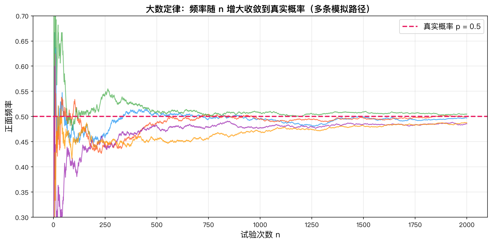
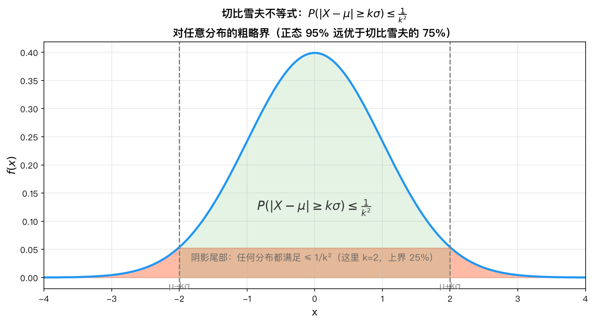
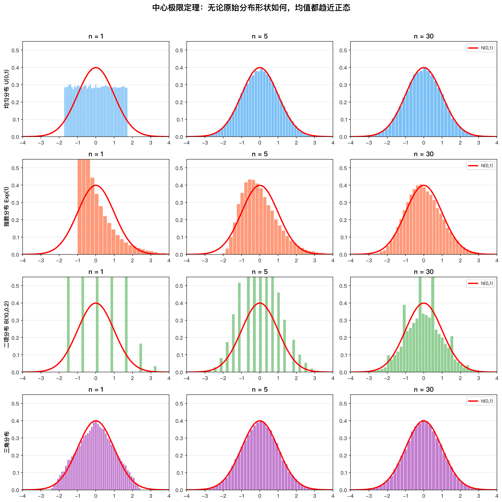
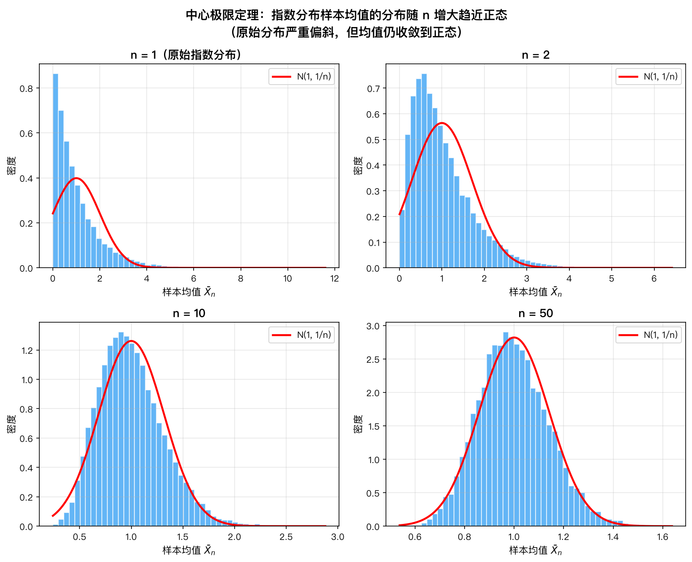

# 第8章 大数定律与中心极限定理——知识讲解

---

> **本章内容**
> 
> 1. 为什么需要大数定律？
> 2. 切比雪夫不等式的意义
> 3. 弱大数定律 vs 强大数定律
> 4. 中心极限定理为什么重要
> 5. CLT的直观理解
> 6. CLT的应用
> 7. 特征函数证明CLT的思路
> 8. 总结：知识体系图

### 承上启下

上一章学习了期望、方差等数字特征。但一个根本问题还没回答：为什么样本均值能代表总体均值？为什么正态分布在自然界中无处不在？本章回答这些问题，它们是概率论走向统计推断的桥梁。

### 问题导向

带着以下问题学习本章，你会更有方向感：

1. **抛硬币1000次，正面频率为什么接近1/2？这是必然的吗？**
2. **为什么正态分布如此普遍——身高、体重、考试成绩、测量误差都近似服从正态分布？**
3. **民意调查中，1000个样本就能代表全国14亿人的意见，这背后的数学原理是什么？**

---

## 一、为什么需要大数定律？

### 直观背景

考虑一个最简单的实验：抛一枚均匀硬币，记正面为1，反面为0。抛一次时，结果可能是1或0，与"平均值0.5"相差甚远。抛10次时，正面频率可能在0.3~0.7之间。抛1000次时，正面频率非常接近0.5。

这种"随着实验次数增加，频率趋于概率"的直觉，在数学上需要严格表述和证明。大数定律正是完成这个任务的。

### 为什么需要严格化？

直觉告诉我们频率会趋于概率，但直觉不是数学。我们需要回答以下问题：

1. **"趋于"是什么意思？** 是概率意义上的趋于，还是其他意义上的？
2. **需要什么条件？** 是否所有随机变量都满足？方差无限时是否成立？
3. **收敛速度有多快？** 需要多少次实验才能达到想要的精度？

大数定律给出了这些问题的精确回答。

### 统计学的理论基础

大数定律是统计学的理论基石，因为它回答了"为什么样本能代表总体"：

- 样本均值 $\bar{X}_n$ 是总体均值 $\mu$ 的估计量
- 大数定律保证当样本量足够大时，这个估计是可靠的
- 没有大数定律，基于样本的统计推断就没有理论依据



*大数定律的直观背景：随着试验次数增多，频率趋于概率、样本均值趋于总体均值，这正是统计学"以样本推断总体"的根据。*

---

## 二、切比雪夫不等式的意义

### 是什么

切比雪夫不等式给出了一个通用概率上界：

$$
P(|X-\mu| \ge \varepsilon) \le \frac{\sigma^2}{\varepsilon^2}
$$

### 为什么重要

1. **无需知道分布**：只需要均值和方差，不需要知道 $X$ 服从什么分布
2. **普适性强**：对任何方差有限的随机变量都成立
3. **理论工具**：是证明大数定律的关键工具

### 有多精确

切比雪夫不等式给出的上界通常比较宽松。例如：

- 若 $X \sim N(\mu, \sigma^2)$，则 $P(|X-\mu| \ge 2\sigma) \approx 0.0455$，但切比雪夫给出 $\le 1/4 = 0.25$
- 若 $X \sim U(a,b)$（均匀分布），则 $P(|X-\mu| \ge 2\sigma) = 0$（因为均匀分布没有超出 $2\sigma$ 的值），但切比雪夫仍然给出 $\le 0.25$

### 等价形式

$$
P(|X-\mu| \ge k\sigma) \le \frac{1}{k^2}
$$

这个形式告诉我们：
- $k=2$：偏离超过2个标准差的概率不超过25%
- $k=3$：偏离超过3个标准差的概率不超过11.1%
- $k=10$：偏离超过10个标准差的概率不超过1%

### 怎么做：使用步骤

1. 确认随机变量 $X$ 的期望 $\mu$ 和方差 $\sigma^2$ 已知（或可计算）
2. 确定 $\varepsilon$ 的值（或 $k$ 的值）
3. 代入公式 $P(|X-\mu| \ge \varepsilon) \le \sigma^2/\varepsilon^2$ 计算上界



*切比雪夫不等式刻画：无论分布如何，$X$ 偏离均值超过 $k$ 个标准差的概率不超过 $1/k^2$，偏离越远概率越小。*

---

## 三、弱大数定律 vs 强大数定律

### 弱大数定律

**结论**：$\bar{X}_n \xrightarrow{P} \mu$

**含义**：对任意 $\varepsilon>0$，当 $n$ 足够大时，$\bar{X}_n$ 偏离 $\mu$ 超过 $\varepsilon$ 的概率可以任意小。

**通俗理解**：随着实验次数增加，样本均值与总体均值有较大偏差的可能性越来越小。但每次实验仍然是独立的，理论上偶尔还是可能出现大的偏差。

### 强大数定律

**结论**：$\bar{X}_n \xrightarrow{a.s.} \mu$

**含义**：$\bar{X}_n$ 以概率1收敛到 $\mu$，即几乎所有的样本序列都收敛到 $\mu$。

**通俗理解**：如果你做无数次实验（得到一条无限长的样本序列），那么这条序列的样本均值最终会收敛到 $\mu$ 并且保持在那里。几乎所有的样本序列都是这样的。

### 区别的直观例子

想象你在一张靶纸上射箭，箭的位置是 $\bar{X}_n$，靶心是 $\mu$。

- **弱大数定律**：随着 $n$ 增大，射偏（$|\bar{X}_n-\mu|>\varepsilon$）的概率趋于0。但某一次射偏还是可能的。
- **强大数定律**：几乎可以肯定，当你射了足够多次后，你的箭会一直落在靶心附近，不会再飞出去。

### 需要什么条件

| 定律                 | 条件                   |
| ------------------ | -------------------- |
| 弱大数定律（切比雪夫版）       | i.i.d.，方差有限          |
| 弱大数定律（Khinchin版）   | i.i.d.，期望存在（不需要方差有限） |
| 强大数定律（Kolmogorov版） | i.i.d.，期望绝对可积        |

### 哪个更强

强大数定律更强。强大数定律 $\Rightarrow$ 弱大数定律，但反之不成立。实际上，"几乎必然收敛"是一个比"依概率收敛"更强的概念。

---

## 四、中心极限定理为什么重要

### 1. 它解释了正态分布的普遍性

为什么自然科学和社会科学中到处都出现正态分布？中心极限定理给出了答案：任何多个独立随机变量之和（适当标准化后）都趋近正态分布。

这意味着：
- 测量误差（多个微小误差的叠加）服从正态分布
- 人的身高（受多个基因和环境因素影响）服从正态分布
- 考试成绩（多个知识点的综合）近似服从正态分布

### 2. 大样本近似的理论依据

中心极限定理告诉我们：当样本量足够大时，可以用正态分布近似各种统计量的分布。

这在实践中极为重要，因为：
- 正态分布有完善的数学性质
- 正态分布的概率可以查表或通过数值方法计算
- 很多统计方法（t检验、ANOVA等）都基于正态性假设

### 3. 统计推断的基础

- **置信区间**：$\bar{X} \pm z_{\alpha/2} \cdot \frac{\sigma}{\sqrt{n}}$ 的公式基于CLT
- **假设检验**：z检验和t检验的理论基础是CLT
- **样本量确定**：确定样本量时需要用到CLT来估计误差

### 4. 蒙特卡洛模拟的理论基础

在蒙特卡洛模拟中，我们通过大量随机样本来估计某个量。CLT保证了：

$$
\sqrt{n}(\hat{\theta}_n - \theta) \xrightarrow{d} N(0, \sigma^2)
$$

其中 $\hat{\theta}_n$ 是 $\theta$ 的估计量。这使我们能够给出模拟结果的误差范围。

---

## 五、CLT的直观理解

### 核心思想

中心极限定理的核心思想可以这样理解：

**每个随机变量贡献一小部分，当 $n$ 足够大时，这些贡献叠加后呈现出正态分布的特征。**

### 逐步理解

1. **单个随机变量**：$X_i$ 可能有任意分布（偏态、双峰、均匀等）
2. **部分和**：$S_n = X_1 + \cdots + X_n$，每个 $X_i$ 贡献 $1/n$ 到总和中
3. **标准化**：减去期望 $n\mu$，除以标准差 $\sigma\sqrt{n}$，使结果均值为0、方差为1
4. **极限分布**：当 $n$ 足够大时，标准化后的分布趋近标准正态

### 直觉类比

想象你在一家餐馆随机点菜：
- 一道菜的价格是随机的（可能有偏分布）
- 但如果你点很多道菜，总价就近似正态分布
- 每道菜的价格对总价的贡献微乎其微
- 大量独立随机因素的叠加导致正态性

### 不依赖于原始分布

这是CLT最神奇的地方：**无论 $X_i$ 服从什么分布（只要方差有限），$Z_n$ 都趋向标准正态分布。**

这意味着：
- 即使 $X_i$ 服从偏态分布，$S_n$ 也会近似正态
- 即使 $X_i$ 服从双峰分布，$S_n$ 也会近似正态
- 即使 $X_i$ 服从均匀分布，$S_n$ 也会近似正态



*CLT"魔法"：四种完全不同的原始分布（均匀/指数/二项/三角），n=1 时各自不同，但随着 n=5、n=30，标准化均值全部趋近标准正态分布（红色曲线）*

### 收敛速度

收敛到正态的速度取决于原始分布的形状：
- 对称分布（如均匀分布）：收敛很快，$n=10$ 就接近正态
- 偏态分布（如指数分布）：收敛较慢，可能需要 $n>30$
- 重尾分布（如柯西分布，方差无限）：CLT不成立



*CLT的直观理解：即使原始分布 $X_i$ 完全不是正态，当 $n$ 增大（如 $n=1,2,10,50$）时，标准化后的样本均值分布也逐步趋近标准正态。*

---

## 六、CLT的应用

### 1. 二项分布的正态近似

当 $n$ 较大时，$B(n,p)$ 可以用 $N(np, npq)$ 近似。

**应用条件**：通常要求 $np \ge 5$ 且 $nq \ge 5$（或 $npq \ge 10$）。

**示例**：抛一枚均匀硬币100次，求正面次数在45~55之间的概率。
- 精确值：$P(45 \le X \le 55) = \sum_{k=45}^{55} C_{100}^k (0.5)^{100}$
- 近似值：$X \sim N(50, 25)$，$P(45 \le X \le 55) \approx \Phi(1) - \Phi(-1) = 0.6827$

### 2. 置信区间的基础

总体均值 $\mu$ 的 $95\%$ 置信区间：
$$
\bar{X} \pm 1.96 \cdot \frac{\sigma}{\sqrt{n}}
$$

这个公式源自CLT：$\frac{\bar{X} - \mu}{\sigma/\sqrt{n}} \approx N(0,1)$，所以 $P(-1.96 \le \frac{\bar{X} - \mu}{\sigma/\sqrt{n}} \le 1.96) \approx 0.95$。

### 3. 假设检验的基础

在检验 $H_0: \mu = \mu_0$ 时，检验统计量：
$$
Z = \frac{\bar{X} - \mu_0}{\sigma/\sqrt{n}} \approx N(0,1)
$$

由CLT保证，当样本量足够大时，这个近似成立。

### 4. 蒙特卡洛模拟的误差估计

假设我们要通过蒙特卡洛模拟估计 $\theta = E[g(X)]$，用 $\hat{\theta}_n = \frac{1}{n}\sum_{i=1}^{n} g(X_i)$ 来估计。

CLT给出：
$$
\frac{\hat{\theta}_n - \theta}{\sigma_g/\sqrt{n}} \xrightarrow{d} N(0,1)
$$

其中 $\sigma_g^2 = \operatorname{Var}(g(X))$。因此模拟误差的 $95\%$ 置信区间为 $\pm 1.96 \cdot \sigma_g/\sqrt{n}$。

---

## 七、特征函数证明CLT的思路

### 为什么用特征函数？

直接证明分布收敛需要处理分布函数的极限，通常很复杂。特征函数方法巧妙地将问题转化为：

$$
\underbrace{\text{分布收敛}}_{\text{概率问题}} \quad \Longleftrightarrow \quad \underbrace{\text{特征函数收敛}}_{\text{分析问题}}
$$

### 证明的逻辑链条

1. **第一步**：标准化，将问题转化为 $Z_n = \sum Y_i/\sqrt{n}$，其中 $E[Y_i]=0$，$\operatorname{Var}(Y_i)=1$

2. **第二步**：写出 $Z_n$ 的特征函数 $\varphi_{Z_n}(t) = [\varphi_Y(t/\sqrt{n})]^n$

3. **第三步**：对 $\varphi_Y(t)$ 在 $t=0$ 处泰勒展开到二阶：
   $$
   \varphi_Y(t) = 1 - \frac{t^2}{2} + o(t^2)
   $$

4. **第四步**：代入 $t/\sqrt{n}$：
   $$
   \varphi_Y(t/\sqrt{n}) = 1 - \frac{t^2}{2n} + o\left(\frac{1}{n}\right)
   $$

5. **第五步**：取极限：
   $$
   \lim_{n\to\infty} \varphi_{Z_n}(t) = \lim_{n\to\infty} \left[1 - \frac{t^2}{2n} + o\left(\frac{1}{n}\right)\right]^n = e^{-t^2/2}
   $$

6. **第六步**：识别出 $e^{-t^2/2}$ 是标准正态的特征函数，由唯一性得证

### 关键洞察

- **泰勒展开**：将特征函数展开到二阶，利用 $E[Y]=0$ 消去一阶项，$E[Y^2]=1$ 得到二阶项
- **极限公式**：$\lim_{n\to\infty} (1 + a_n/n)^n = e^a$，这是复变函数中的经典极限
- **唯一性**：Levy 连续性定理保证了特征函数和分布函数的一一对应

### 复变函数在概率论中的应用

这个证明是复变函数方法在概率论中的重要应用示例：
- 特征函数本质上是傅里叶变换在概率论中的版本
- 泰勒展开用在复变函数中同样成立
- 复指数 $e^{itX}$ 的期望运算具有良好的分析性质

---

## 八、总结：知识体系图

```
马尔可夫不等式
    ↓ (令 Y=(X-μ)²)
切比雪夫不等式
    ↓ (应用于样本均值)
弱大数定律 (WLLN)
    ↓ (更强的收敛)
强大数定律 (SLLN)
    
独立同分布随机变量和
    ↓ (标准化)
中心极限定理 (CLT)
    ↓ (特例：二项分布)
棣莫弗-拉普拉斯定理
```

### 核心脉络

1. **不等式**（马尔可夫 → 切比雪夫）：提供概率上界
2. **大数定律**（弱 → 强）：样本均值收敛到总体均值
3. **中心极限定理**：标准化和的极限分布是正态分布

这三个层次构成了概率论中极限理论的核心框架，也是从概率论过渡到数理统计的桥梁。

### 本章应掌握的内容

学完本章后，你应该能回答以下问题：

1. 你能写出切比雪夫不等式并解释其含义吗？
2. 你能用切比雪夫不等式证明弱大数定律吗？
3. 你能说出弱大数定律和强大数定律的区别吗？
4. 你能写出中心极限定理的数学表达式吗？
5. 你能用CLT近似计算二项分布的概率吗？
6. 你能理解CLT的特征函数证明思路吗？
7. 你知道棣莫弗-拉普拉斯定理是什么吗？